## Introduction

[Arduino Cloud for Schools](https://cloud.arduino.cc/schools/) helps teachers introduce, manage, and facilitate Arduino STEAM projects in their classroom.

<Alert type="info">

To get started with Arduino Cloud, you need an [Arduino account](https://login.arduino.cc/login). If you don't have one yet, follow [Create an Arduino account](https://support.arduino.cc/hc/en-us/articles/360016724040-Create-an-Arduino-account) for step-by-step instructions.

</Alert>

## Goals

- Get an overview of the Arduino Cloud tools that are most useful in an educational context.
- See how Arduino Cloud can enhance both teaching and learning of coding, electronics, and IoT projects.

## Platform for Educators

Arduino Cloud covers the basic needs of a teacher who wants to bring hands-on learning into the classroom using Arduino educational kits or hardware.

**Easy-to-use platform**

The Arduino Cloud **Home** page is designed to give absolute beginners a simple and straightforward experience, with **Quick Actions** and a **Sidebar** that lead to every tool.

**Code online using the Cloud Editor**

The **Cloud Editor** gets students coding quickly, directly in the browser. Instant results motivate students to go further and progress through active learning pathways.

**Get started with IoT projects quickly**

Arduino Cloud makes creating connected objects quick, simple, and secure. You can connect multiple **devices**, let them exchange real-time data, and visualize the data in interactive **dashboards**. Ready-made **Templates** get a project up and running in a few minutes.

**Access rich learning content**

Finding a starting point can be daunting, especially when you're new to Arduino and short on time to prepare a lesson. **Courses** offer over 30 different **lessons** and **projects** across various age groups and grades.

**Organize, manage, and track student progress**

**Shared spaces** make it easier to manage your classroom and collaborate. In a shared space, you can keep track of your students' projects and share learning materials with them.

## Cloud Home

The **Home** page works like a control panel, where you can access all the important functionality of the platform. From here, you can create, monitor, and navigate to the different areas of Arduino Cloud.

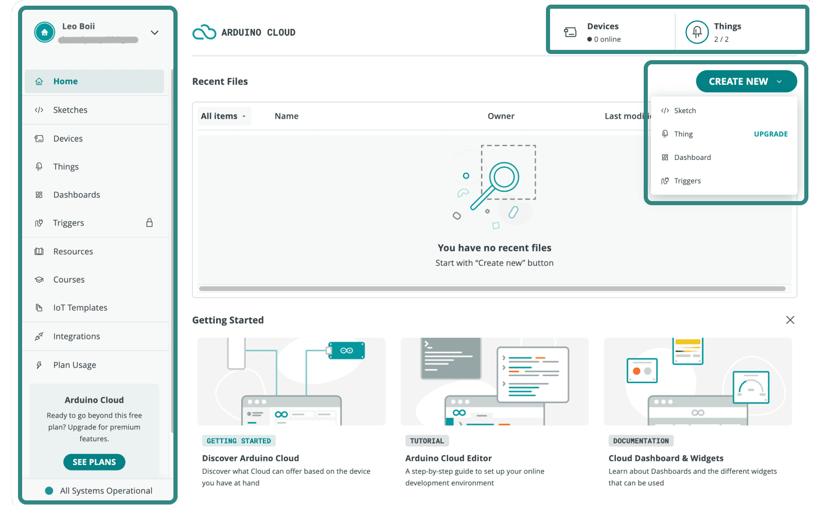

### Quick Actions

**Devices** and **Things** show how many devices and Things are linked to your Arduino Cloud account.

The **Create New** button lets you quickly create sketches and dashboards, or add new devices.

### Sidebar

The **Sidebar** on the left gives quick access to all the important tools:

- **Sketches:** the programs you and your students create. You can access them from any computer. See [Sketchbook & Sketches](/arduino-cloud/sketches-editor/sketchbook-and-sketches).
- **Devices, Things, Dashboards, and Triggers:** the core of the platform, used to build IoT projects that collect, analyze, and monitor data from the environment. See [Devices Overview](/arduino-cloud/devices/devices-overview), [Things](/arduino-cloud/things-data/things), [Working With Dashboards](/arduino-cloud/dashboards/dashboards), and [Triggers & Alerts](/arduino-cloud/automations/triggers-and-alerts).
- **Resources, Courses, and Templates:** learning materials and ready-made IoT projects to get you started with your educational kits or other Arduino hardware. See [Use Templates](/arduino-cloud/templates/use-templates).
- **Integrations:** connect your projects to third-party services. See [Integrations Overview](/arduino-cloud/integrations/integrations-overview).
- **Plan Usage:** track how much of your plan you are using. See [Plans, Limits & Quotas](/arduino-cloud/spaces-plans-account/plans-limits-quotas).

If you're new to the platform, try the interactive walkthrough for a faster onboarding experience.

## Cloud Editor

The **Cloud Editor** lets you **write code** and **upload sketches** to any Arduino board from the browser, after installing the [Cloud Agent](/arduino-cloud/devices/cloud-agent). Your sketches are stored in Arduino Cloud and accessible from any computer. You can use it to create both basic and IoT sketches.

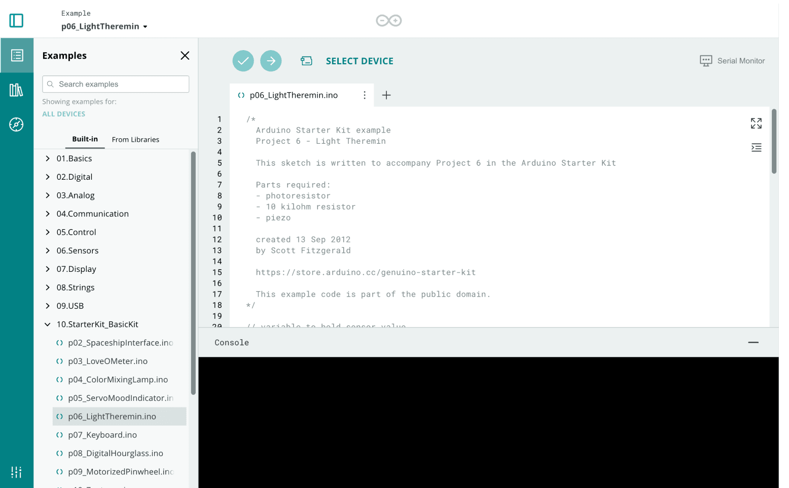

You can **download** your sketch as a `.zip` file or sort your sketches into **folders**.

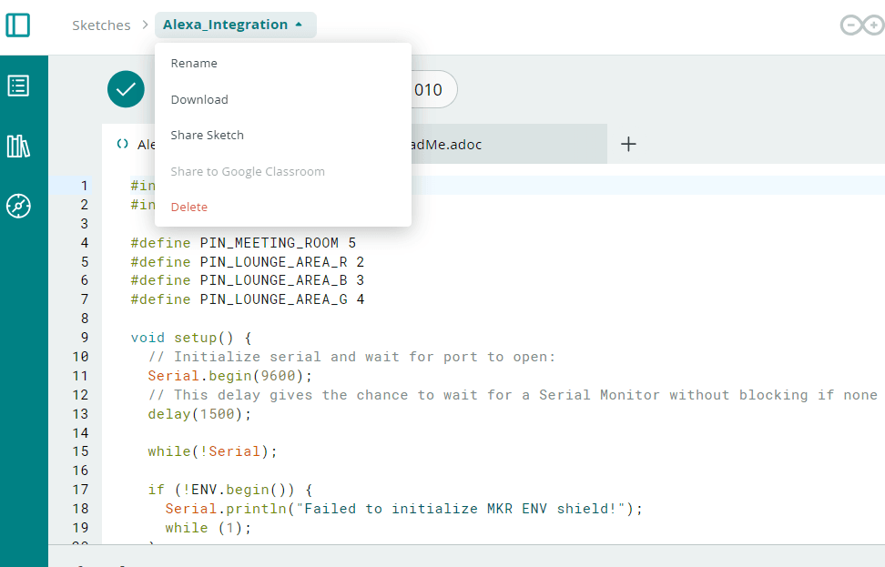

The Cloud Editor is a good fit for schools and institutions that don't want to install the [Arduino IDE](https://www.arduino.cc/en/software) on every computer.

Learn more in [Cloud Editor Overview](/arduino-cloud/sketches-editor/cloud-editor-overview).

## IoT Tools

### Devices

Setting up an IoT project can be time-consuming and complex. With Arduino Cloud, you can bring your IoT project ideas to life in four steps. Before starting a project, get familiar with the tools you will use while building it.

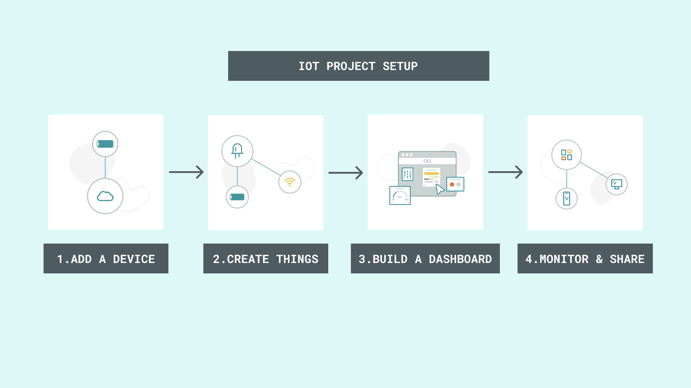

Arduino Cloud supports a range of official and third-party boards, which you manage from the **Devices** page. Devices are the digital counterparts of your physical boards.

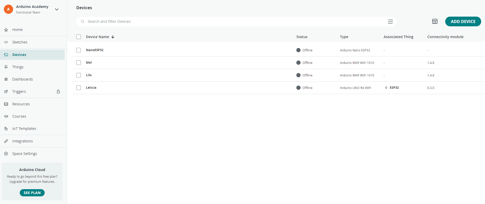

Arduino Cloud supports devices connected via Wi-Fi®, Ethernet, LoRa®-based networks, and cellular connectivity. See [Supported Boards & Capabilities](/arduino-cloud/reference/supported-boards-capabilities) for the full list of compatible hardware.

Learn more in [Devices Overview](/arduino-cloud/devices/devices-overview).

### Things

**Things** represent how your Arduino device, sensors, actuators, and network are mapped and linked together.

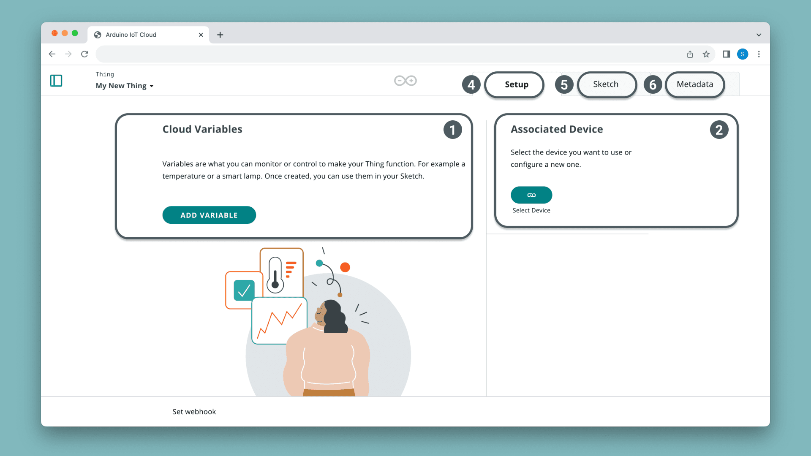

Each Thing has a set of properties, such as:

- **Variables:** similar to the variables in a regular sketch, used to retrieve and store information.
- **Associated device:** the device that collects data from the real world.
- **Network credentials:** configured from the device's page under **Devices**.
- **Sketch:** opens the editor to edit or preview the sketch saved in Arduino Cloud.
- **Metadata:** such as tags, time zone, and Thing ID.

Learn more in [Things](/arduino-cloud/things-data/things).

### Dashboards

Dashboards visualize real-time data and let you interact directly with the board through Arduino Cloud.

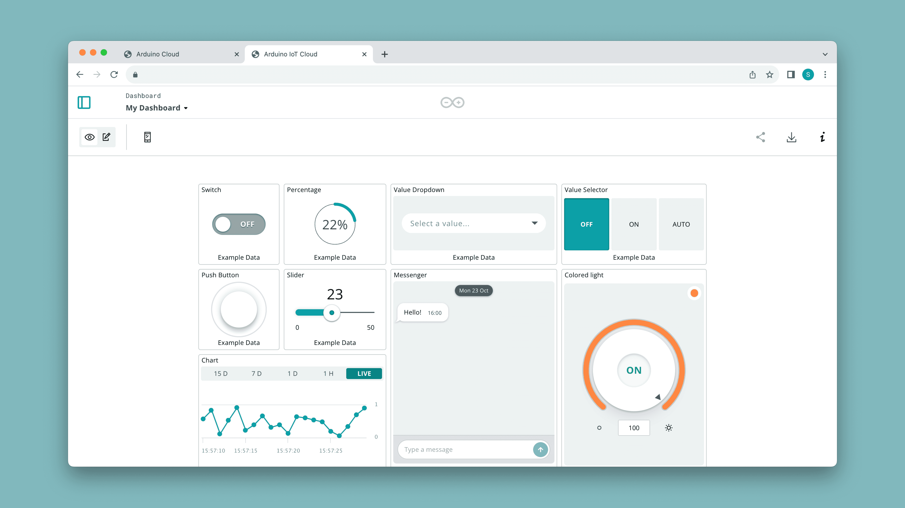

A dashboard is made of configurable **widgets**, the building blocks of a dashboard, each linked to a variable. They let you visualize sensor data and control your devices. There are many widgets to choose from: gauges, sliders, switches, color pickers, messengers, and more.

Learn more in [Working With Dashboards](/arduino-cloud/dashboards/dashboards).

### Triggers

**Triggers** send an email or a push notification when a variable meets a condition, for example when a temperature goes above a threshold or a device goes offline. They're a simple way to introduce students to automation and alerts.

Learn more in [Triggers & Alerts](/arduino-cloud/automations/triggers-and-alerts).

### Templates

If you want to set up an IoT project quickly, you don't have to start from scratch. **Templates** are ready-made projects that automatically configure your hardware and set it up in Arduino Cloud. They're the easiest way to start with a beginner class. See [Templates in the Classroom](#templates-in-the-classroom) for ideas.

Learn more in [Use Templates](/arduino-cloud/templates/use-templates).

## Templates in the Classroom

Arduino Templates are a quick way to introduce students to IoT concepts, such as sensor data collection, remote control, and data visualization, without building a project from scratch. A template creates a working Thing, dashboard, and sketch in a few steps, so you can spend class time on the subject itself: students explore the data, change the code, and extend the project with their own ideas.

Templates work across many subjects:

| Subject | Topics Students Can Explore | Example Template Ideas |
|---|---|---|
| **Computer Science** | Programming logic, remote control, working with data structures, and IoT communication | Control an LED remotely from a dashboard; store and process sensor readings in arrays and lists |
| **Physics** | Measurement, units, and how physical quantities change over time | Measure and chart temperature, pressure, or light levels |
| **Biology** | Living systems and how environmental conditions affect them | Track plant growth conditions; monitor a greenhouse |
| **Chemistry** | Properties of materials and the composition of air and soil | Measure soil properties such as moisture; monitor air quality |
| **Arts & Design** | Interaction design, user interfaces, and creative technology | Build an interactive installation; design the layout and widgets of a dashboard |

To find a template for your lesson, open Arduino Cloud, select **Templates** in the left navigation, and browse the **Arduino Templates** gallery. See [Use Templates](/arduino-cloud/templates/use-templates) for how to apply a template to your board.

For workshops and group activities, apply templates in a [shared space](/arduino-cloud/spaces-plans-account/spaces), so every student works in the same space and you can follow their progress.

## Courses

**Courses** give you access to free online courses for different age groups and topics. The library is extended regularly with new releases of educational kits.

To start, try courses like [Explore Physics](https://courses.arduino.cc/explore-physics/), [Student Kit](https://edu-content-preview.arduino.cc/content-preview/middle_school/lesson/CONTENTPREVIEW+STUDENTKIT), and [Science Journal](https://science-journal.arduino.cc/), which give students fun coding and electronics challenges.

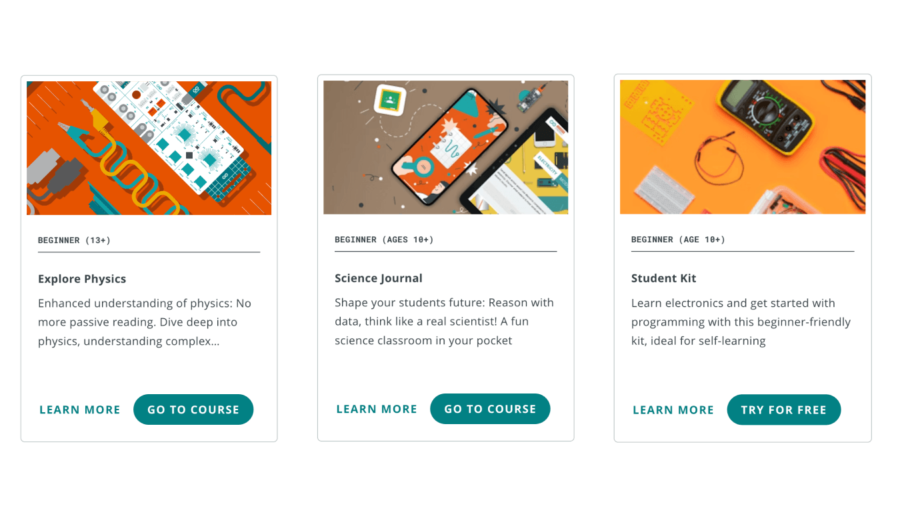

### Lessons & Projects

Every course contains **lessons** and **projects** (activities, in some cases), which separate technical activities from pedagogical ones.

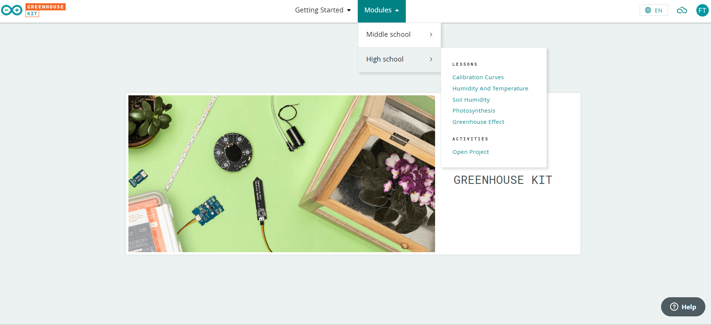

Lessons help students understand how to connect sensors and actuators to an Arduino board, and focus on core programming skills, connecting electronics, and troubleshooting.

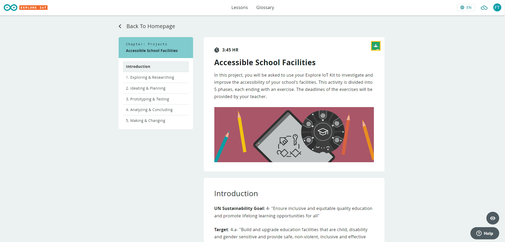

Projects apply core technical knowledge to a real-world context. Students learn to think critically about technology, about the interaction between users and technology, and about the world around them.

### Free & Premium Courses

Some courses are free, while others require a School plan. You can always preview a free chapter of any course and upgrade to a School plan if it suits your class.

Explore the collection of free and premium courses on the [Arduino Education courses page](https://www.arduino.cc/education/courses/).

<Alert type="note">

If you have purchased the Explore IoT Kit Rev2 or the Greenhouse Kit, you already have an Arduino Cloud subscription included and can access all the courses.

</Alert>

## Shared Spaces

**Shared spaces** foster collaboration in your classroom. A shared space is a virtual classroom where you can organize classwork, keep track of your students' progress, and connect with colleagues and students.

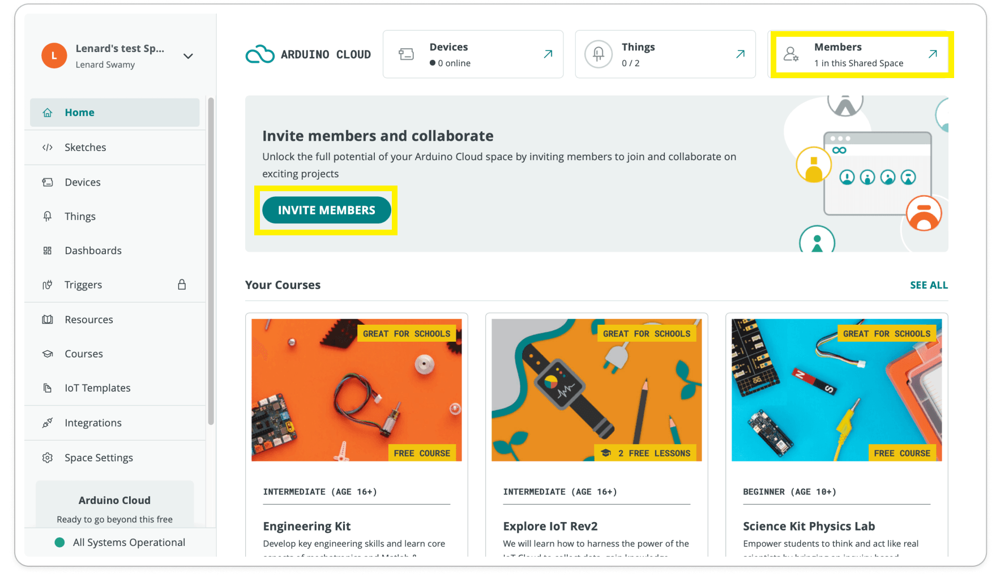

A shared space is created automatically when you sign up for a School plan. Your own **private space** is created automatically when you join Arduino Cloud, and you can use it for personal projects that you don't want to share with your class. To switch between spaces, use the space selector in the top-left corner.

Learn more in [Spaces](/arduino-cloud/spaces-plans-account/spaces).

### Inviting Members

Admins and Teachers invite members from **Space Settings → Manage Members**, by selecting **ADD MEMBERS**. Education spaces have three roles: **Admin**, **Teacher**, and **Student**. New invitations default to **Student**, the role with the least permissions.

You can invite members by email or, in Education spaces, with two more options:

- **Invite link for students:** select **Invite via Link**, copy the link, and share it with the whole class.
- **Invite code for minors:** students with an [Arduino account for juniors](https://support.arduino.cc/hc/en-us/articles/360022234360-Create-an-Arduino-account-for-juniors) join by entering the space code under **Join Space**.

For step-by-step instructions, see [Inviting Members to an Education Space](/arduino-cloud/spaces-plans-account/members-roles#inviting-members-to-an-education-space). For the actions each role can perform, see [Education Space Permissions](/arduino-cloud/spaces-plans-account/members-roles#education-space-permissions).

### Share Learning Materials

Once you've created a space and added members, all of them have access to the learning materials in the **Courses** section of Arduino Cloud.

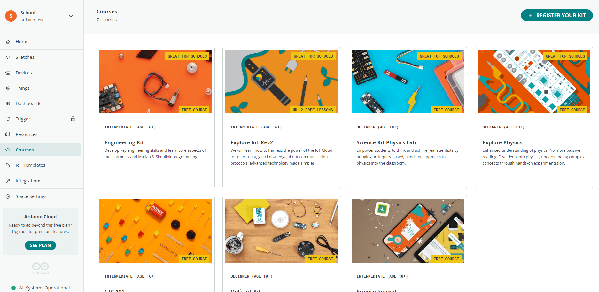

### Manage Student Projects

Find the sketches and dashboards your students worked on directly in the shared space, without unnecessary clicks or complex steps.

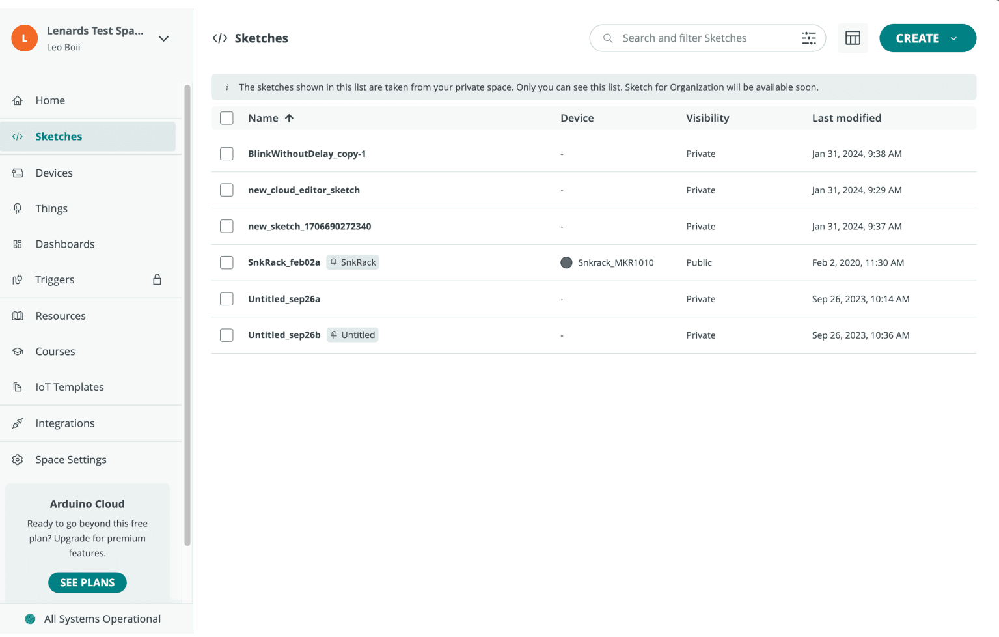

Students can also share their work with each other through [shared sketches](/arduino-cloud/sketches-editor/share-embed-sketches) and [shared dashboards](/arduino-cloud/dashboards/share-dashboards).

## Collaborative Coding

**Collaborative coding** is available in the School plan and lets multiple users in the same shared space work on the same code. Students and teachers can share and edit code, making it easier to collaborate and learn from each other.

In a shared space, everyone can create and modify code at the same time. Changes become visible to all participants once the last user has finished editing. The editor highlights the area someone else is editing with an orange frame.

The following clip shows how collaborative coding works from a student's and a teacher's perspective:

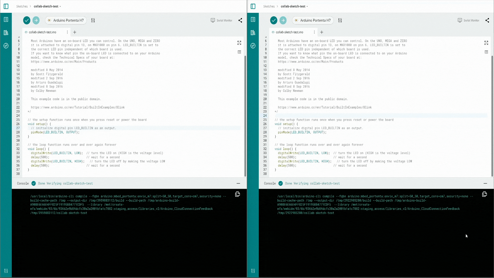

While a student or teacher is editing, their area is highlighted with an orange frame and a warning appears. Wait for them to finish before editing that code, to prevent conflicts and make sure all changes are synchronized correctly.

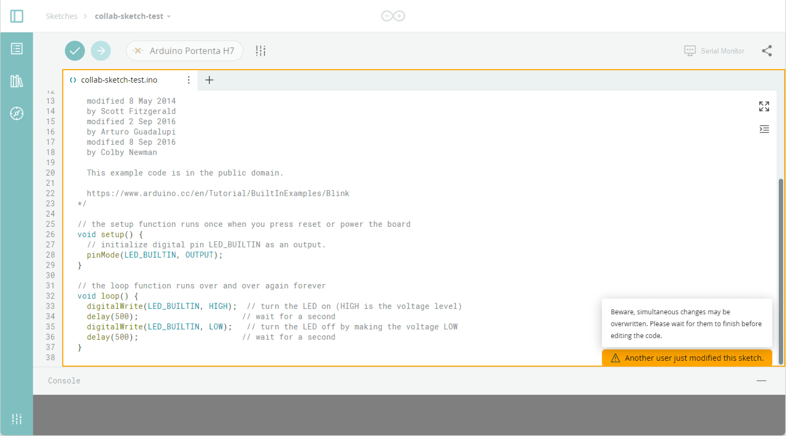

Learn more in [Collaborative Coding](/arduino-cloud/sketches-editor/collaborative-coding).

## IoT Remote App

The **IoT Remote app** lets you and your students monitor and control dashboards anywhere, from a smartphone or tablet, for free. Download it from [Google Play](https://play.google.com/store/apps/details?id=cc.arduino.cloudiot&hl=en&gl=US) or the [App Store](https://apps.apple.com/us/app/arduino-iot-cloud-remote/id1514358431).

Learn more in [App Overview & Install](/arduino-cloud/iot-remote-app/iot-remote-app-overview).

## Conclusions

You now have a general overview of the tools available in Arduino Cloud. It may feel like a lot the first time, but the best way to learn is by doing. Start by [setting up a shared space](/arduino-cloud/spaces-plans-account/spaces) for your class and [inviting your students](/arduino-cloud/spaces-plans-account/members-roles#inviting-members-to-an-education-space).

## Related Articles

- [Sketchbook & Sketches](/arduino-cloud/sketches-editor/sketchbook-and-sketches)
- [Devices Overview](/arduino-cloud/devices/devices-overview)
- [Cloud Editor Overview](/arduino-cloud/sketches-editor/cloud-editor-overview)
- [Cloud Variables](/arduino-cloud/things-data/cloud-variables)
- [Working With Dashboards](/arduino-cloud/dashboards/dashboards)
- [Use Templates](/arduino-cloud/templates/use-templates)
- [App Overview & Install](/arduino-cloud/iot-remote-app/iot-remote-app-overview)
- [Spaces](/arduino-cloud/spaces-plans-account/spaces)
- [Members, Roles & Permissions](/arduino-cloud/spaces-plans-account/members-roles)
