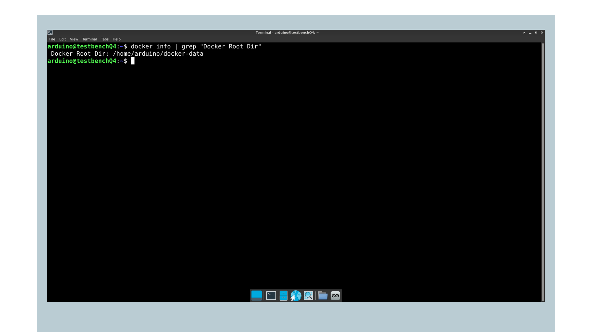
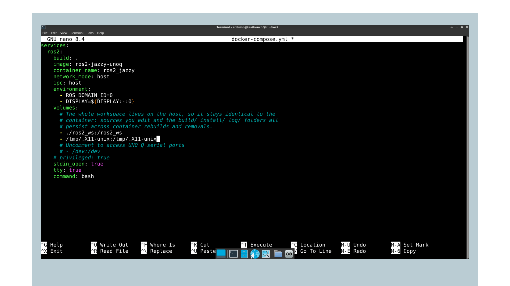
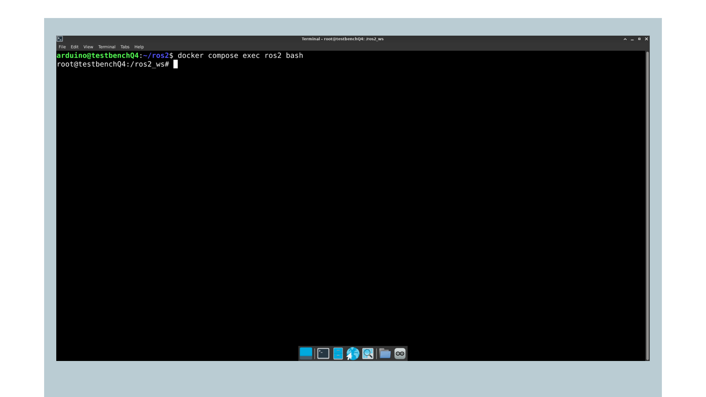

## Overview

In this tutorial, you will learn how to run ROS 2 (Robot Operating System 2) on the Arduino® UNO Q. The UNO Q runs Debian Linux on its Qualcomm® QRB2210 microprocessor (MPU). ROS 2 Jazzy Jalisco runs on top of it inside a Docker container.

You will use the board as a desktop system with a USB-C® hub, set up Docker, pull the official ROS 2 container image, build and start it with Docker Compose, and verify that the ROS 2 communication layer works.


This is the first of two documents. Once the container is running, the [First ROS 2 Project on UNO Q](/tutorials/uno-q/ros2-first-project/) tutorial covers the turtlesim example and how to build your own publisher and subscriber package.

## Goals

- Assemble the UNO Q with a USB-C hub and access its shell via SSH, ADB or SBC mode.
- Understand why ROS 2 runs in a container on the UNO Q.
- Prepare Docker on the board and build a ROS 2 Jazzy container with preinstalled packages.
- Run and manage the ROS 2 container with Docker Compose.
- Verify that ROS 2 works with the talker and listener demo nodes.

## Hardware and Software Requirements

### Hardware Requirements

- [Arduino® UNO Q](https://store.arduino.cc/products/uno-q-4gb) (x1), the 4 GB RAM / 32 GB storage variant (ABX00173) is recommended
- USB-C multiport adapter (hub) with external power delivery, [Arduino USB-C Hub (8 in 1)](https://store.arduino.cc/products/usb-c-hub-8-in-1) (x1)
- Power supply, +5 VDC at 3 A, to power the hub (x1)
- USB-C cable for ADB connection (x1)
- USB keyboard and mouse (x1 each)
- HDMI display (x1)
- Wi-Fi® Access Point or Ethernet with internet access (x1)

<Alert type="warning">

You can use any USB-C hub with external power delivery capabilities except for [Apple](https://www.apple.com/shop/product/MW5M3AM/A/usb-c-digital-av-multiport-adapter) ones, which have been tested and found to be incompatible with the UNO Q.

</Alert>

Unlike boards with dedicated video and USB-A connectors, the UNO Q routes display output, USB peripherals and Ethernet through its single USB-C connector. A hub is therefore not optional for this series. The hub must have its own power input, since the UNO Q's USB-C connector is a 5 VDC 3 A power sink and cannot supply the peripherals itself.

<Alert type="info">

For a complete Single-Board Computer mode tutorial, refer to the dedicated [UNO Q Single-Board Computer tutorial](https://docs.arduino.cc/tutorials/uno-q/single-board-computer/).

</Alert>

### Software Requirements

Before you begin, verify that your UNO Q has the latest system image installed. We will also need:

- Terminal access to the UNO Q via ADB, SSH or SBC mode. If you are not familiar with either method, refer to the [UNO Q User Manual](https://docs.arduino.cc/tutorials/uno-q/user-manual/).
- An active internet connection on the board.

## What Is ROS 2

ROS (Robot Operating System) is an open-source middleware framework that lets robotic and embedded systems exchange data through standardized nodes, topics, services, and actions. ROS is a trademark of the Open Source Robotics Foundation.

It provides reusable libraries and tools, visualization, package management and message passing, so developers can focus on application logic rather than low-level infrastructure.

ROS 2 is the modern version of ROS. While the core concepts remain the same, ROS 2 replaces the original research-oriented architecture with an industrial-grade foundation built on the Data Distribution Service (DDS) standard. Key improvements include:

- Real-time and deterministic performance suitable for safety-critical and time-bounded tasks.
- Improved security with built-in authentication, encryption and access control.
- Improved cross-platform support covering Linux, Windows, macOS and embedded RTOSs.
- Multi-robot and distributed-system readiness with better discovery, namespace isolation and QoS settings.
- Long-term maintenance (LTS) releases for predictable upgrade paths in production deployments.

Throughout this series, we use [**ROS 2 Jazzy Jalisco**](https://docs.ros.org/en/jazzy/index.html), the current LTS release.

## Why ROS 2 Runs in a Container

ROS 2 Jazzy is distributed as pre-built packages for Ubuntu 24.04. The UNO Q runs Debian, so the standard installation procedure from the ROS 2 package repository does not apply. Running those steps on the board would add a repository entry that Debian cannot resolve, so the installation would not be possible.

Rather than building ROS 2 from source, which would impact the board's storage and memory budget, we run the official ROS 2 container image. Docker gives you the Ubuntu 24.04 environment ROS 2 expects, isolated from the Debian system underneath, while still giving you access to the board's display and network. USB devices can also be passed through to the container when a tutorial needs them.

It also has a practical benefit. Everything ROS 2 installs stays inside the container, so your Debian system stays clean and you can remove or rebuild the whole ROS 2 environment with a single command.

## Assembling the UNO Q

The graphical parts of this series need a display, so set up the board as a desktop system before you start.

1. Connect the USB-C hub to the USB-C connector on the UNO Q.
2. Plug the USB keyboard and mouse into the hub's USB-A ports.
3. Connect the display to the hub's HDMI port.
4. Connect the +5 VDC 3 A power supply to the hub's power input.
5. If you are using a wired network, connect the Ethernet cable to the hub's Ethernet port if available.


The board boots automatically once powered. For more detail on this setup, refer to the [UNO Q as a Single-Board Computer](https://docs.arduino.cc/tutorials/uno-q/single-board-computer/) tutorial.

## Accessing the UNO Q

Run all steps in this tutorial directly on the UNO Q, not on your computer. You can access a terminal on the board in three ways.

The first option for initial access is ADB (Android Debug Bridge). It provides direct shell access over USB-C without any network setup, making it the best starting point before you configure Wi-Fi®.

<Alert type="note">

**Note:** ADB uses the same USB-C connector as the hub. To use ADB, disconnect the hub and connect the board directly to your computer with a USB-C cable. Once the board is on the network, use SSH or SBC mode instead so the hub can stay attached.

</Alert>

Connect the UNO Q to your computer via USB-C and run the following to list connected devices and confirm the board is recognized:

```bash
adb devices
```

Then open the shell:

```bash
adb shell
```

Once you are in, you can navigate the Debian system through the terminal. If you have not yet connected the board to a Wi-Fi® network, you can do so from the ADB shell using `nmtui`:

```bash
sudo nmtui
```

The second option is SSH, available once the board is connected to a local network and the first-time setup in the Arduino App Lab is complete. From your computer's terminal, run:

```bash
ssh arduino@<boardname>.local
```

Replace `<boardname>` with your board's configured hostname. When connecting for the first time, you will be asked to verify the connection by typing `yes` to confirm the fingerprint. Then enter your board's password.

The third option is **SBC mode**, which the graphical sections of this series require. With the hub configured as described above, power the board on and log in. You will have access to the full desktop environment and can open a terminal from there.

<Alert type="info">

For detailed instructions on setting up ADB, SSH or SBC mode, refer to the [UNO Q User Manual](https://docs.arduino.cc/tutorials/uno-q/user-manual/).

</Alert>

## Preparing the System

Before pulling the container image, make sure the system package lists and any already-installed packages are up to date:

```bash
sudo apt update && sudo apt upgrade
```

The `apt update` command refreshes the list of available packages from the configured repositories, and `apt upgrade` installs any pending updates for packages already on the system.

### Verifying Docker

Docker is normally already present on the UNO Q, since Arduino App Lab uses it to run applications. Check that it is available on your board:

```bash
docker --version
```

This series also uses Docker Compose to build and run the ROS 2 container. Check that it is available:

```bash
docker compose version
```


If either command is not found, install Docker and Docker Compose:

```bash
sudo apt install docker.io docker-compose
```

Add your user to the `docker` group so you can run Docker commands without `sudo`:

```bash
sudo usermod -aG docker $USER
```

Group membership is only applied at login, so log out and back in, or reboot the board, for the change to take effect. Verify it worked with a small test image:

```bash
docker run --rm hello-world
```


If this prints a confirmation message without a permissions error, Docker is ready.

### Checking Available Storage

The ROS 2 container image and the packages installed in it need plenty of storage. The UNO Q's storage is divided into partitions. The root partition holds the operating system, while your home directory, `/home/arduino`, is on a separate and much larger partition. Compare the free space on both before pulling:

```bash
df -h / /home/arduino
```


On a 32 GB board, for example, the root partition can be around 10 GB and the home partition around 18 GB.

By default, Docker stores all images, containers and build data under `/var/lib/docker`, which is on the root partition. A ROS 2 image can fill that partition quickly, and removing unused data with `docker system prune` only recovers space after the fact. Move Docker's data folder to the larger partition before pulling any ROS 2 image.

### Moving Docker's Data Folder

Stop the Docker service and its socket, so Docker does not restart while you change its configuration:

```bash
sudo systemctl stop docker docker.socket
```

Create a new, empty folder for Docker's data in your home directory, which sits on the larger partition:

```bash
sudo mkdir -p /home/arduino/docker-data
```

Open the Docker daemon configuration file:

```bash
sudo nano /etc/docker/daemon.json
```

On the UNO Q, the file already contains logging settings. Keep them, add a comma after the closing brace of the `log-opts` block, and add the `data-root` setting pointing to the new folder. The complete file looks like this:

```json
{
  "log-driver": "json-file",
  "log-opts": {
    "max-size": "10m",
    "max-file": "2"
  },
  "data-root": "/home/arduino/docker-data"
}
```

The comma after the `log-opts` block is required. Without it, Docker cannot read the file and fails to start. Save the file with `Ctrl+O`, exit with `Ctrl+X` and start Docker again:

```bash
sudo systemctl start docker
```

Docker initializes a fresh data folder in the new location. Confirm that it is in use:

```bash
docker info | grep "Docker Root Dir"
```



The output should show `/home/arduino/docker-data`.

If you use Arduino App Lab, it downloads its images again the next time you run an app, since Docker now starts from an empty data folder.

## Running ROS 2 in a Container

### Pulling the Image

Pull the official ROS 2 Jazzy base image. It is published for `arm64`, which matches the UNO Q's architecture:

```bash
docker pull ros:jazzy-ros-base
```


The download takes a few minutes depending on your connection. We use the `ros-base` image rather than a full desktop image because it is much smaller, and we add only the specific packages each tutorial needs.

### Preparing the Project Files

Anything written inside a container is lost when you delete the container. To keep your project files safe on the board, the workspace lives on the Debian side and is shared with the container through a volume.

The Docker setup used in this series is available in the [Arduino UNO Q robotics workshop repository](https://github.com/arduino/workshop_robotics_unoq/tree/main/ros2). Its `ros2` folder contains everything needed to build and run the ROS 2 container:

- `Dockerfile` defines the container image and the packages preinstalled in it.
- `docker-compose.yml` defines how the container runs, including its networking and the workspace volume.
- `ros_entrypoint.sh` prepares the ROS 2 environment every time the container starts.
- `ros2_ws/src/` is the workspace folder where your ROS 2 packages go.

To get the files directly on the board, make sure `git` is installed:

```bash
sudo apt install git
```

Clone the repository into your home directory:

```bash
git clone https://github.com/arduino/workshop_robotics_unoq.git ~/workshop_robotics_unoq
```

Copy its `ros2` folder to your home directory, so your working copy stays separate from the cloned repository:

```bash
cp -r ~/workshop_robotics_unoq/ros2 ~/ros2
```

Alternatively, clone or download the repository on your computer, connect the board over USB-C and push the `ros2` folder with ADB. Run the following from inside the repository folder on your computer:

```bash
adb push -a ./ros2 /home/arduino
```

Either method creates the `/home/arduino/ros2` folder on the board. Move into it:

```bash
cd ~/ros2
```

You will use its `ros2_ws` folder in the next tutorial when you build your own package.

<Alert type="note">

**Note:** Run all `docker compose` commands in this series from inside the `~/ros2` folder. Docker Compose reads the `docker-compose.yml` file and the `Dockerfile` from the current directory.

</Alert>

### Allowing Container Access to the Display

For graphical ROS 2 tools to draw on your screen, the container needs permission to connect to the board's display server. In a terminal on the desktop session, run:

```bash
xhost +local:docker
```

<Alert type="note">

This grants local containers access to your display for the current session only. It resets when you log out, so you need to run it again after each reboot.

</Alert>

### Installing the Demo Packages

Instead of installing packages by hand inside a running container, add them to the container image through the `Dockerfile`. Anything installed with `apt` inside a running container is lost when the container is recreated, while packages listed in the `Dockerfile` are part of the image and are present every time the container starts.

Open the `Dockerfile`:

```bash
nano Dockerfile
```

It starts from the ROS 2 base image you pulled earlier and sets the workspace location inside the container:

```bash
FROM ros:jazzy-ros-base

ENV ROS_WS=/ros2_ws
WORKDIR ${ROS_WS}
```

Each `RUN` instruction executes a command while the image is being built. Every package block follows the same pattern: refresh the package lists, install the packages, then delete the downloaded lists to keep the image small. The first block installs the tools used to build ROS 2 packages:

```bash
# Install common tools
RUN apt-get update && \
    apt-get install -y --no-install-recommends \
    git \
    python3-colcon-common-extensions \
    python3-rosdep \
    python3-pip && \
    rm -rf /var/lib/apt/lists/*
```

The second block installs the demo nodes used to verify the installation. Add `ros-jazzy-demo-nodes-cpp` to it:

```bash
# Install the ROS 2 demo nodes (talker / listener)
RUN apt-get update && \
    apt-get install -y --no-install-recommends \
    ros-jazzy-demo-nodes-py \
    ros-jazzy-demo-nodes-cpp && \
    rm -rf /var/lib/apt/lists/*
```

In each block, only the last package carries `&&`, which separates the install command from the cleanup command after it. Every other package line ends with just a backslash. Since `ros-jazzy-demo-nodes-cpp` is now the last package in the block, move the `&&` from the `ros-jazzy-demo-nodes-py` line to it. If it stays on the previous line, the build fails with a `not found` error.

Save the file with `Ctrl+O` and exit with `Ctrl+X`.


The same pattern works for any package available for Ubuntu 24.04, including ROS 2 packages, whose names follow the `ros-jazzy-<package-name>` format. The next tutorial uses it to add the packages it needs.

The rest of the `Dockerfile` copies the workspace sources into the image, installs their dependencies with `rosdep` and builds them with colcon. It also adds the ROS 2 setup files to the container's `.bashrc`, so every shell you open has ROS 2 and your workspace available without sourcing anything by hand. Finally, it sets `ros_entrypoint.sh` as the script that runs when the container starts.

### Starting the Container

Docker Compose replaces a long `docker run` command with the `docker-compose.yml` file, which describes how the container runs. Open it:

```bash
nano docker-compose.yml
```

Add the `DISPLAY` variable to the `environment` list and the display socket to the `volumes` list, so graphical nodes can reach the screen. With its comments removed, the file looks like this:

```yaml
services:
  ros2:
    build: .
    image: ros2-jazzy-unoq
    container_name: ros2_jazzy
    network_mode: host
    ipc: host
    environment:
      - ROS_DOMAIN_ID=0
      - DISPLAY=${DISPLAY:-:0}
    volumes:
      - ./ros2_ws:/ros2_ws
      - /tmp/.X11-unix:/tmp/.X11-unix
    stdin_open: true
    tty: true
    command: bash
```

Each setting is important here:

- `build: .` builds the image from the `Dockerfile` in the same folder, and `image` names the result `ros2-jazzy-unoq`.
- `ros2` is the service name you use with `docker compose` commands, and `container_name` gives the running container the fixed name `ros2_jazzy`.
- `network_mode: host` and `ipc: host` let ROS 2 nodes discover each other and use shared memory transport. Without these, nodes in different shells will not find one another.
- `ROS_DOMAIN_ID=0` sets the ROS 2 domain for every shell in the container.
- `DISPLAY` and the `/tmp/.X11-unix` mount give graphical nodes access to the screen. `${DISPLAY:-:0}` takes the value from the terminal where you run `docker compose`, and falls back to `:0`, the board's main display, when none is set, such as in an SSH session.
- The `./ros2_ws` volume shares your workspace between the board and the container, so your code and the `build/`, `install/` and `log/` folders survive even if the container is removed.
- `stdin_open` and `tty` keep the container running in the background, ready for you to open shells in it.



Save the file and exit. Build the image:

```bash
docker compose build
```

The build installs every package listed in the `Dockerfile`, so the first build takes a few minutes. Later builds reuse the steps that have not changed and finish much faster.

Start the container in the background:

```bash
docker compose up -d
```


On the first start, `ros_entrypoint.sh` builds the mounted workspace, because the workspace shared from the board replaces the one built inside the image. This creates the `build/`, `install/` and `log/` folders on the board. Later starts skip this step. You can follow its progress with the following command, then press `Ctrl+C` to stop following the logs. The container keeps running.

```bash
docker compose logs -f
```

Open a shell inside the container:

```bash
docker compose exec ros2 bash
```

You are now inside the container, with a prompt like `root@<boardname>:/ros2_ws#`. The ROS 2 environment is sourced automatically for you in every shell.



### Opening Additional Shells

Many sections in this series need more than one terminal. Rather than starting a second container, open another shell inside the same one. Each new terminal on the board opens in your home directory, so move into the project folder first:

```bash
cd ~/ros2
```

Then open the shell:

```bash
docker compose exec ros2 bash
```

Shells opened this way source ROS 2 and the workspace automatically through the container's `.bashrc`, so `ros2` commands work right away.

<Alert type="note">

**Note:** Always open an interactive shell with `docker compose exec ros2 bash` before running `ros2` commands. Running a command directly, such as `docker compose exec ros2 ros2 topic list`, fails with an `executable file not found` error, because that form does not load the shell settings that source ROS 2.

</Alert>

### Stopping and Resuming

The container keeps running in the background when you exit a shell. Run the following commands from inside the `~/ros2` folder. To stop and remove the container:

```bash
docker compose down
```

Your installed packages and files remain, since the packages are part of the image and the workspace lives on the board. To resume:

```bash
docker compose up -d
```

After changing the `Dockerfile` or the `docker-compose.yml` file, rebuild the image and recreate the container in one step:

```bash
docker compose up -d --build
```

## Verifying the Installation

Check that ROS 2 is working before moving on. ROS 2 includes a set of demo packages specifically for this purpose.

You will run two of them:

- `talker`, which publishes a simple string message on a topic once per second
- `listener`, which subscribes to that topic and prints each message it receives.

If the two nodes can find each other and exchange messages, it confirms that the core communication layer works as expected.

In your container shell, start the talker node:

```bash
ros2 run demo_nodes_cpp talker
```

The `ros2 run` command takes two arguments:

- the package name (`demo_nodes_cpp`)
- the node executable (`talker`)

You should see it printing a new message every second:

```bash
[INFO] [talker]: Publishing: 'Hello World: 1'
[INFO] [talker]: Publishing: 'Hello World: 2'
[INFO] [talker]: Publishing: 'Hello World: 3'
```


Now open a new terminal on the board and move into the project folder:

```bash
cd ~/ros2
```

Then open a second shell in the container:

```bash
docker compose exec ros2 bash
```

Then start the listener:

```bash
ros2 run demo_nodes_cpp listener
```

The listener subscribes to the same topic that the talker is publishing on and prints each message it receives:

```
[INFO] [listener]: I heard: [Hello World: 1]
[INFO] [listener]: I heard: [Hello World: 2]
[INFO] [listener]: I heard: [Hello World: 3]
```


If you see both nodes producing output like this, your ROS 2 installation is working correctly. You can stop both nodes with `Ctrl+C`.

<Alert type="note">

**Note:** This verification runs entirely in the console, so it works over SSH or ADB without a display attached. The graphical tools in the next tutorial require the hub and display to be connected.

</Alert>

## Troubleshooting

If `docker` commands fail with a permissions error, check that your user is in the `docker` group with `groups`, and log out and back in if you added it in this session.

If `docker compose` reports that the command is not found, or that no configuration file was found, check two things. First, confirm Docker Compose is installed with `docker compose version`. Second, confirm you are running the command from inside the `~/ros2` folder, where the `docker-compose.yml` file lives.

If the `ros2` command is not found inside the container, make sure you opened the shell with `docker compose exec ros2 bash`. That shell loads the container's `.bashrc`, which sources ROS 2 and the workspace automatically.

If `ros2 run demo_nodes_cpp talker` reports `Package 'demo_nodes_cpp' not found`, the image was built without the C++ demo nodes. Check the `Dockerfile` from a terminal on the board, inside the `~/ros2` folder:

```bash
grep demo Dockerfile
```

If `ros-jazzy-demo-nodes-cpp` is missing, add it as shown in the [Installing the Demo Packages](#installing-the-demo-packages) section. Then rebuild the image and recreate the container:

```bash
docker compose up -d --build
```

If nodes running in different shells cannot discover each other, first confirm the compose file contains `network_mode: host` and `ipc: host`. Without these, each shell sees an isolated network namespace and DDS discovery fails. You can check the current settings with:

```bash
docker inspect --format '{{.HostConfig.NetworkMode}} {{.HostConfig.IpcMode}}' ros2_jazzy
```

If either value is not `host`, restore the settings in `docker-compose.yml` as shown in the [Starting the Container](#starting-the-container) section and recreate the container:

```bash
docker compose up -d
```

Also check that all shells share the same `ROS_DOMAIN_ID`. The compose file sets it to 0 for every shell, so a mismatch only happens if you changed it by hand in one session. Print the current value in each shell with:

```bash
echo $ROS_DOMAIN_ID
```

To check the container received display access, which the next tutorial depends on, check the variable from the board, inside the `~/ros2` folder:

```bash
docker compose exec ros2 printenv DISPLAY
```

If this prints nothing, the compose file is missing the `DISPLAY` setting. Add it as shown in the [Starting the Container](#starting-the-container) section and recreate the container with `docker compose up -d`.

If Docker fails to start after you edit `/etc/docker/daemon.json`, check the reason it reported:

```bash
sudo journalctl -u docker.service -n 30 --no-pager
```

A message such as `unable to configure the Docker daemon` followed by `invalid character` means the file has a syntax error, most often a missing comma between two settings. Compare the file with the example in the [Moving Docker's Data Folder](#moving-dockers-data-folder) section and correct it. After several failed attempts, systemd stops retrying, so clear the failed state first:

```bash
sudo systemctl reset-failed docker
```

Then start Docker again:

```bash
sudo systemctl start docker
```

The journal may also show a message about an unset `DOCKER_OPTS` variable. It is unrelated to the failure and can be ignored.

If the root partition runs out of storage, check where Docker is storing its data:

```bash
docker info | grep "Docker Root Dir"
```

If the output still shows `/var/lib/docker`, the data folder change was not applied. Check that `/etc/docker/daemon.json` contains the `data-root` line, then restart Docker so it reads the file again:

```bash
sudo systemctl restart docker
```

After the move, the old `/var/lib/docker` folder still takes up space on the root partition, since Docker no longer uses it. Once App Lab and the ROS 2 container both work from the new location, you can remove it:

```bash
sudo rm -rf /var/lib/docker
```

You can also remove unused images and build cache from the new location to recover space:

```bash
docker system prune -a
```

<Alert type="warning">

This removes all images not currently used by a container. You will need to rebuild the ROS 2 image with `docker compose build` if the container was not running when you ran the command.

</Alert>

## Conclusion

In this tutorial, you have assembled the UNO Q as a desktop system with a USB-C hub, prepared Docker on the board and moved its data folder to the larger storage partition, pulled the official ROS 2 Jazzy image, and used Docker Compose to build and start a container with preinstalled packages and network, display and shared workspace access. You then verified the ROS 2 communication layer with the talker and listener demo nodes.

### Next Steps

With the container running, you can move on to [First ROS 2 Project on UNO Q](/tutorials/uno-q/ros2-first-project/), which covers the turtlesim example and building your own publisher and subscriber package in the shared workspace.

For a broader introduction to ROS 2 concepts, the [official ROS 2 tutorials](https://docs.ros.org/en/jazzy/Tutorials.html) are a recommended starting point.

## Acknowledgments

ROS is a trademark of Open Source Robotics Foundation. This tutorial is provided for educational purposes to help users learn ROS 2 on Arduino hardware. This content does not imply endorsement, partnership, or affiliation between Arduino and Open Source Robotics Foundation.

## Support

If you encounter any issues or have questions while working with the UNO Q, we provide various support resources to help you find answers and solutions.

### Help Center

Explore our Help Center, which offers a comprehensive collection of articles and guides for the UNO Q. The Arduino Help Center is designed to provide in-depth technical assistance and help you make the most of your device.

- [Arduino Help Center](https://support.arduino.cc/hc)

### Forum

Join our community forum to connect with other users, share your experiences, and ask questions.

- [UNO Q category in the Arduino Forum](https://forum.arduino.cc/c/official-hardware/uno-family/uno-q/222)

### Contact Us

Please get in touch with our support team if you need personalized assistance or have questions not covered by the help and support resources described above.

- [Contact us page](https://www.arduino.cc/pro/contact-us)
