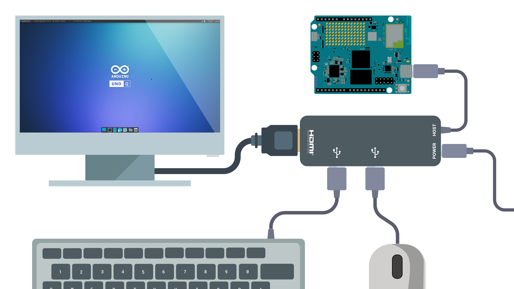
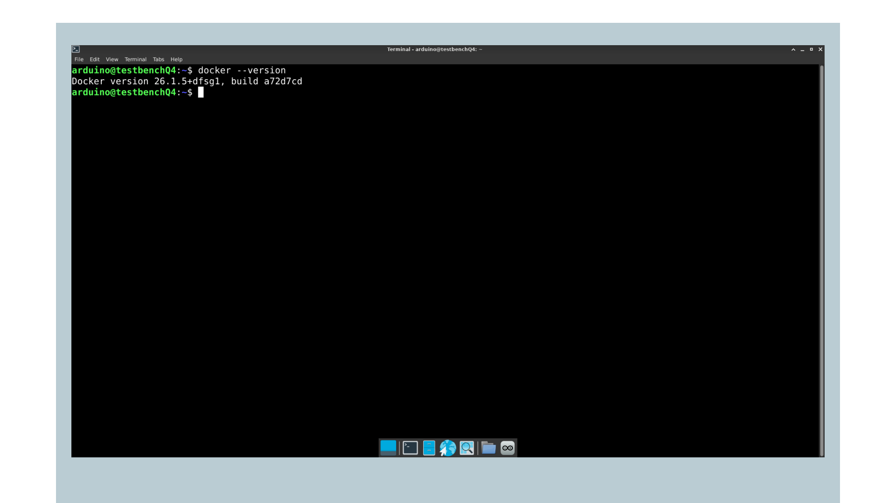
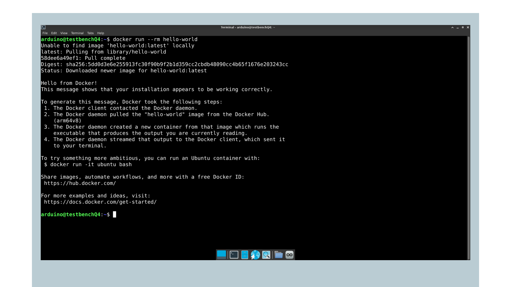
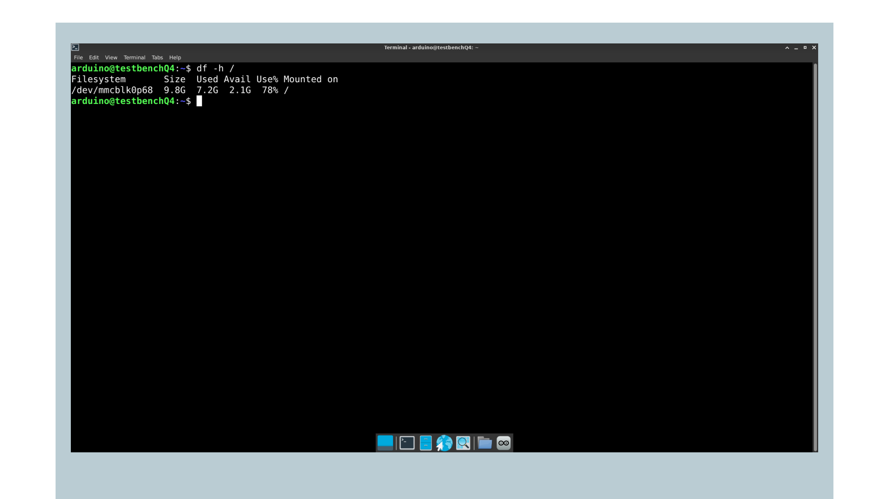
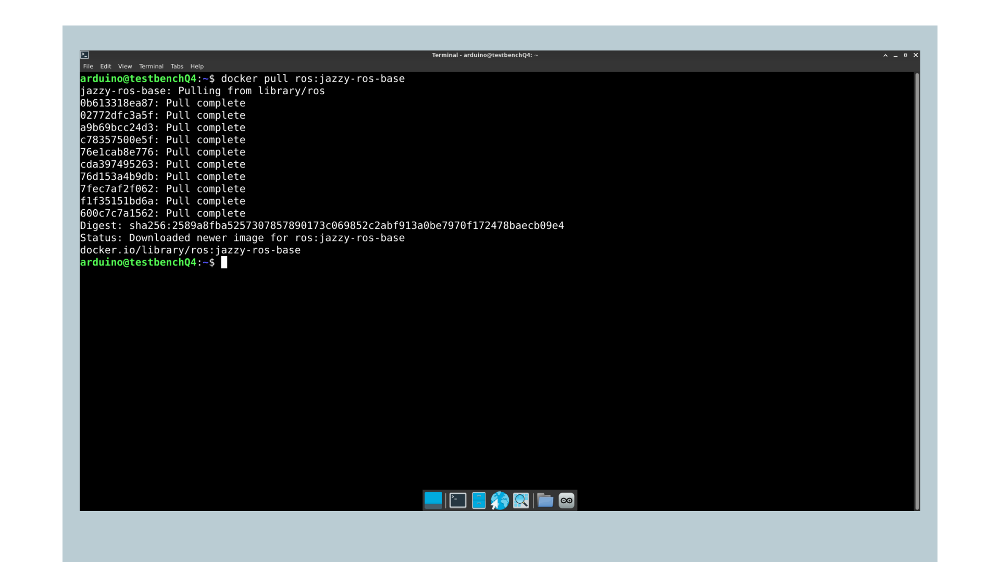
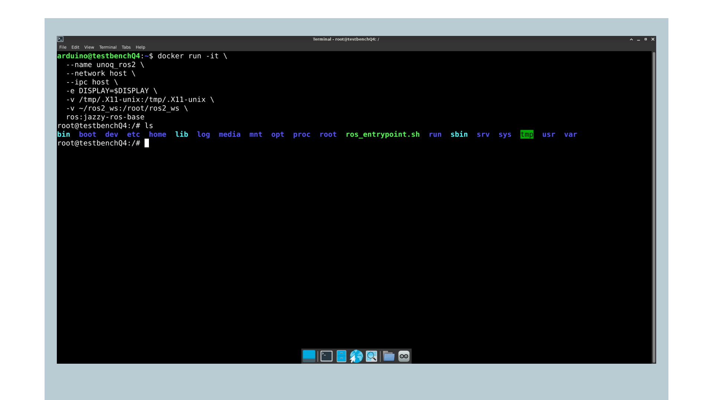
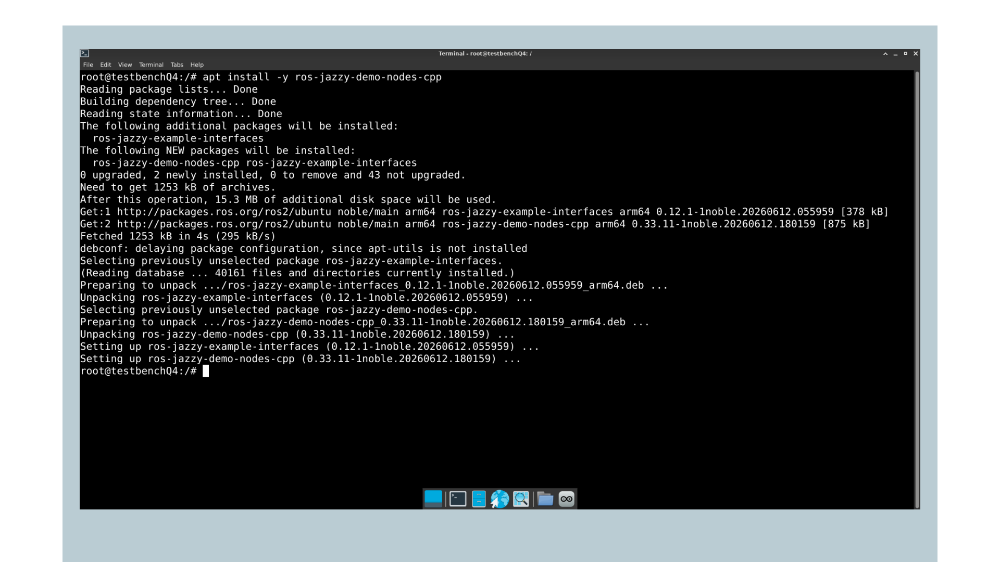
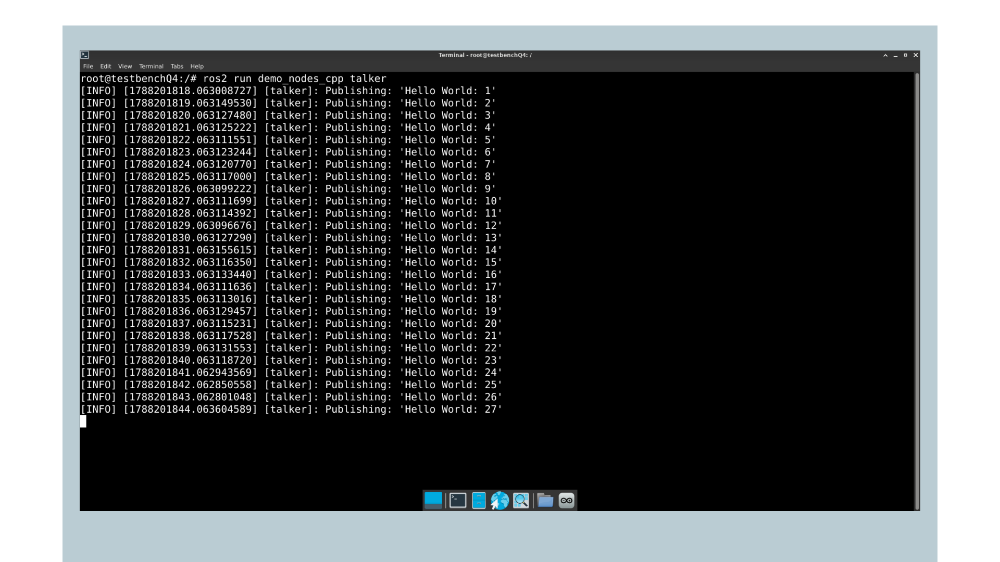
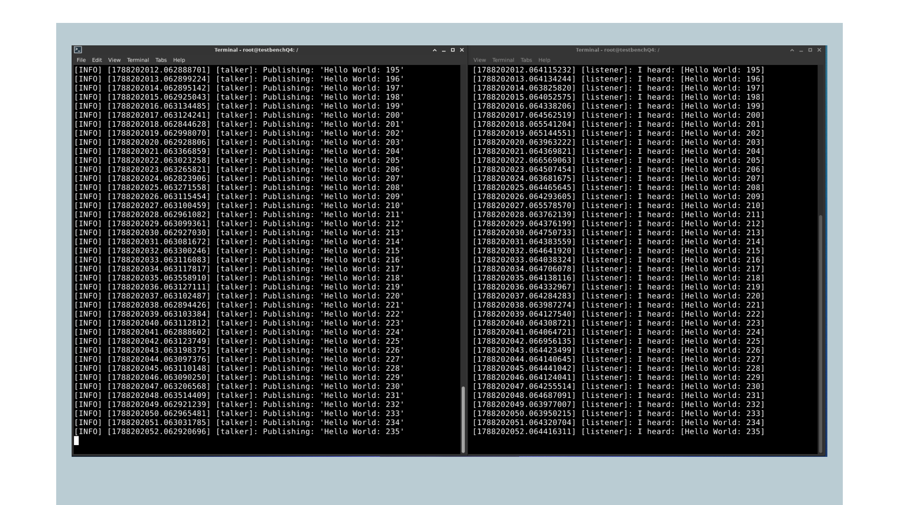

## Overview

In this tutorial, you will learn how to run ROS 2 (Robot Operating System 2) on the Arduino® UNO Q. The UNO Q runs Debian Linux on its Qualcomm® QRB2210 microprocessor (MPU). ROS 2 Jazzy Jalisco runs on top of it inside a Docker container.

You will use the board as a desktop system with a USB-C® hub, set up Docker, pull the official ROS 2 container image, and verify that the ROS 2 communication layer works.

This is the first of two documents. Once the container is running, the [First ROS 2 Project on UNO Q](/tutorials/uno-q/ros2-first-project/) tutorial covers the turtlesim example and how to build your own publisher and subscriber package.

***__Note:__ The Arduino® VENTUNO Q runs Ubuntu and supports a native ROS 2 installation without a container. See the [Getting Started with ROS 2 on VENTUNO Q](/tutorials/ventuno-q/getting-started-ros2/) tutorial for that variant.***

## Goals

- Assemble the UNO Q with a USB-C hub for display and peripherals.
- Access the UNO Q shell via SSH, ADB or SBC mode.
- Understand why ROS 2 runs in a container on the UNO Q.
- Prepare Docker on the board and pull the official ROS 2 Jazzy image.
- Start a container with network, display and shared workspace access.
- Verify the ROS 2 communication layer with the talker and listener demo nodes.
- Manage the container across sessions without losing your work.

## Hardware and Software Requirements

### Hardware Requirements

- [Arduino® UNO Q](https://store.arduino.cc/products/uno-q-4gb) (x1), the 4 GB RAM / 32 GB storage variant (ABX00173) is recommended
- USB-C® multiport adapter (hub) with external power delivery, [Arduino USB-C Hub (8 in 1)](https://store.arduino.cc/products/usb-c-hub-8-in-1) (x1)
- Power supply, +5 VDC at 3 A, to power the hub (x1)
- USB-C® cable for ADB connection (x1)
- USB keyboard and mouse (x1 each)
- HDMI display (x1)
- Wi-Fi® Access Point or Ethernet with internet access (x1)

***You can use any USB-C hub with external power delivery capabilities except for [Apple](https://www.apple.com/shop/product/MW5M3AM/A/usb-c-digital-av-multiport-adapter) ones, which have been tested and found to be incompatible with the UNO Q.***

Unlike boards with dedicated video and USB-A connectors, the UNO Q routes display output, USB peripherals and Ethernet through its single USB-C connector. A hub is therefore not optional for this series. The hub must have its own power input, since the UNO Q's USB-C connector is a 5 VDC 3 A power sink and cannot supply the peripherals itself.

### Software Requirements

Before you begin, verify that your UNO Q has the latest system image installed. We will also need:

- Terminal access to the UNO Q via ADB, SSH or SBC mode. If you are not familiar with either method, refer to the [UNO Q User Manual](/tutorials/uno-q/user-manual/).
- An active internet connection on the board.
- Free storage on the board for the container image and ROS 2 packages.

## What Is ROS 2

ROS (Robot Operating System) is an open-source middleware framework that lets robotic and embedded systems exchange data through standardized nodes, topics, services, and actions. ROS is a trademark of the Open Source Robotics Foundation.

It provides reusable libraries and tools, visualization, package management and message passing, so developers can focus on application logic rather than low-level infrastructure.

ROS 2 is the modern version of ROS. While the core concepts remain the same, ROS 2 replaces the original research-oriented architecture with an industrial-grade foundation built on the Data Distribution Service (DDS) standard. Key improvements include:

- Real-time and deterministic performance suitable for safety-critical and time-bounded tasks.
- Improved security with built-in authentication, encryption and access control.
- Improved cross-platform support covering Linux, Windows, macOS and embedded RTOSs.
- Multi-robot and distributed-system readiness with better discovery, namespace isolation and QoS settings.
- Long-term maintenance (LTS) releases for predictable upgrade paths in production deployments.

Throughout this series, we use [**ROS 2 Jazzy Jalisco**](https://docs.ros.org/en/jazzy/index.html), the current LTS release.

## Why ROS 2 Runs in a Container

ROS 2 Jazzy is distributed as pre-built packages for Ubuntu 24.04. The UNO Q runs Debian, so the standard installation procedure from the ROS 2 package repository does not apply. Running those steps on the board would add a repository entry that Debian cannot resolve, so the installation would not be possible.

Rather than building ROS 2 from source, which is impractical on the board's storage and memory budget, we run the official ROS 2 container image. Docker gives you the Ubuntu 24.04 environment ROS 2 expects, isolated from the Debian system underneath, while still giving you access to the board's display, network, and USB devices.

It also has a practical benefit. Everything ROS 2 installs stays inside the container, so your Debian system stays clean and you can remove or rebuild the whole ROS 2 environment with a single command.

## Assembling the UNO Q

The graphical parts of this series need a display, so set up the board as a desktop system before you start.

1. Connect the USB-C hub to the USB-C connector on the UNO Q.
2. Plug the USB keyboard and mouse into the hub's USB-A ports.
3. Connect the display to the hub's HDMI port.
4. Connect the +5 VDC 3 A power supply to the hub's power input.
5. If you are using a wired network, connect the Ethernet cable to the hub's Ethernet port if available.



The board boots automatically once powered. For more detail on this setup, refer to the [UNO Q as a Single-Board Computer](/tutorials/uno-q/sbc-mode-setup/) tutorial.

## Accessing the UNO Q

Run all steps in this tutorial directly on the UNO Q, not on your computer. You can access a terminal on the board in three ways.

The first option for initial access is ADB (Android Debug Bridge). It provides direct shell access over USB-C without any network setup, making it the best starting point before you configure Wi-Fi.

***__Note:__ ADB uses the same USB-C connector as the hub. To use ADB, disconnect the hub and connect the board directly to your computer with a USB-C cable. Once the board is on the network, use SSH or SBC mode instead so the hub can stay attached.***

Connect the UNO Q to your computer via USB-C and run the following to list connected devices and confirm the board is recognized:

```bash
adb devices
```

Then open the shell:

```bash
adb shell
```

Once you are in, you can navigate the Debian system through the terminal. If you have not yet connected the board to a Wi-Fi network, you can do so from the ADB shell using `nmtui`:

```bash
sudo nmtui
```

The second option is SSH, available once the board is connected to a local network and the first-time setup in the Arduino App Lab is complete. From your computer's terminal, run:

```bash
ssh arduino@<boardname>.local
```

Replace `<boardname>` with your board's configured hostname. When connecting for the first time, you will be asked to verify the connection by typing `yes` to confirm the fingerprint. Then enter your board's password.

The third option is **SBC mode**, which is what the graphical sections of this series assume. With the hub assembled as described above, power the board on and log in. You will have access to the full desktop environment and can open a terminal from there.

***For detailed instructions on setting up ADB, SSH, or SBC mode, refer to the [UNO Q User Manual](/tutorials/uno-q/user-manual/).***

## Preparing the System

Before pulling the container image, make sure the system package lists and any already-installed packages are up to date:

```bash
sudo apt update && sudo apt upgrade
```

The `apt update` command refreshes the list of available packages from the configured repositories, and `apt upgrade` installs any pending updates for packages already on the system.

### Verifying Docker

Check whether Docker is already available on your board:

```bash
docker --version
```



If the command is not found, install it:

```bash
sudo apt install docker.io
```

Add your user to the `docker` group so you can run Docker commands without `sudo`:

```bash
sudo usermod -aG docker $USER
```

Group membership is only applied at login, so log out and back in, or reboot the board, for the change to take effect. Verify it worked with a small test image:

```bash
docker run --rm hello-world
```



If this prints a confirmation message without a permissions error, Docker is ready.

### Checking Available Storage

The ROS 2 container image and the packages installed into it need several gigabytes. Check what you have available before pulling:

```bash
df -h /
```



If you are running the 16 GB variant and space is tight, free some up with `docker system prune` and `sudo apt autoremove` before continuing.

## Running ROS 2 in a Container

### Pulling the Image

Pull the official ROS 2 Jazzy base image. It is published for `arm64`, which matches the UNO Q's architecture:

```bash
docker pull ros:jazzy-ros-base
```



The download takes a few minutes depending on your connection. We use the `ros-base` image rather than a full desktop image because itis much smaller, and we add only the specific packages each tutorial needs.

### Preparing the Workspace Directory

Anything written inside a container is lost when you delete the container. To keep your project files safe on the board, create the workspace on the Debian side first and share it with the container:

```bash
mkdir -p ~/ros2_ws/src
```

You will use this directory in the next tutorial when you build your own package. Creating it now means the container starts with the mount already in place, so you won't have to rebuild later.

### Allowing Container Access to the Display

For graphical ROS 2 tools to draw on your screen, the container needs permission to connect to the board's display server. In a terminal on the desktop session, run:

```bash
xhost +local:docker
```

***This grants local containers access to your display for the current session only. It resets when you log out, so you need to run it again after each reboot.***

### Starting the Container

With Docker ready, the image pulled and the workspace directory in place, start the container:

```bash
docker run -it \
  --name unoq_ros2 \
    --network host \
  --ipc host \
    -e DISPLAY=$DISPLAY \
  -v /tmp/.X11-unix:/tmp/.X11-unix \
    -v ~/ros2_ws:/root/ros2_ws \
  ros:jazzy-ros-base
```



Each option matters here:

- `--name unoq_ros2` gives the container a fixed name so you can return to it later.
- `--network host` and `--ipc host` let ROS 2 nodes discover each other and use shared memory transport. Without these, nodes in different shells will not find one another.
- `-e DISPLAY` and the `/tmp/.X11-unix` mount give graphical nodes access to the screen.
- The `~/ros2_ws` mount shares your workspace between the board and the container, so your code survives even if the container is removed.

You are now inside the container, with a prompt like `root@unoq:/#`. The ROS 2 environment is sourced automatically for you in this session.

### Installing the Demo Packages

Inside the container, install the demo nodes used to verify the installation:

```bash
apt update
```

```bash
apt install -y ros-jazzy-demo-nodes-cpp
```



These stay installed as long as you do not delete the container.

### Opening Additional Shells

Several sections in this series need more than one terminal. Rather than starting a second container, open another shell inside the same one. From a new terminal on the board:

```bash
docker exec -it unoq_ros2 bash
```

Shells opened this way do not source ROS 2 automatically, so run this first each time:

```bash
source /opt/ros/jazzy/setup.bash
```

### Stopping and Resuming

Typing `exit` in the original shell stops the container. Your installed packages and files remain. To resume:

```bash
docker start -ai unoq_ros2
```

Use `docker rm unoq_ros2` only when you want to discard the ROS 2 environment entirely. Your `~/ros2_ws` directory on the board is unaffected either way.

## Verifying the Installation

Confirm that ROS 2 is working before moving on. ROS 2 includes a set of demo packages specifically for this purpose.

You will run two of them:

- `talker`, which publishes a simple string message on a topic once per second
- `listener`, which subscribes to that topic and prints each message it receives.

If the two nodes can find each other and exchange messages, it confirms that the core communication layer is working as expected.

In your container shell, start the talker node:

```bash
ros2 run demo_nodes_cpp talker
```

The `ros2 run` command takes two arguments:

- the package name (`demo_nodes_cpp`)
- the node executable (`talker`)

You should see it printing a new message every second:

```
[INFO] [talker]: Publishing: 'Hello World: 1'
[INFO] [talker]: Publishing: 'Hello World: 2'
[INFO] [talker]: Publishing: 'Hello World: 3'
```



Now open a second shell in the container:

```bash
docker exec -it unoq_ros2 bash
```

Source the environment:

```bash
source /opt/ros/jazzy/setup.bash
```

Then start the listener:

```bash
ros2 run demo_nodes_cpp listener
```

The listener subscribes to the same topic that the talker is publishing on and prints each message it receives:

```
[INFO] [listener]: I heard: [Hello World: 1]
[INFO] [listener]: I heard: [Hello World: 2]
[INFO] [listener]: I heard: [Hello World: 3]
```



If you see both nodes producing output like this, your ROS 2 installation is working correctly. You can stop both nodes with `Ctrl+C`.

***__Note:__ This verification runs entirely in the console, so it works over SSH or ADB without a display attached. The graphical tools in the next tutorial need the hub and display connected.***

## Making the Environment Persistent

You may have noticed that shells opened with `docker exec` need `source /opt/ros/jazzy/setup.bash` before any `ros2` command works. This is because the setup file configures environment variables local to the current shell session.

To avoid running this command every time, append it to the container's `.bashrc`, which is a shell script that runs automatically whenever a new shell session starts:

```bash
echo "source /opt/ros/jazzy/setup.bash" >> ~/.bashrc
```

Then reload it in the current session so the change takes effect immediately:

```bash
source ~/.bashrc
```

From this point on, every shell you open in the container will have ROS 2 available automatically. Note that this applies to the container, not to the Debian system on the board.

## Troubleshooting

If `docker` commands fail with a permissions error, confirm your user is in the `docker` group with `groups`, and log out and back in if you added it in this session.

If the `ros2` command is not found inside the container, source the setup file with `source /opt/ros/jazzy/setup.bash`, or confirm this line is present in the container's `.bashrc`. Shells opened with `docker exec` do not source it automatically unless you added it. Refer to the [Making the Environment Persistent](#making-the-environment-persistent) section if you have not done this yet.

If nodes running in different shells cannot discover each other, first confirm the container was started with `--network host` and `--ipc host`. Without these, each shell sees an isolated network namespace and DDS discovery fails. You can check the current settings with:

```bash
docker inspect --format '{{.HostConfig.NetworkMode}} {{.HostConfig.IpcMode}}' unoq_ros2
```

If the network mode is not `host`, remove the container and start it again with the full command from the [Starting the Container](#starting-the-container) section:

```bash
docker rm unoq_ros2
```

Also check that all shells share the same `ROS_DOMAIN_ID`. By default, this is 0, but if you changed it in one session, the nodes will not find each other. You can set it explicitly and make it permanent:

```bash
export ROS_DOMAIN_ID=0
```

```bash
echo "export ROS_DOMAIN_ID=0" >> ~/.bashrc
```

To confirm the container received display access, which the next tutorial depends on, check the variable from the board:

```bash
docker exec unoq_ros2 printenv DISPLAY
```

If this prints nothing, the container was started without `-e DISPLAY`. Remove and restart it with the full command.

If you run out of storage, remove unused images and build cache from the board's Debian session:

```bash
docker system prune -a
```

***This removes all images not currently used by a container. You will need to pull the ROS 2 image again if you remove the container first.***

## Conclusion

In this tutorial, you have assembled the UNO Q as a desktop system with a USB-C hub, prepared Docker on the board, pulled the official ROS 2 Jazzy image, and started a container with network, display and shared workspace access. You then verified the ROS 2 communication layer with the talker and listener demo nodes.

### Next Steps

With the container running, you can move on to [First ROS 2 Project on UNO Q](/tutorials/uno-q/ros2-first-project/), which covers the turtlesim example and building your own publisher and subscriber package in the shared workspace.

For a broader introduction to ROS 2 concepts, the [official ROS 2 tutorials](https://docs.ros.org/en/jazzy/Tutorials.html) are a recommended starting point.

## Acknowledgments

ROS is a trademark of Open Source Robotics Foundation. This tutorial is provided for educational purposes to help users learn ROS 2 on Arduino hardware. This content does not imply endorsement, partnership, or affiliation between Arduino and Open Source Robotics Foundation.

## Support

If you encounter any issues or have questions while working with the UNO Q, we provide various support resources to help you find answers and solutions.

### Help Center

Explore our Help Center, which offers a comprehensive collection of articles and guides for the UNO Q. The Arduino Help Center is designed to provide in-depth technical assistance and help you make the most of your device.

- [Arduino Help Center](https://support.arduino.cc/hc)

### Forum

Join our community forum to connect with other users, share your experiences, and ask questions.

- [UNO Q category in the Arduino Forum](LINK)

### Contact Us

Please get in touch with our support team if you need personalized assistance or have questions not covered by the help and support resources described above.

- [Contact us page](https://www.arduino.cc/pro/contact-us)
