## Overview

In this tutorial, you will explore the fundamental concepts of ROS 2 (Robot Operating System 2) on the Arduino® UNO Q and build your first project from scratch.

You will run the `turtlesim` simulation to see nodes, topics and services working together, then create a ROS 2 package in the shared workspace, write a publisher node and a subscriber node in Python®, build the package and watch the two nodes communicate.

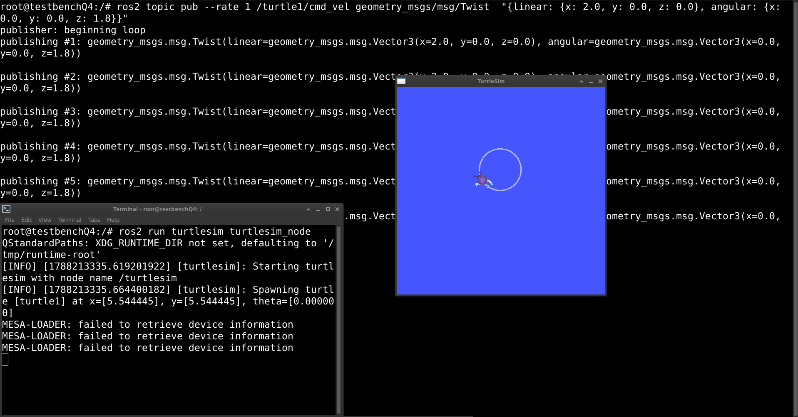

This tutorial continues from [Getting Started with ROS 2 on UNO Q](/tutorials/uno-q/ros2-setup/). It uses the same project files, `docker-compose.yml` and container you set up there, without changes.

<Alert type="info">

**Note:** You can also replicate this tutorial on the Arduino® VENTUNO Q, where ROS 2 runs natively. See the [Getting Started with ROS 2 on VENTUNO Q](/tutorials/ventuno-q/getting-started-ros2/) tutorial for that variant.

</Alert>

## Goals

- Resume the ROS 2 container from the setup tutorial.
- Understand the fundamental concepts of ROS 2: nodes, topics, services and actions.
- Run the `turtlesim` example and control the turtle through topics and services.
- Check a running system with the ROS 2 command-line tools.
- Create a ROS 2 Python® package in a workspace that persists outside the container.
- Write a publisher and subscriber node and verify communication between them.

## Hardware and Software Requirements

### Hardware Requirements

- [Arduino® UNO Q](https://store.arduino.cc/products/uno-q-4gb) (x1), the 4 GB RAM / 32 GB storage variant (ABX00173) is recommended
- USB-C® multiport adapter (hub) with external power delivery, [Arduino USB-C Hub (8 in 1)](https://store.arduino.cc/products/usb-c-hub-8-in-1) (x1)
- Power supply, +5 VDC at 3 A, to power the hub (x1)
- USB keyboard and mouse (x1 each)
- HDMI display (x1)
- Wi-Fi® Access Point or Ethernet with internet access (x1)

<Alert type="warning">

The `turtlesim` sections of this tutorial open a graphical window, so the board must be running in SBC mode with the hub and display attached. The UNO Q routes video and USB peripherals through its single USB-C connector, so you need a hub. You can use any USB-C hub with external power delivery capabilities except for [Apple](https://www.apple.com/shop/product/MW5M3AM/A/usb-c-digital-av-multiport-adapter) ones, which have been tested and found incompatible with the UNO Q.

</Alert>

### Software Requirements

- The ROS 2 container from [Getting Started with ROS 2 on UNO Q](/tutorials/uno-q/ros2-setup/), set up and verified, with the project files in the `~/ros2` folder on the board.

## Resuming the Container

If the container is not currently running, start it again from a terminal on the board. Move into the project folder:

```bash
cd ~/ros2
```

Then start the container in the background:

```bash
docker compose up -d
```

Since `turtlesim` needs to draw on the screen, grant local containers display access again. This permission resets on logout, so run it in a terminal on the desktop session after each reboot:

```bash
xhost +local:docker
```

The following sections need more than one terminal. Each new terminal on the board opens in your home directory, so move into the project folder first:

```bash
cd ~/ros2
```

Then open a shell inside the same container:

```bash
docker compose exec ros2 bash
```

## Checking the Tutorial Packages

The image you built in the previous tutorial already includes everything this tutorial needs: `turtlesim`, the colcon build tool and the `nano` text editor. In your container shell, check that `turtlesim` is available:

```bash
ros2 pkg list | grep turtlesim
```

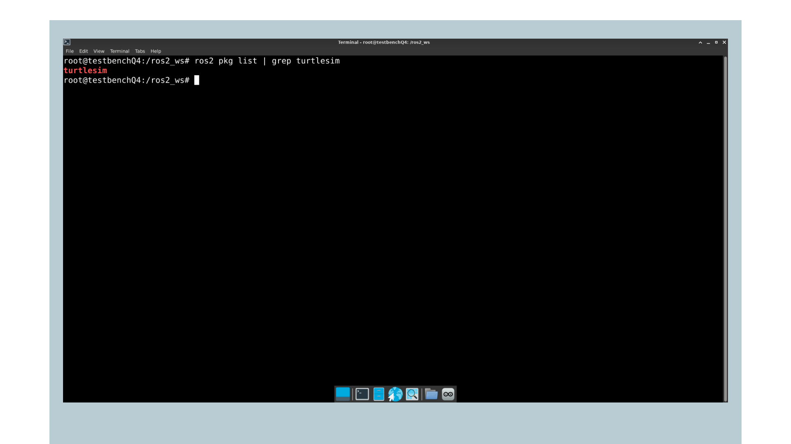

The output should show `turtlesim`. If nothing is printed, the image was built without it. Add it to the `Dockerfile` as shown in the [Installing the Packages](/tutorials/uno-q/ros2-setup/#installing-the-packages) section of the previous tutorial. Then rebuild the image from a terminal on the board, inside the `~/ros2` folder:

```bash
docker compose up -d --build
```

`colcon` is the standard ROS 2 build tool. It reads each package's build configuration and compiles them in the correct order. You will use it later in this tutorial.

## Turtlesim Example

`turtlesim` is a lightweight 2D simulation that comes with ROS 2. It is the standard starting point for learning how the framework works in practice, because it provides visual and interactive elements that make it easy to work with.

A turtle appears on a canvas and can be moved by publishing velocity commands to a topic, which makes it a straightforward way to see nodes, topics, and services in action before working with real hardware.

### Running Turtlesim

Launch the turtlesim node in a container shell:

```bash
ros2 run turtlesim turtlesim_node
```

The terminal will publish initialization messages confirming the node started and spawned the turtle:

```bash
[INFO] [turtlesim]: Starting turtlesim with node name /turtlesim
[INFO] [turtlesim]: Spawning turtle [turtle1] at x=[5.544445], y=[5.544445], theta=[0.000000]
```

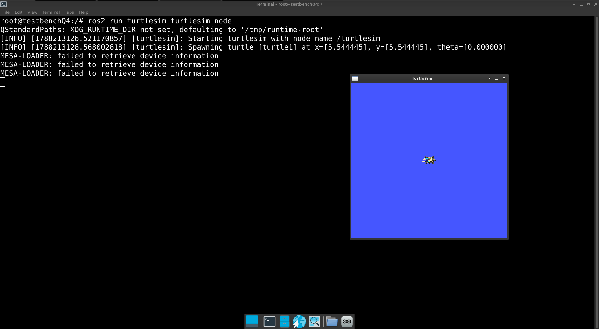

The turtlesim window will appear on the display connected to your hub. If you are connected via SSH or ADB without a display attached, the node will still run and publish topics, but the graphical window will not render.

<Alert type="note">

**Note:** The terminal may also print `XDG_RUNTIME_DIR not set` and several `MESA-LOADER` warnings before the window appears. These are expected when running graphical nodes from a container and do not affect rendering. See the [Troubleshooting](#troubleshooting) section for details.

</Alert>

### Controlling the Turtle

The turtle listens for velocity commands published to the `/turtle1/cmd_vel` topic. With the turtlesim node running, open a second container shell and send commands to move the turtle.

The following command makes it trace a continuous circle by combining forward speed with a rotation rate:

```bash
ros2 topic pub --rate 1 /turtle1/cmd_vel geometry_msgs/msg/Twist \
 "{linear: {x: 2.0, y: 0.0, z: 0.0}, angular: {x: 0.0, y: 0.0, z: 1.8}}"
```

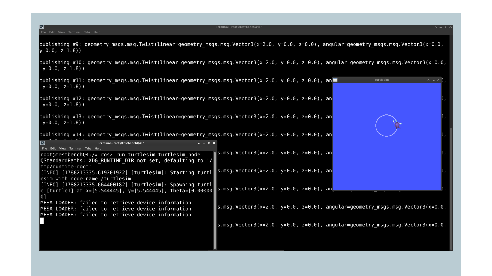


It publishes a Twist message at 1 Hz telling the turtle to move forward at 2.0 units per second while rotating at 1.8 radians per second.

Press `Ctrl+C` to stop. Alternatively, you can run the built-in square-drawing demo, which will move the turtle in a square pattern automatically:

```bash
ros2 run turtlesim draw_square
```

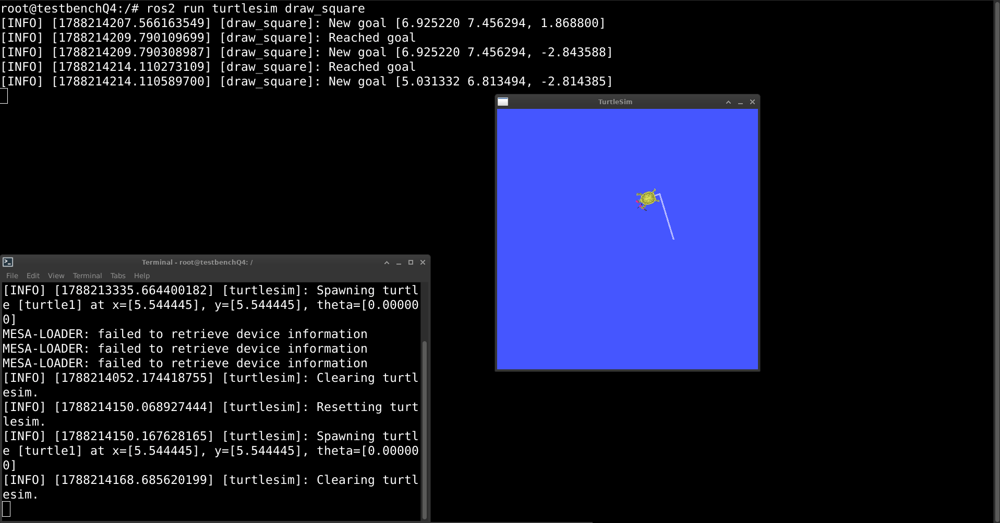

### Resetting and Clearing

You can also interact with turtlesim via ROS 2 services. Services work differently from topics. Instead of a continuous data stream, a service is a *request-response* call.

The following command uses the `/clear` service to clear the drawing trail:

```bash
ros2 service call /clear std_srvs/srv/Empty {}
```

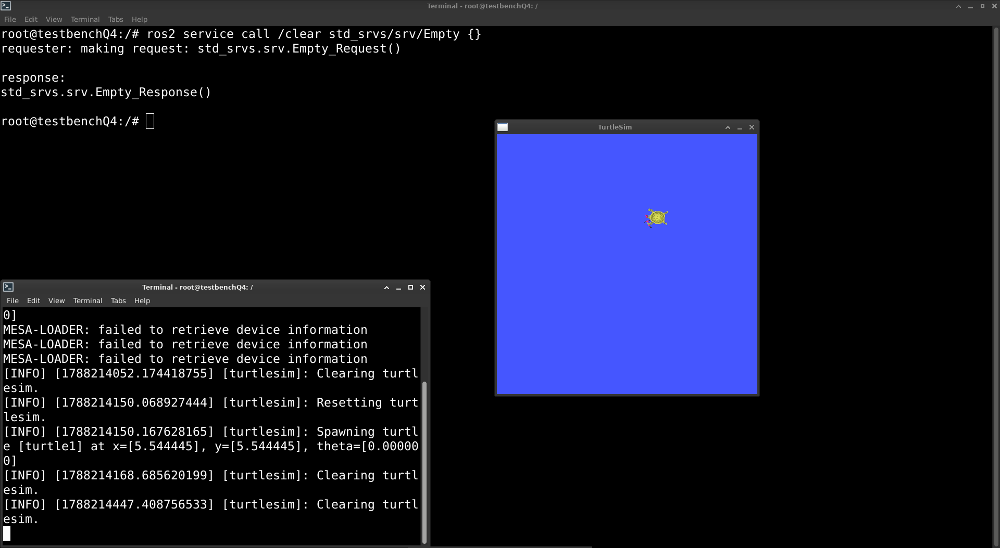

The `/reset` service returns the turtle to its starting position:

```bash
ros2 service call /reset std_srvs/srv/Empty {}
```

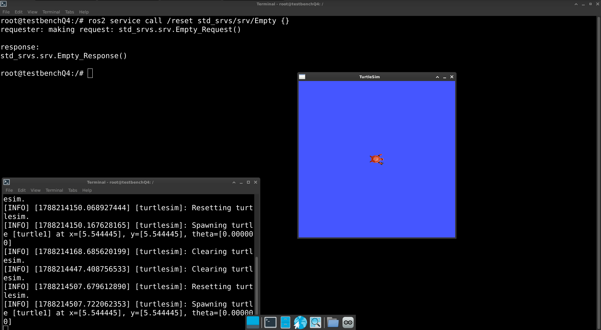

### Exploring the ROS 2 Graph

With `turtlesim` running, open a third container shell and use the ROS 2 command-line tools to inspect what is happening in the system.

`ros2 node list` shows all running nodes. With turtlesim active, you should see `/turtlesim` listed:

```bash
ros2 node list
```

`ros2 topic list` shows all active topics. You will see `/turtle1/cmd_vel` for velocity commands and `/turtle1/pose` for the turtle's current position, among others:

```bash
ros2 topic list
```

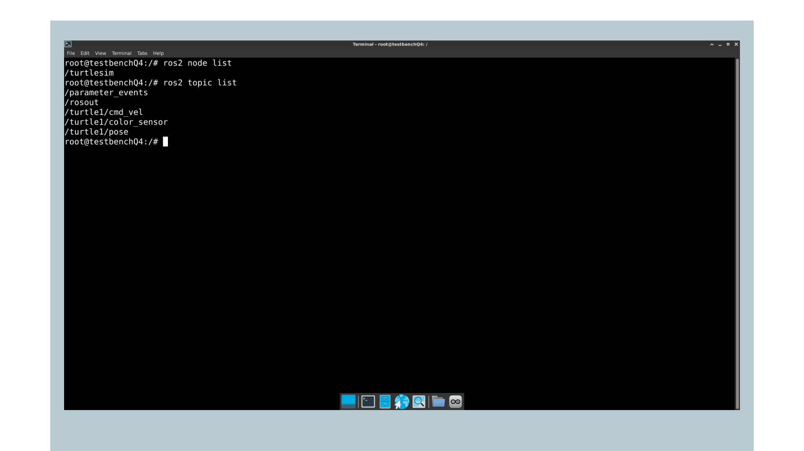

`ros2 topic echo` prints every message being published on a topic in real time. Running it on `/turtle1/cmd_vel` lets you see the velocity commands streaming while the turtle is moving:

```bash
ros2 topic echo /turtle1/cmd_vel
```

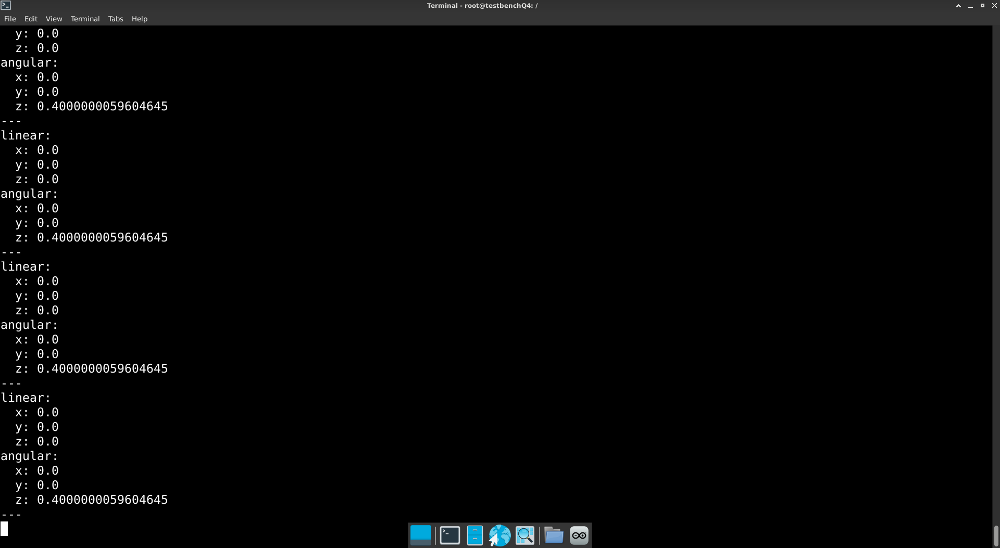

`ros2 node info` shows the full details of a specific node, including which topics it publishes to, which it subscribes to, and which services it exposes:

```bash
ros2 node info /turtlesim
```

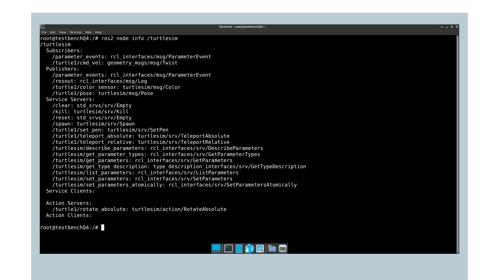

Getting comfortable with these commands helps because they work the same way regardless of which nodes are running, so you will use them throughout the rest of this series.

## Creating First ROS 2 Project

With ROS 2 verified and turtlesim explored, the next step is to build a project from scratch. You will create a package in the shared workspace, write a publisher node and a subscriber node in Python®, build the package and run both nodes to see them communicate.

This section follows the official ROS 2 Python® publisher and subscriber guide, adapted to run on the UNO Q. The full reference is available at [Writing a Simple Publisher and Subscriber (Python)](https://docs.ros.org/en/jazzy/Tutorials/Beginner-Client-Libraries/Writing-A-Simple-Py-Publisher-And-Subscriber.html).

### ROS 2 Core Concepts

Before writing code, it is useful to understand the key concepts you will work with:

- **Node:** a single process that performs one specific task, such as reading a sensor, processing data, or sending commands to a motor. Nodes communicate with each other using topics, services and actions. In a real robot, dozens of nodes can run simultaneously, each responsible for a different part of the system.
- **Topic:** a named channel over which nodes exchange messages asynchronously. Think of it as a radio frequency where any node can broadcast, and any node can tune in to listen. Any number of nodes can publish to or subscribe to the same topic at the same time.
- **Publisher:** a component of a node that sends messages to a topic.
- **Subscriber:** a component of a node that receives messages from a topic and passes them to a callback function.
- **Package:** the basic unit of software organization in ROS 2. A package groups related nodes, libraries, configuration files, and build instructions.
- **Workspace:** a directory where you build and install one or more packages using the `colcon` build tool.

### Using the Shared Workspace

The `ros2_ws` folder inside `~/ros2` on the board is shared with the container through a volume, where it appears at `/ros2_ws`. Everything you write there is stored on the board's eMMC, not inside the container.

Container shells already open in this folder. If you have moved elsewhere, return to it:

```bash
cd /ros2_ws
```

Put all packages in `src/`. When you run `colcon build` from the workspace root, it compiles them.

It places the results in three directories alongside `src/`, which the container created on its first start:

- `build/` for intermediate files
- `install/` for the compiled outputs
- `log/` for build logs

<Alert type="note">

**Note:** Files created inside the container are owned by `root`, so they will appear as root-owned when you browse `~/ros2/ros2_ws` from the board's Debian session. Run `sudo chown -R $USER:$USER ~/ros2/ros2_ws` on the board if you want to edit them with a desktop editor.

</Alert>

### Creating a Python® Package

Navigate into `src/`:

```bash
cd /ros2_ws/src
```

Create a new package using the `ament_python` build type, which is the standard for pure Python® packages in ROS 2:

```bash
ros2 pkg create --build-type ament_python unoq_pubsub
```

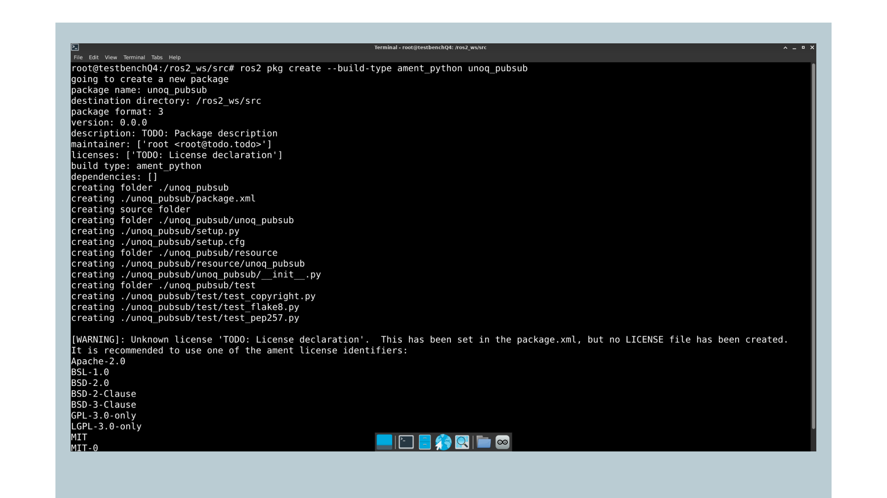

The command creates the following structure:

```bash
src/
└── unoq_pubsub/
    ├── package.xml
    ├── setup.py
    ├── setup.cfg
    ├── resource
    ├── test
    └── unoq_pubsub/
        └── __init__.py
```

The `package.xml` file describes the package metadata and dependencies. The `setup.py` file registers your Python® scripts as executable ROS 2 nodes. The inner `unoq_pubsub/` directory is the Python module where your node scripts will live.

### Writing the Publisher Node

Create the publisher script inside the package's Python® module directory:

```bash
nano /ros2_ws/src/unoq_pubsub/unoq_pubsub/publisher.py
```

```python
import rclpy
from rclpy.node import Node
from std_msgs.msg import String

class UNOQPublisher(Node):
    def __init__(self):
        super().__init__('unoq_publisher')
        self.publisher_ = self.create_publisher(String, 'unoq_topic', 10)
        self.timer = self.create_timer(1.0, self.timer_callback)
        self.count = 0

    def timer_callback(self):
        msg = String()
        msg.data = f'Hello from UNO Q: {self.count}'
        self.publisher_.publish(msg)
        self.get_logger().info(f'Publishing: "{msg.data}"')
        self.count += 1

def main(args=None):
    rclpy.init(args=args)
    node = UNOQPublisher()
    rclpy.spin(node)
    node.destroy_node()
    rclpy.shutdown()

if __name__ == '__main__':
    main()
```

This node inherits from the ROS 2 `Node` base class and registers itself as `unoq_publisher`. In the constructor, it creates a publisher on the `unoq_topic` topic with a queue size of 10 and sets up a timer that calls `timer_callback` once per second.

Each time the callback fires, it builds a `String` message with the current count, publishes it to the topic, and logs the content to the console.

<Alert type="note">

**Note:** The `nano` editor is available in the container because you added it to the `Dockerfile` in the previous tutorial. You can also edit these files from the board's desktop session, since the workspace is shared.

</Alert>

### Writing the Subscriber Node

Create the subscriber script in the same directory:

```bash
nano /ros2_ws/src/unoq_pubsub/unoq_pubsub/subscriber.py
```

```python
import rclpy
from rclpy.node import Node
from std_msgs.msg import String

class UNOQSubscriber(Node):

    def __init__(self):
        super().__init__('unoq_subscriber')
        self.subscription = self.create_subscription(
            String,
            'unoq_topic',
            self.listener_callback,
            10
        )

    def listener_callback(self, msg):
        self.get_logger().info(f'Received: "{msg.data}"')

def main(args=None):
    rclpy.init(args=args)
    node = UNOQSubscriber()
    rclpy.spin(node)
    node.destroy_node()
    rclpy.shutdown()

if __name__ == '__main__':
    main()
```

This node subscribes to `unoq_topic` with a queue size of 10. Whenever a message arrives on that topic, the `listener_callback` function is called, and the message content is printed to the console. The node name is `unoq_subscriber`.

### Registering the Entry Points

For nodes to be launchable with `ros2 run`, register them as console script entry points in `setup.py`. This tells colcon to create executable wrappers for each node during the build. Open the file:

```bash
nano /ros2_ws/src/unoq_pubsub/setup.py
```

Find the `entry_points` dictionary and update it as follows:

```python
entry_points={
    'console_scripts': [
        'publisher = unoq_pubsub.publisher:main',
        'subscriber = unoq_pubsub.subscriber:main',
    ],
},
```

### Building the Workspace

Return to the workspace root:

```bash
cd /ros2_ws
```

Build the package:

```bash
colcon build --packages-select unoq_pubsub
```

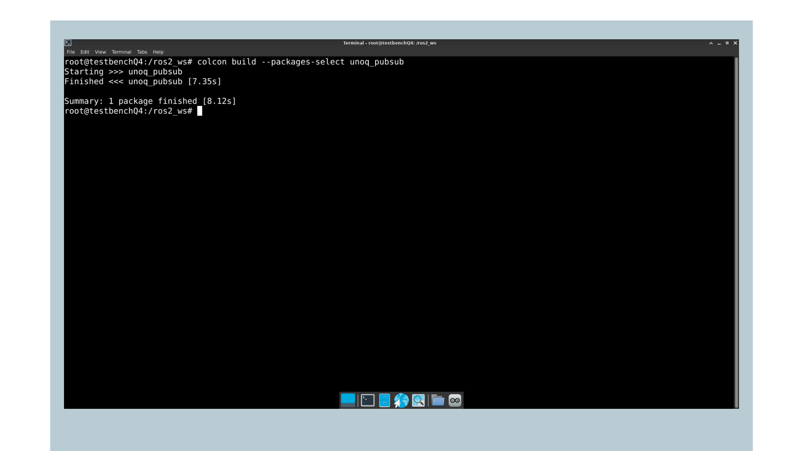

Once the build completes, source the workspace install directory to make the package available in the current shell session:

```bash
source install/setup.bash
```

The `--packages-select` flag tells colcon to build only the specified package instead of everything in the workspace. It is useful when you have multiple packages and want to save time by rebuilding only the one you are working on. Without it, colcon would try to build all packages in `src/`.

You only need to source the workspace by hand in shells that were already open before the build. New shells opened with `docker compose exec ros2 bash` load the workspace automatically, since the container's `.bashrc` sources `/ros2_ws/install/setup.bash` whenever it exists.

### Running the Nodes

Open two shells in the container. In the first one, start the publisher:

```bash
ros2 run unoq_pubsub publisher
```

You should see it printing a new message every second:

```bash
[INFO] [unoq_publisher]: Publishing: "Hello from UNO Q: 0"
[INFO] [unoq_publisher]: Publishing: "Hello from UNO Q: 1"
[INFO] [unoq_publisher]: Publishing: "Hello from UNO Q: 2"
```

In the second shell, start the subscriber:

```bash
ros2 run unoq_pubsub subscriber
```

You should see it receiving and printing each message the publisher sends:

```bash
[INFO] [unoq_subscriber]: Received: "Hello from UNO Q: 0"
[INFO] [unoq_subscriber]: Received: "Hello from UNO Q: 1"
[INFO] [unoq_subscriber]: Received: "Hello from UNO Q: 2"
```

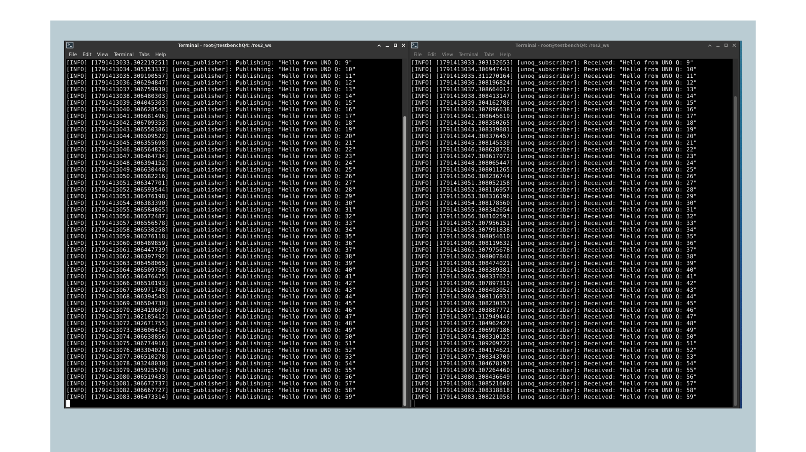

If both nodes show the expected output, your first ROS 2 project is working correctly.

### Inspecting the System

With both nodes running, open a third shell and use the ROS 2 command-line tools to inspect the graph. These are the same tools you used with turtlesim, and they work the same way here.

`ros2 node list` will show both nodes you just launched:

```bash
ros2 node list
```

```bash
/unoq_publisher
/unoq_subscriber
```

`ros2 topic list` will show `/unoq_topic` alongside the default ROS 2 system topics:

```bash
ros2 topic list
```

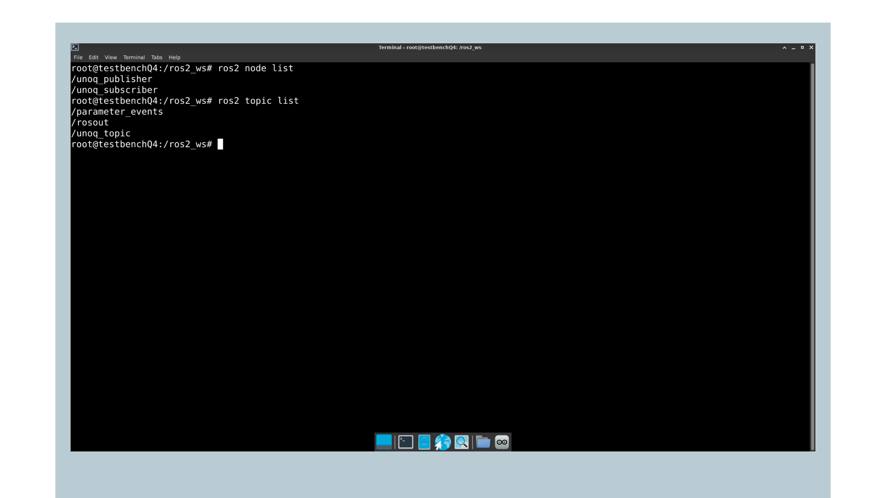

`ros2 topic echo` prints each message as it arrives on the topic in real time, which is a quick way to check that data is streaming without running a dedicated subscriber node:

```bash
ros2 topic echo /unoq_topic
```

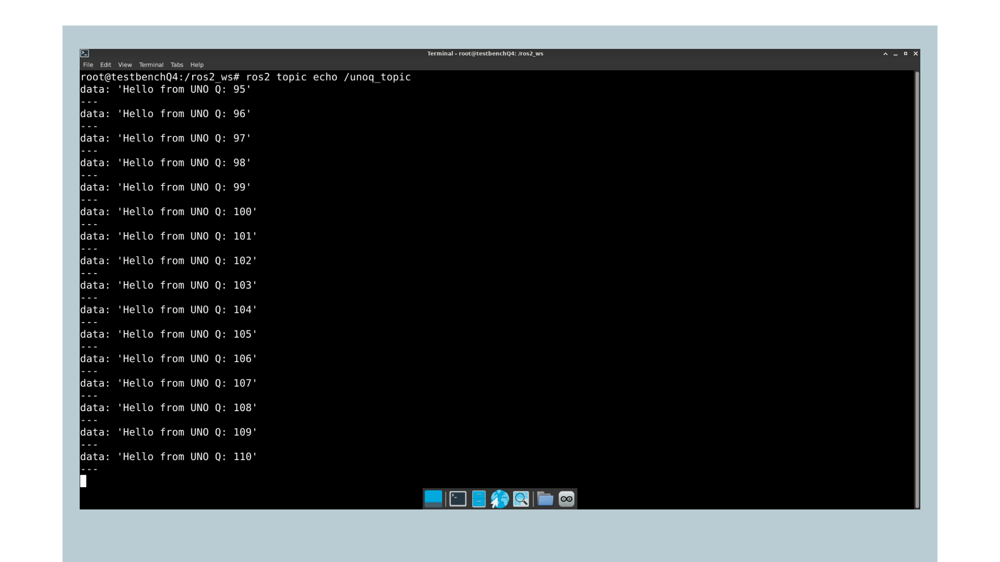

`ros2 topic info` shows the message type, how many nodes are publishing to the topic, and how many are subscribed to it:

```bash
ros2 topic info /unoq_topic
```

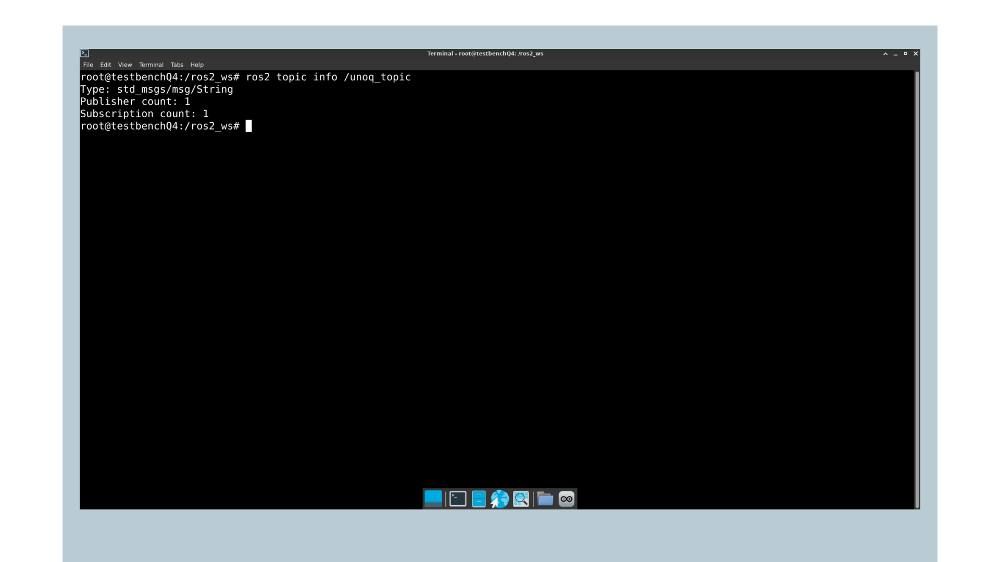

## Troubleshooting

If the `ros2` command is not found, make sure you opened the shell with `docker compose exec ros2 bash`. That shell loads the container's `.bashrc`, which sources ROS 2 and the workspace automatically.

If the `turtlesim` window does not appear, check the following in order. First, confirm you are working from the board's desktop session in **SBC mode** with the hub and display attached, not over SSH or ADB.

Second, make sure you ran `xhost +local:docker` in the desktop session. This resets on logout, so you need to run it again after each reboot. Third, check that the container has the `DISPLAY` variable set, using the following from a terminal on the board, inside the `~/ros2` folder:

```bash
docker compose exec ros2 printenv DISPLAY
```

If this prints nothing, the compose file is missing the `DISPLAY` setting. Add it as shown in [Getting Started with ROS 2 on UNO Q](/tutorials/uno-q/ros2-setup/#starting-the-container), then recreate the container:

```bash
docker compose up -d
```

When you start a graphical node, the terminal prints a few warnings before the window appears. These are expected on the UNO Q and do not indicate a problem.

The `XDG_RUNTIME_DIR not set` message comes from Qt looking for a per-user runtime directory that the container does not define. It falls back to a temporary directory and continues normally. You can set it yourself if you prefer cleaner output:

```bash
export XDG_RUNTIME_DIR=/tmp/runtime-root
```

The `MESA-LOADER: failed to retrieve device information` messages appear because the graphics device node is not present inside the container. Mesa then falls back to requesting access through the X server, which succeeds, so it still uses hardware acceleration. To check this, refresh the package lists inside the container, since the image removes them to save space:

```bash
apt update
```

Then install the Mesa utilities. This installation lasts until the container is recreated:

```bash
apt install -y mesa-utils
```

Check which renderer is active:

```bash
glxinfo | grep "OpenGL renderer"
```

On the UNO Q, this reports `FD702`, which is the driver for the board's GPU. If it reports `llvmpipe` instead, the system has fallen back to software rendering. Turtlesim still runs in that case, but heavier graphical tools will be slow.

The `os_same_file_description` message that follows comes from Docker blocking a system call that Mesa uses to compare file descriptors. Mesa continues with a safe assumption and rendering is unaffected.

If nodes running in different shells cannot discover each other, confirm the compose file contains `network_mode: host` and `ipc: host`, and that all shells share the same `ROS_DOMAIN_ID`. The compose file sets it to 0 for every shell, so a mismatch only happens if you changed it by hand in one session. Print the current value in each shell with:

```bash
echo $ROS_DOMAIN_ID
```

If `ros2 node list` returns nothing while your nodes are running, but `ros2 topic list` shows the expected topics, the ROS 2 daemon is holding incomplete graph information.

The daemon caches the system state in the background and can miss nodes that started before it did. Query the graph directly, without the daemon:

```bash
ros2 node list --no-daemon
```

If your nodes appear, restart the daemon:

```bash
ros2 daemon stop
```

The daemon starts again automatically with the next `ros2` command, so run the list once more to confirm:

```bash
ros2 node list
```

If the `unoq_pubsub` package is not found after building, source the workspace install directory:

```bash
source /ros2_ws/install/setup.bash
```

If the build fails due to missing dependencies, declare them in the package's `package.xml` and rebuild the image from a terminal on the board, inside the `~/ros2` folder. The `Dockerfile` runs `rosdep` during the build, which installs every dependency declared by the packages in `src/` into the image:

```bash
docker compose up -d --build
```

If the build fails or the board becomes unresponsive during `colcon build`, you may be running out of memory. Limit colcon to a single worker:

```bash
colcon build --packages-select unoq_pubsub --parallel-workers 1
```

## Conclusion

In this tutorial, you have explored the core concepts of ROS 2 through the `turtlesim` example, checked a live system with the ROS 2 command-line tools, and built your first ROS 2 project with a publisher and subscriber communicating over a topic. The patterns introduced here, nodes, topics, packages and workspaces, are the base of every tutorial in this series.

### Next Steps

Now that ROS 2 is running and you have a working project structure, you can move on to connecting real sensors to the UNO Q. Keep in mind that USB sensors connect through the hub. The container will need access to the corresponding device nodes.

For a broader introduction to ROS 2 concepts, the [official ROS 2 tutorials](https://docs.ros.org/en/jazzy/Tutorials.html) are a recommended starting point.

## Acknowledgments

ROS is a trademark of Open Source Robotics Foundation. This tutorial is provided for educational purposes to help users learn ROS 2 on Arduino hardware. This content does not imply endorsement, partnership, or affiliation between Arduino and Open Source Robotics Foundation.

## Support

If you encounter any issues or have questions while working with the UNO Q, we provide various support resources to help you find answers and solutions.

### Help Center

Explore our Help Center, which offers a comprehensive collection of articles and guides for the UNO Q. The Arduino Help Center is designed to provide in-depth technical assistance and help you make the most of your device.

- [Arduino Help Center](https://support.arduino.cc/hc)

### Forum

Join our community forum to connect with other users, share your experiences, and ask questions.

- [UNO Q category in the Arduino Forum](https://forum.arduino.cc/c/official-hardware/uno-family/uno-q/222)

### Contact Us

Please get in touch with our support team if you need personalized assistance or have questions not covered by the help and support resources described above.

- [Contact us page](https://www.arduino.cc/pro/contact-us)
