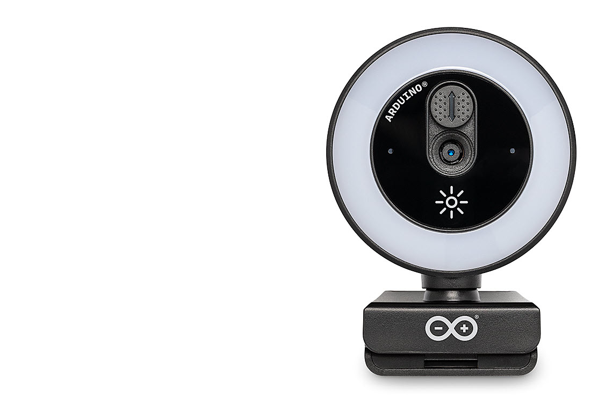
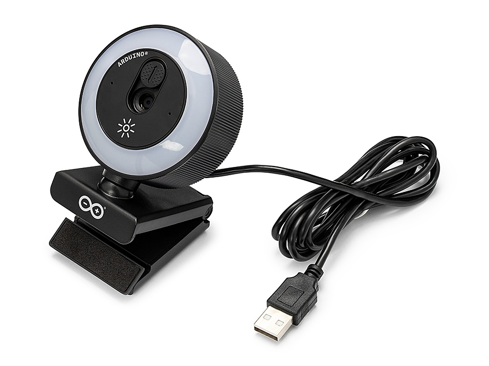
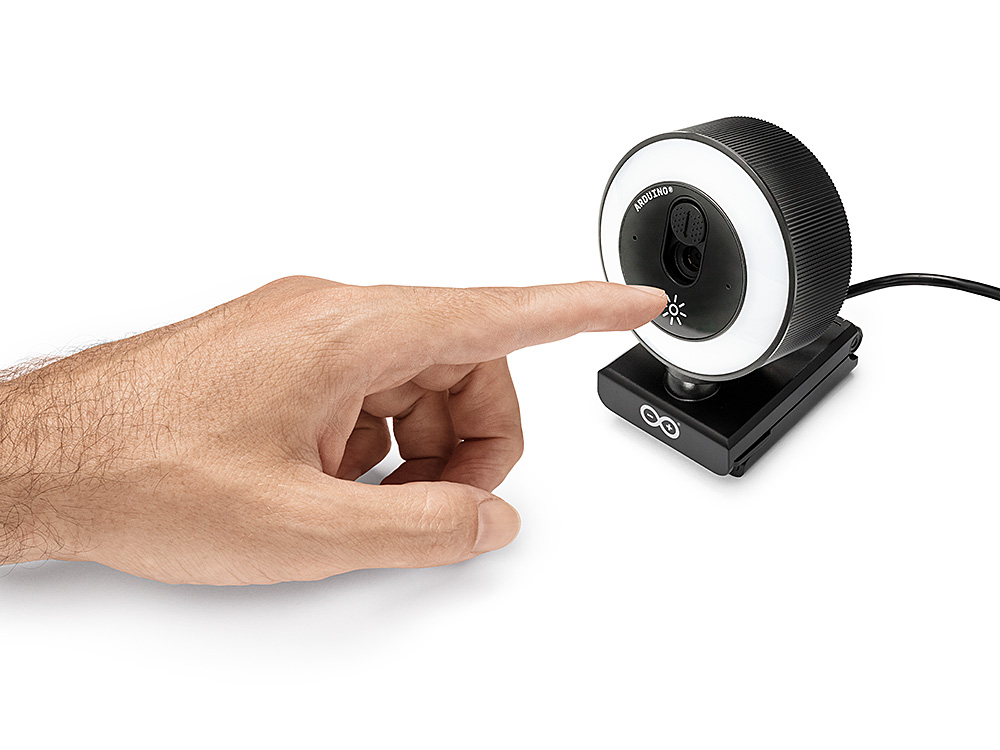
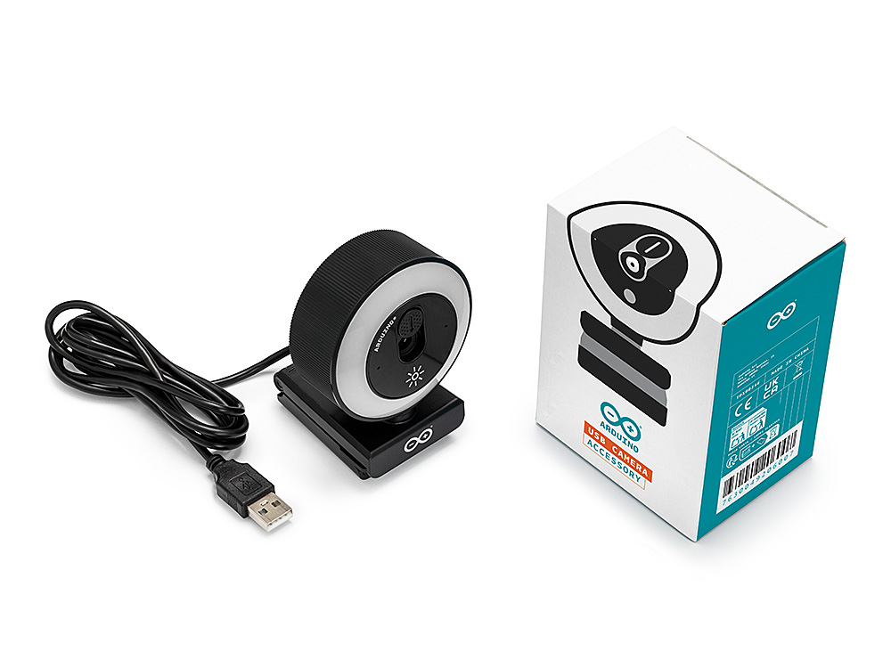

# Description

The Arduino® USB Camera is a compact, plug-and-play USB webcam compatible with any UVC-compatible host, including computers and single-board computers. Built around the Sony IMX376 image sensor, it delivers up to 3840 × 2160 (UHD 4K) video and is recognized automatically as a standard USB Video Class (UVC) device, with no drivers to install. Its autofocus lens, integrated LED ring light, and built-in microphone make it equally suited to everyday video conferencing on a PC and to camera-based projects on Arduino boards like the Arduino® UNO™ Q and Arduino® VENTUNO™ Q.

# Target Areas:

Computer vision, video streaming, video conferencing, Edge AI

# CONTENTS

## Application Examples

The Arduino USB Camera works as a standard USB webcam with any UVC-compatible computer and, when connected to an Arduino board, such as the UNO Q or VENTUNO Q, adds high-resolution image capture to a wide range of development scenarios.

- **Computer vision and Edge AI**: Capture high-resolution frames directly on the Linux side of the UNO Q or VENTUNO Q for on-device image classification, object detection, and other vision tasks, keeping image processing local to the board.
  
- **Video streaming and remote monitoring**: Stream live UHD video over the network for remote monitoring, telepresence, or surveillance setups, taking advantage of the camera's UVC compatibility and high resolution.

- **Machine vision and inspection**: Use the 4K resolution together with autofocus from 20 cm to infinity for inspection, defect detection, and measurement tasks in prototyping and light industrial scenarios.

- **Video capture and conferencing**: Combine the autofocus lens, integrated LED ring light, and built-in microphone to build recording, conferencing, or content-capture stations driven by the UNO Q or VENTUNO Q.

- **Education and rapid prototyping**: Driver-free UVC operation makes the camera a straightforward, low-friction tool for teaching computer vision fundamentals and building vision-enabled prototypes without additional software setup.

- **Standard USB webcam**: Use the camera as a plug-and-play webcam on any Windows, macOS, or Linux computer for video streaming and recording, with its autofocus lens, LED ring light, and built-in microphone ready to use out of the box.

## Features

### General Specifications Overview

The USB Camera is a compact, plug-and-play camera accessory built around the Sony IMX376 image sensor. It connects over USB to any UVC-compatible host and is recognized automatically as a standard USB Video Class (UVC) device, delivering up to 3840 × 2160 (UHD 4K) video together with autofocus, an integrated LED ring light, and a built-in microphone. Its driver-free UVC operation makes it straightforward to add high-resolution video capture and vision-based applications, including projects running on the Linux side of Arduino boards such as the UNO Q and VENTUNO Q.

The main features of the camera are highlighted in the table shown below.

| **Feature**          | **Description**                                                                                                                                                                 |
|----------------------|---------------------------------------------------------------------------------------------------------------------------------------------------------------------------------|
| Image Sensor         | Sony IMX376 CMOS image sensor, 1/2.8" optical format                                                                                                                            |
| Effective Resolution | 8 MP, 3840 (H) × 2160 (V)                                                                                                                                                       |
| Pixel Size           | 1.0 µm native; 2.0 µm with 4-in-1 binning                                                                                                                                       |
| Video Output         | Up to 3840 × 2160 (UHD 4K) at 30 fps (MJPEG); additional lower resolutions available at 30 fps                                                                                  |
| Output Formats       | MJPEG and YUY2 (YUYV) uncompressed                                                                                                                                              |
| Lens                 | Fixed lens (non-interchangeable), F/2.0 aperture                                                                                                                                |
| Field of View        | 80° diagonal, 63° horizontal, 50° vertical                                                                                                                                      |
| Focus                | Autofocus, from 20 cm to infinity                                                                                                                                               |
| Image Processing     | Automatic exposure control (AEC), automatic white balance (AWB), and automatic gain control (AGC)                                                                               |
| Shutter              | Electronic rolling shutter                                                                                                                                                      |
| Integrated Lighting  | Built-in LED ring light, 4000 lux, with warm white (3000 - 3500 K) and cool white (6000 - 6500 K) settings                                                                      |
| Microphone           | Integrated single analog microphone, exposed as a standard USB Audio Class (UAC) device                                                                                         |
| Interface            | USB 2.0 High Speed, USB-A connector                                                                                                                                             |
| Driver Support       | USB Video Class (UVC) compliant; driver-free, plug-and-play                                                                                                                     |
| Host Compatibility   | Any UVC-compatible host (Windows, macOS, Linux, Android). Connects directly to the Arduino VENTUNO Q onboard USB Type-A port; a USB hub or adapter may be required on the UNO Q |
| Power Supply         | USB bus-powered (+5 VDC)                                                                                                                                                        |
| Dimensions           | 70 mm × 40 mm × 90 mm                                                                                                                                                           |
| Weight               | 105 g                                                                                                                                                                           |

### Related Products

- Arduino® UNO™ Q 2GB (SKU: ABX00162)
- Arduino® UNO™ Q 4GB (SKU: ABX00173)
- Arduino® VENTUNO™ Q (SKU: ABX00181)
- Arduino® USB-C Hub (8 in 1) (SKU: TPX00241)

## Ratings

### Recommended Operating Conditions

The table below outlines the typical operating conditions of the USB Camera. The camera is bus-powered through its USB connection and does not require an external power supply.

|              **Parameter**              |      **Symbol**     | **Min** | **Typ** | **Max** | **Unit** |
|:---------------------------------------:|:-------------------:|:-------:|:-------:|:-------:|:--------:|
|            USB Supply Voltage           |   VUSB   |   4.8   |   5.0   |   5.2   |     V    |
| Operating Current (LED off)1 |    IOP   |    -    |   250   |   290   |    mA    |
|  Operating Current (LED on)1 | IOP(LED) |    -    |   410   |   450   |    mA    |
|          Operating Temperature          |    TOP   |    0    |    -    |    70   |    °C    |
|           Storage Temperature           |   TSTG   |   -20   |    -    |    75   |    °C    |

1 The operating current depends on the active video resolution and frame rate. Typical and maximum values are given with the integrated LED ring light disabled (LED off) and enabled (LED on).

>[!NOTE]
>**Driver Tip:** The USB Camera is compliant with the **USB Video Class (UVC)** standard and does not require any additional drivers. It is recognized automatically as a standard video device by the Linux system running on the UNO Q and VENTUNO Q, as well as by any other UVC-compatible host.

>[!NOTE]
>**Safety Note:** The camera is powered exclusively through its USB connection (USB bus power). <**Do not attempt to supply external power to the camera**. When connecting the camera through a USB hub, make sure the hub can supply enough current for the camera and for any other peripheral connected to it.

## Supported Resolutions and Frame Rates

The USB Camera supports two output image formats: **MJPEG**, a compressed format, and **YUY2 (YUYV)**, an uncompressed format. Because both formats share the bandwidth of a single USB 2.0 High Speed connection, the maximum frame rate available at a given resolution depends on the selected format. The compressed MJPEG format sustains 30 fps across the full resolution range, up to 3840 × 2160 (UHD 4K), while the uncompressed YUY2 format is limited to lower resolutions and frame rates.

### MJPEG Output

The resolutions and frame rates supported by the camera in MJPEG format are listed in the table below.

| **Resolution** | **Frame Rate** | **Notes** |
|:--------------:|:--------------:|:---------:|
|   3840 × 2160  |     30 fps     |   UHD 4K  |
|   3264 × 1840  |     30 fps     |     -     |
|   2560 × 1920  |     30 fps     |     -     |
|   2560 × 1440  |     30 fps     |   2K QHD  |
|   2048 × 1536  |     30 fps     |     -     |
|   1920 × 1080  |     30 fps     |  Full HD  |
|   1600 × 1200  |     30 fps     |     -     |
|   1440 × 1080  |     30 fps     |     -     |
|   1280 × 960   |     30 fps     |     -     |
|   1280 × 720   |     30 fps     |     HD    |
|   1024 × 768   |     30 fps     |     -     |
|    960 × 720   |     30 fps     |     -     |
|    960 × 540   |     30 fps     |     -     |
|    800 × 600   |     30 fps     |     -     |
|    640 × 480   |     30 fps     |    VGA    |
|    320 × 240   |     30 fps     |    QVGA   |

### YUY2 (YUYV) Output

The resolutions and frame rates supported by the camera in uncompressed YUY2 format are listed in the table below.

| **Resolution** | **Frame Rate** | **Notes** |
|:--------------:|:--------------:|:---------:|
|   1920 × 1080  |      5 fps     |  Full HD  |
|   1280 × 720   |     10 fps     |     HD    |
|    720 × 480   |     30 fps     |     -     |
|    640 × 480   |     30 fps     |    VGA    |
|    640 × 360   |     30 fps     |     -     |
|    320 × 240   |     30 fps     |    QVGA   |
|    320 × 180   |     30 fps     |     -     |
|    176 × 144   |     30 fps     |    QCIF   |

>[!NOTE]
>**Performance Tip:** For applications that require high resolution or high frame rates, use the **MJPEG** format. The uncompressed **YUY2** format avoids the decoding step on the host, but its higher bandwidth requirements restrict it to lower resolutions and frame rates over USB 2.0.

## Device Operation

### Getting Started

The USB Camera is a standard USB Video Class (UVC) device and requires no drivers or additional configuration. On any computer that supports UVC, including Windows, macOS, and Linux systems, the camera works as a plug-and-play webcam: connect it to a USB port and it is recognized automatically as a standard video capture device, ready to use with video conferencing, streaming, or recording applications.

To use the camera with an UNO Q or VENTUNO Q board, connect it to a USB port on the board. On the VENTUNO Q, the camera can be connected directly to the onboard USB Type-A port. On the UNO Q, a USB hub or adapter may be required. Once connected, the Linux system running on the board detects the camera automatically and exposes it as a standard video capture device, which can then be accessed by any application or library that supports UVC devices.

Because the camera is bus-powered, when it is connected through a USB hub the hub must be able to supply enough current for the camera and for any other peripheral connected to it. **A powered USB hub is recommended when the camera is used together with other USB peripherals, or when the integrated LED ring light is enabled**.

### Video Capture

The camera streams video in MJPEG or YUY2 (YUYV) format at the resolutions and frame rates listed in the [Supported Resolutions and Frame Rates](#supported-resolutions-and-frame-rates) section. The output format, resolution, and frame rate are selected by the host application through the standard UVC interface. Autofocus, automatic exposure control, automatic white balance, and automatic gain control operate on the camera itself and require no configuration on the host side.

The camera also includes an integrated single analog microphone, which is exposed to the host as a standard USB Audio Class (UAC) device, independently of the video stream.

>[!NOTE]
>**Driver Tip:** Because the camera follows the **UVC** standard, it is compatible with any host that implements this class, including the Linux system running on the UNO Q and VENTUNO Q, as well as Windows, macOS, and Android hosts.

### LED Ring Light

The integrated LED ring light is controlled by a touch button on the camera, marked with a light-bulb icon. Pressing the button switches the light on and cycles through its warm white and cool white color settings. The LED ring light is controlled entirely on the device and operates independently of the USB video and audio interfaces.

### Online Resources

Now that you have learned the basics of the USB Camera, you can explore the endless possibilities it provides by checking out exciting projects on Arduino Project Hub **[1]**, the Arduino Library Reference <**[2]**, and the online store **[3]**, where you will be able to complement your camera with additional accessories.

## Mechanical Information

### Product Dimensions

The dimensions and weight of the USB Camera are listed in the table below.

|      **Parameter**     |       **Value**       |
|:----------------------:|:---------------------:|
| Dimensions1 | 70 mm × 40 mm × 90 mm |
|         Weight         |         105 g         |

1 Dimensions refer to the **camera body** only, excluding the USB cable. The length of the included USB-A cable is 1 m.

### Package Contents

The USB Camera is supplied in a box containing the following items:

|       **Item**      | **Quantity** |
|:-------------------:|:------------:|
| Arduino® USB Camera |       1      |
|  USB-A cable (1 m)  |       1      |

## Product Compliance

### Product Compliance Summary

| **Product Compliance** |
|:----------------------:|
|   CE (European Union)  |
|  UKCA (United Kingdom) |
|          RoHS          |
|          REACH         |
|          WEEE          |

## Company Information

| **Company Information** | **Details**                                |
|:-----------------------:|--------------------------------------------|
|       Company Name      | Arduino S.r.l.                             |
|     Company Address     | Via Andrea Appiani, 25-20900 Monza (Italy) |

## Reference Documentation

| **No.** |      **Reference**      | **Link**                                    |
|:-------:|:-----------------------:|---------------------------------------------|
|    1    |       Project Hub       | https://create.arduino.cc/projecthub        |
|    2    |    Library Reference    | https://www.arduino.cc/reference/en/        |
|    3    |      Arduino Store      | https://store.arduino.cc/                   |
|    4    |   UNO Q Documentation   | https://docs.arduino.cc/hardware/uno-q/     |
|    5    | VENTUNO Q Documentation | https://docs.arduino.cc/hardware/ventuno-q/ |

## Document Revision History

| **Date**   | **Revision** |  **Changes**  |
|:----------:|:------------:|:-------------:|
| 15/10/2026 |       1      | First release |
