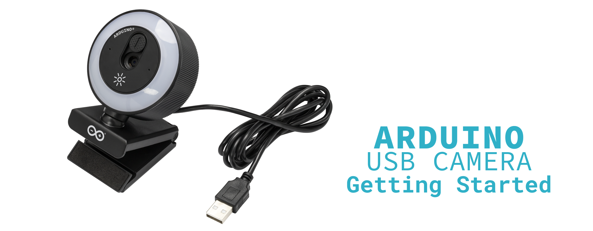
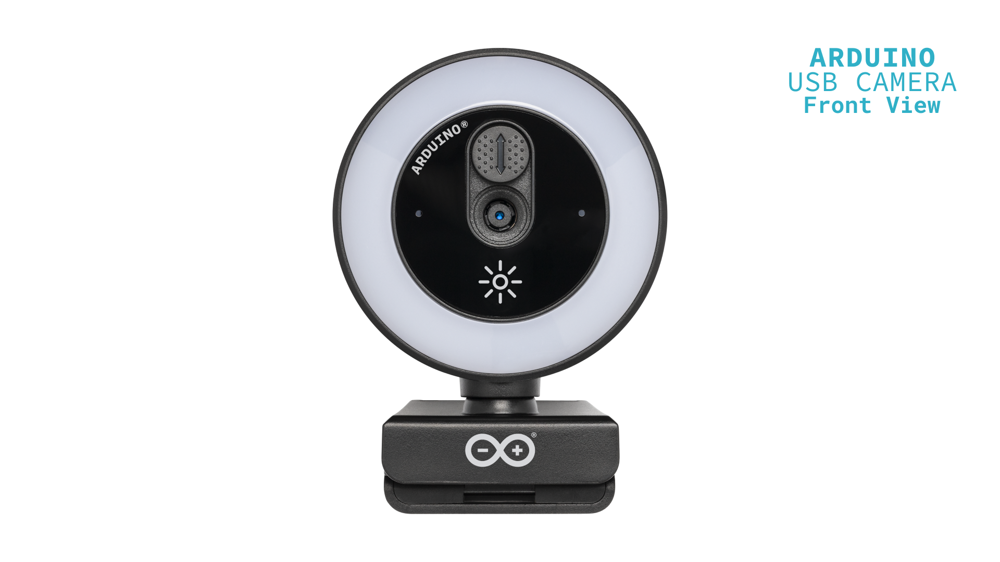
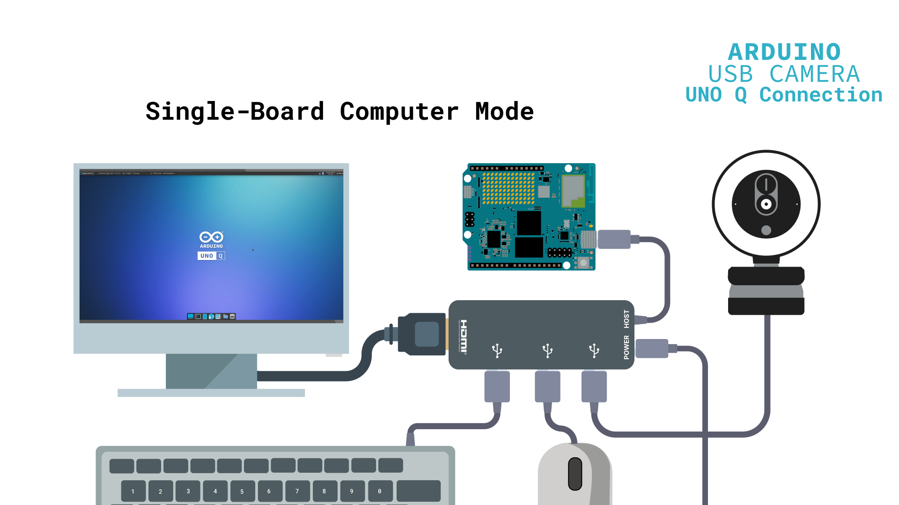
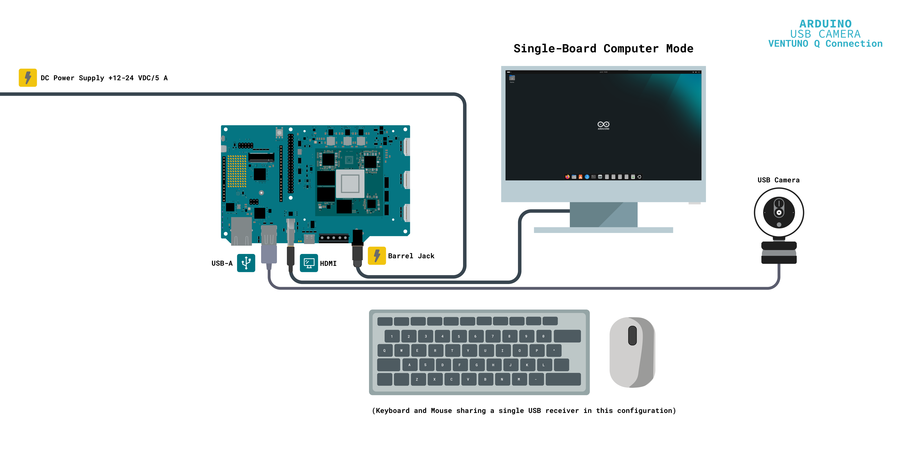
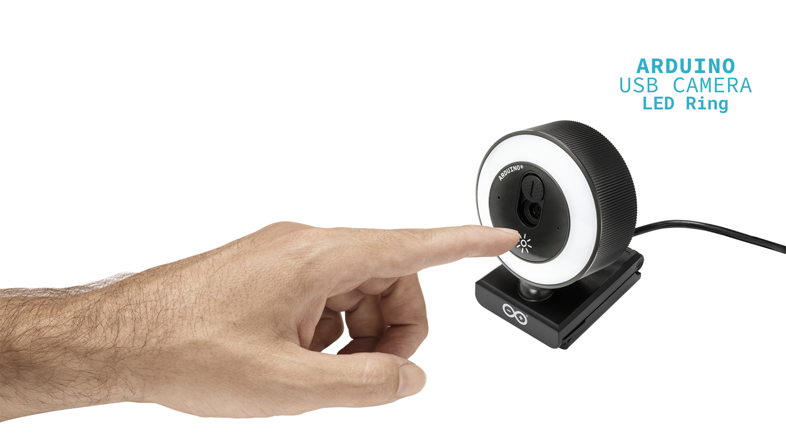

## Overview

The Arduino® USB Camera is a compact, plug-and-play camera accessory built around the Sony IMX376 image sensor. It captures up to 3840 × 2160 (UHD 4K) video and combines an autofocus lens, an integrated LED ring light, and a built-in microphone in a single unit.



Because the camera complies with the USB Video Class (UVC) standard, it requires no drivers. Windows, macOS, and Linux automatically recognize it as a standard video capture device. It works as a conventional webcam on any computer, and equally well as a video input for projects running on the Linux side of the Arduino UNO Q and VENTUNO Q boards.

This tutorial covers both contexts. You will learn to use the camera as a plug-and-play webcam on a computer, connect it to a UNO Q or VENTUNO Q board, confirm that the system has detected it, and capture your first images and video from the desktop and from the command line.

## Goals

The goals of this tutorial are the following:

- Learn about the main hardware features of the Arduino USB Camera.
- Use the camera as a standard USB webcam on Windows, macOS, or Linux.
- Connect the camera to an Arduino UNO Q or VENTUNO Q board.
- Verify that a Linux host detects the camera as a UVC video device.
- Capture images and video using the **Cheese** application.
- Capture images and video from the command line.
- Select the camera's output format, resolution, and frame rate.

## Hardware and Software Requirements

### Hardware Requirements

- [Arduino USB Camera (SKU: TPX00246)](https://store.arduino.cc/) (x1)
- Computer running Windows, macOS, or Linux (x1)

The Arduino USB Camera has an integrated USB-A cable, so no additional cable is required. To follow the sections covering the Arduino UNO Q and VENTUNO Q boards, the following hardware is also required:

- [Arduino UNO Q (SKU: ABX00162 or ABX00173)](https://store.arduino.cc/products/uno-q) or [Arduino VENTUNO Q (SKU: ABX00181)](https://store.arduino.cc/) (x1)
- USB-C® hub with Power Delivery input, HDMI output, and USB-A ports, such as the [Arduino USB-C Hub (8 in 1) (SKU: TPX00241)](https://store.arduino.cc/) (x1) (required for the Arduino UNO Q only)
- External USB-C® power supply for the hub (x1) such as the [Arduino USB-C Power Supply (45W) (SKU: TPX00242)](https://store.arduino.cc/products/usb-c-power-supply-45w) (required for the Arduino UNO Q only)
- HDMI monitor and HDMI cable (x1)
- USB keyboard (x1) and USB mouse (x1)

### Software Requirements

- **No drivers are required**. The camera is a USB Video Class (UVC) device. It is recognized automatically by Windows, macOS, and Linux hosts, including the Linux system running on the Arduino UNO Q and VENTUNO Q boards.
- [`Cheese`](https://apps.gnome.org/Cheese/), a graphical application for capturing images and video from a webcam.
- `v4l-utils`, a set of command-line utilities for working with video devices on Linux.
- `ffmpeg`, a command-line tool for recording and converting audio and video.

The Linux packages listed above are installed from the system's package repositories during this tutorial, so **the system must be connected to the internet**.

## Arduino USB Camera Overview

The Arduino USB Camera is a self-contained USB peripheral. It connects to a standard USB port and is automatically recognized as a USB Video Class (UVC) device, so it requires no drivers, adapters, or host-side configuration.



Here is an overview of the camera's main elements:

- **Autofocus lens**: A non-interchangeable lens with an F/2.0 aperture and an 80° diagonal field of view (63° horizontal, 50° vertical). Autofocus operates from 20 cm to infinity and is handled entirely by the camera.
- **Image sensor**: A Sony IMX376 CMOS image sensor with a 1/2.8" optical format and an effective resolution of 8 MP (3840 × 2160). Automatic exposure control, automatic white balance, and automatic gain control also run on the camera and require no host-side configuration.
- **LED ring light**: An integrated 4000 lux ring light with warm white (3000 - 3500 K) and cool white (6000 - 6500 K) settings. A touch button on the camera controls it and operates independently of the USB video and audio interfaces.
- **Microphone**: An integrated single analog microphone, exposed to the host as a standard USB Audio Class (UAC) device, independently of the video stream.
- **Integrated USB-A cable**: A captive 1 m cable terminated in a USB-A connector. It connects the camera to the host and carries video and audio data, as well as the +5 VDC bus power that the camera runs on.

The table below summarizes the camera's main specifications:

| **Feature**    | **Description**                                                    |
|----------------|--------------------------------------------------------------------|
| Image Sensor   | Sony IMX376 CMOS image sensor, 1/2.8" optical format               |
| Resolution     | 8 MP, up to 3840 × 2160 (UHD 4K) at 30 fps                         |
| Output Formats | MJPEG and YUY2 (YUYV) uncompressed                                 |
| Lens           | Non-interchangeable lens, F/2.0 aperture                           |
| Field of View  | 80° diagonal, 63° horizontal, 50° vertical                         |
| Focus          | Autofocus, from 20 cm to infinity                                  |
| Lighting       | Integrated LED ring light, 4000 lux, warm and cool white settings  |
| Shutter        | Electronic rolling shutter                                         |
| Microphone     | Integrated single analog microphone (UAC device)                   |
| Interface      | USB 2.0 High Speed, integrated USB-A cable (1 m)                   |
| Power Supply   | USB bus-powered (+5 VDC)                                           |
| Dimensions     | 70 mm × 40 mm × 90 mm                                              |
| Weight         | 105 g                                                              |
| Operating Temperature | 0 °C to 70 °C                                               |

<Alert type="note">

For the camera's complete technical specifications, refer to the [Arduino USB Camera datasheet](https://docs.arduino.cc/resources/datasheets/TPX00246-datasheet.pdf).

</Alert>

## Using the Camera with a Computer

The Arduino USB Camera works as a conventional webcam on any computer, with no setup beyond connecting it. This is also the quickest way to confirm that the camera is operating correctly.

Connect the camera to a free USB port on your computer using its USB-A cable. No drivers are needed because the camera follows the UVC standard; Windows, macOS, and Linux recognize it automatically as a standard video capture device. The built-in microphone is exposed separately as a standard UAC audio device and becomes available to the system at the same time.

To confirm that the camera is working, open any application that can access a webcam:

- On Windows, open the **Camera** application.
- On macOS, open **Photo Booth**.
- On Linux, open **Cheese**.

If more than one camera is available on your computer, select the Arduino USB Camera in the application settings. The live preview should appear within a few seconds, and the lens should focus automatically on the subject.

The camera can be used this way for video conferencing, streaming, and recording on any UVC-compatible computer, with no further setup.

## Connecting the Camera to an Arduino Board

The Arduino USB Camera connects to the Linux side of the Arduino UNO Q and VENTUNO Q boards through a standard USB port. The connection procedure differs between the two boards because each provides a different set of USB ports.

<Alert type="note">

**Important note**: The camera is powered exclusively through its USB connection (USB bus power). Do not attempt to supply external power to the camera. When connecting the camera through a USB hub, make sure the hub can supply enough current for the camera and for any other peripherals connected to it.

</Alert>

### Connecting the Camera to the Arduino UNO Q

The Arduino UNO Q provides a single multifunction USB-C port for power, video output, and USB host connectivity. For this reason, you cannot connect the camera directly to the board; you need a USB-C hub with a Power Delivery input.

To connect the camera to the UNO Q, follow the steps below:

1. Connect the USB-C hub to the UNO Q USB-C port.
2. Connect the camera to one of the hub's USB-A ports using its USB-A cable.
3. If you plan to follow the [Capturing Video with Cheese](#capturing-video-with-cheese) section, connect an HDMI monitor, a USB keyboard, and a USB mouse to the hub.
4. Connect the external power supply to the hub's Power Delivery input. The UNO Q does not supply power to the hub; the hub powers itself and the board, and the board boots automatically.



<Alert type="note">

**Important note**: The hub must supply enough current for the camera and any other connected peripherals. See the [Using the LED Ring Light](#using-the-led-ring-light) section for the camera's current consumption.

</Alert>

### Connecting the Camera to the Arduino VENTUNO Q

The Arduino VENTUNO Q has two onboard USB-A 3.0 ports, so you can connect the camera directly to the board without a hub.

To connect the camera to the VENTUNO Q, follow the steps below:

1. Connect the camera to one of the board's USB-A ports using its USB-A cable.
2. Power on the board.



The camera is a USB 2.0 High Speed device and operates correctly in a USB 3.0 port, at USB 2.0 speeds.

If you plan to follow the [Capturing Video with Cheese](#capturing-video-with-cheese) section, also connect an HDMI monitor to the board's HDMI port. Since the camera uses one of the two USB-A ports, you need a USB hub to connect the camera, keyboard, and mouse at the same time, unless you use a keyboard and mouse that share a single USB receiver.

## Verifying Camera Detection

This section and the two that follow apply to any Linux host, including the Linux environment of the Arduino UNO Q and VENTUNO Q boards. You can run the commands from a desktop terminal or remotely over SSH.

First, install `usbutils` and `v4l-utils`, which provide the tools used to inspect USB and video devices:

```bash
sudo apt update
sudo apt install usbutils v4l-utils
```

With the camera connected, confirm the system has enumerated it correctly. List the USB devices connected to the system:

```bash
lsusb
```

Next, list the video devices available on the system:

```bash
v4l2-ctl --list-devices
```

The camera appears in the output together with the device nodes assigned to it, for example `/dev/video1`, `/dev/video2`, and `/dev/media3`. On the Arduino UNO Q and VENTUNO Q boards, the system also exposes its own video and media nodes, such as the hardware video encoder and decoder and, on the VENTUNO Q, the board's camera subsystem. For this reason, the camera is not assigned `/dev/video0` on either board.

The commands in this tutorial use `/dev/videoX` as a placeholder. Replace it with the capture node listed under the camera.

<Alert type="note">

**Important note**: On the Arduino VENTUNO Q, `v4l2-ctl --list-devices` also prints `Failed to open /dev/video0: Operation already in progress`. This node belongs to the board's camera subsystem (`cam-req-mgr`) and is held by a system service. The message does not refer to the USB camera and can be safely ignored.

</Alert>

<Alert type="note">

**Important note**: UVC cameras usually expose two video device nodes and one media node. The first video node is the capture node and is used to obtain images and video; the second carries metadata and cannot be used for capture. The media node (`/dev/mediaN`) is not used in this tutorial. If a capture command fails, verify that you are using the correct node.

</Alert>

To see the formats, resolutions, and frame rates supported by the camera, run the following command:

```bash
v4l2-ctl --device=/dev/videoX --list-formats-ext
```

The output lists the two formats the camera supports, MJPEG and YUY2, along with the resolutions and frame rates available for each. These options are described in the [Video Formats and Resolutions](#video-formats-and-resolutions) section.

## Capturing Video with Cheese

Cheese is a graphical application that captures images and video from a webcam on Linux systems, and is the quickest way to obtain a live preview from the camera. Since it is a desktop application, it requires a graphical environment. On the Arduino UNO Q and VENTUNO Q boards, this means running the board with a monitor, a keyboard, and a mouse connected, as described in the [Connecting the Camera to an Arduino Board](#connecting-the-camera-to-an-arduino-board) section.

Open a terminal and install Cheese:

```bash
sudo apt update
sudo apt install cheese
```

Once installed, launch the application from the desktop's application menu, or from the terminal:

```bash
cheese
```

Cheese opens with a live preview from the camera. If more than one camera is available, select the Arduino USB Camera from the application preferences. You can also change the capture resolution in **Preferences**, since Cheese may start at a low default resolution.

Use the buttons at the bottom of the window to switch between photo and video mode and to start a capture. Captured files are saved in the `Pictures/Webcam` and `Videos/Webcam` folders of your user's home directory.

## Capturing Images and Video From the Command Line

Capturing from the command line does not require a desktop environment, making it suitable for headless setups and integration into scripts and applications.

Install `ffmpeg` and `alsa-utils` on the system:

```bash
sudo apt update
sudo apt install ffmpeg alsa-utils
```

<Alert type="note">

**Important note**: On some systems, `ffmpeg` prints warnings such as `libOpenCL.so.1: no version information available` when it starts. These warnings come from a system library and do not affect the capture.

</Alert>

To capture a single still image at the camera's maximum resolution, run the following command:

```bash
ffmpeg -f v4l2 -input_format mjpeg -video_size 3840x2160 -i /dev/videoX -frames:v 1 -update 1 image.jpg
```

The `-update 1` option tells `ffmpeg` to write a single image file instead of expecting an image sequence.

<Alert type="note">

**Important note**: If the requested resolution is not available, the V4L2 driver may silently substitute a different one and print a message such as `The V4L2 driver changed the video from 3840x2160 to 1920x1080`. Check the `Input #0` line in the output to confirm the resolution actually being captured.

</Alert>

To record ten seconds of video at 1920 × 1080 and 30 fps, run the following command:

```bash
ffmpeg -f v4l2 -input_format mjpeg -video_size 1920x1080 -framerate 30 -i /dev/videoX -t 10 -c:v copy video.mkv
```

The `-c:v copy` option stores the camera's MJPEG stream without re-encoding it. This keeps the processor load low, which matters on resource-constrained systems such as the Arduino UNO Q.

To record video together with audio from the camera's integrated microphone, first identify the audio device assigned to the camera:

```bash
arecord -l
```

The output lists every audio capture device on the system, including the board's own audio devices. Find the card whose name matches the camera, then include it in the recording command, replacing `<card>` and `<device>` with its card and device numbers:

```bash
ffmpeg -f v4l2 -input_format mjpeg -video_size 1920x1080 -framerate 30 -i /dev/videoX -f alsa -thread_queue_size 512 -i plughw:<card>,<device> -t 10 -c:v copy video-with-audio.mkv
```

The `-thread_queue_size 512` option enlarges the input buffer for the audio device. Without it, `ffmpeg` may print a `Thread message queue blocking` warning while recording.

## Video Formats and Resolutions

The camera supports two output formats, and your choice determines the available resolutions and frame rates. Both formats are limited by the bandwidth of the USB 2.0 High Speed connection (480 Mbit/s):

- **MJPEG** is a compressed format. It sustains 30 fps across the full resolution range, up to 3840 × 2160 (UHD 4K), at the cost of a decoding step on the host.
- **YUY2 (YUYV)** is an uncompressed format. It avoids decoding on the host, but its higher bandwidth requirements restrict it to lower resolutions and frame rates.

The table below lists a selection of the resolutions available in each format. The complete list is available in the [Arduino USB Camera datasheet](https://docs.arduino.cc/resources/datasheets/TPX00246-datasheet.pdf).

| **Resolution** | **Notes** | **MJPEG** | **YUY2** |
|:--------------:|:---------:|:---------:|:--------:|
|   3840 × 2160  |   UHD 4K  |   30 fps  |     -    |
|   2560 × 1440  |   2K QHD  |   30 fps  |     -    |
|   1920 × 1080  |  Full HD  |   30 fps  |   5 fps  |
|   1280 × 720   |     HD    |   30 fps  |  10 fps  |
|    640 × 480   |    VGA    |   30 fps  |  30 fps  |
|    320 × 240   |    QVGA   |   30 fps  |  30 fps  |

As a general rule, **use MJPEG whenever resolution or frame rate matters, and reserve YUY2 for low-resolution applications** that process raw frames directly and benefit from skipping the decoding step.

The host application selects the format, resolution, and frame rate through the standard UVC interface. From the command line, `ffmpeg` selects the format with the `-input_format` option, using `mjpeg` for MJPEG and `yuyv422` for YUY2:

```bash
ffmpeg -f v4l2 -input_format yuyv422 -video_size 640x480 -framerate 30 -i /dev/videoX -t 10 -c:v copy output.mkv
```

The `-c:v copy` option stores the raw frames without re-encoding them. Uncompressed video produces large files: at 640 × 480 and 30 fps, YUY2 generates about 18 MB of data per second.

<Alert type="note">

**Important note**: Requesting a combination of format, resolution, and frame rate that the camera does not support causes the capture to fail. If a command returns an error, confirm the available combinations with `v4l2-ctl --device=/dev/videoX --list-formats-ext`.

</Alert>

## Using the LED Ring Light

The camera includes an integrated LED ring light that provides up to 4000 lux of illumination, with warm white (3000-3500 K) and cool white (6000-6500 K) settings.



The camera's touch button, marked with a light-bulb icon, controls the light. Pressing the button switches the light on and cycles through its color settings. No software or driver is involved: the LED ring light is controlled entirely on the device and operates independently of the USB video and audio interfaces, so it behaves identically on a computer and on an Arduino board.

<Alert type="note">

**Important note**: Enabling the LED ring light increases the camera's current consumption from 250 mA to 410 mA (typical values). Take this into account when the camera is connected through a USB hub together with other peripherals, and use a hub with an external power supply in that case.

</Alert>

## Troubleshooting

If you experience issues when setting up the camera, the table below covers the most common problems and their solutions.

|                    **Issue**                    |                               **Possible Cause**                              | **Solution**                                                                                          |
|:-----------------------------------------------:|:-----------------------------------------------------------------------------:|-------------------------------------------------------------------------------------------------------|
|      The camera is not detected by the host     |             The USB connection is loose, or the port is not active            | Reconnect the camera and try a different USB port on the computer, board, or hub                      |
| The camera is not detected when using a USB hub |         The hub cannot supply enough current for the connected devices        | Use a USB hub with an external power supply, or disconnect other peripherals                          |
|     Another camera opens instead of this one    |               The host has more than one video device available               | Select the Arduino USB Camera in the application settings, or specify its device node directly        |
| `Failed to open /dev/video0: Operation already in progress` (VENTUNO Q) | `/dev/video0` is a system camera node in use by a system service | Ignore the message; it does not affect the USB camera. Use the node listed under the camera instead |
|     The preview is black or no frames arrive    |                   The wrong video device node is being used                   | Run `v4l2-ctl --list-devices` and use the capture node, typically the first one listed for the camera |
|        A capture command returns an error       | The requested format, resolution, and frame rate combination is not supported | Confirm the supported combinations with `v4l2-ctl --device=/dev/videoX --list-formats-ext`            |
|     `Dequeued v4l2 buffer contains corrupted data`    |                  Frames are being lost on the USB connection                  | Use a powered USB hub, connect the camera to a different port, or select a lower resolution                            |
|   The captured resolution is not the one requested   |             The requested resolution is not supported by the camera            | Check the `Input #0` line in the `ffmpeg` output and confirm the supported resolutions with `v4l2-ctl --device=/dev/videoX --list-formats-ext` |
|      The frame rate is lower than expected      |         The uncompressed YUY2 format is selected at a high resolution         | Select the MJPEG format, which sustains 30 fps across the full resolution range                       |
| The recording fails with `cannot open audio device` |          The wrong ALSA card or device number is specified in the recording command          | Run `arecord -l` and use the card **and** device numbers reported for the camera, for example `plughw:0,0`             |
|      The LED ring light does not switch on      |      The camera is not powered, or the available current is insufficient      | Verify that the camera is detected by the host and, if a USB hub is used, that the hub is powered     |

## Conclusion

In this tutorial, you learned how to use the Arduino USB Camera in two different contexts. You used the camera as a plug-and-play webcam on a computer, connected it to the Arduino UNO Q and VENTUNO Q boards, verified that the Linux system detected it as a UVC video device, and captured images and video both from the desktop with Cheese and from the command line with `ffmpeg`. You also learned how to select the output format and resolution, and how the integrated LED ring light works.

Because the camera follows the UVC and UAC standards, everything covered here relies on standard interfaces. Any application or library that works with a standard video capture device can use the camera the same way, with no driver or vendor-specific setup.

## Next Steps

Now that the camera is working, you can integrate it into your own applications:

- Access the camera from your own programs using any library that supports standard video capture devices, and build applications around image processing or computer vision.
- Combine the camera with the processing capabilities of the Arduino UNO Q and VENTUNO Q boards to build edge AI applications that run inference locally on the captured video.
- Explore the [Arduino UNO Q documentation](https://docs.arduino.cc/hardware/uno-q/) and the [Arduino VENTUNO Q documentation](https://docs.arduino.cc/hardware/ventuno-q/) to learn more about each board's Linux side and how to run your applications on it.

## Support

If you encounter any issues or have questions while working with your Arduino USB Camera, we provide various support resources to help you find answers and solutions.

### Help Center

Explore our Help Center, which offers a comprehensive collection of articles and guides for the USB Camera. The Help Center is designed to provide in-depth technical assistance and help you make the most of your device.

- [Arduino help center page](https://support.arduino.cc/)

### Forum

Join our community forum to connect with other USB Camera users, share your experiences, and ask questions. The Forum is an excellent place to learn from others, discuss issues, and discover new ideas and projects related to the USB Camera.

- [USB Camera category in the Arduino Forum](https://forum.arduino.cc/c/official-hardware/accessories/)

### Contact Us

Please get in touch with our support team if you need personalized assistance or have questions not covered by the help and support resources described before. We're happy to help you with any issues or inquiries about the USB Camera.

- [Contact us page](https://www.arduino.cc/en/contact-us/)
