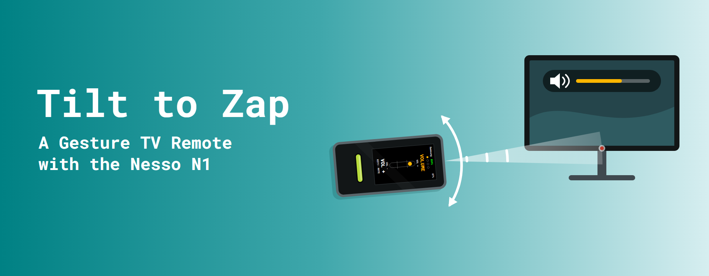
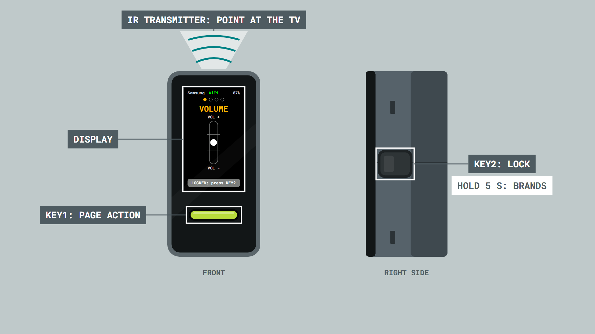
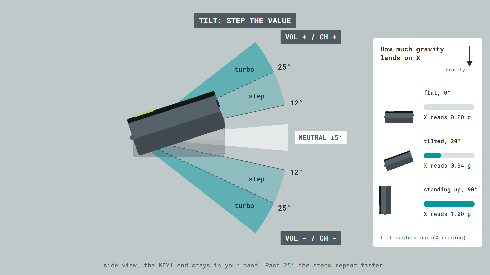
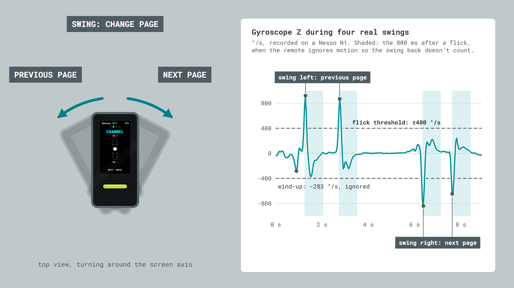
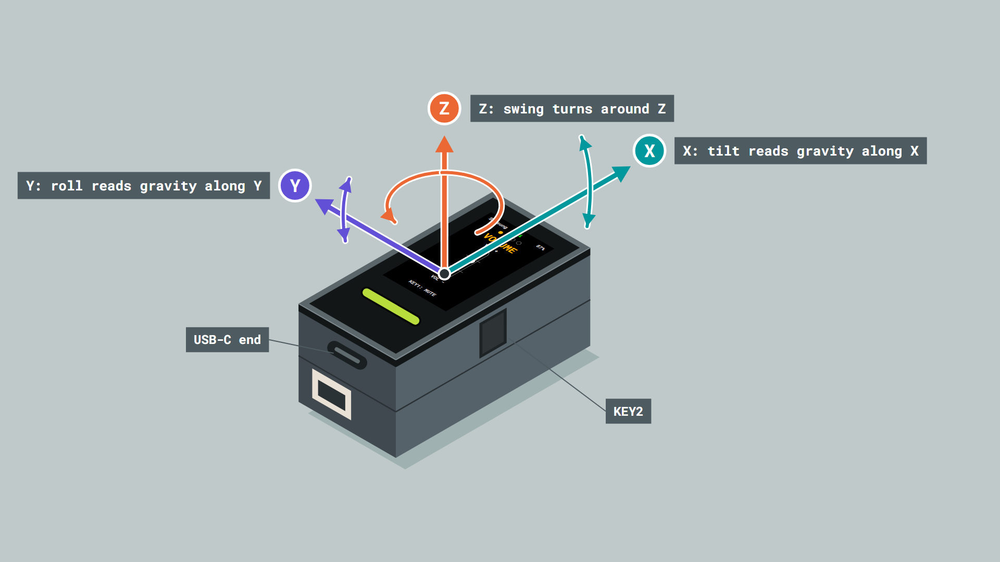
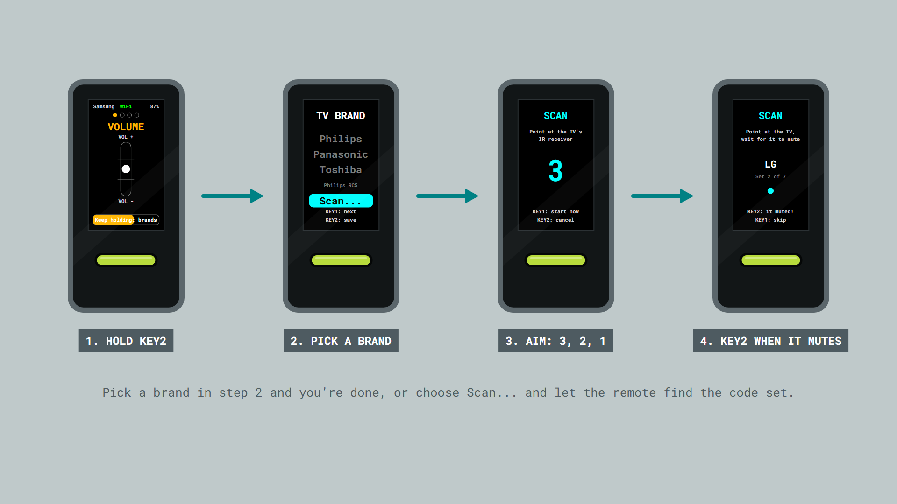
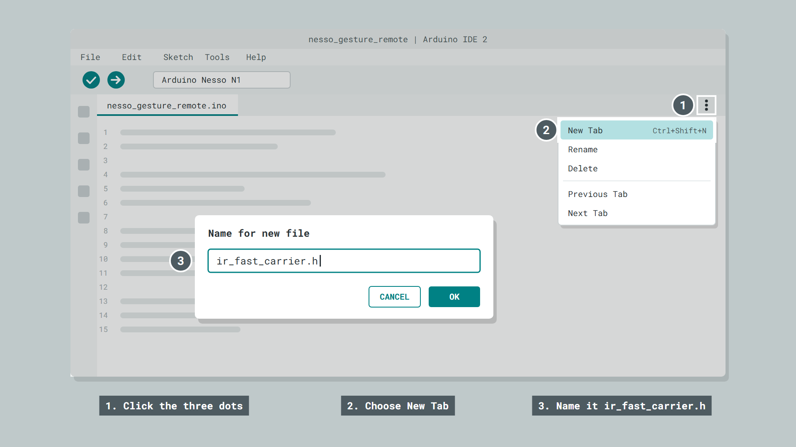
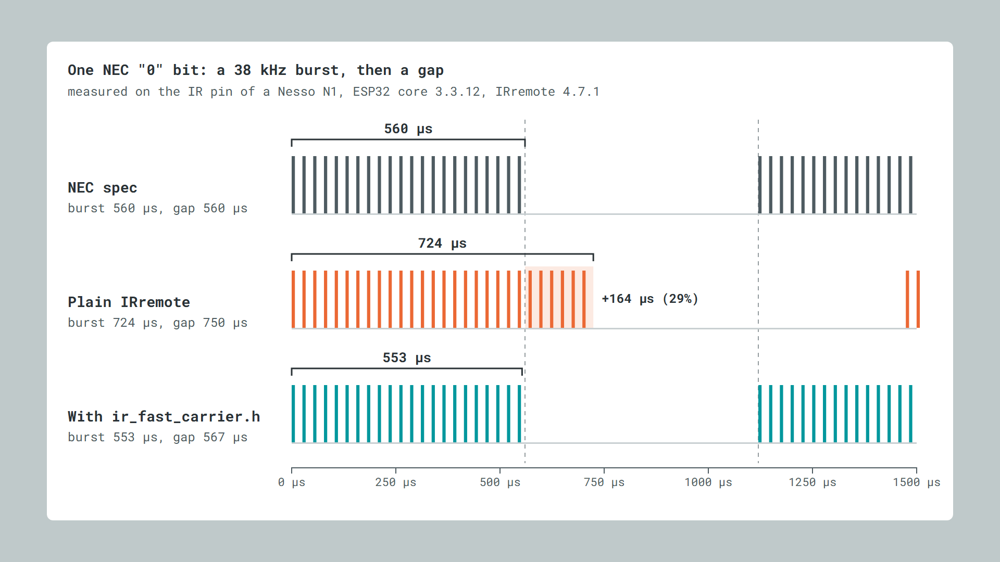
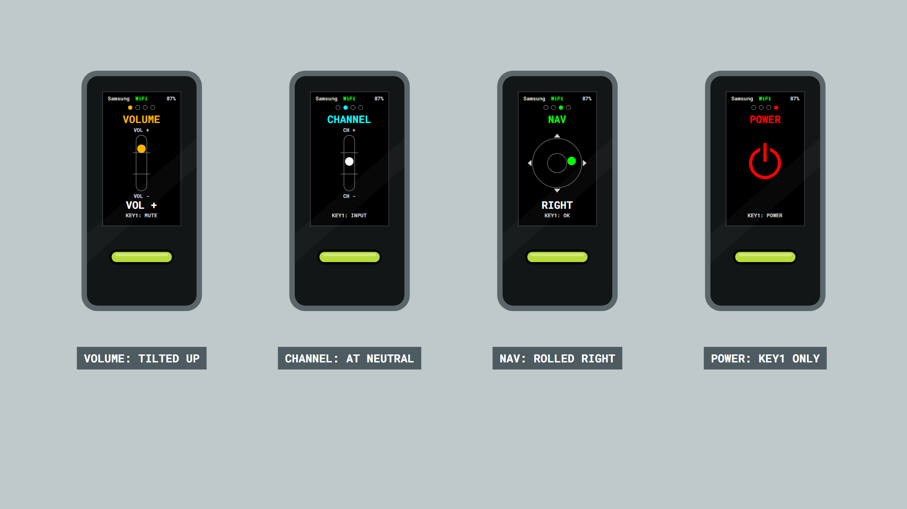
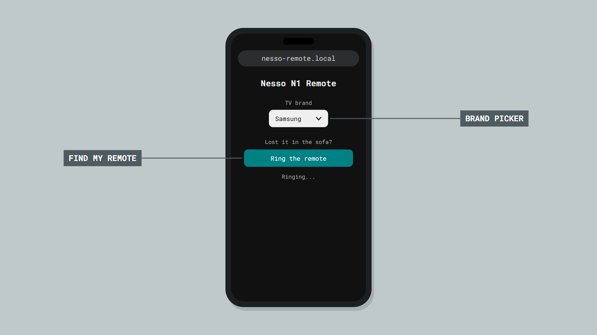

## Introduction

Deep in the living room, wedged between two sofa cushions, lives one of the most elusive creatures of the modern home: the common TV remote. It spends most of its life in the dark, quietly feeding on its natural diet of crumbs and dust. Sightings are rare. Most of them happen in a rush accompanied by a countdown. 



But evolution never sleeps, and in this very habitat a new species is taking its first steps. The Arduino® Nesso N1. Compact and bright-eyed, it carries its own infrared (IR) transmitter, along with an IMU that can feel every move of the hand holding it. For now, those are just instincts. With a little guidance, it could learn to answer to gestures: a flick of the wrist or a gentle tilt. This creature is just starting its journey into adulthood.

It's a social creature, too. Over Wi-Fi®, it can learn to build a small web page where you can tell it which TV it lives with. A sensible adaptation, because even the most evolved remote may one day wander back into the cushions, and from that same page you can make it call out until you find it.

In this application note, you'll raise one of your own.

## How the Remote Works

| You do this                    | The remote does this                                             |
| :----------------------------- | :--------------------------------------------------------------- |
| Swing it quickly to the right  | Moves to the next page                                           |
| Swing it quickly to the left   | Moves to the previous page                                       |
| Tilt the IR end up             | Sends the page's "up" command                                    |
| Tilt the IR end down           | Sends the page's "down" command                                  |
| Keep it tilted                 | Repeats the command, faster the further you lean                 |
| Roll it left or right          | Sends LEFT or RIGHT, on the NAV page only                        |
| Press KEY1                     | Runs the page action                                             |
| Press KEY2                     | Locks or unlocks gestures and sets your current angle as level   |
| Hold KEY2 for 5 seconds        | Opens the brand menu, with a scan mode for unknown TVs           |

And the pages themselves:

| Page    | Tilt up    | Tilt down    | Roll left / right | KEY1   |
| :------ | :--------- | :----------- | :---------------- | :----- |
| VOLUME  | Volume up  | Volume down  | Nothing           | Mute   |
| CHANNEL | Channel up | Channel down | Nothing           | Input  |
| NAV     | Up         | Down         | Left / Right      | OK     |
| POWER   | Nothing    | Nothing      | Nothing           | On/Off |

The NAV page is for smart TV menus: tilt and roll to move the highlight, then press KEY1 to select. KEY1 fires when you let go of it, and only if the remote stayed still while you held it, so a button squeezed mid-swing is quietly ignored.

KEY1 works even while gestures are locked. You can mute an ad with the remote lying on the armrest.

### Holding the Remote



Hold it like any TV remote, roughly flat with the screen tilted toward you and the IR end pointing at the TV. The IR transmitter sits on the short end beyond the display. KEY1 is the long button under the screen, and KEY2 is on the side.

Aim matters more than you'd expect. The IR LED is small and its beam is narrow, so point it at the TV's receiver, usually a small dark window at the bottom of the bezel. If the TV misses commands up close, take a step back. More than once during testing we were ready to blame the code, and the remote was simply pointed at the wrong part of the TV. Keep your fingers off the IR end, too.

That's also why the tilts are small. You can lean the remote and still keep the beam on the TV.

There's no need to hold it perfectly level. Hold it however feels natural and press KEY2. That angle becomes level from then on.

## Understanding the Gestures

The Nesso N1 feels motion through its IMU (inertial measurement unit), a BMI270 that packs an accelerometer and a gyroscope into one small chip. The two give very different views of motion, and the remote uses one for each gesture.

### Tilt

When the remote is still, the only thing the accelerometer feels is gravity. Tilt the IR end up and part of that gravity shifts onto the axis that runs along the remote's length. The sketch turns that share into an angle:

```text
tilt angle = asin(acceleration along the length / total acceleration)
```

A light filter smooths out shaky hands. The angle you set with KEY2 gets subtracted, so level is whatever feels comfortable to you.

You might expect the gyroscope to handle this. It only measures how fast you're turning, though, so it would have to add up every small movement to know where you are, and the errors pile up until level drifts away. Gravity always points down. The accelerometer reads the angle straight from it.



### Roll

On the NAV page the remote also reacts to roll. Turn it like a key in a lock: clockwise sends RIGHT, counter-clockwise sends LEFT. Same gravity trick, on the axis that runs across the remote. Lean diagonally and the bigger lean wins, so you get one command.

### Swing

A quick sideways swing barely changes how gravity hits the accelerometer. The gyroscope sees it clearly, as a short, sharp spike in rotation speed around the axis that points out of the screen. The sketch counts anything past a set speed as a flick, and the sign of the reading tells left from right.

In our tests a deliberate swing peaked somewhere between 650 and 1000 degrees per second, while the little wind-up before a swing stayed under 300. The threshold sits at 400, in the gap. Wrists differ, so expect to tune it.



### Making the Gestures Reliable

Raw thresholds alone make for a jumpy remote. A few small rules calm it down:

- Hysteresis: a tilt counts once it passes 12° and only resets once you're back within 5°. Without that gap, hovering near the threshold fires volume changes like a nervous woodpecker.
- Auto-repeat: hold a tilt and the step repeats, faster past 25°.
- Cooldown: your wrist swings back on its own after a flick, so motion is ignored for a moment afterwards.
- Level first: after a flick or an unlock, tilts wait until you're back at level.

These values are simply what felt right to us. They all sit at the top of the sketch, so change them until the remote feels like yours.

### Which Axis Is Which

The BMI270 has its own X, Y and Z axes. On the Nesso N1 they line up like this:

| Axis | Points                                       | The remote uses it for                                     |
| :--- | :------------------------------------------- | :--------------------------------------------------------- |
| X    | Along the length, positive toward the IR end | Tilt, from the share of gravity along X (`PITCH_AXIS = 0`) |
| Z    | Out of the screen                            | Swing, a turn around Z like a door on its hinge (`YAW_AXIS = 2`) |
| Y    | Out of the left side, away from KEY2         | Roll on the NAV page, from gravity along Y (`ROLL_AXIS = 1`) |



The sketch already uses these values, so there's nothing to set. To see it for yourself, lay the remote flat with the screen up and Z reads about +1 g. Stand it on its USB-C® end and the 1 g moves to X.

## Check Your TV's IR Codes

Every TV brand speaks its own IR dialect. Each message carries an address, which says what kind of device should listen, and a command number. The protocol sets the timing of the light pulses. The sketch ships with these presets:

| Brand       | Protocol             | Address  | Power  | Vol +  | Vol -  | Mute   | Ch +   | Ch -   | Input  |
| :---------- | :------------------- | :------- | :----- | :----- | :----- | :----- | :----- | :----- | :----- |
| Samsung     | Samsung              | `0x0707` | `0x02` | `0x07` | `0x0B` | `0x0F` | `0x12` | `0x10` | `0x01` |
| LG          | NEC                  | `0x04`   | `0x08` | `0x02` | `0x03` | `0x09` | `0x00` | `0x01` | `0x0B` |
| Sony        | Sony (SIRC 12-bit)   | `0x01`   | `0x15` | `0x12` | `0x13` | `0x14` | `0x10` | `0x11` | `0x25` |
| Philips     | RC6                  | `0x00`   | `0x0C` | `0x10` | `0x11` | `0x0D` | `0x20` | `0x21` | `0x38` |
| Panasonic   | Panasonic (Kaseikyo) | `0x08`   | `0x3D` | `0x20` | `0x21` | `0x32` | `0x34` | `0x35` | `0x05` |
| Toshiba     | NEC                  | `0x40`   | `0x12` | `0x1A` | `0x1E` | `0x10` | `0x1B` | `0x1F` | `0x0F` |
| Philips RC5 | RC5                  | `0x00`   | `0x0C` | `0x10` | `0x11` | `0x0D` | `0x20` | `0x21` | `0x38` |

Most TVs from these brands have used these codes for years. Philips shows up twice because its newer TVs use RC6 and older ones RC5, and plenty of other brands borrow one of these sets.

The NAV page uses a second set:

| Brand       | Up     | Down   | Left   | Right  | OK     |
| :---------- | :----- | :----- | :----- | :----- | :----- |
| Samsung     | `0x60` | `0x61` | `0x65` | `0x62` | `0x68` |
| LG          | `0x40` | `0x41` | `0x07` | `0x06` | `0x44` |
| Sony        | `0x74` | `0x75` | `0x34` | `0x33` | `0x65` |
| Philips     | `0x58` | `0x59` | `0x5A` | `0x5B` | `0x5C` |
| Panasonic   | `0x4A` | `0x4B` | `0x4E` | `0x4F` | `0x49` |
| Toshiba     | none   | none   | none   | none   | none   |
| Philips RC5 | none   | none   | none   | none   | none   |

We don't have navigation codes for Toshiba or older Philips RC5 sets yet. Those entries say `NO_CODE`, and the remote shows "No code" instead of guessing. If you own one, you can capture the codes yourself, as described below.

To switch brands, hold KEY2 for five seconds to open the brand menu, or use the web page. The remote remembers your choice.

Not sure which set your TV uses? Choose **Scan...** at the end of the brand menu. After a short countdown to give you time to aim, it sends MUTE with each code set in turn and shows which one it just tried. Press KEY2 when the TV mutes, and that set gets saved. Trust the scan over your memory, by the way: one of our test TVs, which we were sure was an LG, turned out to be a Samsung.



### Adding Your Own TV

The Nesso N1 can send IR but can't receive it, so it can't learn codes from your old remote. There are two ways around that:

- Borrow any Arduino board with an IR receiver, run the **ReceiveDump** example from IRremote and press the buttons on your old remote. It prints each button's code in exactly the format the sketch expects.
- Look your model up in a public code database.

Address formats vary between databases, so expect a little translating.

Then add an entry to the `BRANDS` table in the same command order, with `NO_CODE` for any button you don't have:

```arduino
//  name    protocol    address  POWER VOL+  VOL-  MUTE  CH+   CH-   INPUT
//                               UP    DOWN  LEFT  RIGHT OK
{ "MyTV", PROTO_NEC, 0x20,   { 0x10, 0x11, 0x12, 0x13, 0x14, 0x15, 0x16,
                               0x17, 0x18, 0x19, 0x1A, 0x1B } },  // example values, replace with yours
```

Your brand shows up in the menu and on the web page automatically, and the scan tries it too. If your TV uses a protocol the sketch doesn't support yet, add it to the `IrProtocol` enum and to `sendWithBrand()`. IRremote has senders for many more, such as `sendSharp()` and `sendJVC()`.

## The Gesture Remote Sketch

Install the **IRremote** and **Arduino_Nesso_N1** libraries from the Library Manager (**Tools > Manage Libraries...**) and create a new sketch.

The sketch has one extra tab, `ir_fast_carrier.h`:



It keeps the IR timing within spec, and [Getting the IR Timing Right](#getting-the-ir-timing-right) explains why that matters:

```arduino
// Fast IR carrier switching for the ESP32-C6.
//
// IRremote turns the IR carrier on and off with ledcWrite(). On the ESP32-C6
// each ledcWrite() call takes about 175 us, which stretches every IR pulse by
// roughly 30%. Picky TVs can ignore frames like that.
//
// Include this file BEFORE <IRremote.hpp>. It points IRremote's ledcWrite()
// calls at irFastLedcWrite(), which sets the carrier duty once and then only
// stops and restarts the LEDC channel. Each switch takes about 2 us.
#pragma once
#include <Arduino.h>
#include "esp32-hal-periman.h"
#include "driver/ledc.h"

static inline bool irFastLedcWrite(uint8_t pin, uint32_t duty) {
  static void* carrierBus = nullptr;   // LEDC channel the duty was last set on
  static uint32_t carrierDuty = 0;

  ledc_channel_handle_t* bus = (ledc_channel_handle_t*)perimanGetPinBus(pin, ESP32_BUS_TYPE_LEDC);
  if (bus == nullptr) return (ledcWrite)(pin, duty);   // not an LEDC pin: use the normal path

  ledc_mode_t group = (ledc_mode_t)(bus->channel / SOC_LEDC_CHANNEL_NUM);
  ledc_channel_t channel = (ledc_channel_t)(bus->channel % SOC_LEDC_CHANNEL_NUM);

  if (duty == 0) {
    ledc_stop(group, channel, 0);   // carrier off, LEDC keeps driving the pin low
    return true;
  }

  if (bus != carrierBus || duty != carrierDuty) {
    // First pulse, or IRremote re-attached the pin for a new frequency:
    // set the duty the slow way, once
    (ledcWrite)(pin, duty);
    carrierBus = bus;
    carrierDuty = duty;
    return true;
  }

  ledc_update_duty(group, channel);   // carrier back on, with the duty already set
  return true;
}

#define ledcWrite irFastLedcWrite
```

Then comes the main sketch. For the web page, type your network name and password into `WIFI_SSID` and `WIFI_PASS` at the top. Leave them empty to skip Wi-Fi, and everything else still works offline. If you share the sketch later, blank the password first.

```arduino
// We blink the LED ourselves, so IRremote can skip its feedback LED code
#define NO_LED_FEEDBACK_CODE

#include <Arduino_Nesso_N1.h>
#include "ir_fast_carrier.h"   // must come before IRremote.hpp, see "Getting the IR Timing Right"
#include <IRremote.hpp>
#include <WiFi.h>
#include <WebServer.h>
#include <ESPmDNS.h>
#include <Preferences.h>

// ---------------------------------------------------------------------
// Tweak me: Wi-Fi for the companion web page
// Leave both empty and the remote runs offline, gestures and IR still work
// ---------------------------------------------------------------------
const char* WIFI_SSID = "";
const char* WIFI_PASS = "";
const unsigned long RING_MS = 10000;   // "Ring the remote" on the web page beeps for this long

// ---------------------------------------------------------------------
// Orientation: already set for the Nesso N1 (see "Which Axis Is Which")
// ---------------------------------------------------------------------
const int   PITCH_AXIS = 0;        // accelerometer axis along the remote's length (0 = X, 1 = Y, 2 = Z)
const float PITCH_SIGN = 1.0f;     // set to -1.0 if tilting up turns the volume down
const int   YAW_AXIS   = 2;        // gyroscope axis that points out of the screen
const float YAW_SIGN   = 1.0f;     // set to -1.0 if swinging right goes to the previous page
const int   ROLL_AXIS  = 1;        // accelerometer axis across the remote, for left/right on the NAV page
const float ROLL_SIGN  = 1.0f;     // set to -1.0 if rolling right sends LEFT
const int   SCREEN_ROTATION = 0;   // set to 2 if the interface shows up upside down

// ---------------------------------------------------------------------
// Tweak me: gesture feel
// ---------------------------------------------------------------------
const float TILT_ON_DEG    = 12.0f;   // tilt past this to start stepping
const float TILT_OFF_DEG   = 5.0f;    // come back inside this to re-arm
const float TILT_TURBO_DEG = 25.0f;   // tilt past this for fast stepping
const float GAUGE_DEG      = 30.0f;   // tilt that moves the gauge ball all the way to the end
const float FLICK_DPS      = 400.0f;  // swing speed (degrees per second) that counts as a flick
const unsigned long FLICK_COOLDOWN_MS = 800;  // ignore motion after a flick so the swing back does not count
const unsigned long FIRST_REPEAT_MS   = 600;  // pause before auto-repeat kicks in
const unsigned long REPEAT_MS         = 300;  // auto-repeat interval
const unsigned long TURBO_REPEAT_MS   = 120;  // auto-repeat interval past TILT_TURBO_DEG
const int MAX_REPEATS = 30;                   // auto-repeat stops after this many steps, until you return to neutral

// ---------------------------------------------------------------------
// Tweak me: buttons
// ---------------------------------------------------------------------
const float BUSY_DPS = 150.0f;            // turning faster than this counts as "moving"
const unsigned long KEY1_GUARD_MS = 300;  // a KEY1 press this close to fast motion is ignored
const unsigned long MENU_HOLD_MS  = 5000; // hold KEY2 this long to open the brand menu
const unsigned long SCAN_STEP_MS  = 2000; // scan mode: time between two code sets
const unsigned long SCAN_GRACE_MS = 600;  // KEY2 this soon after a send still picks the previous set
const unsigned long SCAN_COUNTDOWN_MS = 3000; // time to aim at the TV before the scan starts

// ---------------------------------------------------------------------
// TV commands and IR codes
// ---------------------------------------------------------------------
enum TvCommand { CMD_POWER, CMD_VOL_UP, CMD_VOL_DOWN, CMD_MUTE, CMD_CH_UP, CMD_CH_DOWN, CMD_INPUT,
                 CMD_UP, CMD_DOWN, CMD_LEFT, CMD_RIGHT, CMD_OK, CMD_COUNT, CMD_NONE };

const char* const COMMAND_NAMES[CMD_COUNT] = { "POWER", "VOL +", "VOL -", "MUTE", "CH +", "CH -", "INPUT",
                                               "UP", "DOWN", "LEFT", "RIGHT", "OK" };

const uint8_t NO_CODE = 0xFF;   // marks a command a brand has no known code for

enum IrProtocol { PROTO_SAMSUNG, PROTO_NEC, PROTO_SONY, PROTO_RC5, PROTO_RC6, PROTO_PANASONIC };

struct TvBrand {
  const char* name;
  IrProtocol protocol;
  uint16_t address;
  uint8_t codes[CMD_COUNT];   // same order as TvCommand
};

// The scan mode tries these in order, so the most common sets come first
const TvBrand BRANDS[] = {
  //  name          protocol         address   POWER VOL+  VOL-  MUTE  CH+   CH-   INPUT
  //                                           UP    DOWN  LEFT  RIGHT OK
  { "Samsung",     PROTO_SAMSUNG,   0x0707, { 0x02, 0x07, 0x0B, 0x0F, 0x12, 0x10, 0x01,
                                              0x60, 0x61, 0x65, 0x62, 0x68 } },
  { "LG",          PROTO_NEC,       0x04,   { 0x08, 0x02, 0x03, 0x09, 0x00, 0x01, 0x0B,
                                              0x40, 0x41, 0x07, 0x06, 0x44 } },
  { "Sony",        PROTO_SONY,      0x01,   { 0x15, 0x12, 0x13, 0x14, 0x10, 0x11, 0x25,
                                              0x74, 0x75, 0x34, 0x33, 0x65 } },
  { "Philips",     PROTO_RC6,       0x00,   { 0x0C, 0x10, 0x11, 0x0D, 0x20, 0x21, 0x38,
                                              0x58, 0x59, 0x5A, 0x5B, 0x5C } },
  { "Panasonic",   PROTO_PANASONIC, 0x08,   { 0x3D, 0x20, 0x21, 0x32, 0x34, 0x35, 0x05,
                                              0x4A, 0x4B, 0x4E, 0x4F, 0x49 } },
  { "Toshiba",     PROTO_NEC,       0x40,   { 0x12, 0x1A, 0x1E, 0x10, 0x1B, 0x1F, 0x0F,
                                              NO_CODE, NO_CODE, NO_CODE, NO_CODE, NO_CODE } },
  { "Philips RC5", PROTO_RC5,       0x00,   { 0x0C, 0x10, 0x11, 0x0D, 0x20, 0x21, 0x38,
                                              NO_CODE, NO_CODE, NO_CODE, NO_CODE, NO_CODE } },
};
const int BRAND_COUNT = sizeof(BRANDS) / sizeof(BRANDS[0]);

// ---------------------------------------------------------------------
// Remote pages: swing to move between them, tilt (and roll on NAV) to step, KEY1 for the action
// ---------------------------------------------------------------------
struct RemotePage {
  const char* title;
  TvCommand up;
  TvCommand down;
  TvCommand action;
  uint16_t color;
  TvCommand left = CMD_NONE;    // roll left / right, only the NAV page uses them
  TvCommand right = CMD_NONE;
};

const RemotePage PAGES[] = {
  { "VOLUME",  CMD_VOL_UP, CMD_VOL_DOWN, CMD_MUTE,  TFT_ORANGE },
  { "CHANNEL", CMD_CH_UP,  CMD_CH_DOWN,  CMD_INPUT, TFT_CYAN },
  { "NAV",     CMD_UP,     CMD_DOWN,     CMD_OK,    TFT_GREEN, CMD_LEFT, CMD_RIGHT },
  { "POWER",   CMD_NONE,   CMD_NONE,     CMD_POWER, TFT_RED },
};
const int PAGE_COUNT = sizeof(PAGES) / sizeof(PAGES[0]);

// ---------------------------------------------------------------------
// Hardware objects and state
// ---------------------------------------------------------------------
NessoDisplay display;
M5Canvas canvas(&display);   // off-screen buffer, so the UI redraws without flicker
NessoBattery battery;
WebServer server(80);
Preferences prefs;

int  brandIndex = 0;
int  pageIndex = 0;
bool gesturesLocked = true;      // start locked: hold the remote comfortably, then press KEY2
bool waitForNeutral = true;      // after a flick or an unlock, return to neutral before stepping
float filteredPitch = 0;         // smoothed tilt angle, in degrees
float neutralPitch = 0;          // the angle that counts as "not tilted"
float filteredRoll = 0;          // smoothed sideways angle, in degrees
float neutralRoll = 0;
int   tiltZone = 0;              // +1/-1 tilted up/down, +2/-2 rolled right/left, 0 neutral
int   repeatCount = 0;           // auto-repeat steps since entering the current zone
unsigned long nextRepeatAt = 0;
unsigned long motionQuietUntil = 0;
unsigned long lastBusyAt = 0;    // last time the remote was turning fast

bool menuOpen = false;           // brand menu on screen
int  menuIndex = 0;              // brand highlighted in the menu (BRAND_COUNT means "Scan...")

bool scanning = false;           // scan mode: sending MUTE with one code set after another
int  scanIndex = 0;              // code set sent most recently
int  scanPrevIndex = 0;          // the one before it
int  scanSends = 0;              // how many sets we've tried so far
unsigned long scanSentAt = 0;
unsigned long scanStartsAt = 0;  // end of the countdown
int  scanLastTick = 0;           // countdown second we last beeped for
const char* statusMessage = "";  // a short note on the main screen, such as "No match"
unsigned long statusMessageAt = 0;

const char* lastSent = "";
unsigned long lastSentAt = 0;
int  batteryPercent = -1;
unsigned long nextBatteryReadAt = 0;
unsigned long nextFrameAt = 0;
bool wifiEnabled = false;
bool webStarted = false;

bool key1Down = false;
bool key2Down = false;
unsigned long key1ChangedAt = 0;
unsigned long key2ChangedAt = 0;
bool key1Moved = false;          // the remote moved while KEY1 was down, so the press doesn't count
bool ignoreKey2Release = false;  // the release after a long hold must not toggle the lock

// ---------------------------------------------------------------------
// Sound and IR
// ---------------------------------------------------------------------
void chirp(unsigned int frequency) {
  tone(BEEP_PIN, frequency, 40);
}

void sendWithBrand(const TvBrand& tv, TvCommand cmd) {
  if (cmd >= CMD_COUNT) return;

  uint8_t code = tv.codes[cmd];
  if (code == NO_CODE) {
    Serial.printf("No %s code for %s\n", COMMAND_NAMES[cmd], tv.name);
    showStatus("No code");
    return;
  }

  // No pinMode() or IrSender.begin() here: IRremote attaches the pin once and
  // stops transmitting if anything detaches it afterwards
  digitalWrite(LED_BUILTIN, LOW);   // LED on while sending (inverted logic)
  switch (tv.protocol) {
    case PROTO_SAMSUNG:   IrSender.sendSamsung(tv.address, code, 0); break;
    case PROTO_NEC:       IrSender.sendNEC(tv.address, code, 0); break;
    case PROTO_SONY:      IrSender.sendSony(tv.address, code, 2, SIRCS_12_PROTOCOL); break;  // Sony TVs want the frame three times
    case PROTO_RC5:       IrSender.sendRC5(tv.address, code, 0); break;
    case PROTO_RC6:       IrSender.sendRC6(tv.address, code, 0); break;
    case PROTO_PANASONIC: IrSender.sendPanasonic(tv.address, code, 0); break;
  }
  digitalWrite(LED_BUILTIN, HIGH);

  lastSent = COMMAND_NAMES[cmd];
  lastSentAt = millis();
  Serial.printf("IR -> %s %s (0x%02X)\n", tv.name, lastSent, code);
}

void sendCommand(TvCommand cmd) {
  sendWithBrand(BRANDS[brandIndex], cmd);
}

// ---------------------------------------------------------------------
// Remote actions
// ---------------------------------------------------------------------
void changePage(int direction) {
  pageIndex = (pageIndex + direction + PAGE_COUNT) % PAGE_COUNT;
  chirp(direction > 0 ? 1800 : 1200);
  Serial.printf("Page -> %s\n", PAGES[pageIndex].title);
}

// zone: +1 up, -1 down, +2 right, -2 left
void stepValue(int zone) {
  const RemotePage& page = PAGES[pageIndex];
  TvCommand cmd = zone == 1 ? page.up : zone == -1 ? page.down : zone == 2 ? page.right : page.left;
  if (cmd != CMD_NONE) sendCommand(cmd);
}

void toggleLock() {
  gesturesLocked = !gesturesLocked;
  if (!gesturesLocked) {
    neutralPitch = filteredPitch;   // however you hold it right now becomes "not tilted"
    neutralRoll = filteredRoll;
    waitForNeutral = true;
    tiltZone = 0;
  }
  chirp(gesturesLocked ? 500 : 2000);
  Serial.println(gesturesLocked ? "Gestures locked" : "Gestures unlocked");
}

void selectBrand(int index) {
  brandIndex = index;
  prefs.putInt("brand", brandIndex);   // remember the choice across reboots
  Serial.printf("Brand -> %s\n", BRANDS[brandIndex].name);
}

void openBrandMenu() {
  menuOpen = true;
  menuIndex = brandIndex;
  tiltZone = 0;
  chirp(900);
  Serial.println("Brand menu open");
}

void showStatus(const char* message) {
  statusMessage = message;
  statusMessageAt = millis();
}

void startScan() {
  scanning = true;
  scanIndex = 0;
  scanPrevIndex = 0;
  scanSends = 0;
  scanSentAt = 0;   // send the first set as soon as the countdown ends
  scanStartsAt = millis() + SCAN_COUNTDOWN_MS;
  scanLastTick = 0;
  Serial.println("Scan starting: point at the TV, press KEY2 when it mutes");
}

// Whole seconds left in the countdown, or 0 once the scan is running
int countdownSecondsLeft() {
  long left = (long)(scanStartsAt - millis());
  return left > 0 ? (left + 999) / 1000 : 0;
}

// Sends MUTE with the next code set, or gives up after two full rounds
void scanStep() {
  if (scanSends >= 2 * BRAND_COUNT) {
    scanning = false;
    showStatus("No match");
    Serial.println("Scan: no match");
    chirp(500);
    return;
  }
  scanPrevIndex = scanIndex;
  scanIndex = scanSends % BRAND_COUNT;
  scanSends++;
  sendWithBrand(BRANDS[scanIndex], CMD_MUTE);
  scanSentAt = millis();
}

void finishScan() {
  // Pressed right after a send? The TV is most likely reacting to the set before it
  bool tooSoon = scanSends > 1 && millis() - scanSentAt < SCAN_GRACE_MS;
  scanning = false;
  selectBrand(tooSoon ? scanPrevIndex : scanIndex);
  showStatus("Saved!");
  waitForNeutral = true;
  chirp(2000);
}

void updateScan() {
  if (!scanning) return;

  int left = countdownSecondsLeft();
  if (left > 0) {
    // One tick per second, so you can keep your eyes on the TV while you aim
    if (left != scanLastTick) {
      scanLastTick = left;
      chirp(1000);
    }
    return;
  }

  if (scanSentAt == 0 || millis() - scanSentAt >= SCAN_STEP_MS) scanStep();
}

void closeBrandMenu() {
  menuOpen = false;
  waitForNeutral = true;   // a tilt left over from the menu should not touch the volume
  if (menuIndex == BRAND_COUNT) {
    startScan();
  } else {
    selectBrand(menuIndex);
  }
  chirp(2000);
}

// ---------------------------------------------------------------------
// Motion: tilt from the accelerometer, swings from the gyroscope
// ---------------------------------------------------------------------
float pickAxis(float x, float y, float z, int axis) {
  if (axis == 0) return x;
  if (axis == 1) return y;
  return z;
}

void updateMotion() {
  if (!IMU.accelerationAvailable() || !IMU.gyroscopeAvailable()) return;

  float ax, ay, az, gx, gy, gz;
  IMU.readAcceleration(ax, ay, az);
  IMU.readGyroscope(gx, gy, gz);

  // Tilt: how much of gravity points along the remote's length
  float g = sqrtf(ax * ax + ay * ay + az * az);
  if (g > 0.5f) {
    float along = pickAxis(ax, ay, az, PITCH_AXIS) * PITCH_SIGN / g;
    float rawPitch = degrees(asinf(constrain(along, -1.0f, 1.0f)));
    filteredPitch += 0.2f * (rawPitch - filteredPitch);   // simple low-pass filter
    // Roll: the same trick across the remote, for left and right on the NAV page
    float across = pickAxis(ax, ay, az, ROLL_AXIS) * ROLL_SIGN / g;
    float rawRoll = degrees(asinf(constrain(across, -1.0f, 1.0f)));
    filteredRoll += 0.2f * (rawRoll - filteredRoll);
  }

  // Swing: how fast the remote turns around the axis coming out of the screen
  float yawRate = pickAxis(gx, gy, gz, YAW_AXIS) * YAW_SIGN;

  unsigned long now = millis();

  // Remember when the remote last moved fast, so a thumb squeezed mid-swing doesn't count as KEY1
  if (fabsf(gx) > BUSY_DPS || fabsf(gy) > BUSY_DPS || fabsf(gz) > BUSY_DPS) lastBusyAt = now;

  if (gesturesLocked || menuOpen || scanning) return;

  if (now < motionQuietUntil) return;

  if (fabsf(yawRate) > FLICK_DPS) {
    // Right-hand rule: with the screen facing up, a positive rate is a swing to the left
    changePage(yawRate > 0 ? -1 : +1);
    motionQuietUntil = now + FLICK_COOLDOWN_MS;
    waitForNeutral = true;
    tiltZone = 0;
    return;
  }

  float tilt = filteredPitch - neutralPitch;
  float roll = filteredRoll - neutralRoll;
  bool canRoll = PAGES[pageIndex].right != CMD_NONE;   // only the NAV page listens to roll

  if (waitForNeutral) {
    if (fabsf(tilt) < TILT_OFF_DEG && (!canRoll || fabsf(roll) < TILT_OFF_DEG)) waitForNeutral = false;
    return;
  }

  // Hysteresis: enter a zone past TILT_ON_DEG, leave it only inside TILT_OFF_DEG.
  // On the NAV page the bigger lean wins, so a diagonal tilt sends one command, not two.
  int zone = tiltZone;
  if (tiltZone == 0) {
    if (canRoll && fabsf(roll) > fabsf(tilt) && fabsf(roll) > TILT_ON_DEG) zone = roll > 0 ? 2 : -2;
    else if (tilt > TILT_ON_DEG) zone = 1;
    else if (tilt < -TILT_ON_DEG) zone = -1;
  } else if (fabsf(abs(tiltZone) == 2 ? roll : tilt) < TILT_OFF_DEG) {
    zone = 0;
  }
  float lean = fabsf(abs(zone) == 2 ? roll : tilt);

  if (zone != tiltZone) {
    tiltZone = zone;
    repeatCount = 0;
    if (zone != 0) {
      stepValue(zone);
      nextRepeatAt = now + FIRST_REPEAT_MS;
    }
  } else if (zone != 0 && now >= nextRepeatAt) {
    if (++repeatCount > MAX_REPEATS) {
      // Still tilted after all that? It's probably lying on the sofa at an angle
      waitForNeutral = true;
      tiltZone = 0;
      return;
    }
    stepValue(zone);
    nextRepeatAt = now + (lean > TILT_TURBO_DEG ? TURBO_REPEAT_MS : REPEAT_MS);
  }
}

// ---------------------------------------------------------------------
// Buttons
// ---------------------------------------------------------------------
// Returns +1 when a button goes down, -1 when it comes back up, 0 otherwise
int buttonEdge(bool down, bool& wasDown, unsigned long& changedAt, unsigned long now) {
  if (down == wasDown || now - changedAt < 40) return 0;   // 40 ms debounce
  wasDown = down;
  changedAt = now;
  return down ? 1 : -1;
}

void readButtons() {
  // Read both buttons first, then take the time once, so every timestamp below is the same "now"
  bool key1Low = digitalRead(KEY1) == LOW;
  bool key2Low = digitalRead(KEY2) == LOW;
  unsigned long now = millis();
  int key1 = buttonEdge(key1Low, key1Down, key1ChangedAt, now);
  int key2 = buttonEdge(key2Low, key2Down, key2ChangedAt, now);

  // Found it? Any press stops the "find my remote" ringing
  if (key1 == 1 || key2 == 1) stopRing();

  // Scan countdown: KEY1 starts right away, KEY2 cancels
  if (scanning && countdownSecondsLeft() > 0) {
    if (key1 == 1) scanStartsAt = millis();
    if (key2 == 1) {
      scanning = false;
      showStatus("Cancelled");
      ignoreKey2Release = true;
    }
    return;
  }

  // Scan mode: KEY2 keeps the code set that worked, KEY1 skips to the next one
  if (scanning) {
    if (key1 == 1) scanStep();
    if (key2 == 1) {
      finishScan();
      ignoreKey2Release = true;
    }
    return;
  }

  // Brand menu: KEY1 moves to the next entry, KEY2 saves and closes (or starts a scan)
  if (menuOpen) {
    if (key1 == 1) {
      menuIndex = (menuIndex + 1) % (BRAND_COUNT + 1);   // the extra entry is "Scan..."
      chirp(1500);
    }
    if (key2 == 1) {
      closeBrandMenu();
      ignoreKey2Release = true;
    }
    return;
  }

  // KEY1 fires on release, and only if the remote stayed still while it was down
  if (key1 == 1) key1Moved = false;
  if (key1Down && now - lastBusyAt < KEY1_GUARD_MS) key1Moved = true;
  if (key1 == -1) {
    if (key1Moved) {
      Serial.println("KEY1 ignored, the remote was moving");
    } else {
      sendCommand(PAGES[pageIndex].action);
      // Hold off on tilt steps until you're back at neutral: on most TVs a volume
      // step right after MUTE would unmute again
      waitForNeutral = true;
      tiltZone = 0;
    }
  }

  // KEY2: a short press toggles the lock on release, a long hold opens the brand menu
  if (key2Down && !ignoreKey2Release && now - key2ChangedAt >= MENU_HOLD_MS) {
    openBrandMenu();
    ignoreKey2Release = true;
  }
  if (key2 == -1) {
    if (!ignoreKey2Release) toggleLock();
    ignoreKey2Release = false;
  }
}

// ---------------------------------------------------------------------
// Display
// ---------------------------------------------------------------------
// Big text, or small text when a long name wouldn't fit across the screen
void drawFittedString(const char* text, int x, int y) {
  canvas.setTextSize(2);
  if (canvas.textWidth(text) > canvas.width() - 16) canvas.setTextSize(1);
  canvas.drawString(text, x, y);
}

void drawBrandMenu() {
  const int w = canvas.width();
  const int h = canvas.height();
  const int cx = w / 2;
  const int ROWS = 5, rowH = 30, top = 56;
  const int entries = BRAND_COUNT + 1;   // every brand, plus "Scan..." at the end

  canvas.fillScreen(TFT_BLACK);
  canvas.setTextDatum(MC_DATUM);
  canvas.setTextSize(2);
  canvas.setTextColor(TFT_WHITE);
  canvas.drawString("TV BRAND", cx, 24);

  // Scroll the list so the highlighted entry always stays on screen
  int first = constrain(menuIndex - ROWS / 2, 0, max(0, entries - ROWS));
  for (int row = 0; row < ROWS && first + row < entries; row++) {
    int i = first + row;
    int y = top + row * rowH;
    bool isScan = (i == BRAND_COUNT);
    if (i == menuIndex) {
      canvas.fillRoundRect(6, y, w - 12, rowH - 4, 8, isScan ? TFT_CYAN : TFT_ORANGE);
      canvas.setTextColor(TFT_BLACK);
    } else if (isScan) {
      canvas.setTextColor(TFT_CYAN);
    } else {
      canvas.setTextColor(i == brandIndex ? TFT_WHITE : TFT_DARKGREY);
    }
    drawFittedString(isScan ? "Scan..." : BRANDS[i].name, cx, y + (rowH - 4) / 2);
  }

  canvas.setTextSize(1);
  canvas.setTextColor(TFT_LIGHTGREY);
  canvas.drawString("KEY1: next", cx, h - 30);
  canvas.drawString("KEY2: save", cx, h - 14);

  canvas.pushSprite(0, 0);
}

void drawScan() {
  const int w = canvas.width();
  const int h = canvas.height();
  const int cx = w / 2;

  canvas.fillScreen(TFT_BLACK);
  canvas.setTextDatum(MC_DATUM);
  canvas.setTextSize(2);
  canvas.setTextColor(TFT_CYAN);
  canvas.drawString("SCAN", cx, 24);

  // Countdown: a big number while you aim
  int left = countdownSecondsLeft();
  if (left > 0) {
    canvas.setTextSize(1);
    canvas.setTextColor(TFT_LIGHTGREY);
    canvas.drawString("Point at the TV's", cx, 56);
    canvas.drawString("IR receiver", cx, 70);
    canvas.setTextSize(6);
    canvas.setTextColor(TFT_CYAN);
    canvas.drawString(String(left), cx, 130);
    canvas.setTextSize(1);
    canvas.setTextColor(TFT_LIGHTGREY);
    canvas.drawString("KEY1: start now", cx, h - 30);
    canvas.drawString("KEY2: cancel", cx, h - 14);
    canvas.pushSprite(0, 0);
    return;
  }

  canvas.setTextSize(1);
  canvas.setTextColor(TFT_LIGHTGREY);
  canvas.drawString("Point at the TV,", cx, 56);
  canvas.drawString("wait for it to mute", cx, 70);

  // The code set that just went out, and how far along we are
  canvas.setTextColor(TFT_WHITE);
  drawFittedString(BRANDS[scanIndex].name, cx, 118);
  canvas.setTextSize(1);
  canvas.setTextColor(TFT_DARKGREY);
  String progress = "Set " + String(scanIndex + 1) + " of " + String(BRAND_COUNT);
  canvas.drawString(progress, cx, 142);

  // A dot that lights up for each transmission
  bool justSent = millis() - scanSentAt < 300;
  canvas.fillCircle(cx, 170, 6, justSent ? TFT_CYAN : TFT_DARKGREY);

  canvas.setTextColor(TFT_LIGHTGREY);
  canvas.drawString("KEY2: it muted!", cx, h - 30);
  canvas.drawString("KEY1: skip", cx, h - 14);

  canvas.pushSprite(0, 0);
}

void drawUi() {
  if (scanning) {
    drawScan();
    return;
  }
  if (menuOpen) {
    drawBrandMenu();
    return;
  }

  const RemotePage& page = PAGES[pageIndex];
  const int w = canvas.width();
  const int h = canvas.height();
  const int cx = w / 2;

  canvas.fillScreen(TFT_BLACK);

  // Status bar: brand, Wi-Fi, battery
  canvas.setTextSize(1);
  canvas.setTextColor(TFT_LIGHTGREY);
  canvas.setTextDatum(TL_DATUM);
  canvas.drawString(BRANDS[brandIndex].name, 4, 4);
  canvas.setTextDatum(TR_DATUM);
  String batteryLabel = "--%";
  if (batteryPercent >= 0) batteryLabel = String(batteryPercent) + "%";
  canvas.drawString(batteryLabel, w - 4, 4);
  if (wifiEnabled) {
    canvas.setTextDatum(TC_DATUM);
    canvas.setTextColor(WiFi.status() == WL_CONNECTED ? TFT_GREEN : TFT_DARKGREY);
    canvas.drawString("WiFi", cx, 4);
  }

  // Page dots
  for (int i = 0; i < PAGE_COUNT; i++) {
    int x = cx + (int)((i - (PAGE_COUNT - 1) / 2.0f) * 14);
    if (i == pageIndex) canvas.fillCircle(x, 24, 4, page.color);
    else canvas.drawCircle(x, 24, 4, TFT_DARKGREY);
  }

  // Page title
  canvas.setTextDatum(MC_DATUM);
  canvas.setTextSize(2);
  canvas.setTextColor(page.color);
  canvas.drawString(page.title, cx, 46);

  if (page.right != CMD_NONE) {
    // Nav pad: the ball follows tilt (up and down) and roll (left and right)
    const int my = 128, r = 46;
    float tilt = constrain(filteredPitch - neutralPitch, -GAUGE_DEG, GAUGE_DEG);
    float roll = constrain(filteredRoll - neutralRoll, -GAUGE_DEG, GAUGE_DEG);
    int on = (int)(TILT_ON_DEG / GAUGE_DEG * r);

    canvas.drawCircle(cx, my, r, TFT_DARKGREY);
    canvas.drawCircle(cx, my, on, TFT_DARKGREY);
    canvas.fillTriangle(cx, my - r - 9, cx - 6, my - r - 2, cx + 6, my - r - 2, TFT_LIGHTGREY);
    canvas.fillTriangle(cx, my + r + 9, cx - 6, my + r + 2, cx + 6, my + r + 2, TFT_LIGHTGREY);
    canvas.fillTriangle(cx - r - 9, my, cx - r - 2, my - 6, cx - r - 2, my + 6, TFT_LIGHTGREY);
    canvas.fillTriangle(cx + r + 9, my, cx + r + 2, my - 6, cx + r + 2, my + 6, TFT_LIGHTGREY);

    int bx = cx + (int)(roll / GAUGE_DEG * r);
    int by = my - (int)(tilt / GAUGE_DEG * r);
    uint16_t ballColor = (!gesturesLocked && tiltZone != 0) ? page.color : TFT_WHITE;
    canvas.fillCircle(bx, by, 8, ballColor);
  } else if (page.up != CMD_NONE) {
    // Tilt gauge: the ball follows your wrist
    const int top = 76, bottom = 180, mid = (top + bottom) / 2;
    const float range = (bottom - top) / 2.0f;
    float tilt = constrain(filteredPitch - neutralPitch, -GAUGE_DEG, GAUGE_DEG);
    int onOffset = (int)(TILT_ON_DEG / GAUGE_DEG * range);

    canvas.drawRoundRect(cx - 10, top, 20, bottom - top, 10, TFT_DARKGREY);
    canvas.drawFastHLine(cx - 16, mid - onOffset, 32, TFT_DARKGREY);
    canvas.drawFastHLine(cx - 16, mid + onOffset, 32, TFT_DARKGREY);

    int ballY = mid - (int)(tilt / GAUGE_DEG * range);
    uint16_t ballColor = (!gesturesLocked && tiltZone != 0) ? page.color : TFT_WHITE;
    canvas.fillCircle(cx, ballY, 8, ballColor);

    canvas.setTextSize(1);
    canvas.setTextColor(TFT_LIGHTGREY);
    canvas.drawString(COMMAND_NAMES[page.up], cx, top - 10);
    canvas.drawString(COMMAND_NAMES[page.down], cx, bottom + 10);
  } else {
    // Power page: a big, friendly power symbol
    const int py = 128;
    canvas.fillCircle(cx, py, 30, page.color);
    canvas.fillCircle(cx, py, 24, TFT_BLACK);
    canvas.fillRect(cx - 9, py - 32, 18, 20, TFT_BLACK);
    canvas.fillRoundRect(cx - 3, py - 38, 6, 36, 3, page.color);
  }

  // A status note (like "Saved!" after a scan), or the last command for a moment after it fires
  canvas.setTextSize(2);
  if (statusMessage[0] != '\0' && millis() - statusMessageAt < 1500) {
    canvas.setTextColor(TFT_CYAN);
    canvas.drawString(statusMessage, cx, 206);
  } else if (lastSent[0] != '\0' && millis() - lastSentAt < 700) {
    canvas.setTextColor(TFT_WHITE);
    canvas.drawString(lastSent, cx, 206);
  }

  // Footer: what KEY1 does, a reminder that gestures are locked,
  // or a progress bar while KEY2 is held down for the brand menu
  canvas.setTextSize(1);
  unsigned long held = key2Down ? millis() - key2ChangedAt : 0;
  if (!ignoreKey2Release && held > 800) {
    int barW = (int)((w - 8) * min(1.0f, held / (float)MENU_HOLD_MS));
    canvas.drawRoundRect(4, h - 24, w - 8, 20, 6, TFT_DARKGREY);
    canvas.fillRoundRect(4, h - 24, barW, 20, 6, TFT_ORANGE);
    canvas.setTextColor(TFT_WHITE);
    canvas.drawString("Keep holding: brands", cx, h - 14);
  } else if (gesturesLocked) {
    canvas.fillRoundRect(4, h - 24, w - 8, 20, 6, TFT_DARKGREY);
    canvas.setTextColor(TFT_WHITE);
    canvas.drawString("LOCKED: press KEY2", cx, h - 14);
  } else {
    canvas.setTextColor(TFT_LIGHTGREY);
    String hint = "KEY1: ";
    hint += COMMAND_NAMES[page.action];
    canvas.drawString(hint, cx, h - 14);
  }

  canvas.pushSprite(0, 0);
}

// ---------------------------------------------------------------------
// Find my remote: beep, blink and say so on screen until found
// ---------------------------------------------------------------------
unsigned long ringUntil = 0;
bool ringing = false;

void startRing() {
  ringUntil = millis() + RING_MS;
  ringing = true;
  Serial.println("Ringing, come find me");
}

void stopRing() {
  if (!ringing) return;
  ringing = false;
  noTone(BEEP_PIN);
  digitalWrite(LED_BUILTIN, HIGH);   // LED off (inverted logic)
}

void updateRing() {
  static unsigned long nextBeepAt = 0;
  static bool highNote = false;
  if (!ringing) return;
  unsigned long now = millis();
  if (now >= ringUntil) {
    stopRing();
    return;
  }
  if (now >= nextBeepAt) {
    highNote = !highNote;
    tone(BEEP_PIN, highNote ? 2600 : 2000, 150);
    digitalWrite(LED_BUILTIN, highNote ? LOW : HIGH);
    showStatus("Here I am!");
    nextBeepAt = now + 200;
  }
}

// ---------------------------------------------------------------------
// Companion web page
// ---------------------------------------------------------------------
String stateJson() {
  String json = "{\"brand\":";
  json += brandIndex;
  json += ",\"ringing\":";
  json += ringing ? "true" : "false";
  json += "}";
  return json;
}

void handleRoot() {
  String html = F("<!DOCTYPE html><html><head><meta charset='utf-8'>"
    "<meta name='viewport' content='width=device-width,initial-scale=1'>"
    "<title>Nesso Remote</title><style>"
    "body{font-family:sans-serif;background:#111;color:#eee;text-align:center;margin:0;padding:16px}"
    "select,button{font-size:18px;padding:14px;margin:6px;border:0;border-radius:12px}"
    "button{background:#008184;color:#fff;width:88%}"
    ".lbl{color:#aaa;margin:18px 0 0}"
    "#status{color:#aaa;min-height:1.2em}"
    "</style></head><body><h2>Nesso N1 Remote</h2>"
    "<p class='lbl'>TV brand</p>"
    "<select id='brand' onchange='setBrand(this.value)'>");

  for (int i = 0; i < BRAND_COUNT; i++) {
    html += "<option value='" + String(i) + "'";
    if (i == brandIndex) html += " selected";
    html += ">";
    html += BRANDS[i].name;
    html += "</option>";
  }

  html += F("</select>"
    "<p class='lbl'>Lost it in the sofa?</p>"
    "<button onclick='ring()'>Ring the remote</button>"
    "<p id='status'></p><script>"
    "function show(s){document.getElementById('brand').value=s.brand;"
    "document.getElementById('status').textContent=s.ringing?'Ringing...':'';}"
    "function ring(){fetch('/ring').then(r=>r.json()).then(show);}"
    "function setBrand(i){fetch('/brand?i='+i).then(r=>r.json()).then(show);}"
    "function poll(){fetch('/state').then(r=>r.json()).then(show).catch(()=>{});}"
    "setInterval(poll,1000);poll();"
    "</script></body></html>");

  server.send(200, "text/html", html);
}

void handleRing() {
  startRing();
  server.send(200, "application/json", stateJson());
}

void handleBrand() {
  int i = server.arg("i").toInt();
  if (i >= 0 && i < BRAND_COUNT) selectBrand(i);
  server.send(200, "application/json", stateJson());
}

void handleState() {
  server.send(200, "application/json", stateJson());
}

void startWifi() {
  if (strlen(WIFI_SSID) == 0) return;   // no credentials: stay a happy offline remote

  wifiEnabled = true;
  WiFi.mode(WIFI_STA);
  WiFi.begin(WIFI_SSID, WIFI_PASS);   // non-blocking, the remote works while it connects

  server.on("/", handleRoot);
  server.on("/ring", handleRing);
  server.on("/brand", handleBrand);
  server.on("/state", handleState);
}

void serviceWifi() {
  if (!wifiEnabled) return;

  if (!webStarted && WiFi.status() == WL_CONNECTED) {
    MDNS.begin("nesso-remote");
    MDNS.addService("http", "tcp", 80);
    server.begin();
    webStarted = true;
    Serial.print("Web remote at http://");
    Serial.print(WiFi.localIP());
    Serial.println(" or http://nesso-remote.local");
  }

  if (webStarted) server.handleClient();
}

// ---------------------------------------------------------------------
// Setup and loop
// ---------------------------------------------------------------------
void setup() {
  Serial.begin(115200);
#if ARDUINO_USB_CDC_ON_BOOT
  // Never wait for the computer. Plugged in with no Serial Monitor open,
  // each print would otherwise stall the remote for up to two seconds.
  Serial.setTxTimeoutMs(0);
#endif

  pinMode(KEY1, INPUT_PULLUP);
  pinMode(KEY2, INPUT_PULLUP);
  pinMode(LED_BUILTIN, OUTPUT);
  digitalWrite(LED_BUILTIN, HIGH);   // LED off (inverted logic)

  battery.begin();
  battery.enableCharge();

  display.begin();
  display.setRotation(SCREEN_ROTATION);
  canvas.createSprite(display.width(), display.height());

  if (!IMU.begin()) {
    Serial.println("IMU failed to start!");
    display.fillScreen(TFT_BLACK);
    display.setTextColor(TFT_RED);
    display.setTextDatum(MC_DATUM);
    display.drawString("IMU failed", display.width() / 2, display.height() / 2);
    while (true) delay(1000);
  }

  IrSender.begin(IR_TX_PIN);

  prefs.begin("tv-remote", false);
  int savedBrand = prefs.getInt("brand", 0);
  brandIndex = (savedBrand >= 0 && savedBrand < BRAND_COUNT) ? savedBrand : 0;

  startWifi();

  Serial.println("Gesture remote ready. Hold it the way you like and press KEY2.");
}

void loop() {
  updateMotion();
  readButtons();
  updateScan();
  updateRing();
  serviceWifi();

  unsigned long now = millis();

  if (now >= nextBatteryReadAt) {
    batteryPercent = battery.getChargeLevel();
    nextBatteryReadAt = now + 10000;
  }

  if (now >= nextFrameAt) {
    drawUi();
    nextFrameAt = now + 50;   // about 20 frames per second
  }
}
```

## How the Code Works

Most of the sketch is plumbing. These are the parts worth a closer look.

### Settings at the Top

The values that shape how the remote feels are grouped at the top of the sketch:

```arduino
const float TILT_ON_DEG    = 12.0f;   // tilt past this to start stepping
const float TILT_OFF_DEG   = 5.0f;    // come back inside this to re-arm
const float TILT_TURBO_DEG = 25.0f;   // tilt past this for fast stepping
const float GAUGE_DEG      = 30.0f;   // tilt that moves the gauge ball all the way to the end
const float FLICK_DPS      = 400.0f;  // swing speed (degrees per second) that counts as a flick
```

If flicks trigger too easily, raise `FLICK_DPS`. If you have to swing it like a tennis racket, lower it. The tilt thresholds stay small on purpose, because every degree of tilt also points the beam away from the TV.

### Brands and Pages

The IR codes live in `BRANDS` and the page layout in `PAGES`. Each page names its commands and a screen color, and NAV adds the two roll commands:

```arduino
const RemotePage PAGES[] = {
  { "VOLUME",  CMD_VOL_UP, CMD_VOL_DOWN, CMD_MUTE,  TFT_ORANGE },
  { "CHANNEL", CMD_CH_UP,  CMD_CH_DOWN,  CMD_INPUT, TFT_CYAN },
  { "NAV",     CMD_UP,     CMD_DOWN,     CMD_OK,    TFT_GREEN, CMD_LEFT, CMD_RIGHT },
  { "POWER",   CMD_NONE,   CMD_NONE,     CMD_POWER, TFT_RED },
};
```

Want the power button on the volume page after all? Change one word. A fifth page is one more row, and the page dots and swing navigation adapt on their own.

### Getting the IR Timing Right

An IR command is a pattern of short bursts of 38 kHz light. In NEC and Samsung frames, each burst should last 560 µs. IRremote switches the bursts on and off with `ledcWrite()`, which on the ESP32-C6 takes about 175 µs, so every burst comes out roughly 30% too long. Some TVs don't care. Our Samsung test TV ignored every command until we fixed it.



`ir_fast_carrier.h` fixes this without touching the library. IRremote is header-only, so a `#define` placed before `#include <IRremote.hpp>` can redirect its `ledcWrite()` calls. The replacement sets the duty cycle once, then switches the carrier with two fast driver calls:

```arduino
if (duty == 0) {
  ledc_stop(group, channel, 0);   // carrier off, LEDC keeps driving the pin low
  return true;
}
```

With the fix, bursts land within a few percent of spec for every brand in the table. Keep the include above `IRremote.hpp`. Below it, the fix does nothing.

### The Scan

The scan reuses `sendWithBrand()`. Every couple of seconds, `updateScan()` sends MUTE with the next entry in `BRANDS`. People react a little late, so a KEY2 press that lands right after a new send saves the set before it:

```arduino
bool tooSoon = scanSends > 1 && millis() - scanSentAt < SCAN_GRACE_MS;
scanning = false;
selectBrand(tooSoon ? scanPrevIndex : scanIndex);
```

The scan follows the order of `BRANDS`, so put the sets you expect most often near the top.

### Buttons

KEY2 has two jobs. A short press toggles the lock. Keep holding, and an orange bar fills the footer until the brand menu opens:

```arduino
if (key2Down && !ignoreKey2Release && now - key2ChangedAt >= MENU_HOLD_MS) {
  openBrandMenu();
  ignoreKey2Release = true;
}
if (key2 == -1) {
  if (!ignoreKey2Release) toggleLock();
  ignoreKey2Release = false;
}
```

The `ignoreKey2Release` flag keeps the release at the end of a long hold from flipping the lock as well.

### Reading Motion

`updateMotion()` runs on every loop. Tilt comes from the accelerometer:

```arduino
float g = sqrtf(ax * ax + ay * ay + az * az);
if (g > 0.5f) {
  float along = pickAxis(ax, ay, az, PITCH_AXIS) * PITCH_SIGN / g;
  float rawPitch = degrees(asinf(constrain(along, -1.0f, 1.0f)));
  filteredPitch += 0.2f * (rawPitch - filteredPitch);   // simple low-pass filter
}
```

The `g > 0.5f` check skips readings taken in free fall, where the math stops working. Each reading moves the filtered angle a fifth of the way toward the new value. That hides hand tremor without making the gauge feel laggy.

The swing is a single gyroscope reading against the threshold:

```arduino
if (fabsf(yawRate) > FLICK_DPS) {
  // Right-hand rule: with the screen facing up, a positive rate is a swing to the left
  changePage(yawRate > 0 ? -1 : +1);
  motionQuietUntil = now + FLICK_COOLDOWN_MS;
  waitForNeutral = true;
  tiltZone = 0;
  return;
}
```

### Turning Tilt Into Steps

The tilt logic is a small state machine with up, down and neutral zones, plus left and right on the NAV page. Entering a zone sends one step. Staying in it sends more, faster the further you lean:

```arduino
if (zone != tiltZone) {
  tiltZone = zone;
  repeatCount = 0;
  if (zone != 0) {
    stepValue(zone);
    nextRepeatAt = now + FIRST_REPEAT_MS;
  }
} else if (zone != 0 && now >= nextRepeatAt) {
  if (++repeatCount > MAX_REPEATS) {
    // Still tilted after all that? It's probably lying on the sofa at an angle
    waitForNeutral = true;
    tiltZone = 0;
    return;
  }
  stepValue(zone);
  nextRepeatAt = now + (lean > TILT_TURBO_DEG ? TURBO_REPEAT_MS : REPEAT_MS);
}
```

`lean` is whichever of tilt or roll put you in the zone, and `stepValue()` sends the matching command for the current page.

The `MAX_REPEATS` cap came out of testing. We left the remote lying at an angle with gestures unlocked, and it kept nudging the volume down, undoing every mute a moment later. Now it stops after 30 steps and waits for you to come back to level. A KEY1 action pauses tilts the same way, since most TVs unmute as soon as they get a volume command.

### Drawing the Interface

The display is 135 x 240 pixels, used in portrait. To avoid flicker, the sketch draws each frame on an `M5Canvas`, an off-screen buffer from M5GFX, and pushes the finished image in one go.



A status bar runs along the top, with the page dots and title below it. The middle of the screen holds the tilt gauge, which becomes a round pad on NAV and a power symbol on POWER. Under it, the last command flashes up for a moment, and the footer says what KEY1 does or that gestures are locked. While you hold KEY2, the footer turns into the progress bar toward the brand menu.

### The Companion Web Page

Once Wi-Fi connects, the sketch starts a small web server and announces itself as `nesso-remote.local`. It connects in the background, so the remote works from the moment it boots.

| Route            | What it does                                                    |
| :--------------- | :-------------------------------------------------------------- |
| `/`              | Serves the page with the brand picker and the ring button       |
| `/brand?i=<n>`   | Selects brand `n` and saves it to flash with `Preferences`      |
| `/ring`          | Makes the remote beep and blink for `RING_MS` (10 s by default) |
| `/state`         | Returns the selected brand and whether the remote is ringing    |

**Ring the remote** is for the day the Nesso N1 follows its ancestor into the sofa. It beeps and blinks for ten seconds, with "Here I am!" on screen, until you press a button or the time runs out. The page also checks in every second, so the dropdown follows any brand change you make on the remote.



## Uploading and First Test

1. Select **Arduino Nesso N1** from **Tools > Board > esp32** and upload the sketch.
2. The screen shows the VOLUME page, locked.
3. Hold KEY2 for five seconds, press KEY1 until your brand is highlighted and press KEY2 to save it. If your brand isn't listed, choose **Scan...**.
4. Sit where you usually watch TV, hold the remote comfortably and press KEY2 to unlock it.
5. Tilt the IR end up. The ball climbs, turns orange, and the volume goes up.
6. Swing right to reach CHANNEL, and once more for NAV. Open a TV menu, tilt and roll to move around, and press KEY1 to select.
7. If you set up Wi-Fi, open `http://nesso-remote.local` on a phone on the same network. The Serial Monitor (115200 baud) also prints the IP address.

### Troubleshooting

| Symptom                                       | What to try                                                                                                                         |
| :-------------------------------------------- | :---------------------------------------------------------------------------------------------------------------------------------- |
| The TV ignores everything                     | Point the IR end at your phone's front camera and press KEY1. A faint purple flash means the LED works, and the codes need a look. |
| The flash shows, but the TV still ignores it  | Check your aim first: point at the IR window and keep your fingers off the IR end. Then run **Scan...** or capture your own codes.          |
| The TV reacts to some commands only           | Usually aim, again. Also make sure `ir_fast_carrier.h` is included before `IRremote.hpp`.                                           |
| Swings skip pages or go the wrong way         | Raise `FLICK_COOLDOWN_MS` if one swing jumps two pages, or `FLICK_DPS` if the wind-up before a swing changes the page.             |
| Picking up the remote changes the volume      | Lock it with KEY2 before you put it down, or raise `TILT_ON_DEG`.                                                                   |
| Mute doesn't stick                            | A tilt was still sending volume steps. Hold the remote level when you press KEY1.                                                  |
| `nesso-remote.local` doesn't open             | Some networks don't resolve `.local` names. Use the IP address from the Serial Monitor instead.                                    |

## Conclusions

The common TV remote has had a long, quiet run in the cushions. This one evolved a little. Gravity on the accelerometer gives it tilt and roll, and the gyroscope catches the swings. A handful of thresholds and timers turn those twitchy signals into gestures that only fire when you mean them. And when it disappears anyway, the web page calls it back out.

Filtering raw motion and turning it into clean events works well beyond TVs, from game controllers to menus you can drive without looking.

## Next Steps

- Use the touchscreen through the `NessoTouch` class for a number pad, so you can jump straight to channel 42.
- Let the BMI270's motion interrupt wake the board when you pick it up, and sleep the rest of the time.
- Show when the remote is charging. `battery.getChargeStatus()` tells you.
- Give the soundbar its own page, pointing at a different `BRANDS` entry.
- Connect the remote to Arduino Cloud or Matter® so an automation can switch the TV off.
