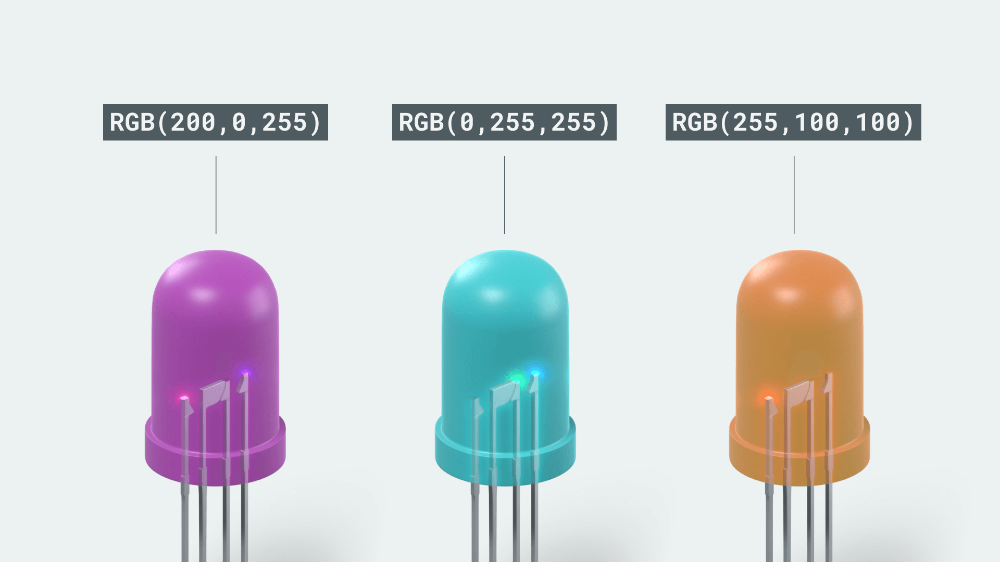
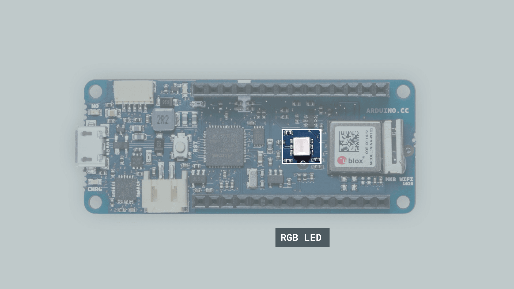
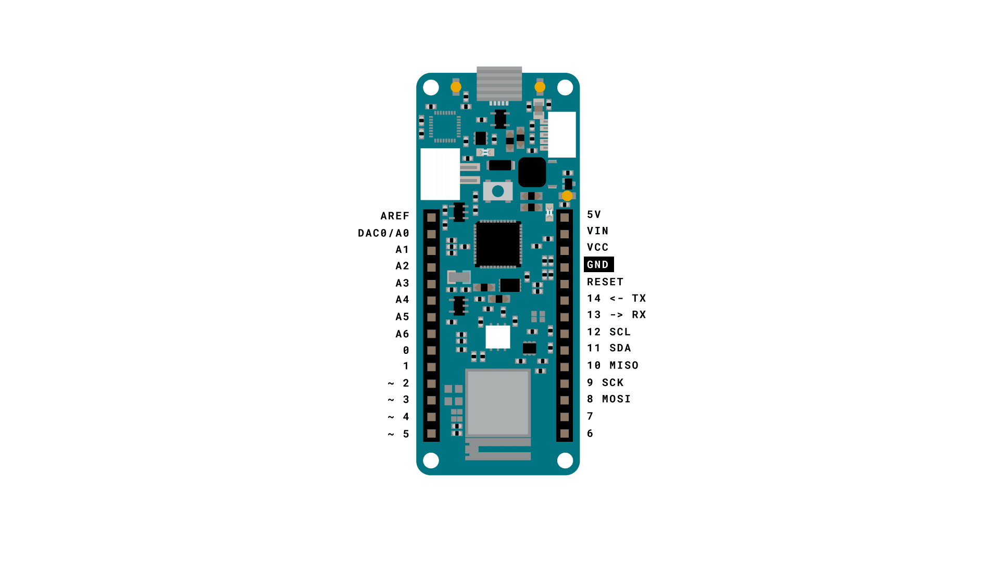
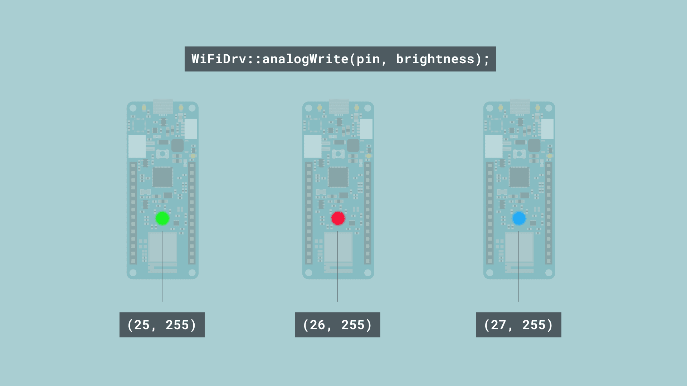

## Einführung

In diesem Tutorial erfahren wir, wie man die integrierte RGB-LED des MKR WiFi 1010 steuert. Dieses Bauteil ist für jede Art von Entwicklung ein sehr nützliches Werkzeug: Wir können damit ein smartes Licht prototypisch umsetzen oder es als Feedback-Element verwenden.

## Ziele

Die Ziele dieses Projekts sind:

- Lernen, mit welchen Befehlen wir die integrierte RGB-LED steuern können.
- Die RGB-LED in drei verschiedenen Farben blinken lassen.

## Benötigte Hardware und Software

- Arduino IDE ([online](https://create.arduino.cc/) oder [offline](https://www.arduino.cc/en/main/software)).
- Bibliothek [WiFiNINA](https://www.arduino.cc/en/Reference/WiFiNINA).
- Arduino MKR WiFi 1010 ([Link zum Store](https://store.arduino.cc/mkr-wifi-1010)).

## RGB (Rot, Grün, Blau)

Wahrscheinlich hast du den Begriff **RGB** schon einmal gesehen oder gehört. RGB steht einfach für **Red** (Rot), **Green** (Grün) und **Blue** (Blau), also die drei Farben, aus denen sich praktisch jede beliebige Farbe mischen lässt. Eine RGB-LED besteht aus drei kleinen LEDs: einer roten, einer blauen und einer grünen. Sieh dir das Bild unten und die Werte an. Diese Werte stehen für die einzelnen Farben, und wenn wir sie an das Bauteil schreiben, wechselt es **wie von Zauberhand** zu dieser Farbe!



RGB-LEDs werden für viele verschiedene Zwecke eingesetzt. Besonders nützlich sind sie, um den Zustand von etwas anzuzeigen. Ein Beispiel: Wenn wir anzeigen wollen, dass alles in Ordnung ist, schalten wir einfach auf Grün; bei einem kleineren Fehler auf Gelb und bei einem schwerwiegenden Fehler auf Rot.

### Die integrierte RGB-LED steuern

Die integrierte RGB-LED befindet sich direkt neben dem WLAN-Modul **NINA-W102** auf dem MKR 1010.



Die RGB-LED des MKR WiFi 1010 wird etwas anders gesteuert, als du es vielleicht von ähnlichen Bauteilen kennst. Zunächst können wir nicht direkt auf sie zugreifen, sondern müssen die Funktionen der Bibliothek [WiFiNINA](https://www.arduino.cc/en/Reference/WiFiNINA) verwenden. Genauer gesagt brauchen wir dafür eine Datei namens `wifi_drv.h`. Das folgende Snippet zeigt, wie du diese Datei in deinen Sketch einbindest:

```arduino
#include <WiFiNINA.h>
#include <utility/wifi_drv.h>
```

Danach ist alles ziemlich einfach. Die RGB-LED verwendet die Pins 25 (Grün), 26 (Rot) und 27 (Blau), daher definieren wir diese Pins mit den folgenden Befehlen:

```arduino
  WiFiDrv::pinMode(25, OUTPUT); //define GREEN LED
  WiFiDrv::pinMode(26, OUTPUT); //define RED LED
  WiFiDrv::pinMode(27, OUTPUT); //define BLUE LED
```

***Hinweis: Bei einigen älteren Versionen sind die grüne und die rote LED vertauscht (Pin `25` und `26`).***

Um sie innerhalb von `loop()` zu steuern, verwenden wir einfach:

```arduino
  WiFiDrv::analogWrite(25, 255); //GREEN
  WiFiDrv::analogWrite(26, 0);   //RED
  WiFiDrv::analogWrite(27, 0);   //BLUE
```

Oder, wenn wir `digitalWrite()` verwenden möchten (um sie einfach mit voller Helligkeit einzuschalten), schreiben wir es so:

```arduino
  WiFiDrv::digitalWrite(25, HIGH); //GREEN
  WiFiDrv::digitalWrite(26, LOW);   //RED
  WiFiDrv::digitalWrite(27, LOW);   //BLUE
```

### Schaltung

Für dieses Tutorial wird nur das MKR WiFi 1010 benötigt. Eine zusätzliche Schaltung ist nicht erforderlich.




## Das Board programmieren

**1.** Zuerst stellen wir sicher, dass die Treiber installiert sind. Im Cloud Editor müssen wir nichts installieren. Bei einem Offline-Editor installieren wir sie manuell: Dazu öffnen wir **Tools > Board > Board Manager...**, suchen nach **Arduino SAMD boards (32-bits Arm® Cortex®-M0+)** und installieren das Paket.

**2.** Jetzt installieren wir die benötigte Bibliothek. Im Cloud Editor ist keine Installation nötig. Bei einem Offline-Editor gehen wir einfach auf **Tools > Manage libraries..**, suchen nach **WiFiNINA** und installieren sie.

**3.** Jetzt können wir uns einige der wichtigsten Funktionen dieses Sketches ansehen:

- `#include <WiFiNINA.h>` - bindet die Bibliothek WiFiNINA ein.
- `#include <utility/wifi_drv.h>` - bindet die Datei `wifi_drv.h` ein.
- `WiFiDrv::pinMode(pin, OUTPUT)` - definiert den Pin als Ausgang.
- `WiFiDrv::analogWrite(pin, brightness)` - schreibt den Helligkeitswert an den Pin. Zum Beispiel setzt (27, 127) die blaue LED auf halbe Helligkeit.

Den Sketch findest du im folgenden Snippet. Lade ihn auf das Board hoch.

```arduino
#include <WiFiNINA.h>
#include <utility/wifi_drv.h>

void setup() {
  WiFiDrv::pinMode(25, OUTPUT); //define green pin
  WiFiDrv::pinMode(26, OUTPUT); //define red pin
  WiFiDrv::pinMode(27, OUTPUT); //define blue pin
}

void loop() {
  WiFiDrv::analogWrite(25, 255);
  WiFiDrv::analogWrite(26, 0);
  WiFiDrv::analogWrite(27, 0);

  delay(1000);

  WiFiDrv::analogWrite(25, 0);
  WiFiDrv::analogWrite(26, 255);
  WiFiDrv::analogWrite(27, 0);

  delay(1000);

  WiFiDrv::analogWrite(25, 0);
  WiFiDrv::analogWrite(26, 0);
  WiFiDrv::analogWrite(27, 255);

  delay(1000);

  WiFiDrv::analogWrite(25, 0);
  WiFiDrv::analogWrite(26, 0);
  WiFiDrv::analogWrite(27, 0);

  delay(1000);
}
```

## Ausprobieren

Kurz nachdem wir den Sketch auf das Board hochgeladen haben, sollte die RGB-LED beginnen, die Farbe zu wechseln. Die richtige Reihenfolge ist:

- Grün.
- Rot.
- Blau.
- Aus.

Am Ende von `loop()` haben wir an alle LEDs den Wert `0` geschrieben, wodurch sie einfach ausgeschaltet werden. Die Farbe sollte sich jede Sekunde ändern, da wir zwischen den Farbwechseln jeweils `delay(1000)` verwendet haben.



### Fehlerbehebung

Wenn der Code nicht funktioniert, gibt es einige häufige Ursachen, die wir prüfen können:

- Die Bibliothek **WiFiNINA** ist nicht installiert.
- Wir verwenden nicht das MKR WiFi 1010 (nur dieses MKR-Board hat eine integrierte RGB-LED).

## Fazit

In diesem Tutorial haben wir die Grundlagen behandelt, um die integrierte RGB-LED des MKR WiFi 1010 ein- und auszuschalten. Sie ist sehr nützlich, um den Zustand von etwas anzuzeigen (zum Beispiel Verbindung oder Signalstärke), oder einfach, um mit einer RGB-LED zu experimentieren, ohne etwas anschließen zu müssen.
