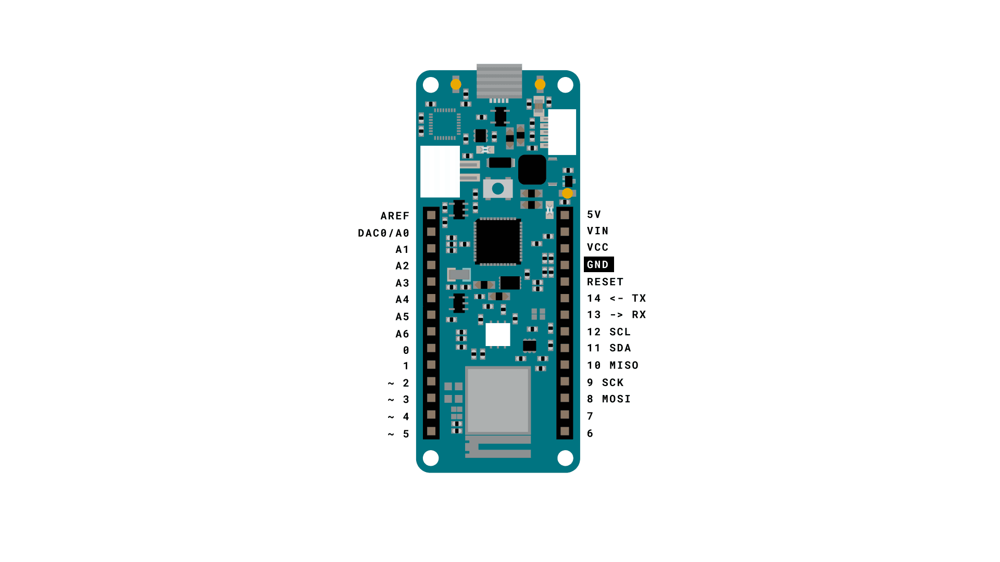
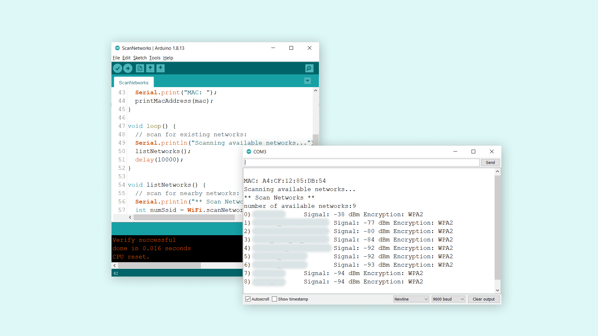
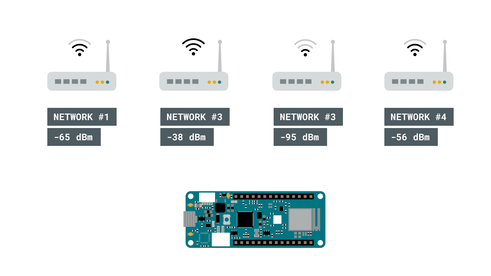

## Introduzione

Una delle funzioni più utili della MKR WiFi 1010 è la possibilità di scansionare le reti Wi-Fi vicine. Lo fa tramite il [modulo radio NINA-W102](https://content.arduino.cc/assets/Arduino_NINA-W10_DataSheet_%28UBX-17065507%29.pdf), e in questo tutorial vedremo alcuni semplici passaggi per farla funzionare!

## Obiettivi

Gli obiettivi di questo progetto sono:

- Scansionare le reti circostanti.
- Stampare le reti disponibili nel Serial Monitor.
- Stampare informazioni aggiuntive su queste reti.

## Hardware e software necessari

- Arduino IDE ([online](https://create.arduino.cc/) o [offline](https://www.arduino.cc/en/main/software))
- [Libreria WiFiNINA](https://www.arduino.cc/en/Reference/WiFiNINA)
- Arduino MKR WiFi 1010  ([link allo store](https://store.arduino.cc/mkr-wifi-1010))

## Scansionare le reti

La scansione delle reti Wi-Fi è un processo piuttosto semplice. Un dispositivo dotato di modulo Wi-Fi, come uno smartphone, un computer o una scheda di sviluppo come la MKR WiFi 1010, esplora l'ambiente circostante e riceve una risposta dalle reti vicine.

Il dispositivo che cerca una rete, cioè il client, invia una probe request, mentre le reti vicine rispondono con delle probe response. Queste risposte contengono informazioni come il nome della rete, la potenza del segnale in dBm (decibel-milliwatt) e il tipo di cifratura.

### Circuito

Questo tutorial non richiede nessun circuito aggiuntivo.



## Passo dopo passo

**1.** Per prima cosa dobbiamo assicurarci di avere installato le dipendenze. Per questo tutorial serve la libreria [WiFiNINA](https://www.arduino.cc/en/Reference/WiFiNINA). Se usiamo l'editor offline, la troviamo in **Tools > Manage Libraries...**. Se usiamo il [Cloud Editor](https://create.arduino.cc/), è già installata.

**2.** Se usiamo l'editor offline, dobbiamo assicurarci di avere installato i driver della MKR WiFi 1010. Nell'editor andiamo in **Tools > Board > Board Manager...** e installiamo il core **Arduino SAMD boards (32-bits Arm® Cortex®-M0+)**.

**3.** Vediamo ora alcune delle funzionalità principali dello sketch che useremo.

- `WiFi.macAddress()` - ottiene l'indirizzo MAC della scheda.
- `WiFi.scanNetworks()` - scansiona le reti vicine.
- `WiFi.encryptionType()` - restituisce il tipo di cifratura della rete trovata.
- `WiFi.SSID()` - restituisce l'SSID (il nome) della rete trovata.
- `WiFi.RSSI()` - restituisce l'RSSI (la potenza del segnale) della rete trovata, misurato in dBm.

Ora possiamo caricare sulla MKR WiFi 1010 il codice che trovi nello snippet qui sotto. 

```cpp
#include <SPI.h>
#include <WiFiNINA.h>

void setup() {
  //Initialize serial and wait for port to open:
  Serial.begin(9600);
  while (!Serial) {
    ; // wait for serial port to connect. Needed for native USB port only
  }

  // check for the WiFi module:
  if (WiFi.status() == WL_NO_MODULE) {
    Serial.println("Communication with WiFi module failed!");
    // don't continue
    while (true);
  }

  String fv = WiFi.firmwareVersion();
  if (fv < WIFI_FIRMWARE_LATEST_VERSION) {
    Serial.println("Please upgrade the firmware");
  }

  // print your MAC address:
  byte mac[6];
  WiFi.macAddress(mac);
  Serial.print("MAC: ");
  printMacAddress(mac);
}

void loop() {
  // scan for existing networks:
  Serial.println("Scanning available networks...");
  listNetworks();
  delay(10000);
}

void listNetworks() {
  // scan for nearby networks:
  Serial.println("** Scan Networks **");
  int numSsid = WiFi.scanNetworks();
  if (numSsid == -1) {
    Serial.println("Couldn't get a wifi connection");
    while (true);
  }

  // print the list of networks seen:
  Serial.print("number of available networks:");
  Serial.println(numSsid);

  // print the network number and name for each network found:
  for (int thisNet = 0; thisNet < numSsid; thisNet++) {
    Serial.print(thisNet);
    Serial.print(") ");
    Serial.print(WiFi.SSID(thisNet));
    Serial.print("\tSignal: ");
    Serial.print(WiFi.RSSI(thisNet));
    Serial.print(" dBm");
    Serial.print("\tEncryption: ");
    printEncryptionType(WiFi.encryptionType(thisNet));
  }
}

void printEncryptionType(int thisType) {
  // read the encryption type and print out the title:
  switch (thisType) {
    case ENC_TYPE_WEP:
      Serial.println("WEP");
      break;
    case ENC_TYPE_TKIP:
      Serial.println("WPA");
      break;
    case ENC_TYPE_CCMP:
      Serial.println("WPA2");
      break;
    case ENC_TYPE_NONE:
      Serial.println("None");
      break;
    case ENC_TYPE_AUTO:
      Serial.println("Auto");
      break;
    case ENC_TYPE_UNKNOWN:
    default:
      Serial.println("Unknown");
      break;
  }
}

void printMacAddress(byte mac[]) {
  for (int i = 5; i >= 0; i--) {
    if (mac[i] < 16) {
      Serial.print("0");
    }
    Serial.print(mac[i], HEX);
    if (i > 0) {
      Serial.print(":");
    }
  }
  Serial.println();
}
```


## Proviamolo

Dopo aver caricato il codice sulla scheda, dobbiamo aprire il Serial Monitor. Appena lo apriamo vedremo prima l'indirizzo MAC della scheda, seguito dal testo `"Scanning available networks"`. Dopo 10 secondi di scansione comparirà l'elenco delle reti disponibili, insieme ad alcune informazioni su ciascuna.



Se guardiamo con attenzione la rete #1 dell'elenco, vediamo che il segnale è di -38 dBm. Durante questo test la scheda era a un solo metro dal router, quindi la potenza del segnale è ottima.

Se invece guardiamo le altre reti, vediamo che il segnale scende fino a -94 dBm, che è molto debole. Se provassimo a collegare un computer a questa rete, molto probabilmente non ci riusciremmo.



### Risoluzione dei problemi

Se il codice non funziona, ecco alcuni problemi comuni da verificare:

- Non abbiamo installato la libreria WiFiNINA.
- Non abbiamo installato i driver della MKR WiFi 1010.
- Non abbiamo selezionato la porta giusta.

## Conclusione

In questo tutorial abbiamo creato un semplice scanner Wi-Fi, che ha stampato tutte le reti disponibili nel raggio della nostra MKR WiFi 1010. Questa funzione esiste praticamente in ogni dispositivo che si connette a Internet, e può essere un ottimo strumento per fare esperimenti, per esempio per capire quanto lontano dal gateway (router) possono stare i nostri dispositivi per funzionare. 

