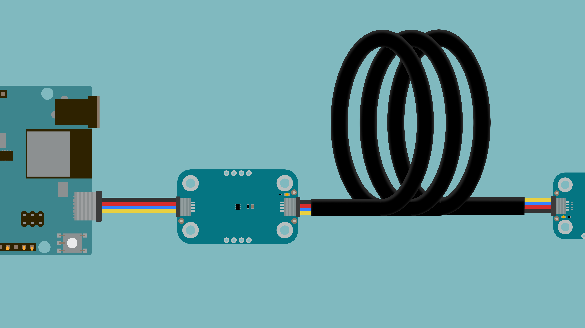
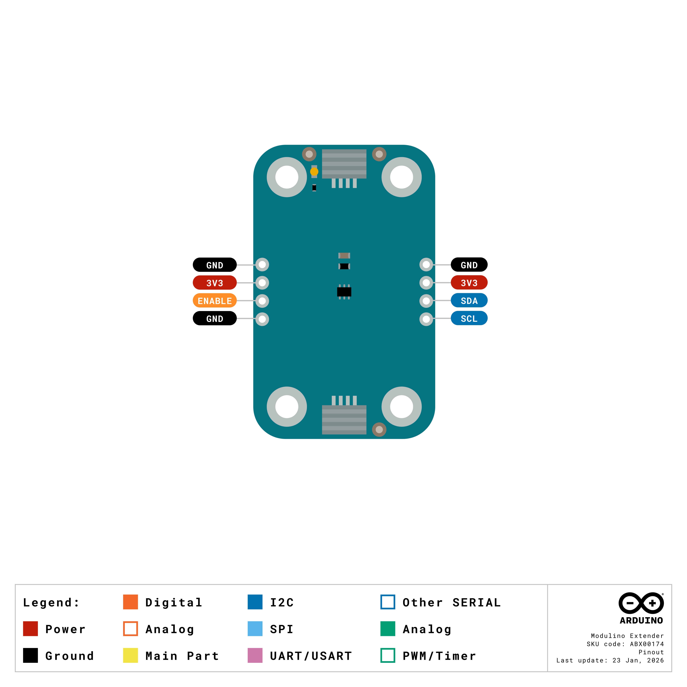
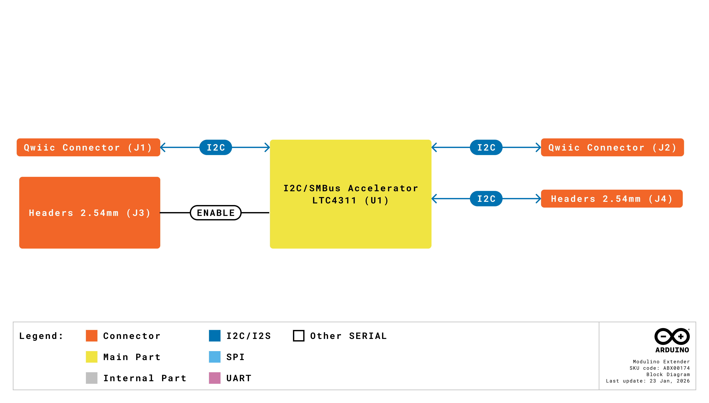
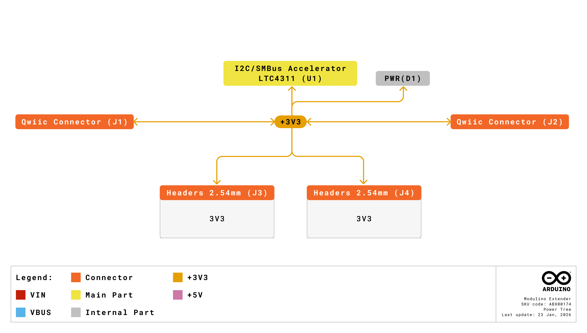

The Modulino Extender extends the reach of an I²C bus, letting you place sensors and actuators far from the controller. Built around the LTC4311 I²C accelerator, it shortens I²C signal rise time on long cable runs and on buses with many devices. The Extender has no I²C address and requires no configuration or code changes. This tutorial describes the Modulino Extender hardware, shows how to add it to an existing project, and explains the cable requirements for long installations.

## Why Use the Modulino Extender?

I²C was designed for communication between devices located close to each other. Every cable and device added to the bus increases capacitance, and because the lines are pulled high only through pull-up resistors, higher capacitance slows rising edges. When bus capacitance exceeds the I²C specification's 400 pF limit, rising edges may slow enough to cause communication errors at the selected clock frequency.

The Modulino Extender accelerates these rising edges. It connects in parallel to the SDA and SCL lines and, when the LTC4311 detects a rising edge on either line, it supplies an additional pull-up current that shortens the rise time. Signals in both directions benefit from the same acceleration, so the controller and the target devices communicate as if they were connected directly. This process takes place entirely in hardware and does not affect the code.

A common use case is a long-distance installation, where sensors or actuators are located far from the controller, for example, environmental sensors in different rooms or distributed sensors in an industrial setting. In these cases, the Extender allows longer cable runs than a bus with pull-up resistors alone; the achievable distance depends on the cable, the I²C clock frequency, and the devices connected to the bus. The Modulino Extender is also useful on buses with many devices: even with short cables, the combined capacitance of several devices can exceed the I²C specification limit, and the accelerated rising edges help maintain signal integrity under these conditions.

## Hardware Overview

### General Characteristics

The Modulino Extender is built around Analog Devices' LTC4311 I²C/SMBus accelerator. The LTC4311 is a dual active pull-up that connects in parallel to the SDA and SCL lines. On each rising edge, it supplies additional slew-limited pull-up current that shortens the line's rise time. This compensates for the capacitance added by long cables or by many devices on the same bus, which slows down rising edges when only pull-up resistors are present. The module does not buffer or repeat the I²C signals and has no I²C address, so the controller and the other devices on the bus do not detect it.

The main characteristics of the Modulino Extender are summarized in the following table:

|      **Specification**      | **Details**                                                                            |
|:---------------------------:|----------------------------------------------------------------------------------------|
|       I²C Accelerator       | Analog Devices LTC4311 (LTC4311ISC6#TRMPBF)                                            |
|      Supply Voltage         | +3.3 VDC (from the Qwiic connectors)                                                   |
|        Supply Current       | Approximately 1.5 mA, dominated by the power LED                                       |
| Maximum I²C Clock Frequency | 400 kHz (Fast-mode); the achievable frequency decreases with cable length and bus load |
|       Bus Capacitance       | Supports loads beyond the 400 pF limit of the I²C specification                        |
|         I²C Address         | None (transparent to the bus)                                                          |
|    Operating Temperature    | -40 °C to +85 °C                                                                       |
|          Indicator          | Green power LED                                                                        |

These characteristics make the Extender suitable for sensor networks where devices are located far from the controller, for buses with many devices whose combined capacitance exceeds the I²C specification limit, and for remote installations of sensors and actuators.

The Modulino Extender does not include pull-up resistors on the SDA and SCL lines. The LTC4311 accelerates rising edges but does not replace the bus pull-up resistors, which must be present elsewhere on the bus, for example, on the host board or on the connected Modulino nodes.

### Pinout



#### Qwiic Connectors (2×, 1×4 Each)

Both Qwiic connectors share the same I²C and power lines, so you can use either connector to connect the controller and the other to continue the bus to remote devices. Their pin assignment is described in the following table:

| **Pin** |       **Function**      |
|:-------:|:-----------------------:|
|   GND   |          Ground         |
|   3V3   | Power supply (+3.3 VDC) |
|   SDA   |         I²C data        |
|   SCL   |        I²C clock        |

#### Optional Header (1×4, J4, Not Mounted)

The J4 header exposes the same I²C bus and power lines as the Qwiic connectors, which allows a long cable to be wired directly to the board:

| **Pin** |       **Function**      |
|:-------:|:-----------------------:|
|    1    |          Ground         |
|    2    | Power supply (+3.3 VDC) |
|    3    |         I²C data        |
|    4    |        I²C clock        |

#### Optional Header (1×4, J3, Not Mounted)

The J3 header provides access to the `ENABLE` pin of the LTC4311:

| **Pin** |       **Function**      |
|:-------:|:-----------------------:|
|    1    |          Ground         |
|    2    | Power supply (+3.3 VDC) |
|    3    |         `ENABLE`        |
|    4    |          Ground         |

The `ENABLE` pin controls the accelerator and connects to +3.3 VDC through a 10 kΩ pull-up resistor, so the LTC4311 is enabled by default. Driving `ENABLE` low through the J3 header places the LTC4311 in a low-current shutdown mode in which it does not load the bus. The power LED remains on in this mode.

### Power Specifications

The Modulino Extender is powered at +3.3 VDC through the Qwiic connectors, as per the Qwiic standard. Its electrical characteristics are listed in the following table:

|         **Parameter**        |       **Condition**      | **Minimum** | **Typical** | **Maximum** | **Unit** |
|:----------------------------:|:------------------------:|:-----------:|:-----------:|:-----------:|:--------:|
|     Module Supply Voltage    | Through Qwiic connectors |      -      |     3.3     |      -      |     V    |
| LTC4311 Supply Voltage Range |             -            |     1.6     |      -      |     5.5     |     V    |
|    LTC4311 Supply Current    |      `ENABLE` high       |      -      |     200     |      -      |    µA    |
|   LTC4311 Shutdown Current   |       `ENABLE` low       |      -      |      -      |      5      |    µA    |
|     Module Supply Current    |       Power LED on       |      -      |     1.5     |      -      |    mA    |

<Alert type="note">
The +1.6 VDC to +5.5 VDC range applies to the LTC4311 itself. The Qwiic connectors and Modulino nodes operate at +3.3 VDC; supplying +5 VDC through the Qwiic connectors would apply that voltage to every device on the bus. When both SDA and SCL remain high, the LTC4311 enters automatic standby mode, reducing its supply current.
</Alert>

### Block Diagram



The LTC4311 connects in parallel to the SDA and SCL lines shared by both Qwiic connectors (J1 and J2) and by the optional J4 header. When it detects a rising (low-to-high) transition on either line, it supplies additional pull-up current to bring the line to the pull-up voltage faster. This keeps the signal edges sharp over long cables and heavily loaded buses. The optional J3 header exposes the `ENABLE` pin, pulled up to +3.3 VDC. Electrically, the Qwiic connectors and the J4 header share the same I²C bus.

### Power Tree



The +3.3 VDC line from the Qwiic connectors supplies the LTC4311 and the power LED directly, with no regulation stage, and is shared by both connectors and the optional headers. A 10 µF capacitor decouples the LTC4311 supply.

### Schematic

The Modulino Extender uses a simple circuit built around the **LTC4311** accelerator, whose SDA and SCL pins connect in parallel to the I²C lines of the **Qwiic connectors** (J1 and J2) and the **J4 header**. The board is powered at **+3.3 VDC** through the Qwiic cable or the `3V3` pin of J4 or J3.

The full schematic and PCB files are available from the [Modulino Extender page](https://docs.arduino.cc/hardware/modulinos/modulino-extender) on Docs.

## How to Connect

The Modulino Extender requires no configuration. To add it to an I²C bus, follow these steps:

1. Connect your Arduino board to one of the Modulino Extender's Qwiic connectors using a Qwiic cable.
2. Connect the remote device to the other Qwiic connector of the Modulino Extender. For cable runs longer than a standard Qwiic cable, use the cable types described in the [Cable Requirements](#cable-requirements) section.
3. Power your Arduino board. The Modulino Extender's green power LED turns on, and the Extender is ready to use.

Boards with an onboard Qwiic connector, such as the UNO R4 WiFi, the UNO Q, and the Nano R4, connect directly to the Modulino Extender. Boards in the Nano form factor without a Qwiic connector can be mounted on the Nano Connector Carrier, which adds Qwiic connectors. You can place the Modulino Extender anywhere in the Modulino chain: devices before and after it share the same bus, and all of them benefit from accelerated rising edges.

## Programming with Arduino

The Modulino Extender requires no code changes. It has no I²C address, needs no library or initialization, and works with any I²C device. Code written for Modulino nodes or other I²C devices runs without modification whether the Modulino Extender is present on the bus, in Arduino and MicroPython alike.

### Basic Example

The following sketch reads the distance measured by a Modulino Distance connected through the Modulino Extender. The same sketch applies to both of these setups:

```text
Without the Extender: Arduino board → Qwiic cable → Modulino Distance
With the Extender:    Arduino board → Qwiic cable → Modulino Extender → long cable → Modulino Distance
```

```arduino
/**
Basic Example for the Arduino Modulino Extender
Name: modulino_extender_basic.ino
Purpose: This sketch demonstrates that a Modulino Distance connected
through the Modulino Extender is read with the same code used
without it, since the Extender requires no configuration.

@author Arduino Product Experience Team
@version 1.0 15/10/26
*/

#include <Arduino_Modulino.h>

ModulinoDistance distance;

void setup() {
  Serial.begin(115200);
  Modulino.begin();
  distance.begin();
}

void loop() {
  if (distance.available()) {
    Serial.println(distance.get());
  }
  delay(100);
}
```

After uploading the sketch, open the Serial Monitor at 115200 baud to see the distance readings. The `Arduino_Modulino` library can be installed from the Library Manager of the Arduino IDE; for detailed instructions, refer to the [Getting Started with Modulinos](../how-general) guide.

### Key Functions

The basic example above relies on the following functions of the `Arduino_Modulino` library, none of which refers to the Modulino Extender:

- `Modulino.begin()`: Initializes the Modulino system and configures the I²C clock at 100 kHz (uses `Wire1` on boards with an onboard Qwiic connector).
- `distance.begin()`: Detects the Modulino Distance on the bus and initializes it. Returns `false` when the node is not detected, which helps confirm whether a remote device is reachable.
- `distance.available()` and `distance.get()`: Check whether a new measurement is available and return it.

If an application requires a different I²C clock frequency, call `setClock()` after `Modulino.begin()` on the same I²C interface used by the Modulino library; otherwise, the library setting overrides it. On the UNO R4 WiFi, Nano R4, UNO Q, and VENTUNO Q, this interface is `Wire1`; on other boards, it is `Wire`. Long cable runs may require a lower clock frequency than the 100 kHz default.

## Cable Requirements

For runs longer than a standard Qwiic cable, use twisted-pair cable, preferably shielded, such as Cat5e or Cat6 cable. Longer cables add capacitance and propagation delay, so long cable runs may require a lower I²C clock frequency.

### Connecting Long Cables

Standard Qwiic cables use a 4-pin JST SH connector, while Cat5e and Cat6 cables typically terminate with RJ45 connectors or connect through screw terminals. A long cable run therefore requires an adapter or a breakout between the cable and the Qwiic connectors at both ends. Alternatively, you can wire the cable directly to the optional J4 header of the Extender, which exposes the I²C bus and power lines.

When using twisted-pair cable, avoid placing SDA and SCL on the same pair, as this increases the crosstalk between the two lines. Pair each signal with a supply or ground conductor instead, for example, SDA with GND and SCL with +3.3 VDC.

### Supply Voltage Drop

The +3.3 VDC supply for the remote devices travels through the same cable as the I²C signals. Over long cable runs, the resistance of the supply and ground conductors causes a voltage drop proportional to the current drawn by the remote devices. Depending on the cable length and the load, the voltage at the remote end may fall below the operating range of the connected devices.

To reduce voltage drop, use the cable's spare conductors to double the +3.3 VDC and GND connections, and verify the supply voltage at the remote end with the devices connected and operating.

### Electrical Noise

Route I²C cables away from sources of electrical noise, such as motors, power supplies, and RF transmitters, and avoid running them parallel to power lines.

## Troubleshooting

### Communication Not Working

If the I²C devices do not respond through the Modulino Extender, first check that both Qwiic connections are secure and that the Modulino Extender's power LED is on. If needed, measure the voltage between the +3.3 VDC and GND pins of the Modulino Extender and at the remote end of the cable, with the devices connected. If the J3 header is mounted and the `ENABLE` pin is wired, make sure that it is not driven low, as this turns off the accelerator.

To determine whether the issue is related to the cable length, connect the remote device through a short Qwiic cable. If it works with the short cable, review the cable type and wiring described in the [Cable Requirements](#cable-requirements) section, and consider reducing the I²C clock frequency. The `begin()` function of a Modulino node, for example, `distance.begin()`, returns `false` when the node is not detected on the bus, which helps confirm whether the device is reachable.

### Intermittent Communication

Intermittent communication usually indicates a signal integrity issue. Check the cable terminations and adapter connections, and verify that the cable shield is intact. If the cable runs close to motors, power supplies, or RF transmitters, reroute it away from these sources. Temporarily reducing the cable length helps confirm whether the cable run is causing the issue.

If the issue persists, check that the bus has pull-up resistors on the SDA and SCL lines, since the LTC4311 accelerates rising edges but does not replace them. The Modulino Extender does not include pull-up resistors, so the host board or other devices on the bus must provide them.

### Unreliable Communication with Many Devices

On buses with many devices, the combined capacitance can still affect communication even with the Modulino Extender. In these cases, reduce the I²C clock frequency, as described in the [Key Functions](#key-functions) section, and verify that every device on the bus has a unique I²C address. If the issue persists, divide the bus into segments using a Modulino Hub, which connects only one port to the controller at a time, so the capacitance of the unselected segments does not add to the bus load.

## Project Ideas

Now that you are familiar with the Modulino Extender, you can use it in projects such as the following:

- **Remote environmental monitoring**: Place a Modulino Thermo in another room or outdoors and read it from a controller located elsewhere
- **Distributed sensor network**: Connect several Modulino nodes along a long cable run, for example, in a greenhouse or a workshop
- **Remote actuators**: Drive a Modulino Pixels or a Modulino Buzzer installed far from the controller
- **Large I²C installations**: Combine the Modulino Extender with a Modulino Hub to organize many devices into segments, each of them over its own cable run

## Conclusion

In this tutorial, you learned how the Modulino Extender accelerates the rising edges of the I²C signals to extend communication over long cable runs and heavily loaded buses. Because the Extender has no I²C address and requires no configuration, existing code works without modification. For long installations, consider the cable type, the wiring of the signal pairs, the I²C clock frequency, and the supply voltage at the remote end.

For more information, refer to the following resources:

- [Modulino Extender page](https://docs.arduino.cc/hardware/modulinos/modulino-extender), with the datasheet, the schematic, and the pinout
- [LTC4311 product page and datasheet (Analog Devices)](https://www.analog.com/en/products/ltc4311.html)
- [I²C-bus specification and user manual (NXP UM10204)](https://www.nxp.com/docs/en/user-guide/UM10204.pdf)