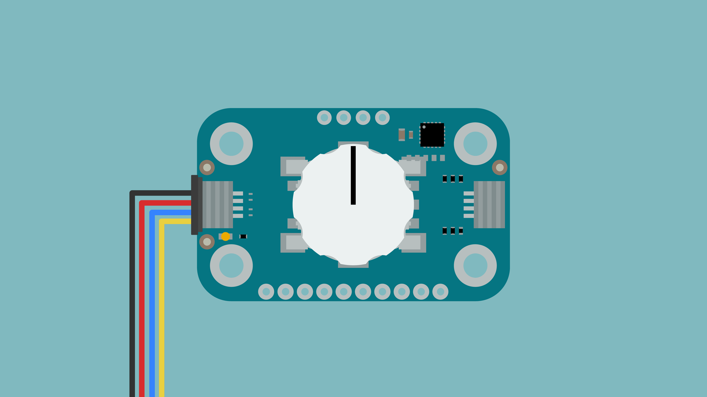
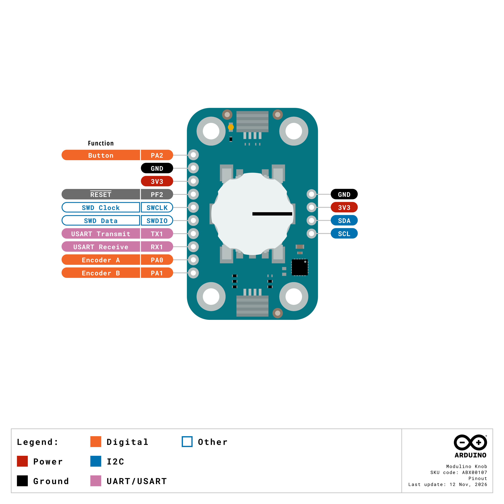
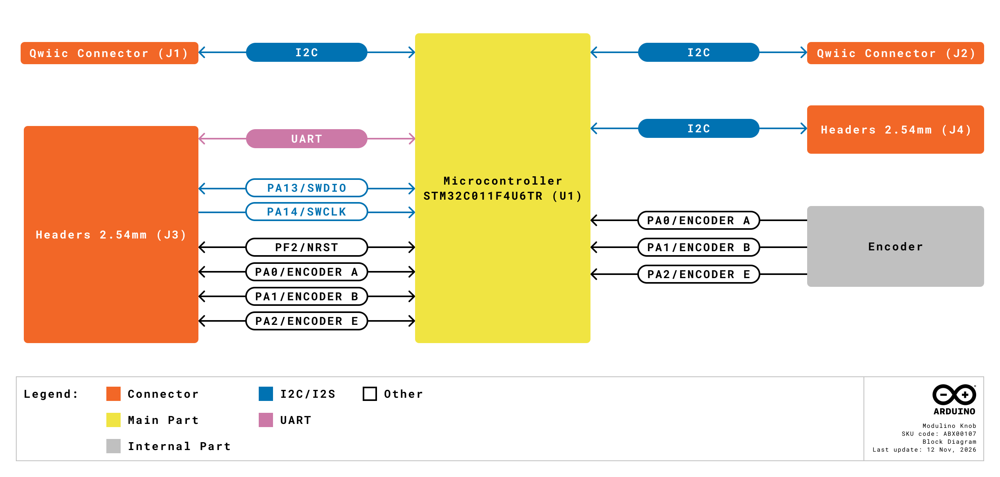
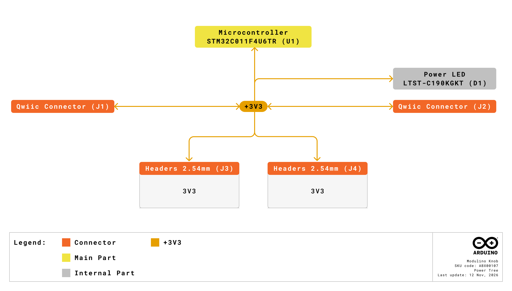

The Modulino Knob is a Modulino node that provides a rotary encoder with an integrated push button. An onboard microcontroller reads the encoder and reports its position and the button state over I²C, and the node connects to the host board through Qwiic connectors, so no additional circuitry is required. This tutorial describes the Modulino Knob hardware and shows how to read its rotation and button state using both the Arduino and MicroPython libraries.

## Why Use the Modulino Knob?

A rotary encoder is a common way to set a value or move through a list of options: it turns without end stops, and each step is reported as an increment or a decrement of a position value. Reading an encoder directly requires two input pins, pull-up resistors, and code to decode the quadrature signals and filter contact bounce. The Modulino Knob handles these tasks on its onboard microcontroller, so the host board reads position and button state directly over I²C.

Because it uses the Modulino form factor, the Modulino Knob can be chained with other Modulino nodes on the same Qwiic bus, for example, with a Modulino Pixels to display the selected value or with a Modulino Buzzer to give audible feedback.

## Hardware Overview

### General Characteristics

The Modulino Knob is based on the **PEC11J-9215F-S0015** incremental rotary encoder from Bourns, which includes a push button that is actuated by pressing the shaft. An onboard **STM32C011F4** microcontroller reads the encoder, decodes the quadrature signals, tracks position, and makes position and button state available over I²C.

The main characteristics of the Modulino Knob are summarized in the following table:

|       **Parameter**       |                 **Value**                 |
|:-------------------------:|:-----------------------------------------:|
|        Encoder Type       |       Incremental, quadrature output      |
|          Rotation         |        360° (continuous, no stops)        |
|   Pulses per Revolution   |                     15                    |
|   Detents per Revolution  |                     30                    |
|  Position Steps per Turn  |                     30                    |
|       Position Value      |  Signed 16-bit integer (-32768 to +32767) |
|        Push Button        | Momentary, actuated by pressing the shaft |

<Alert type="note">

**Note**: The position value is not limited to one turn. It increases when the knob is rotated clockwise, decreases when it is rotated counterclockwise, and wraps around when it reaches the limits of the signed 16-bit range.

</Alert>

The Modulino Knob communicates over I²C through its onboard microcontroller. Its default I²C address is the following:

| **Modulino I²C Address** | **Hardware I²C Address** |              **Configurable Addresses**             |
|:------------------------:|:------------------------:|:---------------------------------------------------:|
|          `0x76`          |          `0x3B`          | Any address, set by software and stored on the node |

<Alert type="note">

**Note**: The Modulino I²C address is the identifier that the onboard firmware and the Modulino library use for the node; the hardware I²C address is the 7-bit address that appears when scanning the I²C bus. The address can be changed with the `AddressChanger` sketch included in the Modulino library (**File > Examples > Arduino_Modulino > Utilities**), which makes it possible to use several Modulino Knob nodes on the same I²C bus.

</Alert>

<Alert type="note">

**Note**: The pull-up resistors of the I²C lines are **not mounted** on the Modulino Knob. The I²C bus relies on the host board's pull-up resistors.

</Alert>

### Pinout



#### Qwiic Connectors (2×, 1×4 Each)

Both Qwiic connectors share the same I²C and power lines, so you can use either one to connect the host board and the other to continue the Modulino chain. Their pin assignment is described in the following table:

| **Pin** |       **Function**      |
|:-------:|:-----------------------:|
|   GND   |          Ground         |
|   3V3   | Power supply (+3.3 VDC) |
|   SDA   |         I²C data        |
|   SCL   |        I²C clock        |

#### Optional Header (1×4, J4, Not Mounted)

The J4 header exposes the same I²C bus and power lines as the Qwiic connectors, for applications where header pins are preferred:

| **Pin** |       **Function**      |
|:-------:|:-----------------------:|
|   GND   |          Ground         |
|   3V3   | Power supply (+3.3 VDC) |
|   SDA   |         I²C data        |
|   SCL   |        I²C clock        |

#### Optional Header (1×10, J3, Not Mounted)

The J3 header provides access to the encoder signals and to the programming and serial pins of the onboard microcontroller:

| **Pin** |            **Function**            |
|:-------:|:----------------------------------:|
|   PA2   |  Encoder push button (active low)  |
|   GND   |               Ground               |
|   3V3   |       Power supply (+3.3 VDC)      |
|   PF2   | Microcontroller reset (active low) |
|  SWCLK  |              SWD clock             |
|  SWDIO  |              SWD data              |
|   TX1   |           USART1 transmit          |
|   RX1   |           USART1 receive           |
|   PA0   |          Encoder channel A         |
|   PA1   |          Encoder channel B         |

The `PA0`, `PA1`, and `PA2` pins connect to both the encoder and the onboard microcontroller inputs, so they can be used to monitor the encoder signals while the node is operating. These lines have no pull-up resistors on the board; the firmware enables the microcontroller's internal pull-up resistors. **The Modulino library does not use the J3 header**.

### Power Specifications

The Modulino Knob is powered at +3.3 VDC through the Qwiic connectors, as per the Qwiic standard. The same supply line feeds the onboard microcontroller and the power LED, and it is also available on the `3V3` pin of the optional J4 and J3 headers.

<Alert type="note">

**Note**: The board includes an always-on green power LED with a 1 kΩ series resistor that draws about 1 mA.

</Alert>

### Block Diagram



The **PEC11J-9215F-S0015** encoder (ENCODER1) connects its two quadrature channels and its push button to the `PA0`, `PA1`, and `PA2` inputs of the **STM32C011F4** microcontroller (U1). The microcontroller connects to the SDA and SCL lines shared by both Qwiic connectors (J1 and J2) and the optional J4 header. The optional J3 header exposes the encoder signals, along with the microcontroller's SWD, USART1, and reset pins.

### Power Tree



The +3.3 VDC line from the Qwiic connectors supplies the STM32C011F4 microcontroller and the power LED directly, with no regulation stage, and is shared by both connectors and the optional headers.

### Schematic

The Modulino Knob uses a simple circuit built around the **PEC11J-9215F-S0015** encoder (ENCODER1) and the **STM32C011F4** microcontroller (U1), which reads the encoder and handles the I²C communication. The I²C lines are available through the **Qwiic connectors** (J1 and J2, recommended) or the **J4 header**, and the board is powered at **+3.3 VDC** through the Qwiic cable or the `3V3` pin of J4 or J3.

The full schematic and PCB files are available from the [Modulino Knob page](https://docs.arduino.cc/hardware/modulino-knob/) on Docs.

## How to Connect

The Modulino Knob requires no configuration. To add it to your project, follow these steps:

1. Connect your Arduino board to one of the Qwiic connectors of the Modulino Knob using a Qwiic cable. Every Modulino node ships with a 5 cm cable.
2. If your project uses other Modulino nodes, connect the next node to the second Qwiic connector of the Modulino Knob to continue the chain.
3. Power your Arduino board. The green power LED of the Modulino Knob turns on, and the node is ready to use.

Boards with an onboard Qwiic connector, such as the **UNO R4 WiFi**, the **UNO Q**, and the **Nano R4**, connect directly to the Modulino Knob. Boards in the Nano form factor without a Qwiic connector can be mounted on the **Nano Connector Carrier**, which adds Qwiic connectors. Alternatively, the Modulino Knob can be wired to the I²C pins of any board through the optional J4 header.

<Alert type="note">

**Note**: The Modulino Knob operates at +3.3 VDC. The Arduino boards listed above supply that voltage through the Qwiic connector and handle the logic level translation, so no additional circuitry is required. If you wire the node through the J4 header instead, confirm that your board drives the I²C lines at +3.3 VDC and that the bus has pull-up resistors, since they are not mounted on the Modulino Knob.

</Alert>

## Programming with Arduino

The Modulino Knob is supported by the [Arduino_Modulino](https://github.com/arduino-libraries/Arduino_Modulino) library, which is compatible with the Arduino IDE and the Arduino Cloud Editor. The following examples show how to read the position and button state and build a simple menu.

### Prerequisites

To follow the Arduino examples in this tutorial, you will need the following:

- An Arduino board with an onboard Qwiic connector (**UNO R4 WiFi**, **UNO Q**, or **Nano R4**), or a Nano form factor board mounted on the **Nano Connector Carrier**
- A Qwiic cable
- The `Arduino_Modulino` library, installed from the Library Manager of the Arduino IDE (**version 0.10.0 or later is recommended**). If you use the Arduino Cloud Editor, the library is already available, and no installation is required

On the UNO R4 WiFi, the UNO Q, and the Nano R4, the Qwiic connector is wired to the secondary I²C interface, and `Modulino.begin()` automatically selects `Wire1`. On any other board, the library defaults to `Wire`. **You do not need to specify the interface in your sketch.**

For detailed instructions on setting up your Arduino environment and installing libraries, refer to the [Getting Started with Modulinos](../how-general) guide.

### Firmware Update

The Modulino Knob's onboard microcontroller runs its own firmware, which reads the encoder and reports its position over I²C. Version 0.10.0 of the `Arduino_Modulino` library includes updated firmware for the Modulino nodes that improves encoder-reading stability.

<Alert type="note">

**Note**:  Use the `FirmwareUpdater` sketch to update the Modulino Knob to the latest firmware version for improved stability and performance.

</Alert>

To update the firmware of the Modulino Knob, follow these steps:

1. Connect the Modulino Knob to your Arduino board as the **only Modulino node on the bus**.
2. In the Arduino IDE, open the sketch from **File > Examples > Arduino_Modulino > Utilities > FirmwareUpdater**. On the UNO R4 WiFi, the sketch also requires the `ArduinoGraphics` library, which you can install from the Library Manager.
3. Upload the sketch to your board. The sketch detects the node and writes the new firmware to it.
4. Open the Serial Monitor at 115200 baud to follow the progress. On the UNO R4 WiFi, the LED matrix shows `PASS` or `FAIL` when the update finishes.

**Do not disconnect the board or the Modulino Knob while the update is in progress.** Once the update has finished, upload your own sketch again; the examples below work without changes.

### Basic Example

The following sketch reads the position and the button state of the Modulino Knob and prints them to the Serial Monitor each time they change:

```arduino
/**
Basic Example for the Arduino Modulino Knob
Name: modulino_knob_basic.ino
Purpose: This sketch demonstrates how to read the position and
the button state of the Modulino Knob and print them to the
Serial Monitor each time they change.
 
@author Arduino Product Experience Team
@version 1.0 13/11/26
*/
 
#include <Arduino_Modulino.h>
 
// Modulino Knob object
ModulinoKnob knob;
 
// Last position and button state reported
int lastPosition = 0;
bool lastPressed = false;
 
void setup() {
  // Initialize serial communication and wait up to 2.5 seconds for a connection
  Serial.begin(115200);
  for (auto startNow = millis() + 2500; !Serial && millis() < startNow; delay(500));
 
  // Initialize the Modulino system (I2C bus)
  Modulino.begin();
 
  // Initialize the Modulino Knob and halt if the node is not detected
  if (!knob.begin()) {
    Serial.println("- Modulino Knob not detected! Check the Qwiic connection...");
    while (1);
  }
 
  // Start counting from zero
  knob.set(0);
 
  // Startup message
  Serial.println("- Arduino Modulino Knob - Basic Example started...");
}
 
void loop() {
  // Read the position and the button state
  int position = knob.get();
  bool pressed = knob.isPressed();
 
  // Print the position when the knob is rotated
  if (position != lastPosition) {
    Serial.print("- Position: ");
    Serial.println(position);
    lastPosition = position;
  }
 
  // Print the button state when the knob is pressed or released
  if (pressed != lastPressed) {
    if (pressed) {
      Serial.println("- Button pressed");
    } else {
      Serial.println("- Button released");
    }
    lastPressed = pressed;
  }
 
  // Wait 10 milliseconds before the next reading
  delay(10);
}
```

After uploading the sketch, open the Serial Monitor at 115200 baud and rotate or press the knob to see the position and the button state.

### Key Functions
 
The basic example above relies on the following functions of the `Arduino_Modulino` library:
 
- `Modulino.begin()`: Initializes the Modulino system (uses `Wire1` on boards with an onboard Qwiic connector).
- `begin()`: Detects the Modulino Knob and initializes it. Returns `true` if the node responded on the I²C bus.
- `get()`: Returns the current position as a signed 16-bit integer (`int16_t`). The value increases with clockwise rotation and decreases with counterclockwise rotation.
- `set(value)`: Sets the current position to the given value (`int16_t`). Use `set(0)` to start counting from zero.
- `isPressed()`: Returns `true` while the knob is pressed and `false` otherwise.
- `getDirection()`: Returns the direction of the rotation since the previous call: `1` for clockwise, `-1` for counterclockwise, and `0` if the knob was not rotated.

<Alert type="note">

**Note**: Each call to `get()`, `isPressed()`, or `getDirection()` reads the Modulino Knob over I²C. `isPressed()` returns the state of the button at the moment of the call, so to detect a single press, compare its value with the one of the previous reading, as the examples in this tutorial do.

</Alert>


### Advanced Example - Menu Navigation
 
This example uses the rotation direction to move through the options of a menu shown in the Serial Monitor, and the button to confirm the selected option. The selection wraps around at both ends of the menu:
 
```arduino
/**
Menu Navigation Example for the Arduino Modulino Knob
Name: modulino_knob_menu.ino
Purpose: This sketch demonstrates how to use the Modulino Knob
to navigate a menu shown in the Serial Monitor: rotating the
knob moves the selection, and pressing it confirms the selected
option.
 
@author Arduino Product Experience Team
@version 1.0 13/11/26
*/
 
#include <Arduino_Modulino.h>
 
// Menu options
const int MENU_SIZE = 5;
String menuOptions[MENU_SIZE] = {"Settings", "Display", "Audio", "Network", "Exit"};
 
// Modulino Knob object
ModulinoKnob knob;
 
// Option currently selected (0 is the first option of the menu)
int currentSelection = 0;
 
// Button state in the previous reading
bool lastPressed = false;
 
// Print the menu with a marker next to the selected option
void printMenu() {
  Serial.println();
  Serial.println("- Menu (rotate to navigate, press to select):");
 
  for (int i = 0; i < MENU_SIZE; i++) {
    if (i == currentSelection) {
      Serial.print("  > ");
    } else {
      Serial.print("    ");
    }
    Serial.println(menuOptions[i]);
  }
}
 
void setup() {
  // Initialize serial communication and wait up to 2.5 seconds for a connection
  Serial.begin(115200);
  for (auto startNow = millis() + 2500; !Serial && millis() < startNow; delay(500));
 
  // Initialize the Modulino system (I2C bus)
  Modulino.begin();
 
  // Initialize the Modulino Knob and halt if the node is not detected
  if (!knob.begin()) {
    Serial.println("- Modulino Knob not detected! Check the Qwiic connection...");
    while (1);
  }
 
  // Startup message
  Serial.println("- Arduino Modulino Knob - Menu Navigation Example started...");
  printMenu();
}
 
void loop() {
  // Read the rotation direction since the previous reading:
  // 1 (clockwise), -1 (counterclockwise) or 0 (no rotation)
  int direction = knob.getDirection();
 
  // Clockwise rotation: move to the next option
  if (direction == 1) {
    currentSelection = currentSelection + 1;
 
    // After the last option, go back to the first one
    if (currentSelection > MENU_SIZE - 1) {
      currentSelection = 0;
    }
 
    printMenu();
  }
 
  // Counterclockwise rotation: move to the previous option
  if (direction == -1) {
    currentSelection = currentSelection - 1;
 
    // Before the first option, go to the last one
    if (currentSelection < 0) {
      currentSelection = MENU_SIZE - 1;
    }
 
    printMenu();
  }
 
  // Read the button state
  bool pressed = knob.isPressed();
 
  // Confirm the selection only at the moment the knob is pressed:
  // it is pressed now and it was not pressed in the previous reading
  if (pressed == true && lastPressed == false) {
    Serial.print("- Selected: ");
    Serial.println(menuOptions[currentSelection]);
  }
 
  // Store the button state for the next reading
  lastPressed = pressed;
 
  // Wait 10 milliseconds before the next reading
  delay(10);
}
```
 
<Alert type="note">

**Note**: `getDirection()` reports one step per call and ignores new rotation for 30 ms after each detected step, which suits menu navigation. When your application needs every step of a fast rotation, read the position with `get()` and compute the difference with the previous value instead.

</Alert>

## Programming with MicroPython

The Modulino Knob is supported by the [Modulino MicroPython package](https://github.com/arduino/arduino-modulino-mpy). The following examples show how to use callbacks to react to rotation and button presses, and how to build a simple volume control.

### Prerequisites

To follow the MicroPython examples in this tutorial, you will need the following:

- * An Arduino board that officially supports MicroPython, such as the **Nano ESP32**, **Nano RP2040 Connect**, **Nano 33 BLE Sense**, **GIGA R1 WiFi**, or **Portenta H7**. Mount a Nano form-factor board on the **Nano Connector Carrier** to connect the Modulino Knob through Qwiic
- A Qwiic cable
- The Modulino MicroPython package, installed with the [Arduino MicroPython Package Installer](https://labs.arduino.cc/en/labs/micropython-package-installer) by searching for **Modulino**, or from a terminal with `mpremote` and `mip`:

  ```bash
  mpremote mip install github:arduino/arduino-modulino-mpy
  ```

- Arduino Lab for MicroPython, to run the scripts on the board

On Arduino boards, the package detects the correct I²C interface automatically, so `ModulinoKnob()` needs no arguments. For detailed instructions, refer to the [Getting Started with Modulinos](../how-general) guide.

### Basic Example

The following script limits the position value to a range, prints a message each time the knob is rotated, pressed, or released, and resets the value when the knob is released:

```python
"""
Basic Example for the Arduino Modulino Knob
Name: modulino_knob_basic.py
Purpose: This script demonstrates how to read the rotation and
the button of the Modulino Knob using callbacks, and how to limit
the position value to a range.

@author Arduino Product Experience Team
@version 1.0 12/11/26
"""

from modulino import ModulinoKnob
from time import sleep_ms

# Modulino Knob object
knob = ModulinoKnob()

# Limit the value to a range and set the initial value
knob.range = (-10, 10)
knob.value = 0


def on_rotate_clockwise(steps, value):
    """Called when the knob is rotated clockwise."""
    print(f"- Rotated {steps} step(s) clockwise, value: {value}")


def on_rotate_counter_clockwise(steps, value):
    """Called when the knob is rotated counterclockwise."""
    print(f"- Rotated {steps} step(s) counterclockwise, value: {value}")


def on_press():
    """Called when the knob is pressed."""
    print("- Button pressed")


def on_release():
    """Called when the knob is released. Resets the value to zero."""
    knob.reset()
    print("- Button released, value reset to 0")


# Register the callbacks
knob.on_rotate_clockwise = on_rotate_clockwise
knob.on_rotate_counter_clockwise = on_rotate_counter_clockwise
knob.on_press = on_press
knob.on_release = on_release

# Startup message
print("- Arduino Modulino Knob - Basic Example started...")

while True:
    # Read the Modulino Knob and call the callbacks of the events detected
    knob.update()

    # Wait 20 milliseconds before the next reading
    sleep_ms(20)
```

### Key Properties

The basic example above relies on the following properties and methods of the `ModulinoKnob` class:

- `.update()`: Reads the Modulino Knob and calls the callbacks of the events detected. Returns `True` if the value or the button state changed since the previous call.
- `.value`: Gets or sets the current value.
- `.range`: Gets or sets the range of the value as a tuple with its minimum and its maximum, for example, `(-10, 10)`. When a range is set, the value stops at its limits.
- `.reset()`: Sets the value to zero.
- `.pressed`: Returns `True` if the knob was pressed at the last call to `.update()`.
- `.on_rotate_clockwise` and `.on_rotate_counter_clockwise`: Callbacks for the rotation in each direction. They receive the number of steps turned and the new value.
- `.on_press` and `.on_release`: Callbacks for the button. They receive no arguments.

<Alert type="note">

**Note**: The properties and the callbacks are only refreshed by `.update()`, so call it regularly in the main loop of your script. Set `.range` before `.value`: assigning a value outside the range raises a `ValueError`.

</Alert>

### Differences From the Arduino Library

The MicroPython implementation is not a direct port of the Arduino one. The following table summarizes the differences to keep in mind when moving an application between the two:

|     **Aspect**    |                   **Arduino**                  |                       **MicroPython**                      |
|:-----------------:|:----------------------------------------------:|:----------------------------------------------------------:|
|   Reading model   |   Every function call reads the node over I²C  | `.update()` reads the node; the properties keep the result |
|  Rotation events  |      `getDirection()` (one step per call)      |  Callbacks that receive the steps turned and the new value |
|   Button events   |  Not available, compare `isPressed()` readings |           `.on_press` and `.on_release` callbacks          |
|    Value range    | Not available, the sketch must limit the value |                          `.range`                          |
| Setting the value |                  `set(value)`                  |                   `.value` and `.reset()`                  |

### Advanced Example - Volume Control

This example uses the Modulino Knob as a volume control. The value is limited to the range from 0 to 100; rotating the knob changes the volume and shows it as a bar in the console, and pressing the knob mutes or unmutes the output without losing the volume level:

```python
"""
Volume Control Example for the Arduino Modulino Knob
Name: modulino_knob_volume.py
Purpose: This script demonstrates how to use the Modulino Knob
as a volume control: rotating the knob changes the volume between
0 and 100, and pressing it mutes or unmutes the output.

@author Arduino Product Experience Team
@version 1.0 12/11/26
"""

from modulino import ModulinoKnob
from time import sleep_ms

# Volume configuration
VOLUME_MIN = 0       # Minimum volume (%)
VOLUME_MAX = 100     # Maximum volume (%)
VOLUME_START = 50    # Volume at startup (%)
BAR_LENGTH = 20      # Length of the volume bar, in characters

# Modulino Knob object
knob = ModulinoKnob()

# Limit the value to the volume range and set the initial volume
knob.range = (VOLUME_MIN, VOLUME_MAX)
knob.value = VOLUME_START

# Mute state
muted = False


def print_volume():
    """Print the volume as a bar followed by its value."""
    volume = knob.value

    if muted:
        print(f"- Volume: [{'-' * BAR_LENGTH}] muted (level kept at {volume} %)")
        return

    filled = (volume - VOLUME_MIN) * BAR_LENGTH // (VOLUME_MAX - VOLUME_MIN)
    print(f"- Volume: [{'#' * filled}{'-' * (BAR_LENGTH - filled)}] {volume} %")


def on_rotate(steps, value):
    """Called when the knob is rotated in either direction. Rotating unmutes the output."""
    global muted
    muted = False
    print_volume()


def on_press():
    """Called when the knob is pressed. Toggles the mute state."""
    global muted
    muted = not muted
    print_volume()


# Register the callbacks
knob.on_rotate_clockwise = on_rotate
knob.on_rotate_counter_clockwise = on_rotate
knob.on_press = on_press

# Startup message
print("- Arduino Modulino Knob - Volume Control Example started...")
print_volume()

while True:
    # Read the Modulino Knob and call the callbacks of the events detected
    knob.update()

    # Wait 20 milliseconds before the next reading
    sleep_ms(20)
```

<Alert type="note">

**Note**: The script only prints the volume. To control a real output, use the value in the `on_rotate()` callback, for example, to set the brightness of a Modulino Pixels or the duty cycle of a PWM pin.

</Alert>

## Troubleshooting

### Knob Not Detected

If the Modulino Knob power LED is off, check that the Qwiic cable is firmly clicked into place at both ends and that the host board is powered. If the LED is on but the node does not respond, check the return value of `knob.begin()` in Arduino: it returns `false` when the node did not answer on the I²C bus.

If the Modulino Knob is wired through the J4 header, confirm that the bus has pull-up resistors on the SDA and SCL lines, since they are not mounted on the node, and that `Modulino.begin()` is using the I²C interface the node is wired to.

### Position Jumps or Skips Steps

If the position changes by more than one step per click, skips steps, or moves in the wrong direction when the knob is rotated quickly, update the firmware of the Modulino Knob as described in the [Firmware Update](#firmware-update) section.

Also check how often your code reads the node. In Arduino, `getDirection()` reports a single step per call, so a long `delay()` in the main loop makes the selection lag behind the knob. In MicroPython, the callbacks are only called from `.update()`, so call it every few milliseconds.

### Several Modulino Knob Nodes on the Same Bus

All Modulino Knob nodes share the same default I²C address, so connecting two or more to the same bus causes an address conflict. To use several nodes in the same project, assign a different address to each one using the Modulino library's `AddressChanger` sketch, connecting one node at a time, and pass the new address when creating each object in your code. Alternatively, connect the nodes through a [Modulino Hub](https://store.arduino.cc/products/modulino-hub).

### Position Starts From an Unexpected Value

The onboard microcontroller keeps the position while the node is powered, so in Arduino it is not reset when a new sketch starts or when the host board is reset. Call `knob.set(0)` in `setup()` to start from zero, as the basic example does. In MicroPython, assign `knob.value` at the beginning of the script to start from a known value.

### Library Issues

See the [Getting Started with Modulinos](../how-general) guide for library installation troubleshooting.

## Project Ideas

Now that you are familiar with the Modulino Knob, you can use it in projects such as the following:

- **Volume control**: Adjust the level of an audio output, as shown in the MicroPython advanced example
- **Menu navigation**: Move through the options of a menu on a display and confirm them with the button, as shown in the Arduino advanced example
- **Light dimmer**: Set the brightness of a Modulino Pixels and switch it on and off with the button
- **Parameter adjustment**: Tune a setpoint, a threshold, or a timer value while your application is running
- **Frequency tuner**: Change the tone of a Modulino Buzzer step by step
- **Thermostat interface**: Combine it with a Modulino Thermo to set a target temperature
- **Game controller**: Use the rotation to steer or aim and the button to trigger an action

## Conclusion

In this tutorial, you learned about the Modulino Knob hardware, how to connect it to your Arduino board, how to update its firmware, and how to read its position and button state using both the `Arduino_Modulino` library and the Modulino MicroPython package. You also learned how to use it to navigate a menu and to build a volume control, and how to troubleshoot the most common issues.

For more information, refer to the following resources:

- [Modulino Knob page](https://docs.arduino.cc/hardware/modulinos/modulino-knob), with the datasheet, the schematic, and the pinout
- [Arduino_Modulino library](https://github.com/arduino-libraries/Arduino_Modulino)
- [Modulino MicroPython package](https://github.com/arduino/arduino-modulino-mpy)