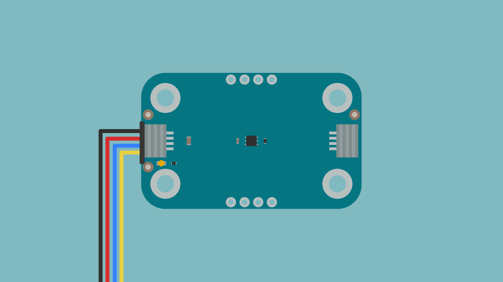
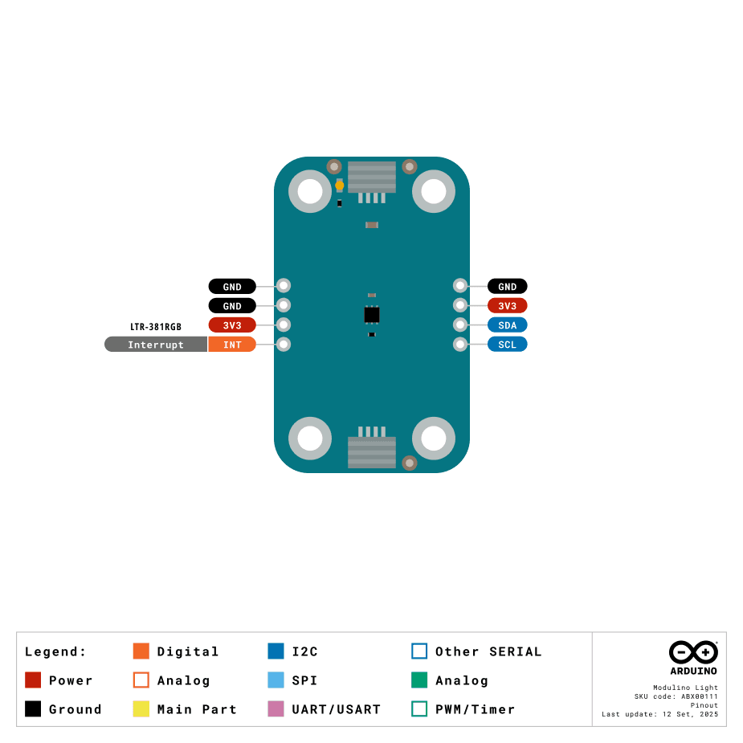
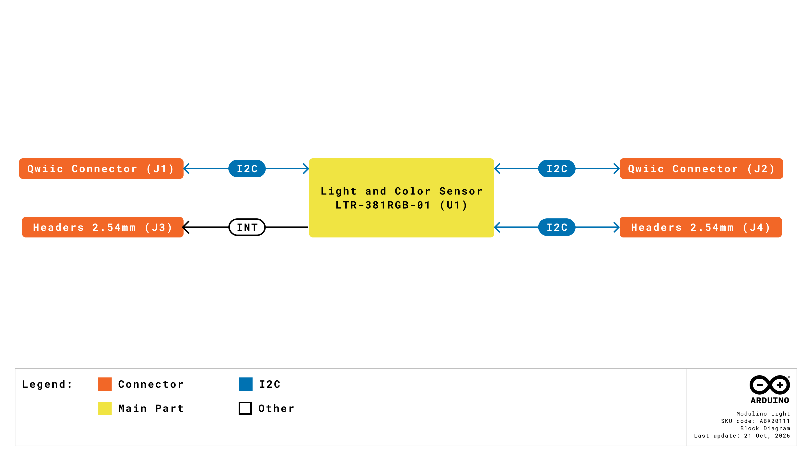
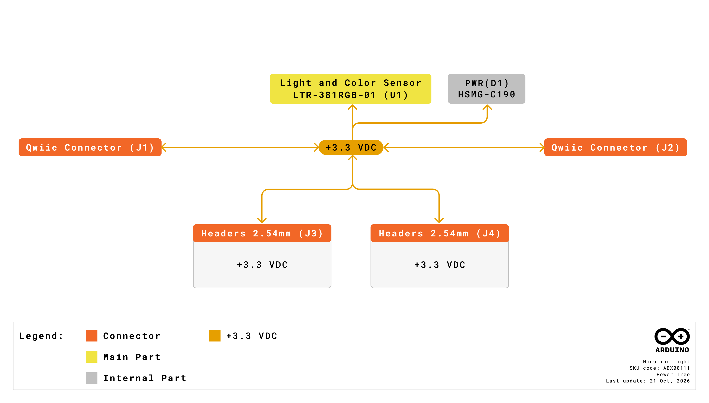

The Modulino Light is a Modulino node that measures ambient light, RGB color components, and infrared levels. It uses a single color sensor with an I²C interface and connects to the host board through Qwiic connectors, so no additional circuitry is required. This tutorial describes the Modulino Light hardware and shows how to read colors and light levels using both the Arduino and MicroPython libraries.

## Why Use the Modulino Light?

Detecting an object's color or measuring the amount of light in a space usually requires several components: a photodiode or RGB sensor, an amplifier, and an analog-to-digital converter, plus code to turn the raw values into something meaningful. The Modulino Light integrates all of this in a single sensor that measures the red, green, and blue components of the light, the overall ambient light level, and the infrared level. It delivers its readings in digital form over I²C. The Modulino library goes further by converting the readings into an approximate color name and a lux value so that an application can react to a color or brightness level with a few lines of code.

Because it uses the Modulino form factor, the Modulino Light can be chained with other Modulino nodes on the same Qwiic bus, for example, with a Modulino Pixels to reproduce the detected color or with a Modulino Buzzer to signal a match. Its I²C address is fixed, so using several Modulino Light nodes in the same project requires a Modulino Hub, as described in the [General Characteristics](#general-characteristics) section.

## Hardware Overview

### General Characteristics

The **Modulino Light** is based on the **LTR-381RGB-01** sensor from Lite-On, which integrates an ambient light sensor (ALS) and a color sensor (CS) in a single package. The sensor measures the red, green, and blue color channels, the ambient light level, and the infrared (IR) level, and delivers the readings through its I²C interface, so it requires no additional conversion circuitry.

The main characteristics of the LTR-381RGB-01 sensor are summarized in the following table:

|     **Parameter**     | **Minimum** | **Typical** | **Maximum** | **Unit** |
|:---------------------:|:-----------:|:-----------:|:-----------:|:--------:|
| Sensor Supply Voltage |     1.7     |      -      |     3.6     |     V    |
| Operating Temperature |     -40     |      -      |     +85     |    °C    |
|     ADC Resolution    |      16     |      -      |      20     |    bit   |
|    Integration Time   |      25     |      -      |     400     |    ms    |
|      Lux Accuracy     |     -10     |      -      |     +10     |     %    |

<Alert type="note">
The sensor supply range above is the LTR-381RGB-01 specification. On the Modulino Light, the sensor is always supplied at +3.3 VDC through the Qwiic connectors or the `3V3` pin of the optional headers.
</Alert>

The sensor supports I²C standard mode (100 kHz) and fast mode (400 kHz). The Modulino library configures the bus at 100 kHz. The default I²C address of the Modulino Light is as follows:

| **Modulino I²C Address** | **Hardware I²C Address** | **Configurable Addresses** |
|:------------------------:|:------------------------:|:--------------------------:|
|          `0x53`          |          `0x53`          |   Fixed hardware address   |

<Alert type="note">
Since you can't change the Modulino Light address, connecting two or more Modulino Light nodes to the same I²C bus causes an address conflict. To use several Modulino Light nodes in the same project, connect them through a [Modulino Hub](https://store.arduino.cc/products/modulino-hub).
</Alert>

### Pinout



#### Qwiic Connectors (2×, 1×4 Each)

Both Qwiic connectors share the same I²C and power lines, so you can use either one to connect the host board and the other to continue the Modulino chain. Their pin assignment is described in the following table:

| **Pin** |       **Function**      |
|:-------:|:-----------------------:|
|   GND   |          Ground         |
|   3V3   | Power supply (+3.3 VDC) |
|   SDA   |         I²C data        |
|   SCL   |        I²C clock        |

#### Optional Header (1×4, J4, Not Mounted)

The J4 header exposes the same I²C bus and power lines as the Qwiic connectors, for applications where header pins are preferred:

| **Pin** |       **Function**      |
|:-------:|:-----------------------:|
|   GND   |          Ground         |
|   3V3   | Power supply (+3.3 VDC) |
|   SDA   |         I²C data        |
|   SCL   |        I²C clock        |

#### Optional Header (1×4, Not Mounted)

The second optional header provides access to the interrupt output of the LTR-381RGB-01 sensor: <!-- TO VERIFY: connector designator (J3?) and the assignment of the two GND pins against the schematic -->

| **Pin** |       **Function**      |
|:-------:|:-----------------------:|
|   GND   |          Ground         |
|   GND   |          Ground         |
|   3V3   | Power supply (+3.3 VDC) |
|   INT   |     Interrupt output    |

The `INT` pin is an open-drain, active-low interrupt output with a 10 kΩ pull-up resistor to +3.3 VDC on the board. The sensor can assert it on threshold and data-ready events. **The Modulino library does not use the `INT` pin.**

### Power Specifications

The Modulino Light is powered at +3.3 VDC through the Qwiic connectors, as per the Qwiic standard. The electrical characteristics of the LTR-381RGB-01 sensor are listed in the following table:

|       **Parameter**       |        **Condition**        | **Minimum** | **Typical** | **Maximum** | **Unit** |
|:-------------------------:|:---------------------------:|:-----------:|:-----------:|:-----------:|:--------:|
|     Operating Voltage     |              -              |      -      |     3.3     |      -      |     V    |
| ALS Active Supply Current | Default duty cycle, gain 3x |      -      |     120     |      -      |    µA    |
|  CS Active Supply Current |      Default duty cycle     |      -      |     120     |      -      |    µA    |
|      Standby Current      |         Standby mode        |      -      |     1.2     |      -      |    µA    |

<Alert type="note">
The currents above are those of the LTR-381RGB-01 sensor **alone**. The Modulino Light's total consumption is higher because the board also includes an always-on power LED and the pull-up resistor on the `INT` line.
</Alert>

### Block Diagram



The **LTR-381RGB-01** sensor (U1) connects directly to the SDA and SCL lines shared by both Qwiic connectors (J1 and J2) and by the optional J4 header. The second optional header exposes the sensor's  `INT` signal, pulled up to +3.3 VDC. Electrically, the Qwiic connectors and the J4 header share the same I²C bus.

### Power Tree



The +3.3 VDC line from the Qwiic connectors directly supplies the LTR-381RGB-01 sensor, the power LED, and the `INT` pull-up resistor, with no regulation stage, and is shared by both connectors and the optional headers. 

### Schematic

The Modulino Light uses a simple circuit built around the LTR-381RGB-01 sensor (U1), which handles color detection, ambient light measurement, and I²C communication. The I²C lines are available through the Qwiic connectors (J1 and J2, recommended) or the J4 header, and the board powers at +3.3 VDC through the Qwiic cable or the `3V3` pin on the optional headers.

The full schematic and PCB files are available from the [Modulino Light page](https://docs.arduino.cc/hardware/modulinos/modulino-light) on Docs.

## How to Connect

The Modulino Light requires no configuration. To add it to your project, follow these steps:

1. Connect your Arduino board to one of the Modulino Light's Qwiic connectors using a Qwiic cable. Every Modulino node ships with a 5 cm cable.
2. If your project uses other Modulino nodes, connect the next node to the second Qwiic connector of the Modulino Light to continue the chain.
3. Power your Arduino board. The Modulino Light's green power LED turns on, and the node is ready to use.

Boards with an onboard Qwiic connector, such as the **UNO R4 WiFi**, the **UNO Q**, and the **Nano R4**, connect directly to the Modulino Light. Boards in the Nano form factor without a Qwiic connector can be mounted on the **Nano Connector Carrier**, which adds Qwiic connectors. Alternatively, you can wire the Modulino Light to the I²C pins of any board through the optional J4 header.

<Alert type="note">
The Modulino Light operates at +3.3 VDC. The Arduino boards listed above supply that voltage through the Qwiic connector and handle logic-level translation, so no additional circuitry is required. If you wire the node through the J4 header instead, confirm that your board drives the I²C lines at +3.3 VDC.
</Alert>

## Programming with Arduino

The [`Arduino_Modulino`](https://github.com/arduino-libraries/Arduino_Modulino) library supports the Modulino Light and is compatible with the Arduino IDE and the Arduino Cloud Editor. The following examples show how to read colors and light levels and how to build a color categorization application.

### Prerequisites

To follow the Arduino examples in this tutorial, you will need the following:

- An Arduino board with an onboard Qwiic connector (**UNO R4 WiFi**, **UNO Q**, or **Nano R4**), or a Nano form factor board mounted on the **Nano Connector Carrier**
- A Qwiic cable
- The `Arduino_Modulino` library, installed from the Library Manager of the Arduino IDE. If you use the Arduino Cloud Editor, the library is already available, and no installation is required.

On the UNO R4 WiFi, the UNO Q, and the Nano R4, the Qwiic connector is wired to the secondary I²C interface, and `Modulino.begin()` automatically selects  `Wire1`. On any other board, the library defaults to `Wire`. **You do not need to specify the interface in your sketch.**

For detailed instructions on setting up your Arduino environment and installing libraries, refer to the [Getting Started with Modulinos](../how-general) guide.

### Basic Example

The following sketch takes a reading every half second and prints the approximate color name, the RGB components, the raw ambient light count, the lux value, and the infrared level to the Serial Monitor:

```arduino
/**
Basic Example for the Arduino Modulino Light
Name: modulino_light_basic.ino
Purpose: This sketch demonstrates how to read the color, ambient
light, and infrared level from the Modulino Light and print the
values to the Serial Monitor.

@author Arduino Product Experience Team
@version 1.0 21/10/26
*/

#include <Arduino_Modulino.h>

ModulinoLight light;

void setup() {
  Serial.begin(115200);
  Modulino.begin();

  // Always check the return value: if the sensor is not detected,
  // calling the reading methods afterwards leads to undefined behavior.
  if (!light.begin()) {
    Serial.println("Modulino Light not detected. Check the QWIIC connection.");
    while (1);
  }
}

void loop() {
  // Take a new reading. This call is blocking and takes several tens of
  // milliseconds, since the sensor performs two acquisition cycles.
  if (!light.update()) {
    Serial.println("Reading failed");
    delay(500);
    return;
  }

  // Approximate color name, derived from the RGB channels
  String colorName = light.getColorApproximate();

  // RGB components, packed into a 32-bit value
  ModulinoColor color = light.getColor();
  int r = (0xFF000000 & color) >> 24;  // Red:   bits 24-31
  int g = (0x00FF0000 & color) >> 16;  // Green: bits 16-23
  int b = (0x0000FF00 & color) >> 8;   // Blue:  bits 8-15

  int rawAmbient = light.getAL();   // Raw ambient light count
  int lux = light.getLux();         // Ambient light, converted to lux
  int ir = light.getIR();           // Infrared level

  Serial.print("Color: ");
  Serial.print(colorName);
  Serial.print("\tRGB: (");
  Serial.print(r);
  Serial.print(", ");
  Serial.print(g);
  Serial.print(", ");
  Serial.print(b);
  Serial.print(")\tRaw AL: ");
  Serial.print(rawAmbient);
  Serial.print("\tLux: ");
  Serial.print(lux);
  Serial.print("\tIR: ");
  Serial.println(ir);

  delay(500);
}
```

After uploading the sketch, open the Serial Monitor at 115200 baud to see the readings.

### Key Functions

The basic example above relies on the following functions of the `Arduino_Modulino` library:

- `Modulino.begin()`: Initializes the Modulino system (uses `Wire1` on boards with an onboard Qwiic connector).
- `begin()`: Initializes the sensor at address `0x53`. Returns `true` if the sensor responded.
- `update()`: Takes a new reading of color, ambient light, and IR. Returns `true` if successful. All the getters below return values cached by this call, so `update()` must be called on every iteration.
- `getColor()`: Returns a `ModulinoColor` object. Extract the individual channels with the bit shifting shown above. Each channel is scaled to the range 0 to 255.
- `getColorApproximate()`: Returns an approximate color name as a `String`. See the [Understanding the Color Names](#understanding-the-color-names) section for the full vocabulary.
- `getAL()`: Returns the **raw** ambient light count, not a value in lux.
- `getLux()`: Returns the ambient light converted to lux using the datasheet formula.
- `getIR()`: Returns the infrared level.

<Alert type="note">
`getLux()` applies the conversion formula from the LTR-381RGB-01 datasheet using the gain and integration time configured by the library. It is not a factory-calibrated photometric measurement, and it does not compensate for any enclosure or cover placed over the sensor. Treat it as a relative indication of brightness.
</Alert>

### Understanding the Color Names

`getColorApproximate()` converts the RGB reading to the HSL color space and builds a name from three parts: an optional saturation qualifier, an optional lightness qualifier, and a hue name. The twelve hue names are the following:

`RED` · `ORANGE` · `YELLOW` · `LIME` · `GREEN` · `SPRING GREEN` · `CYAN` · `AZURE` · `BLUE` · `VIOLET` · `MAGENTA` · `ROSE`

The qualifiers are `VERY DARK`, `DARK`, `LIGHT`, and `VERY LIGHT` for lightness, and `VERY PALE`, `PALE`, `VIVID`, and `VERY VIVID` for saturation. A typical result therefore looks like `PALE DARK AZURE` rather than a single word. Very bright, very dark, or very desaturated readings return one of the neutral names instead: `WHITE`, `BLACK`, `LIGHT GRAY`, or `DARK GRAY`.

<Alert type="note">
When you compare the result against a color, match a substring rather than the whole string. `colorName == "BLUE"` fails for a reading of `VIVID LIGHT BLUE`, while `colorName.indexOf("BLUE") >= 0` succeeds.
</Alert>

### Advanced Example - Color Categorization

This example groups the detected color into families and prints the result. It matches substrings, so it works with the compound names returned by the library:

```arduino
/**
Color Categorization Example for the Arduino Modulino Light
Name: modulino_light_categorization.ino
Purpose: This sketch demonstrates how to group the color names
returned by the Modulino Light into color families using
substring matching.

@author Arduino Product Experience Team
@version 1.0 21/10/26
*/

#include <Arduino_Modulino.h>

ModulinoLight light;

void setup() {
  Serial.begin(115200);
  Modulino.begin();

  if (!light.begin()) {
    Serial.println("Modulino Light not detected. Check the QWIIC connection.");
    while (1);
  }

  Serial.println("Color Categorization");
  Serial.println("Place colored objects under the sensor");
  Serial.println("---------------------------------------");
}

void loop() {
  if (!light.update()) {
    Serial.println("Reading failed");
    delay(1000);
    return;
  }

  String color = light.getColorApproximate();

  ModulinoColor rgb = light.getColor();
  int r = (0xFF000000 & rgb) >> 24;
  int g = (0x00FF0000 & rgb) >> 16;
  int b = (0x0000FF00 & rgb) >> 8;

  Serial.print("Detected color: ");
  Serial.print(color);
  Serial.print("\tRGB: (");
  Serial.print(r);
  Serial.print(", ");
  Serial.print(g);
  Serial.print(", ");
  Serial.print(b);
  Serial.print(")\tCategory: ");
  Serial.println(categorizeColor(color));

  delay(1000);
}

// Groups a color name returned by getColorApproximate() into a family.
// The comparison uses indexOf() because the library returns compound
// names such as "PALE DARK AZURE".
String categorizeColor(String color) {
  color.toUpperCase();

  // Neutrals are checked first: they are returned instead of a hue name.
  if (color.indexOf("WHITE") >= 0 || color.indexOf("BLACK") >= 0 ||
      color.indexOf("GRAY") >= 0) {
    return "NEUTRAL COLORS";
  }

  // SPRING GREEN and LIME are checked before GREEN is matched on its own.
  if (color.indexOf("RED") >= 0 || color.indexOf("ROSE") >= 0 ||
      color.indexOf("ORANGE") >= 0) {
    return "WARM COLORS";
  } else if (color.indexOf("YELLOW") >= 0) {
    return "BRIGHT COLORS";
  } else if (color.indexOf("GREEN") >= 0 || color.indexOf("LIME") >= 0) {
    return "NATURAL COLORS";
  } else if (color.indexOf("CYAN") >= 0 || color.indexOf("AZURE") >= 0 ||
             color.indexOf("BLUE") >= 0) {
    return "COOL COLORS";
  } else if (color.indexOf("VIOLET") >= 0 || color.indexOf("MAGENTA") >= 0) {
    return "VIOLET TONES";
  }

  return "UNKNOWN";
}
```

<Alert type="note">
For repeatable color readings, keep the object at a constant distance from the sensor and shield it from changing ambient light. The sensor has no built-in illumination source, so the color it reports depends on the light falling on the object.
</Alert>

## Programming with MicroPython

The Modulino Light is supported by the [Modulino MicroPython package](https://github.com/arduino/arduino-modulino-mpy). The following examples show how to read colors and light levels and how to tune the sensor for low-light conditions.

### Prerequisites

To follow the MicroPython examples of this tutorial, you will need the following:

- An Arduino board that officially supports MicroPython, such as the **Nano ESP32**, **Nano RP2040 Connect**, **Nano 33 BLE Sense**, **GIGA R1 WiFi**, or **Portenta H7**. Mount a Nano form-factor board on the **Nano Connector Carrier** to connect the Modulino Light through Qwiic.
- A Qwiic cable.
- Install the Modulino MicroPython package with the [Arduino MicroPython Package Installer](https://labs.arduino.cc/en/labs/micropython-package-installer) by searching for Modulino, or from a terminal with `mpremote` and `mip`. Both methods also install the `ltr381rgb` sensor driver, which the Modulino Light depends on:

  ```bash
  mpremote mip install github:arduino/arduino-modulino-mpy
  ```

- Arduino Lab for MicroPython, to run the scripts on the board

On Arduino boards, the package detects the correct I²C interface automatically, so `ModulinoLight()` needs no arguments. For detailed instructions, refer to the [Getting Started with Modulinos](../how-general) guide.

### Basic Example

The following script reads the color name, the RGB components, the lux value, the infrared level, and the color temperature every half second and prints them to the console:

```python
"""
Basic Example for the Arduino Modulino Light
Name: modulino_light_basic.py
Purpose: This script demonstrates how to read the color, ambient
light, infrared level, and color temperature from the Modulino
Light and print the values to the console.

@author Arduino Product Experience Team
@version 1.0 21/10/26
"""

from modulino import ModulinoLight
from time import sleep

light = ModulinoLight()

while True:
    r, g, b = light.rgb

    print(f"Color: {light.color_name:8s}  RGB: ({r:3d}, {g:3d}, {b:3d})", end="")
    print(f"  Lux: {light.lux:8.1f}  IR: {light.infrared:6d}")

    # Returns None when there is not enough light to estimate it
    temperature = light.color_temperature
    if temperature is not None:
        print(f"Color temperature: {temperature} K")

    sleep(0.5)
```

### Key Properties

The basic example above relies on the following properties of the `ModulinoLight` class:

- `.lux`: Ambient brightness in lux, as a `float`. Computed from the datasheet formula, not factory calibrated.
- `.rgb`: Tuple of `(red, green, blue)` values in the range 0 to 255.
- `.color_name`: Approximate color name as a lowercase `str`.
- `.color_temperature`: Color temperature in kelvin as an `int`, or `None` when there is not enough light to estimate it.
- `.infrared`: Infrared level as an `int`.
- `.sensor`: The underlying `LTR381RGB` driver object, for advanced configuration.

### Differences From the Arduino Library

The MicroPython implementation is not a direct port of the Arduino one. The following table summarizes the differences to keep in mind when moving an application between the two:

|     **Aspect**     |                 **Arduino**                 |                       **MicroPython**                       |
|:------------------:|:-------------------------------------------:|:-----------------------------------------------------------:|
|     Color names    | Compound, uppercase, e.g. `PALE DARK AZURE` |             Single word, lowercase, e.g. `azure`            |
|  Color vocabulary  |  12 hues, plus qualifiers and neutral names |           12 hues only, no qualifiers, no neutrals          |
|     RGB scaling    |   Absolute, relative to the ADC resolution  | Normalized per sample: the highest channel is mapped to 255 |
|      Lux type      |                    `int`                    |                           `float`                           |
| Color temperature  |                Not available                |                          Available                          |
|   Sensor settings  |                 Not exposed                 |       Gain and integration time exposed via `.sensor`       |

The twelve names returned by `.color_name` in MicroPython are the following:

`red` · `orange` · `yellow` · `lime` · `green` · `spring` · `cyan` · `azure` · `blue` · `violet` · `magenta` · `rose`

<Alert type="note">
In very dark or very desaturated conditions, the MicroPython driver falls back to `red`. Do not treat a `red` reading as a confident detection without checking the brightness first.
</Alert>

### Advanced Example - Tuning the Sensor

The `ModulinoLight` class covers the most common readings, but the sensor can do more. You can reach it directly through the `.sensor` attribute to change the gain, which amplifies weak light, and the integration time, which is how long the sensor collects light for each reading. Higher values help in dim conditions; lower values work better in bright environments:

```python
"""
Sensor Tuning Example for the Arduino Modulino Light
Name: modulino_light_tuning.py
Purpose: This script demonstrates how to configure the gain and
integration time of the Modulino Light sensor for low-light
conditions and group the detected color into color families.

@author Arduino Product Experience Team
@version 1.0 21/10/26
"""

from modulino import ModulinoLight
from ltr381rgb import Gain, IntegrationTime
from time import sleep

light = ModulinoLight()

# Increase gain and integration time for better readings in low light
light.sensor.gain = Gain.X9
light.sensor.integration_time = IntegrationTime.MS200

print("Sensor reconfigured for low-light readings")
print(f"Integration time: {light.sensor.integration_time_ms} ms")
print("")

MIN_LUX = 50

def categorize_color(color_name):
    """Group a color name returned by .color_name into a family."""
    name = color_name.lower()

    if name in ("red", "rose", "orange"):
        return "WARM COLORS"
    elif name == "yellow":
        return "BRIGHT COLORS"
    elif name in ("green", "lime", "spring"):
        return "NATURAL COLORS"
    elif name in ("cyan", "azure", "blue"):
        return "COOL COLORS"
    elif name in ("violet", "magenta"):
        return "VIOLET TONES"

    return "UNKNOWN"

while True:
    lux = light.lux

    # The driver returns "red" as a fallback when there is not enough
    # light or saturation, so check the brightness before trusting the name.
    if lux < MIN_LUX:
        print("Not enough light for a reliable color reading")
        sleep(1)
        continue

    color_name = light.color_name
    r, g, b = light.rgb

    print(f"Color: {color_name:8s}  RGB: ({r:3d}, {g:3d}, {b:3d})", end="")
    print(f"  Lux: {lux:8.1f}  Category: {categorize_color(color_name)}")

    sleep(1)
```

<Alert type="note">
`MIN_LUX` is an empirical threshold. Because the lux value isn't factory calibrated, tune it to your lighting conditions rather than reusing this number directly.
</Alert>

## Troubleshooting

### Sensor Not Detected

If the Modulino Light power LED is off, check that the Qwiic cable is firmly clicked into place at both ends and that the host board is powered. If the LED is on but the sensor does not respond, check the return value of `light.begin()` in Arduino: it returns `false` when the sensor did not answer at address `0x53`.

If more than one Modulino Light is on the bus, remove all but one or connect them through a Modulino Hub, since the address is fixed and cannot be changed.

### Readings Do Not Change

In Arduino, all getters return values cached by the last call to `update()`. If you call `getColor()` or `getColorApproximate()` without calling `update()` first in the same iteration, you read the same values indefinitely.

### Inaccurate Color Detection

If the color readings are inaccurate, make sure the lighting conditions are adequate: the sensor has no built-in light source and reports light reflected from the object, so avoid mixed lighting sources, such as daylight combined with artificial light. Position the sensor facing the object directly and keep it at a consistent distance from the object. In MicroPython, increase the gain and the integration time for dim environments, as shown in the [Advanced Example](#advanced-example---tuning-the-sensor) of the MicroPython section.

### Library Issues

See the [Getting Started with Modulinos](../how-general) guide for library installation troubleshooting.

## Project Ideas

Now that you are familiar with the Modulino Light, you can use it in projects such as the following:

- **Color sorting machine**: Sort objects automatically by color
- **Ambient light controller**: Adjust the brightness of LEDs according to the room lighting
- **Color matching game**: Build an interactive color identification game
- **Paint color identifier**: Identify paint or material colors
- **Plant monitor**: Track light levels for optimal plant growth
- **Color-reactive art installation**: Drive a Modulino Pixels from the detected color
- **Light logger**: Record the ambient light across a day to profile a room

## Conclusion

In this tutorial, you learned about the Modulino Light hardware, how to connect it to your Arduino board, and how to read colors, ambient light, and infrared levels using both the `Arduino_Modulino` library and the Modulino MicroPython package. You also learned how the approximate color names are built, how to categorize the detected colors, how to tune the sensor for low-light conditions, and how to troubleshoot the most common issues.

In this tutorial, you learned about the hardware of the Modulino Light, how to connect it to your Arduino board, and how to read colors, ambient light, and infrared levels from it using both the `Arduino_Modulino` library and the Modulino MicroPython package. You also learned how the approximate color names are built, how to categorize the detected colors, how to tune the sensor for low-light conditions, and how to troubleshoot the most common issues.

For more information, refer to the following resources:

- [Modulino Light page](https://docs.arduino.cc/hardware/modulinos/modulino-light), with the datasheet, the schematic, and the pinout
- [Arduino_Modulino library](https://github.com/arduino-libraries/Arduino_Modulino)
- [Modulino MicroPython package](https://github.com/arduino/arduino-modulino-mpy)