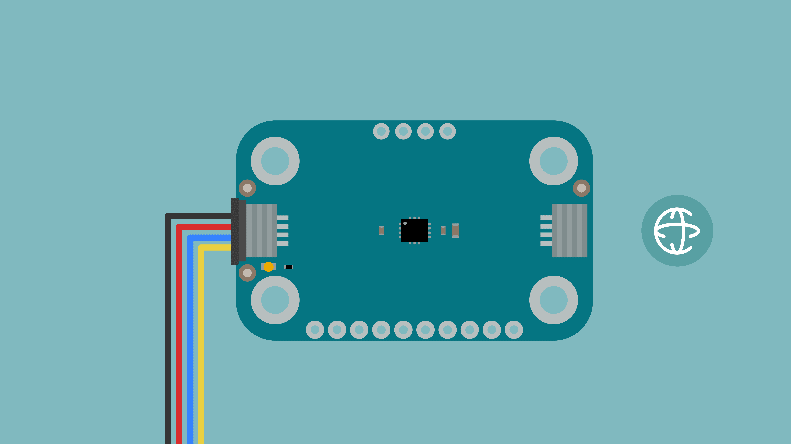
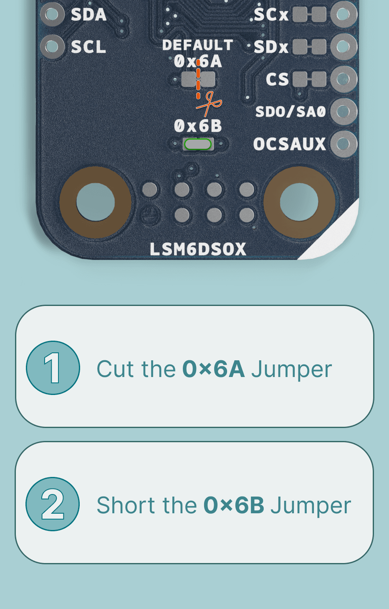
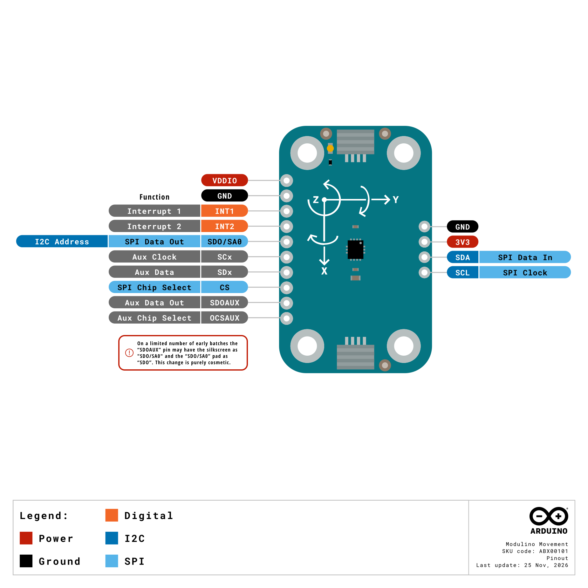
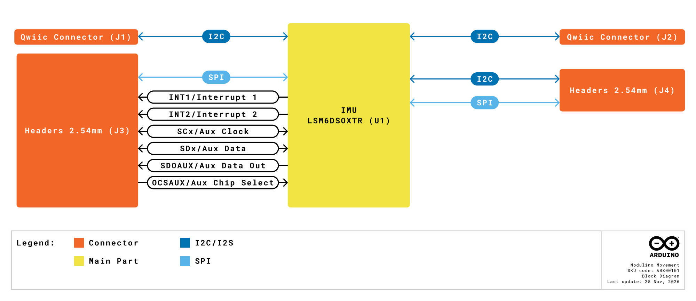
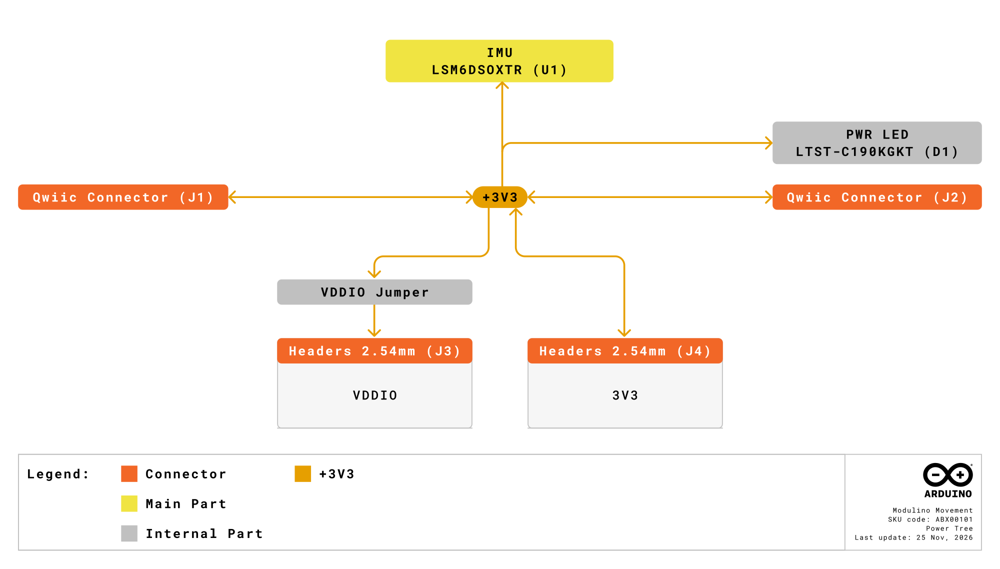

The Modulino Movement is a Modulino node that measures linear acceleration and angular velocity on three axes each. It uses a single 6-axis inertial measurement unit (IMU) with an I²C interface and connects to the host board through Qwiic connectors, so it requires no additional circuitry. This tutorial describes the Modulino Movement hardware and shows how to read its measurements using both the Arduino and MicroPython libraries.

## Why Use the Modulino Movement?

Acceleration and angular velocity are the two measurements needed to detect how an object moves: whether it is tilted, shaken, rotated, dropped, or at rest. Measuring them with separate sensors requires two devices, two sets of connections, and readings taken at different times. The Modulino Movement integrates a 3-axis accelerometer and a 3-axis gyroscope in a single sensor that delivers its readings in digital form over I²C, so the host board reads acceleration in g and angular velocity in degrees per second (dps) directly, without conversion code.

Because it uses the Modulino form factor, you can chain the Modulino Movement with other Modulino nodes on the same Qwiic bus, for example, with a Modulino Pixels to display the node's orientation or with a Modulino Buzzer to signal that movement was detected. You can change its I²C address with the solder jumpers on the board, so two Modulino Movement nodes can share the same bus, as described in the [General Characteristics](#general-characteristics) section.

## Hardware Overview

### General Characteristics

The **Modulino Movement** is based on the **LSM6DSOXTR** sensor from STMicroelectronics, a 6-axis IMU that combines a 3-axis accelerometer and a 3-axis gyroscope with a digital I²C output. The sensor supports several measurement ranges and output data rates; the Modulino libraries configure it with a fixed range and data rate when the node is initialized.

The main characteristics of the sensor, together with the settings applied by the Modulino libraries, are summarized in the following table:

|                    **Parameter**                    |                 **Sensor Capability**                | **Modulino Library Setting** |
|:---------------------------------------------------:|:----------------------------------------------------:|:----------------------------:|
|               Accelerometer Full Scale              |                 ±2, ±4, ±8, or ±16 g                 |             ±4 g             |
|                 Gyroscope Full Scale                |         ±125, ±250, ±500, ±1000, or ±2000 dps        |           ±2000 dps          |
|              Accelerometer Sensitivity              |      0.061 mg/LSB (±2 g) to 0.488 mg/LSB (±16 g)     |         0.122 mg/LSB         |
|                Gyroscope Sensitivity                | 4.375 mdps/LSB (±125 dps) to 70 mdps/LSB (±2000 dps) |          70 mdps/LSB         |
|            Accelerometer Output Data Rate           |                  1.6 Hz to 6.66 kHz                  |            104 Hz            |
|              Gyroscope Output Data Rate             |                  12.5 Hz to 6.66 kHz                 |            104 Hz            |
| Accelerometer Noise Density (High-Performance Mode) |                   70 µg/√Hz (±2 g)                   |       75 µg/√Hz (±4 g)       |
|   Gyroscope Noise Density (High-Performance Mode)   |                     3.8 mdps/√Hz                     |         3.8 mdps/√Hz         |
|             Sensor Operating Temperature            |                     -40 to +85 °C                    |               -              |

<Alert type="note">

**Note**: Both the `Arduino_Modulino` library and the Modulino MicroPython package apply the settings above when the node is initialized, and neither provides functions to change the measurement range or the sensor's output data rate.

</Alert>

The sensor supports I²C fast mode (400 kHz) and fast mode plus (1 MHz). The `Arduino_Modulino` library configures the bus at 100 kHz. The default I²C address of the Modulino Movement is as follows:

| **Modulino I²C Address** | **Hardware I²C Address** |  **Configurable Addresses**  |
|:------------------------:|:------------------------:|:----------------------------:|
|          `0x6A`          |          `0x6A`          | `0x6B` via solder jumpers    |

<Alert type="note">

**Note**: An I²C scanner sketch reports the Modulino Movement at two addresses: `0x6A` (or `0x6B`, depending on the solder jumpers) and `0x7E`. The second is not an additional node address. The LSM6DSOXTR sensor also supports the MIPI I3C® interface, which is enabled by default, and `0x7E` is the broadcast address reserved by that interface. **Always use `0x6A` or `0x6B` to communicate with the node.**

</Alert>

The address is set by the `SDO/SA0` pin of the sensor, which is connected to two solder jumpers on the back of the board: one connects the pin to GND (address `0x6A`) and is closed by default, and the other connects it to `VDDIO` (address `0x6B`) and is open by default.

To change the address of the node to `0x6B`, follow these steps:

1. Disconnect the Modulino Movement from any power source.
2. Locate the address selection solder jumpers on the back of the board.
3. Cut the trace of the jumper marked **Default** (`0x6A`).
4. Close the jumper marked **0x6B** with a drop of solder.



<Alert type="warning">

Never leave both jumpers closed at the same time. With both jumpers closed, the node's +3.3 VDC supply is shorted to GND, which can damage the Modulino Movement and the host board.

</Alert>

### Pinout



#### Qwiic Connectors (2×, 1×4 Each)

Both Qwiic connectors share the same I²C and power lines, so you can use either one to connect the host board and the other to continue the Modulino chain. Their pin assignment is described in the following table:

| **Pin** |       **Function**      |
|:-------:|:-----------------------:|
|   GND   |          Ground         |
|   3V3   | Power supply (+3.3 VDC) |
|   SDA   |         I²C data        |
|   SCL   |        I²C clock        |

#### Optional Header (1×4, J4, Not Mounted)

The J4 header exposes the same I²C bus and power lines as the Qwiic connectors, for applications that prefer header pins. The `SDA` and `SCL` pins also carry the data input and the clock of the SPI interface of the sensor, as described in the [Using the SPI Interface](#using-the-spi-interface) section:

| **Pin** |       **Function**      |
|:-------:|:-----------------------:|
|   GND   |          Ground         |
|   3V3   | Power supply (+3.3 VDC) |
|   SDA   | I²C data/SPI data input |
|   SCL   |   I²C clock/SPI clock   |

<Alert type="note">

The Modulino Movement does not include pull-up resistors on the `SDA` and `SCL` lines. Arduino boards with an onboard Qwiic connector provide them; if you wire the node to a different board through the J4 header, confirm that your board's I²C bus has pull-up resistors to +3.3 VDC.

</Alert>

#### Optional Header (1×10, J3, Not Mounted)

The J3 header provides access to the I/O supply, the interrupt outputs, and the remaining interface signals of the LSM6DSOXTR sensor:

| **Pin** |                         **Function**                        |
|:-------:|:-----------------------------------------------------------:|
|  VDDIO  |                   I/O supply of the sensor                  |
|   GND   |                            Ground                           |
|   INT1  |               Programmable interrupt output 1               |
|   INT2  |               Programmable interrupt output 2               |
|   SDO   |        SPI data output / I²C address selection input        |
|   SCx   | Auxiliary clock (sensor hub I²C or auxiliary SPI interface) |
|   SDx   |  Auxiliary data (sensor hub I²C or auxiliary SPI interface) |
|    CS   |    SPI chip select (I²C enabled when high, SPI when low)    |
| SDO/SA0 |                  Auxiliary SPI data output                  |
|  OCSAUX |                  Auxiliary SPI chip select                  |

Several of these pins are connected to solder jumpers on the board, all of them closed by default, that set the default configuration of the sensor: `VDDIO` is connected to +3.3 VDC, `CS` is connected to `VDDIO` to select the I²C interface, `SDO/SA0` is connected to GND to select the address `0x6A`, and `SCx` and `SDx` are connected to GND, as required by the sensor when its auxiliary interfaces are not used. **The Modulino libraries do not use the `INT1`, `INT2`, `SCx`, `SDx`, `SDOAUX`, and `OCSAUX` pins.**

<Alert type="note">

On a limited number of early batches, the `SDOAUX` pin is marked `SDO/SA0` on the silkscreen and the `SDO/SA0` pin is marked `SDO`. This difference is cosmetic only; the pin positions and functions are the same.

</Alert>

#### Using the SPI Interface

The LSM6DSOXTR sensor can also communicate over a 4-wire SPI interface, which is available on the J3 and J4 headers. The SPI signals of the sensor are distributed across both headers and must be connected to the host board as described in the following table:

| **Modulino Movement Pin** | **Header** |  **SPI Function** | **Host Board Pin** |
|:-------------------------:|:----------:|:-----------------:|:------------------:|
|            SDA            |     J4     |     Data input    |        MOSI        |
|          SDO/SA0          |     J3     |    Data output    |        MISO        |
|            SCL            |     J4     |       Clock       |         SCK        |
|             CS            |     J3     |    Chip select    |         CS         |

<Alert type="note">

The `SCx` and `SDx` pins are **not** the clock and data lines of the SPI interface. They belong to the sensor's auxiliary interfaces and must be left unconnected.

</Alert>

Because the `CS` and `SDO/SA0` pins are connected to solder jumpers by default, you must modify the board before using SPI. To prepare the Modulino Movement, follow these steps:

1. Disconnect the Modulino Movement from any power source.
2. Open the solder jumper connecting `CS` to `VDDIO`, so the host board can drive the chip select line.
3. Open both I²C address solder jumpers so the `SDO/SA0` pin is no longer connected to GND or `VDDIO` and can function as the data output.
4. Wire the node to the host board through the J3 and J4 headers, including the `3V3` and `GND` pins.

<Alert type="warning">

Do not drive the `CS` or `SDO/SA0` pins while their solder jumpers are closed. The jumpers connect these pins directly to `VDDIO` or GND, so driving them shorts the host board or sensor output to the supply.

</Alert>

When using the SPI interface, the `SDA` and `SCL` lines carry SPI signals, so leave the Qwiic connectors unconnected and do not chain the node with other Modulino nodes. The Modulino libraries support only the I²C interface; to read the sensor over SPI in Arduino, use the [Arduino_LSM6DSOX](https://github.com/arduino-libraries/Arduino_LSM6DSOX) library directly, which provides a constructor for SPI communication.

### Power Specifications

The Modulino Movement is powered at +3.3 VDC through the Qwiic connectors, as per the Qwiic standard. The electrical characteristics of the LSM6DSOXTR sensor are listed in the following table:

|              **Parameter**              |             **Condition**            | **Minimum** | **Typical** | **Maximum** | **Unit** |
|:---------------------------------------:|:------------------------------------:|:-----------:|:-----------:|:-----------:|:--------:|
|            Operating Voltage            |    Qwiic connectors or `3V3` pin     |      -      |     3.3     |      -      |     V    |
|       Sensor Supply Voltage (VDD)       |                   -                  |     1.71    |      -      |     3.6     |     V    |
|    Sensor I/O Supply Voltage (VDDIO)    |                   -                  |     1.62    |      -      |     3.6     |     V    |
| Supply Current, Accelerometer and Gyroscope |       High-performance mode      |      -      |     0.55    |      -      |    mA    |
|    Supply Current, Accelerometer Only   |         High-performance mode        |      -      |     170     |      -      |    µA    |
|    Supply Current, Accelerometer Only   |         Low-power mode, 50 Hz        |      -      |      26     |      -      |    µA    |
|    Supply Current, Accelerometer Only   |      Ultra-low-power mode, 50 Hz     |      -      |     9.5     |      -      |    µA    |

<Alert type="note">

The currents above are those of the LSM6DSOXTR sensor **alone**. The Modulino Movement's total consumption is higher, as the board also includes an always-on power LED. The Modulino libraries enable the accelerometer and gyroscope together in high-performance mode, so the first supply current in the table applies when the node is used with them.
</Alert>

On the board, the supply pin (`VDD`) is connected directly to the +3.3 VDC line, and its I/O supply pin (`VDDIO`) is connected to the same line through a solder jumper. The `VDDIO` pin of the J3 header is connected to the sensor's I/O supply, so with the jumper closed, it is at +3.3 VDC.

### Block Diagram



The **LSM6DSOXTR** sensor (U1) connects directly to the SDA and SCL lines shared by both Qwiic connectors (J1 and J2) and by the optional J4 header. The optional J3 header exposes the remaining signals of the sensor: the `INT1` and `INT2` interrupt outputs, the `SDO/SA0` and `CS` pins, and the `SCx`, `SDx`, `SDOAUX`, and `OCSAUX` pins of its auxiliary interfaces. Electrically, the Qwiic connectors and the J4 header share the same I²C bus.

The sensor's SPI interface is distributed across both headers: its clock and data input are the `SCL` and `SDA` lines of the J4 header, while its data output (`SDO/SA0`) and chip select (`CS`) are on the J3 header, as described in the [Using the SPI Interface](#using-the-spi-interface) section. The solder jumpers on the back of the board set the sensor's default configuration: I²C interface enabled and address `0x6A`.

### Power Tree



The +3.3 VDC line from the Qwiic connectors supplies the LSM6DSOXTR sensor and the power LED directly, with no regulation stage, and is shared by both connectors and by the `3V3` pin of the optional J4 header. You can also power the node through that pin when the Qwiic connectors are not used.

The sensor's I/O supply (`VDDIO`) is connected to the +3.3 VDC line through a solder jumper, closed by default, and is the supply available on the `VDDIO` pin of the optional J3 header. The sensor supply pin is decoupled with a 100 nF and a 4.7 µF capacitor, and its I/O supply pin with a 100 nF capacitor.

### Schematic

The Modulino Movement uses a simple circuit built around the **LSM6DSOXTR** sensor (U1), which handles both the measurements and the I²C communication. The I²C lines are available through the **Qwiic connectors** (J1 and J2, recommended) or the **J4 header**, and the board is powered at **+3.3 VDC** through the Qwiic cable or the `3V3` pin of J4. The remaining sensor signals are available on the **J3 header**, and a set of solder jumpers on the back of the board sets the default configuration.

The full schematic and PCB files are available from the [Modulino Movement page](https://docs.arduino.cc/hardware/modulino-movement/) on Docs.

## How to Connect

The Modulino Movement requires no configuration. To add it to your project, follow these steps:

1. Connect your Arduino board to one of the Modulino Movement's Qwiic connectors using a Qwiic cable. Every Modulino node ships with one.
2. If your project uses other Modulino nodes, connect the next node to the second Qwiic connector of the Modulino Movement to continue the chain.
3. Power your Arduino board. The green power LED of the Modulino Movement turns on, and the node is ready to use.

Boards with an onboard Qwiic connector, such as the **UNO R4 WiFi**, the **UNO Q**, and the **Nano R4**, connect directly to the Modulino Movement. Boards in the Nano form factor without a Qwiic connector can be mounted on the Nano Connector Carrier, which adds Qwiic connectors. Alternatively, you can wire the Modulino Movement to the I²C pins of any board through the optional J4 header.

<Alert type="note">

The Modulino Movement operates at +3.3 VDC. The Arduino boards listed above supply that voltage through the Qwiic connector and handle logic-level translation, so no additional circuitry is required. If you wire the node through the J4 header instead, confirm that your board drives the I²C lines at +3.3 VDC and that its I²C bus has pull-up resistors.

</Alert>

Since the Modulino Movement measures the board's motion, how it is mounted affects its readings. Secure the node firmly to the object you want to measure using its four mounting holes so the node moves with the object and doesn't vibrate on its own, and leave enough slack in the Qwiic cable to prevent it from pulling on the node. The [Pinout](#pinout) section shows the orientation of the sensor's X, Y, and Z axes.

## Programming with Arduino

The Modulino Movement is supported by the [Arduino_Modulino](https://github.com/arduino-libraries/Arduino_Modulino) library, which is compatible with the Arduino IDE and the Arduino Cloud Editor. The following examples show how to read acceleration and angular velocity and how to build a simple motion detector.

### Prerequisites

To follow the Arduino examples in this tutorial, you will need the following:

- An Arduino board with an onboard Qwiic connector (**UNO R4 WiFi**, **UNO Q**, or **Nano R4**), or a Nano form factor board mounted on the **Nano Connector Carrier**.
- A Qwiic cable.
- * The `Arduino_Modulino` library, installed from the Library Manager of the Arduino IDE. The Library Manager also installs the `Arduino_LSM6DSOX` library, which `Arduino_Modulino` uses to communicate with the sensor. If you use the Arduino Cloud Editor, the library is already available, and no installation is required.

On the UNO R4 WiFi, the UNO Q, and the Nano R4, the Qwiic connector is wired to the secondary I²C interface, and `Modulino.begin()` automatically selects `Wire1`. On any other board, the library defaults to `Wire`. **You do not need to specify the interface in your sketch**.

For detailed instructions on setting up your Arduino environment and installing libraries, refer to the [Getting Started with Modulinos](../how-general) guide.

### Basic Example

The following sketch reads the acceleration and the angular velocity on the three axes ten times per second and prints them to the Serial Monitor:

```arduino
/**
Basic Example for the Arduino Modulino Movement
Name: modulino_movement_basic.ino
Purpose: This sketch demonstrates how to read acceleration and
angular velocity from the Modulino Movement and print the values
to the Serial Monitor.

@author Arduino Product Experience Team
@version 1.0 25/11/26
*/

#include <Arduino_Modulino.h>

// Modulino Movement object
ModulinoMovement movement;

void setup() {
  // Initialize serial communication and wait up to 2.5 seconds for a connection
  Serial.begin(115200);
  for (auto startNow = millis() + 2500; !Serial && millis() < startNow; delay(500));

  // Initialize the Modulino system (I2C bus)
  Modulino.begin();

  // Initialize the Modulino Movement and halt if the sensor is not detected
  if (!movement.begin()) {
    Serial.println("- Modulino Movement not detected! Check the Qwiic connection...");
    while (1);
  }

  // Startup message
  Serial.println("- Arduino Modulino Movement - Basic Example started...");
}

void loop() {
  // Read new data from the sensor; update() returns 0 if the reading failed
  if (movement.update()) {
    // Print the acceleration on each axis (g)
    Serial.print("- Acceleration (g): X = ");
    Serial.print(movement.getX(), 3);
    Serial.print(", Y = ");
    Serial.print(movement.getY(), 3);
    Serial.print(", Z = ");
    Serial.print(movement.getZ(), 3);

    // Print the angular velocity around each axis (dps)
    Serial.print(" | Angular velocity (dps): X = ");
    Serial.print(movement.getRoll(), 1);
    Serial.print(", Y = ");
    Serial.print(movement.getPitch(), 1);
    Serial.print(", Z = ");
    Serial.println(movement.getYaw(), 1);
  }

  // Wait 100 milliseconds before the next reading
  delay(100);
}
```

After uploading the sketch, open the Serial Monitor at 115200 baud to see the readings. With the node at rest on a flat surface, the axis perpendicular to the surface reads close to 1 g, the other two read close to 0 g, and the three angular velocities read close to 0 dps.

### Key Functions

The basic example above relies on the following functions of the `Arduino_Modulino` library:

- `Modulino.begin()`: Initializes the Modulino system (uses `Wire1` on boards with an onboard Qwiic connector).
- `begin()`: Initializes the sensor. Returns `true` if the sensor responded at its I²C address.
- `update()`: Reads the acceleration and the angular velocity from the sensor and stores them. Returns `1` if both readings succeeded and `0` otherwise. **Call it before reading the values**, since the functions below return the values stored by the last call.
- `getX()`, `getY()`, `getZ()`: Return the acceleration on the X, Y, and Z axes in g, as a `float`.
- `getRoll()`, `getPitch()`, `getYaw()`: Return the angular velocity around the X, Y, and Z axes in degrees per second (dps), as a `float`.
- `available()`: Returns a non-zero value if the sensor has new acceleration and angular velocity data ready.

<Alert type="note">

Despite their names, `getRoll()`, `getPitch()`, and `getYaw()` do not return orientation angles. They return the **angular velocity** measured by the gyroscope around each axis, that is, how fast the node is rotating. The value is 0 dps while the node is at rest, regardless of its orientation.
</Alert>


<Alert type="note">

If you changed the I²C address of the node to `0x6B` with the solder jumpers, pass the address when you create the object: `ModulinoMovement movement(0x6B);`. This also lets you use two Modulino Movement nodes on the same bus, one at each address.

</Alert>

### Advanced Example (Motion Detector)

This example measures the readings of the node at rest during startup and then reports when the node starts and stops moving, indicating whether the movement was a rotation, a linear movement, or both:

```arduino
/**
Motion Detector Example for the Arduino Modulino Movement
Name: modulino_movement_motion_detector.ino
Purpose: This sketch demonstrates how to detect when the Modulino
Movement starts and stops moving by comparing its acceleration and
angular velocity readings against the values measured at rest.

@author Arduino Product Experience Team
@version 1.0 25/11/26
*/

#include <Arduino_Modulino.h>

// Motion detection thresholds
const float ACCEL_THRESHOLD = 0.15;  // Acceleration change threshold (g)
const float GYRO_THRESHOLD = 20.0;   // Angular velocity change threshold (dps)

// Timing configuration
const int CALIBRATION_SAMPLES = 50;         // Readings averaged at startup
const unsigned long SAMPLE_INTERVAL = 50;   // Time between readings (ms)
const unsigned long STILL_TIMEOUT = 2000;   // Time without movement to report a stop (ms)

// Modulino Movement object
ModulinoMovement movement;

// Readings of the node at rest
float baseX = 0.0, baseY = 0.0, baseZ = 0.0;
float baseRoll = 0.0, basePitch = 0.0, baseYaw = 0.0;

// Motion state
bool inMotion = false;
unsigned long motionStartTime = 0;
unsigned long lastMotionTime = 0;

void setup() {
  // Initialize serial communication and wait up to 2.5 seconds for a connection
  Serial.begin(115200);
  for (auto startNow = millis() + 2500; !Serial && millis() < startNow; delay(500));

  // Initialize the Modulino system (I2C bus)
  Modulino.begin();

  // Initialize the Modulino Movement and halt if the sensor is not detected
  if (!movement.begin()) {
    Serial.println("- Modulino Movement not detected! Check the Qwiic connection...");
    while (1);
  }

  // Startup message
  Serial.println("- Arduino Modulino Movement - Motion Detector Example started...");

  // Measure the readings of the node at rest
  Serial.println("- Keep the node still, measuring the readings at rest...");
  calibrate();
  Serial.println("- Ready, waiting for movement...");
}

void loop() {
  // Read new data from the sensor
  if (movement.update()) {
    // Check the acceleration change on each axis against the threshold
    bool linear = fabs(movement.getX() - baseX) > ACCEL_THRESHOLD ||
                  fabs(movement.getY() - baseY) > ACCEL_THRESHOLD ||
                  fabs(movement.getZ() - baseZ) > ACCEL_THRESHOLD;

    // Check the angular velocity change around each axis against the threshold
    bool rotation = fabs(movement.getRoll() - baseRoll) > GYRO_THRESHOLD ||
                    fabs(movement.getPitch() - basePitch) > GYRO_THRESHOLD ||
                    fabs(movement.getYaw() - baseYaw) > GYRO_THRESHOLD;

    unsigned long now = millis();

    if (linear || rotation) {
      // Report the movement only when it starts
      if (!inMotion) {
        inMotion = true;
        motionStartTime = now;
        Serial.print("- Movement detected:");
        if (rotation) Serial.print(" rotation");
        if (linear) Serial.print(" linear movement");
        Serial.println();
      }
      lastMotionTime = now;
    } else if (inMotion && (now - lastMotionTime >= STILL_TIMEOUT)) {
      // Report the stop once the node has been still for the timeout period
      inMotion = false;
      Serial.print("- Movement stopped. Duration: ");
      Serial.print((lastMotionTime - motionStartTime) / 1000.0, 1);
      Serial.println(" s");
    }
  }

  // Wait before the next reading
  delay(SAMPLE_INTERVAL);
}

/**
Measures the readings of the node at rest by averaging several samples.
The node must not move while this function runs.
*/
void calibrate() {
  float sumX = 0.0, sumY = 0.0, sumZ = 0.0;
  float sumRoll = 0.0, sumPitch = 0.0, sumYaw = 0.0;

  for (int i = 0; i < CALIBRATION_SAMPLES; i++) {
    movement.update();
    sumX += movement.getX();
    sumY += movement.getY();
    sumZ += movement.getZ();
    sumRoll += movement.getRoll();
    sumPitch += movement.getPitch();
    sumYaw += movement.getYaw();
    delay(20);
  }

  baseX = sumX / CALIBRATION_SAMPLES;
  baseY = sumY / CALIBRATION_SAMPLES;
  baseZ = sumZ / CALIBRATION_SAMPLES;
  baseRoll = sumRoll / CALIBRATION_SAMPLES;
  basePitch = sumPitch / CALIBRATION_SAMPLES;
  baseYaw = sumYaw / CALIBRATION_SAMPLES;
}
```

<Alert type="note">

The thresholds in this example are arbitrary. Lower them to detect slight movements, or raise them if the example reports movement while the node is at rest. Since the readings at rest include the effect of gravity on each axis, tilting the node to a new position is also reported as a movement; reset the board to measure the readings at rest again.

</Alert>

## Programming with MicroPython

The Modulino Movement package supports [Modulino MicroPython](https://github.com/arduino/arduino-modulino-mpy). The following examples show how to read acceleration and angular velocity and how to build a step counter with the pedometer built into the sensor.

### Prerequisites

To follow the MicroPython examples of this tutorial, you will need the following:

- An Arduino board that officially supports MicroPython, such as the **Nano ESP32**, the **Nano RP2040 Connect**, the **Nano 33 BLE Sense**, the **GIGA R1 WiFi**, or the **Portenta H7**. Mount a Nano form-factor board on the **Nano Connector Carrier** to connect the Modulino Movement through Qwiic.
- A Qwiic cable.
- The Modulino MicroPython package, installed with the [Arduino MicroPython Package Installer](https://labs.arduino.cc/en/labs/micropython-package-installer) by searching for **Modulino**, or from a terminal with `mpremote` and `mip`:

  ```bash
  mpremote mip install github:arduino/arduino-modulino-mpy
  ```

- Arduino Lab for MicroPython, to run the scripts on the board

On Arduino boards, the package detects the correct I²C interface automatically, so `ModulinoMovement()` needs no arguments. It also finds the node at either of its two addresses, `0x6A` or `0x6B`, without changing the script. For detailed instructions, refer to the [Getting Started with Modulinos](../how-general) guide.

### Basic Example

The following script reads the acceleration and the angular velocity on the three axes ten times per second and prints them to the console:

```python
"""
Basic Example for the Arduino Modulino Movement
Name: modulino_movement_basic.py
Purpose: This script demonstrates how to read acceleration and
angular velocity from the Modulino Movement and print the values
to the console.

@author Arduino Product Experience Team
@version 1.0 25/11/26
"""

from modulino import ModulinoMovement
from time import sleep_ms

# Modulino Movement object
movement = ModulinoMovement()

# Startup message
print("- Arduino Modulino Movement - Basic Example started...")

while True:
    # Read the acceleration (g) and the angular velocity (dps)
    acceleration = movement.acceleration
    angular_velocity = movement.angular_velocity

    # Print the readings
    print(f"- Acceleration (g): X = {acceleration.x:.3f}, Y = {acceleration.y:.3f}, Z = {acceleration.z:.3f}"
          f" | Angular velocity (dps): X = {angular_velocity.x:.1f}, Y = {angular_velocity.y:.1f}, Z = {angular_velocity.z:.1f}")

    # Wait 100 milliseconds before the next reading
    sleep_ms(100)
```

### Key Properties

The basic example above relies on the first two properties of the following list, which summarizes the properties and the function of the `ModulinoMovement` class:

- `.acceleration`: Returns the acceleration on the three axes in g, as a named tuple with the fields `x`, `y`, and `z`.
- `.angular_velocity`: Returns the angular velocity around the three axes in degrees per second (dps), as a named tuple with the fields `x`, `y`, and `z`. The `.gyro` property is an alias of this one.
- `.acceleration_magnitude`: Returns the magnitude of the acceleration vector in g, as a `float`. It reads close to 1.0 while the node is at rest.
- `.pedometer_enabled`: Enables or turns off the pedometer built into the sensor. It is turned off by default.
- `.pedometer_debounce_steps`: Sets the number of consecutive steps that must be detected before they are counted, from 0 to 255. The default value is 10.
- `.step_count`: Returns the number of steps counted by the pedometer since it was enabled or since the last reset.
- `reset_step_count()`: Resets the step count to zero.

<Alert type="note">

Each access to `.acceleration`, `.angular_velocity`, or `.acceleration_magnitude` reads the sensor. To use all three components of a reading together, store the named tuple in a variable, as the basic example does, instead of accessing each property separately.

</Alert>

### Differences From the Arduino Library

The MicroPython implementation is not a direct port of the Arduino one. The following table summarizes the differences to keep in mind when moving an application between the two:

|        **Aspect**        |                    **Arduino**                   |                   **MicroPython**                  |
|:------------------------:|:------------------------------------------------:|:--------------------------------------------------:|
|    Reading the sensor    |    `update()`, then the `get` functions return the stored values    |        Every property access reads the sensor       |
|       Acceleration       |          `getX()`, `getY()`, `getZ()`            |          `.acceleration` named tuple          |
|     Angular velocity     |      `getRoll()`, `getPitch()`, `getYaw()`       |  `.angular_velocity` named tuple (alias `.gyro`)   |
|  Acceleration magnitude  |                   Not available                  |             `.acceleration_magnitude`              |
|       Step counter       |                   Not available                  |       Pedometer built into the sensor       |
|     Address `0x6B`       |     Passed when the object is created     |               Detected automatically               |
|    Sensor not detected   |            `begin()` returns `false`             |  `ModulinoMovement()` raises a `RuntimeError`  |
|      Sensor settings     |                    Not exposed                   |        Sensor driver exposed via `.sensor`         |

### Advanced Example - Step Counter

This example uses the pedometer built into the LSM6DSOXTR sensor to count steps and to estimate the distance walked. The step detection runs on the sensor itself, so the script only has to read the count:

```python
"""
Step Counter Example for the Arduino Modulino Movement
Name: modulino_movement_step_counter.py
Purpose: This script demonstrates how to count steps with the
pedometer built into the sensor of the Modulino Movement and how
to estimate the distance walked from the step count.

@author Arduino Product Experience Team
@version 1.0 25/11/26
"""

from modulino import ModulinoMovement
from time import sleep_ms

# Step counter configuration
DEBOUNCE_STEPS = 5      # Consecutive steps required before they are counted
STRIDE_LENGTH_M = 0.7   # Stride length used to estimate the distance (m)

# Modulino Movement object
movement = ModulinoMovement()

# Configure and enable the pedometer, and start counting from zero
movement.pedometer_debounce_steps = DEBOUNCE_STEPS
movement.pedometer_enabled = True
movement.reset_step_count()

# Startup message
print("- Arduino Modulino Movement - Step Counter Example started...")
print("- Attach the node to your shoe or hold it in your hand, and start walking...")

last_step_count = 0

while True:
    # Read the number of steps counted by the sensor
    step_count = movement.step_count

    # Print the step count and the estimated distance when new steps are counted
    if step_count != last_step_count:
        distance = step_count * STRIDE_LENGTH_M
        print(f"- Steps: {step_count}, Estimated distance: {distance:.1f} m")
        last_step_count = step_count

    # Wait 100 milliseconds before checking again
    sleep_ms(100)
```

<Alert type="note">

The first steps are not reported immediately: the pedometer waits until it has detected the number of consecutive steps set in `DEBOUNCE_STEPS`, which filters out false detections caused by shaking the node. The stride length in this example is an approximation; adjust `STRIDE_LENGTH_M` to your own stride for a better distance estimate.

</Alert>

## Troubleshooting

### Sensor Not Detected

If the power LED of the Modulino Movement is off, check that the Qwiic cable is firmly clicked into place at both ends and that the host board is powered. If the LED is on but the sensor does not respond, check the return value of `movement.begin()` in Arduino: it returns `false` when the sensor did not answer at its I²C address. In MicroPython, `ModulinoMovement()` raises a `RuntimeError` when it can't find the node on the bus.

If you changed the node address to `0x6B` with the solder jumpers, remember that the Arduino library only looks for the node at `0x6A` unless you pass the new address when you create the object, as described in the [Key Functions](#key-functions) section. Also verify that only one of the two address jumpers is closed.

### An Unknown Device Appears at Address 0x7E

An I²C scanner sketch reports a device at address `0x7E` whenever a Modulino Movement is connected. This is the expected behavior, not a fault or a second device: it is the broadcast address of the MIPI I3C® interface that the sensor also supports, as described in the [General Characteristics](#general-characteristics) section.

### Two Nodes Do Not Work on the Same Bus

Two Modulino Movement nodes with the same address cannot share the same I²C bus. Change one of their addresses to`0x6B` with the solder jumpers. To use more than two nodes in the same project, connect them through a [Modulino Hub](https://store.arduino.cc/products/modulino-hub).

### Readings Do Not Change

In Arduino, the `getX()`, `getY()`, `getZ()`, `getRoll()`, `getPitch()`, and `getYaw()` functions return the values stored by the last call to `update()`. If your sketch does not call `update()` before reading them, the values never change.

### Readings Are Not Zero at Rest

With the node at rest, the accelerometer still measures gravity, so the axis pointing up or down reads close to 1 g or -1 g, and the acceleration magnitude reads close to 1 g. This is the expected behavior. The gyroscope can also show a small, constant angular velocity at rest; if your application requires it, measure the readings at rest and subtract them, as the Arduino advanced example does.

Remember that `getRoll()`, `getPitch()`, and `getYaw()` in Arduino, and `.angular_velocity` in MicroPython, return how fast the node is rotating, not its orientation angles.

### Noisy or Inaccurate Readings

If the readings are noisy, make sure the node is firmly fixed to the object you are measuring and that the Qwiic cable isn't pulling on it or transmitting vibrations. Keep the node away from sources of vibration that are not part of the measurement, such as motors or fans mounted on the same surface.

### Steps Are Not Counted

In MicroPython, the pedometer is turned off by default; set `.pedometer_enabled` to `True` before reading `.step_count`. The first steps are not counted until the sensor has detected the number of consecutive steps set in `.pedometer_debounce_steps`.

### Library Issues

See the [Getting Started with Modulinos](../how-general) guide for library installation troubleshooting.

## Project Ideas

Now that you are familiar with the Modulino Movement, you can use it in projects such as the following:

- **Motion-activated alarm**: Trigger an alert when unexpected movement is detected, as shown in the Arduino advanced example
- **Pedometer**: Count steps and estimate the distance walked, as shown in the MicroPython advanced example
- **Tilt controller**: Use the acceleration on each axis to control a game or a robot
- **Balance game**: Challenge players to keep the node level, using a Modulino Pixels to show the result
- **Vibration monitor**: Detect and log vibrations in machinery
- **Fall detector**: Identify the sudden acceleration changes that indicate a fall
- **Gesture recognition**: Detect specific motion patterns and use them as commands

## Conclusion

In this tutorial, you learned about the Modulino Movement hardware, including its I²C address options, pinout, and SPI interface; how to connect it to your Arduino board; and how to read acceleration and angular velocity using both the `Arduino_Modulino` library and the Modulino MicroPython package. You also learned how to use the readings in a motion detector, count steps with the pedometer built into the sensor, and troubleshoot the most common issues.

For more information, refer to the following resources:

- [Modulino Movement page](https://docs.arduino.cc/hardware/modulino-movement), with the datasheet, the schematic, and the pinout
- [Arduino_Modulino library](https://github.com/arduino-libraries/Arduino_Modulino)
- [Modulino MicroPython package](https://github.com/arduino/arduino-modulino-mpy)