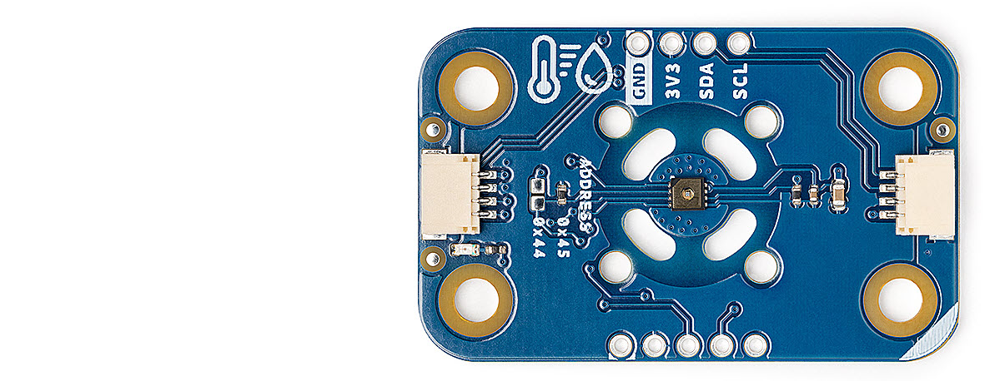
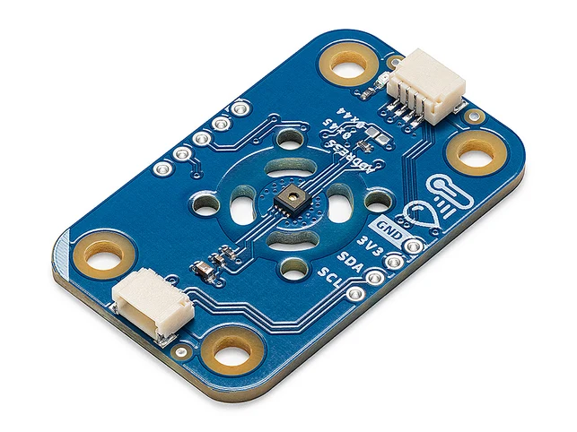
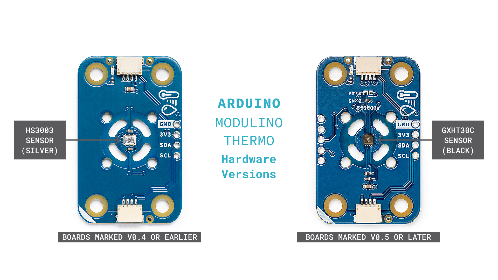
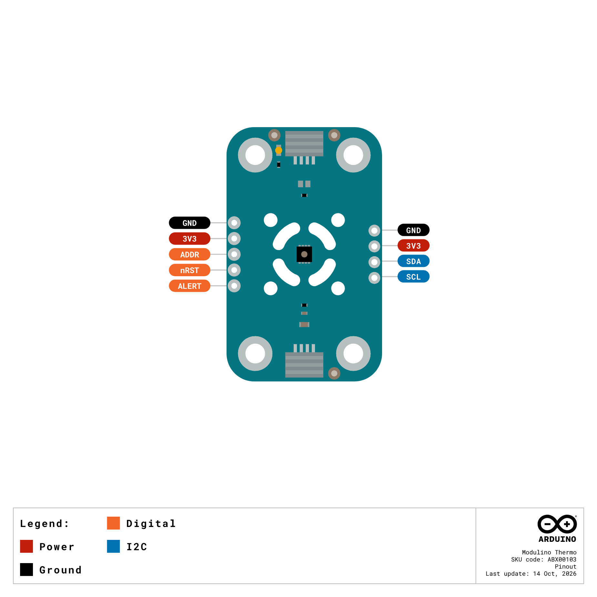
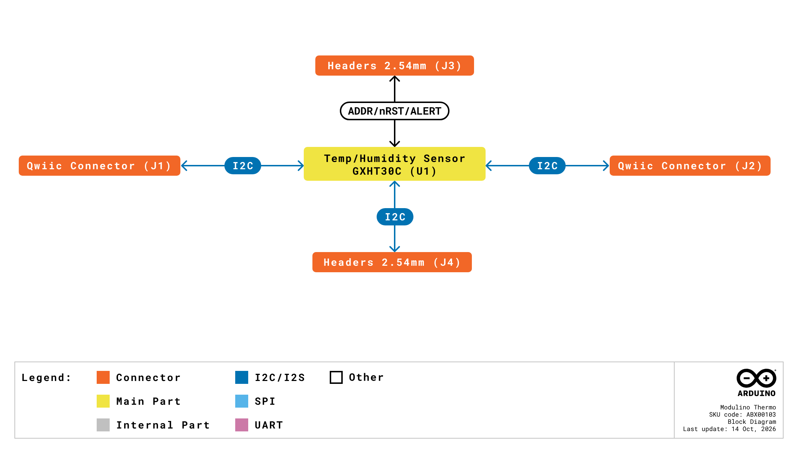
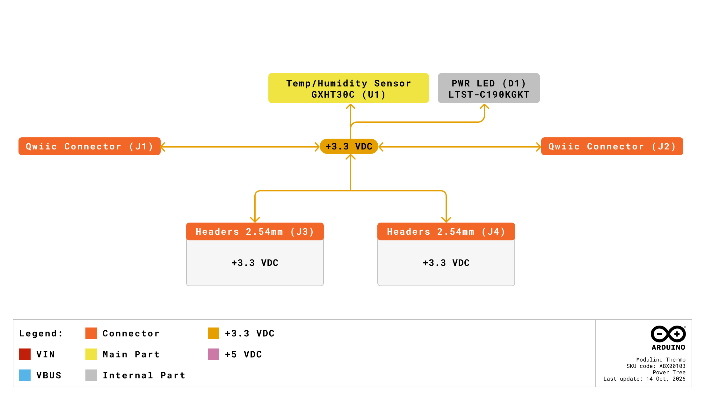
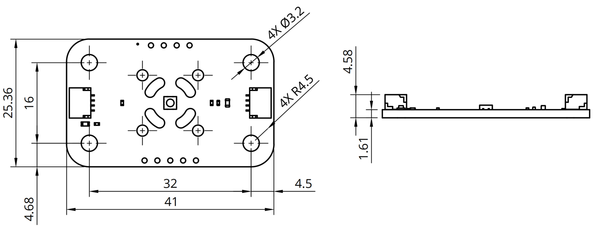
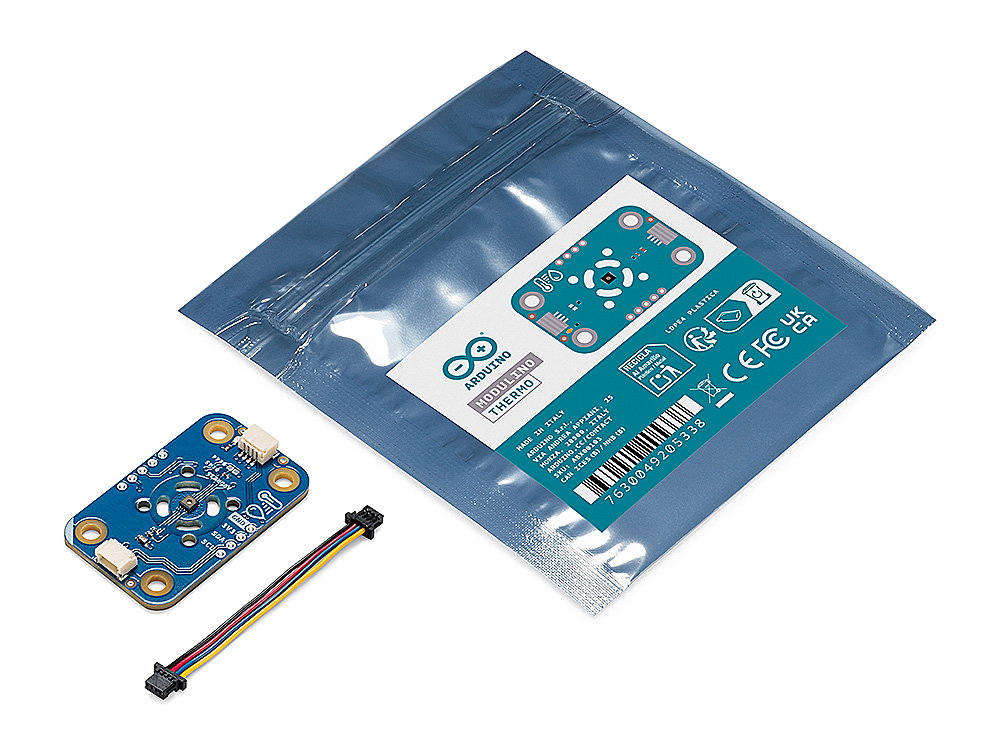

# Description

The Arduino® Modulino™ Thermo is a compact sensor module that measures temperature and relative humidity. Based on the GXHT30C sensor from GXCAS, the module communicates over I2C through two Qwiic connectors and provides additional headers for direct wiring. It is designed for environmental monitoring, indoor climate control, and IoT applications, and integrates with the Arduino ecosystem through the Modulino library for both Arduino and MicroPython. Boards marked V0.5 or later use the GXHT30C sensor (I2C address 0x45); earlier boards use the HS3003 sensor (I2C address 0x44).

# Target Areas:

Maker, beginner, education

# Contents

## Application Examples

The Modulino Thermo combines a temperature and humidity sensor with a plug-and-play Qwiic interface, which makes it suitable for projects where environmental data must be measured with minimal wiring.

- **Indoor climate control**: Monitor real-time temperature and humidity levels to automatically adjust HVAC systems or trigger alerts when conditions leave a defined range.

- **Greenhouse monitoring**: Track changes in temperature and humidity to maintain growing conditions and detect deviations that affect plant health.

- **Smart home automation**: Combine the Modulino Thermo with other Modulino nodes, such as movement or distance sensors, to build automated home systems that respond to environmental changes.

- **Classroom experiments**: Collect environmental data for science and engineering activities, with readings available through a few lines of code in Arduino or MicroPython.

## Features

### General Specifications Overview

The Modulino Thermo is built around the GXHT30C temperature and humidity sensor from GXCAS. In addition to the sensor, the module integrates two Qwiic connectors, two headers for direct wiring, and a power LED.

The main features of the module are highlighted in the table shown below.

|       **Feature**       | **Description**                                                                                              |
|:-----------------------:|--------------------------------------------------------------------------------------------------------------|
|          Sensor         | GXHT30C temperature and relative humidity sensor (boards marked V0.5 or later)                               |
|    Measurement Ranges   | -45 to +130 °C, 0 to 100 %RH                                                                                 |
|     Accuracy (typ.)     | ±0.3 °C (-40 to +90 °C), ±3 %RH                                                                              |
| Communication Interface | I2C (address 0x45)                                                                                           |
|     Qwiic Connectors    | 2× I2C connectors (SM04B-SRSS-TB) for daisy-chaining with other Modulino nodes and Qwiic-compatible devices |
|         Headers         | 1×4 header (GND, +3.3 VDC, SDA, SCL) and 1×5 header (GND, +3.3 VDC, ADDR, nRST, ALERT) for direct wiring     |
|       Onboard LED       | Green (power)                                                                                                |
|       Power Supply      | +3.3 VDC via the Qwiic connectors or the headers                                                             |
|        Dimensions       | 41 mm × 25.36 mm                                                                                             |

### Sensor

The Modulino Thermo uses the GXHT30C sensor, a single-chip temperature and humidity sensor with a fully calibrated and temperature-compensated digital output. The "C" suffix indicates that the sensor is covered with a dustproof, breathable protective film, which gives the sensor its black appearance and must not be removed. The main characteristics of the sensor are listed in the table below.

|        **Parameter**        | **Details**                                                      |
|:---------------------------:|------------------------------------------------------------------|
|      Temperature Range      | -45 to +130 °C                                                   |
|     Temperature Accuracy    | ±0.3 °C (typical, -40 to +90 °C)                                 |
|    Temperature Resolution   | 0.015 °C                                                         |
|        Humidity Range       | 0 to 100 %RH                                                     |
|      Humidity Accuracy      | ±3 %RH (typical)                                                 |
|     Humidity Resolution     | 0.01 %RH                                                         |
| Recommended Operating Range | 5 to 60 °C, 20 to 80 %RH                                         |
|        ADC Resolution       | 16-bit                                                           |
|     Measurement Duration    | 2.5 / 4.5 / 12.5 ms (typical, low / medium / high repeatability) |
|        I2C Interface        | Up to 1 MHz (the Modulino library operates the bus at 100 kHz)  |
|           Package           | DFN8, 2.5 × 2.5 × 0.9 mm                                         |

### Hardware Versions

The Modulino Thermo is available in two hardware versions that differ in the temperature and humidity sensor they use. Boards marked V0.5 or later use the GXHT30C sensor, which responds at I2C address 0x45; earlier boards use the HS3003 sensor from Renesas, which responds at I2C address 0x44. The image below shows the two versions side by side.

> [!NOTE]
> **Note:** To identify the version of your Modulino Thermo, check the version marking on the PCB: boards marked **V0.5 or later** use the GXHT30C sensor (black), while earlier boards use the HS3003 sensor (silver). Unless otherwise stated, the specifications in this datasheet refer to boards marked V0.5 or later.

The main differences between the two hardware versions are summarized in the table below.

|     **Parameter**    |         **V0.5 or later**         |      **Earlier than V0.5**      |
|:--------------------:|:---------------------------------:|:-------------------------------:|
|        Sensor        |          GXHT30C (GXCAS)          |         HS3003 (Renesas)        |
|      I2C Address     | 0x45 (0x44 via solder jumper SJ1) |               0x44              |
|   Temperature Range  |           -45 to +130 °C          |          -40 to +125 °C         |
| Temperature Accuracy |  ±0.3 °C (typical, -40 to +90 °C) |        ±0.25 °C (typical)       |
|    Humidity Range    |            0 to 100 %RH           |           0 to 100 %RH          |
|   Humidity Accuracy  |          ±3 %RH (typical)         |        ±2.8 %RH (typical)       |
|      Resolution      |  0.015 °C / 0.01 %RH (16-bit ADC) | 14-bit temperature and humidity |
|  Sensor Supply Range |          +2.0 to +5.5 VDC         |          +2.3 to +5.5 V         |

> [!NOTE]
> **Note:** The two versions of the Modulino Thermo share the same board outline, connectors, headers, and library API. Sketches and MicroPython scripts written for one version work on the other without changes.

### Related Products

- Arduino® UNO R4 WiFi (SKU: ABX00087)
- Arduino® UNO™ Q 2GB (SKU: ABX00162)
- Arduino® UNO™ Q 4GB (SKU: ABX00173)
- Arduino® VENTUNO™ Q (SKU: ABX00181)
- Arduino® Nano R4 (SKU: ABX00142) 
- Arduino® Nano Connector Carrier (SKU: ASX00061)
- Arduino® Modulino™ Hub (SKU: ABX00100)

## Ratings

### Recommended Operating Conditions

The table below outlines the typical operating conditions of the Modulino Thermo. The module is powered at +3.3 VDC through its Qwiic connectors or headers and does not include a voltage regulator.

|     **Parameter**     |    **Symbol**   | **Min** | **Typ** | **Max** | **Unit** |
|:---------------------:|:---------------:|:-------:|:-------:|:-------:|:--------:|
|  Supply Input Voltage | V3V3 |    -    |   3.3   |    -    |     V    |
|      I/O Voltage      |  VIO |    -    |   3.3   |    -    |     V    |
| Operating Temperature |  TOP |   -40   |    -    |   125   |    °C    |

> [!NOTE]
> **Sensor Tip:** The GXHT30C sensor shows optimum performance within a temperature range of **5 to 60 °C** and a relative humidity range of **20 to 80 %RH**. Long-term exposure to conditions outside this range, especially at high humidity, may temporarily shift the humidity readings; the sensor slowly returns to its calibrated state once normal conditions are restored.

> [!CAUTION]
> **Safety Note:** The Modulino Thermo is designed for +3.3 VDC operation. **Do not power the module from a +5 VDC supply or connect its I2C lines to a +5 VDC bus**; use a host board with a +3.3 VDC Qwiic interface or a suitable level shifter.

## Functional Overview

The core of the Modulino Thermo is the GXHT30C temperature and humidity sensor. The module also contains the connectors, headers, and passive components described in the following subsections.

### Pinout

The module has two Qwiic connectors (J1 and J2) and two headers for direct wiring (J3 and J4). The pinout of the module is shown in the image below.

The signals available on each connector and header are listed in the table below.

|  **Connector**  | **Pin** | **Signal** | **Description**                                      |
|:---------------:|:-------:|:----------:|------------------------------------------------------|
|  Qwiic (J1, J2) |    1    |     GND    | Ground                                               |
|                 |    2    |     VCC    | +3.3 VDC power supply                                |
|                 |    3    |     SDA    | I2C data                                             |
|                 |    4    |     SCL    | I2C clock                                            |
| 1×4 header (J4) |    1    |     GND    | Ground                                               |
|                 |    2    |  +3.3 VDC  | +3.3 VDC power supply                                |
|                 |    3    |     SDA    | I2C data                                             |
|                 |    4    |     SCL    | I2C clock                                            |
| 1×5 header (J3) |    1    |     GND    | Ground                                               |
|                 |    2    |  +3.3 VDC  | +3.3 VDC power supply                                |
|                 |    3    |    ADDR    | Sensor I2C address selection (pulled up to +3.3 VDC) |
|                 |    4    |    nRST    | Sensor reset, active low (pulled up to +3.3 VDC)     |
|                 |    5    |    ALERT   | Sensor alert output                                  |

### Block Diagram

An overview of the Modulino Thermo high-level architecture is illustrated in the image below.

### Power Supply

The Modulino Thermo is powered at +3.3 VDC through the Qwiic connectors or the +3.3 VDC pin of either header, in accordance with the Qwiic standard. The module has no onboard voltage regulator: the +3.3 VDC rail directly supplies the sensor, the power LED, and the pull-up resistors. Decoupling capacitors (4.7 µF and 100 nF) are placed close to the sensor. The power architecture of the module is shown in the image below.

### Qwiic Connectors

The module has two Qwiic connectors (SM04B-SRSS-TB) wired in parallel on the same I2C bus. One connector is used to connect the module to the host board, while the other allows daisy-chaining additional Modulino nodes or Qwiic-compatible devices. The connectors carry the +3.3 VDC supply, GND, SDA, and SCL signals.

### Additional Headers

In addition to the Qwiic connectors, the module exposes two headers for direct wiring. The 1×4 header (J4) replicates the Qwiic signals (GND, +3.3 VDC, SDA, SCL). The 1×5 header (J3) provides access to the sensor's ADDR, nRESET, and ALERT pins, together with GND and +3.3 VDC:

- **ADDR**: Address selection input of the sensor, pulled up to +3.3 VDC through a 4.7 kΩ resistor, which sets the I2C address to 0x45. The solder jumper SJ1 connects this pin to GND (see the [I2C Address](#i2c-address) section).

- **nRST**: Active-low reset input of the sensor, pulled up to +3.3 VDC through a 4.7 kΩ resistor. A low pulse of at least 1 µs resets the sensor.

- **ALERT**: Alert output of the sensor, driven high when a measurement exceeds the thresholds configured in the sensor. This pin must be left floating when the alert function is not used.

> [!NOTE]
> **Note:** The nRESET and ALERT functions of the sensor are not exposed by the Modulino library. They are available on the header for advanced use with custom code only.

### I2C Address

The Modulino Thermo acts as an I2C target device. Its default address depends on the hardware version, as shown in the table below.

| **Board Silk Name** | **Hardware Version** | **Sensor** | **Default I2C Address (HEX)** | **Alternative I2C Address (HEX)** |
|:-------------------:|:--------------------:|:----------:|:-----------------------------:|:---------------------------------:|
|   MODULINO THERMO   |     V0.5 or later    |   GXHT30C  |              0x45             |  0x44 (solder jumper SJ1 closed)  |
|   MODULINO THERMO   |   Earlier than V0.5  |   HS3003   |              0x44             |           Not supported           |

On boards marked V0.5 or later, the I2C address is set by the solder jumper SJ1, located on the bottom side of the board. SJ1 is **open by default**, which leaves the sensor's ADDR pin pulled up to +3.3 VDC and sets the address to 0x45. Closing SJ1 connects the ADDR pin to GND and changes the address to 0x44.

> [!CAUTION]
> **Safety Note:** The Modulino library identifies the hardware version of the module by its I2C address. A board marked V0.5 or later with SJ1 closed (address 0x44) will be handled as an HS3003-based board and **will not be recognized by the library**. Close SJ1 only when using custom code that addresses the GXHT30C sensor directly.

### Power LED

The module has a green LED (LTST-C190KGKT) connected to the +3.3 VDC rail through a 1 kΩ resistor, indicating that the module is powered.

## Device Operation

### Getting Started - IDE

If you want to program your host board while offline, you need to install the Arduino Desktop IDE **[1]**. Connect the Modulino Thermo to the Qwiic connector of your host board using the Qwiic cable included in the package.

### Getting Started - Arduino Cloud Editor

All Arduino devices work out-of-the-box on the Arduino Cloud Editor **[2]** by just installing a simple plugin.

The Arduino Cloud Editor is hosted online, therefore it will always be up-to-date with the latest features and support for all boards and devices. Follow **[3]** to start coding on the browser and upload your sketches onto your device.

### Getting Started - Arduino Cloud

All Arduino IoT enabled products are supported on Arduino Cloud, which allows you to log, graph, and analyze sensor data, trigger events, and automate your home or business. A Modulino Thermo template is available on Arduino Cloud to get started quickly.

### Modulino Library

The Modulino Thermo is supported by the Modulino library for Arduino **[5]** and by the Modulino package for MicroPython **[6]**. Both provide a `ModulinoThermo` class that returns temperature and humidity readings without requiring direct I2C transactions. The library automatically detects the hardware version of the module.

### Sample Sketches

Sample sketches for the Modulino Thermo can be found either in the "Examples" menu in the Arduino IDE or in the "Modulino Thermo Documentation" section of Arduino Docs **[4]**.

### Online Resources

Now that you have learned the basics of the Modulino Thermo, you can explore the endless possibilities it provides by checking out exciting projects on Arduino Project Hub **[8]**, the Arduino Library Reference **[9]**, and the online store **[10]**, where you will be able to complement your Modulino Thermo with additional nodes, boards, and accessories.

## Mechanical Information

### Board Dimensions

The Modulino Thermo is a 41 mm × 25.36 mm board with a thickness of 1.6 mm (±0.2 mm). It has two Qwiic connectors on its short edges, two headers for direct wiring, and four mounting holes (Ø 3.2 mm) spaced 16 mm vertically and 32 mm horizontally. The board outline is shown in the image below; **all the dimensions are in mm**.

### Package Contents

The Modulino Thermo is supplied in a package containing the following items:

|     **Item**     | **Quantity** |
|:----------------:|:------------:|
| Modulino™ Thermo |       1      |
|  I2C Qwiic cable |       1      |

## Product Compliance

### Product Compliance Summary

|  **Product Compliance** |
|:-----------------------:|
| CE/RED (European Union) |
|  UKCA (United Kingdom)  |
|   FCC (United States)   |
|       IC (Canada)       |
|           RoHS          |
|          REACH          |
|           WEEE          |

### Declaration of Conformity CE DoC (EU)

We declare under our sole responsibility that the products above are in conformity with the essential requirements of the following EU Directives and therefore qualify for free movement within markets comprising the European Union (EU) and European Economic Area (EEA).

### Declaration of Conformity to EU RoHS & REACH 211 01/19/2021

Arduino boards are in compliance with RoHS 2 Directive 2011/65/EU of the European Parliament and RoHS 3 Directive 2015/863/EU of the Council of 4 June 2015 on the restriction of the use of certain hazardous substances in electrical and electronic equipment.

|              **Substance**             | **Maximum Limit (ppm)** |
|:--------------------------------------:|:-----------------------:|
|                Lead (Pb)               |           1000          |
|              Cadmium (Cd)              |           100           |
|              Mercury (Hg)              |           1000          |
|       Hexavalent Chromium (Cr6+)       |           1000          |
|     Poly Brominated Biphenyls (PBB)    |           1000          |
| Poly Brominated Diphenyl ethers (PBDE) |           1000          |
|   Bis(2-Ethylhexyl) phthalate (DEHP)   |           1000          |
|      Benzyl butyl phthalate (BBP)      |           1000          |
|         Dibutyl phthalate (DBP)        |           1000          |
|       Diisobutyl phthalate (DIBP)      |           1000          |

Exemptions: No exemptions are claimed.

Arduino Boards are fully compliant with the related requirements of European Union Regulation (EC) 1907 /2006 concerning the Registration, Evaluation, Authorization and Restriction of Chemicals (REACH). We declare none of the SVHCs (https://echa.europa.eu/web/guest/candidate-list-table), the Candidate List of Substances of Very High Concern for authorization currently released by ECHA, is present in all products (and also package) in quantities totaling in a concentration equal or above 0.1%. To the best of our knowledge, we also declare that our products do not contain any of the substances listed on the "Authorization List" (Annex XIV of the REACH regulations) and Substances of Very High Concern (SVHC) in any significant amounts as specified by the Annex XVII of Candidate list published by ECHA (European Chemical Agency) 1907 /2006/EC.

### FCC Warning

This device complies with part 15 of the FCC Rules.

Operation is subject to the following two conditions:

(1) This device may not cause harmful interference, and (2) this device must accept any interference received, including interference that may cause undesired operation.

### IC Caution

This device complies with Industry Canada licence-exempt RSS standard(s).

Operation is subject to the following two conditions:

(1) This device may not cause interference, and (2) this device must accept any interference, including interference that may cause undesired operation of the device.

### Conflict Minerals Declaration

As a global supplier of electronic and electrical components, Arduino is aware of our obligations concerning laws and regulations regarding Conflict Minerals, specifically the Dodd-Frank Wall Street Reform and Consumer Protection Act, Section 1502. Arduino does not directly source or process conflict minerals such as Tin, Tantalum, Tungsten, or Gold. Conflict minerals are contained in our products in the form of solder, or as a component in metal alloys. As part of our reasonable due diligence, Arduino has contacted component suppliers within our supply chain to verify their continued compliance with the regulations. Based on the information received thus far we declare that our products contain Conflict Minerals sourced from conflict-free areas.

## Company Information

| **Company Information** | **Details**                                |
|:-----------------------:|--------------------------------------------|
|       Company Name      | Arduino S.r.l.                             |
|     Company Address     | Via Andrea Appiani, 25-20900 Monza (Italy) |

## Reference Documentation

| **No.** | **Reference**                   | **Link**                                                                                                          |
|:-------:|:-------------------------------:|-------------------------------------------------------------------------------------------------------------------|
| 1       | Arduino IDE (Desktop)           | https://www.arduino.cc/en/Main/Software                                                                           |
| 2       | Arduino IDE (Cloud)             | https://create.arduino.cc/editor                                                                                  |
| 3       | Arduino Cloud - Getting started | https://docs.arduino.cc/arduino-cloud/getting-started/iot-cloud-getting-started                                   |
| 4       | Modulino Thermo Documentation  | https://docs.arduino.cc/hardware/modulino-thermo                                                                   |
| 5       | Modulino Library (Arduino)     | https://github.com/arduino-libraries/Arduino_Modulino                                                              |
| 6       | Modulino Package (MicroPython) | https://github.com/arduino/arduino-modulino-mpy                                                                    |
| 7       | GXHT30 Sensor Datasheet         | https://www.galaxy-cas.com/uploads/files/202509/GXHT30_datasheet_V3.9_20250919170350.pdf                          |
| 8       | Project Hub                     | https://create.arduino.cc/projecthub                                                                              |
| 9       | Library Reference               | https://www.arduino.cc/reference/en/                                                                              |
| 10      | Arduino Store                   | https://store.arduino.cc/                                                                                         |

## Document Revision History

| **Date** | **Revision** | **Changes**                                                                    |
|:--------:|:------------:|--------------------------------------------------------------------------------|
| 14/10/26 |       6      | Sensor updated to GXHT30C (boards marked V0.5 or later); document restructured |
| 24/11/25 |       5      | I2C information changed                                                        |
| 01/07/25 |       4      | Certification                                                                  |
| 17/06/25 |       3      | Nomenclature updates                                                           |
| 23/05/25 |       2      | Power info                                                                     |
| 14/05/25 |       1      | First release                                                                  |