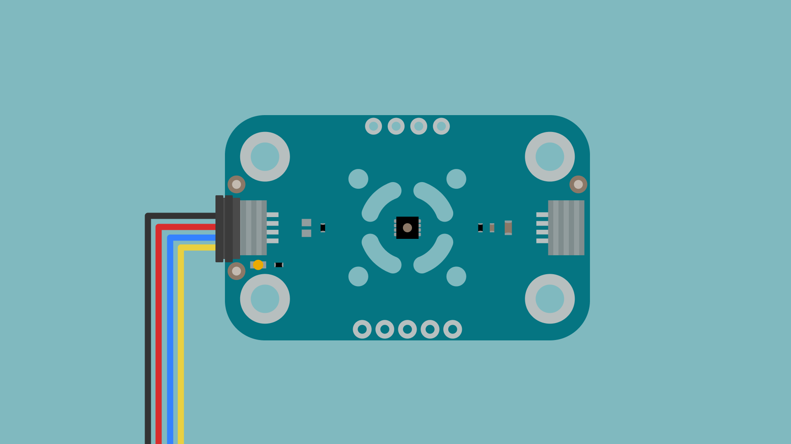
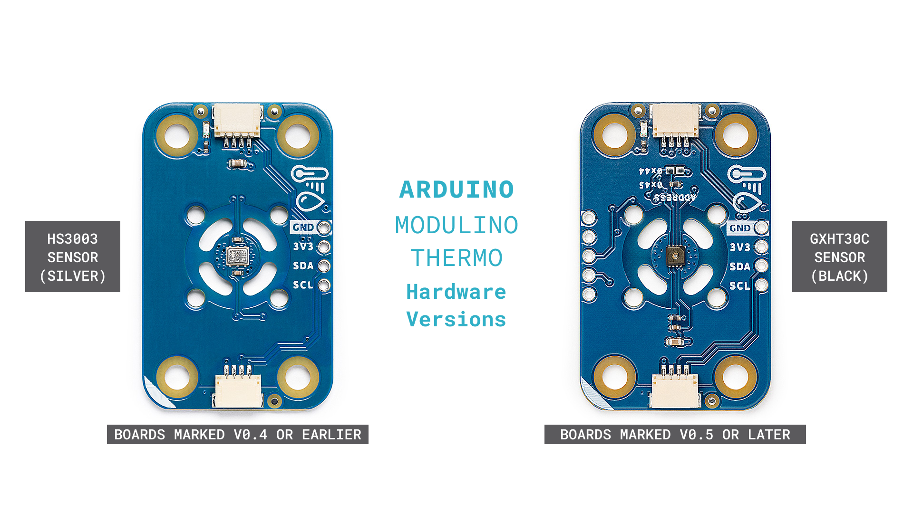

The Modulino Thermo is a Modulino node that measures temperature and relative humidity, which makes it suitable to add environmental monitoring to your projects. It uses the Modulino form factor with Qwiic connectors for easy integration.

<Alert type="note">

The Modulino Thermo is available in two hardware versions that differ in the sensor they use. Boards marked **V0.5 or later** on the PCB use the GXHT30C sensor from GXCAS (black), while earlier boards use the HS3003 sensor from Renesas (silver). Both versions share the same board outline, connectors and library API, so the examples in this guide work on both. **Unless otherwise stated, the specifications below refer to boards marked V0.5 or later**.

</Alert>



## Hardware Overview

### General Characteristics

The Modulino Thermo is based on a single-chip temperature and humidity sensor with a calibrated digital I²C output. The table below summarizes the main characteristics of the sensor used in each hardware version:

|      **Parameter**     |    **V0.5 or later (GXHT30C)**   | **Earlier than V0.5 (HS3003)** |
|:----------------------:|:--------------------------------:|:------------------------------:|
|    Temperature Range   |          -45 to +130 °C          |         -40 to +125 °C         |
|  Temperature Accuracy  | ±0.3 °C (typical, -40 to +90 °C) |       ±0.25 °C (typical)       |
| Temperature Resolution |             0.015 °C             |             14-bit             |
|     Humidity Range     |           0 to 100 %RH           |          0 to 100 %RH          |
|    Humidity Accuracy   |         ±3 %RH (typical)         |       ±2.8 %RH (typical)       |
|   Humidity Resolution  |             0.01 %RH             |             14-bit             |
|  Sensor Supply Voltage |         +2.0 to 5+.5 VDC         |        +2.3 to +5.5 VDC        |
|    I²C Address (HEX)   |               0x45               |              0x44              |

<Alert type="note">

The sensor supply ranges above are the specifications of the sensors themselves. On the Modulino Thermo node, the sensor is always supplied at +3.3 VDC through the Qwiic connector or the node's 3V3 pin.

</Alert>

### Sensor Details

The Modulino Thermo node (boards marked V0.5 or later) uses the **GXHT30C** temperature and humidity sensor from GXCAS. This sensor natively supports digital communication (I²C), meaning it connects directly to the I²C bus without requiring additional conversion circuitry. The "C" suffix indicates that the sensor is covered with a dustproof, breathable protective film, which gives it its black appearance and **must not be removed**. The sensor provides measurements for the following:

- Temperature
- Relative humidity

The sensor supports I²C standard mode at 100 kHz, fast mode at 400 kHz and fast mode plus at 1 MHz. The Modulino library configures the bus at 100 kHz. The default address for the module is the following:

| **Modulino I²C Address** | **Hardware I²C Address** |         **Editable Addresses (HEX)**         |
|:------------------------:|:------------------------:|:--------------------------------------------:|
|          `0x45`          |          `0x45c          | `0x44` via solder jumper SJ1 (V0.5 or later) |

<Alert type="note">

**On boards marked V0.5 or later, the solder jumper SJ1 on the board connects the sensor's ADDR pin to GND when closed, which changes the I²C address from `0x45` to `0x44`. SJ1 is open by default**. The Modulino library identifies the hardware version by its I²C address, so a V0.5 or later board with SJ1 closed is handled as an HS3003-based board and **will not be recognized by the library**. Close SJ1 only when using custom code that addresses the GXHT30C sensor directly. On earlier boards, the address is fixed at `0x44`.

</Alert>

<Alert type="note">

Since the address cannot be changed while using the Modulino library, using two or more Modulino Thermo modules on the same I²C bus will result in address conflicts and cause communication issues. To use several Modulino Thermo modules at the same time, connect them through a [Modulino Hub](https://store.arduino.cc/products/modulino-hub).

</Alert>

### Pinout


**Qwiic / I2C (1×4 Header, J4)**

The pins of the 1×4 header are described in the table below:

| **Pin** |       **Function**      |
|:-------:|:-----------------------:|
|   GND   |          Ground         |
|  3.3 V  | Power supply (+3.3 VDC) |
|   SDA   |         I²C data        |
|   SCL   |        I²C clock        |

These pads and the Qwiic connectors share the same I²C bus. You can optionally solder header pins here.

**Additional 1×5 Header (GXHT30C Signals, J3)**:

The pins of the 1×5 header are described in the table below:

| **Pin** |         **Function**        |
|:-------:|:---------------------------:|
|   GND   |            Ground           |
|   3V3   |        +3.3 VDC power       |
|   ADDR  | I²C address selection input |
|   nRST  |   Reset input (active low)  |
|  ALERT  |         Alert output        |

<Alert type="note">

The `ADDR` and `nRST` pins have 4.7 kΩ pull-up resistors to +3.3 VDC on the board. `ADDR` sets the I²C address (see the Sensor Details section above); a low pulse of at least 1 µs on `nRST` resets the sensor. `ALERT` is an output that the sensor asserts when a reading exceeds its programmable thresholds; leave it unconnected when the alert function is not used. **The Modulino Arduino library does not use the `nRST` and `ALERT` pins**.

</Alert>

<Alert type="note">

The 1×5 header is only available on boards marked V0.5 or later.

</Alert>

### Power Specifications

The board is powered at +3.3 VDC through the Qwiic interface, as per the Qwiic standard.

|       **Parameter**      |              **Condition**             | **Typical** | **Maximum** | **Unit** |
|:------------------------:|:--------------------------------------:|:-----------:|:-----------:|:--------:|
|     Operating Voltage    |                    -                   |     3.3     |      -      |     V    |
|    Idle Supply Current   |           Sensor idle, 25 °C           |     0.2     |     2.0     |    µA    |
| Measuring Supply Current |         Sensor measuring, 25 °C        |     600     |     1500    |    µA    |
|  Average Supply Current  | 1 humidity + temperature measurement/s |     1.7     |      -      |    µA    |

<Alert type="note">

The currents above are those of the GXHT30C sensor **alone**. Total module consumption is higher, as the board also includes an always-on power LED and pull-up resistors on the `ADDR` and `nRST` lines. For the HS3003 sensor of earlier boards, the average supply current is 24.4 µA at one measurement per second.

</Alert>

### Schematic

The Modulino Thermo uses a simple circuit built around the **GXHT30C** sensor (U1), which handles both temperature and humidity measurements, as well as I²C communication.

You can connect to the I²C pins (SDA and SCL) using either the **Qwiic connectors** (J1 and J2, recommended) or the **solderable pins** (J4). The board runs on **+3.3 VDC** from the Qwiic cable or the **`3V3` pin** on J4 or J3.

Full schematic and PCB files are available from the [Modulino Thermo page](https://docs.arduino.cc/hardware/modulinos/modulino-thermo) on Docs.

## Programming with Arduino

The Modulino Thermo is fully compatible with the Arduino IDE and the official `Arduino_Modulino` library. The following examples show how to read temperature and humidity and how to build a simple environmental alert.

### Prerequisites

- An Arduino board with an onboard Qwiic connector: the **UNO R4 WiFi**, the **UNO Q** or the **Nano R4**. Boards in the Nano form factor can also be mounted on the **Nano Connector Carrier**, which adds Qwiic connectors to them.
- A Qwiic cable. Every Modulino node ships with a 5 cm cable.
- Install the `Arduino_Modulino` library via the Arduino IDE Library Manager (**version 0.10.0 or later is required for boards marked V0.5 or later**).
- Connect your Modulino Thermo via Qwiic or solderable headers.

On the UNO R4 WiFi, the UNO Q and the Nano R4, the Qwiic connector is wired to the secondary I²C interface, and `Modulino.begin()` selects `Wire1` automatically. On any other board the library defaults to `Wire`. **You do not need to specify the interface in your sketch.**

<Alert type="note">

The Modulino Thermo operates at +3.3 VDC. The Arduino boards listed above supply that voltage through the Qwiic connector and handle the logic level translation, so no additional circuitry is required. If you wire the module through its solderable pins instead, confirm that your board drives the I²C lines at +3.3 VDC.

</Alert>

<Alert type="note">

The `Arduino_Modulino` library detects the hardware version of the module automatically: `thermo.begin()` first looks for the HS3003 sensor at address `0x44` and, if it is not found, for the GXHT30C sensor at address `0x45`. The same sketch works on both versions without changes.

</Alert>

For detailed instructions on setting up your Arduino environment and installing libraries, please refer to the [Getting Started with Modulinos guide](../how-general). The library repository is available [here](https://github.com/arduino-libraries/Arduino_Modulino).

### Basic Example

The following sketch reads the temperature and the relative humidity once per second and prints them to the Serial Monitor:

```arduino
/**
Basic Example for the Arduino Modulino Thermo
Name: modulino_thermo_basic.ino
Purpose: This sketch demonstrates how to read temperature and
relative humidity from the Modulino Thermo and print the values
to the Serial Monitor.

@author Arduino Product Experience Team
@version 1.0 15/10/26
*/

#include <Arduino_Modulino.h>

// Modulino Thermo object
ModulinoThermo thermo;

void setup() {
  // Initialize serial communication and wait up to 2.5 seconds for a connection
  Serial.begin(115200);
  for (auto startNow = millis() + 2500; !Serial && millis() < startNow; delay(500));

  // Initialize the Modulino system (I2C bus)
  Modulino.begin();

  // Initialize the Modulino Thermo and halt if the sensor is not detected
  if (!thermo.begin()) {
    Serial.println("- Modulino Thermo not detected! Check the Qwiic connection...");
    while (1);
  }

  // Startup message
  Serial.println("- Arduino Modulino Thermo - Basic Example started...");
}

void loop() {
  // Read temperature (°C) and relative humidity (%RH)
  // Both functions return NAN if the sensor was not initialized
  float temperature = thermo.getTemperature();
  float humidity = thermo.getHumidity();

  // Print the readings
  Serial.print("- Temperature: ");
  Serial.print(temperature);
  Serial.print(" C, Humidity: ");
  Serial.print(humidity);
  Serial.println(" %RH");

  // Wait 1 second before the next reading
  delay(1000);
}
```

### Key Functions

The basic example above relies on the following functions of the `Arduino_Modulino` library:

- `begin()`: Detects the sensor and initializes it. Returns `true` if the sensor responded at address `0x44` (HS3003) or `0x45` (GXHT30C).
- `getTemperature()`: Returns the temperature in degrees Celsius as a `float`, or `NAN` if `begin()` failed.
- `getHumidity()`: Returns the relative humidity as a percentage (`float`, 0.0 to 100.0), or `NAN` if `begin()` failed.
- `Modulino.begin()`: Initializes the Modulino system (uses `Wire1` on boards with an onboard Qwiic connector).

<Alert type="note">

On boards marked V0.5 or later, the library caches the sensor reading for one second: calling `getTemperature()` and `getHumidity()` back to back triggers a single I²C transaction, and calling either function more than once per second returns the same values. The sensor is read again once the second has elapsed.

</Alert>

### Advanced Example - Environmental Alert

This example compares the readings against temperature and humidity thresholds and prints an alert when either of them is exceeded.

```arduino
/**
Environmental Alert Example for the Arduino Modulino Thermo
Name: modulino_thermo_alert.ino
Purpose: This sketch demonstrates how to compare the temperature
and relative humidity readings of the Modulino Thermo against
user-defined thresholds and print an alert when they are exceeded.

@author Arduino Product Experience Team
@version 1.0 15/10/26
*/

#include <Arduino_Modulino.h>

// Alert thresholds
const float TEMP_THRESHOLD = 25.0;      // Temperature threshold (°C)
const float HUMIDITY_THRESHOLD = 70.0;  // Relative humidity threshold (%RH)

// Modulino Thermo object
ModulinoThermo thermo;

void setup() {
  // Initialize serial communication and wait up to 2.5 seconds for a connection
  Serial.begin(115200);
  for (auto startNow = millis() + 2500; !Serial && millis() < startNow; delay(500));

  // Initialize the Modulino system (I2C bus)
  Modulino.begin();

  // Initialize the Modulino Thermo and halt if the sensor is not detected
  if (!thermo.begin()) {
    Serial.println("- Modulino Thermo not detected! Check the Qwiic connection...");
    while (1);
  }

  // Startup message
  Serial.println("- Arduino Modulino Thermo - Environmental Alert Example started...");
}

void loop() {
  // Read temperature (°C) and relative humidity (%RH)
  float temperature = thermo.getTemperature();
  float humidity = thermo.getHumidity();

  // Check the temperature threshold
  if (temperature > TEMP_THRESHOLD) {
    Serial.print("- High temperature: ");
    Serial.print(temperature);
    Serial.println(" C");
  }

  // Check the relative humidity threshold
  if (humidity > HUMIDITY_THRESHOLD) {
    Serial.print("- High humidity: ");
    Serial.print(humidity);
    Serial.println(" %RH");
  }

  // Print the readings when both are within the thresholds
  if (temperature <= TEMP_THRESHOLD && humidity <= HUMIDITY_THRESHOLD) {
    Serial.print("- Normal conditions: ");
    Serial.print(temperature);
    Serial.print(" C, ");
    Serial.print(humidity);
    Serial.println(" %RH");
  }

  // Wait 5 seconds before the next check
  delay(5000);
}
```

<Alert type="note">

The thresholds in this example are arbitrary. Adjust them to the conditions of your own environment, and keep the sensor away from heat sources such as motors, power supplies or the host board's voltage regulator, which can raise the temperature reading by several degrees.

</Alert>

## Programming with MicroPython

The Modulino Thermo is fully compatible with MicroPython through the official Modulino MicroPython library.

<Alert type="warning">

At the time of writing, **the Modulino MicroPython library (version 1.2.0) supports the HS3003 sensor only**. Boards marked V0.5 or later (GXHT30C sensor, address 0x45) are not detected by `ModulinoThermo()` until a new version of the library is released. Check the [library repository](https://github.com/arduino/arduino-modulino-mpy) for the latest version.

</Alert>

### Prerequisites

To follow the MicroPython examples of this guide, you will need the following:

- An Arduino board that officially supports MicroPython, such as the **Nano ESP32**, the **Nano RP2040 Connect**, the **Nano 33 BLE Sense**, the **GIGA R1 WiFi** or the **Portenta H7**. Mount a Nano form factor board on the **Nano Connector Carrier** to connect the Modulino Thermo through Qwiic
- A Qwiic cable. Every Modulino node ships with a 5 cm cable
- Install the Modulino MicroPython library. The recommended method uses `mpremote` and `mip` (this also installs the sensor driver that the Modulino Thermo depends on):

  ```
  mpremote mip install github:arduino/arduino-modulino-mpy
  ```

- Ensure Arduino Lab for MicroPython is installed

On Arduino boards the library detects the correct I²C interface automatically, so `ModulinoThermo()` needs no arguments.

See [Getting Started with Modulinos](../how-general) for detailed instructions.

### Basic Example

The following script reads the temperature and the relative humidity every two seconds and prints them to the console:

```python
"""
Basic Example for the Arduino Modulino Thermo
Name: modulino_thermo_basic.py
Purpose: This script demonstrates how to read temperature and
relative humidity from the Modulino Thermo and print the values
to the console.

@author Arduino Product Experience Team
@version 1.0 15/10/26
"""

from modulino import ModulinoThermo
from time import sleep

# Modulino Thermo object
thermo = ModulinoThermo()

# Startup message
print("- Arduino Modulino Thermo - Basic Example started...")

while True:
    # Read temperature (°C) and relative humidity (%RH)
    # Both properties return None if the sensor data is not ready
    temperature = thermo.temperature
    humidity = thermo.relative_humidity

    # Print the readings
    if temperature is not None and humidity is not None:
        print(f"- Temperature: {temperature:.1f} C, Humidity: {humidity:.1f} %RH")

    # Wait 2 seconds before the next reading
    sleep(2)
```

### Key Properties

The basic example above relies on the following properties of the `ModulinoThermo` class:

- `.temperature`: Returns the temperature in degrees Celsius as a `float`, or `None` if the sensor data is not ready.
- `.relative_humidity`: Returns the relative humidity as a percentage (`float`), or `None` if the sensor data is not ready.
- `.measurements`: Returns both values at once as a named tuple with the fields `temperature` and `relative_humidity`, using a single I²C transaction.

<Alert type="note">

Each access to `.temperature` or `.relative_humidity` triggers a full sensor reading. When you need both values, read `.measurements` once instead of accessing the two properties separately: it is faster and guarantees that both values come from the same measurement.

</Alert>

### Differences From the Arduino Library

The MicroPython implementation is not a direct port of the Arduino one. The table below summarizes the differences to keep in mind when moving an application between the two.

|         **Aspect**         |                **Arduino**                |           **MicroPython**           |
|:--------------------------:|:-----------------------------------------:|:-----------------------------------:|
| Hardware version detection |          Automatic (0x44 or 0x45)         | HS3003 only (0x44) in version 1.2.0 |
|    Reading not available   |       `NAN` (sensor not initialized)      |    `None` (sensor data not ready)   |
|        Reading cache       | One second on boards marked V0.5 or later | None, every access reads the sensor |
|      Combined reading      |               Not available               |     `.measurements` named tuple     |
|       Sensor settings      |                Not exposed                | Sensor driver exposed via `.sensor` |

### Advanced Example - Data Logger

This example logs a reading at a fixed interval, keeps the most recent samples in memory and prints basic statistics each time a new sample is stored. It uses `ticks_diff()` to measure elapsed time, which handles the wrap-around of the millisecond counter correctly.

```python
"""
Data Logger Example for the Arduino Modulino Thermo
Name: modulino_thermo_logger.py
Purpose: This script demonstrates how to log temperature and
relative humidity readings from the Modulino Thermo at a fixed
interval and compute basic statistics from the stored samples.

@author Arduino Product Experience Team
@version 1.0 15/10/26
"""

from modulino import ModulinoThermo
from time import sleep, ticks_ms, ticks_diff

# Logger configuration
LOG_INTERVAL_MS = 60000  # Log one sample every minute
SAMPLES_TO_KEEP = 60     # Keep the last hour of samples

# Modulino Thermo object
thermo = ModulinoThermo()

# Data storage
samples = []
last_log_time = ticks_ms()


def log_sample():
    """Store a new sample. Returns True if the reading was valid."""
    measurement = thermo.measurements

    if measurement.temperature is None or measurement.relative_humidity is None:
        return False

    samples.append(measurement)

    # Discard the oldest sample when the buffer is full
    if len(samples) > SAMPLES_TO_KEEP:
        samples.pop(0)

    return True


def print_statistics():
    """Print the minimum, maximum and average of the stored samples."""
    temperatures = [s.temperature for s in samples]
    humidities = [s.relative_humidity for s in samples]

    print(f"- Samples stored: {len(samples)}")
    print(f"- Temperature (C): min {min(temperatures):.1f}, "
          f"max {max(temperatures):.1f}, avg {sum(temperatures) / len(temperatures):.1f}")
    print(f"- Humidity (%RH): min {min(humidities):.1f}, "
          f"max {max(humidities):.1f}, avg {sum(humidities) / len(humidities):.1f}")


# Startup message
print("- Arduino Modulino Thermo - Data Logger Example started...")
print(f"- Logging one sample every {LOG_INTERVAL_MS // 1000} seconds...")

while True:
    # Store a new sample when the logging interval has elapsed
    if ticks_diff(ticks_ms(), last_log_time) >= LOG_INTERVAL_MS:
        if log_sample():
            latest = samples[-1]
            print(f"- Sample logged: {latest.temperature:.1f} C, {latest.relative_humidity:.1f} %RH")
            print_statistics()
        last_log_time = ticks_ms()

    # Wait 1 second before checking again
    sleep(1)
```

<Alert type="note">

The samples are kept in RAM and are lost when the board is reset. To keep a permanent record, write each sample to a file on the board's file system or send it to a host computer over the serial connection.

</Alert>

## Troubleshooting

### Sensor Not Reachable

If your Modulino's power LED isn't on or the sensor isn't responsive:

- Ensure the host board is connected to your computer and the Modulino is connected to the host board
- Verify that the power LEDs on both are lit.
- Check that the Qwiic cable is properly clicked into place.
- Check the return value of `thermo.begin()` in Arduino. If it returns `false`, the sensor did not answer at address `0x44` or `0x45`.
- On boards marked V0.5 or later, make sure you are using Arduino_Modulino version 0.10.0 or later. Earlier versions only look for the sensor at address `0x44`.
- On boards marked V0.5 or later, verify that the solder jumper SJ1 is open. If it was closed, the module answers at address `0x44` and the library handles it as an HS3003-based board.
- If you have more than one Modulino Thermo on the bus, remove all but one or connect them through a Modulino Hub: the address cannot be changed while using the Modulino library

### Readings Are NAN or None

If `getTemperature()` and `getHumidity()` return `NAN` in Arduino, `begin()` failed and the sensor was never initialized. Check the previous section.

If `.temperature` and `.relative_humidity` return `None` in MicroPython, the sensor reported that its data is not ready. Wait a few milliseconds and read again; the basic example shows how to skip these readings.

### Inaccurate Values

If the sensor values are not accurate:

- Keep the sensor away from heat-generating components such as motors, power supplies or the host board's voltage regulator, which can raise the temperature reading by several degrees
- Allow the sensor time to stabilize after power-on and after any change in the environment
- Do not touch or cover the black protective film of the GXHT30C sensor, and keep it clean and free of condensation
- Avoid exposing the sensor to volatile solvents such as acetone, ethanol or isopropyl alcohol, which permanently shift the humidity readings
- After long exposure to very high humidity, the sensor may read high for a while. It slowly returns to its calibrated state once normal conditions are restored

### Readings Do Not Change

On boards marked V0.5 or later, the Arduino library caches the sensor reading for one second. If you call `getTemperature()` or `getHumidity()` several times within the same second, you will get the same values. This is expected behavior, not a fault.

### Library Issues

See the [Getting Started with Modulinos](../how-general) guide for library installation troubleshooting.

## Project Ideas

Now that you've learned how to use your Modulino Thermo, try these projects:

- **Smart greenhouse monitor**: Track temperature and humidity for optimal plant growth
- **Weather station**: Combine with other Modulino nodes to create a complete weather monitoring system
- **HVAC controller**: Monitor room conditions and trigger heating or cooling systems
- **Food storage monitor**: Keep an eye on the conditions in pantries, cellars or refrigerators
- **Data logger**: Record environmental conditions over time for analysis, as shown in the MicroPython advanced example
- **Comfort zone indicator**: Use with Modulino Pixels to show comfort levels with colors
- **Pet habitat monitor**: Make sure reptile or tropical fish environments stay within range

## Conclusion

In this guide, you learned about the hardware of the Modulino Thermo, including the two hardware versions of the module and how to identify them, and how to read temperature and relative humidity from it using both the `Arduino_Modulino` library and the Modulino MicroPython library. You also learned how to use the readings in an environmental alert and in a data logger, and how to troubleshoot the most common issues.

The Modulino Thermo is a simple way to add environmental sensing to a project, and it combines well with other Modulino nodes to build complete monitoring and control systems. For more information about the module, refer to the [Modulino Thermo page](https://docs.arduino.cc/hardware/modulinos/modulino-thermo) in Docs, where you will find the datasheet, the schematic and the pinout.
