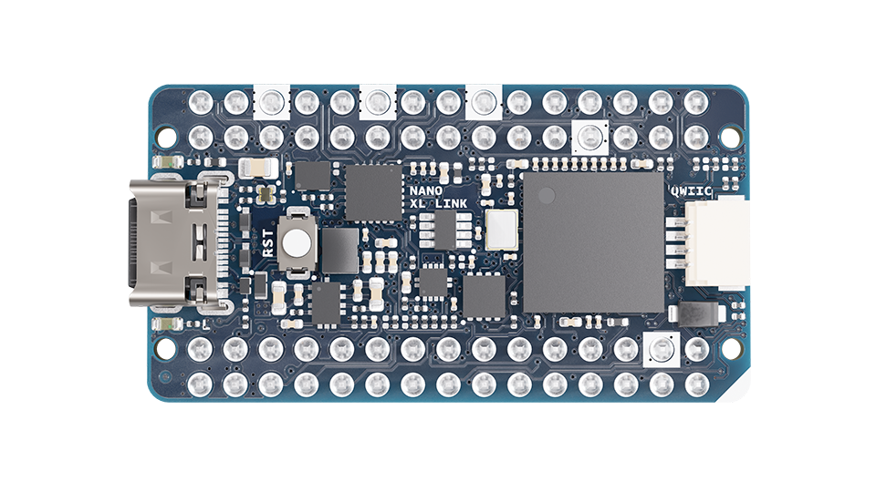
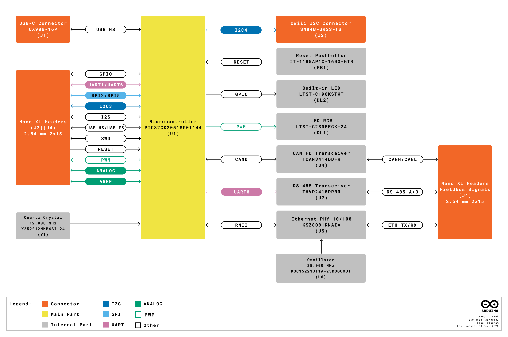
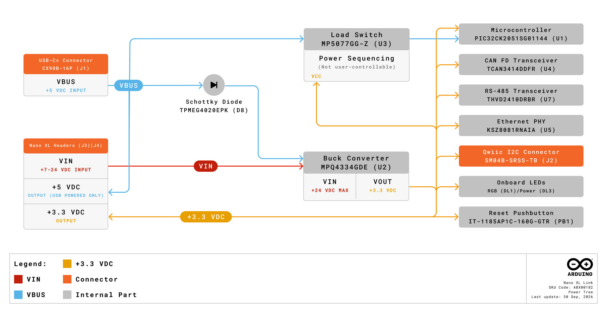
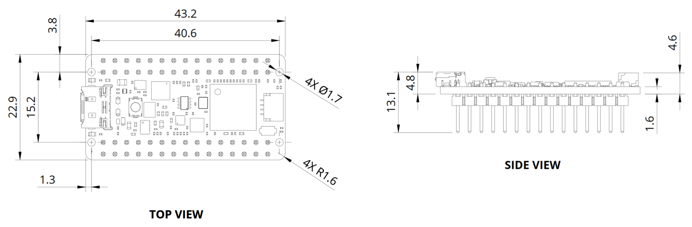
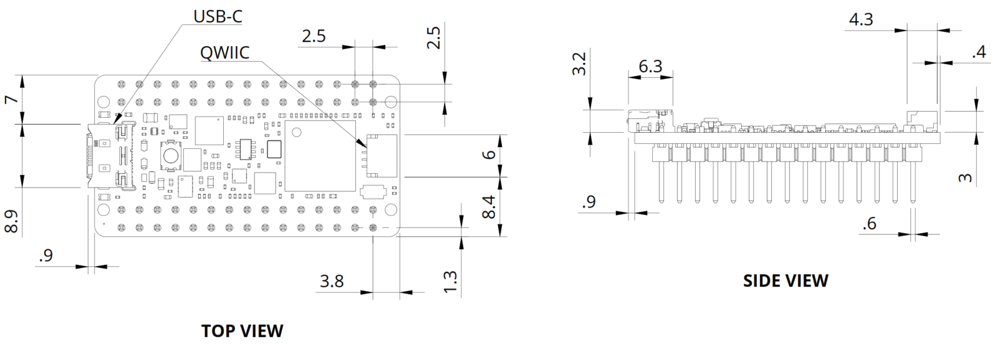
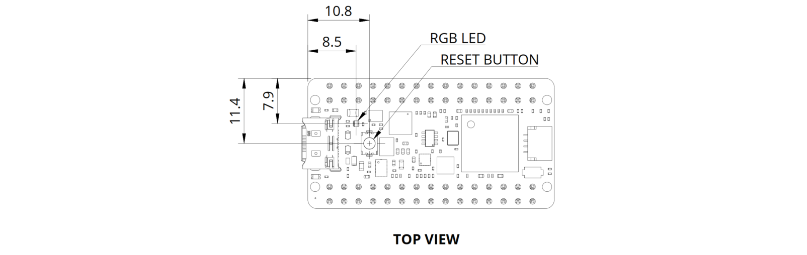

# Description

The Arduino Nano XL Link is a compact microcontroller board designed for industrial and building automation applications. Based on the PIC32CK2051SG01144 microcontroller from Microchip®, the board extends the standard Nano pinout through two 2.54 mm double-row headers and integrates three industrial communication transceivers: CAN FD, RS-485, and a 10/100 Ethernet PHY. These interfaces allow the Nano XL Link to communicate directly with industrial equipment without additional interface boards, while retaining full compatibility with the Arduino ecosystem.

# Target Areas
 
Industrial automation, building automation, energy monitoring, and smart homes.

# CONTENTS

## Application Examples

The Nano XL Link combines an Arm® Cortex®-M33 microcontroller with onboard CAN FD, RS-485, and Ethernet transceivers and an extended Nano pinout, which makes it suitable for control and communication tasks in industrial and building environments. Below are some application examples that demonstrate its practical value:

- **Real-time industrial controller:** The Nano XL Link can serve as a compact, PLC-like controller for machine-level control tasks. Its fieldbus interfaces enable real-time communication with industrial devices such as motors, sensors, and HMIs, while the extended pinout allows multiple digital and analog signals to be connected directly, reducing the need for external expansion hardware.
  
- **Fieldbus gateway and protocol converter:** With CAN FD, RS-485, and Ethernet available on the same board, the Nano XL Link can bridge legacy and modern industrial networks, translating and aggregating data across different buses without additional interface boards. The extended pinout provides extra I/O for configuration options, status indicators, or service interfaces.
  
- **Smart edge node:** Deployed in distributed automation systems, the Nano XL Link can perform signal conditioning and decision-making locally, reducing network traffic and improving system responsiveness. The fieldbus interfaces provide robust communication in electrically noisy environments.
  
- **HVAC zone controller:** The board can manage HVAC zones in commercial and residential buildings, connecting directly to temperature sensors, dampers, valves, and fan control signals, and integrating with building management systems or supervisory controllers through its communication interfaces.
  
- **Energy monitoring and management node:** The Nano XL Link can interface with meters, current sensors, and control relays, exchange data with energy management platforms, and perform local aggregation, threshold detection, and basic load control.
  
- **Building automation edge controller:** The board can coordinate multiple building subsystems such as HVAC, lighting, and shading, performing control and preprocessing at the edge to reduce network traffic and maintain operation during temporary network disruptions.
  
- **Smart lighting and room automation:** In smart home installations, the Nano XL Link can control lighting, motorized shades, and roller shutters, connecting buttons, motion sensors, limit switches, and relay or dimmer circuits directly through the extended pinout, and integrating with a central home automation hub.

 
## Features
 
### General Specifications Overview
 

The Nano XL Link is built around the PIC32CK2051SG01144, a 32-bit Arm® Cortex®-M33 microcontroller from Microchip®. In addition to the microcontroller, the board integrates a CAN FD transceiver, an RS-485 transceiver, and a 10/100 Ethernet PHY, as well as a Qwiic connector, a reset push-button, and onboard status LEDs.

Table 1 summarizes the board's main features; Table 2 shows more detailed information about the board's microcontroller.

|        **Feature**       | **Description**                                                                                                           |
|:------------------------:|---------------------------------------------------------------------------------------------------------------------------|
|      Microcontroller     | 120 MHz, 32-bit Arm® Cortex®-M33 core microcontroller (PIC32CK2051SG01144) with integrated Hardware Security Module (HSM)                                                |
|      Internal Memory     | 2 MB Flash and 512 kB RAM                                                                                                 |
|    Fieldbus Interfaces   | CAN FD (TCAN3414DDFR transceiver), RS-485 (THVD2410DRBR transceiver), 10/100 Ethernet (KSZ8081RNAIA PHY)                  |
| Communication Interfaces | USB, I2C, I2S, SPI, UART                                                                                                  |
|       USB Connector      | USB-C® connector for programming and power (+5 VDC)                                                                       |
|          Headers         | Two 2.54 mm double-row 2×15 headers (60 pins in total) exposing fieldbus, digital, analog, and communication signals      |
|       Analog Inputs      | 8× analog inputs (A0–A7), ADC up to 12-bit resolution, external reference (AREF) available                                |
|        PWM Outputs       | 8× PWM-capable digital pins (D2–D9)                                                                                       |
|      Qwiic Connector     | I2C connector (SM04B-SRSS-TB) for Modulino® nodes and other Qwiic-compatible modules                                      |
|       Onboard LEDs       | Green (power), yellow (built-in user LED), RGB user LED                                                                   |
|        Push-Button       | Reset push-button                                                                                                         |
|           Debug          | SWD interface available on headers and bottom-side test points                                                            |
|       Arduino Cloud      | Arduino Cloud ready (no OTA update support)                                                                               |
|       Power Supply       | +5 VDC via USB-C® connector or +7 to +24 VDC via VIN pin; +3.3 VDC generated by the onboard step-down converter (MPQ4334) |
|        I/O Voltage       | +3.3 VDC                                                                                                                  |
|        Dimensions        | 23 mm × 43 mm                                                                                                             |

<caption>Table 1. Nano XL Link main features</caption>

### Microcontroller
 

The Nano XL Link is based on the PIC32CK2051SG01144 microcontroller from Microchip. Table 2 summarizes its main characteristics.

|                **Component**               | **Details**                                                                                                       |
|:------------------------------------------:|-------------------------------------------------------------------------------------------------------------------|
|                    Core                    | 32-bit Arm® Cortex®-M33                                                                                           |
|                 Clock Speed                | 120 MHz                                                                                                           |
|                Flash Memory                | 2 MB                                                                                                              |
|                     RAM                    | 512 kB                                                                                                            |
|              Hardware Security              | Integrated Hardware Security Module (HSM)                                                                         |
|               External Clock               | 12 MHz crystal (X252012MMB4SI-24)                                                                                 |
|      Peripherals Exposed on the Headers     | USB HS, USB FS, UART1, UART6, SPI2, SPI5, I2C3, I2S, ADC, TCC (PWM), SWD                                          |
| Peripherals Connected to Onboard Transceivers | CAN0 (CAN FD transceiver), UART0 (RS-485 transceiver), ENET/RMII (Ethernet PHY)                                   |
|     Peripheral Connected to the Qwiic Connector    | I2C4                                                                                                              |
 
<caption>Table 2. Nano XL Link microcontroller details</caption>

### Fieldbus Interfaces
 

The Nano XL Link integrates three transceivers for industrial communication. Table 3 summarizes the main characteristics of each interface. The fieldbus signals are routed to the board's headers; the corresponding connectors (RJ45, screw terminals) can be provided by a carrier board such as the Nano XL Link Connector Carrier (SKU: ASX00090).

| **Interface** |          **Transceiver**         | **Details**                                                                                                                                                                                                                                                                                     |
|:-------------:|:--------------------------------:|-------------------------------------------------------------------------------------------------------------------------------------------------------------------------------------------------------------------------------------------------------------------------------------------------|
|     CAN FD    | TCAN3414DDFR (Texas Instruments) | +3.3 VDC CAN FD transceiver connected to the microcontroller's CAN0 peripheral; CANH/CANL signals available on the headers; 120 Ω termination selectable via solder jumper (SJ1, closed by default)                                                                                                                |
|     RS-485    | THVD2410DRBR (Texas Instruments) | +3.3 VDC RS-485 transceiver connected to the microcontroller's UART0 peripheral; driver enable (DE) controlled by the UART0 RTS signal and receiver enable (RE) by the UART0 CTS signal; A/B signals available on the headers; 120 Ω termination selectable via solder jumper (SJ2, closed by default)                                                          |
|    Ethernet   |    KSZ8081RNAIA (Microchip)      | 10/100 Mbps industrial temperature range Ethernet PHY connected to the microcontroller's Ethernet MAC through an RMII interface; 25 MHz reference oscillator (DSC1522JI1A-25M00000T); auto-negotiation enabled by default (100 Mbps default speed); TX/RX differential pairs and link/activity LED signal available on the headers; magnetics and RJ45 connector not included on the board |
 
<caption>Table 3. Nano XL Link fieldbus interfaces</caption>

<strong>Note:</strong> The 120 Ω termination resistors of the CAN FD (SJ1) and RS-485 (SJ2) interfaces are <strong>enabled by default</strong> (solder jumpers closed). Open the corresponding solder jumper when the Nano XL Link is not located at one end of the bus. The Ethernet magnetics and the RJ45 connector are not included on the Nano XL Link. The PHY TX/RX differential pairs are routed to the headers and must be terminated on a carrier board.

### Related Products
 
- Arduino® Nano XL Link Connector Carrier (SKU: ASX00090)

## Power and Ratings
 
### Recommended Operating Conditions
 

Table 4 provides a guideline for the optimal use of the Nano XL Link, outlining typical operating conditions and design limits. The operating conditions of the Nano XL Link are largely based on the specifications of its microcontroller, its step-down converter, and its transceivers.

|           **Parameter**           |    **Symbol**    | **Min** | **Typ** | **Max** | **Unit** |
|:---------------------------------:|:----------------:|:-------:|:-------:|:-------:|:--------:|
| USB Supply Input Voltage          | VUSB  |    -    |   5.0   |    -    |    V     |
| Supply Input Voltage              | VIN   |   7.0   |    -    |  24.0   |    V     |
| +3.3 VDC Pin Supply Input Voltage1 | V3V3 |    -    |   3.3   |    -    |    V     |
| I/O Voltage                       | VIO   |    -    |   3.3   |    -    |    V     |
| VBUS Header Pin Output Current    | IVBUS |    -    |    -    |   500   |    mA    |
| +3.3 VDC Header Pin Output Current| I3V3  |    -    |    -    |  1000   |    mA    |
| Operating Temperature             | TOP   |   -20   |    -    |   85    |    °C    |
 
<caption>Table 4. Recommended operating conditions of the Nano XL Link</caption>

1 The +3.3 VDC header pin is primarily the output of the onboard step-down converter. It can also be used to power the board from a regulated +3.3 VDC supply, bypassing the step-down converter; in that case, the board must not be powered through VIN or the USB-C® connector at the same time.

## Functional Overview
 

The core of the Nano XL Link is the PIC32CK2051SG01144 microcontroller from Microchip. The board also contains several peripherals connected to its microcontroller, described in the following subsections.

### Pinout
 
The Nano XL Link headers pinout is shown in Figure 1.
 

 

The board has two 2.54 mm double-row 2×15 headers (J3 and J4). The following signals are available on the headers:

- **Power:** VIN, VBUS (+5 VDC), 3.3V (+3.3 VDC), GND, AREF
- **Analog:** A0–A7 (ADC inputs)
- **Digital/PWM:** D2–D9 (TCC waveform outputs), additional digital I/Os
- **Communication:** SPI2, SPI5, I2C3, I2S (WS, CK, SDI, SDO), UART1, UART6, USB HS (D+/D-, shared with the USB-C® connector), USB FS (D+/D-)
- **Fieldbus:** CANH/CANL, RS-485 A/B, Ethernet TX+/TX-/RX+/RX-, Ethernet link/activity LED signal
- **System:** RESET, SWDIO, SWCLK

### Block Diagram
 
An overview of the Nano XL Link high-level architecture is illustrated in Figure 2.
 

### Power Supply
 

Figure 3 shows the power options available on the Nano XL Link and illustrates the main system power architecture.

The Nano XL Link can be powered through the USB-C® connector (+5 VDC) or the VIN pin on the headers (+7 to +24 VDC). Both inputs feed the onboard step-down converter (MPQ4334), which generates the +3.3 VDC rail that supplies the microcontroller, the transceivers, the Ethernet PHY, the Qwiic connector, and the onboard LEDs. VBUS and VIN are protected by TVS diodes, and a load switch (MP5077) delays the VBUS signal to the microcontroller's VBUS pin to ensure correct power sequencing; this load switch is not user-controllable.

<strong>Power Tip:</strong> The VBUS pin of the headers can supply up to <strong>500 mA</strong> (USB 2.0 limit) and the +3.3 VDC pin up to <strong>1 A</strong>, including the current drawn by any module connected to the Qwiic connector.

<strong>Safety Note:</strong> Do not apply a voltage outside the +7 to +24 VDC range to the VIN pin. The +3.3 VDC pin is primarily the output of the onboard step-down converter; the board can also be powered through this pin with a regulated +3.3 VDC supply, in which case the step-down converter is bypassed. <strong>Never power the board through the +3.3 VDC pin and through VIN or the USB-C® connector at the same time</strong>.

### USB Connector
 

The board has a USB-C® connector (CX90B-16P) used for programming and for powering the board at +5 VDC. The CC lines are pulled down with 5.1 kΩ resistors, configuring the board as a USB device (UFP). The data lines are protected by an ESD protection device (ESD321DYAR), and VBUS is protected by a TVS diode (STN101050B301).

### Qwiic Connector
 

The board features a Qwiic connector (SM04B-SRSS-TB) connected to the microcontroller's I2C4 peripheral. The SDA and SCL lines have 5.1 kΩ pull-up resistors to +3.3 VDC, and the connector provides +3.3 VDC power to the connected modules. This connector allows direct connection of Modulino® nodes and other Qwiic-compatible devices.

<strong>Power Tip:</strong> The Qwiic connector supplies +3.3 VDC to the connected modules from the onboard step-down converter. The current drawn by these modules counts toward the 1 A maximum load of the +3.3 VDC rail. When the board is powered only through the USB-C® connector, the total current available for the board and all its external loads is additionally limited by the USB source (500 mA for USB 2.0).

### LEDs and Push-Button
 

The Nano XL Link has three onboard LEDs: a green LED (LTST-C190KGKT) indicating the +3.3 VDC power rail status, a yellow built-in user LED (LTST-C190KSKT) connected to the PB16 pin of the microcontroller, and an RGB LED (LTST-C28NBEGK-2A) connected to the PC15, PC16, and PC17 pins, which are TCC1 waveform outputs and therefore allow PWM control of each color channel. The board also has a reset push-button connected to the microcontroller's reset line with a 5.1 kΩ pull-up resistor.

### Debug Interface
 

The microcontroller's SWD interface (SWDIO and SWCLK) is available on the headers and on test points located on the bottom side of the board. The bottom-side test points also expose the USB data lines, VBUS, +3.3 VDC, and RESET signals.

## Topology
 

The Nano XL Link is designed to be used together with a carrier board that provides the physical connectors for its fieldbus interfaces. Figure 4 illustrates a typical system topology.

 
- **Nano XL Link:** Provides the microcontroller, the CAN FD, RS-485, and Ethernet transceivers, and the extended pinout.
- **Nano XL Link Connector Carrier:** DIN-rail-mountable carrier board compatible with standard 4U DIN-rail open enclosures. It provides a socket for the Nano XL Link, an Ethernet connector, screw terminal connectors, a GPIO connector, a 2×5 debug header, and a Qwiic connector. It also serves as a reference design for custom carrier boards.

## Device Operation

### Getting Started - IDE

If you want to program your Nano XL Link while offline, you need to install the Arduino® Desktop IDE <strong>[1]</strong>. To connect the Nano XL Link to your computer, you will need a USB-C® cable.

### Getting Started - Arduino Cloud Editor

All Arduino® devices work out-of-the-box on the Arduino® Cloud Editor <strong>[2]</strong> by just installing a simple plugin.

The Arduino® Cloud Editor is hosted online, therefore it will always be up-to-date with the latest features and support for all boards and devices. Follow <strong>[3]</strong> to start coding on the browser and upload your sketches onto your device.

### Getting Started - Arduino Cloud

All Arduino® IoT enabled products are supported on Arduino Cloud, which allows you to log, graph, and analyze sensor data, trigger events, and automate your home or business.

<strong>Note:</strong> The Nano XL Link is Arduino Cloud ready; however, it <strong>does not support Over-The-Air (OTA) updates</strong>. Sketches must be uploaded to the board through its USB-C® connector using the Arduino IDE or the Arduino Cloud Editor.

### Sample Sketches

Sample sketches for the Nano XL Link can be found either in the "Examples" menu in the Arduino® IDE or in the "Nano XL Link Documentation" section of Arduino® <strong>[4]</strong>.

### Online Resources

Now that you have gone through the basics of what you can do with the device, you can explore the endless possibilities it provides by checking exciting projects on Project Hub <strong>[5]</strong>, the Arduino® Library Reference <strong>[6]</strong>, and the online store <strong>[7]</strong>, where you will be able to complement your Nano XL Link with additional extensions, sensors, and actuators.

## Mechanical Information
 

The Nano XL Link is a double-sided 23 mm × 43 mm board with a USB-C® connector on one of its short edges, two 2.54 mm double-row 2×15 headers along its long edges, and a Qwiic connector. Test points and a QR code are located on the bottom side of the board.

### Board Dimensions
 
The Nano XL Link board outline is shown in Figure 5; **all the dimensions are in mm**.
 

### Board Connectors
 
The placement of the Nano XL Link connectors is shown in Figure 6; **all the dimensions are in mm**.
 

### Board Peripherals and Actuators
 

The Nano XL Link has three onboard LEDs (green power LED, yellow built-in LED, and RGB LED) and a reset push-button. The placement of these components is shown in Figure 7; <strong>all the dimensions are in mm</strong>.

## Product Compliance
 
### Product Compliance Summary
 
| **Product Compliance** |
|:----------------------:|
| CE (European Union)    |
| RoHS                   |
| REACH                  |
| WEEE                   |
 
### Declaration of Conformity CE DoC (EU)
 

We declare under our sole responsibility that the products above are in conformity with the essential requirements of the following EU Directives and therefore qualify for free movement within markets comprising the European Union (EU) and European Economic Area (EEA).

### Declaration of Conformity to EU RoHS & REACH 211 01/19/2021
 

Arduino boards are in compliance with RoHS 2 Directive 2011/65/EU of the European Parliament and RoHS 3 Directive 2015/863/EU of the Council of 4 June 2015 on the restriction of the use of certain hazardous substances in electrical and electronic equipment.

| **Substance**                          | **Maximum Limit (ppm)** |
|----------------------------------------|-------------------------|
| Lead (Pb)                              | 1000                    |
| Cadmium (Cd)                           | 100                     |
| Mercury (Hg)                           | 1000                    |
| Hexavalent Chromium (Cr6+)             | 1000                    |
| Poly Brominated Biphenyls (PBB)        | 1000                    |
| Poly Brominated Diphenyl ethers (PBDE) | 1000                    |
| Bis(2-Ethylhexyl) phthalate (DEHP)     | 1000                    |
| Benzyl butyl phthalate (BBP)           | 1000                    |
| Dibutyl phthalate (DBP)                | 1000                    |
| Diisobutyl phthalate (DIBP)            | 1000                    |
 
Exemptions: No exemptions are claimed.
 

Arduino Boards are fully compliant with the related requirements of European Union Regulation (EC) 1907 /2006 concerning the Registration, Evaluation, Authorization and Restriction of Chemicals (REACH). We declare none of the SVHCs (https://echa.europa.eu/web/guest/candidate-list-table), the Candidate List of Substances of Very High Concern for authorization currently released by ECHA, is present in all products (and also package) in quantities totaling in a concentration equal or above 0.1%. To the best of our knowledge, we also declare that our products do not contain any of the substances listed on the "Authorization List" (Annex XIV of the REACH regulations) and Substances of Very High Concern (SVHC) in any significant amounts as specified by the Annex XVII of Candidate list published by ECHA (European Chemical Agency) 1907 /2006/EC.

### Conflict Minerals Declaration
 

As a global supplier of electronic and electrical components, Arduino is aware of our obligations concerning laws and regulations regarding Conflict Minerals, specifically the Dodd-Frank Wall Street Reform and Consumer Protection Act, Section 1502. Arduino does not directly source or process conflict minerals such as Tin, Tantalum, Tungsten, or Gold. Conflict minerals are contained in our products in the form of solder, or as a component in metal alloys. As part of our reasonable due diligence, Arduino has contacted component suppliers within our supply chain to verify their continued compliance with the regulations. Based on the information received thus far we declare that our products contain Conflict Minerals sourced from conflict-free areas.

 
## Company Information
 
| **Company name** |              **Arduino S.r.l.**              |
| :--------------: | :------------------------------------------: |
| Company address  | Via Andrea Appiani, 25 - 20900 Monza (Italy) |
 
## Reference Documentation
 
| **No.** | **Reference**                   | **Link**                                                                        |
|:-------:|---------------------------------|---------------------------------------------------------------------------------|
|    1    | Arduino IDE (Desktop)           | https://www.arduino.cc/en/Main/Software                                         |
|    2    | Arduino IDE (Cloud)             | https://create.arduino.cc/editor                                                |
|    3    | Arduino Cloud - Getting started | https://docs.arduino.cc/arduino-cloud/getting-started/iot-cloud-getting-started |
|    4    | Nano XL Link Documentation      | https://docs.arduino.cc/hardware/nano-xl-link                                   |
|    5    | Project Hub                     | https://create.arduino.cc/projecthub                                            |
|    6    | Library Reference               | https://www.arduino.cc/reference/en/                                            |
|    7    | Arduino Store                   | https://store.arduino.cc/                                                       |
 
 
## Document Revision History
 
|  **Date**  | **Revision** |   **Changes**   |
|:----------:|:------------:|:---------------:|
| 03/10/2026 |      1       |  First release  |