This user manual provides an overview of the Nano XL Link board, highlighting its hardware and software elements. It shows you how to set up, configure, and use the Nano XL Link board's main features.

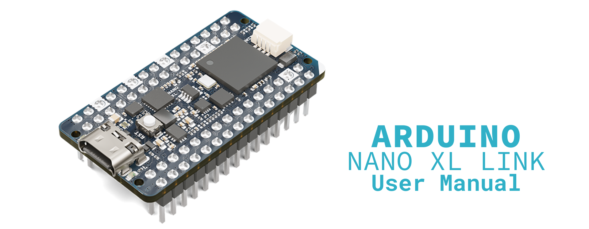

## Hardware and Software Requirements

### Hardware Requirements

- [Nano XL Link](https://store.arduino.cc/products/nano-xl-link) (x1)
- [USB-C® cable](https://store.arduino.cc/products/usb-cable2in1-type-c) (x1)
- [Nano Connector Carrier](https://store.arduino.cc/products/nano-connector-carrier) (x1) (recommended)
- [Breadboard](https://store.arduino.cc/products/breadboard-400-contacts) (x1) (recommended)
- [Female/male jumper wires](https://store.arduino.cc/products/40-colored-male-female-jumper-wires) (recommended)

### Software Requirements

- [Arduino IDE 2.0+](https://www.arduino.cc/en/software) or [Arduino Cloud Editor](https://create.arduino.cc/editor)
- [Arduino Zephyr core](https://github.com/arduino/ArduinoCore-zephyr)


<Alert type="info">

The Nano XL Link is compatible with the Arduino ecosystem and can be programmed directly as a standalone device.

</Alert>

## Nano XL Link Overview

The Nano XL Link is a compact microcontroller board designed for industrial and building automation applications. It is based on the [PIC32CK2051SG01144](https://www.microchip.com/en-us/product/pic32ck2051sg01144) microcontroller from Microchip® and extends the standard Nano pinout through two 2.54 mm double-row headers. The board integrates three industrial communication transceivers (CAN FD, RS-485, and a 10/100 Ethernet PHY), allowing it to communicate directly with industrial equipment without additional interface boards.

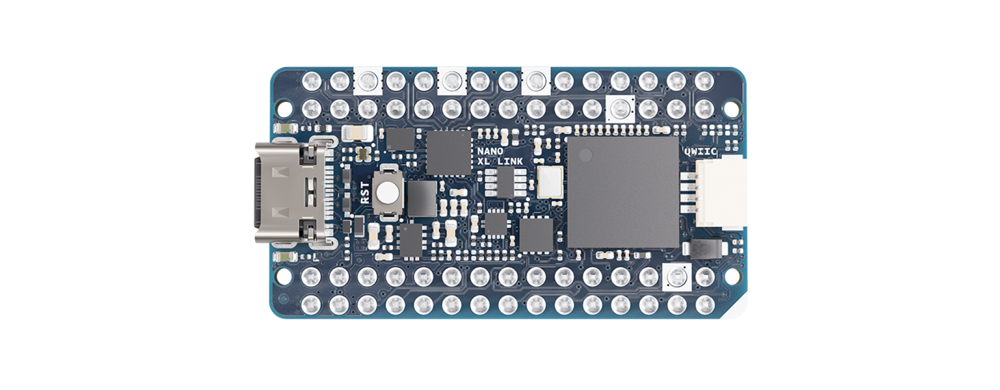

The Nano XL Link includes a 32-bit Arm® Cortex®-M33 microcontroller with 2 MB of flash memory and 512 kB of RAM, an onboard Qwiic connector, a programmable RGB LED, and a user LED. The board operates at +3.3 VDC logic levels and is rated for an industrial operating temperature range of -20 °C to +85 °C.

### Nano XL Link Architecture Overview

The Nano XL Link board combines a microcontroller with onboard fieldbus transceivers in a compact form factor, suitable for applications such as machine-level control, building automation, and energy monitoring.

The top view of the Nano XL Link board is shown in the image below:

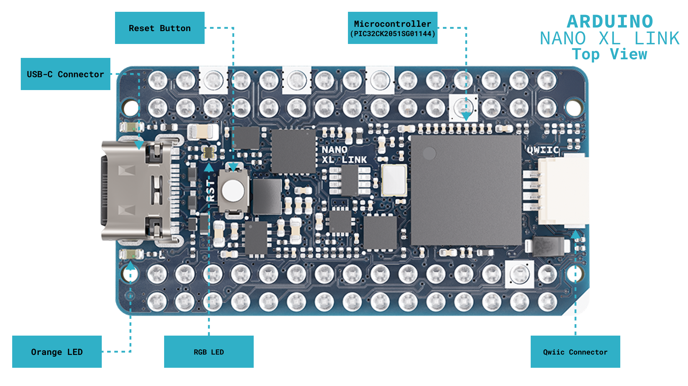

The bottom view of the Nano XL Link board is shown in the image below:

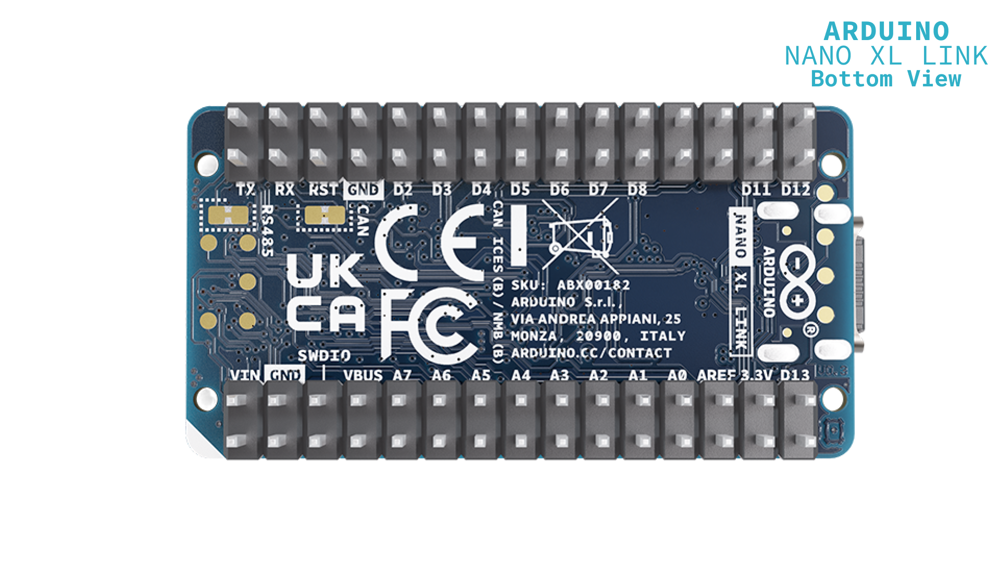

<Alert type="info">
The bottom side of the Nano XL Link board features test points for debugging and development purposes (SWD, USB, and `RESET`), along with the board's certification markings and identification information (board model and SKU).
</Alert>

Here is an overview of the board's main components, most of them shown in the images above:

- **Microcontroller**: The Nano XL Link board's heart is a Microchip PIC32CK2051SG01144 microcontroller, based on an Arm® Cortex®-M33 core with 2 MB of flash memory, 512 kB of RAM, and an integrated hardware security module (HSM). The microcontroller is clocked from a 12 MHz quartz crystal.
- **CAN FD transceiver**: An onboard Texas Instruments® TCAN3414 transceiver provides the physical layer for the microcontroller's CAN FD controller. The `CANH` and `CANL` signals are available on the board headers.
- **RS-485 transceiver**: An onboard Texas Instruments® THVD2410 transceiver provides a half-duplex RS-485 interface. The `A` and `B` signals are available on the board headers.
- **Ethernet PHY**: An onboard Microchip® KSZ8081RNAIA PHY provides a 10/100 Mbps Ethernet interface. The differential transmit and receive pairs and an activity LED signal are available on the board headers.
- **Bus termination jumpers**: Two solder jumpers connect 120 Ω termination resistors to the fieldbuses: `SJ1` for the CAN bus and `SJ2` for the RS-485 bus. Both jumpers are **closed** by default.
- **USB-C connector**: The Nano XL Link board includes a USB-C connector for programming, power, and serial communication.
- **Qwiic connector**: The Nano XL Link board includes an onboard Qwiic connector to expand the board's communication capabilities via I²C, facilitating connection with a wide range of sensors, actuators, and peripherals, such as the Arduino Modulino nodes.
- **Programmable RGB LED**: The board has an onboard user-programmable RGB LED to provide visual feedback about different operating states.
- **User LED**: In addition to the RGB LED, the board includes an onboard user-programmable orange LED for basic status indications.
- **Power LED**: A green LED indicates that the board's +3.3 VDC rail is powered.
- **Reset button**: An onboard push button resets the microcontroller.
- **Extended headers**: Two 2x15 pin headers (`J3` and `J4`) with 2.54 mm pitch expose the board's signals, power pins, and fieldbus lines.

### Board Core and Libraries

The **`Arduino Zephyr`** core includes libraries and examples for the Arduino Nano XL Link's peripherals and onboard components, such as its PIC32CK microcontroller, CAN FD controller, Ethernet interface, and onboard LEDs.

To install the core for the Nano XL Link board, navigate to **Tools > Board > Boards Manager** or click the Boards **Manager** icon in the left tab of the IDE. In the Boards Manager tab, search for `Zephyr` and install the latest core version.

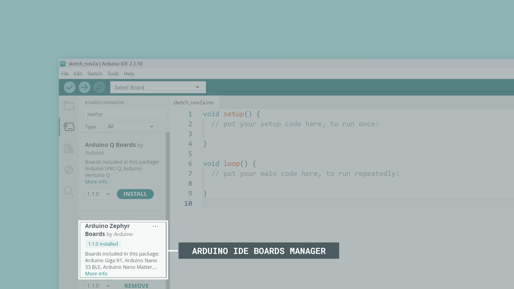

The `Arduino Zephyr` core provides support for the following:

- Board control and configuration (pin configuration and reset)
- Analog input (12-bit ADC) and PWM output
- Communication interfaces (UART, I²C and SPI)
- CAN and CAN FD communication through the `CAN` library
- Ethernet communication through the `Ethernet` library
- RS-485 communication through the `ArduinoRS485` library
- Onboard LED control (RGB LED and user LED)

The `Arduino Zephyr` core runs Arduino sketches on top of the Zephyr® real-time operating system (RTOS). Sketches use the same Arduino API as other Arduino boards, while Zephyr provides the underlying drivers.

### Pinout

- 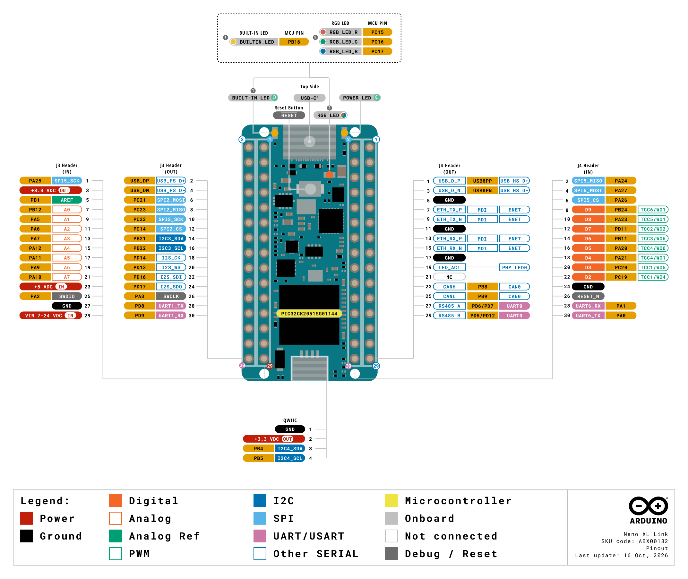

The full pinout is available and downloadable as a PDF from the link below:

- [Nano XL Link pinout](https://docs.arduino.cc/resources/pinouts/ABX00182-full-pinout.pdf)

### Datasheet

The complete datasheet is available and downloadable as a PDF from the link below:

- [Nano XL Link datasheet](https://docs.arduino.cc/resources/datasheets/ABX00182-datasheet.pdf)

### Schematics

The complete schematics are available and downloadable as a PDF from the link below:

- [Nano XL Link schematics](https://docs.arduino.cc/resources/schematics/ABX00182-schematics.pdf)

### STEP Files

The complete STEP files are available and downloadable from the link below:

- [Nano XL Link STEP files](../../downloads/ABX00182-step.zip)

## First Use

### Unboxing the Product

When opening the Nano XL Link box, you will find the board and its corresponding documentation. **The Nano XL Link does not include additional cables**, so you will need a USB-C cable ([available separately here](https://store.arduino.cc/products/usb-cable2in1-type-c)) to connect the board to your computer.

The Nano XL Link is a standalone device that can be programmed directly without requiring additional boards. For prototyping and for connecting the board to CAN, RS-485 and Ethernet networks, we recommend the [Nano Connector Carrier (ASX00090)](https://store.arduino.cc/products/nano-connector-carrier), which provides screw terminals and connectors for the board's signals. Refer to the Nano Connector Carrier user manual for more information.

### Connecting the Board

The Nano XL Link can be connected to your computer using its onboard USB-C connector. It can also be integrated into larger projects using the following:

- **Direct USB-C connection**: For programming, power supply and serial communication with the computer
- **Nano Connector Carrier**: For prototyping and field installations, providing screw terminals and connectors for the board's signals and fieldbus lines
- **Jumper wire connection**: For connecting the board's pins to a breadboard or to external circuits
- **Qwiic connection**: For rapid expansion with compatible sensors and modules, such as the Modulino® nodes
- **Pin connection**: For integration into custom PCBs through the `J3` and `J4` headers

<Alert type="warning">
The Nano XL Link cannot be inserted directly into a breadboard. Its double-row headers would connect the inner and outer rows of each header together, short-circuiting the board's signals. For prototyping, we recommend mounting the board on the Nano Connector Carrier or using female/male jumper wires to connect its pins to a breadboard.
</Alert>

<Alert type="warning">
The Nano XL Link operates at +3.3 VDC. When connecting sensors, modules, or shields designed for +5 VDC logic, verify voltage compatibility to avoid component damage.
</Alert>


### Voltage Compatibility Considerations

Before connecting any external components to your Nano XL Link board, it is important to understand its voltage characteristics to prevent damage to the board and to your sensors and modules.

**The Nano XL Link operates at +3.3 VDC**, which means:

- All digital I/O pins use +3.3 VDC logic levels (`HIGH` = +3.3 VDC, `LOW` = 0 VDC)
- Analog inputs measure voltages from 0 to +3.3 VDC
- Communication pins (I²C, SPI and UART) operate at +3.3 VDC logic levels
- The Qwiic connector operates at +3.3 VDC and can be used directly with Qwiic, STEMMA QT and Modulino® nodes

<Alert type="warning">
For +5 VDC components, add external level shifters on all data lines and use the `VBUS` pin only when the board is powered from USB (see the following section). Always check your component's datasheet for voltage specifications before connecting. When in doubt, use a multimeter to verify voltage levels or add level-shifting protection.
</Alert>

### Powering the Board

The Nano XL Link has three power inputs and two power outputs on its headers. Understanding which pins accept power and which pins only supply it is important to avoid damaging the board.

The board can be powered in several ways:

- **Via USB-C connector**: The most common method during development and programming
- **Via `VIN` pin**: Using an external +7-24 VDC power supply that is regulated down to +3.3 VDC by the onboard buck converter (MPQ4334)
- **Via `3V3` pin**: Directly connecting a regulated +3.3 VDC source, which bypasses the onboard buck converter and powers the microcontroller directly
- **Via `VBUS` pin**: Directly connecting a regulated +5 VDC source, which follows the same path as the USB-C power

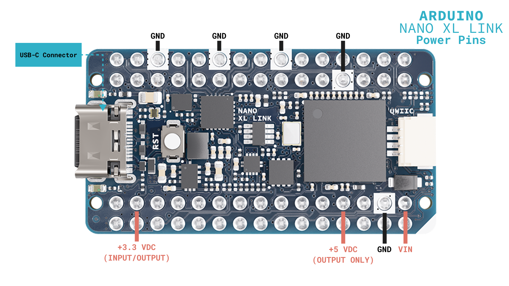

<Alert type="warning">
The Nano XL Link's `VIN` pin accepts +7-24 VDC. Do not connect voltages outside this range, as you could permanently damage the board.
</Alert>

<Alert type="warning">
When powering the board through the `3V3` pin, do not connect a power source to the `VIN` pin or the USB-C connector at the same time. Applying an external +3.3 VDC source together with another power source can damage the board. Always verify all the connections before applying power.
</Alert>

#### Power Inputs and Outputs

The direction of each power pin depends on how you power the board. The `3V3` pin is an output when the board is powered through the USB-C connector or the `VIN` pin, and an input when it powers the board. The `VBUS` pin is connected to the same +5 VDC net as the USB-C connector: it is an output that supplies +5 VDC to external circuits when the board is powered via USB-C, and an input that powers the board when a regulated +5 VDC source is connected to it. The following table summarizes the function of each power pin:

| **Pin** | **Voltage** | **Direction** | **Maximum Current** |                             **Notes**                            |
|:-------:|:-----------:|:-------------:|:-------------------:|:----------------------------------------------------------------:|
|  `VIN`  |  +7-24 VDC  |     Input     |          -          |                   Regulated to +3.3 VDC onboard                  |
|  `3V3`  |   +3.3 VDC  |  Input/Output |     1 A (output)    |          Output of the buck converter, or external input         |
|  `VBUS` |    +5 VDC   |  Input/Output |   500 mA (output)   | Same net as the USB-C +5 VDC; output only when powered via USB-C |
|  `GND`  |      -      |       -       |          -          |                  Five ground pins on the headers                 |

<Alert type="warning">
The Nano XL Link does not generate +5 VDC on its own: when the board is powered through the `VIN` or `3V3` pins, the `VBUS` pin carries no voltage. Never power the board through the USB-C connector and the `VBUS` pin at the same time, nor through `VBUS` together with `VIN` or `3V3`. Connecting two supplies to the same net can cause back-powering and ground return problems and damage the board or the power sources.
</Alert>

### Hello World Example

Let's program the Nano XL Link to reproduce the classic `Hello World` example used in the Arduino ecosystem: the `Blink` sketch. We will use this example to verify that the Nano XL Link connects to the computer, the Arduino IDE is configured correctly, and the board and development environment work as expected.

First, connect your Nano XL Link to your computer with a USB-C cable, open the Arduino IDE, and make sure the board connects correctly. If you are new to the Arduino IDE, please refer to the official Arduino documentation for more detailed information about initial setup.

Copy and paste the following example sketch into a new Arduino IDE file:

```arduino
/**
Blink Example for the Arduino Nano XL Link Board
Name: nano_xl_link_blink.ino
Purpose: This sketch demonstrates how to blink the built-in
user LED of the Arduino Nano XL Link board.

@author Arduino Product Experience Team
@version 1.0 06/10/26
*/

// Built-in LED pin
#define LED_PIN LED_BUILTIN

void setup() {
  // Initialize serial communication and wait up to 2.5 seconds for a connection
  Serial.begin(115200);
  for (auto startNow = millis() + 2500; !Serial && millis() < startNow; delay(500));

  // Configure LED pin as output
  pinMode(LED_PIN, OUTPUT);

  // Startup message
  Serial.println("- Arduino Nano XL Link - Blink Example started...");
}

void loop() {
  // Turn on the LED, wait 1 second
  digitalWrite(LED_PIN, HIGH);
  Serial.println("- LED on!");
  delay(1000);

  // Turn off the LED, wait 1 second
  digitalWrite(LED_PIN, LOW);
  Serial.println("- LED off!");
  delay(1000);
}
```

To upload the sketch to the board, click **Verify** to compile the sketch and check for errors, then click **Upload** to program the device:

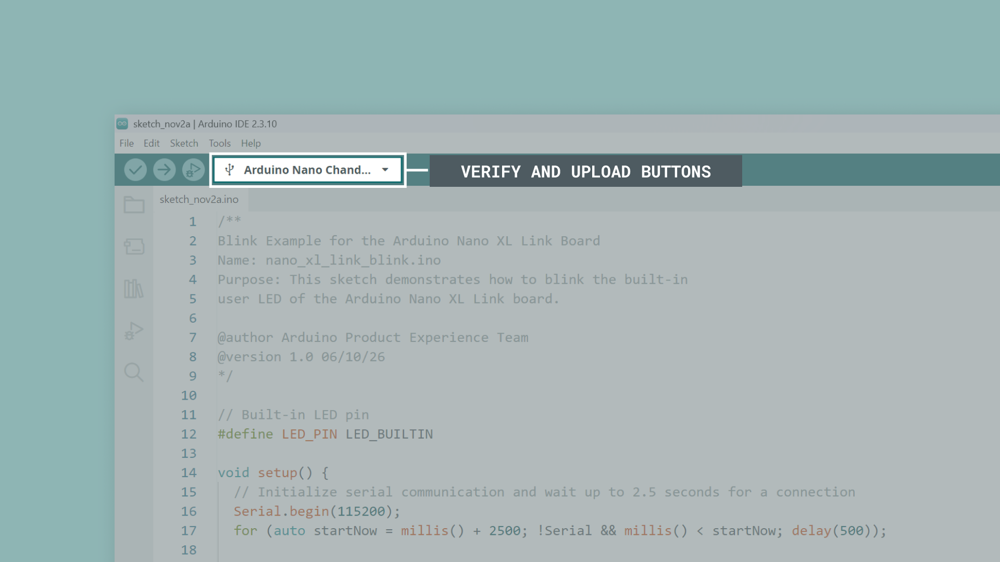

You should see the built-in orange user LED of your Nano XL Link board turn on for one second, then turn off for one second, repeating this cycle continuously:

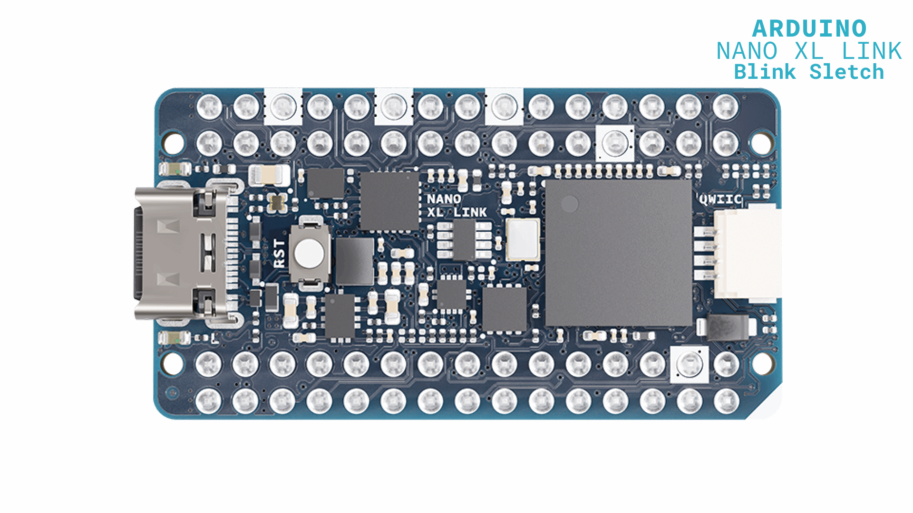

You can also open the Arduino IDE's Serial Monitor (Tools > Serial Monitor) to see the status messages the example sketch sends each time the LED state changes:

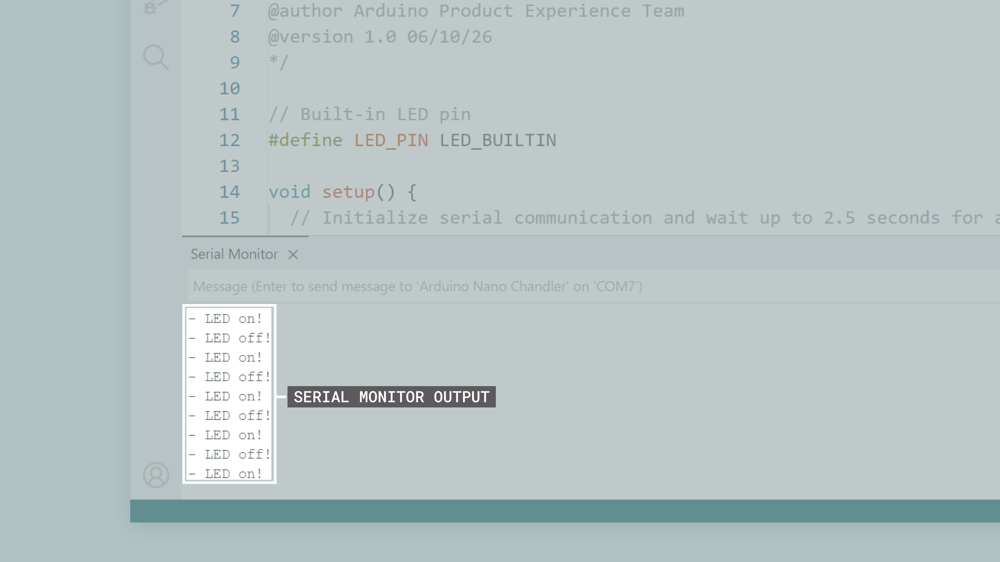

This example confirms the following:

- The Nano XL Link board is correctly connected
- The Arduino IDE is properly configured
- The board is functioning correctly
- USB communication and sketch upload are working
- Digital pins respond to commands

Congratulations! You have completed your first program on the Nano XL Link board. You are now ready to explore the more advanced features of the board.

## LEDs

This section covers the Nano XL Link built-in LEDs and their main hardware and software characteristics.

### RGB LED

The Nano XL Link features a built-in RGB LED that provides visual feedback. The built-in RGB LED can be accessed through the following macro definitions:

| **Built-in LED** | **Macro Definition** | **Arduino Pin** | **Microcontroller Pin** |
| :--------------: | :------------------: | :-------------: | :---------------------: |
|     Red LED      |        `LEDR`        |      `D39`      |         `PC15`          |
|    Green LED     |        `LEDG`        |      `D40`      |         `PC16`          |
|     Blue LED     |        `LEDB`        |      `D41`      |         `PC17`          |

<Alert type="info">
The built-in RGB LED on the Nano XL Link is a common-anode LED connected to +3.3 VDC, so each color must be pulled to ground (`GND`) to make it light up. This means a `LOW` voltage on each pin turns on that color, and a `HIGH` voltage turns it off.
</Alert>

You can turn each color on and off using the `pinMode()` and `digitalWrite()` functions of the Arduino programming language. The following example sketch turns on each of the RGB LED colors at an interval of 500 ms:

```arduino
/**
RGB LED Example for the Arduino Nano XL Link Board
Name: nano_xl_link_rgb_led.ino
Purpose: This sketch demonstrates how to control the built-in
RGB LED of the Arduino Nano XL Link board.

@author Arduino Product Experience Team
@version 1.0 06/10/26
*/

void setup() {
  // Initialize serial communication and wait up to 2.5 seconds for a connection
  Serial.begin(115200);
  for (auto startNow = millis() + 2500; !Serial && millis() < startNow; delay(500));

  // Initialize LEDR, LEDG and LEDB as outputs
  pinMode(LEDR, OUTPUT);
  pinMode(LEDG, OUTPUT);
  pinMode(LEDB, OUTPUT);

  // Turn off all LEDs initially
  digitalWrite(LEDR, HIGH);
  digitalWrite(LEDG, HIGH);
  digitalWrite(LEDB, HIGH);

  Serial.println("- Arduino Nano XL Link - RGB LED Example started...");
}

void loop() {
  // Turn on the built-in red LED and turn off the rest
  digitalWrite(LEDR, LOW);
  digitalWrite(LEDG, HIGH);
  digitalWrite(LEDB, HIGH);
  Serial.println("- Red LED on!");
  delay(500);

  // Turn on the built-in green LED and turn off the rest
  digitalWrite(LEDR, HIGH);
  digitalWrite(LEDG, LOW);
  digitalWrite(LEDB, HIGH);
  Serial.println("- Green LED on!");
  delay(500);

  // Turn on the built-in blue LED and turn off the rest
  digitalWrite(LEDR, HIGH);
  digitalWrite(LEDG, HIGH);
  digitalWrite(LEDB, LOW);
  Serial.println("- Blue LED on!");
  delay(500);

  // Turn off all LEDs
  digitalWrite(LEDR, HIGH);
  digitalWrite(LEDG, HIGH);
  digitalWrite(LEDB, HIGH);
  Serial.println("- All LEDs off!");
  delay(500);
}
```

You should now see the built-in RGB LED cycle through red, green, and blue, then briefly turn off, repeating this pattern continuously.

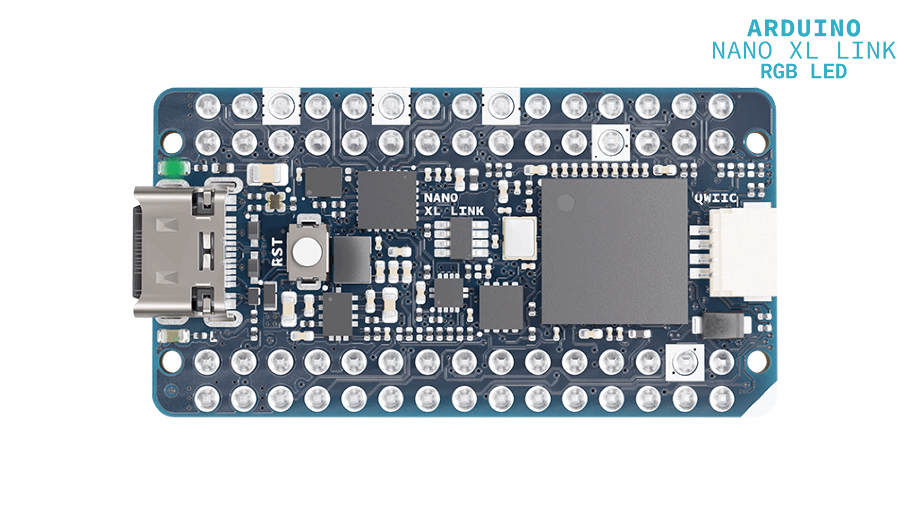

You can also open the Arduino IDE's Serial Monitor (Tools > Serial Monitor) to see the status messages the example sketch sends each time the RGB LED state changes.

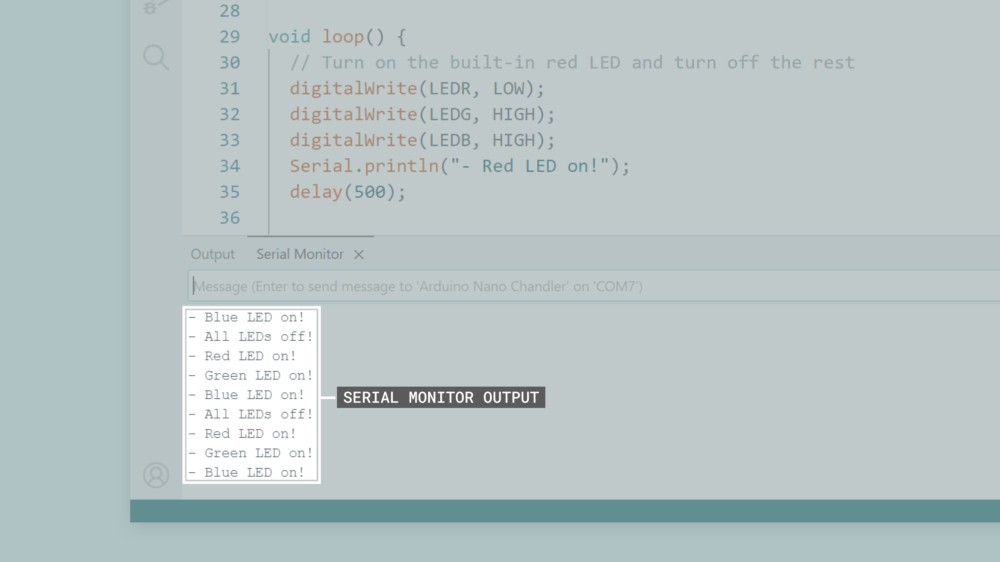

<Alert type="info">
The three RGB LED pins also support PWM for brightness control. When using `analogWrite()`, the core already inverts the polarity, so higher values make the LED brighter; for example `analogWrite(LEDG, 255)` sets the green LED at maximum brightness.
</Alert>

### User LED

The Nano XL Link also features a built-in orange user LED that can be used for basic status indications and debugging purposes.

The built-in user LED can be accessed through the following macro definition:

| **Built-in LED** | **Macro Definition** | **Arduino Pin** | **Microcontroller Pin** |
| :--------------: | :------------------: | :-------------: | :---------------------: |
| Orange User LED  |    `LED_BUILTIN`     |      `D38`      |         `PB16`          |

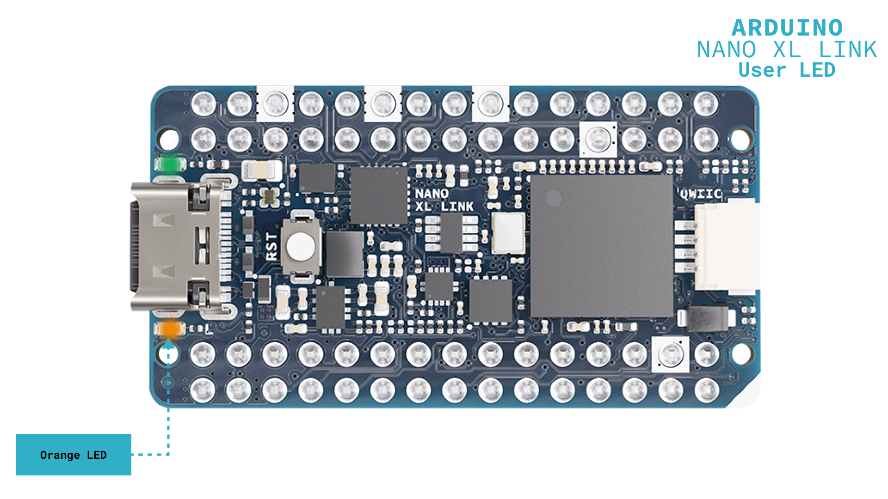

<Alert type="info">
Unlike the RGB LED, the built-in user LED on the Nano XL Link operates with standard logic levels. This means that a voltage level of `HIGH` will turn the LED on, and a voltage level of `LOW` will turn it off.
</Alert>

The [Hello World example](#hello-world-example) shows how to control the built-in orange user LED. **Unlike the RGB LED pins, `LED_BUILTIN` does not support PWM**.

### Power LED

The green power LED is connected directly to the +3.3 VDC rail and turns on whenever the board is powered. **It cannot be controlled from a sketch**.

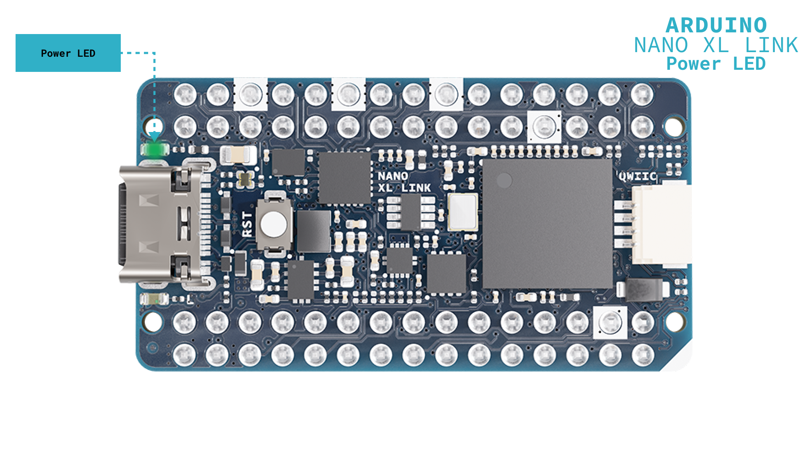

## Pins

This user manual section provides information about the Nano XL Link's pin capabilities and functionality. Understanding the board's pin capabilities and configurations helps you make the most of your projects with the Nano XL Link.

### Pins Overview

The Nano XL Link exposes its signals through **two 2x15 pin headers** (`J3` and `J4`), for a total of 60 pins. The headers keep the signals of the classic Nano form factor and add a second row with additional I/O, communication interfaces, fieldbus lines, and USB signals.

### Pins Specifications and Characteristics

The Nano XL Link's header pins are organized into the following categories:

|    **Pin Type**   | **Count** |                               **Pin Numbers**                               |              **Primary Functions**             |
|:-----------------:|:---------:|:---------------------------------------------------------------------------:|:----------------------------------------------:|
|  **Digital Pins** |     26    |                         `D0` - `D13`, `D22` - `D33`                         | Digital I/O, PWM (8 pins), UART, SPI, I²C, I²S |
|  **Analog Pins**  |     8     |                         `A0` - `A7` (`D14` - `D21`)                         |            Analog input, Digital I/O           |
| **Fieldbus Pins** |     9     | `CANH`, `CANL`, `RS485 A`, `RS485 B`, `ETH_TX_P/N`, `ETH_RX_P/N`, `LED_ACT` |      CAN FD, RS-485 and Ethernet bus lines     |
|    **USB Pins**   |     4     |                 `USB_FS D+`, `USB_FS D-`, `USB_D_P`, `USB_D_N`               |                 USB data lines                 |
|   **Power Pins**  |     8     |                       `VIN`, `VBUS`, `3V3`, `GND` (x5)                      |             Power supply and ground            |
|  **Special Pins** |     4     |                      `RESET`, `AREF`, `SWDIO`, `SWCLK`                      |       System control, reference and debug      |

<Alert type="info">
The Nano XL Link operates at +3.3 VDC. This applies to all digital and analog pins, including communication interfaces like I²C, SPI, and UART. Before connecting any sensors, modules, or shields, always verify their voltage compatibility. Applying +5 VDC signals to the board's pins without proper level shifting can permanently damage the board.
</Alert>

The following table shows the electrical specifications and operating limits for the pins on the Nano XL Link board:

|     **Specification**     |        **Value**       |                                   **Notes**                                   |
|:-------------------------:|:----------------------:|:-----------------------------------------------------------------------------:|
|   **Operating Voltage**   |        +3.3 VDC        |                        Logic level for all digital pins                       |
|  **Input Voltage Range**  |      0 to +3.3 VDC     |             Analog and digital (except 5 V-tolerant digital pins)             |
|  **Max Current per Pin**  | 7 mA sink/11 mA source |               Guaranteed output levels at default drive strength              |
|   **Input Low Voltage**   |     0 to +0.66 VDC     |                         Maximum voltage read as `LOW`                         |
|   **Input High Voltage**  |    +2.31 to +3.3 VDC   |                         Minimum voltage read as `HIGH`                        |
| **Internal Pull-up/down** |      12 to 14.6 kΩ     |                Selectable with `INPUT_PULLUP`/`INPUT_PULLDOWN`                |
|    **Analog Reference**   |        +3.3 VDC        | Default reference (`VDD`); AREF connected to the ADC external reference input |

The current values in the table above are the conditions under which the PIC32CK microcontroller guarantees its output voltage levels at the default (4x) drive strength. The microcontroller also supports an 8x drive strength (13 mA sink and 19 mA source), but the Arduino core does not expose this setting.

<Alert type="info">
The core also defines the digital pins `D34` to `D43`, but they are connected to onboard components (Qwiic connector, Ethernet PHY control, LEDs, and RS-485 transceiver control) and are not available on the headers. Avoid using them as general-purpose I/O.
</Alert>

### Digital Pins

The Nano XL Link features **26 digital pins** on its headers (`D0` to `D13` and `D22` to `D33`), plus the analog pins `A0` to `A7`, which can also be used as digital pins `D14` to `D21`. You can configure all of them as digital inputs or digital outputs, and they operate at +3.3 VDC logic levels.

The Nano XL Link digital pins provide the following functionality:

| **Arduino Pin** | **Microcontroller Pin** | **Header Pin** | **Additional Functions** |
| :-------------: | :---------------------: | :------------: | :----------------------: |
|      `D0`       |         `PA01`          |    `J4-28`     |     `Serial1` RX         |
|      `D1`       |         `PA00`          |    `J4-30`     |     `Serial1` TX         |
|      `D2`       |         `PC19`          |    `J4-22`     |           PWM            |
|      `D3`       |         `PC20`          |    `J4-20`     |           PWM            |
|      `D4`       |         `PA21`          |    `J4-18`     |           PWM            |
|      `D5`       |         `PA20`          |    `J4-16`     |           PWM            |
|      `D6`       |         `PB11`          |    `J4-14`     |           PWM            |
|      `D7`       |         `PD11`          |    `J4-12`     |           PWM            |
|      `D8`       |         `PA23`          |    `J4-10`     |           PWM            |
|      `D9`       |         `PB24`          |     `J4-8`     |           PWM            |
|      `D10`      |         `PA26`          |     `J4-6`     |        `SPI` CS          |
|      `D11`      |         `PA27`          |     `J4-4`     |       `SPI` MOSI         |
|      `D12`      |         `PA24`          |     `J4-2`     |       `SPI` MISO         |
|      `D13`      |         `PA25`          |     `J3-1`     |        `SPI` SCK         |
|      `D22`      |         `PC21`          |     `J3-6`     |       `SPI1` MOSI        |
|      `D23`      |         `PC23`          |     `J3-8`     |       `SPI1` MISO        |
|      `D24`      |         `PC22`          |    `J3-10`     |       `SPI1` SCK         |
|      `D25`      |         `PC14`          |    `J3-12`     |        `SPI1` CS         |
|      `D26`      |         `PB21`          |    `J3-14`     |       `Wire1` SDA        |
|      `D27`      |         `PB22`          |    `J3-16`     |       `Wire1` SCL        |
|      `D28`      |         `PD14`          |    `J3-18`     |          I²S CK          |
|      `D29`      |         `PD13`          |    `J3-20`     |          I²S WS          |
|      `D30`      |         `PD16`          |    `J3-22`     |         I²S SDI          |
|      `D31`      |         `PD17`          |    `J3-24`     |         I²S SDO          |
|      `D32`      |         `PD08`          |    `J3-28`     |     `Serial2` TX         |
|      `D33`      |         `PD09`          |    `J3-30`     |     `Serial2` RX         |

<Alert type="info">
Pins `D0` and `D1` are used by Serial1 (RX and TX respectively) and should be avoided for general digital I/O when that port is in use. Pins `D28` to `D31` are reserved for a future I²S interface and can currently be used as general-purpose digital I/O.
</Alert>

You can configure and control digital pins using the following basic Arduino functions. You can configure a pin's mode using the `pinMode()` function:

```arduino
pinMode(pin, mode);
```

To write a digital value to an output pin, use the `digitalWrite()` function:

```arduino
digitalWrite(pin, value);
```

To read the state of a digital input pin, use the `digitalRead()` function:

```arduino
digitalRead(pin);
```

The available pin modes are `OUTPUT` for digital output, `INPUT` for digital input with high impedance, `INPUT_PULLUP` for digital input with the internal pull-up resistor enabled, and `INPUT_PULLDOWN` for digital input with the internal pull-down resistor enabled. Digital output values can be `HIGH` (+3.3 VDC) or `LOW` (0 VDC), and digital input readings will return `HIGH` or `LOW` based on the voltage level detected on the pin. Digital pins can also trigger interrupts through the `attachInterrupt()` function.

The following example demonstrates how to use a digital input with an external interrupt to toggle the built-in user LED each time a push button connected to pin `D9` is pressed:

```arduino
/**
Digital Input Interrupt Example for the Arduino Nano XL Link Board
Name: nano_xl_link_digital_interrupt.ino
Purpose: This sketch demonstrates how to use an external interrupt
on a digital input pin to toggle the built-in user LED each time
a push button is pressed.

@author Arduino Product Experience Team
@version 1.0 06/10/26
*/

// Pin definitions
const int buttonPin = 9;            // Button input on D9
const int ledPin = LED_BUILTIN;     // Built-in LED

// Debounce time in milliseconds
const unsigned long debounceTime = 50;

// Variables shared with the interrupt service routine
volatile bool buttonPressed = false;

// Variables to store the LED state and the last valid press
bool ledState = false;
unsigned long lastPressTime = 0;

// Interrupt service routine, keep it short
void onButtonPress() {
  buttonPressed = true;
}

void setup() {
  // Initialize serial communication and wait up to 2.5 seconds for a connection
  Serial.begin(115200);
  for (auto startNow = millis() + 2500; !Serial && millis() < startNow; delay(500));

  // Configure pins
  pinMode(buttonPin, INPUT_PULLUP);
  pinMode(ledPin, OUTPUT);

  // Turn off LED initially
  digitalWrite(ledPin, LOW);

  // Trigger the interrupt when the button pulls the pin LOW
  attachInterrupt(digitalPinToInterrupt(buttonPin), onButtonPress, FALLING);

  Serial.println("- Arduino Nano XL Link - Digital Interrupt Example started...");
  Serial.println("- Press button to toggle the built-in LED");
}

void loop() {
  // Check if the interrupt detected a button press
  if (buttonPressed) {
    buttonPressed = false;

    // Ignore presses detected within the debounce time
    if (millis() - lastPressTime > debounceTime) {
      lastPressTime = millis();

      // Toggle LED state
      ledState = !ledState;
      digitalWrite(ledPin, ledState);

      Serial.print("- Button pressed! LED is now ");
      if (ledState) {
        Serial.println("ON");
      } else {
        Serial.println("OFF");
      }
    }
  }
}
```

To test this example, connect a push button to the Nano XL Link board as follows:

- Place the push button on a breadboard
- Connect one leg of the push button to pin `D9` of the board
- Connect the other leg of the push button to a `GND` pin of the board
- No additional components are needed, since the example uses the built-in LED and the internal pull-up resistor

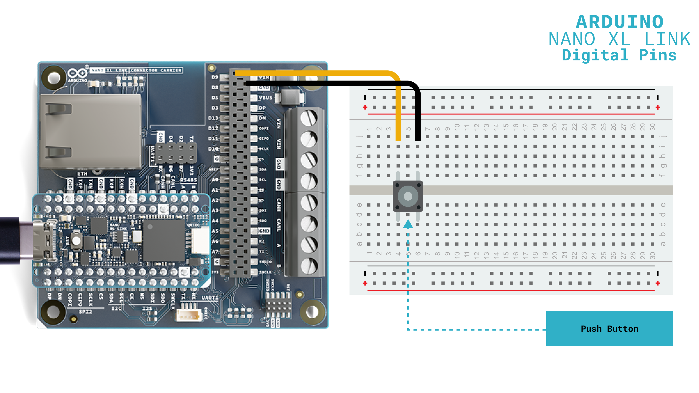

<Alert type="info">
You can make these connections with female/male jumper wires from the board's header pins, or through the screw terminals of the Nano Connector Carrier (our recommended way), as shown above.
</Alert>

You should now see the built-in user LED toggle on and off each time you press the button. The interrupt is triggered on the falling edge (`FALLING`) of the pin, and the sketch ignores presses detected within 50 ms of the previous one to filter out the mechanical bounce of the button. You can also open the Arduino IDE's Serial Monitor (Tools > Serial Monitor) to see messages indicating when the button is pressed and the current LED state.

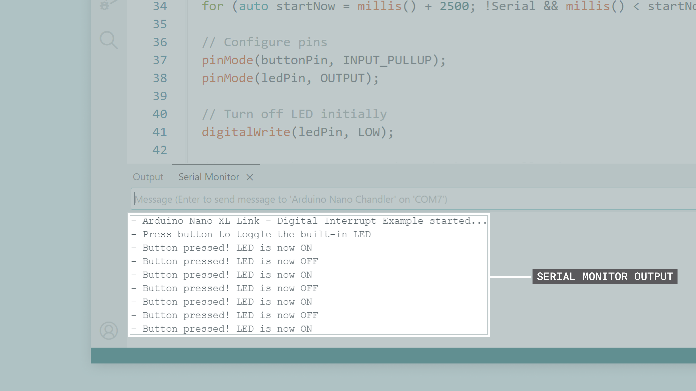

<Alert type="info">
Keep interrupt service routines as short as possible. In this example, the routine only sets a flag, and the LED and IDE's Serial Monitor updates are handled in the `loop()` function.
</Alert>

### Analog Pins

The Nano XL Link has **8 analog input pins** (`A0` to `A7`) that you can read with the `analogRead()` function. These pins let you measure continuously varying voltages, making them suitable for reading sensors like potentiometers, light sensors, temperature sensors, and other analog components. The PIC32CK microcontroller's analog-to-digital converter (ADC) converts the analog voltage into a digital value your sketch can process.

The Nano XL Link analog pins provide the following functionality:

| **Arduino Pin** | **Digital Pin** | **Microcontroller Pin** | **Header Pin** | **ADC Channel** |
| :-------------: | :-------------: | :---------------------: | :------------: | :-------------: |
|      `A0`       |      `D14`      |         `PB12`          |     `J3-7`     |   ADC0 ch 11    |
|      `A1`       |      `D15`      |         `PA05`          |     `J3-9`     |    ADC0 ch 1    |
|      `A2`       |      `D16`      |         `PA06`          |    `J3-11`     |    ADC0 ch 2    |
|      `A3`       |      `D17`      |         `PA07`          |    `J3-13`     |    ADC0 ch 3    |
|      `A4`       |      `D18`      |         `PA12`          |    `J3-15`     |    ADC0 ch 8    |
|      `A5`       |      `D19`      |         `PA11`          |    `J3-17`     |    ADC0 ch 7    |
|      `A6`       |      `D20`      |         `PA09`          |    `J3-19`     |    ADC0 ch 5    |
|      `A7`       |      `D21`      |         `PA10`          |    `J3-21`     |    ADC0 ch 6    |

<Alert type="info">
Unlike the classic Nano boards, pins `A4` and `A5` of the Nano XL Link board are not connected to the I²C bus. The I²C interfaces of the board are available on the Qwiic connector (`Wire`) and on pins `D26` and `D27` (`Wire1`).
</Alert>

The Nano XL Link's analog pins offer the following specifications:

|   **Specification**   |   **Value**   |            **Notes**             |
| :-------------------: | :-----------: | :------------------------------: |
|     Input Voltage     | 0 to +3.3 VDC |    Maximum safe input voltage    |
|  Default Resolution   |    10-bit     |  Values 0-1023 (`analogRead()`)  |
| Hardware Resolution   |    12-bit     |          Values 0-4095           |
|   Default Reference   |   +3.3 VDC    |      Microcontroller supply      |

You can read analog values using the `analogRead()` function:

```arduino
value = analogRead(pin);
```

The Nano XL Link's ADC samples at 12 bits, but by default `analogRead()` returns 10-bit values (0 to 1023) for compatibility with other Arduino boards. You can change the returned resolution using the `analogReadResolution()` function in the `setup()` of your sketch; for example, `analogReadResolution(12)` returns the full 12-bit range (0 to 4095).

The following example demonstrates how to read an analog value with the full 12-bit resolution and display it on the Serial Monitor:

```arduino
/**
Analog Input Example for the Arduino Nano XL Link Board
Name: nano_xl_link_analog_input.ino
Purpose: This sketch demonstrates how to read an analog input
with the 12-bit ADC and display the value on the Serial Monitor.

@author Arduino Product Experience Team
@version 1.0 06/10/26
*/

// Analog input pin
const int analogPin = A0;

void setup() {
  // Initialize serial communication and wait up to 2.5 seconds for a connection
  Serial.begin(115200);
  for (auto startNow = millis() + 2500; !Serial && millis() < startNow; delay(500));

  // Set analog read resolution to 12-bit (0 - 4095)
  analogReadResolution(12);

  Serial.println("- Arduino Nano XL Link - Analog Input Example started...");
  Serial.println("- Reading analog values from pin A0 (12-bit resolution)");
}

void loop() {
  // Read the analog value (0 - 4095 with 12-bit resolution)
  int analogValue = analogRead(analogPin);

  // Convert to voltage (0 to +3.3 VDC)
  float voltage = analogValue * (3.3 / 4095.0);

  // Display the results
  Serial.print("- Analog Value: ");
  Serial.print(analogValue);
  Serial.print(" | Voltage: ");
  Serial.print(voltage, 2);
  Serial.println(" VDC");

  // Wait half a second before next reading
  delay(500);
}
```

To test this example, connect a potentiometer to the Nano XL Link board as follows:

- Place the potentiometer on a breadboard
- Connect the middle pin of the potentiometer to pin `A0` of the board
- Connect one outer pin of the potentiometer to the `3V3` pin of the board
- Connect the other outer pin of the potentiometer to a `GND` pin of the board

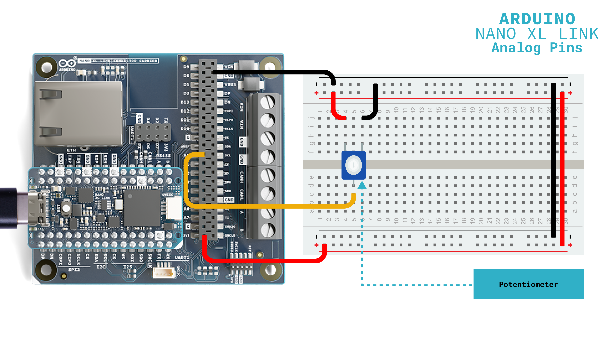

Open the Arduino IDE's Serial Monitor (Tools > Serial Monitor) to see real-time analog values and voltage measurements as you adjust the potentiometer. As you turn the potentiometer, the values will range from 0 to 4095, with corresponding voltage readings from 0 to +3.3 VDC.

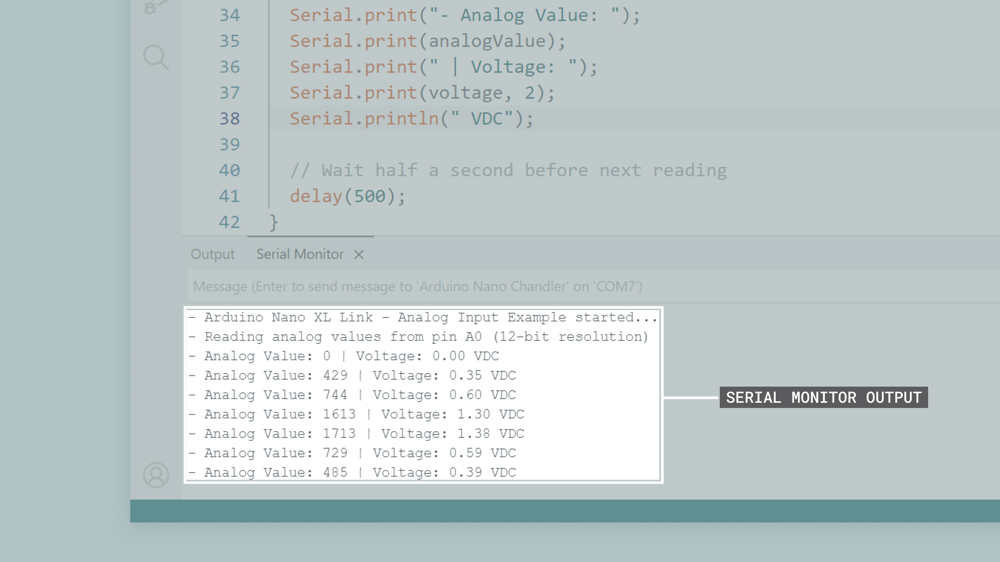

<Alert type="warning">
Do not connect the potentiometer to the `VBUS` pin. Applying more than +3.3 VDC to an analog input can permanently damage the board.
</Alert>

### PWM (Pulse Width Modulation)

The Nano XL Link has multiple PWM-capable pins you can use to generate analog-like output signals. PWM works by rapidly switching a digital output between `HIGH` and `LOW` states, where the ratio of HIGH time to the total period determines the effective analog voltage output.

The Nano XL Link board provides PWM functionality on the following pins:

| **Arduino Pin** | **Microcontroller Pin** | **Timer** | **Output** |
| :-------------: | :---------------------: | :-------: | :--------: |
|      `D2`       |         `PC19`          |  `TCC1`   |   `WO4`    |
|      `D3`       |         `PC20`          |  `TCC1`   |   `WO5`    |
|      `D4`       |         `PA21`          |  `TCC4`   |   `WO1`    |
|      `D5`       |         `PA20`          |  `TCC4`   |   `WO0`    |
|      `D6`       |         `PB11`          |  `TCC3`   |   `WO6`    |
|      `D7`       |         `PD11`          |  `TCC2`   |   `WO2`    |
|      `D8`       |         `PA23`          |  `TCC5`   |   `WO1`    |
|      `D9`       |         `PB24`          |  `TCC6`   |   `WO1`    |
|  `LEDR` (`D39`) |         `PC15`          |  `TCC1`   |   `WO0`    |
|  `LEDG` (`D40`) |         `PC16`          |  `TCC1`   |   `WO1`    |
|  `LEDB` (`D41`) |         `PC17`          |  `TCC1`   |   `WO2`    |

<Alert type="info">
Pins `D2` and `D3` share the `TCC1` timer with the three RGB LED channels, and pins `D4` and `D5` share the `TCC4` timer. Pins that share a timer always run at the same PWM frequency.
</Alert>

The Nano XL Link's PWM offers the following technical specifications:

|  **Specification**  |   **Value**   |           **Notes**            |
| :-----------------: | :-----------: | :----------------------------: |
| Default Resolution  | 8-bit (0-255) | Standard Arduino compatibility |
|  Default Frequency  |    500 Hz     |   Defined by the board core    |
|   Output Voltage    | 0 to +3.3 VDC |      +3.3 VDC logic level      |

You can use PWM pins as analog output pins with the `analogWrite()` function:

```arduino
analogWrite(pin, value);
```

**By default, the resolution is 8-bit (0 to 255)**. You can use the `analogWriteResolution()` function to change the range of values accepted by `analogWrite()`:

```arduino
analogWriteResolution(resolution);
```
<Alert type="warning">
If `analogWrite()` is called on a pin without PWM capability, the core configures the pin as a digital output and sets it `HIGH` for values above half of the range, or `LOW` otherwise.
</Alert>

The following example demonstrates how to fade an LED connected to pin `D39 (LEDR)`:

```arduino
/**
PWM Example for the Arduino Nano XL Link Board
Name: nano_xl_link_pwm_led.ino
Purpose: This sketch demonstrates how to use PWM to control
the brightness of the built-in red LED of the Nano XL Link board.

@author Arduino Product Experience Team
@version 1.0 06/10/26
*/

// Built-in red LED pin (supports PWM)
const int ledPin = LEDR;

void setup() {
  // Initialize serial communication and wait up to 2.5 seconds for a connection
  Serial.begin(115200);
  for (auto startNow = millis() + 2500; !Serial && millis() < startNow; delay(500));

  // No need to set pinMode for PWM pins - analogWrite() handles this

  Serial.println("- Arduino Nano XL Link - PWM LED Example started...");
  Serial.println("- Built-in red LED will fade in and out continuously");
}

void loop() {
  // Fade in (0 to 255)
  for (int brightness = 0; brightness <= 255; brightness++) {
    analogWrite(ledPin, brightness);
    delay(5);
  }

  Serial.println("- LED at maximum brightness");
  delay(500);

  // Fade out (255 to 0)
  for (int brightness = 255; brightness >= 0; brightness--) {
    analogWrite(ledPin, brightness);
    delay(5);
  }

  Serial.println("- LED turned off");
  delay(500);
}
```

<Alert type="info">
To test this example, no external connections are needed. The red LED is part of the board's built-in RGB LED.
</Alert>

You should now see the built-in red LED of your Nano XL Link board gradually fade in and out, creating a smooth breathing effect that repeats continuously.

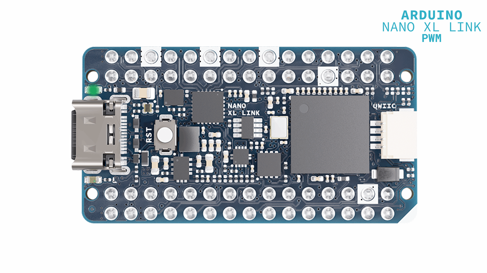

Additionally, you can open the Arduino IDE's Serial Monitor (Tools > Serial Monitor) to see the status messages that the example sketch sends at key brightness levels.

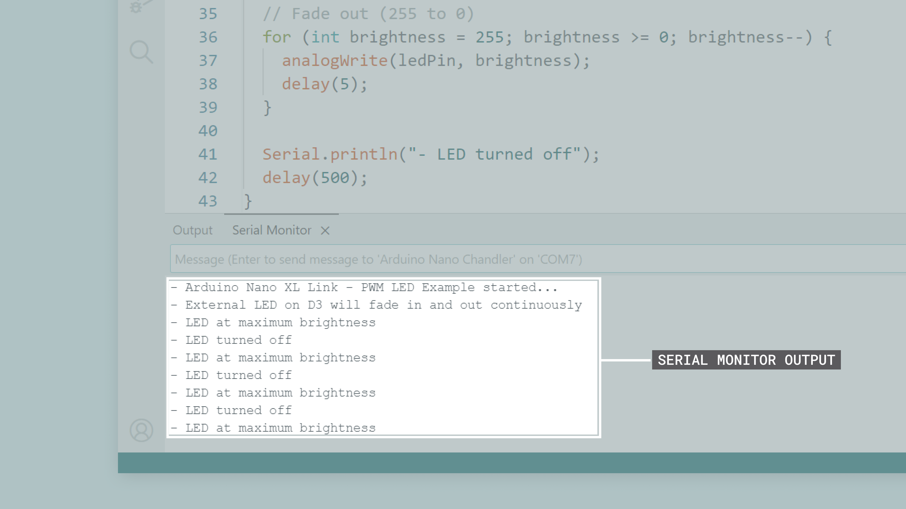

## UART Communication

The Nano XL Link board features built-in UART (Universal Asynchronous Receiver-Transmitter) communication, allowing your projects to communicate with other devices through serial data transmission. The board provides one USB serial port for communication with the computer and three hardware UART ports: two available on the board headers for external devices, and one connected to the onboard RS-485 transceiver. This lets you debug a sketch over USB while communicating with sensors, modules, or other microcontrollers at the same time.

UART is particularly useful when your project needs to communicate with devices that require simple, reliable serial communication, rather than the more complex protocols like SPI or I²C. While SPI excels at high-speed communication and I²C is ideal for multiple-device networks, UART provides point-to-point communication that works well with GPS modules, Bluetooth® modules, Wi-Fi® modules, and other serial devices. UART communication is asynchronous, meaning it does not require a shared clock signal.

The Nano XL Link's UART interface offers the following technical specifications:

|   **Parameter**   |      **Value**     |              **Notes**             |
|:-----------------:|:------------------:|:----------------------------------:|
|   Hardware Ports  |          3         | `Serial1`, `Serial2` and `Serial3` |
|     USB Serial    |          1         |       `Serial` (USB CDC-ACM)       |
|     Data Bits     |       5 to 8       |          8-bit by default          |
|       Parity      |  None, even or odd |           None by default          |
|     Stop Bits     |     1, 1.5 or 2    |            1 by default            |
|   Communication   |     Full-duplex    |         Simultaneous TX/RX         |
|    Buffer Size    | 1024 bytes (TX/RX) |       Per port, per direction      |
| Operating Voltage |      +3.3 VDC      |          TTL logic levels          |
|    Flow Control   |        None        |      No hardware flow control      |

The Nano XL Link board uses the following pins for UART communication:

| **Serial Object** | **Arduino Pin** | **Microcontroller Pin** | **UART Function** |       **Description**      |
|:-----------------:|:---------------:|:-----------------------:|:-----------------:|:--------------------------:|
|     `Serial1`     |       `D0`      |          `PA01`         |         RX        |        Transmit data       |
|     `Serial1`     |       `D1`      |          `PA00`         |         TX        |        Receive data        |
|     `Serial2`     |      `D32`      |          `PD08`         |         TX        |        Transmit data       |
|     `Serial2`     |      `D33`      |          `PD09`         |         RX        |        Receive data        |
|     `Serial3`     |        -        |            -            |         -         | Onboard RS-485 transceiver |

<Alert type="info">
`Serial3` is connected internally to the onboard RS-485 transceiver and is not available on the headers. Do not use it directly; use the `ArduinoRS485` library instead, as explained in the [RS-485 Communication](#rs-485-communication) section.
</Alert>

You can communicate via UART using the built-in `Serial`, `Serial1`, and `Serial2` objects. The `Serial` object connects to the USB-C port for computer communication, while `Serial1` and `Serial2` connect to the header pins for external device communication. All of them support the standard `begin()`, `print()`, `println()`, `available()` and `read()` functions. The port configuration can be changed with the second argument of `begin()`; for example, `Serial1.begin(9600, SERIAL_8E1)` configures 8 data bits, even parity, and 1 stop bit.

The following example demonstrates basic UART communication by sending a counter value via `Serial1` every second and forwarding messages between the USB serial port and `Serial1`:

```arduino
/**
UART Basic Example for the Arduino Nano XL Link Board
Name: nano_xl_link_uart_basic.ino
Purpose: This sketch demonstrates basic UART communication
using both the USB serial port and the hardware Serial1 port.

@author Arduino Product Experience Team
@version 1.0 03/11/26
*/

void setup() {
  // Initialize USB serial communication and wait up to 2.5 seconds for a connection
  Serial.begin(115200);
  for (auto startNow = millis() + 2500; !Serial && millis() < startNow; delay(500));

  // Initialize hardware serial on pins D0/D1 at 9600 baud
  Serial1.begin(9600);

  Serial.println("- Arduino Nano XL Link - UART Basic Example started...");
  Serial.println("- USB Serial (Serial): 115200 baud");
  Serial.println("- Hardware Serial (Serial1): 9600 baud on D1 (TX) / D0 (RX)");
  Serial.println("- Sending a counter value via Serial1 every second");
  Serial.println("- Type messages in the Serial Monitor to send them via Serial1");
  Serial.println();
}

void loop() {
  // Forward data from USB Serial (computer) to Serial1
  if (Serial.available()) {
    String message = Serial.readString();

    // Remove newline characters
    message.trim();

    if (message.length() > 0) {
      Serial.print("- USB received: \"");
      Serial.print(message);
      Serial.println("\"");

      // Send the message via Serial1 (D0/D1)
      Serial1.print("- Message from USB: ");
      Serial1.println(message);

      Serial.println("- Message sent via Serial1!");
    }
  }

  // Forward data from Serial1 (external device on D0/D1) to USB Serial
  if (Serial1.available()) {
    String response = Serial1.readString();

    // Remove newline characters
    response.trim();

    if (response.length() > 0) {
      Serial.print("- Serial1 received: \"");
      Serial.print(response);
      Serial.println("\"");
    }
  }

  // Send the counter value via Serial1 every second
  static unsigned long lastSend = 0;
  static unsigned int counter = 0;
  if (millis() - lastSend > 1000) {
    lastSend = millis();

    // Send the current counter value
    Serial1.print("Counter: ");
    Serial1.println(counter);

    Serial.print("- Counter value sent via Serial1: ");
    Serial.println(counter);

    counter++;
  }

  delay(10);
}
```

<Alert type="info">
To test this example, you don't need any external UART devices. You can type messages in the Arduino IDE's Serial Monitor to see them transmitted via `Serial1`. To observe the UART signals, connect a logic analyzer with a UART decoder to pin `D1` (TX) and to a `GND` pin of the board. The images below were captured with a Digilent Analog Discovery 2 and the WaveForms software. If you connect a jumper wire between `D0` and `D1`, the board receives its own transmissions, and the messages appear back in the Serial Monitor as "Serial1 received".
</Alert>

Open the Arduino IDE's Serial Monitor (Tools > Serial Monitor) to interact with the USB serial port and observe the communication:

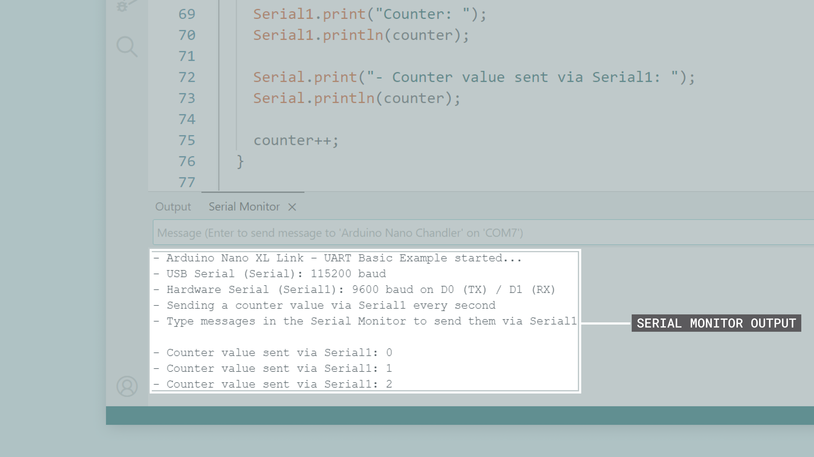

The image below shows how the UART communication from the example appears in the WaveForms Logic Analyzer, with the decoded protocol showing the counter message bytes and timing:

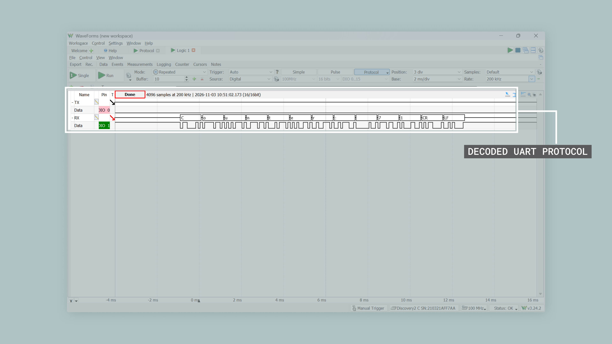

When working with UART on the Nano XL Link, there are several key points to keep in mind:

- The USB serial port (`Serial`) and the hardware ports (`Serial1`, `Serial2`) are independent, so you can debug over USB while communicating with an external device at the same time.
- Always ensure that both devices use the same baud rate, data bits, parity, and stop bits for successful communication.
- UART communication uses TTL voltage levels (0 VDC for logic `LOW`, +3.3 VDC for logic `HIGH`). Devices with +5 VDC UART signals require a level shifter, and RS-232 devices require a level converter.
- When connecting external devices, remember that TX connects to RX and RX connects to TX (crossover connection).
- For long-distance or industrial serial communication, use the onboard RS-485 interface instead of the TTL UART pins.

## SPI Communication

The Nano XL Link board features built-in SPI (Serial Peripheral Interface) communication, allowing your projects to communicate with external devices like sensors, displays, memory cards, and other microcontrollers. The board provides two independent SPI buses on its headers: `SPI`, on the classic Nano pins `D10` to `D13`, and `SPI1`, on the extended pins `D22` to `D25`. Each bus uses four dedicated pins to provide high-speed synchronous serial communication.

SPI is particularly useful when your project needs to communicate with external components at high speeds. While I²C is ideal for simple sensor communication and UART for basic serial data exchange, SPI excels at high-speed communication with devices like SD cards, TFT displays, wireless modules, or external memory chips. SPI can achieve much faster data rates than I²C and can handle multiple devices on the same bus through individual chip select lines.

The Nano XL Link's SPI interface offers the following technical specifications:

|   **Parameter**   |       **Value**       |              **Notes**              |
|:-----------------:|:---------------------:|:-----------------------------------:|
|   Hardware Buses  |           2           |          `SPI` and `SPI1`           |
|   Clock Speed     |       1 MHz min.      | Lower settings are raised to 1 MHz  |
|   Data Transfer   |     8-bit, 16-bit     |     `transfer()`, `transfer16()`    |
|   Communication   |      Full-duplex      |     Simultaneous send/receive       |
|  Multiple Devices |       Supported       |      Via different `CS` pins        |
| Operating Voltage |       +3.3 VDC        |          Same as the board          |
|  Protocol Support |     Mode 0, 1, 2, 3   |       All SPI modes available       |
|     Bit Order     |   MSB or LSB first    |     `MSBFIRST` by default           |

The Nano XL Link board uses the following pins for SPI communication:

| **SPI Object** | **Arduino Pin** | **Microcontroller Pin** | **Header Pin** | **SPI Function** |          **Description**          |
|:--------------:|:---------------:|:-----------------------:|:--------------:|:----------------:|:---------------------------------:|
|     `SPI`      |      `D10`      |         `PA26`          |     `J4-6`     |       `CS`       |            Chip Select            |
|     `SPI`      |      `D11`      |         `PA27`          |     `J4-4`     |      `MOSI`      | Controller Out, Peripheral In     |
|     `SPI`      |      `D12`      |         `PA24`          |     `J4-2`     |      `MISO`      | Controller In, Peripheral Out     |
|     `SPI`      |      `D13`      |         `PA25`          |     `J3-1`     |      `SCK`       |           Serial Clock            |
|     `SPI1`     |      `D22`      |         `PC21`          |     `J3-6`     |      `MOSI`      | Controller Out, Peripheral In     |
|     `SPI1`     |      `D23`      |         `PC23`          |     `J3-8`     |      `MISO`      | Controller In, Peripheral Out     |
|     `SPI1`     |      `D24`      |         `PC22`          |    `J3-10`     |      `SCK`       |           Serial Clock            |
|     `SPI1`     |      `D25`      |         `PC14`          |    `J3-12`     |       `CS`       |            Chip Select            |

<Alert type="info">
The SPI library does not control the chip select line. The `CS` pins listed above are the conventional ones for each bus, but any digital pin can be used as chip select by driving it `LOW` and `HIGH` from the sketch with `digitalWrite()`. The SPI pins of both buses behave as general-purpose I/O until `SPI.begin()` or `SPI1.begin()` is called.
</Alert>

You can communicate via SPI using the dedicated `SPI.h` library, which is included in the `Arduino Zephyr` core. The library provides the `SPI` and `SPI1` objects, with functions to initialize each bus, configure its clock speed, bit order, and mode, and send and receive data. On the Nano XL Link, the bus configuration is applied by `beginTransaction()`, so always call it with the appropriate `SPISettings()` before transferring data.

The following example demonstrates how to use SPI communication to send and receive data:

```arduino
/**
SPI Basic Example for the Arduino Nano XL Link Board
Name: nano_xl_link_spi_basic.ino
Purpose: This sketch demonstrates how to use SPI communication
to send and receive data.

@author Arduino Product Experience Team
@version 1.0 03/11/26
*/

#include <SPI.h>

// Chip Select pin for the SPI device
const int csPin = 10;

// Counter value to send
uint8_t counter = 0;

void setup() {
  // Initialize serial communication and wait up to 2.5 seconds for a connection
  Serial.begin(115200);
  for (auto startNow = millis() + 2500; !Serial && millis() < startNow; delay(500));

  Serial.println("- Arduino Nano XL Link - SPI Basic Example started...");

  // Set CS pin as output and set it HIGH (inactive)
  pinMode(csPin, OUTPUT);
  digitalWrite(csPin, HIGH);

  // Initialize SPI communication
  SPI.begin();

  Serial.println("- SPI initialized successfully");
  Serial.println("- Sending a counter value every second on D10 (CS), D11 (MOSI), D13 (SCK)");
}

void loop() {
  // Configure the SPI bus for this transaction
  // - Clock speed: 1 MHz
  // - Data order: Most Significant Bit first
  // - Data mode: Mode 0 (Clock polarity = 0, Clock phase = 0)
  SPI.beginTransaction(SPISettings(1000000, MSBFIRST, SPI_MODE0));

  // Select the device (CS LOW)
  digitalWrite(csPin, LOW);

  // Send the counter value and read the response
  uint8_t response = SPI.transfer(counter);

  // Deselect the device (CS HIGH)
  digitalWrite(csPin, HIGH);

  // Release the SPI bus
  SPI.endTransaction();

  // Display results
  Serial.print("- Sent: 0x");
  if (counter < 16) Serial.print("0");
  Serial.print(counter, HEX);
  Serial.print(" | Received: 0x");
  if (response < 16) Serial.print("0");
  Serial.println(response, HEX);

  // Increment counter and wrap around at 255
  counter++;

  delay(1000);
}
```

<Alert type="info">
To test this example, you don't need an external SPI device. The sketch generates SPI transfers that can be observed with a logic analyzer connected to pins `D10` (CS), `D11` (MOSI), `D13` (SCK), and a `GND` pin on the board. Without a connected device, the received data will typically be `0xFF` or `0x00`. The image below was captured with a Digilent Analog Discovery 2 and the WaveForms software.
</Alert>

Open the Arduino IDE's Serial Monitor (Tools > Serial Monitor) to see the SPI communication in action. The example sketch shows how to properly select a device, send data, and read the response:

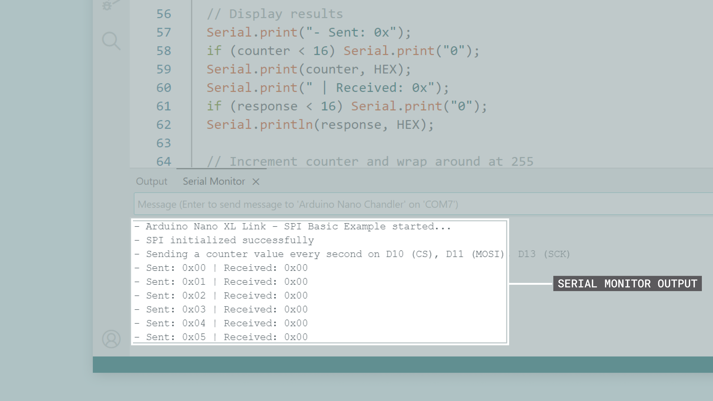

The image below shows how the SPI communication from the example appears in the WaveForms Logic Analyzer, with the decoded protocol showing the chip select, clock, and data signals:

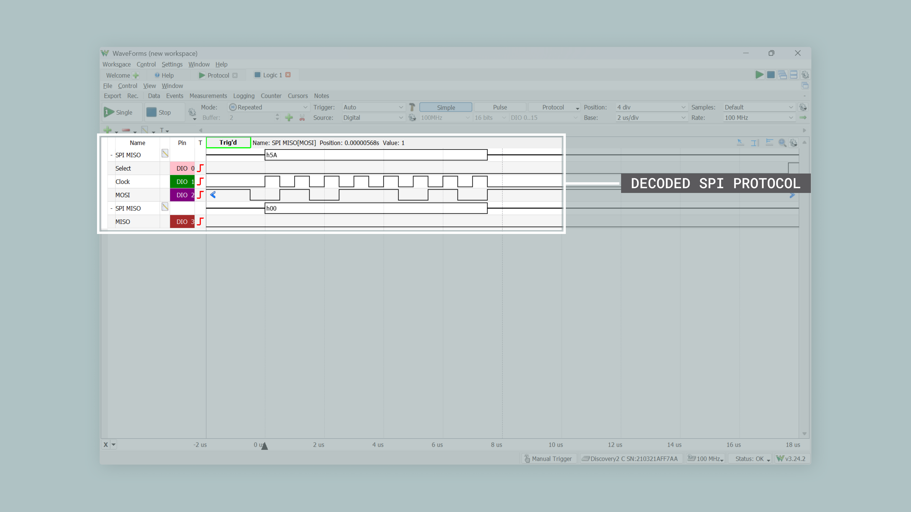

To connect multiple SPI devices, use a different digital pin as chip select for each device while sharing the `MOSI`, `MISO`, and `SCK` pins:

```arduino
// Multiple device example
const int device1CS = 10;  // First SPI device
const int device2CS = 9;   // Second SPI device
const int device3CS = 8;   // Third SPI device

void setup() {
  SPI.begin();

  // Configure all CS pins as outputs
  pinMode(device1CS, OUTPUT);
  pinMode(device2CS, OUTPUT);
  pinMode(device3CS, OUTPUT);

  // Set all CS pins HIGH (inactive)
  digitalWrite(device1CS, HIGH);
  digitalWrite(device2CS, HIGH);
  digitalWrite(device3CS, HIGH);
}
```

The second bus, `SPI1`, works in the same way and is useful to keep a high-speed device, such as a display, on its own bus:

```arduino
// Second SPI bus example
const int csPin1 = 25;  // CS pin of the SPI1 bus

void setup() {
  SPI1.begin();

  pinMode(csPin1, OUTPUT);
  digitalWrite(csPin1, HIGH);
}

void loop() {
  SPI1.beginTransaction(SPISettings(1000000, MSBFIRST, SPI_MODE0));
  digitalWrite(csPin1, LOW);
  SPI1.transfer(0x55);
  digitalWrite(csPin1, HIGH);
  SPI1.endTransaction();

  delay(1000);
}
```

When working with SPI on the Nano XL Link, there are several key points to keep in mind:

- Always call `beginTransaction()` with the settings required by your device before transferring data, and `endTransaction()` afterward to release the bus.
- Make sure that only one device is selected (`CS` `LOW`) at a time, and deselect devices (`CS` `HIGH`) after communication to avoid conflicts.
- Different SPI devices may require different clock speeds and modes, so check your device's datasheet for the correct `SPISettings()` parameters. Clock speeds below 1 MHz are not supported; the core raises them to 1 MHz.
- SPI is a synchronous protocol, meaning that data is transferred in both directions simultaneously with each clock pulse. Even if you only need to send data, you will still receive data back, and vice versa.
- The Nano XL Link operates at +3.3 VDC, so SPI devices with +5 VDC logic levels require a level shifter on `MOSI`, `SCK`, and `CS`, and on `MISO` if the device drives it at +5 VDC.

## I²C Communication

The Nano XL Link board features built-in I²C (Inter-Integrated Circuit) communication, allowing your projects to communicate with multiple devices using just two wires. The board provides two independent I²C buses: `Wire`, connected to the onboard Qwiic connector, and `Wire1`, available on header pins `D26` and `D27`. This lets you connect several sensors, displays, or other devices without using many pins, and separate devices onto different buses when needed.

I²C is particularly useful when your project needs to communicate with multiple sensors and devices simply. While SPI is excellent for high-speed communication and UART for basic serial data exchange, I²C excels at connecting many devices with minimal wiring. Multiple I²C devices can share the same two-wire bus, each with its own unique address, making it ideal for sensor networks, display modules, and expandable systems.

The Nano XL Link's I²C interface offers the following technical specifications:

|   **Parameter**   |        **Value**        |                     **Notes**                    |
|:-----------------:|:-----------------------:|:------------------------------------------------:|
|   Hardware Buses  |            2            |                `Wire` and `Wire1`                |
|    Clock Speed    | 100 kHz, 400 kHz, 1 MHz | Standard, Fast and Fast-mode Plus (`setClock()`) |
|   Data Transfer   |          8-bit          |                Standard data width               |
|   Communication   |       Half-duplex       |              One direction at a time             |
| Device Addressing |          7-bit          |            Up to 127 unique addresses            |
|     Bus Roles     |   Controller or target  |         Target mode via `begin(address)`         |
| Operating Voltage |         +3.3 VDC        |                 Same as the board                |
| Pull-up Resistors |   5.1 kΩ (`Wire` only)  |    `Wire1` requires external pull-up resistors   |

The Nano XL Link board uses the following pins and connectors for I²C communication:

| **I²C Object** | **Arduino Pin** | **Microcontroller Pin** |   **Location**  | **I²C Function** |  **Description**  |
|:--------------:|:---------------:|:-----------------------:|:---------------:|:----------------:|:-----------------:|
|     `Wire`     |      `D34`      |          `PB04`         | Qwiic connector |        SDA       |  Serial Data Line |
|     `Wire`     |      `D35`      |          `PB05`         | Qwiic connector |        SCL       | Serial Clock Line |
|     `Wire1`    |      `D26`      |          `PB21`         |     `J3-14`     |        SDA       |  Serial Data Line |
|     `Wire1`    |      `D27`      |          `PB22`         |     `J3-16`     |        SCL       | Serial Clock Line |

<Alert type="info">
Unlike classic Nano boards, the Nano XL Link's I²C bus is not available on pins `A4` and `A5`. The `Wire` bus routes only to the Qwiic connector, which includes 5.1 kω pull-up resistors to +3.3 VDC and supplies +3.3 VDC power to connected devices. The `Wire1` bus on pins `D26` and `D27` has no onboard pull-up resistors, so external pull-up resistors (typically 4.7 kΩ to +3.3 VDC) are required for proper operation.
</Alert>

The Qwiic connector is the simplest way to add I²C devices to the Nano XL Link. It provides a standard 4-pin JST SH connector with `GND`, `+3.3 VDC`, `SDA`, and `SCL`, compatible with Qwiic, STEMMA QT, and Modulino® devices. You can daisy-chain devices, so several can share the same connector.

You can communicate via I²C using the dedicated `Wire.h` library, which is included in the `Arduino Zephyr` core. The library provides the `Wire` and `Wire1` objects, with functions to initialize each bus, send and receive data, and manage multiple devices. The bus clock can be changed with `setClock()`, which accepts 100000, 400000, or 1000000; other values fall back to 100 kHz.

The following example demonstrates basic I²C communication patterns on the `Wire1` bus:

```arduino
/**
I2C Basic Example for the Arduino Nano XL Link Board
Name: nano_xl_link_i2c_basic.ino
Purpose: This sketch demonstrates basic I2C communication
patterns on the Wire1 bus (pins D26 and D27).

@author Arduino Product Experience Team
@version 1.0 03/11/26
*/

#include <Wire.h>

// Example device address
const int deviceAddress = 0x48;

// Counter value to send
uint8_t counter = 0;

void setup() {
  // Initialize serial communication and wait up to 2.5 seconds for a connection
  Serial.begin(115200);
  for (auto startNow = millis() + 2500; !Serial && millis() < startNow; delay(500));

  Serial.println("- Arduino Nano XL Link - I2C Basic Example started...");

  // Initialize I2C communication as controller on the Wire1 bus
  Wire1.begin();

  Serial.println("- I2C initialized successfully on the Wire1 bus (D26 SDA / D27 SCL)");
  Serial.println("- Sending a counter value to device 0x48 every second");
}

void loop() {
  // Write the counter value to the device
  Wire1.beginTransmission(deviceAddress);
  Wire1.write(counter);
  uint8_t error = Wire1.endTransmission();

  // Display results
  Serial.print("- Sent: 0x");
  if (counter < 16) {
    Serial.print("0");
  }
  Serial.print(counter, HEX);
  Serial.print(" | Result: ");
  if (error == 0) {
    Serial.println("ACK received");
  } else {
    Serial.println("no ACK (device not found)");
  }

  // Increment counter and wrap around at 255
  counter++;

  delay(1000);
}
```

<Alert type="info">
To test this example, you don't need an external I²C device, but the `Wire1` bus requires external pull-up resistors: connect a 4.7 kΩ resistor from `D26` (SDA) to `3V3` and another from `D27` (SCL) to `3V3`. The sketch generates I²C transactions that can be observed with a logic analyzer connected to pins `D26` (SDA), `D27` (SCL), and a `GND` pin of the board. Without a device at address `0x48`, the transactions end with a NACK and the Serial Monitor reports "no ACK". The image below was captured with a Digilent Analog Discovery 2 and the WaveForms software.
</Alert>

Open the Arduino IDE's Serial Monitor (Tools > Serial Monitor) to see the I²C operations being performed:

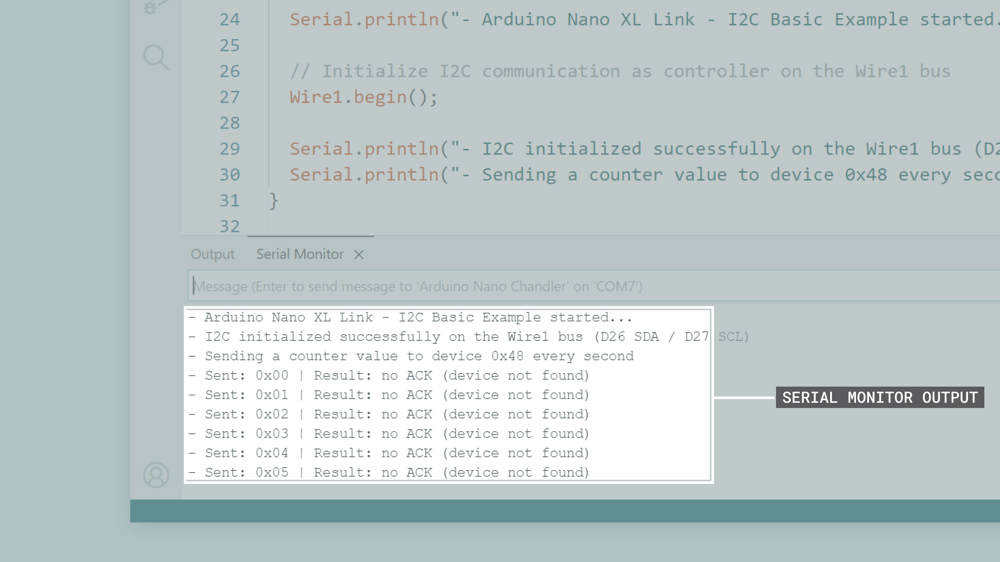

The image below shows how the I²C communication from the example appears in the WaveForms Logic Analyzer, with the decoded protocol showing the device address, the data byte, and the acknowledge bit:

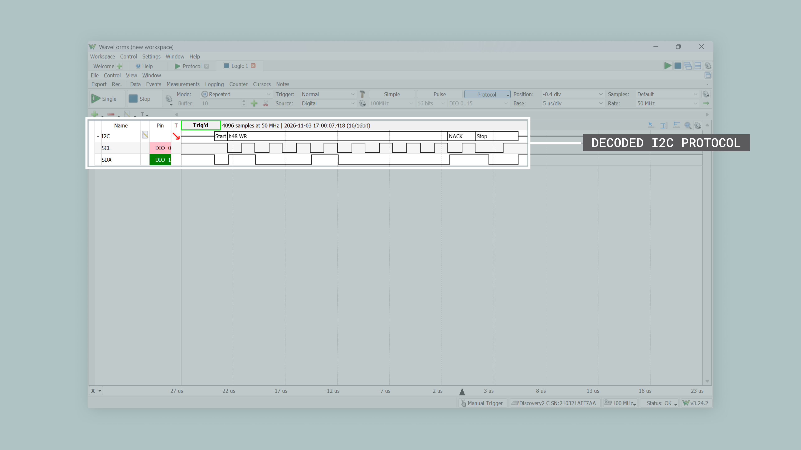

To read data from an I²C device, use `requestFrom()` followed by `available()` and `read()`:

```arduino
// Request 2 bytes from the device
Wire.requestFrom(deviceAddress, 2);

// Read the received bytes
while (Wire.available()) {
  uint8_t data = Wire.read();
  Serial.print("Received: 0x");
  Serial.println(data, HEX);
}
```

The `Wire` bus works in the same way and is the simplest option for Qwiic, STEMMA QT, and Modulino® devices, since the Qwiic connector already includes the pull-up resistors and supplies power to the connected devices:

```arduino
// Qwiic connector example
void setup() {
  Wire.begin();
  Wire.setClock(400000);  // Fast mode (400 kHz)
}

void loop() {
  Wire.beginTransmission(0x3C);
  Wire.write(0x00);
  Wire.endTransmission();

  delay(1000);
}
```

When working with I²C on the Nano XL Link, there are several key points to keep in mind:

- Each I²C device must have a unique address on the bus, so check device datasheets to avoid address conflicts. Devices with the same address can be placed on different buses (`Wire` and `Wire1`).
- I²C is a half-duplex protocol, meaning data flows in only one direction at a time. The controller device (your Nano XL Link) controls the clock line and initiates all communication.
- When connecting multiple devices, connect all `SDA` pins and all `SCL` pins, along with power and ground connections. The Qwiic connector lets you daisy-chain compatible devices directly.
- The Nano XL Link operates at +3.3 VDC, so I²C devices with +5 VDC logic levels require a bidirectional level shifter. Qwiic, STEMMA QT, and Modulino® devices run at +3.3 VDC and can connect directly.
- The board can also act as an I²C target by calling `begin()` with an address and registering the `onReceive()` and `onRequest()` callbacks, which is useful for connecting two boards.

## CAN FD Communication

The Nano XL Link board features a built-in CAN FD (Controller Area Network with Flexible Data-rate) interface that allows your projects to communicate with automotive systems, industrial devices, and other CAN-enabled equipment. Unlike boards that only expose the microcontroller's logic-level CAN signals, the Nano XL Link integrates an onboard CAN FD transceiver, so the `CANH` and `CANL` bus lines are available directly on the board headers, and you can connect to a CAN bus without additional hardware.

CAN is particularly useful when your project needs to communicate in industrial or automotive environments where reliability and noise immunity are critical. While UART excels at simple serial communication and SPI provides high-speed data transfer, CAN offers multi-node networking with built-in error detection, collision handling, and message prioritization. CAN uses differential signaling, making it highly resistant to electromagnetic interference and suitable for harsh environments. CAN FD extends the classic CAN protocol with payloads of up to 64 bytes and a higher bit rate for the data phase of each frame.

The Nano XL Link's CAN FD interface offers the following technical specifications:

|    **Parameter**    |              **Value**               |                **Notes**                 |
|:-------------------:|:------------------------------------:|:----------------------------------------:|
|     Transceiver     |      Texas Instruments TCAN3414      |         Onboard, +3.3 VDC CAN FD         |
|      Protocols      |        Classic CAN, CAN FD           |   Selected with `begin()` or `beginFD()` |
| Arbitration Bitrate |     125, 250, 500 kbps, 1 Mbps       |         `CanBitRate` enumeration         |
|    Data Bitrate     |            Up to 8 Mbps              |   CAN FD data phase, set in `beginFD()`  |
|     Data Length     | 0-8 bytes (CAN), 0-64 bytes (CAN FD) |     `CanMsg` and `CanFDMsg` classes      |
|     Message IDs     |           11-bit, 29-bit             |       Standard and extended format       |
|     Termination     |           120 Ω onboard              |  Solder jumper `SJ1`, closed by default  |
|    Communication    |            Multi-master              |          Multiple nodes support          |

The Nano XL Link board uses the following pins for CAN FD communication:

| **Signal** | **Header Pin** |          **Description**          |
|:----------:|:--------------:|:---------------------------------:|
|   `CANH`   |    `J4-23`     |  CAN bus high differential line   |
|   `CANL`   |    `J4-25`     |  CAN bus low differential line    |

The transceiver is connected internally to the microcontroller's CAN controller (`PB08` as CAN TX and `PB09` as CAN RX); these logic-level signals are not available on the headers.

<Alert type="info">
A CAN bus must be terminated with 120 Ω resistors at both ends. The Nano XL Link includes an onboard 120 Ω termination resistor between `CANH` and `CANL`, connected through the solder jumper `SJ1`, which is closed by default. When you place the board at one end of the bus, leave `SJ1` closed; when you connect the board in the middle of an already terminated bus, open `SJ1` to remove the onboard termination.
</Alert>

You can communicate via CAN using the dedicated `CAN.h` library, which is included in the `Arduino Zephyr` core. The library provides the `CAN` object, with functions to initialize the bus in classic or FD mode, send and receive frames, filter incoming messages by ID, and register a callback that is executed when a frame is received. Classic CAN frames use the `CanMsg` class, and CAN FD frames use the `CanFDMsg` class, which supports payloads of up to 64 bytes.

The following examples show the Nano XL Link exchanging frames with another node on the bus. The second node can be another Nano XL Link, any CAN device operating at the same bitrate, or a USB-CAN adapter connected to a computer, as in this section: the board sends a counter value every second, and the adapter receives it. The adapter sends a frame that the board receives and prints to the Serial Monitor. Upload the first sketch to send frames from the board:

```arduino
/**
CAN Write Example for the Arduino Nano XL Link Board
Name: nano_xl_link_can_write.ino
Purpose: This sketch demonstrates how to send CAN frames
with a counter value every second.

@author Arduino Product Experience Team
@version 1.0 04/11/26
*/

#include <CAN.h>

// CAN message ID (11-bit standard identifier)
const uint32_t canId = 0x123;

// Counter value to send
uint8_t counter = 0;

void setup() {
  // Initialize serial communication and wait up to 2.5 seconds for a connection
  Serial.begin(115200);
  for (auto startNow = millis() + 2500; !Serial && millis() < startNow; delay(500));

  Serial.println("- Arduino Nano XL Link - CAN Write Example started...");

  // Initialize the CAN bus at 500 kbps (classic CAN)
  if (!CAN.begin(CanBitRate::BR_500k)) {
    Serial.println("- Error: failed to initialize the CAN bus!");
    while (1) delay(10);
  }

  Serial.println("- CAN bus initialized at 500 kbps");
  Serial.println("- Sending a counter value with ID 0x123 every second");
}

void loop() {
  // Build the message: counter in the first byte, rest filled with zeros
  uint8_t data[8] = {counter, 0, 0, 0, 0, 0, 0, 0};
  CanMsg msg(CanStandardId(canId), sizeof(data), data);

  // Send the message
  int result = CAN.write(msg);
  if (result == 1) {
    Serial.print("- CAN message sent: ");
    Serial.println(msg);
  } else {
    Serial.print("- Error: failed to send CAN message, code ");
    Serial.println(result);
  }

  // Increment counter and wrap around at 255
  counter++;

  delay(1000);
}
```

Upload the second sketch to receive frames on the board:

```arduino
/**
CAN Read Example for the Arduino Nano XL Link Board
Name: nano_xl_link_can_read.ino
Purpose: This sketch demonstrates how to receive CAN frames
and print them to the Serial Monitor.

@author Arduino Product Experience Team
@version 1.0 04/11/26
*/

#include <CAN.h>

void setup() {
  // Initialize serial communication and wait up to 2.5 seconds for a connection
  Serial.begin(115200);
  for (auto startNow = millis() + 2500; !Serial && millis() < startNow; delay(500));

  Serial.println("- Arduino Nano XL Link - CAN Read Example started...");

  // Initialize the CAN bus at 500 kbps (classic CAN)
  if (!CAN.begin(CanBitRate::BR_500k)) {
    Serial.println("- Error: failed to initialize the CAN bus!");
    while (1) delay(10);
  }

  // Configure the built-in LED to blink on each received message
  pinMode(LED_BUILTIN, OUTPUT);

  Serial.println("- CAN bus initialized at 500 kbps");
  Serial.println("- Waiting for CAN messages...");
}

void loop() {
  // Check for incoming CAN messages
  if (CAN.available()) {
    CanMsg msg = CAN.read();

    // Print the message (ID, length and data)
    Serial.print("- CAN message received: ");
    Serial.println(msg);

    // Blink the built-in LED
    digitalWrite(LED_BUILTIN, HIGH);
    delay(50);
    digitalWrite(LED_BUILTIN, LOW);
  }
}
```

To test these examples, connect the Nano XL Link board to a USB-CAN adapter as follows:

- Connect the `CANH` pin of the board to the `CANH` terminal of the adapter
- Connect the `CANL` pin of the board to the `CANL` terminal of the adapter
- Connect a `GND` pin of the board to the `GND` terminal of the adapter
- Keep the `SJ1` jumper closed on the board and enable the termination resistor of the adapter, so the bus is terminated at both ends

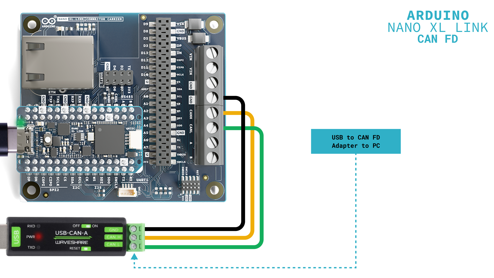

<Alert type="info">
You can make the connections above through the screw terminals of the Nano Connector Carrier (our recommended way) or with jumper wires from the board's header pins. The examples in this section were tested with a [Waveshare USB-CAN-A](https://www.waveshare.com/wiki/USB-CAN-A) adapter and its configuration tool, set to normal mode, standard frames, and 500 kbps. You can use any CAN adapter or device configured with the same bitrate. A CAN frame is only transmitted successfully when another node on the bus acknowledges it, so a single Nano XL Link connected to nothing cannot be used to test the examples.
</Alert>

With the first sketch running, open the Arduino IDE's Serial Monitor (Tools > Serial Monitor) to see each transmitted message, and the adapter's software to see the frames received with ID `0x123` and the counter value in the first data byte:

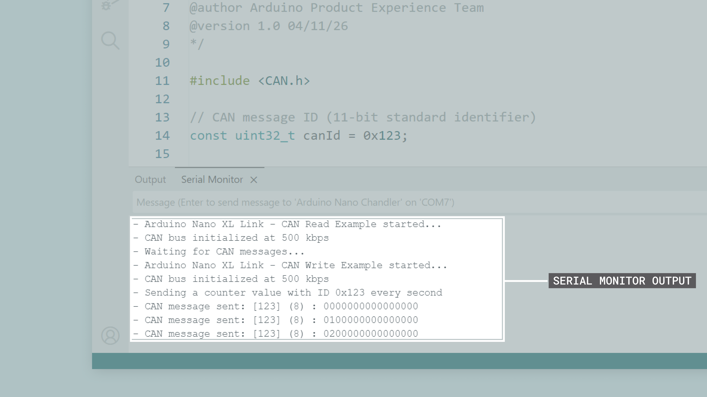

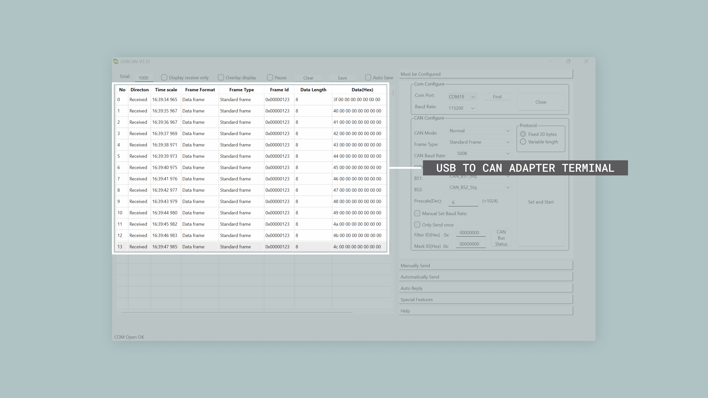

With the second sketch running, send a frame from the adapter's software (for example, ID `0x456` with data `01 02 03 04`). The Serial Monitor shows the received message and the built-in LED blinks:

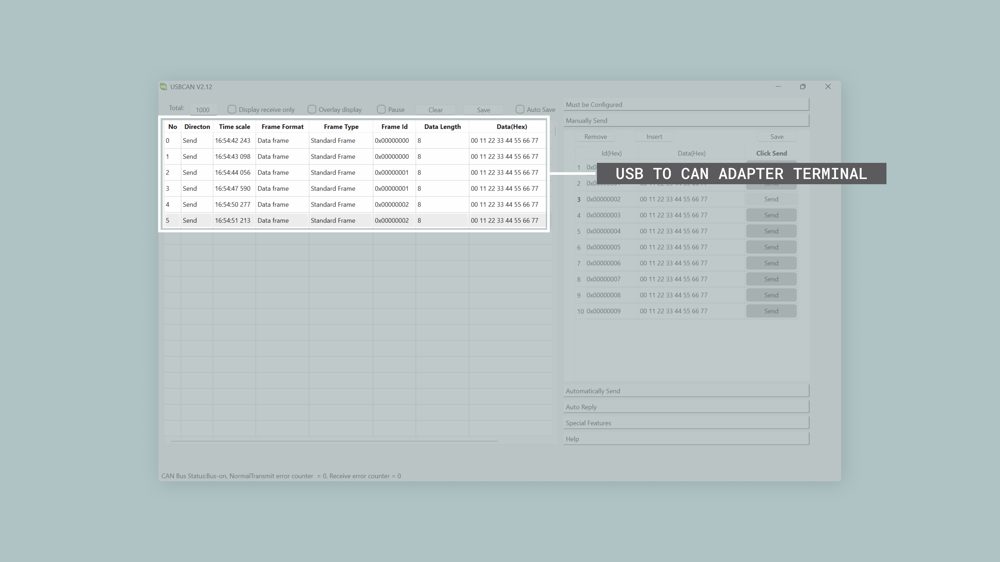

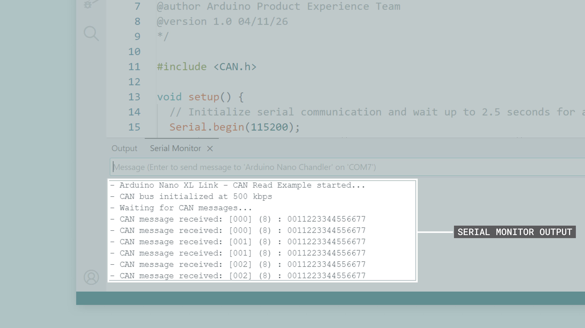

To use CAN FD instead of classic CAN, replace `begin()` with `beginFD()`, which takes the arbitration bitrate and the data bitrate, and use the `CanFDMsg` class, `writeFD()`, and `readFD()`:

```arduino
// Initialize the CAN bus in FD mode: 500 kbps arbitration, 2 Mbps data
if (!CAN.beginFD(CanBitRate::BR_500k, 2000000)) {
  Serial.println("- Error: failed to initialize the CAN FD bus!");
  while (1) delay(10);
}

// Send a 16-byte CAN FD frame
uint8_t data[16] = {0xCA, 0xFE, 0, 0, 0, 0, 0, 0, 0, 0, 0, 0, 0, 0, 0, 0};
CanFDMsg msg(CanStandardId(0x123), sizeof(data), data);
CAN.writeFD(msg);

// Receive a CAN FD frame
if (CAN.available()) {
  CanFDMsg msg = CAN.readFD();
  Serial.println(msg);
}
```

<Alert type="info">
All nodes on a CAN FD bus must support CAN FD and use the same arbitration and data bitrates. Many low-cost USB-CAN adapters, including the one used in this section, support only classic CAN.
</Alert>

The library can also filter incoming messages by ID and deliver them through a callback instead of polling. Filters must be configured before calling `begin()` or `beginFD()`:

```arduino
// Accept only messages with the standard ID 0x123
CAN.addReceiveFilter(0x123, 0x7FF, false);

// Callback executed for each received message
void onCanMessage(CanFDMsg const &msg, void *user_data) {
  Serial.print("- Received: ");
  Serial.println(msg);
}

// Register the callback after begin()
CAN.onReceive(onCanMessage);
```

When working with CAN on the Nano XL Link, there are several key points to keep in mind:

- All nodes on the bus must use the same bitrate (and the same data bitrate in CAN FD mode). A node with a different bitrate will generate errors and can disturb the whole bus.
- A CAN frame is only transmitted successfully when at least one other node acknowledges it. A single board connected to nothing will keep retransmitting the frame and `write()` will not complete; always test with another node on the bus, such as a second board or a USB-CAN adapter.
- CAN uses message-based communication with unique identifiers rather than device addresses. Lower ID numbers have higher priority, so critical messages should use lower IDs.
- When a receive callback is registered with `onReceive()`, incoming messages are delivered only to the callback and no longer to `available()` and `read()`. Call `clearReceiveCallback()` to return to polling.
- The library tracks one standard-ID filter and one extended-ID filter; if no filter is configured, all messages are accepted.
- The Nano XL Link supports both standard (11-bit) and extended (29-bit) CAN identifiers, allowing compatibility with most automotive and industrial CAN networks.

## RS-485 Communication

The Nano XL Link board features a built-in RS-485 interface that allows your projects to communicate with industrial equipment, sensors, and controllers over long distances and in electrically noisy environments. The board integrates an onboard RS-485 transceiver connected to one of the microcontroller's hardware UART ports, so the `A` and `B` bus lines are available directly on the board headers, and you don't need an external transceiver.

RS-485 is particularly useful when your project needs serial communication over distances beyond what the TTL UART pins allow. While UART signals on the board headers are limited to a few meters, RS-485 uses differential signaling over a twisted pair to reach distances of up to 1200 m and to connect up to 32 devices on the same bus. It is the physical layer for protocols widely used in industrial automation and building automation, such as Modbus RTU, making the Nano XL Link suitable for reading industrial sensors, controlling actuators, and integrating with PLCs and HMIs.

The Nano XL Link's RS-485 interface offers the following technical specifications:

|   **Parameter**   |          **Value**         |                **Notes**                |
|:-----------------:|:--------------------------:|:---------------------------------------:|
|    Transceiver    | Texas Instruments THVD2410 |         Onboard, surge-protected        |
|   Communication   |         Half-duplex        |  One direction at a time, two-wire bus  |
|    Serial Port    |          `Serial3`         |   Internal, used by the RS-485 library  |
| Direction Control |   `D42` (DE), `D43` (RE)   | Internal, handled by the RS-485 library |
|     Baud Rates    |       Up to 500 kbps       |      Transceiver maximum data rate      |
|    Termination    |        120 Ω onboard       |  Solder jumper `SJ2`, closed by default |
|    Bus Devices    |          Up to 32          |        Standard RS-485 unit loads       |

The Nano XL Link board uses the following pins for RS-485 communication:

| **Signal** | **Header Pin** |              **Description**               |
|:----------:|:--------------:|:------------------------------------------:|
|    `A`     |    `J4-27`     |    RS-485 non-inverting differential line  |
|    `B`     |    `J4-29`     |     RS-485 inverting differential line     |

The transceiver connects internally to the microcontroller's `Serial3` port, with the driver enable (`DE`) and receiver enable (`RE`) control lines on the internal pins `D42` and `D43`. **These signals are not available on the headers and are managed automatically by the RS-485 library**.

<Alert type="info">
An RS-485 bus must be terminated with 120 Ω resistors at both ends. The Nano XL Link includes an onboard 120 Ω termination resistor between `A` and `B`, connected through the solder jumper `SJ2`, which is closed by default. When you place the board at one end of the bus, leave `SJ2` closed; when you connect the board in the middle of an already terminated bus, open `SJ2` to remove the onboard termination.
</Alert>

You can communicate via RS-485 using the `ArduinoRS485` library, which can be installed from the Arduino IDE's Library Manager (search for `ArduinoRS485`). The library provides the `RS485` object, which on the Nano XL Link is already configured to use `Serial3` and the onboard transceiver's control lines. The `RS485` object works like a serial port, with `beginTransmission()` and `endTransmission()` to switch the transceiver to transmit mode around the data you send, and `receive()` and `noReceive()` to turn the receiver on or off.

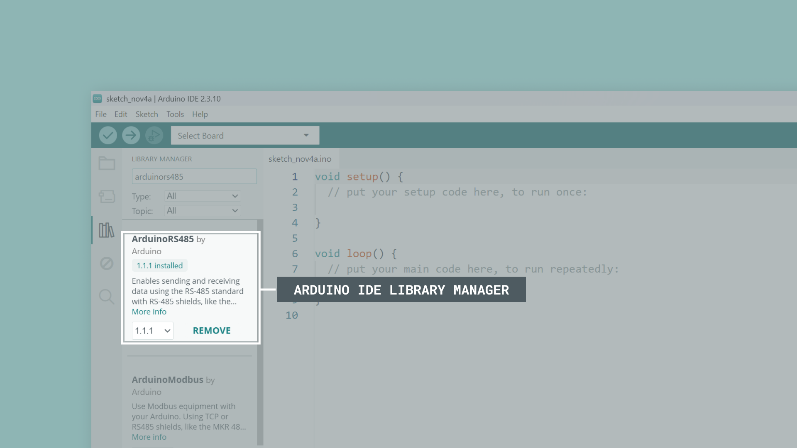

The following example sends a counter value over the RS-485 bus every second and prints to the Serial Monitor any data received from the bus:

```arduino
/**
RS-485 Basic Example for the Arduino Nano XL Link Board
Name: nano_xl_link_rs485_basic.ino
Purpose: This sketch demonstrates basic RS-485 communication
by sending a counter value every second and printing received data.

@author Arduino Product Experience Team
@version 1.0 04/11/26
*/

#include <ArduinoRS485.h>

// Counter value to send
unsigned int counter = 0;

void setup() {
  // Initialize serial communication and wait up to 2.5 seconds for a connection
  Serial.begin(115200);
  for (auto startNow = millis() + 2500; !Serial && millis() < startNow; delay(500));

  Serial.println("- Arduino Nano XL Link - RS-485 Basic Example started...");

  // Initialize the RS-485 interface at 9600 baud
  RS485.begin(9600);

  // Enable the receiver
  RS485.receive();

  Serial.println("- RS-485 initialized at 9600 baud");
  Serial.println("- Sending a counter value every second");
  Serial.println("- Type messages in the Serial Monitor to send them via RS-485");
}

void loop() {
  // Forward data from USB Serial (computer) to the RS-485 bus
  if (Serial.available()) {
    String message = Serial.readString();

    // Remove newline characters
    message.trim();

    if (message.length() > 0) {
      RS485.beginTransmission();
      RS485.println(message);
      RS485.endTransmission();

      Serial.print("- Message sent via RS-485: \"");
      Serial.print(message);
      Serial.println("\"");
    }
  }

  // Forward data received from the RS-485 bus to USB Serial
  if (RS485.available()) {
    String response = RS485.readString();

    // Remove newline characters
    response.trim();

    if (response.length() > 0) {
      Serial.print("- RS-485 received: \"");
      Serial.print(response);
      Serial.println("\"");
    }
  }

  // Send the counter value every second
  static unsigned long lastSend = 0;
  if (millis() - lastSend > 1000) {
    lastSend = millis();

    RS485.beginTransmission();
    RS485.print("Counter: ");
    RS485.println(counter);
    RS485.endTransmission();

    Serial.print("- Counter value sent via RS-485: ");
    Serial.println(counter);

    counter++;
  }

  delay(10);
}
```

To test this example, connect the Nano XL Link board to a USB-RS485 adapter as follows:

- Connect the `A` pin of the board to the `A+` terminal of the adapter
- Connect the `B` pin of the board to the `B-` terminal of the adapter
- Connect a `GND` pin of the board to the `GND` terminal of the adapter
- Keep the `SJ2` jumper closed on the board; the adapter includes its own 120 Ω termination resistor, so the bus is terminated at both ends

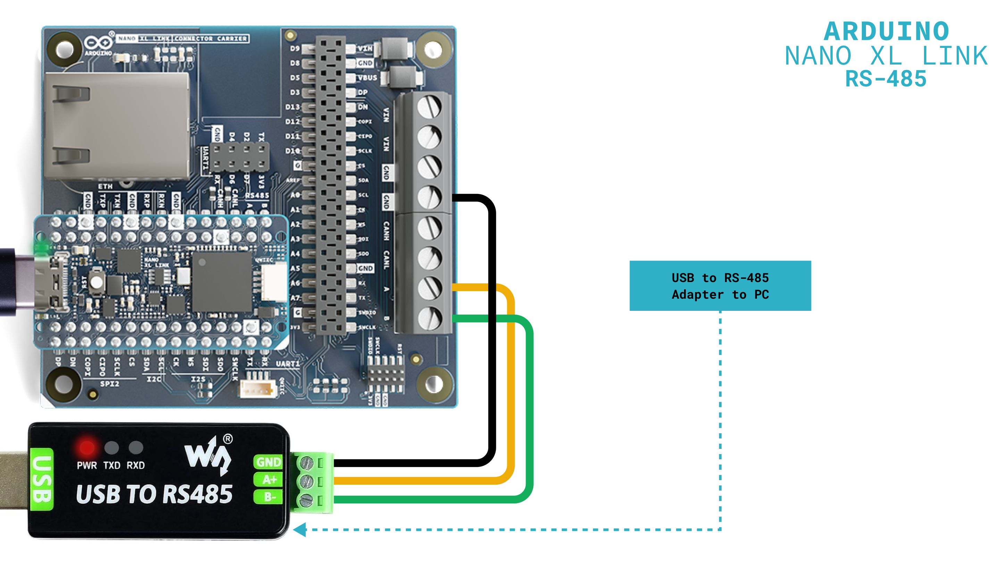

<Alert type="info">
You can make the connections above through the screw terminals of the Nano Connector Carrier (our recommended way) or with jumper wires from the board's header pins. The example in this section was tested with a [Waveshare USB TO RS485](https://www.waveshare.com/wiki/USB_TO_RS485) adapter, which appears on the computer as a standard serial port and handles the transmit/receive switching automatically. Any RS-485 device configured with the same serial settings (9600 baud, 8 data bits, no parity, 1 stop bit) can be used instead, including a second Nano XL Link running the same sketch. If no data is received, swap the `A` and `B` connections: the labeling of RS-485 lines is not consistent between manufacturers.
</Alert>

Open the Arduino IDE's Serial Monitor (Tools > Serial Monitor) and a serial terminal connected to the adapter's COM port at 9600 baud. The terminal shows the counter messages sent by the board every second and any text typed in the Serial Monitor, while text typed in the terminal appears in the Serial Monitor as data received by the board:

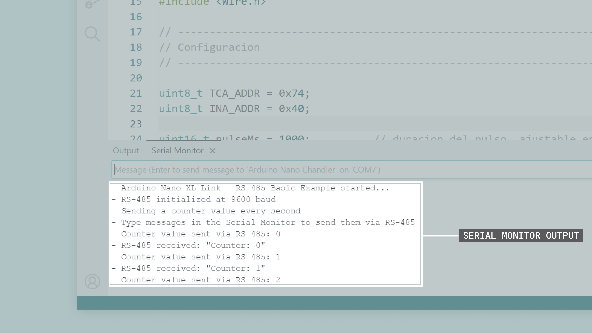

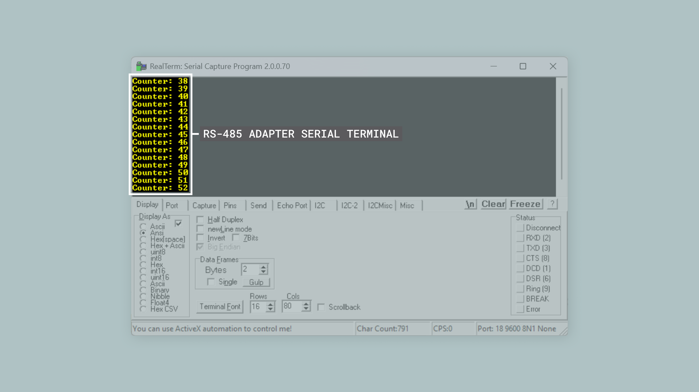

<Alert type="info">
RS-485 is the physical layer of the Modbus RTU protocol, used by many industrial sensors, meters, and controllers. Modbus RTU frames can be sent and received with the `RS485` object following the protocol specification, or with a Modbus library compatible with the `ArduinoRS485` library and the `Arduino Zephyr` core.
</Alert>

When working with RS-485 on the Nano XL Link, there are several key points to keep in mind:

- RS-485 on the Nano XL Link is half-duplex: the bus carries data in one direction at a time. Always wrap the data you send between `beginTransmission()` and `endTransmission()`, so the transceiver's driver is enabled only while transmitting and the bus is free for other devices the rest of the time.
- All devices on the bus must use the same baud rate, data bits, parity, and stop bits.
- For long cables or noisy environments, use a twisted pair for `A` and `B`, and connect the ground reference of all devices when possible to keep the common-mode voltage within the transceiver's limits.
- Terminate the bus at both ends only. Additional termination resistors in the middle of the bus load the drivers and reduce the signal amplitude.
- `Serial3` is reserved for the RS-485 transceiver; do not use it directly in sketches that use the `ArduinoRS485` library.

## Ethernet Communication

The Nano XL Link board features a built-in 10/100 Mbps Ethernet interface that allows your projects to connect to local networks and the Internet with a wired, reliable connection. The board integrates an onboard Ethernet PHY connected to the microcontroller's Ethernet controller, so the only external components needed are the magnetics and the RJ45 connector, which the Nano Connector Carrier provides.

Ethernet is particularly useful when your project needs a stable, low-latency network connection in industrial or building environments, where wireless connectivity may be unreliable or not allowed. With Ethernet, the Nano XL Link can act as a web server for monitoring and control, publish data to cloud services, communicate with other devices through TCP or UDP, or integrate with industrial protocols such as Modbus TCP.

The Nano XL Link's Ethernet interface offers the following technical specifications:

|   **Parameter**  |              **Value**             |                **Notes**                |
|:----------------:|:----------------------------------:|:---------------------------------------:|
|        PHY       |       Microchip KSZ8081RNAIA       |     Onboard, industrial temperature     |
|       Speed      |             10/100 Mbps            |   Auto-negotiation enabled by default   |
|   Network Stack  |          Zephyr native IP          |     IPv4, TCP, UDP, DHCP client, DNS    |
| IP Configuration |           DHCP or static           |            Set with `begin()`           |
|     Connector    | RJ45 on the Nano Connector Carrier |  Magnetics and connector on the carrier |
|   Activity LED   |          `LED_ACT` signal          | Driven by the PHY, available on `J4-19` |

The Nano XL Link board uses the following pins for Ethernet communication:

|  **Signal**  | **Header Pin** |           **Description**           |
|:------------:|:--------------:|:-----------------------------------:|
|  `ETH_TX_P`  |     `J4-7`     |   Transmit differential pair (+)    |
|  `ETH_TX_N`  |     `J4-9`     |   Transmit differential pair (-)    |
|  `ETH_RX_P`  |    `J4-13`     |    Receive differential pair (+)    |
|  `ETH_RX_N`  |    `J4-15`     |    Receive differential pair (-)    |
|  `LED_ACT`   |    `J4-19`     |     Link/activity LED output        |

The PHY is connected internally to the microcontroller through an RMII interface, and its reset and interrupt lines use the internal pins `D37` and `D36`. The Ethernet driver manages these signals, and they are not available on the headers.

<Alert type="warning">
The Ethernet signals on the headers are the PHY's differential pairs and must connect to an RJ45 connector with integrated magnetics. Do not connect them directly to an Ethernet cable. The Nano Connector Carrier provides the RJ45 connector and magnetics, so you can connect the board to a network with a standard Ethernet cable when mounted on the carrier.
</Alert>

You can communicate via Ethernet using the dedicated `Ethernet` library, which is included in the `Arduino Zephyr` core. The library provides the `Ethernet` object to configure the network interface, and the `EthernetClient` and `ZephyrServer` classes to open TCP connections and accept incoming ones, using the same API as the Ethernet libraries on other Arduino boards. UDP communication is available through the `EthernetUDP` class.

The following example connects the board to the network using DHCP and prints the network configuration to the Serial Monitor:

```arduino
/**
Ethernet DHCP Example for the Arduino Nano XL Link Board
Name: nano_xl_link_ethernet_dhcp.ino
Purpose: This sketch demonstrates how to connect the board to a
network using DHCP and print its network configuration.

@author Arduino Product Experience Team
@version 1.0 04/11/26
*/

#include <ZephyrEthernet.h>

void setup() {
  // Initialize serial communication and wait up to 2.5 seconds for a connection
  Serial.begin(115200);
  for (auto startNow = millis() + 2500; !Serial && millis() < startNow; delay(500));

  Serial.println("- Arduino Nano XL Link - Ethernet DHCP Example started...");

  // Check that the Ethernet hardware is present
  if (Ethernet.hardwareStatus() == EthernetNoHardware) {
    Serial.println("- Error: Ethernet hardware not found!");
    while (1) delay(10);
  }

  // Wait for the Ethernet cable to be connected
  Serial.println("- Waiting for the Ethernet link...");
  while (Ethernet.linkStatus() != LinkON) {
    delay(100);
  }
  Serial.println("- Ethernet link is up");

  // Request an IP address from the DHCP server
  Serial.println("- Requesting an IP address via DHCP...");
  if (Ethernet.begin() == 0) {
    Serial.println("- Error: failed to configure Ethernet using DHCP!");
    while (1) delay(10);
  }

  // Print the network configuration
  uint8_t mac[6];
  Ethernet.MACAddress(mac);

  Serial.print("- MAC address: ");
  for (int i = 0; i < 6; i++) {
    if (mac[i] < 16) Serial.print("0");
    Serial.print(mac[i], HEX);
    if (i < 5) Serial.print(":");
  }
  Serial.println();

  Serial.print("- IP address: ");
  Serial.println(Ethernet.localIP());
  Serial.print("- Subnet mask: ");
  Serial.println(Ethernet.subnetMask());
  Serial.print("- Gateway: ");
  Serial.println(Ethernet.gatewayIP());
  Serial.print("- DNS server: ");
  Serial.println(Ethernet.dnsServerIP());
}

void loop() {
  // Report the link status every 5 seconds
  static unsigned long lastCheck = 0;
  if (millis() - lastCheck > 5000) {
    lastCheck = millis();

    Serial.print("- Link status: ");
    Serial.println(Ethernet.linkStatus() == LinkON ? "ON" : "OFF");
  }

  delay(10);
}
```

To test this example, mount the Nano XL Link board on the Nano Connector Carrier and connect an Ethernet cable from the carrier's RJ45 connector to a router or switch with a DHCP server (most home and office networks provide one).

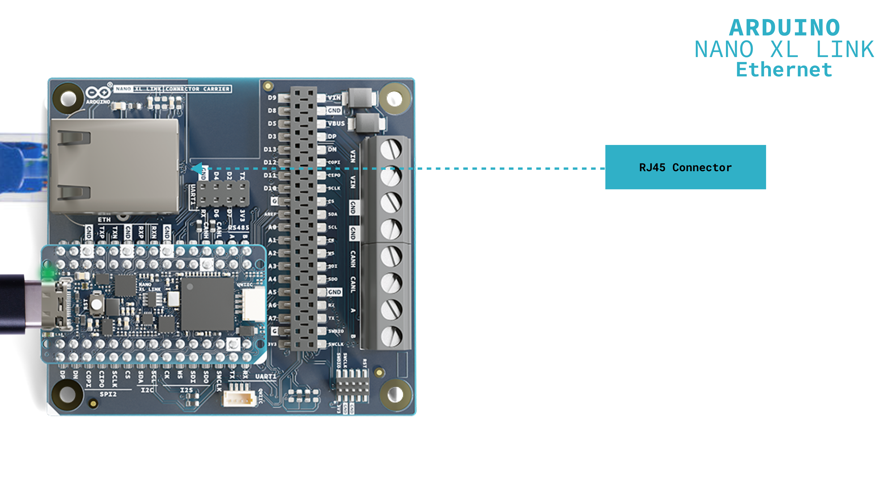

Open the Arduino IDE's Serial Monitor (Tools > Serial Monitor) to see the network configuration assigned by the DHCP server and the link status updates:

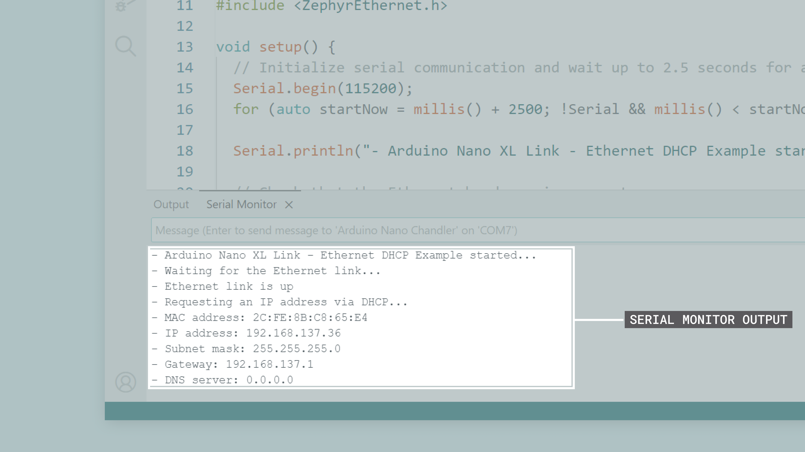

To use a static IP address instead of DHCP, call `begin()` with the IP address, DNS server, gateway, and subnet mask:

```arduino
// Static IP configuration (adapt the values to your network)
IPAddress ip(192, 168, 1, 177);
IPAddress dns(192, 168, 1, 1);
IPAddress gateway(192, 168, 1, 1);
IPAddress subnet(255, 255, 255, 0);

Ethernet.begin(ip, dns, gateway, subnet);
```

The following example turns the Nano XL Link into a simple web server. When a browser on the same network opens the board's IP address, the board responds with a page showing its uptime and the values of its analog inputs, refreshed every five seconds:

```arduino
/**
Ethernet Web Server Example for the Arduino Nano XL Link Board
Name: nano_xl_link_ethernet_web_server.ino
Purpose: This sketch demonstrates how to run a simple web server
that shows the board's uptime and analog input values.

@author Arduino Product Experience Team
@version 1.0 04/11/26
*/

#include <ZephyrEthernet.h>
#include <ZephyrServer.h>
#include <ZephyrClient.h>

// Web server on port 80 (HTTP)
ZephyrServer server(80);

void setup() {
  // Initialize serial communication and wait up to 2.5 seconds for a connection
  Serial.begin(115200);
  for (auto startNow = millis() + 2500; !Serial && millis() < startNow; delay(500));

  Serial.println("- Arduino Nano XL Link - Ethernet Web Server Example started...");

  // Wait for the Ethernet cable to be connected
  Serial.println("- Waiting for the Ethernet link...");
  while (Ethernet.linkStatus() != LinkON) {
    delay(100);
  }

  // Request an IP address from the DHCP server
  if (Ethernet.begin() == 0) {
    Serial.println("- Error: failed to configure Ethernet using DHCP!");
    while (1) delay(10);
  }

  // Start the web server
  server.begin();

  Serial.print("- Web server started at http://");
  Serial.println(Ethernet.localIP());
}

void loop() {
  // Wait for an incoming client connection
  ZephyrClient client = server.accept();

  if (client) {
    Serial.println("- New client connected");

    // Read the HTTP request until the empty line that ends the header
    bool currentLineIsBlank = true;
    while (client.connected()) {
      if (client.available()) {
        char c = client.read();

        if (c == '\n' && currentLineIsBlank) {
          // Request complete, send the HTTP response
          client.println("HTTP/1.1 200 OK");
          client.println("Content-Type: text/html");
          client.println("Connection: close");
          client.println("Refresh: 5");
          client.println();
          client.println("<!DOCTYPE HTML>");
          client.println("<html>");
          client.println("<h1>Arduino Nano XL Link</h1>");

          // Uptime in seconds
          client.print("<p>Uptime: ");
          client.print(millis() / 1000);
          client.println(" s</p>");

          // Analog input values
          for (int channel = 0; channel < 8; channel++) {
            client.print("<p>A");
            client.print(channel);
            client.print(": ");
            client.print(analogRead(A0 + channel));
            client.println("</p>");
          }

          client.println("</html>");
          break;
        }

        if (c == '\n') {
          // New line received
          currentLineIsBlank = true;
        } else if (c != '\r') {
          // Character received on the current line
          currentLineIsBlank = false;
        }
      }
    }

    // Give the browser time to receive the data, then close the connection
    delay(1);
    client.stop();
    Serial.println("- Client disconnected");
  }
}
```

Open the Arduino IDE's Serial Monitor (Tools > Serial Monitor) to see the address assigned to the board, then open that address in a web browser on a computer connected to the same network. The page shows the board's uptime and analog values, and updates automatically every five seconds:

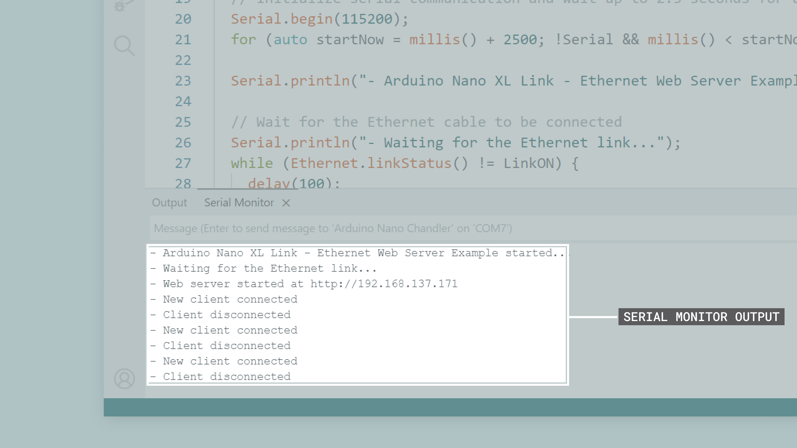

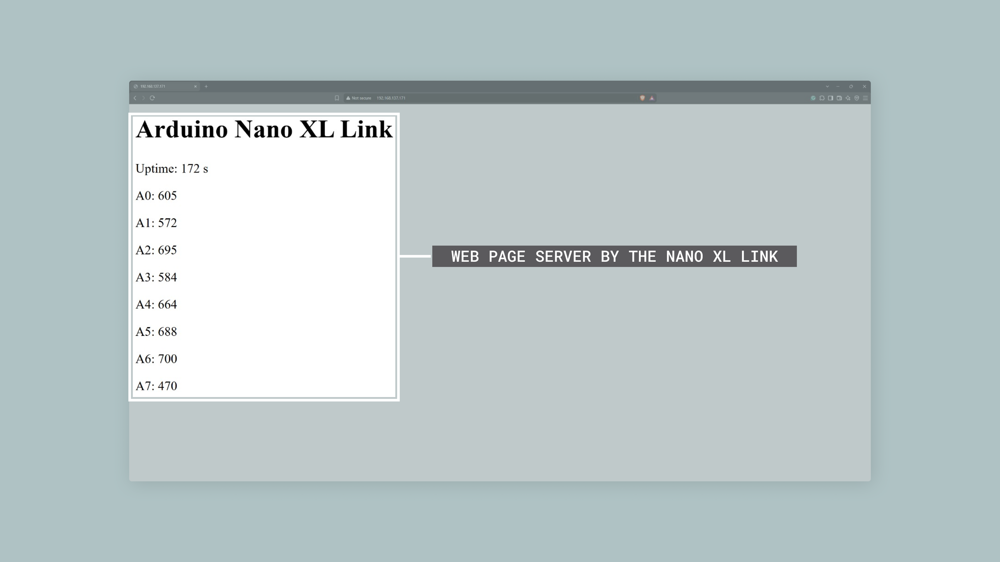

<Alert type="info">
If the page does not load, **make sure that the computer and the board are on the same network and subnet, and that the network does not isolate wired clients from each other**. The board's IP address can change between power cycles when using DHCP; for permanent installations, use a static IP address or a DHCP reservation in your router.
</Alert>

When working with Ethernet on the Nano XL Link, there are several key points to keep in mind:

- Always check `linkStatus()` before calling `begin()`. With DHCP, `begin()` waits for an address for up to 10 seconds and returns 0 if no DHCP server responds.
- The board uses a default MAC address provided by the core. To use a specific MAC address, for example in networks with address filtering, pass it as the first argument of `begin()`.
- The Ethernet library uses the Zephyr network stack. The `EthernetClient` and `EthernetUDP` classes are compatible with most Arduino libraries that accept a `Client` or `UDP` object, such as `ArduinoHttpClient`, `ArduinoMqttClient`, and `ArduinoModbus` (Modbus TCP).
- The `LED_ACT` signal on `J4-19` is driven by the PHY to indicate link and activity, and is used by the Nano Connector Carrier for the LED of its RJ45 connector.

## Bootloader

The Nano XL Link board includes a built-in bootloader that lets you upload sketches directly from the Arduino IDE without external programming hardware. The bootloader is based on MCUboot, a secure bootloader for microcontrollers, and is stored in a protected area of the PIC32CK microcontroller's flash memory. It runs each time the board powers on or resets, and manages the communication between your computer and the board during sketch uploads.

During normal operation, when you upload a sketch, the Arduino IDE asks the board to restart into the bootloader, transfers the new program over the USB-C connection, and restarts the board to run it. This process is automatic and transparent, so you can focus on developing your projects rather than managing low-level programming details.

### Understanding the Bootloader Operation

When the Nano XL Link board resets or powers on, the bootloader performs the following sequence:

1. **Initialization**: MCUboot starts and checks whether it has been asked to enter recovery mode
2. **Recovery check**: If a recovery request is found, the bootloader stays in recovery mode and waits for a new sketch over USB
3. **Program execution**: Otherwise, it verifies the installed program and starts it

The recovery request can be triggered in two ways, which produce the same result:

- **Automatically by the Arduino IDE**: During an upload, the IDE opens the board's serial port at 1200 bps (the "1200 bps touch"); the sketch detects this and restarts the board into recovery mode
- **Manually by the user**: Pressing the `RESET` button twice quickly (double-tap) restarts the board into recovery mode

<Alert type="info">
The double-tap reset is useful when a sketch prevents the Arduino IDE from restarting the board automatically, for example, because it turns off the USB serial port, crashes shortly after starting, or keeps the microcontroller busy. After the double-tap, the board waits in recovery mode until you upload a new sketch, and you can upload normally from the IDE.
</Alert>

### Technical Specifications

The Nano XL Link's bootloader offers the following technical specifications:

| **Parameter** |              **Value**             |                **Notes**               |
|:-------------:|:----------------------------------:|:--------------------------------------:|
|   Bootloader  |               MCUboot              |  Stored in the boot flash memory (BFM) |
| Upload Method |       USB serial (MCUmgr SMP)      |       Through the USB-C connector      |
| Recovery Mode | 1200 bps touch, double-tap `RESET` |   Both enter MCUboot serial recovery   |
| Sketch Memory |               728 KB               | Flash partition available for sketches |

<Alert type="warning">
Never disconnect the USB cable or remove power during a sketch upload. An interrupted upload can leave the board without a valid program; in that case, use the double-tap reset to enter recovery mode and upload the sketch again.
</Alert>

### Maintaining Bootloader Health

To minimize the risk of problems and ensure reliable operation, we recommend the following:

- **Always allow uploads to complete**: Never disconnect the USB cable or remove power during sketch uploads
- **Use quality USB cables**: Poor quality or damaged cables can cause communication errors
- **Ensure stable power**: Use a reliable power source when uploading sketches
- **Keep the core updated**: Newer versions of the `Arduino Zephyr` core include improvements to the bootloader and the upload process
- **Handle the board carefully**: Avoid static discharge and physical damage to the board

## Support

If you encounter any issues or have questions while working with your Nano XL Link board, we provide various support resources to help you find answers and solutions.

### Help Center

Explore our Help Center, which offers a collection of articles and guides for Nano family boards. The Help Center is designed to provide in-depth technical assistance and help you make the most of your device.

- [Nano family help center page](https://support.arduino.cc/hc/en-us/sections/360004605400-Nano-Family)

### Forum

Join our community forum to connect with other Nano family board users, share your experiences, and ask questions. The forum is an excellent place to learn from others, discuss issues, and discover new ideas and projects related to the Nano XL Link.

- [Nano category in the Arduino Forum](https://forum.arduino.cc/c/official-hardware/nano-family/87)

### Contact Us

Please get in touch with our support team if you need personalized assistance or have questions not covered by the help and support resources described before. We're happy to help you with any issues or inquiries about the Nano family boards.

- [Contact us page](https://www.arduino.cc/en/contact-us/)