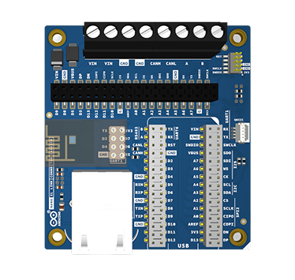

# Description

The Nano XL Link Connector Carrier is a practical solution for expanding the capabilities of the Nano XL Link development board.

Whether you are working on complex communication networks, developing control applications, or building robust solutions, this carrier exposes all extended connections of the Nano XL form factor via pin headers and screw terminals. This provides a simple and straightforward platform to bring your ideas to life.

The hardware integrates an RJ45 Ethernet port, along with dedicated connections for RS485 and CAN bus, unlocking new possibilities for automation, data acquisition, and real-time industrial communication needs.

# Target Areas:

Industrial Automation, Production-Ready Solutions, Industrial Communication, Research and Development

# CONTENTS

## Application Examples

**Industrial Automation & Production-Ready Solutions:** 
- **Heavy Machinery Control:** Use the integrated CAN bus to establish reliable communication with engine control units and industrial PLCs. In addition, the onboard screw terminals ensure that field wiring withstands high-vibration environments, allowing your system to transition from a testing environment to a final deployment without needing custom hardware.
- **Distributed Sensor Networks:** Create robust data acquisition systems using the RS485 communication interface. This topology is ideal for transmitting telemetry over long distances across a production floor, offering high electrical noise immunity for the secure monitoring of assembly lines.

**Industrial Communication:**
- **Wired IoT Gateway:** Transform the Nano XL Link into a powerful data bridge using the RJ45 Ethernet port. The *carrier* can collect local real-time data from modules connected via the Qwiic or CAN bus connector and transmit it securely over a local wired network, facilitating integration with SCADA systems or cloud analytics servers without relying on wireless connections.
- **Wireless Hub:** Communicate wirelessly using a WiFi module connected to the *carrier* and expand your sensor network in hard-to-reach areas. By leveraging the dedicated 2x4-pin female header for modules like the ESP8266 (ESP-01), you can build an IoT control hub that collects local data and transmits it to the cloud or SCADA systems, all without the need to install additional wiring infrastructure.

**Research and Development:**
- **Advanced Rapid Prototyping:** Accelerate design and validation cycles in the lab. The *carrier* not only exposes all board connections through standard headers, but also includes a JTAG connector. This provides hardware and software engineers with deep access for low-level debugging and programming of new technological concepts prior to mass production.

## Features
### General Specifications Overview

The main features of the Nano XL Link Connector Carrier are detailed in the table shown below.

| **Feature**            | **Description**                                                                                                                                                                                    |
| ---------------------- | -------------------------------------------------------------------------------------------------------------------------------------------------------------------------------------------------- |
| Interfaces             | 1x Qwiic I2C Connector  1x Ethernet RJ45 Connector  1x WiFi Module ESP-01 Connector  1x SWD/JTAG 2x5 1.27mm Connector  1x Screw Terminals block (RS485, CAN, Power IN) |
| Dimensions             | 66 mm x 71.8 mm                                                                                                                                                                                    |
| Operating Temperatures | -40 °C to +85 °C                                                                                                                                                                                   |

### Qwiic I2C Connector

The Qwiic I2C connector (J7) is connected to the standard I2C bus on the board. It is powered via the +3.3 V output line, following the standard Qwiic ecosystem to allow seamless plug-and-play integration with a wide variety of external I2C sensors and modules.

### Breakout Headers

The carrier features dual 2x20 female Breakout Headers (J1) that expose the extended pinout of the host Nano XL Link board. These headers provide access to all standard and extended GPIOs, SPI, I2C, I2S, and UART interfaces, allowing for highly flexible prototyping.

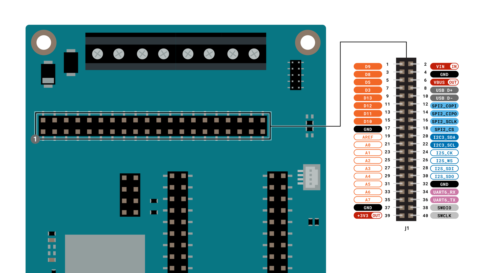

### SWD/JTAG Connector

For advanced development, the board includes an SWD/JTAG 2x5 1.27mm Connector (J6). This provides a direct interface for low-level debugging and programming of the microcontroller, and is powered by the board's +3.3 V line.

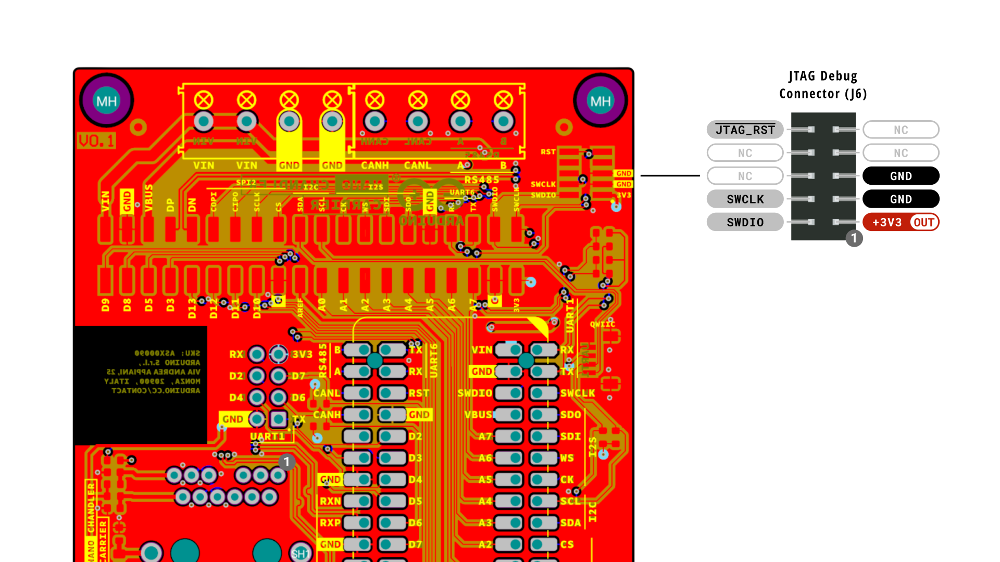

### Screw Terminals

The Screw Terminals block (J8) is designed for robust, industrial-grade connections. It securely exposes the **RS485** and **CAN bus** interfaces for reliable communication in high-vibration environments. Additionally, it provides a Power IN terminal (J9) that accepts a +7-24V input (VIN) to power the carrier.

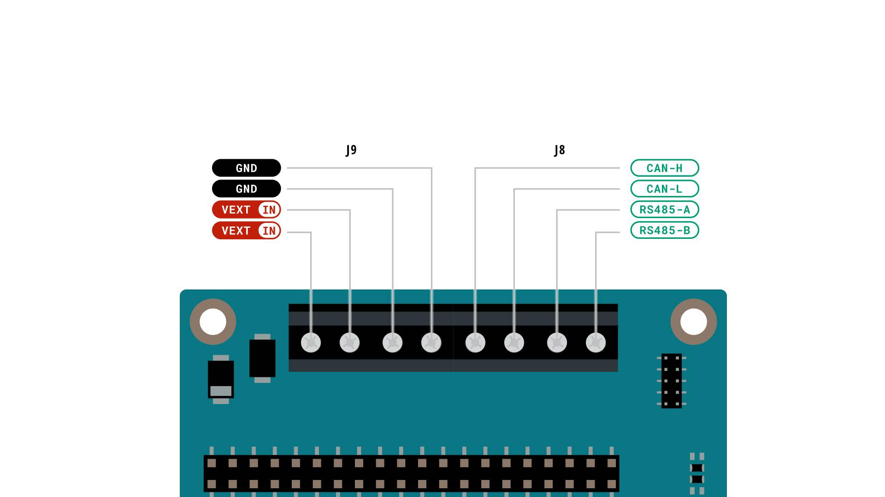

<strong>Note:</strong> The VIN power input is protected by a Schottky diode and a TVS diode before feeding the Nano XL Link Header[cite: 6].

### WiFi Module Connector

The carrier includes a dedicated 2x4 female header (J5) designed to host an ESP8266 ESP-01 WiFi module. This connector is powered by the +3.3 V line and interfaces directly with the host board via UART1 and standard GPIOs, offering an immediate path to add wireless capabilities to your setup.

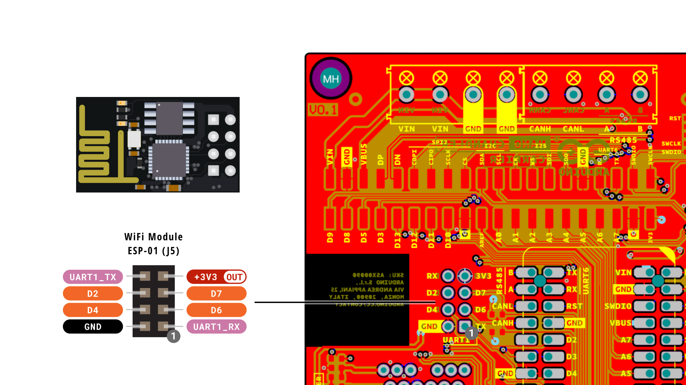

### Communication Interfaces

The Nano XL Link Connector Carrier exposes all the host board connections and communication interfaces through its dedicated ports and breakout headers.

| Interfaces    | Connector                                                                            |
| ------------- | ------------------------------------------------------------------------------------ |
| I2C           | - Breakout headers   - Qwiic I2C connector (J7)                          |
| RS485         | - Breakout headers   - Screw Terminals (J8)                              |
| CAN bus       | - Breakout headers   - Screw Terminals (J8)                              |
| Serial (UART) | - Breakout headers (UART/USART)   - WiFi Module ESP-01 Connector (UART1) |
| WiFi          | - WiFi Module ESP-01 Connector (J5)                                                  |
| Ethernet      | - Ethernet RJ45 Connector (J2)                                                       |

### Related Products

- Nano XL Link (ABX00182)
- Modulino® nodes

## Power and Ratings
### Recommended Operating Conditions

| Symbol         | Description           | Min | Typ | Max | Unit |
| -------------- | --------------------- | --- | --- | --- | ---- |
| VIN            | Input voltage         | 7.0 | -   | 24  | V    |
| TOP | Operating Temperature | -40 | 25  | 85  | °C   |

<strong>Note:</strong> The Nano XL Link Connector Carrier is powered by the host board's regulated power nets.

### Power Tree

The following diagram illustrates the Nano XL Link Connector Carrier's main system power architecture.

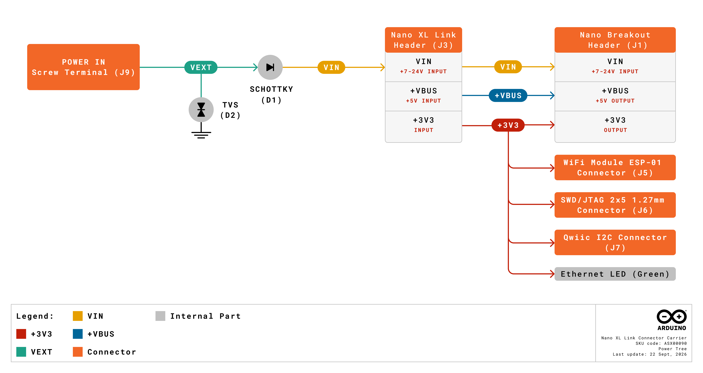

## Functional Overview

The Nano XL Link Connector Carrier expands the connectivity of the Nano XL Link board, featuring a variety of communication interfaces including CAN, RS485, and Ethernet. It also includes a Qwiic I2C connector, an ESP-01 WiFi module header, and robust screw terminals for industrial environments.

### Pinout

The Nano XL Link Connector Carrier pinout is shown in the following figure.

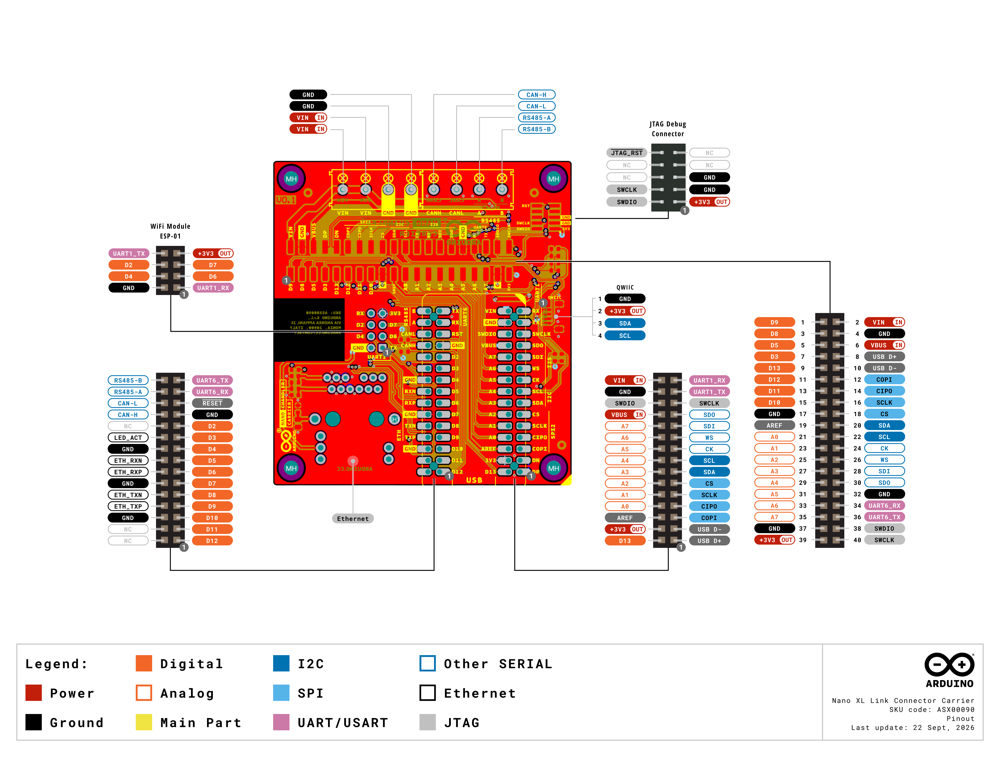

#### Nano Header (J4)

| Pin No. | Inner Pin (Standard Nano Digital) | Pin No. | Outer Pin (XL Extension) |
| ------- | --------------------------------- | ------- | ------------------------ |
| 1       | D12                               | 30      | NC                       |
| 2       | D11                               | 29      | NC                       |
| 3       | D10                               | 28      | GND                      |
| 4       | D9                                | 27      | ETH_TXP                  |
| 5       | D8                                | 26      | ETH_TXN                  |
| 6       | D7                                | 25      | GND                      |
| 7       | D6                                | 24      | ETH_RXP                  |
| 8       | D5                                | 23      | ETH_RXN                  |
| 9       | D4                                | 22      | GND                      |
| 10      | D3                                | 21      | LED_ACT                  |
| 11      | D2                                | 20      | NC                       |
| 12      | GND                               | 19      | CAN-H                    |
| 13      | RESET                             | 18      | CAN-L                    |
| 14      | UART6_RX                          | 17      | RS485-A                  |
| 15      | UART6_TX                          | 16      | RS485-B                  |

#### Nano Header (J3)

| Pin No. | Outer Pin (XL Extension) | Pin No. | Inner Pin (Standard Nano Analog) |
| ------- | ------------------------ | ------- | -------------------------------- |
| 1       | USB D+                   | 30      | D13                              |
| 2       | USB D-                   | 29      | +3V3                             |
| 3       | COPI                     | 28      | AREF                             |
| 4       | CIPO                     | 27      | A0                               |
| 5       | SCLK                     | 26      | A1                               |
| 6       | CS                       | 25      | A2                               |
| 7       | SDA                      | 24      | A3                               |
| 8       | SCL                      | 23      | A4                               |
| 9       | CK                       | 22      | A5                               |
| 10      | WS                       | 21      | A6                               |
| 11      | SDI                      | 20      | A7                               |
| 12      | SDO                      | 19      | VBUS                             |
| 13      | SWCLK                    | 18      | SWDIO                            |
| 14      | UART1_TX                 | 17      | GND                              |
| 15      | UART1_RX                 | 16      | VIN                              |

#### Nano Breakout Headers (J1)

The carrier exposes the board's I/O through a 2x20 pin breakout header.

| Pin | Function | Pin | Function |
| --- | -------- | --- | -------- |
| 1   | D9       | 2   | VIN      |
| 3   | D8       | 4   | GND      |
| 5   | D5       | 6   | VBUS     |
| 7   | D3       | 8   | USB D+   |
| 9   | D13      | 10  | USB D-   |
| 11  | D12      | 12  | COPI     |
| 13  | D11      | 14  | CIPO     |
| 15  | D10      | 16  | SCLK     |
| 17  | GND      | 18  | CS       |
| 19  | AREF     | 20  | SDA      |
| 21  | A0       | 22  | SCL      |
| 23  | A1       | 24  | CK       |
| 25  | A2       | 26  | WS       |
| 27  | A3       | 28  | SDI      |
| 29  | A4       | 30  | SDO      |
| 31  | A5       | 32  | GND      |
| 33  | A6       | 34  | UART6_RX |
| 35  | A7       | 36  | UART6_TX |
| 37  | GND      | 38  | SWDIO    |
| 39  | +3V3     | 40  | SWCLK    |

#### WiFi Module ESP-01 Connector (J5)

This 2x4 header provides connections to an ESP-01 WiFi module via UART1 and GPIOs.

| Pin | Function | Pin | Function |
| --- | -------- | --- | -------- |
| 1   | UART1_RX | 2   | GND      |
| 3   | D6       | 4   | D4       |
| 5   | D7       | 6   | D2       |
| 7   | +3V3     | 8   | UART1_TX |

#### SWD/JTAG 2x5 1.27mm Connector (J6)

Used for low-level debugging and programming of the microcontroller.

| Pin | Function | Pin | Function |
| --- | -------- | --- | -------- |
| 1   | +3V3     | 2   | SWDIO    |
| 3   | GND      | 4   | SWCLK    |
| 5   | GND      | 6   | NC       |
| 7   | NC       | 8   | NC       |
| 9   | NC       | 10  | JTAG_RST |

#### Qwiic I2C Connector (J7)

Follows the standard Qwiic ecosystem for plug-and-play I2C modules.

| Pin | Function  | Description       |
| --- | --------- | ----------------- |
| 1   | GND       | Ground            |
| 2   | +3V3      | +3.3 V Power Rail |
| 3   | SDA       | I2C Serial Data   |
| 4   | SCL       | I2C Serial Clock  |

### Block Diagram

An overview of the Nano XL Link Connector Carrier high-level architecture is illustrated in the figure below.

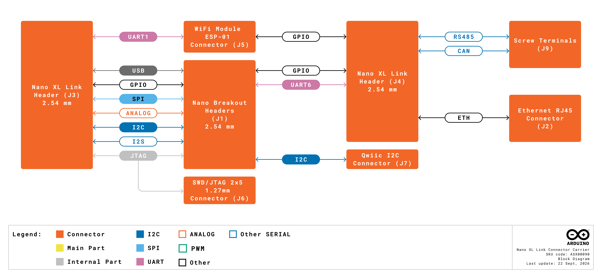

## Board Topology
### Overall View

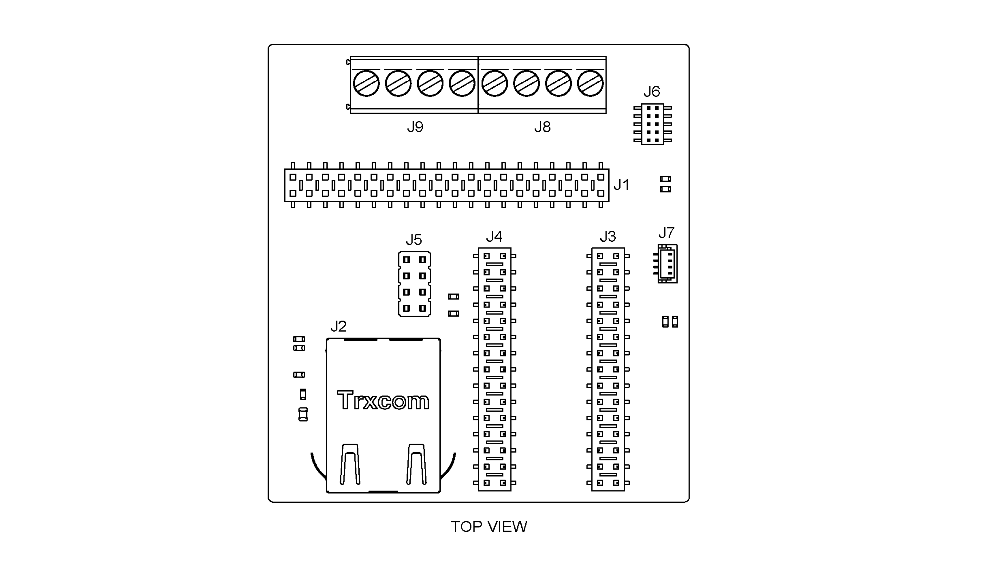

| **Reference** | **Description**                    |
| ------------- | ---------------------------------- |
| J1            | Breakout Headers (2.54 mm)         |
| J2            | Ethernet RJ45 Connector            |
| J3, J4        | Nano XL Link Headers (2.54 mm)     |
| J5            | WiFi Module ESP-01 Connector       |
| J6            | SWD/JTAG 2x5 1.27mm Connector      |
| J7            | Qwiic I2C Connector                |
| J8            | Screw Terminals block (CAN, RS485) |
| J9            | Screw Terminals block (POWER IN)   |

## Device Operation

### Getting Started - IDE

If you want to program your Nano board to use the Nano Connector Carrier while offline you need to install the Arduino® Desktop IDE **[1]**. To connect the Nano board to your computer, you will need a USB cable, which can also provide power to the board.

### Online Resources

Now that you have learned the basics of what you can do with the carrier, you can explore its endless possibilities by checking out exciting projects on Arduino Project Hub **[4]**, the Arduino Library Reference **[5]**, and the online store **[6]**. Here, you can complement your board with sensors, actuators and more.

## Mechanical Information

The Nano Connector Carrier is a double-sided 28 mm x 43 mm board with female double row Nano headers around the top long edges, 4x Grove horizontal connectors, one on each corner of the bottom side, a Micro SD card slot and a Qwiic connector on the bottom edges.

### Board Dimensions
The outline and dimensions of the Nano XL Link Connector Carrier can be seen in the following figure; all the dimensions are in mm.

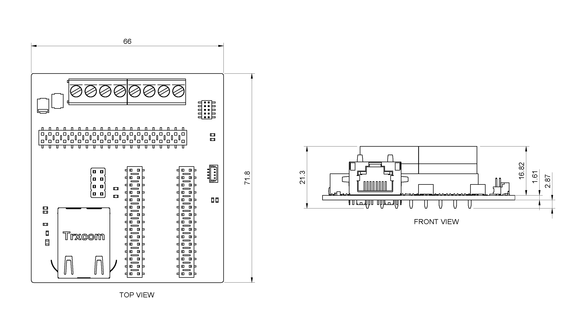

### Board Connectors

The Nano XL Link Connector Carrier's connectors are placed on the top side of the board, as shown in the figure below; all the dimensions are in mm.

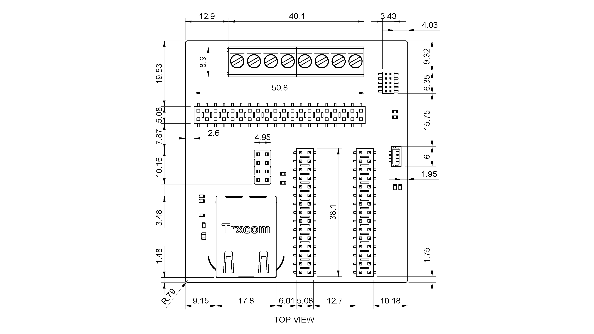

## Certifications

### Certificactions Summary

|  **Certification**  | **Status** |
| :-----------------: | :--------: |
| CE (European Union) |    Yes     |
|        RoHS         |    Yes     |
|        REACH        |    Yes     |
|        WEEE         |    Yes     |
|      FCC (USA)      |    Yes     |
|     IC (Canada)     |    Yes     |
|      UKCA (UK)      |    Yes     |

### Declaration of Conformity CE DoC (EU)

We declare under our sole responsibility that the products above are in conformity with the essential requirements of the following EU Directives and therefore qualify for free movement within markets comprising the European Union (EU) and European Economic Area (EEA).

### Declaration of Conformity to EU RoHS & REACH 211 01/19/2021

Arduino boards are in compliance with RoHS 2 Directive 2011/65/EU of the European Parliament and RoHS 3 Directive 2015/863/EU of the Council of 4 June 2015 on the restriction of the use of certain hazardous substances in electrical and electronic equipment.

| **Substance**                          | **Maximum Limit (ppm)** |
| -------------------------------------- | ----------------------- |
| Lead (Pb)                              | 1000                    |
| Cadmium (Cd)                           | 100                     |
| Mercury (Hg)                           | 1000                    |
| Hexavalent Chromium (Cr6+)             | 1000                    |
| Poly Brominated Biphenyls (PBB)        | 1000                    |
| Poly Brominated Diphenyl ethers (PBDE) | 1000                    |
| Bis(2-Ethylhexyl) phthalate (DEHP)     | 1000                    |
| Benzyl butyl phthalate (BBP)           | 1000                    |
| Dibutyl phthalate (DBP)                | 1000                    |
| Diisobutyl phthalate (DIBP)            | 1000                    |

Exemptions : No exemptions are claimed.

Arduino Boards are fully compliant with the related requirements of European Union Regulation (EC) 1907 /2006 concerning the Registration, Evaluation, Authorization and Restriction of Chemicals (REACH). We declare none of the SVHCs ([https://echa.europa.eu/web/guest/candidate-list-table](https://echa.europa.eu/web/guest/candidate-list-table)), the Candidate List of Substances of Very High Concern for authorization currently released by ECHA, is present in all products (and also package) in quantities totaling in a concentration equal or above 0.1%. To the best of our knowledge, we also declare that our products do not contain any of the substances listed on the "Authorization List" (Annex XIV of the REACH regulations) and Substances of Very High Concern (SVHC) in any significant amounts as specified by the Annex XVII of Candidate list published by ECHA (European Chemical Agency) 1907 /2006/EC.

### Conflict Minerals Declaration

As a global supplier of electronic and electrical components, Arduino is aware of our obligations with regards to laws and regulations regarding Conflict Minerals, specifically the Dodd-Frank Wall Street Reform and Consumer Protection Act, Section 1502. Arduino does not directly source or process conflict minerals such as Tin, Tantalum, Tungsten, or Gold. Conflict minerals are contained in our products in the form of solder, or as a component in metal alloys. As part of our reasonable due diligence Arduino has contacted component suppliers within our supply chain to verify their continued compliance with the regulations. Based on the information received thus far we declare that our products contain Conflict Minerals sourced from conflict-free areas.

### FCC Caution

Any Changes or modifications not expressly approved by the party responsible for compliance could void the user’s authority to operate the equipment.

This device complies with part 15 of the FCC Rules. Operation is subject to the following two conditions:

(1) This device may not cause harmful interference

(2) this device must accept any interference received, including interference that may cause undesired operation.

**FCC RF Radiation Exposure Statement:**

1. This Transmitter must not be co-located or operating in conjunction with any other antenna or transmitter.

2. This equipment complies with RF radiation exposure limits set forth for an uncontrolled environment.

3. This equipment should be installed and operated with a minimum distance of 20 cm between the radiator & your body.

English:
User manuals for licence-exempt radio apparatus shall contain the following or equivalent notice in a conspicuous location in the user manual or alternatively on the device or both. This device complies with Industry Canada licence-exempt RSS standard(s). Operation is subject to the following two conditions:

(1) this device may not cause interference

(2) this device must accept any interference, including interference that may cause undesired operation of the device.

French:
Le présent appareil est conforme aux CNR d’Industrie Canada applicables aux appareils radio exempts de licence. L’exploitation est autorisée aux deux conditions suivantes :

(1) l’ appareil nedoit pas produire de brouillage

(2) l’utilisateur de l’appareil doit accepter tout brouillage radioélectrique subi, même si le brouillage est susceptible d’en compromettre le fonctionnement.

**IC SAR Warning:**

English
This equipment should be installed and operated with a minimum distance of 20 cm between the radiator and your body.

French:
Lors de l’ installation et de l’ exploitation de ce dispositif, la distance entre le radiateur et le corps est d ’au moins 20 cm.

**Important:** The operating temperature of the EUT can’t exceed 85 ℃ and shouldn’t be lower than -40 ℃.

Hereby, Arduino S.r.l. declares that this product is in compliance with essential requirements and other relevant provisions of Directive 201453/EU. This product is allowed to be used in all EU member states.

## Company Information

| Company Information    | Details                               |
| --------------- | -------------------------------------------- |
| Company Name    | Arduino S.r.l.                               |
| Company Address | Via Andrea Appiani, 25 - 20900 MONZA (Italy) |

## Reference Documentation

| Reference                       | Link                                                                                                             |
| ------------------------------- | ---------------------------------------------------------------------------------------------------------------- |
| Arduino IDE (Desktop)           | [https://www.arduino.cc/en/Main/Software](https://www.arduino.cc/en/Main/Software)                               |
| Arduino IDE (Cloud)             | [https://app.arduino.cc/sketches](https://app.arduino.cc/sketches)                                               |
| Arduino Cloud - Getting Started | [https://docs.arduino.cc/arduino-cloud/guides/overview/](https://docs.arduino.cc/arduino-cloud/guides/overview/) |
| Project Hub                     | [https://projecthub.arduino.cc/](https://projecthub.arduino.cc/)                                                 |
| Language Reference              | [https://docs.arduino.cc/language-reference/](https://docs.arduino.cc/language-reference/)                       |
| Online Store                    | [https://store.arduino.cc/](https://store.arduino.cc/)                                                           |

## Change Log

| Date       | **Revision** | **Changes**   |
| ---------- | ------------ | ------------- |
| 29/09/2026 | 1            | First Release |