## Overview

This user manual will guide you through a practical journey covering the most interesting features of the Arduino Nano XL Link Connector Carrier. With this user manual, you will learn how to extend your Nano XL Link capabilities by using this carrier.

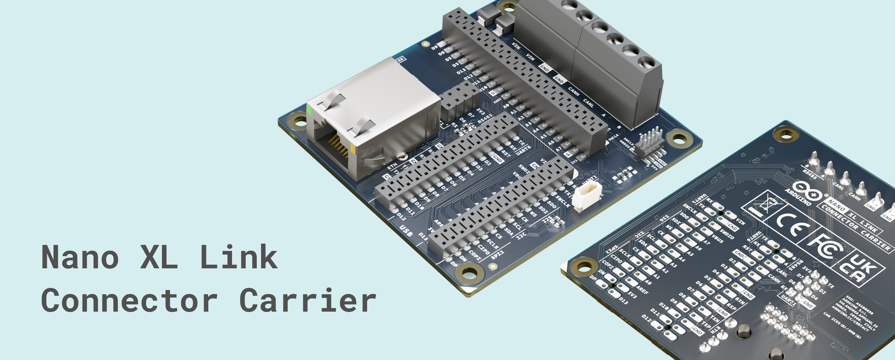

## Hardware and Software Requirements

### Hardware Requirements

- [Arduino Nano XL Link](https://store.arduino.cc/products/nano-xl-link) (x1)
- [Arduino Nano XL Link Connector Carrier](https://store.arduino.cc/products/nano-xl-connector-carrier) (x1)
- [Arduino Modulino Thermo](https://store.arduino.cc/products/modulino-thermo) (x1) with its Qwiic cable.
- WiFi Module ESP-01 (ESP8266) (x1)
- Ethernet Cable (x1)
- Twisted pair wires
- USB-C® cable (x1)
- Computer with internet access

### Software Requirements

- [Arduino IDE 2.0+](https://www.arduino.cc/en/software)

## Product Overview

The Nano XL Link Connector Carrier extends the Nano XL Link development board by providing direct, complete access to all standard and extended signals. Essential industrial interfaces, including CAN FD, RS485, Ethernet, I2C, and standard GPIOs, route to 2.54 mm female breakout headers, robust screw terminals, and dedicated peripheral connectors (such as Qwiic and ESP-01). This makes the carrier an ideal, DIN-rail-compatible tool for hardware validation, system integration, and a smooth transition from rapid prototyping to industrial deployment.

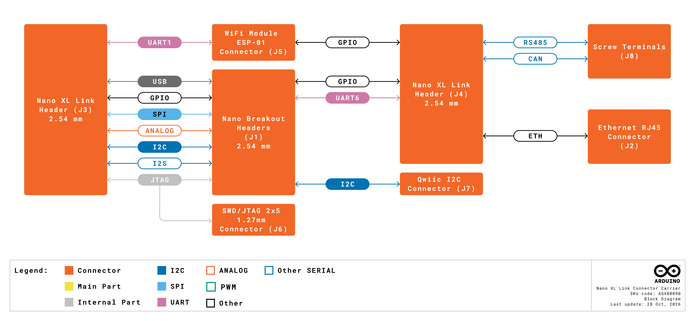

### Carrier Architecture Overview

The Nano XL Link Connector Carrier connects directly to the Nano XL Link board through its two 30-pin dual-row headers, mirroring all signals to breakout headers and dedicated peripheral ports. This makes it fully accessible for standard test equipment, custom circuits, and industrial networks. 

Here is an overview of the carrier's main components:

- **Nano Breakout Headers (J1)**: Dual 2x20 female headers (2.54 mm pitch) that fully expose both the standard Nano footprint and the extended XL signal sets in an accessible layout suitable for prototyping, jumper wires, and measurement equipment.
- **Nano XL Link Headers (J3, J4)**: Two 30-pin dual-row female headers that provide the direct physical and electrical pass-through for the host Nano XL Link board.
- **Industrial Screw Terminals (J8, J9)**: Two 4-position terminal blocks designed for robust, field-ready connections, exposing the RS485 and CAN bus interfaces, as well as the external power input.
- **Network & Wireless Connectivity**: Features a built-in RJ45 Ethernet port (J2) for wired networking and a dedicated 2x4 female header (J5) for seamless integration of an ESP8266 (ESP-01) WiFi module.
- **Power Management**: The carrier can be powered via the external VIN input (+7–24 VDC) on the screw terminal block. This input is protected by onboard reverse-polarity and TVS diodes before it powers the host Nano XL Link board. 
- **Expansion & Debugging**: Includes a Qwiic I2C connector (J7) for plug-and-play Modulino nodes integration, and a 2x5 1.27mm SWD header (J6) for low-level debugging and programming.

The carrier's breakout headers, industrial screw terminals, and peripheral ports are the interfaces you use day-to-day, while J3 and J4 serve as the mechanical and electrical interfaces that connect the carrier to the Nano XL Link host board.

### Pinout

The figure below shows the Nano XL Link Connector Carrier pinout.

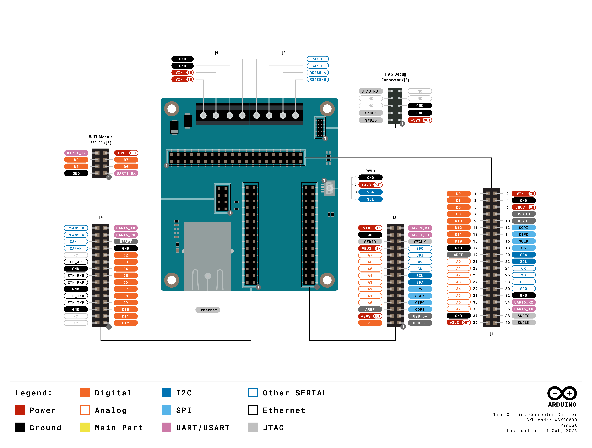

### Datasheet

The complete datasheet is available and downloadable as a PDF from the link below:

- [Nano XL Link Connector Carrier datasheet](https://docs.arduino.cc/resources/datasheets/ASX00090-datasheet.pdf)

### Schematics

The complete schematics are available for download as a PDF from the link below:

- [Nano XL Link Connector Carrier schematics](https://docs.arduino.cc/resources/schematics/ASX00090-schematics.pdf)

### STEP Files

The complete STEP files are available for download at the link below:

- [Nano XL Link Connector Carrier STEP files](../../downloads/ASX00090-step.zip)

### Form Factor

The Nano XL Link Connector Carrier features a 66 mm x 71.8 mm footprint compatible with standard 4U DIN-rail open enclosures, making it ideal for integrating into final industrial solutions.

You can easily mount the carrier on control panels or existing infrastructure, making the transition from prototyping to production smooth.

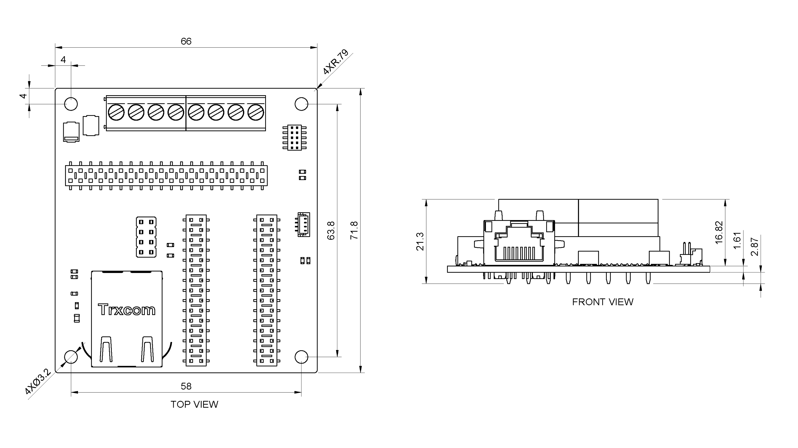

The board comes equipped with female headers and robust screw terminals out of the box, providing easy access for probing, testing, and secure field wiring.

## First Use

### Mounting the Carrier

To attach the Nano XL Link to the carrier, follow the steps below:

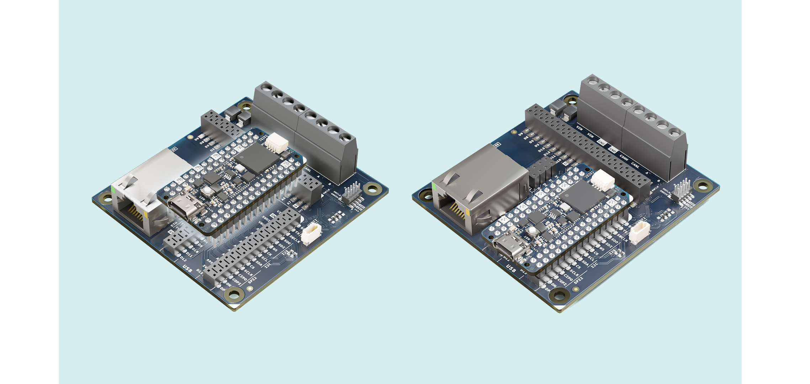

1. Hold the Nano XL Link with its male connectors facing down, aligned with the corresponding connectors on the carrier.
2. Gently press the Nano XL Link straight down until both connectors are fully seated. Apply even pressure across both connectors to avoid misalignment.

### Powering the Carrier

Once the Nano XL Link is mounted, the carrier can be powered by the following methods:

- A USB-C® cable providing 5 VDC connected to the Nano XL Link.
- An external +7–24 VDC power supply connected to VIN on the screw terminals.

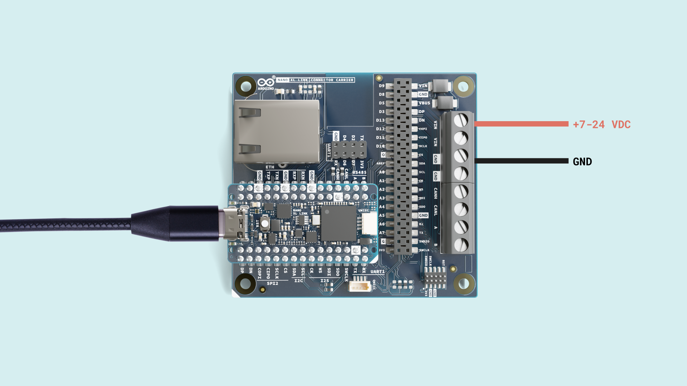

***The screw-terminal power input is protected by reverse-polarity and TVS protection diodes before feeding power to the host Nano XL Link board.***

## Communication

This section details the communication interfaces unlocked by the Nano XL Link Connector Carrier. By expanding the host board's connectivity, the carrier provides direct access to industrial CAN FD and RS485 networks, plug-and-play I2C via the Qwiic ecosystem, wired Ethernet, and integrated WiFi.

### CAN Bus

The carrier exposes the host board's CAN FD interface through the onboard screw terminals, enabling reliable, high-speed communication with automotive systems, motor controllers, and distributed industrial PLCs. The Nano XL Link utilizes the **Texas Instruments TCAN3414** transceiver, a high-performance 3.3V CAN FD IC. 

Key features of the TCAN3414 include:

* **Classic CAN Support**: Support for classic CAN and optimized CAN FD performance at 2, 5, and 8 Mbps
* **High-Speed CAN FD:** Capable of data rates up to 5 Mbps (and up to 8 Mbps in specific networks), significantly reducing bus load.
* **Robust Protection:** Provides ±58 V bus fault protection and high electrostatic discharge (ESD) immunity, making it ideal for harsh industrial environments.
* **Power Efficiency:** Features a low-current Standby/Shutdown mode to conserve power when the bus is inactive.

#### Wiring and Topology

CAN bus requires a linear topology (daisy-chain) to function correctly. Avoid star or tree topologies, as they cause signal reflections that disrupt communication. When connecting the carrier to another node, ensure the following connections:

| Carrier Screw Terminal | External CAN Device                  |
| ---------------------- | ------------------------------------ |
| CAN-H                  | CAN-H                                |
| CAN-L                  | CAN-L                                |
| GND                    | GND (Crucial for a common reference) |

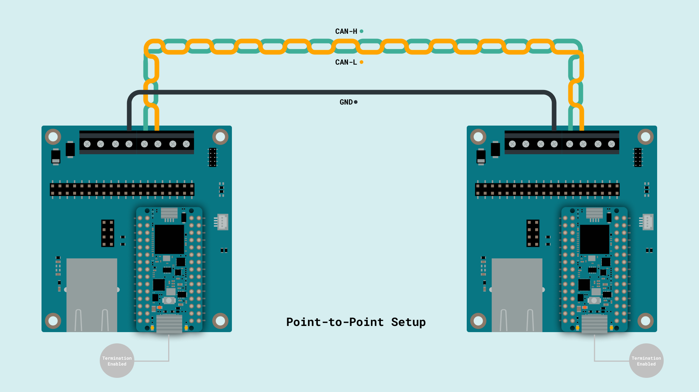

***You can also connect the board in a bus topology (daisy-chained) to an existing network.***

#### Termination Resistor Configuration

To prevent signal reflection and ensure data integrity, a CAN bus must be terminated at **both physical ends** of the network with 120-ohm resistors placed across the CAN-H and CAN-L lines. 

The Nano XL Link includes a built-in 120-ohm termination resistor. By default, this resistor is **enabled** via a normally closed solder jumper (**SJ1**) on the PCB.

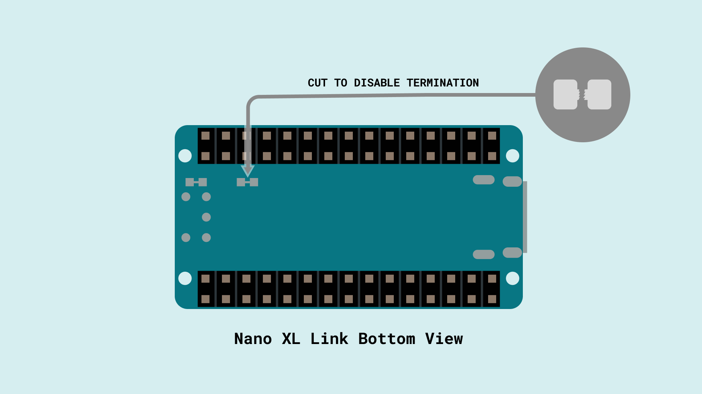

* **When to leave it closed (Default):** If your carrier board is located at either the absolute beginning or the absolute end of the physical bus line, leave the SJ1 jumper untouched.
* **When to cut it (Disable Termination):** If the carrier acts as a middle node (tapped into the bus between two already terminated end nodes), you must cut the small trace inside the SJ1 solder jumper to disable the onboard termination.

#### Leveraging CAN Bus

The Nano XL Link natively supports both Classic CAN 2.0 and CAN FD (Flexible Data-Rate) protocols. You do not need to install external libraries; the board's Zephyr-based core includes the `CAN` library, which interfaces seamlessly with the Zephyr device tree and the onboard CAN controller. You can access these features by simply including `<CAN.h>` in your sketch.

**Classic CAN 2.0:** Supports payloads up to 8 bytes per frame. It operates at a single bit rate, typically limited to 1 Mbps.

**CAN FD:** A modern extension offering two major advantages:

* **Increased Payload:** Transmits up to 64 bytes of data per frame, ideal for sending complex sensor arrays or longer strings.
* **Higher Speed (Dual Bit Rates):** Utilizes an **Arbitration Phase Rate** (for identifiers and control bits, capped at 1 Mbps to ensure priority arbitration) and a much faster **Data Phase Rate** (for transmitting the actual payload). Thanks to the onboard TCAN3414 transceiver, the data phase can reach speeds up to 5 Mbps (and up to 8 Mbps in highly optimized, short networks).

#### Classic CAN Example

To initialize a Classic CAN bus, use the `CAN.begin()` method, passing the desired baud rate using the `CanBitRate` enum (e.g., `CanBitRate::BR_500k`). Classic frames are handled using the `CanMsg` class, and transmitted or received using the `CAN.write()` and `CAN.read()` methods.

This example demonstrates two-way communication by transmitting a classic (8-byte) CAN message every second while continuously polling the RX queue. It instantly decodes and prints any received messages to the Arduino IDE Serial Monitor.

```cpp
#include <CAN.h>

static uint32_t const CAN_ID = 0x123;

void setup() {
  Serial.begin(115200);
  while (!Serial) {}

  // Initialize Classic CAN at 500 kbps
  if (!CAN.begin(CanBitRate::BR_500k)) {
    Serial.println("CAN.begin(...) failed.");
    for (;;) {}
  }
  Serial.println("Classic CAN Initialized successfully.");
}

void loop() {
  // --- TRANSMIT ---
  // Create a classic 8-byte payload
  uint8_t payload[] = {0xCA, 0xFE, 0x01, 0x02, 0x03, 0x04, 0x05, 0x06};
  
  // Construct a Classic CAN Message with a standard ID
  CanMsg tx_msg(CanStandardId(CAN_ID), sizeof(payload), payload);
  
  // Transmit the message
  if (CAN.write(tx_msg) <= 0) {
    Serial.println("CAN transmission failed!");
  }
  
  // --- RECEIVE ---
  // Check if a message is available in the RX queue
  if (CAN.available()) {
    CanMsg const rx_msg = CAN.read();
    
    Serial.print("Received packet with ID 0x");
    Serial.print(rx_msg.getStandardId(), HEX);
    Serial.print(" and length ");
    Serial.println(rx_msg.data_length);

    for (int i = 0; i < rx_msg.data_length; i++) {
      Serial.print(rx_msg.data[i], HEX);
      Serial.print(" ");
    }
    Serial.println();
  }
  
  delay(1000);
}
```

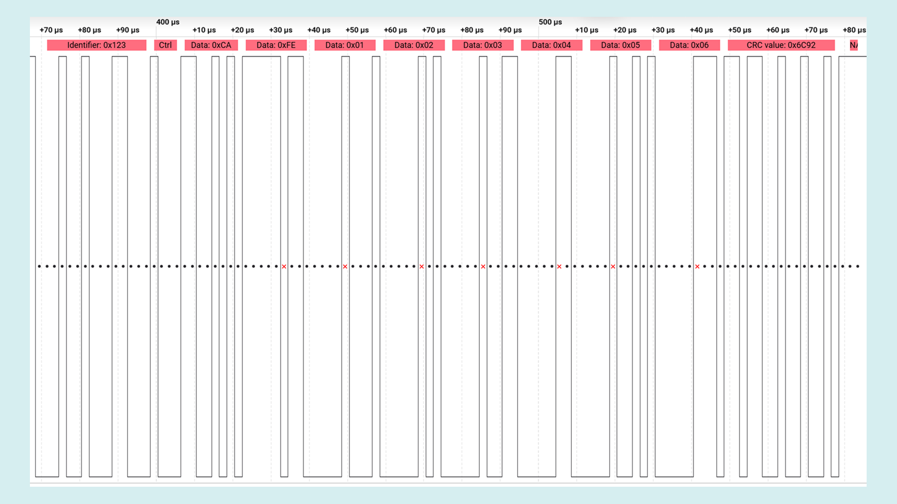

When a message is sent to the board, it is shown as follows in the Serial Monitor:

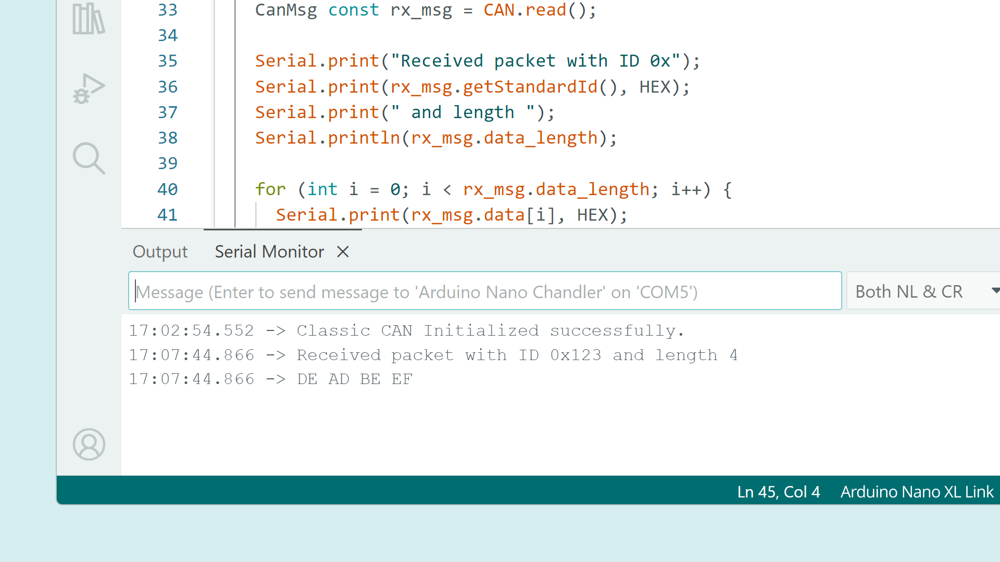

#### CAN FD Example

To enable CAN FD and configure its dual speeds, use the `CAN.beginFD(arbitration_bitrate, data_bitrate)` method:

- `arbitration_bitrat`e: Sets the base speed using the `CanBitRate` enum (e.g., `CanBitRate::BR_500k`).   
- `data_bitrate`: Sets the high-speed payload rate as a standard `uint32_t` integer representing bits per second (e.g., `1000000` for 1 Mbps, or `2000000` for 2 Mbps).
- (Optional) `bitrate_switch`: A boolean parameter that defaults to `true`. It enables the Bit Rate Switch (BRS) flag, instructing the hardware to physically switch  to the higher `data_bitrate` during the data phase of the transmission.

Extended frames are handled using the `CanFDMsg` class, and processed using `CAN.writeFD()` and` CAN.readFD()`.

This example demonstrates two-way communication by transmitting an FD (12-byte) CAN message every second while continuously polling the RX queue. It instantly decodes and prints any received messages to the Arduino IDE Serial Monitor.

```cpp
#include <CAN.h>

static uint32_t const CAN_ID = 0x123;

void setup() {
  Serial.begin(115200);
  while (!Serial) {}

  // Initialize CAN FD with a 500 kbps Arbitration Rate and a 1 Mbps Data Rate
  if (!CAN.beginFD(CanBitRate::BR_500k, 1000000)) {
    Serial.println("CAN.beginFD(...) failed.");
    for (;;) {}
  }
  Serial.println("CAN FD Initialized successfully.");
}

void loop() {
  // --- TRANSMIT ---
  // Create an extended 12-byte payload
  uint8_t payload[] = {0x01, 0x02, 0x03, 0x04, 0x05, 0x06, 0x07, 0x08, 0x09, 0x0A, 0x0B, 0x0C};
  
  // Construct a CAN FD Message with a standard ID
  CanFDMsg tx_msg(CanStandardId(CAN_ID), sizeof(payload), payload);
  
  // Transmit the message
  if (CAN.writeFD(tx_msg) <= 0) {
    Serial.println("CAN transmission failed!");
  }
  
  // --- RECEIVE ---
  // Check if a message is available in the RX queue
  if (CAN.available()) {
    CanFDMsg const rx_msg = CAN.readFD();
    
    Serial.print("Received packet with ID 0x");
    Serial.print(rx_msg.getStandardId(), HEX);
    Serial.print(" and length ");
    Serial.println(rx_msg.data_length);

    for (int i = 0; i < rx_msg.data_length; i++) {
      Serial.print(rx_msg.data[i], HEX);
      Serial.print(" ");
    }
    Serial.println();
  }
  
  delay(1000);
}
```

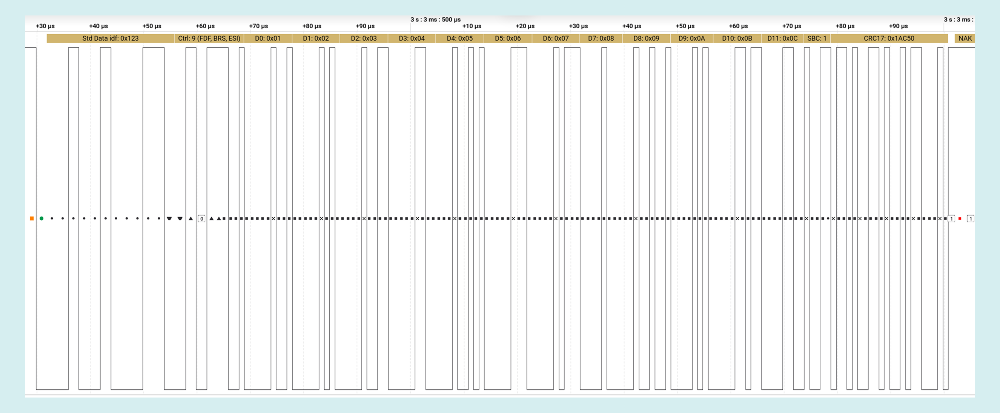

When a message is sent to the board it is shown as follows in the Serial Monitor:


### RS-485 

Designed for high electrical noise immunity and long-distance data transmission across the factory floor, the RS485 interface is accessible via the onboard screw terminals, making it ideal for bridging legacy equipment and modern automation systems. 

The Nano XL Link utilizes the **Texas Instruments THVD2410** transceiver, a highly robust, fault-protected 3.3V RS-485 IC designed specifically for harsh industrial environments.

Key features of the THVD2410 include:

- **Extreme Fault Protection:** Provides ±70 V DC bus fault protection, ensuring the device survives severe miswiring or accidental high-voltage shorts on the data lines.
- **High ESD Immunity:** Features ±16 kV HBM ESD and ±12 kV IEC 61000-4-2 contact and air-gap discharge protection.
- **Extended Common-Mode Range:** Operates safely with a ±25 V common-mode voltage range, making it highly resilient to ground potential differences between distant nodes.
- **Optimized Data Rate:** Operates at a reliable 500 kbps signaling rate, perfectly tailored for noise-resistant long cable runs.
- **Failsafe Receiver:** Guarantees a known logic-high state internally when the bus inputs are open, shorted, or idle, preventing false start bits.

#### Wiring and Topology

RS-485 requires a linear (daisy-chain) topology. Star or tree topologies cause signal reflections and should be strictly avoided. Use a twisted-pair cable for the data lines to maximize noise rejection. 

When connecting the carrier to another RS-485 node (such as an industrial sensor, VFD, or PLC), ensure the following connections:

| Carrier Screw Terminal | External RS-485 Device (Target)       |
| ---------------------- | ------------------------------------ |
| A (Non-Inverting)      | A / D+ / Y                           |
| B (Inverting)          | B / D- / Z                           |
| GND                    | GND (Crucial for a common reference) |

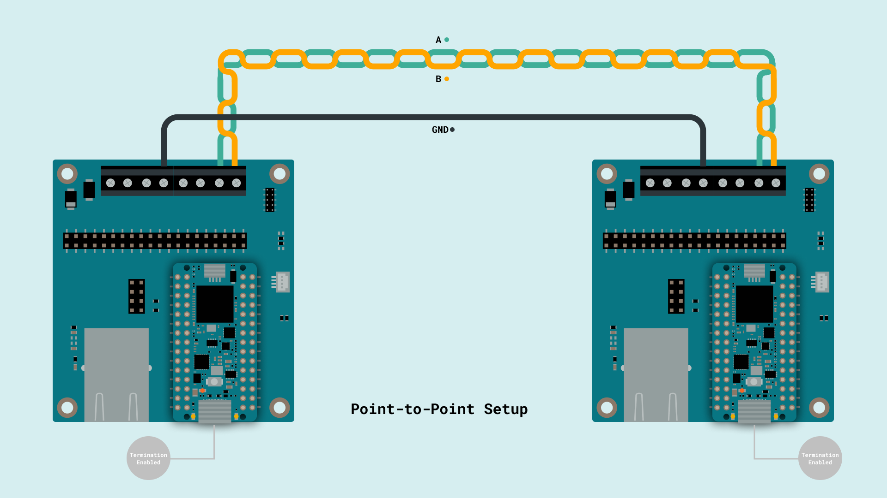

***Terminal naming conventions (A/B vs. Y/Z vs. +/-) can vary between manufacturers. Always verify the polarity in your external device's datasheet.***

#### Termination Resistor Configuration

To prevent signal reflection and ensure data integrity over long cable runs, an RS-485 bus must be terminated at **both physical ends** of the network with 120-ohm resistors placed across the A and B lines.

The Nano XL Link includes a built-in 120-ohm termination resistor for the RS-485 bus. By default, this resistor is **enabled** via a normally closed solder jumper (**SJ2**) on the PCB.

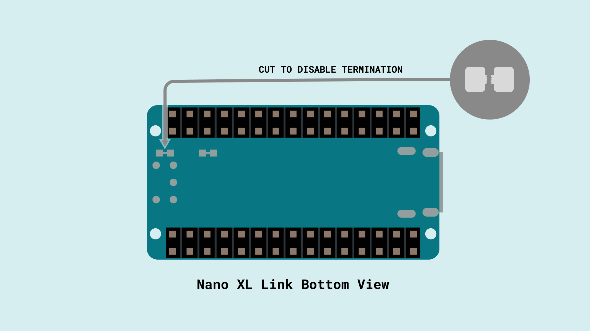

- **When to leave it closed (Default):** If your carrier board is located at either the absolute beginning or the absolute end of the physical bus line, leave the SJ2 jumper untouched.
- **When to cut it (Disable Termination):** If the carrier acts as a middle node (tapped into the bus between two already-terminated end nodes), you must cut the small trace inside the SJ2 solder jumper to disable the onboard termination.
#### Leveraging RS-485

To control the RS-485 interface, you will use the official `ArduinoRS485` library. You can easily install it via the Arduino IDE Library Manager by searching for **"ArduinoRS485"**. 

Because standard RS485 is a half-duplex protocol, the transceiver cannot send and receive simultaneously. The THVD2410 data direction is controlled seamlessly by the host board through Driver Enable (DE) and Receiver Enable (RE) logic, which the library handles automatically via specific methods:

- `RS485.beginTransmission()`: Configures the transceiver to sending mode (enables the driver).
- `RS485.endTransmission()`: Finishes the transmission, flushes the buffer, and disables the driver.
- `RS485.receive()`: Configures the transceiver back to listening mode (enables the receiver).

#### Basic Arduino Example

This example demonstrates two-way communication by transmitting an RS485 message every second while continuously polling the RX queue. It instantly decodes any received messages and prints them to the Arduino IDE Serial Monitor.

```cpp
#include <ArduinoRS485.h>

int counter = 0;

void setup() {
  Serial.begin(115200);
  while (!Serial);

  // Initialize the RS485 bus at a baud rate of 9600 bps
  RS485.begin(9600);
  
  // Enable reception by default
  RS485.receive();
  
  Serial.println("RS485 Initialized successfully.");
}

void loop() {
  // --- TRANSMIT ---
  // 1. Disable the receiver to prevent local echo
  RS485.noReceive();
  
  // 2. Switch transceiver to transmit mode
  RS485.beginTransmission();
  
  // 3. Send data
  RS485.print("Hello RS485 node, message count: ");
  RS485.println(counter);
  
  // 4. Complete transmission and flush buffers
  RS485.endTransmission();
  
  counter++;

  // --- RECEIVE ---
  // 5. Switch transceiver back to receive mode
  RS485.receive();
  
  // 6. Briefly wait and check for incoming responses (Polling for 1 second)
  unsigned long startTime = millis();
  while (millis() - startTime < 1000) {
    if (RS485.available()) {
      Serial.write(RS485.read());
    }
  }
}
```

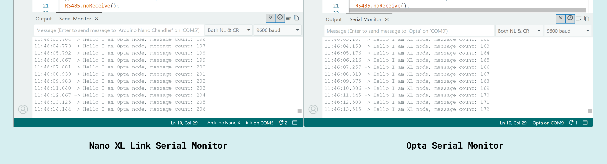

#### Advanced Timing Configuration

Because standard RS-485 is a half-duplex protocol, the transceiver must constantly switch between transmitting and receiving modes. The `ArduinoRS485` library handles this automatically by toggling the Driver Enable (DE) pin. However, depending on the host board's hardware architecture, the internal UART buffer might report that it has finished sending data (triggering the library to disable the transmitter) while the final bits are still physically shifting out over the wire.

This premature shutdown often results in truncated data, missing newline characters, or corrupted bytes (such as ``) at the end of a received message.

To prevent this, the `RS485.begin()` method accepts optional timing parameters to fine-tune the transceiver's switching behavior:

**Syntax:**

`RS485.begin(baudrate, predelay, postdelay);`

***You can also include the serial configuration: `RS485.begin(baudrate, config, predelay, postdelay);`***

- `baudrate`: The communication speed in bits per second (e.g., `9600`).
- `predelay`: The time in microseconds to wait *after* enabling the transmitter before sending the first byte. The default is 50 µs.
- `postdelay`: The time in microseconds to wait *after* the UART buffer is flushed before disabling the transmitter. The default is 50 µs.

**When to use custom delays:**

If you experience dropped or corrupted bytes at the end of your transmissions, it is highly recommended to increase the `postdelay`. At a standard baud rate of 9600 bps, transmitting a single byte takes roughly 1 millisecond (1000 µs). By increasing the `postdelay`, you force the DE pin to stay HIGH just long enough for the final byte to travel safely across the cable.

**Example:**

```cpp
// Initialize RS485 at 9600 baud, with a default 50 µs pre-delay and a custom 2000 µs (2 ms) post-delay
RS485.begin(9600, 50, 2000);
```

### I2C (Qwiic)

A dedicated Qwiic connector provides a seamless, plug-and-play interface for the standard I2C bus, letting you quickly expand your system with a wide range of sensors and actuators, such as Modulino nodes.

***Hardware Details (I2C3 vs I2C4)***

The Qwiic connector on the Nano XL Link Connector Carrier routes to the host microcontroller's **I2C3** bus. This is physically and logically independent of the Qwiic connector mounted directly on the Nano XL Link board, which utilizes the **I2C4** bus.

In the Arduino environment, the carrier board's I2C3 bus is mapped to the `Wire1` object. Therefore, you must explicitly configure your I2C libraries to use `Wire1` in order to communicate with any device plugged into the carrier's Qwiic port.

#### Modulino Thermo Example

This example demonstrates how to read temperature and humidity data from a Modulino Thermo node connected to the carrier board. 

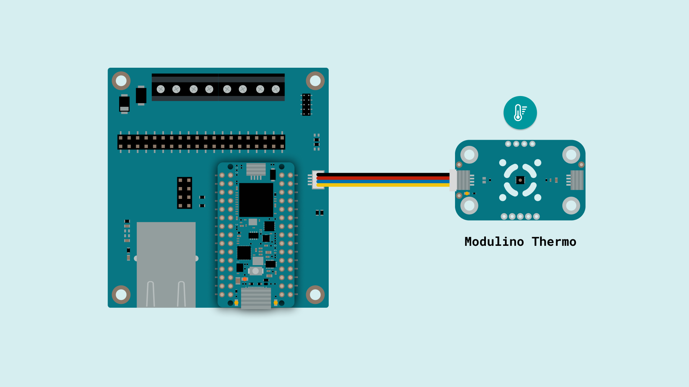

To run this sketch, you must install the **`Arduino_Modulino`** library via the Arduino IDE Library Manager. Notice the critical `Modulino.begin(Wire1);` line in the `setup()` function: by passing `Wire1`, we explicitly instruct the Modulino library to route its communication through the carrier's Qwiic connector.

```cpp
#include <Arduino_Modulino.h>

// Create object instance
ModulinoThermo thermo;

void setup(){
  Serial.begin(115200);
  while(!Serial); // Wait for Serial Monitor to open

  // Initialize Modulino I2C communication over the Carrier's Qwiic bus
  Modulino.begin(Wire1);
  
  // Detect and connect to temperature/humidity sensor module
  thermo.begin();
}

void loop(){
  // Read temperature in Celsius from the sensor
  float celsius = thermo.getTemperature();

  // Convert Celsius to Fahrenheit
  // Formula: F = (C × 9/5) + 32
  float fahrenheit = (celsius * 9 / 5) + 32;

  // Read relative humidity percentage from the sensor
  // Returns value from 0.0 to 100.0
  float humidity = thermo.getHumidity();

  // Print temperature in Celsius
  Serial.print("Temperature (C) is: ");
  Serial.println(celsius);

  // Print temperature in Fahrenheit
  Serial.print("Temperature (F) is: ");
  Serial.println(fahrenheit);

  // Print relative humidity percentage
  Serial.print("Humidity (rH) is: ");
  Serial.println(humidity);

  delay(2000);
}
```

When the code is running, the sensor readings will be displayed as follows in the Serial Monitor:

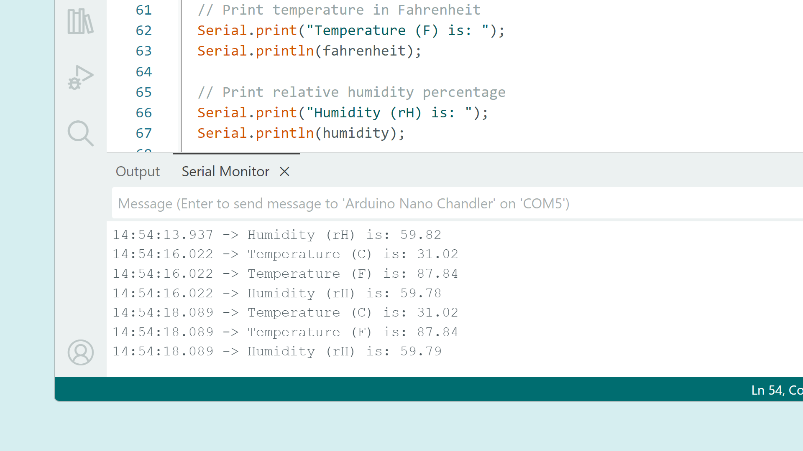

### Ethernet

The integrated RJ45 port turns the carrier into a reliable wired IoT gateway, providing a stable, high-bandwidth connection to integrate your edge devices with local networks, SCADA systems, or cloud analytics servers.

To drive this connection, the board features a **Microchip KSZ8081RNAIA-TR** Ethernet physical layer transceiver (PHY). 

Key features of the KSZ8081 PHY include:

- **10Base-T/100Base-TX Support:** Auto-negotiates the best possible speed (10 Mbps or 100 Mbps) and duplex mode (half or full) depending on your network infrastructure.
- **RMII Interface:** Utilizes a Reduced Media Independent Interface to communicate efficiently with the host microcontroller while saving valuable pin resources.
- **Robust Industrial Design:** Features built-in HP Auto MDI/MDI-X crossover detection (eliminating the need for specialized crossover cables) and excellent electromagnetic compatibility (EMC) for noisy environments.

**Zephyr Ethernet Library**

The Zephyr core natively includes an Ethernet stack configured specifically for the host board's architecture. By including the `ZephyrServer.h`, `ZephyrClient.h`, and `ZephyrEthernet.h` libraries, you gain access to a familiar, Arduino-style API that seamlessly handles low-level network operations.

#### Web Server Example

This example demonstrates how to configure the Ethernet interface to automatically obtain an IP address via DHCP and host a responsive HTML web server. It allows you to remotely toggle the onboard LED from a web interface.

To run this sketch, you must connect an Ethernet cable between the Nano XL Link Connector Carrier and your home internet router.

```cpp
#include "ZephyrServer.h"
#include "ZephyrClient.h"
#include "ZephyrEthernet.h"

// Define a MAC address for the controller
byte mac[] = { 0xDE, 0xAD, 0xBE, 0xEF, 0xFE, 0xED };

// Initialize the Ethernet server on port 80 (Default HTTP)
ZephyrServer server(80);

// Variable to track the LED state
bool ledState = false;
String httpHeader;

void setup() {
  Serial.begin(115200);
  while (!Serial);

  pinMode(LED_BUILTIN, OUTPUT);
  digitalWrite(LED_BUILTIN, LOW);

  Serial.println("Starting Ethernet Web Server...");

  // Wait for the physical Ethernet link to establish
  while (Ethernet.linkStatus() != LinkON) {
    Serial.println("Waiting for physical link...");
    delay(500);
  }

  // Initialize Ethernet using DHCP (by passing only the MAC address)
  Serial.println("Requesting IP address via DHCP...");
  if (Ethernet.begin(mac) == 0) {
    Serial.println("Failed to obtain an IP address. Check network/router.");
    while (true) delay(1); // Halt execution
  }

  // Start the web server
  server.begin();
  
  Serial.print("Server is active at IP: ");
  Serial.println(Ethernet.localIP());
}

void loop() {
  // Listen for incoming clients
  ZephyrClient client = server.accept();
  
  if (client) {
    Serial.println("New client connected.");
    String currentLine = "";
    
    while (client.connected()) {
      if (client.available()) {
        char c = client.read();
        httpHeader += c;
        
        // If newline is received and the line is blank, the HTTP request ends
        if (c == '\n' && currentLine.length() == 0) {
          
          // Parse the HTTP Header to toggle the LED
          if (httpHeader.indexOf("GET /?led=on") >= 0) {
            digitalWrite(LED_BUILTIN, HIGH);
            ledState = true;
          } else if (httpHeader.indexOf("GET /?led=off") >= 0) {
            digitalWrite(LED_BUILTIN, LOW);
            ledState = false;
          }
          
          // Send a standard HTTP response header
          client.println("HTTP/1.1 200 OK");
          client.println("Content-Type: text/html");
          client.println("Connection: close");
          client.println();
          
          // Generate the HTML and CSS for the Web UI
          client.println("<!DOCTYPE html><html>");
          client.println("<head><meta name=\"viewport\" content=\"width=device-width, initial-scale=1\">");
          client.println("<style>");
          client.println("body { font-family: 'Segoe UI', Tahoma, Geneva, Verdana, sans-serif; text-align: center; margin-top: 50px; background-color: #f4f4f9; color: #333;}");
          client.println(".button { background-color: #4CAF50; border: none; color: white; padding: 16px 40px; text-decoration: none; font-size: 20px; margin: 20px; cursor: pointer; border-radius: 8px; transition: background 0.3s; box-shadow: 0 4px 6px rgba(0,0,0,0.1);}");
          client.println(".button-off { background-color: #f44336; }");
          client.println(".button:active { transform: translateY(2px); box-shadow: 0 2px 4px rgba(0,0,0,0.1); }");
          client.println("</style></head>");
          
          // Generate Web Page Content
          client.println("<body>");
          client.println("<h2>Nano XL Link Control Panel</h2>");
          
          if (ledState) {
            client.println("<p>Current Status: <strong>ON</strong></p>");
            client.println("<a href=\"/?led=off\"><button class=\"button button-off\">Turn OFF</button></a>");
          } else {
            client.println("<p>Current Status: <strong>OFF</strong></p>");
            client.println("<a href=\"/?led=on\"><button class=\"button\">Turn ON</button></a>");
          }
          
          client.println("</body></html>");
          
          // Clear the header for the next connection
          httpHeader = "";
          break; // Break out of the while loop to close the connection
        }
        
        if (c == '\n') {
          currentLine = ""; // Start a new line
        } else if (c != '\r') {
          currentLine += c; // Append characters to the current line
        }
      }
    }
    
    // Give the web browser time to receive the data
    delay(1);
    client.stop();
    Serial.println("Client disconnected.");
  }
}
```

Once the code is uploaded, check for the assigned IP address in the Serial Monitor and open it in your browser:

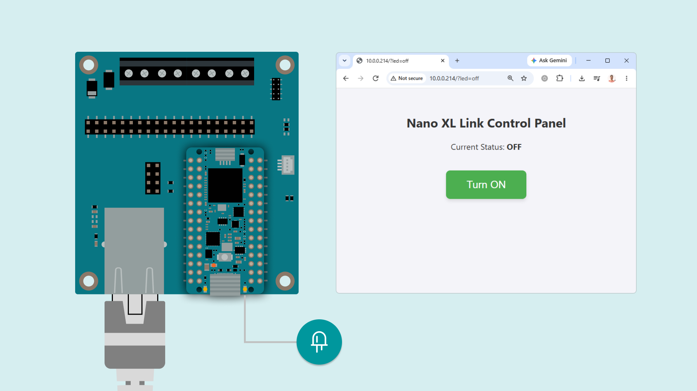

Now you can control the Nano XL Link onboard LED by clicking the Web UI button.

### Wi-Fi Expansion

While the Nano XL Link host board does not feature built-in wireless connectivity, the Carrier provides a dedicated 2x4 female header designed specifically to host an **ESP8266 (ESP-01) module**. This lets you easily add Wi-Fi connectivity to your project without external breadboards or complex wiring.

The header directly interfaces the ESP-01 module with the microcontroller's `UART1` bus. The Zephyr core natively includes a `WiFi` library tailored to communicate with this module seamlessly, translating standard Arduino networking commands into the AT commands required by the ESP8266.

**Hardware Prerequisites:**

To ensure stable communication, the ESP-01 module plugged into the carrier **must** be flashed with an **AT firmware version of 1.6.2 or newer**. Older firmware versions may not support the full AT command set used by the Zephyr core's Wi-Fi library, which can cause connection timeouts or initialization failures.

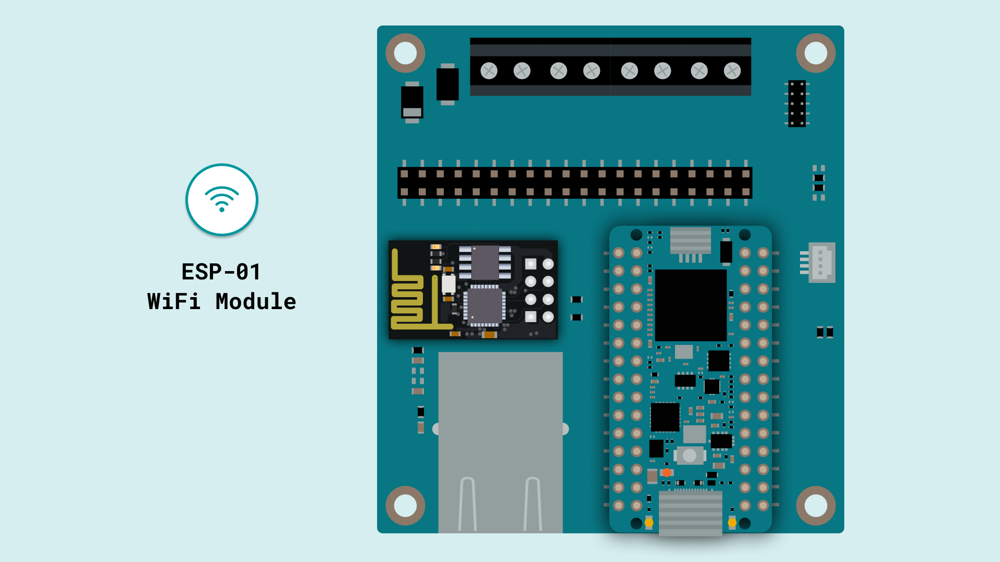

The header **J5** provides connections to an ESP-01 WiFi module via UART1 and GPIOs.

| Pin | Function | Pin | Function |
| --- | -------- | --- | -------- |
| 1   | UART1_RX | 2   | GND      |
| 3   | D6       | 4   | D4       |
| 5   | D7       | 6   | D2       |
| 7   | +3V3     | 8   | UART1_TX |

**Leveraging the Wi-Fi Library:**

Because the underlying Zephyr architecture handles the UART-to-AT command translation internally, you can use the familiar `ZephyrServer.h`, `ZephyrClient.h` and the standard `WiFi.h` libraries just as you would on any native Wi-Fi Arduino board.

#### Web Server Example

Just like the Ethernet interface, you can host a responsive HTML web server over Wi-Fi. This example shows how to connect your ESP-01 module to a local WPA/WPA2 network and serve a control panel that lets you toggle the onboard LED from any web browser on the same network.

By using `WiFi.begin()` and keeping the `ZephyrServer` and `ZephyrClient` objects, the underlying logic remains virtually identical.

```cpp
#include <ZephyrServer.h>
#include <ZephyrClient.h>
#include <WiFi.h>

// Network credentials (replace with your actual network details)
const char ssid[] = "YOUR_NETWORK_SSID";
const char pass[] = "YOUR_NETWORK_PASSWORD";

// Initialize the Wi-Fi server on port 80 (Default HTTP)
ZephyrServer server(80);

// Variable to track the LED state
bool ledState = false;
String httpHeader;

void setup() {
  Serial.begin(115200);
  while (!Serial);

  pinMode(LED_BUILTIN, OUTPUT);
  digitalWrite(LED_BUILTIN, LOW);

  Serial.println("Starting Wi-Fi Web Server...");

  // Check if the ESP-01 module is properly seated and responding
  if (WiFi.status() == WL_NO_SHIELD) {
    Serial.println("Communication with WiFi module failed! Check connection and AT firmware.");
    while (true) delay(1); // Halt execution
  }

  // Attempt to connect to the Wi-Fi network
  Serial.print("Attempting to connect to SSID: ");
  Serial.println(ssid);
  
  while (WiFi.status() != WL_CONNECTED) {
    WiFi.begin(ssid, pass);
    delay(3000);
    Serial.print(".");
  }

  Serial.println("\nConnected to Wi-Fi successfully!");

  // Start the web server
  server.begin();
  
  Serial.print("Server is active at IP: ");
  Serial.println(WiFi.localIP());
}

void loop() {
  // Listen for incoming clients
  ZephyrClient client = server.accept();
  
  if (client) {
    Serial.println("New client connected.");
    String currentLine = "";
    
    while (client.connected()) {
      if (client.available()) {
        char c = client.read();
        httpHeader += c;
        
        // If newline is received and the line is blank, the HTTP request ends
        if (c == '\n' && currentLine.length() == 0) {
          
          // Parse the HTTP Header to toggle the LED
          if (httpHeader.indexOf("GET /?led=on") >= 0) {
            digitalWrite(LED_BUILTIN, HIGH);
            ledState = true;
          } else if (httpHeader.indexOf("GET /?led=off") >= 0) {
            digitalWrite(LED_BUILTIN, LOW);
            ledState = false;
          }
          
          // Send a standard HTTP response header
          client.println("HTTP/1.1 200 OK");
          client.println("Content-Type: text/html");
          client.println("Connection: close");
          client.println();
          
          // Generate the HTML and CSS for the Web UI
          client.println("<!DOCTYPE html><html>");
          client.println("<head><meta name=\"viewport\" content=\"width=device-width, initial-scale=1\">");
          client.println("<style>");
          client.println("body { font-family: 'Segoe UI', Tahoma, Geneva, Verdana, sans-serif; text-align: center; margin-top: 50px; background-color: #f4f4f9; color: #333;}");
          client.println(".button { background-color: #4CAF50; border: none; color: white; padding: 16px 40px; text-decoration: none; font-size: 20px; margin: 20px; cursor: pointer; border-radius: 8px; transition: background 0.3s; box-shadow: 0 4px 6px rgba(0,0,0,0.1);}");
          client.println(".button-off { background-color: #f44336; }");
          client.println(".button:active { transform: translateY(2px); box-shadow: 0 2px 4px rgba(0,0,0,0.1); }");
          client.println("</style></head>");
          
          // Generate Web Page Content
          client.println("<body>");
          client.println("<h2>Nano XL Link Control Panel</h2>");
          
          if (ledState) {
            client.println("<p>Current Status: <strong>ON</strong></p>");
            client.println("<a href=\"/?led=off\"><button class=\"button button-off\">Turn OFF</button></a>");
          } else {
            client.println("<p>Current Status: <strong>OFF</strong></p>");
            client.println("<a href=\"/?led=on\"><button class=\"button\">Turn ON</button></a>");
          }
          
          client.println("</body></html>");
          
          // Clear the header for the next connection
          httpHeader = "";
          break; // Break out of the while loop to close the connection
        }
        
        if (c == '\n') {
          currentLine = ""; // Start a new line
        } else if (c != '\r') {
          currentLine += c; // Append characters to the current line
        }
      }
    }
    
    // Give the web browser time to receive the data
    delay(1);
    client.stop();
    Serial.println("Client disconnected.");
  }
}
```

Once the code is uploaded, check for the assigned IP address on the Serial Monitor and open it in your browser:

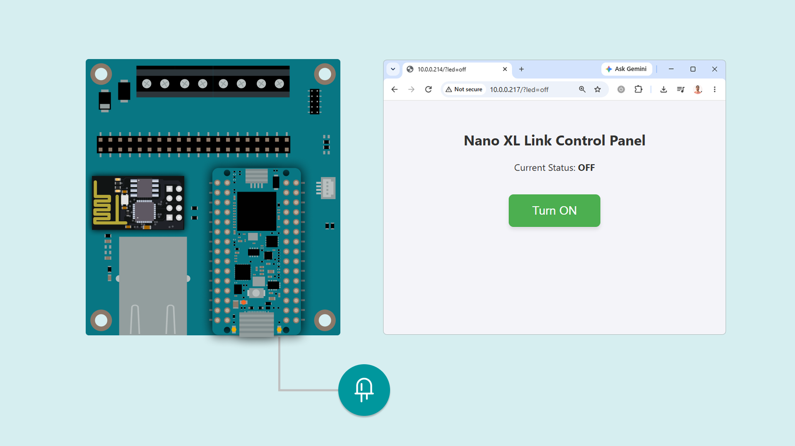

Now you can control the Nano XL Link onboard LED by clicking on the Web UI button.


## Headers and Connectors

The Nano XL Link Connector Carrier exposes all host signals through its dual 2x20 breakout headers (J1), making them easy to access with standard test equipment and jumper wires. For dedicated peripherals and industrial integration, it also features two 4-position screw terminal blocks (J8, J9) for RS-485, CAN, and Power IN, an RJ45 Ethernet port (J2), a Qwiic I2C connector (J7), and specific headers for an ESP-01 WiFi module (J5) and SWD/JTAG debugging (J6).

### Nano XL Header (J4)


| Pin No. | Inner Pin (Standard Nano Digital) | Pin No. | Outer Pin (XL Extension) |
| ------- | --------------------------------- | ------- | ------------------------ |
| 1       | D12                               | 30      | NC                       |
| 2       | D11                               | 29      | NC                       |
| 3       | D10                               | 28      | GND                      |
| 4       | D9                                | 27      | ETH_TXP                  |
| 5       | D8                                | 26      | ETH_TXN                  |
| 6       | D7                                | 25      | GND                      |
| 7       | D6                                | 24      | ETH_RXP                  |
| 8       | D5                                | 23      | ETH_RXN                  |
| 9       | D4                                | 22      | GND                      |
| 10      | D3                                | 21      | LED_ACT                  |
| 11      | D2                                | 20      | NC                       |
| 12      | GND                               | 19      | CAN-H                    |
| 13      | RESET                             | 18      | CAN-L                    |
| 14      | UART6_RX                          | 17      | RS485-A                  |
| 15      | UART6_TX                          | 16      | RS485-B                  |

### Nano XL Header (J3)


| Pin No. | Outer Pin (XL Extension) | Pin No. | Inner Pin (Standard Nano Analog) |
| ------- | ------------------------ | ------- | -------------------------------- |
| 1       | USB D+                   | 30      | D13                              |
| 2       | USB D-                   | 29      | +3V3                             |
| 3       | SPI2_COPI                | 28      | AREF                             |
| 4       | SPI2_CIPO                | 27      | A0                               |
| 5       | SPI2_SCLK                | 26      | A1                               |
| 6       | SPI2_CS                  | 25      | A2                               |
| 7       | I2C3_SDA                 | 24      | A3                               |
| 8       | I2C3_SCL                 | 23      | A4                               |
| 9       | I2S_CK                   | 22      | A5                               |
| 10      | I2S_WS                   | 21      | A6                               |
| 11      | I2S_SDI                  | 20      | A7                               |
| 12      | I2S_SDO                  | 19      | VBUS                             |
| 13      | SWCLK                    | 18      | SWDIO                            |
| 14      | UART1_TX                 | 17      | GND                              |
| 15      | UART1_RX                 | 16      | VIN                              |

### Nano Breakout Headers (J1)

The carrier exposes the board's I/O through a 2x20 pin breakout header.

| Pin | Function | Pin | Function  |
| --- | -------- | --- | --------- |
| 1   | D9       | 2   | VIN       |
| 3   | D8       | 4   | GND       |
| 5   | D5       | 6   | VBUS      |
| 7   | D3       | 8   | USB D+    |
| 9   | D13      | 10  | USB D-    |
| 11  | D12      | 12  | SPI2_COPI |
| 13  | D11      | 14  | SPI2_CIPO |
| 15  | D10      | 16  | SPI2_SCLK |
| 17  | GND      | 18  | SPI2_CS   |
| 19  | AREF     | 20  | I2C3_SDA  |
| 21  | A0       | 22  | I2C3_SCL  |
| 23  | A1       | 24  | I2S_CK    |
| 25  | A2       | 26  | I2S_WS    |
| 27  | A3       | 28  | I2S_SDI   |
| 29  | A4       | 30  | I2S_SDO   |
| 31  | A5       | 32  | GND       |
| 33  | A6       | 34  | UART6_RX  |
| 35  | A7       | 36  | UART6_TX  |
| 37  | GND      | 38  | SWDIO     |
| 39  | +3V3     | 40  | SWCLK     |


### SWD 2x5 1.27mm Connector (J6)

Used for low-level debugging and programming of the microcontroller.

| Pin | Function | Pin | Function |
| --- | -------- | --- | -------- |
| 1   | +3V3     | 2   | SWDIO    |
| 3   | GND      | 4   | SWCLK    |
| 5   | GND      | 6   | NC       |
| 7   | NC       | 8   | NC       |
| 9   | NC       | 10  | RESET    |


## Support

If you encounter any issues or have questions while working with the Arduino® Nano XL Link Connector Carrier, we provide various support resources to help you find answers and solutions.

### Help Center

Explore our [Help Center](https://support.arduino.cc/hc/en-us), which offers a comprehensive collection of articles and guides for the Nano family boards. The Arduino Help Center is designed to provide in-depth technical assistance and help you make the most of your device.

- [Nano Family Help Center page](https://support.arduino.cc/hc/en-us/sections/360004605400-Nano-Family)

### Forum

Join our community forum to connect with other Nano family board users, share your experiences, and ask questions. The forum is an excellent place to learn from others, discuss issues, and discover new ideas and projects related to the Nano XL Link Connector Carrier.

- [Nano category in the Arduino Forum](https://forum.arduino.cc/c/official-hardware/nano-family/87)

### Contact Us

Please get in touch with our support team if you need personalized assistance or have questions not covered by the help and support resources described before. We are happy to help you with any issues or inquiries about the Nano XL Link Connector Carrier.

- [Contact us page](https://www.arduino.cc/en/contact-us/)