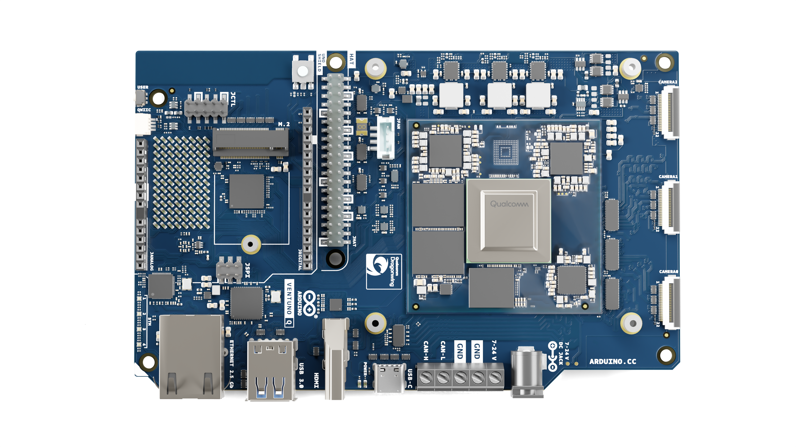

# 日本語

# 説明

Arduino® VENTUNO™ Qは、次世代のAIおよびロボティクス向けに特別に設計された高性能エッジAIコンピュータだ。産業用グレードのコンピューティングとリアルタイムのアクチュエーションをシームレスに橋渡しすることで、VENTUNO Qは、単一のコンパクトなエッジデバイスから、複雑なAIモデルを展開するための処理能力と、物理世界を操作するための精密な制御の両方を提供する。

その中核をなすのは、革新的なデュアルブレインアーキテクチャだ。堅牢なQualcomm Dragonwing™ IQ8 (QCS8275) マイクロプロセッサ（MPU）は、高度なコンピュータビジョンや、完全なUbuntu Linux OS（Debianもサポート）上で動作するローカルLLM向けに、最大40 dense TOPSのAI演算性能を提供する。一方、Zephyr OS上でArduino Coreを実行する専用のSTMicroelectronics STM32H5F5マイクロコントローラ（MCU）は、複雑なモーター制御やロボティクスに必要な低遅延かつ高精度な制御を保証する。

VENTUNO Q を使えば、常時接続を維持し、いつでも展開できる状態を保てる。Wi-Fi® 6（トライバンド）および Bluetooth® 5.3 接続を内蔵しているほか、高速 USB 3.0、HDMI、2.5 Gb イーサネット、拡張可能な NVMe Gen 4 ストレージ用の M.2 コネクタなど、包括的なコネクタ群を備えている。 このボードは、Arduino UNOシールドの広範なエコシステムをネイティブでサポートするほか、40ピンヘッダーを介してRaspberry Pi® HAT、Qwiicコネクタを介してArduino® Modulino™ノードにも対応している。

# 対象分野

エッジAI、ローカルLLM/VLM、スマートホーム、ロボティクス、モーションコントロール、スマートシティ、産業用ビジョン、教育・研究

製品の用途 Arduinoハードウェア製品は、主に開発およびプロトタイピングを目的としているが、量産ソリューションにも対応する場合がある。開発者は、想定される導入環境に基づき、早期にセキュリティ対策を設計・検証しなければならない。セキュリティはArduinoとソリューション構築者の双方の責任であり、ソリューション構築者はハードウェアが備えるセキュリティ機能を評価し、必要な保護措置を追加しなければならない。

**製品の用途** 

Arduinoハードウェア製品の「使用目的およびセキュリティモデル」の全文については、docs.arduino.cc/tutorials/security/intended-use-and-security-model/ を参照のこと。

# 目次

## 適用例

VENTUNO Qは、AI対応のLinuxプロセッサとリアルタイムマイクロコントローラを組み合わせ、高水準の演算能力と決定論的制御の両方の長所を実現している。これは、物理的な世界を直接形作ることができるAIを求めるメイカーや開発者のために特別に設計されたものだ。

- **AIアシスタント・スマートホーム :** オフライン音声アシスタント、ローカルエージェント型ハブ、タッチレスインターフェースキオスク、リアルタイム音声翻訳システムを構築できる。
- **ロボティクス・モーションコントロール :** ビジュアルSLAMを活用した自律移動ロボット（AMR）、ビジョン誘導型マニピュレーター、コンパニオンロボットやサービスロボット。
- **スマートシティ・産業用ビジョン :** エッジ型交通監視システム、組立ラインでの自動品質検査、予防的な現場セキュリティ、ビジョンベースの在庫監視。
- **教育・研究 :**  高度なAI学習キット、迅速な研究用プロトタイピング、音声ベースのコーディングアシスタント、モバイルマニピュレーション研究プラットフォーム。

## 特長

### VENTUNO Qのバリエーション

VENTUNO Qには1つのバリエーションが用意されている：

- **ABX00181**：16 GB LPDDR5 RAM、64 GB eMMCストレージ

### 一般的な仕様の概要

#### プロセッサとメモリ

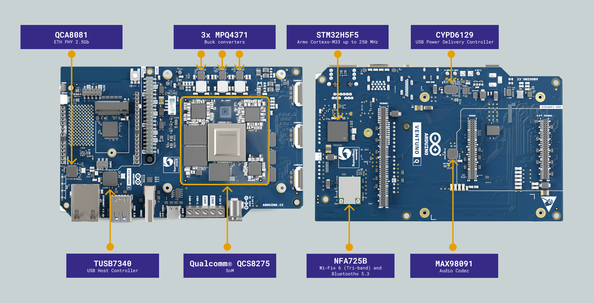

| **サブシステム** | **詳細**                                                                             |
| ------------- | --------------------------------------------------------------------------------------- |
| メインMPU      | Qualcomm Dragonwing™ IQ8 (QCS8275)                                                      |
|               | CPU: オクタコア Arm® Cortex®                                                             |
|               | Adreno™ 623 GPU (3DグラフィックスおよびOpenCL)                                                  |
|               | Adreno™ VPU 623 （動画処理）                                                      |
|               | Hexagon™ Tensor AIプロセッサ（NPU）：最大40 dense TOPS                                 |
|               | Qualcomm Spectra 692 ISP                                                                |
|               | Ubuntu Linux OS（Debianもサポート）                                                 |
| リアルタイムMCU | ST STM32H5F5 （MCU）、Arm® Cortex®-M33（最大250 MHz）                                      |
|               | Zephyr OS上のArduino Core                                                               |
|               | 4 MBフラッシュ、1.5 MB RAM                                                                  |
| システムメモリ | OS/データ用eMMC 64 GB                                                                  |
|               | OSPI SAILメモリ (MX25UW25345GXDI00-TR)（MCUのブート／共有データ用）                        |
|               | NVMe Gen 4ストレージ用M.2 Key M 2230コネクタ（SOMから直接PCIe x4接続、ブート不可） |
|               | 2x8 GB LPDDR5 RAM（合計16 GB）                                                         |

#### 接続性およびメディア

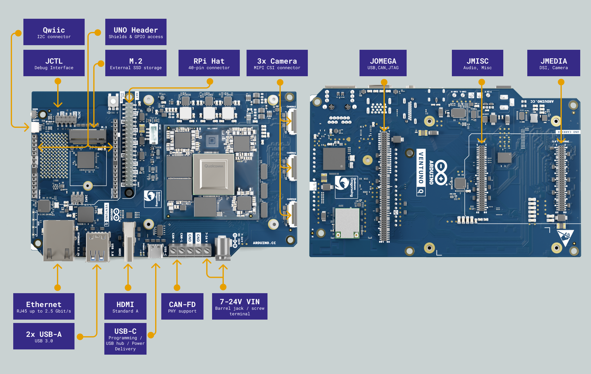

| **サブシステム**      | **詳細**                                                                                 |
| ------------------ | ------------------------------------------------------------------------------------------- |
| ネットワーク・ワイヤレス | Wi-Fi® 6 2.4/5/6 GHz（トライバンド）、オンボードアンテナ2本搭載（NFA725Bモジュール）                   |
|                    | Bluetooth® 5.3、オンボードアンテナ搭載                                                         |
|                    | 2.5 Gbit RJ45イーサネット×1（QCA-8081 PHY）                                                    |
| USBコネクタ     | ホスト／デバイス役割切り替え、電源役割切り替え、ビデオ出力対応のUSB-Cポート×1           |
|                    | USB 3.0 Type A×2                                                                           |
|                    | JOMEGAヘッダー上のUSB 3.0×2                                                                 |
| ビデオ              | オンボードのADV7535 DSI-to-HDMIブリッジ経由のHDMI出力×1。 HDMIとMIPI DSIは              |
|                    | 同じDSIラインを共有する。HDMIがアクティブな場合、JMEDIAヘッダー上のMIPI DSIはマルチプレクサにより切り離される             |
|                    | USB-C経由のビデオ出力（DP Altモード）                                                        |
| カメラ             | オンボードのMIPI CSIコネクタ×3（J3_1、J3_2、J3_3）                                          |
|                    | JMEDIAヘッダー上にも2本のMIPI CSIレーンが利用可能（基板上のコネクタと多重化されている）           |
|                    | USB Type-AまたはUSB-C経由のUSBカメラ対応                                                  |
| オーディオ              | オーディオコーデック：MAX98091ETM+T（Maxim）                                                          |
|                    | JMISC上： 1x LINE OUT モノラル、1x SPEAKER OUT モノラル、1x HEADPHONES OUT ステレオ、1x MIC IN        |
|                    | JOMEGA上：1x MIC IN                                                                        |
| CANインターフェース     | ネジ端子上のPHY（ATA6563-GBQW1）付きCAN-FD 1x、MCU (STM32H5F5)             |
|                    | CAN-H および CAN-L ラインは TVS 保護付き (PJGBLC24C-AU_R1_000A1、双方向、24 V、350 W) |
|                    | ネジ端子上の CAN バスにオンボードの分割終端 (2× 60.4 Ω + 100 nF)                    |
|                    | JOMEGAヘッダー上の3つのCAN-FD（PHYなし）、MCU経由でピン多重化                                      |
|                    | UNO Shieldヘッダー（D4/D5）上の1つのCAN-FD（PHYなし）、MCU経由でピン多重化                         |

>📝 **注：** ネジ端子上のCANバスには、オンボードのスプリット終端（2× 60.4 Ω + 100 nF）が含まれている。ボードがバスの末端にない場合、ネットワークトポロジーを設計する際にはこの終端を考慮する必要がある。

#### 拡張機能とヘッダー

| **インターフェース（コネクタ）** | **詳細**                                                                                                                            |
| ------------------------- | -------------------------------------------------------------------------------------------------------------------------------------- |
| UNOシールドヘッダー        | - 標準的なArduino UNOシールド（3.3 Vロジック）に対応している                                                                           |
|                           | - ほとんどのデジタルピンは5 V耐性がある。JANALOG上のA0およびA1はADCの直接入力であり、5 V耐性はない                              |
| 拡張ヘッダー（JOMEGA） | - USB 3.0、CAN-FD、JTAG、MIC IN、MPU SPI を含む広範な拡張機能                                                    |
| Carrier Headers | - JMEDIA：1.8 V の MIPI CSI0/CSI1 カメラレーンおよび MIPI-DSI ディスプレイレーン                                                              |
|                           | - JMISC：オーディオエンドポイント、1.8 VのMPU GPIO、および3.3 VのMCU信号                                                                   |
| Qwiicコネクタ           | - MCUに接続されたI2C（3.3V）により、Modulino®ノードへの即時のプラグアンドプレイアクセスが可能だ                                                      |
| JHATコネクタ            | - Raspberry Pi®互換の40ピンヘッダー（MPU GPIO、TXS0108ERKSRおよびTXS0104ERUTRを介してHAT互換性のために3.3 Vへレベル変換済み） |
| JCTL (MPUリモートデバッグ)   | - MPUリモートデバッグ用の10ピン（2×5）ヘッダー。[Arduino Bughopper](https://docs.arduino.cc/hardware/bughopper/)と互換性がある       |

## 定格

### 入力電源

| **電源**               | **電圧範囲** | **最大電流** | **コネクタ**          |
| ------------------------ | ----------------: | ------------------: | ---------------------- |
| USB-C PD                 |              20 V |           最大 3 A | USB-C コネクタ        |
| バレルジャック (5.5×2.1 mm) |           12-24 V |           最大 5 A | 5.5×2.1 mm バレルジャック |
| ネジ端子           |            7-24 V |          最大 10 A | ネジ端子         |

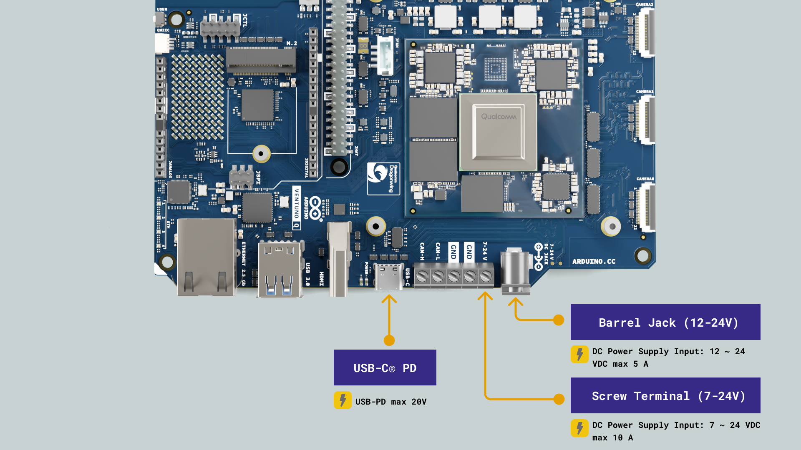

両方の入力経路はTVS保護（SMBJ24CA、24 V双方向）されており、独立した電源スイッチ（KTS1900GXAA-TA + SQS414CENW-T1_GE3）を経由して電流検出段（INA232AIDDFR）へと接続されている。 2つの多相バックコンバータ（MPQ4371GVE-1001-AECC901-Z）がメインの3.3 Vレールを生成し、別のバックコンバータ（MPQ4371GVE-1001-AECC901-Z）が5 Vレールを生成する。 USB-C® PDコントローラ（CYPD6129-52LQXI）は、互換性のあるUSB-C®電源から最大20 Vまでの電圧プロファイルをネゴシエートする。

> 📝 **DC入力電流および電力バジェットに関する注記：** バレルジャックコネクタの定格は最大5 Aである。利用可能な電力バジェットは入力電圧に依存する。7 V（5 A）の場合、供給可能な最大電力は35 W、12 Vの場合は60 W、 24 Vでは120 Wとなる。MPU、NPU、GPUが同時にフルパフォーマンスで動作する最悪の条件下では、SoM単体で約23～25 Wを消費する。イーサネットPHY、オーディオコーデック、USBハブ、その他のオンボードICを含むボード全体ではさらに多くの電力を消費するため、7 Vではコネクタの限界に達するまでの余裕が限られる。
>
> ボードに7 Vで給電する際は、ケーブルの電圧降下を必ず考慮すること。ボードのコネクタには最低7 Vが必要であり、7 V未満の電圧では電源が入らないからだ。
>
> 2つのUSB Type-Aポートは、それぞれ最大5 V × 1.71 A = 8.55 Wを供給可能であり、合計で最大約17 Wの追加消費電力となる。 ボードがフルパワーで動作し、両方のUSB-Aポートが最大負荷状態の場合、総消費電力は42 Wに近づき、7 V時のDCジャックの制限値である35 Wを超え、コネクタの損傷の恐れがある。
>
>
> **AI推論、USB周辺機器、および接続されたシールドやHATを同時に使用する場合は、12 Vまたは24 Vでの動作を強く推奨する**。
>
> AI推論、USB周辺機器、または拡張アプリケーションを伴う高負荷の作業では、ピーク時の消費電力でも安定した動作を確保するため、すべての電源について**60 W以上**の定格を持つ電源の使用が推奨される。 **バレルジャック**（5.5×2.1 mm、最大5 A）を使用する場合、例として**12 V / 5 A または 24 V / 3 A**の電源が推奨される。

### 推奨動作条件

| **パラメータ**             | **記号**       | **最小値** | **標準値** | **最大値** | **単位** |
| ------------------------- | ---------------- | :---------: | :---------: | :---------: | :------: |
| USB-C PD入力            | VUSBC |      -      |      -      |    20.0     |    V     |
| DC入力（ネジ端子） | VIN   |     7.0     |      -      |    24.0     |    V     |
| DC入力 （バレルジャック）    | VIN   |    12.0     |      -      |    24.0     |    V     |
| 5.0 V レール（出力）       | V+5V  |    4.75     |     5.0     |    5.25     |    V     |
| 3.3 V レール （出力）       | V3P3  |    3.14     |     3.3     |    3.47     |    V     |
| 動作温度     | TOP   |     -10     |      -      |     60      |    °C    |

>📝 **注：** USB-C® PDコントローラは、PD対応の電源に接続された場合、複数の電圧プロファイル（9 V、15 V、20 V）に対応している。

### オンボード電圧レール

| **電圧** | **レール**              | **発生源／レギュレータ**                                                                  |
| :---------: | --------------------- | ------------------------------------------------------------------------------------- |
|   7～24 V    | VIN        | ジャック／ネジ端子入力（TVS保護付き、SMBJ24CA）                                   |
|    5.0 V    | +5V                   | MPQ4371GVE バックコンバータ                                                             |
|    3.3 V    | +3V3                  | MPQ4371GVE 降圧コンバータ 2基                                                         |
|    1.8 V    | SOM_VREG_MDPX3_1P8    | SOM メインアプリケーションドメインの 1.8 V レール（JMISC、JCTL 経由でユーザーがアクセス可能）              |
|    1.8 V    | SOM_VREG_S5S_SPX3_1P8 | SOM 安全サブシステム (RTSS) ドメイン専用、一般用途には使用しない                          |
|    1.8 V    | +1V8                  | MPQ2179GQHE 降圧コンバータ (オンボード IC QCA8081、ADV7535、 MAX98091用)              |
|   1.28 V    | +1.28V                | MP20312GTF LDO（オーディオコーデック MAX98091用）                                             |
|    1.1 V    | +1V1                  | MPQ2179GQHE 降圧コンバータ （搭載IC：TUSB7340RKMR、QCA8081、PI7C9X2G304EV用） |

>📝 **注：** このボードには、3つの独立した1.8 Vレールが備わっている。`SOM_VREG_MDPX3_1P8`は、QCS8275 SoMのメインアプリケーションドメインレールであり、JMISCやJCTLを含む、ユーザーがアクセス可能なすべての1.8 Vインターフェースの推奨リファレンスである。 `SOM_VREG_S5S_SPX3_1P8`は、SoMの安全サブシステム（RTSS）ドメインのレールであり、汎用電源や基準電圧として使用してはならない。 `+1V8`は、MPQ2179GQHEバックコンバータによって生成されるボードレベルの1.8 Vレールであり、QCA-8081イーサネットPHY、ADV7535ディスプレイブリッジ、およびMAX98091オーディオコーデックに電力を供給する。

>📝 **注：** 上記のレールとは別に、JMISCのピン59は最大3.3 VのRTCバックアップバッテリーを受け入れ、ボードの電源が切れている際にもSOMおよびMCUのリアルタイムクロックを維持する。 `SOM_VCOIN`（SOM RTC）と`VBAT`（MCU RTC）は、2つのRTCバックアップバッテリー入力であり、これらは共有の電源レールではなく、この単一のピンで物理的に接続されている。それぞれが独自の0 Ω抵抗を介して共通ノードに接続されており、このノードはグランドを基準とする双方向TVSダイオード（Vr = 5.5 V）によって保護されている。 予想される消費電流は非常に低く、このピンはボードの他の部分を動作させるための電力を供給するものではない。

### 標準的な消費

電力

以下の測定値は、周囲温度24.4°Cの条件下で、電力アナライザを用いて、12 V DC、24 V DC、および20 VのUSB-C® PDという3つの電源入力方式について行ったものである。MCU上の「Blink」、MPU上の「Hello World」、スマートフォンカメラ上の「Edge AI Assistant」および「Detect Objects」は、Arduino App Lab内の組み込みサンプルとして利用可能である。「Smart Mirror」のサンプルは、専用のアプリケーションノートを基にしている。

#### 標準的な消費電力 - 12 V DC

| **シナリオ**                        | **平均消費電力** | **最小消費電力** | **最大消費電力** |
| ----------------------------------- | ----------------: | ------------: | ------------: |
| 起動                             |            7.07 W |             – |        17.9 W |
| MCUでの「Blink」                        |            7.42 W |        5.30 W |        12.6 W |
| MPUでの「Hello World」                  |            7.52 W |        5.32 W |        13.3 W |
| エッジAIアシスタント                   |            13.5 W |        6.13 W |        24.6 W |
| スマートミラーの例¹               |            14.7 W |        7.65 W |        33.0 W |
| スマートフォンカメラでの物体検出 |            9.63 W |        5.80 W |        21.2 W |

#### 標準的な消費電力 - 24 V DC

| **シナリオ**                        | **平均消費電力** | **最小消費電力** | **最大消費電力** |
| ----------------------------------- | ----------------: | ------------: | ------------: |
| 起動                             |            9.71 W |             – |        23.7 W |
| MCUでの点滅                        |            10.6 W |        7.04 W |        18.9 W |
| MPUでの「Hello World」                  |            10.8 W |        7.09 W |        18.3 W |
| エッジAIアシスタント                   |            15.5 W |        7.44 W |        28.8 W |
| スマートミラーの例¹               |            17.3 W |        8.47 W |        36.6 W |
| スマートフォンカメラでの物体検出 |            11.5 W |        7.88 W |        24.7 W |

#### 標準的な消費電力 - USB-C® PD (20 V)

| **シナリオ**                        | **平均消費電力** | **最小消費電力** | **最大消費電力** |
| ----------------------------------- | ----------------: | ------------: | ------------: |
| 起動                             |            6.56 W |             – |        20.2 W |
| MCUでの点滅                        |            7.84 W |        6.33 W |        16.1 W |
| MPUでの「Hello World」                  |            9.68 W |        6.42 W |        16.1 W |
| エッジAIアシスタント                   |            15.3 W |        6.61 W |        25.6 W |
| スマートミラーの例¹               |            15.1 W |        8.05 W |        34.2 W |
| スマートフォンカメラでの物体検出 |            11.3 W |        7.85 W |        23.1 W |

¹ スマートミラーのテスト環境：Logitech BRIO 4K USBカメラ、USBヘッドセット（マイクおよびスピーカー）、およびHDMIディスプレイを接続。

>📝 **注：** 測定は参考としてOtii Ace Pro電力アナライザーを使用して行った。すべてのシナリオおよび入力ソースにおいて記録された最高ピーク値は36.6 W（24 V DCでのスマートミラーの例）であり、上記の60 W以上の電源推奨値の範囲内であった。

## 機能概要

### **ピン配置**

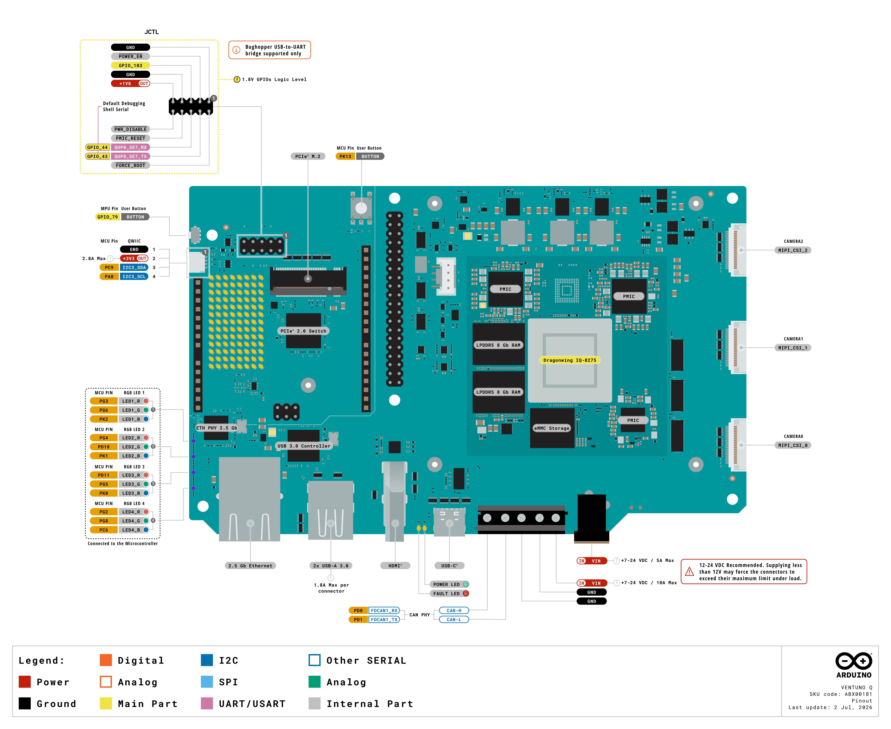

### ブロック図

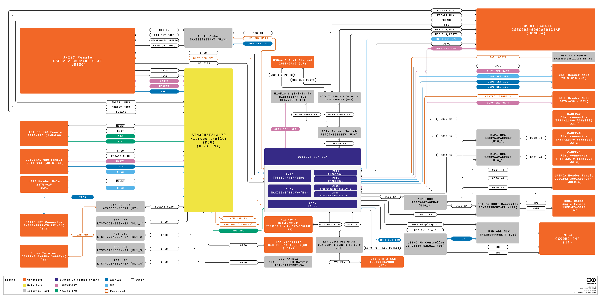

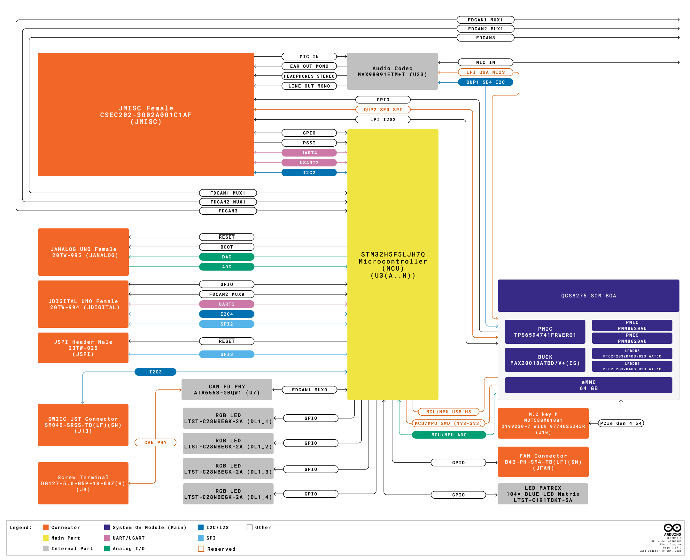

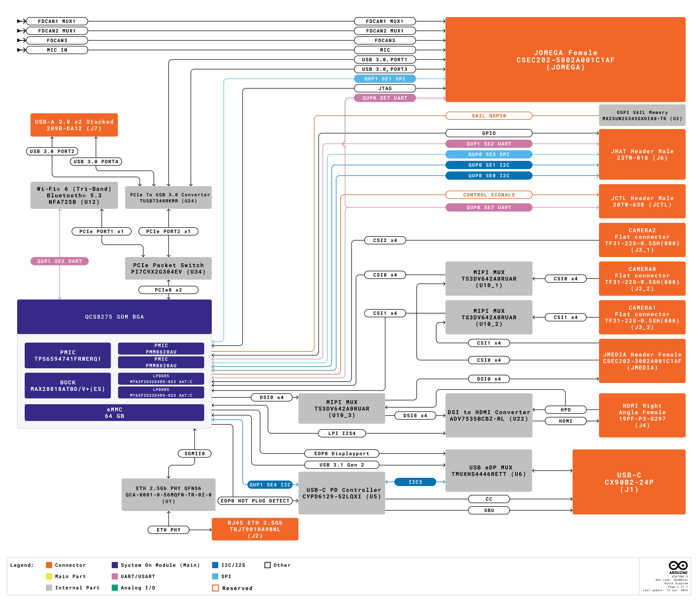

### 電源

VENTUNO Qは、最大20 VのPower Delivery (PD) ネゴシエーションに対応したUSB-C®ポートと、5.5×2.1 mmバレルジャックまたはネジ端子を介した7～24 V DC入力の2つの独立した電源入力経路をサポートしている。 両方の経路は双方向24V TVSによって保護されており、バックコンバータに到達する前に、独立した逆極性および逆電流保護機能を備えたパワースイッチ（KTS1900 + 2x NMOS）のパワーOR回路を経由する。

電流検出IC（INA232AIDDFR）が、アクティブな経路全体の入力総電流を監視する。 2つの多相降圧コンバータ（MPQ4371GVE-1001-AECC901-Z）が、SOM（QCS8275）およびボード上の3.3 V周辺機器に電力を供給するメインの「+3V3」レールを生成する。3つ目のMPQ4371GVE降圧コンバータが「+5V」レールを生成する。

1つのMPQ2179GQHE降圧コンバータが`+1V8`レールを生成し、QCA-8081イーサネットPHY、ADV7535ディスプレイブリッジ、およびMAX98091オーディオコーデックに電力を供給する。 1つのMPQ2179GQHE降圧コンバータが`+1V1`レールを生成し、TUSB7340RKMR、QCA-8081、およびPI7C9X2G304EV PCIeスイッチに電力を供給する。

SOMは、内部PMIC（`SOM_VREG_MDPX3_1P8`）を介して`MDPX3_1P8`（1.8 V）メインアプリケーションドメインレールを提供する。このレールは、JMISCおよびJCTLを介してユーザーがアクセス可能である。 別の`SOM_VREG_S5S_SPX3_1P8`レールは、リアルタイム安全サブシステム（RTSS）専用である。汎用リファレンスとして使用してはならない。MP20312GTF LDOが、MAX98091オーディオコーデック用の`+1.28V`レールを生成する。

専用の MP5077GG-Z ロードスイッチが、M.2 NVMe スロット、`+3V3_LIMITED` レール（UNO シールド、HAT、Qwiic 用）、および `+5V_LIMITED` レール（シールドおよび HAT 用）を個別に制御する。 各USB Type-AポートのVBUSレールは、TUSB7340RKMRによって有効化および保護される。その他のすべての周辺機器用ロードスイッチは、SOMのGPIO制御によるイネーブルラインによって制御され、MPUが未使用のサブシステムへの電源供給を遮断できるようにしている。

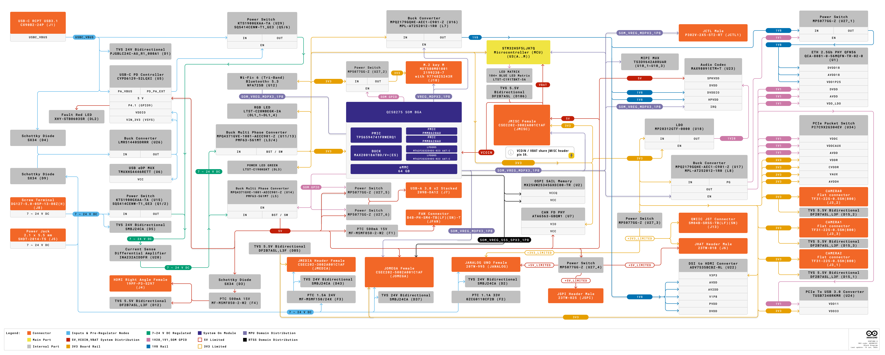

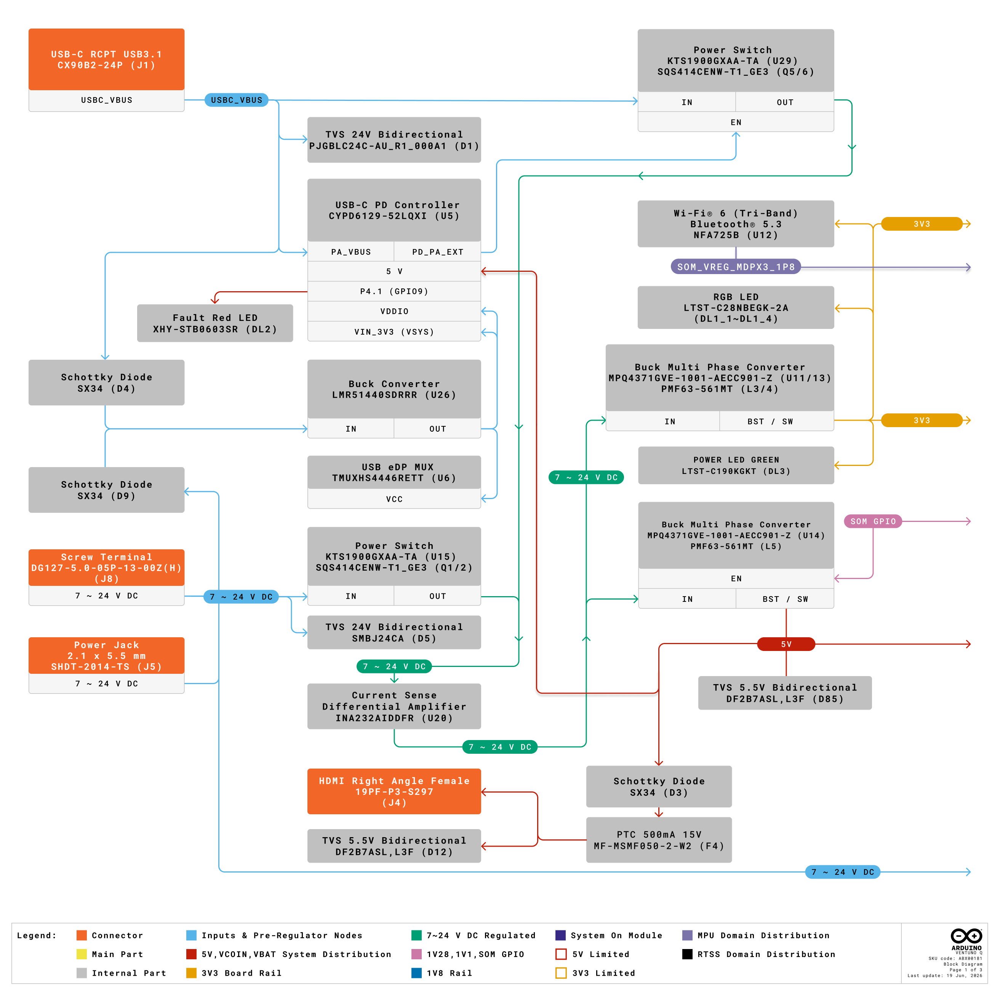

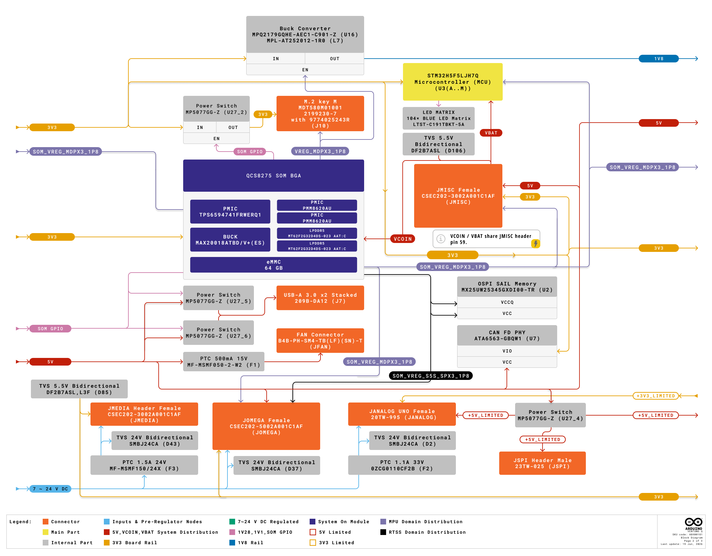

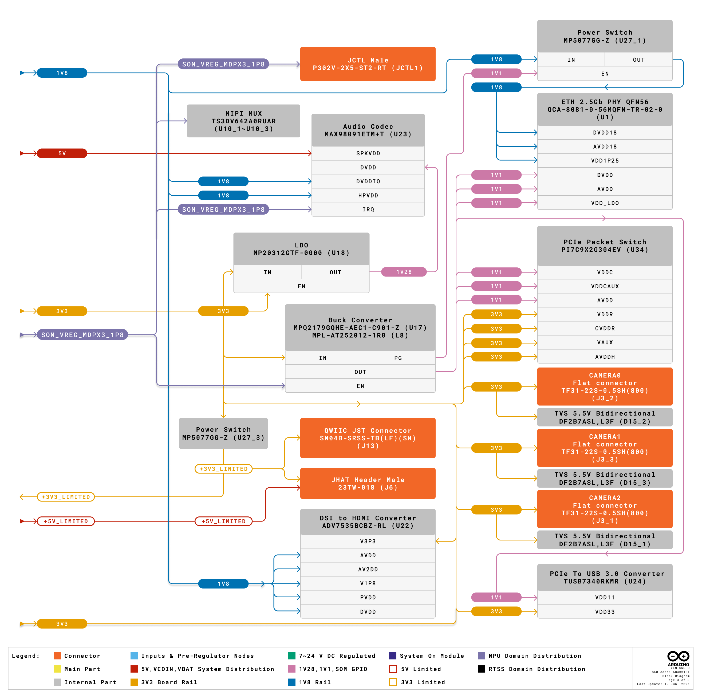

## UI およびインジケーター

| **インジケーター** | **種類**                          | **コントローラー**                              | **備考**                                                 |
| ------------- | --------------------------------- | ------------------------------------------- | --------------------------------------------------------- |
| LEDマトリックス    | 104個の青色LED (LTST-C191TBKT-5A) | GPIO経由のMCU                                | プログラム可能なディスプレイマトリックス                               |
| 4個のRGB LED   | LTST-C28NBEGK-2A                  | GPIO経由のMCU                                | ユーザーがアドレス指定可能なステータスインジケータ                        |
| 電源LED     | 緑 (LTST-C190KGKT)             | ハードウェア (+3V3レール)                        | +3V3レールがアクティブであることを示す                             |
| 故障LED     | 赤 (XHY-STB0603SR)               | USB-C® PDコントローラ (CYPD6129, GPIO9/P4.1) | PDコントローラによって検出された故障状態を示す |

- **4× RGB LED:** STM32H5F5マイクロコントローラ（MCU）により、12本の個別のGPIOピン（LED 1つにつき3本）を介して駆動される4つの3色LEDだ。これらはユーザーがアドレス指定可能であり、Arduinoプログラム内からアプリケーションの状態、接続状態、またはカスタムイベントを示すために使用できる。

| **記号** | **RGB LED** | **赤** | **緑** | **青** |
| -------------- | ----------- | ------- | --------- | -------- |
| DL1_1          | RGB LED 1   | PG3     | PG6       | PK2      |
| DL1_2          | RGB LED 2   | PG4     | PD10      | PK1      |
| DL1_3          | RGB LED 3   | PD11    | PG5       | PK0      |
| DL1_4          | RGB LED 4   | PG2     | PG8       | PC6      |

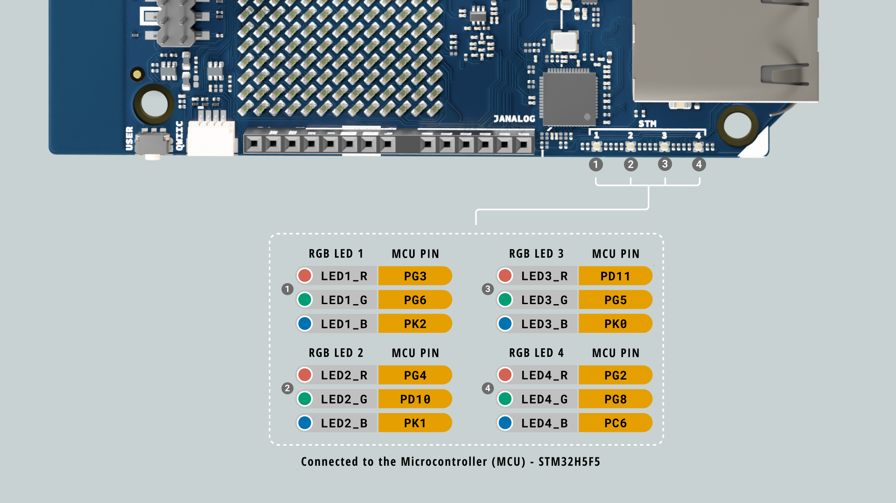

>📝 RGB LEDはアクティブロー方式であり、ロジック`0`に駆動されると点灯する。

- **LEDマトリックス：** STM32H5F5 MCUによって駆動される8×13のモノクロ青色LEDマトリックス（104ピクセル）だ。Linuxの起動中に、約20～30秒間ブートアニメーションを表示する。起動が完了する前にマトリックスにアクセスすると、MCUの動作に支障をきたす可能性がある。

>📝 **注：** ブートアニメーションは、MCUのブートローダーが読み込まれ、有効なプログラムが実行されている場合にのみ再生される。表示されない場合は、『[VENTUNO Q ユーザーマニュアル](https://docs.arduino.cc/tutorials/ventuno-q/user-manual/)』を参照のこと。

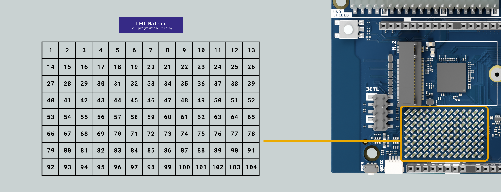

- **電源LED：** `+3V3` レールに接続された緑色のインジケータ（LTST-C190KGKT）。ボードに電源が供給されている間は常に点灯する。

- **障害LED：** USB-C® PDコントローラ（CYPD6129、GPIO9/P4.1）によって駆動される赤色インジケータ。PDコントローラによって検出された障害状態を示す。

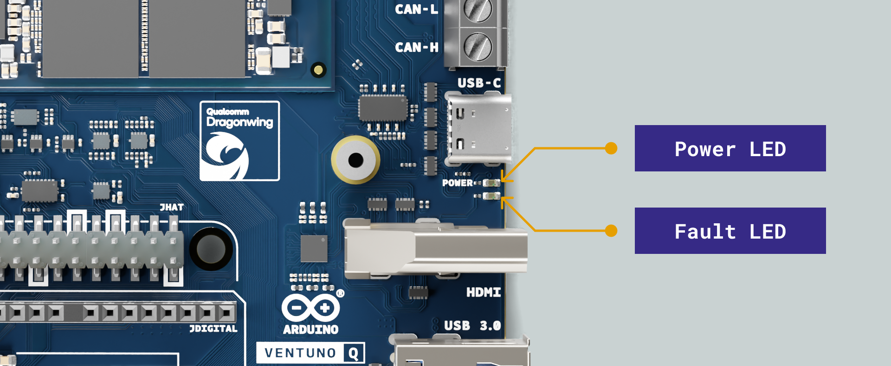

## MPU と MCU

MPU（マイクロプロセッサユニット）は、完全なオペレーティングシステムや複雑なソフトウェアを実行するように設計された高性能なアプリケーションプロセッサである。MCU（マイクロコントローラユニット）は、I/Oや制御の高速かつ精密なタイミングを実現するために設計された、小型で省電力のコントローラである。VENTUNO Qはこれら両方を組み合わせることで、単一のボード上でOSレベルの演算処理と、応答性が高く時間的制約の厳しい制御を両立させ、双方に実装されたRPCレイヤーである「Bridge」を介して通信を行う。

### アプリケーションプロセッサ（MPU）

Qualcomm® Dragonwing™ IQ8 (QCS8275) は、Ubuntu Linux OS（Debianもサポート）を実行するオクタコア Arm® Cortex® プロセッサである。そのI/Oは1.8 Vで動作し、高速メディアインターフェースやAI推論を処理する。

- 電圧ドメイン：MPU（SoC）のGPIOおよび高速インターフェースは1.8 V。
- JMEDIAを駆動：MIPI CSIカメラレーンおよびMIPI-DSIディスプレイレーン。
- キャリアヘッダー上の1.8 V MPU GPIOおよびオーディオエンドポイント（JMEDIA、JMISC）を駆動する。
- USB-C：CYPD6129 PDコントローラを介してロール切り替えを管理し、PDネゴシエーションを独立して処理する（最大20 Vのプロファイルに対応）。
- USB-Cコネクタ上のUSB eDP MUX（TMUXHS4446RETT）を介したDisplayPort出力。
- エッジAIおよびグラフィックスワークロード向けに、Hexagon™ NPU（最大40 dense TOPS）およびAdreno™ 623 GPUを動作させる。

### リアルタイム・マイクロコントローラ（MCU）

STMicroelectronics® STM32H5F5は、Zephyr OS上でArduino Coreを実行するArm® Cortex®-M33であり、動作周波数は250 MHzだ。ロボット工学、モーター制御、および一般的なI/O向けに、高速かつ決定論的なタイミングを提供する。

- 電圧ドメイン：GPIOおよびアナログインターフェース用に3.3 V。
- ADC、PWM、LEDマトリックス、RGB LED、タイマーを管理する。
- 3.3 Vヘッダー（JDIGITAL、JANALOG、JSPI）を扱う。
- すべてのCAN-FDインターフェースを制御する：ネジ端子上のPHYおよびJOMEGAおよびUNOシールドヘッダー上の非PHYポート。

JMISCは両方のドメインを扱う。1.8 VのMPUラインと、3.3 VのMCU信号（PSSI、I²C、GPIO）およびアナログオーディオが共存している。JMISCにCarrierや外部ロジックを接続する際は、必ず電圧レベルを確認すること。

>📝 **VDDIO2に関する注意：** STM32H5F5には、`SOM_VREG_MDPX3_1P8`（1.8 V）から給電される二次I/O電源ドメイン（VDDIO2）がある。これにより、特定のMCUピンは、外部レベル変換器を必要とせずに1.8 VでMPUと直接通信できる。 以下のインターフェースはVDDIO2ドメインで動作する：
>
>- **MCU I2C1**は、MCUとMPU間の直接通信
に使用される >- **MCUのGPIOピンPG9、PG10、PG11、PG12、PG13、およびPG14**は、1.8 V
でMPUと直接通信する >
> これらのピンに3.3 Vのロジックを印加してはならない。 その他のすべてのMCU GPIO信号は、標準のVDDIOドメイン上で3.3 Vで動作する。

>⚠️ **電圧レベルの警告：** MPUのGPIO信号は1.8 Vで動作するが、MCUのGPIO信号は3.3 Vで動作する。ハードウェアの損傷を防ぐため、拡張ヘッダへの外部接続が、それぞれのプロセッサドメインの電圧レベルと互換性があることを確認すること。

## プロセッサ間通信

Qualcomm® Dragonwing™ IQ8 (QCS8275) (MPU) と STM32H5F5 (MCU) は、Linux 側と MCU 側の両方に実装されたソフトウェアベースのリモートプロシージャコール (RPC) レイヤーである Arduino Bridge を通じて通信する。 Bridgeは、サービス指向のAPIを提供し、いずれのプロセッサも相手側が呼び出せるサービスを公開できるようにすると同時に、非同期イベントに対する一方向の通知もサポートしている。また、プロセッサ間のメッセージルーティングを管理し、複数の物理トランスポートに対応している。

BridgeはAPIを通じて型安全な関数呼び出しを実現し、マイクロコントローラのプログラムがLinuxサービスを呼び出して構造化された応答を受け取ったり、通知を介してデータをプッシュしたりできるようにする。

2つのプロセッサ間の物理トランスポート層には、以下のインターフェースが含まれる：

| **インターフェース** | **方向**     | **目的**                                       |
| ------------- | ----------------- | ------------------------------------------------- |
| USB 2.0       | SoC → MCU (ホスト) | 高帯域幅のデータ転送                     |
| SWD           | SoC → MCU        | デバッグインターフェース (1.8 V から 3.3 V へのレベル変換済み) |

キャリアボードや外部ロジックにハードウェアインジケータが必要な場合、ファームウェアはJMISC上の1.8 V MPU GPIO、または利用可能なJCTL GPIOを、レディまたはウェイク出力として割り当てることができる。この信号は、レベルシフタやプルアップ抵抗を備えたオープンドレイン構成などのレベル互換回路を介して、MCUのGPIOで受信できる。

>📝 MPU GPIO信号は、アプリケーションプロセッサの低電圧ドメイン（1.8 V）で動作する。マイクロコントローラへの接続は、そのI/O電圧レール（3.3 V）とレベル互換であることを確認すること。例えば、レベルシフタ、またはプルアップ抵抗を備えたオープンドレイン構成を使用して、マイクロコントローラのI/Oレールに接続する。

## ハードウェアアクセラレーション

VENTUNO Qは、統合されたHexagon™ Tensor AIプロセッサ（NPU）、Adreno™ 623 GPU、およびAdreno™ VPU 623を通じて、エッジAI、3Dグラフィックス、およびビデオのエンコード/デコードに対するハードウェアアクセラレーションを提供する。

### AIアクセラレーション（NPU）

オンボードのHexagon™ Tensor AIプロセッサは、最大40 dense TOPS（Tera Operations Per Second）のニューラルネットワーク演算性能を提供する。これにより、VENTUNO QはローカルLLM（大規模言語モデル）、VLM（ビジョン言語モデル）、および複雑なコンピュータビジョンパイプラインをオフラインで実行できる。

このNPUはQualcomm AI Stackと統合されており、Arduino App Labでネイティブにサポートされている。開発者は、**TensorFlow Lite、ONNX Runtime、PyTorch**を通じて最適化されたモデルを展開できる。また、VENTUNO Qは**Edge Impulse Studio**と直接統合されており、定型コードを記述することなく、カスタムエッジAIモデルの迅速なトレーニングと展開が可能だ。

| **コンポーネント**        | **仕様**                                       |
| -------------------- | ------------------------------------------------------- |
| プロセッサ            | Hexagon™ Tensor AIプロセッサ                            |
| ピーク性能     | 最大40 dense TOPS                                     |
| アーキテクチャ         | Hexagon DSP + クアッドHVX + デュアルHMXコプロセッサ          |
| 対応フレームワーク | TensorFlow Lite、ONNX Runtime、PyTorch                  |
| 統合          | Qualcomm AI Stack、Arduino App Lab、Edge Impulse Studio |

### グラフィックスアクセラレーション（GPU）

Adreno™ 623 GPUは、QCS8275 SoM上でハードウェアアクセラレーションによる3Dグラフィックスおよび汎用演算（GPGPU）を提供する。Qualcomm Linux上では、KGSLカーネルドライバを介して、Qualcomm独自のAdrenoドライバスタックによりGPUアクセラレーションが提供される。

GPUハードウェアの完全な仕様については、[QCS8275データシート (80-73475-1)](https://docs.qualcomm.com/doc/80-73475-1/topic/device-description.html) および [Qualcomm Linux グラフィックスガイド](https://docs.qualcomm.com/doc/80-70018-19/topic/) を参照のこと。

>📝 **注：** Adreno ドライバライブラリおよびファームウェアファイルは、デバイスの `/lib/firmware/` ディレクトリにある。 QCS8275のドキュメントに記載されているGPU機能のすべてが、VENTUNO Qに同梱されているソフトウェアで利用可能とは限らない。現在サポートされている機能の一覧については、[VENTUNO Qドキュメント](https://docs.arduino.cc/hardware/ventuno-q/)を参照のこと。

### ビデオアクセラレーション (VPU)

Adreno™ VPU 623は、QCS8275 SoM上でハードウェアアクセラレーションによるビデオ処理を提供する。サポートされるコーデック、解像度、および統合の詳細は、ボードに同梱されるソフトウェアスタックによって異なる。 ハードウェアの完全な仕様については、[QCS8275 データシート (80-73475-1)](https://docs.qualcomm.com/doc/80-73475-1/topic/device-description.html)を参照のこと。

>📝 **注：** QCS8275のドキュメントに記載されているすべてのコーデックやフレームワークが、VENTUNO Qに同梱されるソフトウェアで利用可能とは限らない。現在サポートされている機能の一覧については、[VENTUNO Qドキュメント](https://docs.arduino.cc/hardware/ventuno-q/)を参照のこと。

>📝 **注：** Qualcomm 専用の GStreamer プラグイン (`gstreamer1.0-plugins-qcom`) は、VENTUNO Q に同梱されている Ubuntu イメージにはデフォルトでは含まれていない。ハードウェアアクセラレーションによるカメラキャプチャやビデオパイプラインが必要な場合は、手動でインストールできる。 設定の詳細については、[VENTUNO Q ユーザーマニュアル](https://docs.arduino.cc/tutorials/ventuno-q/user-manual/)を参照のこと。

## 周辺機器とヘッダー

VENTUNO Qは、包括的なヘッダーおよびコネクタのセットを通じて、そのデュアルブレインアーキテクチャを実現している。MCU駆動のヘッダーは**3.3 V**ロジックで動作し、MPU駆動のヘッダーは**1.8 V**で動作する。ハードウェアの損傷を防ぐため、外部周辺機器を接続する前に、必ず各ヘッダーの電圧ドメインを確認すること。

### JANALOG

JANALOGヘッダーは、アナログ入力、電源レール、およびMCU制御信号を提供する。標準的なArduino UNOのアナログヘッダーレイアウトと互換性がある。アナログ入力は3.3 Vレールの`VREF+`を基準とし、`VDD + 0.3 V`（約3.6 V）を超えてはならない。 **アナログピンに5 Vを印加してはならない**。`IOREF`は3.3 Vのリファレンス出力であるため、これを介して電力を逆流させてはならない。

| **ピン** | **名称** | **ネット**               | **ドメイン** | **MCU ピン** | **備考**                    |
| ------: | --------------- | --------------------- | ---------- | ----------- | ---------------------------- |
|       1 | NC              | JANALOG_BOOT_MCU_3V3  | 3.3 V MCU  | BOOT0       | MCU ブートストラップ               |
|       2 | IOREF           | +3V3_LIMITED          | 電源      | -           | I/O電圧リファレンス出力    |
|       3 | RESET           | JANALOG_RESET_MCU_3V3 | 3.3 V MCU  | NRST        | MCUリセット                    |
|       4 | +3V3 OUT        | +3V3_LIMITED          | 電源      | -           | 3.3 V 電源出力             |
|       5 | +5V USB         | +5V_LIMITED           | 電源      | -           | 5 V 電源出力 (USB制限付き) |
|       6 | GND             | GND                   | 電源      | -           | グランド                       |
|       7 | GND             | GND                   | 電源      | -           | グランド                       |
|       8 | VIN             | 7-24V                 | 電源      | -           | DC入力（電源専用）        |
|       9 | A0              | JANALOG_A0_MCU_3V3    | アナログ     | PA4         | ADC入力、5 V耐性なし  |
|      10 | A1              | JANALOG_A1_MCU_3V3    | アナログ     | PA5         | ADC入力、 5 V耐性なし  |
|      11 | A2              | JANALOG_A2_MCU_3V3    | アナログ     | PE12        | ADC入力／SPI4_SCK         |
|      12 | A3              | JANALOG_A3_MCU_3V3    | アナログ     | PE13        | ADC入力／ SPI4_MISO        |
|      13 | A4              | JANALOG_A4_MCU_3V3    | アナログ     | PE14        | ADC入力 / SPI4_MOSI        |
|      14 | A5              | JANALOG_A5_MCU_3V3    | アナログ     | PE15        | ADC入力                    |

>📝 **注：** A0 および A1 は MCU の直接 ADC 入力であり、5 V 耐性はない。有効な入力範囲は 0 V から `VREF+` (~3.3 V) である。 ピン8のVINは電源専用入力であり、GPIOとして使用してはならない。VINピンは1.1 AのPTCヒューズで保護されており、24 V時で約26 Wに制限される。フル負荷時において、このピンからボードに電源を供給することは推奨されない。メインボードの電源源としてではなく、シールドや周辺機器に電力を供給するために使用するのが適している。

>📝 **注：** A4 (PE14) および A5 (PE15) はアナログおよびSPI対応ピンであり、ハードウェアI2C周辺機器は備えていない。A4およびA5でのI2Cを必要とするシールドは、ソフトウェアI2C（ビットバンギング）が必要となる。 ハードウェアI2Cは、JDIGITALのピン17（SDA、PH12）および18（SCL、PH11）で利用可能だ。

### JDIGITAL

JDIGITALヘッダーは、MCUによって3.3 Vロジックで駆動されるデジタルI/O、UART、SPI、I2C、およびPWM信号を提供する。標準的なArduino UNOのデジタルヘッダーレイアウトと互換性がある。

| **ピン** | **名称** | **ネット**               | **ドメイン** | **MCUピン** | **備考**                |
| ------: | --------------- | --------------------- | ---------- | ----------- | ------------------------ |
|       1 | D0 / RX         | JDIGITAL_MCU_UART_3V3 | 3.3 V MCU  | PB11        | UART RX                  |
|       2 | D1 / TX         | JDIGITAL_MCU_UART_3V3 | 3.3 V MCU  | PB10        | UART TX                  |
|       3 | D2              | JDIGITAL_D2_MCU_3V3   | 3.3 V MCU  | PB0         | GPIO                     |
|       4 | D3              | JDIGITAL_D3_MCU_3V3   | 3.3 V MCU  | PB1         | GPIO / PWM               |
|       5 | D4              | JDIGITAL_D4_MCU_3V3   | 3.3 V MCU  | PB6         | GPIO / FDCAN2_TX         |
|       6 | D5              | JDIGITAL_D5_MCU_3V3   | 3.3 V MCU  | PB5         | GPIO / PWM / FDCAN2_RX   |
|       7 | D6              | JDIGITAL_D6_MCU_3V3   | 3.3 V MCU  | PB2         | GPIO / PWM               |
|       8 | D7              | JDIGITAL_D7_MCU_3V3   | 3.3 V MCU  | PB3         | GPIO                     |
|       9 | D8              | JDIGITAL_D8_MCU_3V3   | 3.3 V MCU  | PB4         | GPIO                     |
|      10 | D9              | JDIGITAL_D9_MCU_3V3   | 3.3 V MCU  | PB7         | GPIO / PWM               |
|      11 | D10 / CS        | JDIGITAL_MCU_SPI_3V3  | 3.3 V MCU  | PB12        | SPIチップセレクト          |
|      12 | D11 / MOSI      | JDIGITAL_MCU_SPI_3V3  | 3.3 V MCU  | PB15        | SPI MOSI / PWM           |
|      13 | D12 / MISO      | JDIGITAL_MCU_SPI_3V3  | 3.3 V MCU  | PB14        | SPI MISO                 |
|      14 | D13 / SCK       | JDIGITAL_MCU_SPI_3V3  | 3.3 V MCU  | PB13        | SPIクロック                |
|      15 | GND             | GND                   | 電源      | -           | グランド                   |
|      16 | AREF            | JDIGITAL_AREF_MCU_3V3 | アナログ     | -           | アナログ電圧リファレンス |
|      17 | SDA             | JDIGITAL_MCU_I2C_3V3  | 3.3 V MCU  | PH12        | I2Cデータ (I2C4 / I3C1)   |
|      18 | SCL             | JDIGITAL_MCU_I2C_3V3  | 3.3 V MCU  | PH11        | I2Cクロック (I2C4 / I3C1)  |

>📝 **注：** すべてのJDIGITALラインは3.3 V MCUロジックである。ほとんどのピンは、デジタルモードでの入力として5 V耐性を有する。AREFは、MCUのADC用のアナログ電圧リファレンス入力である。これはオンボードのアナログスイッチ（U28、SGM3157YC6/TR）を経由して接続されており、MCUのピンPI8がHIGHに設定されている場合にのみアクティブになる。

### JSPI

JSPIヘッダーは、SDカードリーダー、ディスプレイドライバ、センサーなどの周辺機器を接続するための専用SPIバスを提供する。また、RESETおよび電源も提供する。すべての信号は3.3 VのMCUドメインにある。

| **ピン** | **名称** | **ネット**          | **ドメイン** | **MCUピン** | **備考**     |
| ------: | --------------- | ---------------- | ---------- | ----------- | ------------- |
|       1 | MISO            | JSPI_MCU_SPI_3V3 | 3.3 V MCU  | PF14        | SPI MISO      |
|       2 | +5V             | +5V_LIMITED      | 電源      | -           | 5 V 電源出力 |
|       3 | SCK             | JSPI_MCU_SPI_3V3 | 3.3 V MCU  | PC10        | SPI クロック     |
|       4 | MOSI            | JSPI_MCU_SPI_3V3 | 3.3 V MCU  | PC12        | SPI MOSI      |
|       5 | RESET           | MCU_NRST         | 3.3 V MCU  | NRST        | MCUリセット     |
|       6 | GND             | GND              | 電源      | -           | グランド        |

>⚠️ **電源保護に関する注意：** JSPIおよびUNOシールドのヘッダーにある3.3 Vおよび5 Vのレールは、専用のロードスイッチ（MP5077GG-Z）によって保護されており、それぞれ**2.8 A**に制限されている。これらのスイッチは、接続された周辺機器が過大な電流を消費するのを防ぎ、基板を逆電力供給から保護する。これらのスイッチをバイパスしたり無効にしたりしてはならない。

### Qwiic

Qwiicコネクタは、はんだ付けを必要とせずにModulino®ノードや互換性のあるサードパーティ製センサーへプラグアンドプレイ接続するための3.3 V I2Cバスを提供する。このコネクタは極性があり、接続できる向きは1つだけである。

| **ピン** | **名称** | **ネット**      | **ドメイン** | **MCU ピン** | **備考**                |
| ------: | --------------- | ------------ | ---------- | ----------- | ------------------------ |
|       1 | GND             | GND          | 電源      | -           | グランド                   |
|       2 | VCC             | +3V3_LIMITED | 電源      | -           | デバイス用 3.3 V 電源 |
|       3 | SDA             | I2C3_SDA     | 3.3 V MCU  | PC9         | I2C データ                 |
|       4 | SCL             | I2C3_SCL     | 3.3 V MCU  | PA8         | I2C クロック                |

>📝 **注：** Qwiicコネクタはチェーン形式で拡張可能であり、同一のI2Cバス上に複数のモジュールを直列に接続できる。I2CバスはMCUに接続されている。

### JCTL (MPUリモートデバッグ)

JCTLヘッダーは10ピン（2×5）のコネクタであり、MPUのUARTコンソールアクセス、ブートオーバーライド制御、および電源管理信号を提供する。このヘッダーとのインターフェースには、Arduino Bughopperの使用が推奨される。ほとんどのアクティブ信号ピンはTVSダイオードを介してESD保護されている（ピン10は除く）。 信号ピンは、1.8 V、3.3 V、7～24 Vの混合電圧ドメインで動作する。詳細は以下のピン表を参照のこと。ピン9は`SOM_VREG_MDPX3_1P8`レールを直接露出しているため、このピンに外部電圧を印加してはならない。

| **ピン** | **名称**        | **ネット**            | **電圧ドメイン**             | **MPU ピン** | **備考**                                                                                                                           |
| ------: | ---------------------- | ------------------ | ---------------------- | ----------- | ----------------------------------------------------------------------------------------------------------------------------------- |
|       1 | GND                    | GND                | 電源                  | -           | グランド                                                                                                                              |
|       2 | FORCED_USB_BOOT_N      | FORCE_BOOT_3V3     | 3.3 V                  | -           | 3.3 V ドメイン。 MD_FORCE_USB_BOOT_1V8 および RTSS_FORCE_USB_BOOT_1V8 を駆動する 2 つの NMOS を制御する。LOW に引き下げると、次回の再起動時に EDL モードに入る |
|       3 | PMIC_POWER_EN          | PMIC_POWER_EN      | 1.8 V MPU              | -           | PMIC電源有効                                                                                                                   |
|       4 | TX                     | UART_DBG_1V8       | 1.8 V MPU              | GPIO_43     | MPUデバッグUART TX                                                                                                                   |
|       5 | GPIO                   | MD_GPIO_103        | 1.8 V MPU              | GPIO_103    | 汎用GPIO                                                                                                                |
|       6 | RX                     | UART_DBG_1V8       | 1.8 V MPU              | GPIO_44     | MPUデバッグUART RX                                                                                                                   |
|       7 | GND                    | GND                | 電源                  | -           | グランド                                                                                                                              |
|       8 | RESIN_N                | RESIN_N            | 3.3 V                  | -           | オープンドレイン、TVS保護付き。ホットリブート時はLOWにプル（電圧レールはONのまま）                                                          |
|       9 | +1V8 OUT               | SOM_VREG_MDPX3_1P8 | 電源                  | -           | MDPX3 ドメイン 1.8 V 直接接続。外部電圧を印加しない                                                                            |
|      10 | POWER_SWITCH_DISABLE_N | PWR_DISABLE        | 7-24 V（最大 5 V まで） | -           | TVS 保護なし。コールドリブートを行う場合は LOW に引き下げる（メイン電源を遮断する）                                                                      |

> ⚠️ **JCTLに何かを接続する前に必ず読むこと**
>
> ピン9は`SOM_VREG_MDPX3_1P8`（約1.8 V）を直接露出しているため、このピンに外部電圧を印加してはならない。 ピンは混合電圧ドメインで動作する：ピン2および8は3.3 Vドメイン、ピン4および6（UART）は1.8 V、 ピン10はメインVIN電源スイッチの有効化入力であり、内部分圧器によりVINへの直接接続が可能だ。0.85 V未満に引き下げるとメイン電源が無効になり、1 V以上に保つと正常に動作する。外部からの電圧は5 Vを超えないようにすること。 ピン10にはTVS保護が施されていない。アクティブなJCTLピンに誤った電圧を印加すると、QCS8275 SoMに永久的な損傷を与える可能性がある。
>
> **Arduino Bughopperの使用を強く推奨する**。これは、安全なJCTLインターフェース用に特別に設計されたレベル変換器とオープンドレイン互換の出力段を備えているため、ほとんどのデバッグ用途に適している。
>
> 代わりに別のUSB-UARTアダプタやカスタムデバッグハードウェアを使用する場合は、すべての信号線がそれぞれのドメインに適した電圧で駆動されていること、ピン10が5 Vを超えて駆動されないこと、および`SOM_VREG_MDPX3_1P8`レールへの逆電力経路が存在しないことを確認すること。

> 📝 **ブート制御の概要：**
>
> - **ホットリブート**（MPUのみ、電圧レールはアクティブのまま）：オープンドレインを介してピン8（RESIN_N）をLOWにする。
> - **コールドリブート**（完全な電源サイクル、主電源を遮断）： オープンドレインを介してピン10（POWER_SWITCH_DISABLE_N）をLOWにする。
> - **EDL / 緊急ダウンロードモード**：オープンドレインを介してピン2（FORCED_USB_BOOT_N）をLOWにし、その後ピン8またはピン10を介して再起動をトリガーする。
>
> このコネクタは、開発およびデバッグ用途を目的としている。

### JHAT

JHATヘッダーは、MPU（QCS8275）によって**3.3 V**ロジックで駆動される、Raspberry Pi®互換の標準的な40ピンヘッダーである。MPUからのI2C、SPI、UART、I2S、および汎用GPIO信号を公開している。電源ピンは、接続されたHATに3.3 Vおよび5 Vを供給する。

すべてのGPIO信号は、4つのオンボード双方向レベル変換器（3つの8チャンネルTXS0108ERKSRデバイス（U33_2、U33_3、 U33_4）と、4チャンネルのTXS0104ERUTRデバイス（U21）1個により、MPUの1.8 VドメインからHATの3.3 Vドメインへレベル変換される。これにより、追加のレベルシフトを行うことなく、標準的なRaspberry Pi® HAT設計と直接互換性を持つ。

| **ピン** | **名称** | **MPUピン** | **代替機能** | **ドメイン** | **備考**         |
| ------: | --------------- | ----------- | ----------------- | ---------- | ----------------- |
|       1 | +3V3 OUT        | -           | -                 | 電源      | 3.3 V 電源出力  |
|       2 | +5V OUT         | -           | -                 | 電源      | 5 V 電源出力    |
|       3 | GPIO 2 (SDA)    | MD_GPIO_17  | QUP0_SE0_I2C_SDA  | 3.3 V MPU  | I2C1 データ         |
|       4 | +5V OUT         | -           | -                 | 電源      | 5 V 電源出力    |
|       5 | GPIO 3 (SCL)    | MD_GPIO_18  | QUP0_SE0_I2C_SCL  | 3.3 V MPU  | I2C1 クロック        |
|       6 | GND             | -           | -                 | 電源      | グランド            |
|       7 | GPIO 4          | MD_GPIO_83  | GPCLK0            | 3.3 V MPU  | 汎用 GPIO      |
|       8 | GPIO 14 (TX)    | MD_GPIO_86  | QUP1_SE2_UART_TX  | 3.3 V MPU  | UART0 TX          |
|       9 | GND             | -           | -                 | 電源      | グランド            |
|      10 | GPIO 15 (RX)    | MD_GPIO_87  | QUP1_SE2_UART_RX  | 3.3 V MPU  | UART0 RX          |
|      11 | GPIO 17         | MD_GPIO_85  | QUP1_SE2_UART_RFR | 3.3 V MPU  | UART RFR/RTS      |
|      12 | GPIO 18 (CLK)   | MD_GPIO_116 | LPI_I2S1_SCK      | 3.3 V MPU  | PCMクロック         |
|      13 | GPIO 27         | MD_GPIO_109 | GPIO              | 3.3 V MPU  | 汎用GPIO      |
|      14 | GND             | -           | -                 | 電源      | グランド            |
|      15 | GPIO 22         | MD_GPIO_90  | GPIO              | 3.3 V MPU  | 汎用 GPIO      |
|      16 | GPIO 23         | MD_GPIO_105 | GPIO              | 3.3 V MPU  | 汎用 GPIO      |
|      17 | +3V3 OUT        | -           | -                 | 電源      | 3.3 V 電源出力  |
|      18 | GPIO 24         | MD_GPIO_106 | GPIO              | 3.3 V MPU  | 汎用 GPIO      |
|      19 | GPIO 10 (MOSI)  | MD_GPIO_26  | QUP0_SE3_SPI_MOSI | 3.3 V MPU  | SPI0 MOSI         |
|      20 | GND             | -           | -                 | 電源      | グランド            |
|      21 | GPIO 9 (MISO)   | MD_GPIO_25  | QUP0_SE3_SPI_MISO | 3.3 V MPU  | SPI0 MISO         |
|      22 | GPIO 25         | MD_GPIO_107 | GPIO              | 3.3 V MPU  | 汎用 GPIO      |
|      23 | GPIO 11 (SCLK)  | MD_GPIO_27  | QUP0_SE3_SPI_SCK  | 3.3 V MPU  | SPI0 クロック        |
|      24 | GPIO 8 (CE0)    | MD_GPIO_28  | QUP0_SE3_SPI_CS   | 3.3 V MPU  | SPI0 CE0          |
|      25 | GND             | -           | -                 | 電源      | グランド            |
|      26 | GPIO 7 (CE1)    | MD_GPIO_88  | GPIO              | 3.3 V MPU  | SPI0 CE1          |
|      27 | GPIO 0 (SDA)    | MD_GPIO_19  | QUP0_SE1_I2C_SDA  | 3.3 V MPU  | I2C0 / EEPROM SDA |
|      28 | GPIO 1 (SCL)    | MD_GPIO_20  | QUP0_SE1_I2C_SCL  | 3.3 V MPU  | I2C0 / EEPROM SCL |
|      29 | GPIO 5          | MD_GPIO_89  | GPIO              | 3.3 V MPU  | 汎用 GPIO      |
|      30 | GND             | -           | -                 | 電源      | グランド            |
|      31 | GPIO 6          | MD_GPIO_80  | GPIO              | 3.3 V MPU  | 汎用 GPIO      |
|      32 | GPIO 12 (PWM0)  | MD_GPIO_77  | GPIO              | 3.3 V MPU  | 汎用 GPIO      |
|      33 | GPIO 13 (PWM1)  | MD_GPIO_81  | GPIO              | 3.3 V MPU  | 汎用 GPIO      |
|      34 | GND             | -           | -                 | 電源      | グランド            |
|      35 | GPIO 19 (FS)    | MD_GPIO_117 | LPI_I2S1_WS       | 3.3 V MPU  | PCMフレーム同期    |
|      36 | GPIO 16         | MD_GPIO_84  | QUP1_SE2_UART_CTS | 3.3 V MPU  | UART CTS          |
|      37 | GPIO 26         | MD_GPIO_108 | GPIO              | 3.3 V MPU  | 汎用 GPIO      |
|      38 | GPIO 20 (DIN)   | MD_GPIO_118 | LPI_I2S1_DATA0    | 3.3 V MPU  | PCMデータ入力       |
|      39 | GND             | -           | -                 | 電源      | グランド            |
|      40 | GPIO 21 (DOUT)  | MD_GPIO_119 | LPI_I2S1_DATA1    | 3.3 V MPU  | PCMデータ出力      |

>📝 **注：** MPUのGPIO信号は内部では1.8 Vであるが、基板上のTXS0108ERKSRおよびTXS0104ERUTRレベル変換器により、JHATコネクタ上では3.3 Vとして出力されるため、標準的なRaspberry Pi® HATのロジックレベルと直接互換性がある。 JHATの信号ピンには、3.3 Vを超える電圧を印加してはならない。電源ピン（3.3 Vおよび5 V）はボードからの出力であるため、接続されたHATからこれらを介して電力を逆流させてはならない。

>📝 **注：** JHATのUARTピン8、10、11、36（TX、RX、RFR、CTS）は、オンボードのWi-Fi®/Bluetooth® LEモジュールと同じQUP1_SE2 UARTを共有している。 TX、RX、RFRはU33_4（TXS0108ERKSR）を介してレベル変換され、CTSはU21（TXS0104ERUTR）を介して、GPIO 26、GPIO 20（I2S_DATA0）、およびGPIO 21 (I2S_DATA1)は、U21 (TXS0104ERUTR) を通じて個別にレベル変換される。Bluetoothがアクティブな間は、これらのピンは外部HATでの使用には利用できない。

### JMISC

JMISCヘッダーは、MCUのPSSI並列カメラバス、MCUのGPIO、MCUのI2C、オーディオ（マイク、ヘッドフォン、モノラルスピーカー出力、ライン出力）、MPUのSoC SPI、MPUのGPIO、およびMPUのI2S信号を統合した60ピンの高密度コネクタである。 これは混合電圧ヘッダーである：**MCU信号は3.3 V**、**MPU信号は1.8 V**、オーディオ／マイクピンはアナログである。

| **ピン** | **名称**    | **ドメイン** | **MCU ピン** | **MPU ピン** | **備考**                            |
| ------: | ------------------ | ---------- | ----------- | ----------- | ------------------------------------ |
|       1 | MCU_PSSI_D0        | 3.3 V MCU  | PA9         | -           | PSSI データビット 0                      |
|       2 | MCU_TRACE_CLK      | 3.3 V MCU  | PE2         | -           | MCU トレースクロック                      |
|       3 | MCU_PSSI_D1        | 3.3 V MCU  | PC7         | -           | PSSIデータビット1                      |
|       4 | MCU_TRACE_D0       | 3.3 V MCU  | PE3         | -           | MCUトレースデータ0                     |
|       5 | MCU_PSSI_D2        | 3.3 V MCU  | PC8         | -           | PSSIデータビット2                      |
|       6 | MCU_TRACE_D1       | 3.3 V MCU  | PE4         | -           | MCUトレースデータ1                     |
|       7 | MCU_PSSI_D3        | 3.3 V MCU  | PE1         | -           | PSSIデータビット3                      |
|       8 | MCU_TRACE_D2       | 3.3 V MCU  | PE5         | -           | MCUトレースデータ2                     |
|       9 | MCU_PSSI_D4        | 3.3 V MCU  | PC11        | -           | PSSIデータビット4                      |
|      10 | MCU_TRACE_D3       | 3.3 V MCU  | PE6         | -           | MCUトレースデータ3                     |
|      11 | MCU_PSSI_D5        | 3.3 V MCU  | PD3         | -           | PSSIデータビット5                      |
|      12 | MCU_USART2_RX      | 3.3 V MCU  | PE7         | -           | MCU USART2 RX                        |
|      13 | MCU_PSSI_D6        | 3.3 V MCU  | PF4         | -           | PSSIデータビット6                      |
|      14 | MCU_USART2_TX      | 3.3 V MCU  | PE8         | -           | MCU USART2 TX                        |
|      15 | MCU_PSSI_D7        | 3.3 V MCU  | PI7         | -           | PSSIデータビット7                      |
|      16 | MCU_I2C_SCL        | 3.3 V MCU  | PF1         | -           | MCU I2C2クロック                       |
|      17 | MCU_PSSI_PDCK      | 3.3 V MCU  | PA6         | -           | PSSI ピクセルクロック                     |
|      18 | MCU_I2C_SDA        | 3.3 V MCU  | PF0         | -           | MCU I2C2 データ                        |
|      19 | MCU_PSSI_RDY       | 3.3 V MCU  | PI5         | -           | PSSI レディ                           |
|      20 | MCU_GPIO_PA0       | 3.3 V MCU  | PA0         | -           | MCU GPIO                             |
|      21 | MCU_PSSI_DE        | 3.3 V MCU  | PH8         | -           | PSSIデータイネーブル                     |
|      22 | MCU_GPIO_PA1       | 3.3 V MCU  | PA1         | -           | MCU GPIO                             |
|      23 | MCU_UART4_RX       | 3.3 V MCU  | PA11        | -           | MCU UART4 RX                         |
|      24 | MCU_GPIO_PA2       | 3.3 V MCU  | PA2         | -           | MCU GPIO                             |
|      25 | MCU_UART4_TX       | 3.3 V MCU  | PA12        | -           | MCU UART4 TX                         |
|      26 | GND                | 電源      | -           | -           | グランド                               |
|      27 | GND                | 電源      | -           | -           | グランド                               |
|      28 | EAR_P              | アナログ     | -           | -           | スピーカー出力 P (モノラル)                 |
|      29 | MIC_INP            | アナログ     | -           | -           | マイク入力+                       |
|      30 | EAR_M              | アナログ     | -           | -           | スピーカー出力 M (モノラル)                 |
|      31 | MIC_INN            | アナログ     | -           | -           | マイク入力−                       |
|      32 | LINEOUT_P          | アナログ     | -           | -           | ライン出力 P                           |
|      33 | MIC_BIAS           | アナログ     | -           | -           | マイクバイアス                      |
|      34 | LINEOUT_M          | アナログ     | -           | -           | ライン出力 M                           |
|      35 | GND                | 電源      | -           | -           | グランド                               |
|      36 | HPH_L              | アナログ     | -           | -           | ヘッドフォン（左）                       |
|      37 | SOC_SPI_MISO       | 1.8 V MPU  | -           | GPIO_10     | MPU SPI MISO (SE0)                   |
|      38 | HPH_R              | アナログ     | -           | -           | ヘッドフォン（右）                      |
|      39 | SOC_SPI_MOSI       | 1.8 V MPU  | -           | GPIO_11     | MPU SPI MOSI (SE0)                   |
|      40 | HPH_REF            | アナログ     | -           | -           | ヘッドフォン基準電圧                  |
|      41 | SOC_SPI_SCK        | 1.8 V MPU  | -           | GPIO_12     | MPU SPI クロック (SE0)                  |
|      42 | HS_DET             | アナログ     | -           | -           | ヘッドセット検出                       |
|      43 | SOC_SPI_CS0        | 1.8 V MPU  | -           | GPIO_13     | MPU SPI チップセレクト 0 (SE0)          |
|      44 | GND                | 電源      | -           | -           | グランド                               |
|      45 | SOC_SPI_CS2        | 1.8 V MPU  | -           | GPIO_15     | MPU SPI チップセレクト 2 (SE0)          |
|      46 | SOC_MI2S_SCK       | 1.8 V MPU  | -           | GPIO_120    | I2Sクロック                            |
|      47 | SOC_SPI_CS1        | 1.8 V MPU  | -           | GPIO_14     | MPU SPIチップセレクト1 (SE0)          |
|      48 | SOC_MI2S_WS        | 1.8 V MPU  | -           | GPIO_121    | I2S ワードセレクト                      |
|      49 | SOC_GPIO_73        | 1.8 V MPU  | -           | GPIO_73     | MPU SoC GPIO                         |
|      50 | SOC_MI2S_DATA0     | 1.8 V MPU  | -           | GPIO_122    | I2Sデータ0                           |
|      51 | SOC_GPIO_74        | 1.8 V MPU  | -           | GPIO_74     | MPU SoC GPIO                         |
|      52 | SOC_MI2S_DATA1     | 1.8 V MPU  | -           | GPIO_123    | I2Sデータ1                           |
|      53 | +3V3 OUT           | 電源      | -           | -           | 3.3 V電源出力                     |
|      54 | +5V OUT            | 電源      | -           | -           | 5 V電源出力                       |
|      55 | +3V3 OUT           | 電源      | -           | -           | 3.3 V 電源出力                     |
|      56 | +5V OUT            | 電源      | -           | -           | 5 V 電源出力                       |
|      57 | SOM_VREG_MDPX3_1P8 | 電源      | -           | -           | SOM 1.8 V レール                       |
|      58 | GND                | 電源      | -           | -           | グランド                               |
|      59 | SOM_VCOIN / VBAT   | RTCバックアップ | -           | -           | SOMおよびMCUのRTCバックアップバッテリー入力 |
|      60 | 未接続      | -          | -           | -           | -                                    |

>📝 **注：** MCUのピンは3.3 V、MPU SoCのピンは1.8 V、オーディオ/マイクピンはアナログである。電圧ドメインを混在させてはならない。JMISC上のSoC GPIOラインはインターフェース専用であり、汎用的なメイカー向けGPIOではない。

>📝 **注：** JMISCのピン59は、ボードの電源が切れている際にSOMおよびMCUのリアルタイムクロックを維持するため、最大3.3 VまでのRTCバックアップバッテリーを受け入れる。 `SOM_VCOIN`（SOM RTC）と`VBAT`（MCU RTC）は、2つのRTCバックアップバッテリー入力であり、これらは共有の電源レールではなく、この単一のピンで物理的に接続されている。それぞれが独自の0 Ω抵抗を介して共通ノードに接続されており、このノードはグランドを基準とする双方向TVSダイオード（Vr = 5.5 V）によって保護されている。 予想される消費電流は非常に低く、このピンはボードの他の部分を動作させるための電力を供給するものではない。

### JMEDIA

JMEDIAヘッダは、MIPI DSI（ディスプレイ）、MIPI CSI0およびCSI1、カメラクロック信号、およびカメラ制御用I2Cバスを伝送する60ピンの高密度コネクタである。すべての信号は**1.8 V MPUドメイン**にある。電源ピンは3.3 Vを出力し、7～24 V DCの入力を受け付ける。

| **ピン** | **名称** | **ドメイン** | **MPUピン** | **備考**                                  |
| ------: | --------------- | ---------- | ----------- | ------------------------------------------ |
|       1 | GND             | 電源      | -           | グランド                                     |
|       2 | GND             | 電源      | -           | グランド                                     |
|       3 | MIPI_DSI0_CLK_M | MIPI D-PHY | -           | DSIクロック −                                |
|       4 | MIPI_DSI0_L1_P  | MIPI D-PHY | -           | DSIレーン1 +                               |
|       5 | MIPI_DSI0_CLK_P | MIPI D-PHY | -           | DSIクロック＋                                |
|       6 | MIPI_DSI0_L1_M  | MIPI D-PHY | -           | DSIレーン1−                               |
|       7 | GND             | 電源      | -           | グランド                                     |
|       8 | GND             | 電源      | -           | グランド                                     |
|       9 | MIPI_DSI0_L2_M  | MIPI D-PHY | -           | DSIレーン2 −                               |
|      10 | MIPI_DSI0_L0_P  | MIPI D-PHY | -           | DSIレーン0 +                               |
|      11 | MIPI_DSI0_L2_P  | MIPI D-PHY | -           | DSIレーン2 +                               |
|      12 | MIPI_DSI0_L0_M  | MIPI D-PHY | -           | DSIレーン0 −                               |
|      13 | GND             | 電源      | -           | グランド                                     |
|      14 | GND             | 電源      | -           | グランド                                     |
|      15 | MIPI_DSI0_L3_M  | MIPI D-PHY | -           | DSIレーン3 −                               |
|      16 | SOC_CAM_MCLK0   | 1.8 V MPU  | GPIO_67     | カメラマスタークロック0                      |
|      17 | MIPI_DSI0_L3_P  | MIPI D-PHY | -           | DSIレーン3 +                               |
|      18 | SOC_CAM_MCLK1   | 1.8 V MPU  | GPIO_68     | カメラマスタークロック1                      |
|      19 | GND             | 電源      | -           | グランド                                     |
|      20 | GND             | 電源      | -           | グランド                                     |
|      21 | CSI0_LN0_M      | MIPI D-PHY | -           | CSI0 データレーン 0 −                         |
|      22 | CCI_I2C2_SDA    | 1.8 V MPU  | GPIO_59     | カメラ制御 I2C2 SDA                    |
|      23 | CSI0_LN0_P      | MIPI D-PHY | -           | CSI0 データレーン 0 +                         |
|      24 | CCI_I2C2_SCL    | 1.8 V MPU  | GPIO_60     | カメラ制御 I2C2 SCL                    |
|      25 | GND             | 電源      | -           | グランド                                     |
|      26 | GND             | 電源      | -           | グランド                                     |
|      27 | CSI0_LN1_M      | MIPI D-PHY | -           | CSI0 データレーン 1 −                         |
|      28 | CSI1_LN3_P      | MIPI D-PHY | -           | CSI1 データレーン 3 +                         |
|      29 | CSI0_LN1_P      | MIPI D-PHY | -           | CSI0 データレーン 1 +                         |
|      30 | CSI1_LN3_M      | MIPI D-PHY | -           | CSI1 データレーン 3 −                         |
|      31 | GND             | 電源      | -           | グランド                                     |
|      32 | GND             | 電源      | -           | グランド                                     |
|      33 | CSI0_CLK_M      | MIPI D-PHY | -           | CSI0クロック −                               |
|      34 | CSI1_LN2_P      | MIPI D-PHY | -           | CSI1データレーン2 +                         |
|      35 | CSI0_CLK_P      | MIPI D-PHY | -           | CSI0クロック＋                               |
|      36 | CSI1_LN2_M      | MIPI D-PHY | -           | CSI1データレーン2−                         |
|      37 | GND             | 電源      | -           | グランド                                     |
|      38 | GND             | 電源      | -           | グランド                                     |
|      39 | CSI0_LN2_M      | MIPI D-PHY | -           | CSI0 データレーン 2 −                         |
|      40 | CSI1_CLK_P      | MIPI D-PHY | -           | CSI1クロック＋                               |
|      41 | CSI0_LN2_P      | MIPI D-PHY | -           | CSI0データレーン2＋                         |
|      42 | CSI1_CLK_M      | MIPI D-PHY | -           | CSI1 クロック −                               |
|      43 | GND             | 電源      | -           | グランド                                     |
|      44 | GND             | 電源      | -           | グランド                                     |
|      45 | CSI0_LN3_M      | MIPI D-PHY | -           | CSI0 データレーン 3 −                         |
|      46 | CSI1_LN1_P      | MIPI D-PHY | -           | CSI1 データレーン 1 +                         |
|      47 | CSI0_LN3_P      | MIPI D-PHY | -           | CSI0 データレーン 3 +                         |
|      48 | CSI1_LN1_M      | MIPI D-PHY | -           | CSI1 データレーン 1 −                         |
|      49 | GND             | 電源      | -           | グランド                                     |
|      50 | GND             | 電源      | -           | グランド                                     |
|      51 | CCI_I2C0_SCL    | 1.8 V MPU  | GPIO_58     | カメラ制御 I2C0 SCL                    |
|      52 | CSI1_LN0_P      | MIPI D-PHY | -           | CSI1 データレーン 0 +                         |
|      53 | CCI_I2C0_SDA    | 1.8 V MPU  | GPIO_57     | カメラ制御 I2C0 SDA                    |
|      54 | CSI1_LN0_M      | MIPI D-PHY | -           | CSI1 データレーン 0 −                         |
|      55 | GND             | 電源      | -           | グランド                                     |
|      56 | GND             | 電源      | -           | グランド                                     |
|      57 | VIN IN          | 電源      | -           | 7～24 V DC入力（最大1.5 A、PTC保護付き） |
|      58 | +3V3 OUT        | 電源      | -           | 3.3 V電源出力                           |
|      59 | VIN IN          | 電源      | -           | 7～24 V DC入力（最大1.5 A、PTC保護付き） |
|      60 | +3V3 OUT        | 電源      | -           | 3.3 V電源出力                           |

>📝 **注：** JMEDIAのVINピン（ピン57および59）は同一のネットであり、1.5 AのPTCヒューズ（F3、MF-MSMF150/24X）および24 VのTVSダイオードによって保護されている。 これらはキャリアボードへの電源供給には使用できるが、外部電源からVENTUNO Qボード全体に電力を供給することを意図したものではない。

>📝 **注：** MIPI CSI/DSIの差動ペアはD-PHY信号であり、汎用I/Oとして使用してはならない。すべての制御信号（CCI_I2C、CAM_MCLK）は1.8 VのMPUドメインである。ピン57および59のVINは、DC入力電圧の電源専用である。

### JOMEGA

JOMEGAヘッダーは、USB 3.0、CAN-FD、JTAG、MPU GPIO、SPI、UARTのデバッグおよび電源管理信号を提供する100ピンの高密度拡張コネクタである。電圧ドメインは混在している。USBおよび一部の制御信号は3.3 Vで駆動される一方、JTAG、SPI、UARTのデバッグ信号はMPUドメインの1.8 Vで駆動される。

| **ピン** | **名称**           | **ドメイン** | **MCU ピン** | **MPU ピン** | **備考**                   |
| ------: | ------------------------- | ---------- | ----------- | ----------- | --------------------------- |
|       1 | VIN                       | 電源      | -           | -           | 7～24 V DC 入力             |
|       2 | GND                       | 電源      | -           | -           | グランド                      |
|       3 | VIN                       | 電源      | -           | -           | 7～24 V DC 入力             |
|       4 | GND                       | 電源      | -           | -           | アース                      |
|       5 | VIN                       | 電源      | -           | -           | 7～24 V DC 入力             |
|       6 | GND                       | 電源      | -           | -           | アース                      |
|       7 | VIN                       | 電源      | -           | -           | 7～24 V DC入力             |
|       8 | GND                       | 電源      | -           | -           | 接地                      |
|       9 | VIN                       | 電源      | -           | -           | 7～24 V DC入力             |
|      10 | GND                       | 電源      | -           | -           | 接地                      |
|      11 | VIN                       | 電源      | -           | -           | 7～24 V DC 入力             |
|      12 | GND                       | 電源      | -           | -           | 接地                      |
|      13 | VIN                       | 電源      | -           | -           | 7～24 V DC 入力             |
|      14 | GND                       | 電源      | -           | -           | 接地                      |
|      15 | GND                       | 電源      | -           | -           | 接地                      |
|      16 | GND                       | 電源      | -           | -           | 接地                      |
|      17 | GND                       | 電源      | -           | -           | グランド                      |
|      18 | USB3.0_1_SS_TX_P          | USB 3.0    | -           | -           | USBポート1 SuperSpeed TX+   |
|      19 | GND                       | 電源      | -           | -           | グランド                      |
|      20 | USB3.0_1_SS_TX_N          | USB 3.0    | -           | -           | USBポート1 SuperSpeed TX−   |
|      21 | GND                       | 電源      | -           | -           | グランド                      |
|      22 | GND                       | 電源      | -           | -           | グランド                      |
|      23 | GND                       | 電源      | -           | -           | グランド                      |
|      24 | USB3.0_1_HS_D_P           | USB 3.0    | -           | -           | USBポート1 ハイスピード D+     |
|      25 | GND                       | 電源      | -           | -           | グランド                      |
|      26 | USB3.0_1_HS_D_N           | USB 3.0    | -           | -           | USBポート1 ハイスピード D−     |
|      27 | GND                       | 電源      | -           | -           | グランド                      |
|      28 | GND                       | 電源      | -           | -           | グランド                      |
|      29 | GND                       | 電源      | -           | -           | グランド                      |
|      30 | USB3.0_1_SS_RX_P          | USB 3.0    | -           | -           | USBポート1 スーパースピード RX+   |
|      31 | GND                       | 電源      | -           | -           | グランド                      |
|      32 | USB3.0_1_SS_RX_N          | USB 3.0    | -           | -           | USBポート1 SuperSpeed RX−   |
|      33 | GND                       | 電源      | -           | -           | グランド                      |
|      34 | GND                       | 電源      | -           | -           | グランド                      |
|      35 | GND                       | 電源      | -           | -           | グランド                      |
|      36 | USB3.0_2_SS_TX_P          | USB 3.0    | -           | -           | USBポート2 SuperSpeed TX+   |
|      37 | GND                       | 電源      | -           | -           | グランド                      |
|      38 | USB3.0_2_SS_TX_N          | USB 3.0    | -           | -           | USBポート2 SuperSpeed TX−   |
|      39 | IO0_3V3                   | 3.3 V MCU  | PC0         | -           | MCU GPIO                    |
|      40 | GND                       | 電源      | -           | -           | グランド                      |
|      41 | IO1_3V3                   | 3.3 V MCU  | PC1         | -           | MCU GPIO                    |
|      42 | USB3.0_2_HS_D_P           | USB 3.0    | -           | -           | USBポート2 ハイスピード D+     |
|      43 | IO2_3V3                   | 3.3 V MCU  | PC2         | -           | MCU GPIO                    |
|      44 | USB3.0_2_HS_D_N           | USB 3.0    | -           | -           | USBポート2 ハイスピードD−     |
|      45 | IO3_3V3                   | 3.3 V MCU  | PC3         | -           | MCU GPIO                    |
|      46 | GND                       | 電源      | -           | -           | グランド                      |
|      47 | IO4_3V3                   | 3.3 V MCU  | PD12        | -           | MCU GPIO                    |
|      48 | USB3.0_2_SS_RX_P          | USB 3.0    | -           | -           | USBポート2 SuperSpeed RX+   |
|      49 | IO5_3V3                   | 3.3 V MCU  | PD13        | -           | MCU GPIO                    |
|      50 | USB3.0_2_SS_RX_N          | USB 3.0    | -           | -           | USBポート2 SuperSpeed RX−   |
|      51 | IO6_3V3                   | 3.3 V MCU  | PD14        | -           | MCU GPIO                    |
|      52 | GND                       | 電源      | -           | -           | グランド                      |
|      53 | IO7_3V3                   | 3.3 V MCU  | PD15        | -           | MCU GPIO                    |
|      54 | USB3.0_1_PWRON_3V3        | 3.3 V      | -           | -           | USBポート1の電源有効     |
|      55 | IO8_3V3                   | 3.3 V MCU  | PI2         | -           | MCU GPIO                    |
|      56 | USB3.0_1_OVERCUR_3V3      | 3.3 V      | -           | -           | USBポート1過電流フラグ |
|      57 | MIC_INP                   | アナログ     | -           | -           | マイクIN+              |
|      58 | USB3.0_2_PWRON_3V3        | 3.3 V      | -           | -           | USBポート2の電源有効     |
|      59 | MIC_INN                   | アナログ     | -           | -           | マイク入力−              |
|      60 | USB3.0_2_OVERCUR_3V3      | 3.3 V      | -           | -           | USBポート2過電流フラグ |
|      61 | MIC_BIAS                  | アナログ     | -           | -           | マイクバイアス             |
|      62 | SPI_ICS_MISO              | 1.8 V MPU  | -           | GPIO_39     | MPU SPI MISO (SPI_ICS_1V8)  |
|      63 | TMS                       | 1.8 V MPU  | -           | -           | JTAG TMS (JTAG_1V8)         |
|      64 | SPI_ICS_MOSI              | 1.8 V MPU  | -           | GPIO_40     | MPU SPI MOSI                |
|      65 | TDO                       | 1.8 V MPU  | -           | -           | JTAG TDO                    |
|      66 | SPI_ICS_SCK               | 1.8 V MPU  | -           | GPIO_37     | MPU SPI クロック               |
|      67 | TDI                       | 1.8 V MPU  | -           | -           | JTAG TDI                    |
|      68 | SPI_ICS_CS                | 1.8 V MPU  | -           | GPIO_38     | MPU SPIチップセレクト         |
|      69 | TCK                       | 1.8 V MPU  | -           | -           | JTAGクロック                  |
|      70 | PM_PS_HOLD_1V8            | 1.8 V MPU  | -           | -           | MPU 電源状態ホールド        |
|      71 | SRST_N                    | 1.8 V MPU  | -           | -           | JTAG システムリセット           |
|      72 | FORCED_USB_BOOT_1V8       | 1.8 V MPU  | -           | GPIO_52     | USBブートモードの強制         |
|      73 | TRST_N                    | 1.8 V MPU  | -           | -           | JTAG TAPリセット              |
|      74 | PWR_EN_N                  | 1.8 V MPU  | -           | -           | 電源有効 (アクティブ・ロー)   |
|      75 | GND                       | 電源      | -           | -           | グランド                      |
|      76 | USER_BUTTON               | 3.3 V      | -           | GPIO_79     | ユーザーボタン入力           |
|      77 | SOM_VREG_S5S_SPX3_1P8     | 電源      | -           | -           | SOM 1.8 V レール         |
|      78 | PM_RESIN_N_3V3            | 3.3 V      | -           | -           | MPU PMIC リセット入力        |
|      79 | SOM_VREG_MDPX3_1P8        | 電源      | -           | -           | SOM 1.8 V レール              |
|      80 | RTSS_RESIN_N_1V8          | 1.8 V MPU  | -           | -           | RTSSリセット入力            |
|      81 | SOM_VREG_MDPX3_1P8        | 電源      | -           | -           | SOM 1.8 Vレール              |
|      82 | RTSS_PS_HOLD_SPX3_1P8_1V8 | 1.8 V MPU  | -           | -           | RTSS電源状態保持       |
|      83 | UART_DBG_TX               | 1.8 V MPU  | -           | GPIO_71     | MPUデバッグUART TX           |
|      84 | GND                       | 電源      | -           | -           | グランド                      |
|      85 | UART_DBG_RX               | 1.8 V MPU  | -           | GPIO_72     | MPUデバッグUART RX           |
|      86 | CAN1_TX                   | 3.3 V MCU  | PD5         | -           | CAN-FDバス1 TX (PHYなし)    |
|      87 | PWR_DISABLE_7-24V         | システム     | -           | -           | VIN電源経路を無効化する     |
|      88 | CAN1_RX                   | 3.3 V MCU  | PI9         | -           | CAN-FDバス1 RX （PHYなし）    |
|      89 | FORCE_BOOT_3V3            | 3.3 V      | -           | -           | 強制ブートオーバーライド         |
|      90 | GND                       | 電源      | -           | -           | グランド                      |
|      91 | +3V3 OUT                  | 電源      | -           | -           | 3.3 V 電源出力            |
|      92 | CAN2_TX                   | 3.3 V MCU  | PA10        | -           | CAN-FD バス 2 TX （PHYなし）    |
|      93 | +3V3 OUT                  | 電源      | -           | -           | 3.3 V 電源出力            |
|      94 | CAN2_RX                   | 3.3 V MCU  | PD9         | -           | CAN-FD バス 2 RX（PHYなし）    |
|      95 | +3V3 OUT                  | 電源      | -           | -           | 3.3 V 電源出力            |
|      96 | GND                       | 電源      | -           | -           | グランド                      |
|      97 | +5V OUT                   | 電源      | -           | -           | 5 V 電源出力              |
|      98 | CAN3_TX                   | 3.3 V MCU  | PF6         | -           | CAN-FDバス3 TX（PHYなし）    |
|      99 | +5V OUT                   | 電源      | -           | -           | 5 V電源出力              |
|     100 | CAN3_RX                   | 3.3 V MCU  | PF7         | -           | CAN-FDバス3 RX（PHYなし）    |

>📝 **注：** JTAGおよびSPIのICS信号は1.8 VのMPUドメインである。3.3 Vロジックを直接適用してはならない。JOMEGA上のCAN FDバスには物理的なPHY層がないため、外部のCANトランシーバーが必要となる。VINピンは電源入力専用である。

### MIPI CSI カメラコネクタ (J3_1, J3_2, J3_3)

VENTUNO Qには、3つの独立したMIPI CSIカメラコネクタ（J3_1、J3_2、J3_3）が搭載されており、それぞれ22ピンのFPCコネクタ（TF31-22S-0.5SH、0.5 mmピッチ）である。各コネクタは4レーンのMIPI CSI-2カメラに対応している。 制御信号（I2C、GPIO）は、ピン17のイネーブルGPIOおよびピン20～21のI2Cバスの両方において、**3.3 V**で動作する。I2C信号は、SoMの`CCI_I2C`バスに到達する前に、内部で1.8 Vにレベル変換される。MIPIの差動ペアはD-PHYであり、GPIOとして使用してはならない。

#### J3_1 - カメラ 2

| **ピン** | **名称** | **ドメイン** | **MPU ピン** | **備考**                                              |
| ------: | --------------- | ---------- | ----------- | ------------------------------------------------------ |
|       1 | GND             | 電源      | -           | グランド                                                 |
|       2 | LN0_M           | MIPI D-PHY | -           | CSI2 データレーン 0 −                                     |
|       3 | LN0_P           | MIPI D-PHY | -           | CSI2 データレーン 0 +                                     |
|       4 | GND             | 電源      | -           | グランド                                                 |
|       5 | LN1_M           | MIPI D-PHY | -           | CSI2 データレーン 1 −                                     |
|       6 | LN1_P           | MIPI D-PHY | -           | CSI2 データレーン 1 +                                     |
|       7 | GND             | 電源      | -           | グランド                                                 |
|       8 | CLK_M           | MIPI D-PHY | -           | CSI2 クロックレーン −                                      |
|       9 | CLK_P           | MIPI D-PHY | -           | CSI2 クロックレーン +                                      |
|      10 | GND             | 電源      | -           | グランド                                                 |
|      11 | LN2_M           | MIPI D-PHY | -           | CSI2 データレーン 2 −                                     |
|      12 | LN2_P           | MIPI D-PHY | -           | CSI2 データレーン 2 +                                     |
|      13 | GND             | 電源      | -           | グランド                                                 |
|      14 | LN3_M           | MIPI D-PHY | -           | CSI2 データレーン 3 −                                     |
|      15 | LN3_P           | MIPI D-PHY | -           | CSI2 データレーン 3 +                                     |
|      16 | GND             | 電源      | -           | グランド                                                 |
|      17 | GPIO_PIN17_3V3  | 3.3 V      | GPIO_82     | カメラ GPIO                                            |
|      18 | 未接続   | -          | -           | -                                                      |
|      19 | GND             | 電源      | -           | グランド                                                 |
|      20 | SCL             | 3.3 V      | GPIO_62     | カメラ I2C クロック (CCI_I2C4、1.8 V に変換済み) |
|      21 | SDA             | 3.3 V      | GPIO_61     | カメラ I2C データ (CCI_I2C4、1.8 V に変換済み)  |
|      22 | +3V3            | 電源      | -           | カメラモジュール用 3.3 V 電源                         |

#### J3_2 - カメラ 0

| **ピン** | **名称** | **ドメイン** | **MPU ピン** | **備考**                                              |
| ------: | --------------- | ---------- | ----------- | ------------------------------------------------------ |
|       1 | GND             | 電源      | -           | グランド                                                 |
|       2 | LN0_M           | MIPI D-PHY | -           | CSI0 データレーン 0 −                                     |
|       3 | LN0_P           | MIPI D-PHY | -           | CSI0 データレーン 0 +                                     |
|       4 | GND             | 電源      | -           | グランド                                                 |
|       5 | LN1_M           | MIPI D-PHY | -           | CSI0 データレーン 1 −                                     |
|       6 | LN1_P           | MIPI D-PHY | -           | CSI0 データレーン 1 +                                     |
|       7 | GND             | 電源      | -           | グランド                                                 |
|       8 | CLK_M           | MIPI D-PHY | -           | CSI0 クロックレーン −                                      |
|       9 | CLK_P           | MIPI D-PHY | -           | CSI0 クロックレーン +                                      |
|      10 | GND             | 電源      | -           | グランド                                                 |
|      11 | LN2_M           | MIPI D-PHY | -           | CSI0 データレーン 2 −                                     |
|      12 | LN2_P           | MIPI D-PHY | -           | CSI0 データレーン 2 +                                     |
|      13 | GND             | 電源      | -           | グランド                                                 |
|      14 | LN3_M           | MIPI D-PHY | -           | CSI0 データレーン 3 −                                     |
|      15 | LN3_P           | MIPI D-PHY | -           | CSI0 データレーン 3 +                                     |
|      16 | GND             | 電源      | -           | グランド                                                 |
|      17 | GPIO_PIN17_3V3  | 3.3 V      | GPIO_64     | カメラ GPIO                                            |
|      18 | 未接続   | -          | -           | -                                                      |
|      19 | GND             | 電源      | -           | グランド                                                 |
|      20 | SCL             | 3.3 V      | GPIO_58     | カメラ I2C クロック (CCI_I2C0、1.8 V に変換済み) |
|      21 | SDA             | 3.3 V      | GPIO_57     | カメラ I2C データ (CCI_I2C0、1.8 V に変換済み)  |
|      22 | +3V3            | 電源      | -           | カメラモジュール用 3.3 V 電源                         |

#### J3_3 - カメラ 1

| **ピン** | **名称** | **ドメイン** | **MPUピン** | **備考**                                              |
| ------: | --------------- | ---------- | ----------- | ------------------------------------------------------ |
|       1 | GND             | 電源      | -           | グランド                                                 |
|       2 | LN0_M           | MIPI D-PHY | -           | CSI1 データレーン 0 −                                     |
|       3 | LN0_P           | MIPI D-PHY | -           | CSI1 データレーン 0 +                                     |
|       4 | GND             | 電源      | -           | グランド                                                 |
|       5 | LN1_M           | MIPI D-PHY | -           | CSI1 データレーン 1 −                                     |
|       6 | LN1_P           | MIPI D-PHY | -           | CSI1 データレーン 1 +                                     |
|       7 | GND             | 電源      | -           | グランド                                                 |
|       8 | CLK_M           | MIPI D-PHY | -           | CSI1 クロックレーン −                                      |
|       9 | CLK_P           | MIPI D-PHY | -           | CSI1 クロックレーン +                                      |
|      10 | GND             | 電源      | -           | グランド                                                 |
|      11 | LN2_M           | MIPI D-PHY | -           | CSI1 データレーン 2 −                                     |
|      12 | LN2_P           | MIPI D-PHY | -           | CSI1 データレーン 2 +                                     |
|      13 | GND             | 電源      | -           | グランド                                                 |
|      14 | LN3_M           | MIPI D-PHY | -           | CSI1 データレーン 3 −                                     |
|      15 | LN3_P           | MIPI D-PHY | -           | CSI1 データレーン 3 +                                     |
|      16 | GND             | 電源      | -           | グランド                                                 |
|      17 | GPIO_PIN17_3V3  | 3.3 V      | GPIO_75     | カメラ GPIO                                            |
|      18 | 未接続   | -          | -           | -                                                      |
|      19 | GND             | 電源      | -           | グランド                                                 |
|      20 | SCL             | 3.3 V      | GPIO_60     | カメラ I2C クロック (CCI_I2C2、1.8 V に変換済み) |
|      21 | SDA             | 3.3 V      | GPIO_59     | カメラ I2C データ (CCI_I2C2、1.8 V に変換済み)  |
|      22 | +3V3            | 電源      | -           | カメラモジュール用 3.3 V 電源                         |

>📝 **注：** MIPI D-PHYの差動レーンは汎用I/Oではない。

## 高速周辺機器

### ネットワーク

NFA725B統合モジュールによるトライバンドWi-Fi® 6（2.4/5/6 GHz）およびBluetooth® 5.3。2.5 Gbps RJ45イーサネット（QCA-8081 PHY）による有線接続。

### ストレージ

M.2 2230 Key Mコネクタ（MDT580M01001）経由で拡張可能なNVMe Gen 4ストレージ。4レーンのPCIe Gen 4インターフェースを介してQCS8275 SOMに直接接続される。 QCS8275の仕様により、M.2スロットはブート不可である。スロットへの電源供給は、MPUによって制御されるMP5077GG-Zロードスイッチを介して個別に切り替えられる。

ボード上の PI7C9X2G304EV PCIe Gen 2 パケットスイッチは、USB 3.0 xHCI ホストコントローラ（TUSB7340RKMR）および Wi-Fi® モジュール（NFA725B）専用である。

> 📝 **注：** MPUがM.2スロットの電源を制御する。MPUがブートを完了していない場合、または電源制御が有効になっていない場合、装着されたNVMeドライブには電源が供給されず、認識されない。これはブート初期段階における想定された動作である。

### USB-C

USB-Cコネクタは、ホスト／デバイス役割の切り替え、電力役割の切り替え、DisplayPort Alt-Mode出力、およびCYPD6129-52LQXI PDコントローラを介した最大20 VまでのUSB Power Deliveryネゴシエーションに対応している。 USB-CコネクタのSuperSpeed差動ペアは、オンボードのUSB eDP MUX（TMUXHS4446RETT）を介して、USB 3.0 SuperSpeedデータとDisplayPort Alt-Modeの間で共有される。

**DisplayPort Alt-Modeがアクティブな場合**、SuperSpeedレーンはDisplayPortに再割り当てされる。その結果、USBデータはHS_D+/D−ペア上でのみUSB 2.0速度（HighSpeed、480 Mbps）に制限される。完全なUSB 3.0 SuperSpeedデータは、DisplayPort Alt-Modeがアクティブでない場合にのみ利用可能である。

CYPD6129は、VBUSとVINの両方を監視して基板の電源状態を判定し、それに応じてPDプロファイルをネゴシエートする。フォールトLED（赤色、CYPD6129上のGPIO9/P4.1）は、障害状態を示す。主な電源シナリオを以下にまとめる：

| **シナリオ**                                                                     | **予想される結果**                                                 |
| -------------------------------------------------------------------------------- | -------------------------------------------------------------------- |
| VIN接続済み、USB未接続                                                 | システムはVINから給電され、PDコントローラはバッテリーモードとなる                 |
| VIN接続済み、USB接続済み                                                     | システムはVINから給電され、PDネゴシエーションおよびデータ転送が許可される          |
| VIN未接続、USB-C to USB-C                                                | システムはVBUSから給電され、PDネゴシエーションが開始され、20 V @ 3 Aをターゲットとする    |
| VIN未接続、 USB-C から USB-A                                                | PDが非PD電源を検知、システムオフ、Fault LEDが点滅             |
| VIN未接続、USB-C から USB-A → 動作中にVINが接続                    | PDがVINを認識、VINのゲートを解除、VBUSのゲートは維持                     |
| VIN未接続、USB-C から USB-C （電力ネゴシエーション済み）→ 動作中にVINが接続される | システムはVBUSから給電され、VINは遮断され、Fault LEDが異なるパターンを示す |

>📝 **注：** CYPD6129は、メインの電源パスを有効にする前に5 Vを超えるPD電圧プロファイルを必要とするようプログラムされている。標準のUSB-C-USB-Aケーブル、またはPDネゴシエーションなしで5 Vのみを供給するUSB-Cポートを介して接続した場合、ボードに電力が供給されず、Fault LEDが点滅する。 安定したUSB-C給電動作を確保するには、9 V、15 V、または20 Vに対応したUSB-C PD対応の電源を必ず使用すること。
>
> CYPD6129は、接続された任意の電源から供給される専用の降圧コンバータ（LMR51440SDRRR、U26）を介して常に給電されており、メインボードの電源経路を有効化する前に、独立して電力を監視・ネゴシエーションすることができる。

### USB Type-A

2つのUSB 3.0 Type-Aポートは、それぞれ専用のロードスイッチ（MP5077GG-Z）によって独立して保護されている。各ポートのVBUSは、ILIM抵抗ネットワークによって1.71 Aにハードリミットされている。各ポートの電源有効化は、TUSB7340RKMRによって管理される。

| **パラメータ**        | **値**                   |
| -------------------- | --------------------------- |
| VBUS電圧         | 5 V                         |
| ポートあたりの最大電流 | 1.71 A（ILIM設定、ポートあたり） |
| 保護機能           | MP5077GG-Z ロードスイッチ      |
| 有効化制御       | TUSB7340RKMR                |

>📝 **注：** ポートあたりの電流制限 1.71 A はハードウェアで設定されており、ソフトウェアで上書きすることはできない。ロードスイッチをバイパスしようとしないこと。

### ディスプレイ

このボードは、以下のディスプレイ出力を提供する：

- **HDMI**：専用のHDMIコネクタ経由で、オンボードのADV7535 DSI-HDMIブリッジによって駆動される。ADV7535はSoMからのMIPI DSIラインを使用する。HDMIがアクティブな場合、JMEDIAヘッダー上のMIPI-DSIラインは利用できない。
- **DisplayPort Alt Mode**：オンボードのUSB eDP MUX（TMUXHS4446RETT）を経由したUSB-Cコネクタ経由。
- **JMEDIA上のMIPI DSI**：HDMI出力がアクティブでない場合に利用可能（DSIオーバーレイの設定が必要）。

### カメラ

VENTUNO Qは、3つのオンボードMIPI CSIコネクタ（J3_1、J3_2、J3_3）およびJMEDIA carrier header を介して、カメラ入力をサポートしている。

**VENTUNO Q スタンドアロン（デフォルト）：**

3つのオンボードCSIコネクタ（J3_1、J3_2、J3_3）すべてを同時にカメラ入力として使用できる。これはカメラ専用の構成であり、デフォルトではMIPI DSIは有効になっていない。ディスプレイ出力は、HDMIコネクタまたはUSB-C DisplayPort Alt Mode経由で利用可能だ。

>📝 **注：** [Arducam IMX577 ミニカメラモジュール](https://www.arducam.com/arducam-imx577-mini-camera-module-for-qualcomm-rb3g2.html) (SKU B0488) は、搭載された MIPI CSI コネクタを介して VENTUNO Q と互換性がある。 テストおよびセットアップの手順については、[VENTUNO Q ユーザーマニュアル](https://docs.arduino.cc/tutorials/ventuno-q/user-manual/)を参照のこと。

**互換性のあるキャリアボードを搭載したVENTUNO Q：**

JMEDIAにキャリアボードを接続すると、オンボードカメラに加えてMIPI DSIディスプレイを使用できるようになる。キャリアボードのDSIオーバーレイが有効になっている場合、カメラ0（J3_2）はJMEDIAヘッダーとCCI_I2C0バス（GPIO_57/58）を共有しているため、使用できない。 カメラ1（J3_3）および2（J3_1）は引き続き利用可能だ。

>📝 **注：** キャリアボードを装着した際のカメラの利用可否は、そのキャリアボードの具体的な構成に依存する。詳細については、キャリアボード自体のドキュメントを参照のこと。

## デバイスの操作

### はじめに - Arduino App Lab

Arduino App Lab [1] は、VENTUNO Qの2つのプロセッサの両方でプロジェクトを構築・実行できる統合エディタだ。組み込み（sketch）プログラミング、Linux開発、エッジAIを単一の環境で統合している。

プロジェクトとは**App**のことで、以下を含めることができる：

- Linuxシステム（Qualcomm Dragonwing™ IQ8）
- マイクロコントローラ（STM32H5F5）上で動作するArduinoプログラム
- 上で実行されるArduinoスケッチ- オプションの**Bricks**（AIモデル、Webサーバー、APIクライアントなどの事前パッケージ化されたサービス）。これらはアプリと共にデプロイされ、Linuxシステム上で実行される。

アプリは**Bridge**を使用して、Linux側とマイクロコントローラ間でデータをやり取りする。

**3つのセットアップ。1つの体験。**

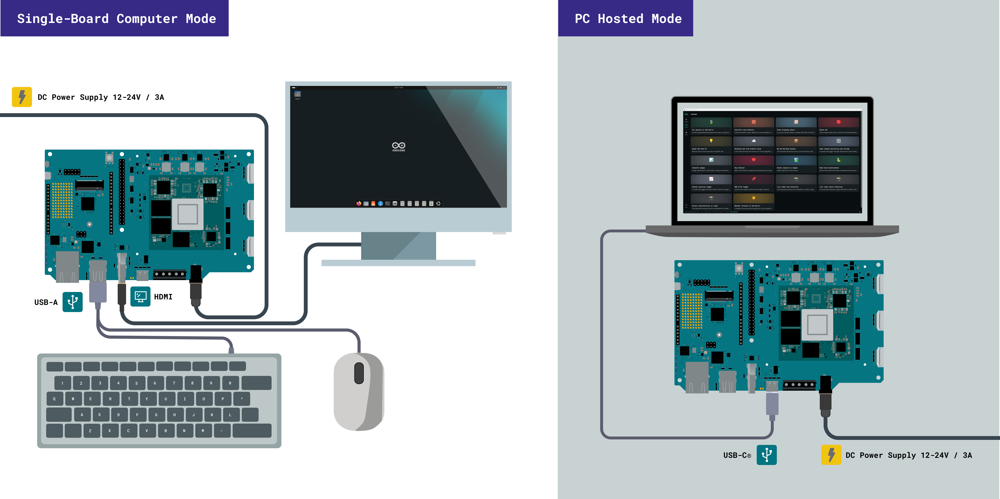

- **シングルボードコンピュータモード：** Arduino App LabがVENTUNO Q上で直接動作する。HDMI（またはUSB-C）経由でモニター、キーボード、マウスを接続すれば、オールインワンの開発環境が整う。 PCは不要だ。
- **PCホストモード：** VENTUNO QをUSB-Cまたはネットワーク経由でコンピュータに接続し、PC上でArduino App Labを実行する。
- **ネットワークモード：** VENTUNO Qはディスプレイ、キーボード、マウスを接続せずにヘッドレスで動作する。Wi-Fi®またはイーサネット経由でボードにリモートアクセスする。

>📝 **注：** **PCホスト**モードでは、初回セットアップにUSBデータ接続が必要だ。その後は、LAN（SSH）経由で**ネットワーク**ターゲットを使用できる。

**シングルボードコンピュータ**モードでは、USBデータ接続は不要だ。ボードに電源を供給し、ネットワークに接続されたら**ネットワーク**ターゲットを使用する。USB周辺機器（キーボード、マウス、USBカメラ、マイク）は、ボード上のUSB-Aポートに直接接続できる。USB-CポートでDisplayPort Alt-Modeが有効になっている場合、USBのデータ転送速度は低下する。

詳細なセットアップ手順、初期設定、および初回使用時のガイダンスについては、[VENTUNO Q ユーザーマニュアル](https://docs.arduino.cc/tutorials/ventuno-q/user-manual/)を参照のこと。

>📝 **注：** 初めてUSB-C経由で給電する場合、コンピュータや非PD対応のUSB-Cポートに接続すると、Fault LEDが点滅することがある。ボードの起動には、9 V以上のPD対応電源が必要だ。 AI推論、接続された周辺機器、および装着されたHATを含むフルパフォーマンスでの動作には、USB-C PD（最大20 V）またはバレルジャックもしくはネジ端子（7～24 V）を介して、12 V以上の電源を供給することを推奨する。各電源ごとの電圧および電流制限については、[入力電源](#入力電源)のセクションを参照のこと。

>📝 **注：**初回起動時は、Linuxの起動に20～30秒かかる。MCUのブートローダーが読み込まれ、有効なプログラムが実行されると、LEDマトリックスに起動アニメーションが表示される。ボードを操作する前に、アニメーションが完了するまで待ってほしい。アニメーションが表示されない場合は、[VENTUNO Q ユーザーマニュアル](https://docs.arduino.cc/tutorials/ventuno-q/user-manual/)を参照のこと。

### Bricks

Bricksとは、Arduino App Labに用意されているパッケージ化されたビルディングブロックであり、AIモデル、Webサービス、センサー連携、データベース、ユーザーインターフェースなどが含まれる。これらは、基盤となるインフラを自ら構築する必要なく、Linux側でアプリと共にデプロイされる。 Bricksの選択および使用に関する完全なガイドについては、[VENTUNO Q ユーザーマニュアル](https://docs.arduino.cc/tutorials/ventuno-q/user-manual/)を参照のこと。

>📝 **注：** アプリがバインドされ実行中の間、USBインターフェースはシステムによって占有されている可能性がある。USB経由で外部CLIツールを使用するには、アプリを停止するか、ボードを取り外す必要がある。

### ボタンと起動モード

VENTUNO Q には、**縦型プッシュボタン**と**ユーザーボタン**の 2 つのオンボードボタンが搭載されている。

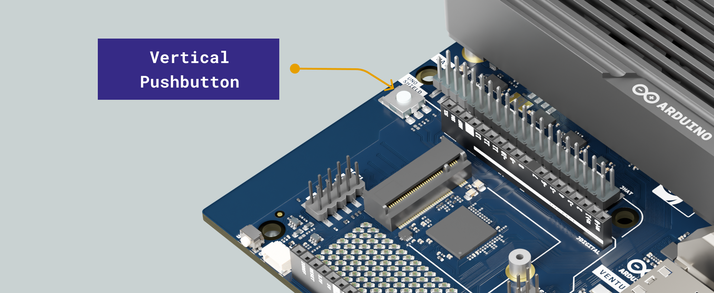

### 縦型プッシュボタン

垂直プッシュボタンは、MCUのGPIO PK13に接続されている。ボードとのやり取りや、ボードのシャットダウンに使用できる。

- **1回押す（シングルボードコンピュータモード）：** 画面上にシャットダウンダイアログを表示する。ユーザーは「確認」を選択して直ちに電源を切るか、「キャンセル」を選択してダイアログを閉じ、通常動作を継続できる。操作がない場合、60秒後にボードは自動的に電源が切れる。
- **長押し（10秒以上、SSH / ADBモード）：** システムを完全にシャットダウンする。 ボードは、電源を一度切り、再度接続するまで電源オフの状態が続く。

>📝 **注：** 長押しによるシャットダウンはLinux環境を完全に停止させ、実行中のアプリをすべて中断する。作業内容を保存し、必要に応じて外部プロセスが安全に停止されていることを確認すること。電源が供給されるとボードは自動的に起動し、通常の起動にはプッシュボタンの操作は不要だ。

### ユーザーボタン

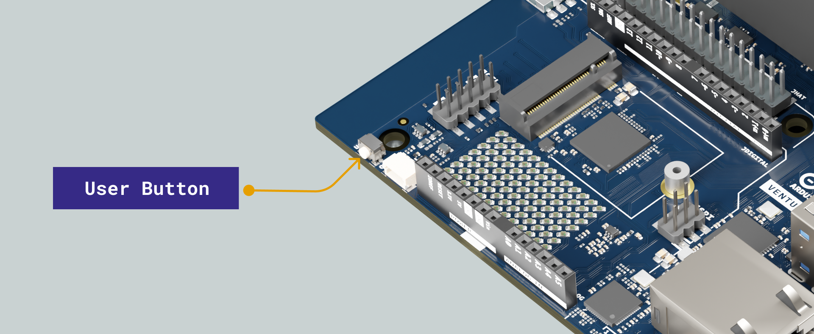

ユーザーボタンはMPU（GPIO_79）に接続されており、汎用入力として利用可能だ。標準的なGPIOインターフェースを使用して、Linuxアプリケーションやスクリプトから読み取ることができる。使用例については、[VENTUNO Q ユーザーマニュアル](https://docs.arduino.cc/tutorials/ventuno-q/user-manual/)を参照のこと。

## 機械的仕様

ボードのサイズは160 mm × 100 mmである。SoMのヒートシンクとファンを除いた総高さは25.8 mmである。40ピンのJHATヘッダーは、標準的なRaspberry Pi® HATの機械的仕様に準拠しており、準拠したHATアクセサリーとの物理的な互換性がある。

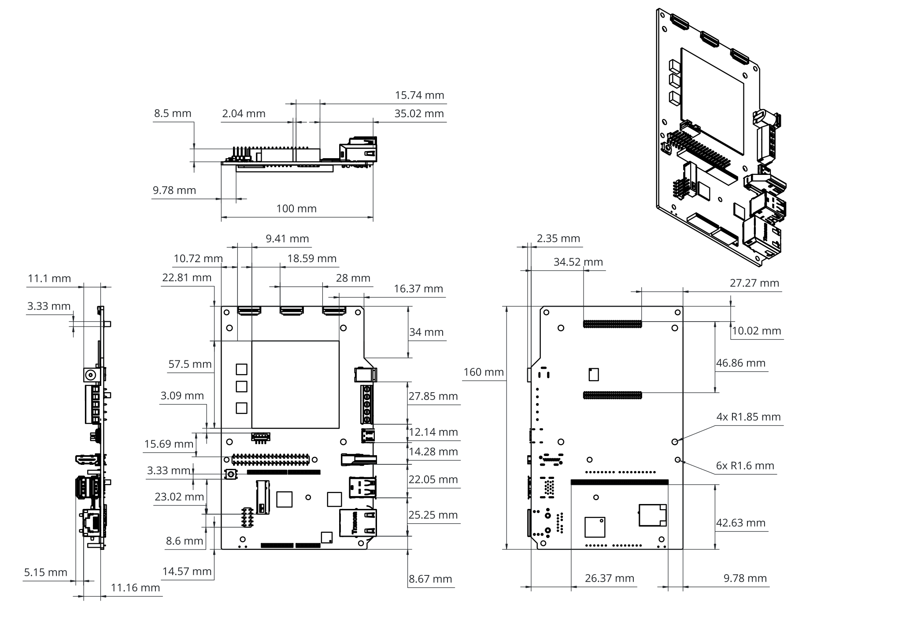

UNO Shieldヘッダーは、標準的なArduino UNOのフットプリント間隔を維持しており、UNO Shieldエコシステムとの機械的および電気的な互換性を直接確保している。

この基板には、それぞれ異なる機械的用途を持つ3種類の穴が設けられている：

- **4× M2.5 スタンドオフ**（高さ5 mm、基板に半田付け済み）はヒートシンクの取り付け用で、右端から9.78 mm、上端から10.02 mmおよび42.63 mmの位置にある。
- **4× 3.2 mm**のコーナー取り付け穴は、筐体、パネル、またはカスタムキャリアボードやアクセサリーへの取り付け用だ。
- **2× 3.2 mm**：Raspberry Pi® HATの標準的な機械的仕様に準拠したHAT取り付け穴。HATアクセサリーを取り付けるためのM3スタンドオフと互換性がある。
- **1× M2スタンドオフ**（高さ4 mm）：M.2スロットにM.2 2230 NVMeストレージカードを固定するためのものだ。

VENTUNO Qには、4× M3六角スタンドオフと4× M3ナットが同梱されており、これらは別の袋に入っている。静電気に敏感な環境では、4つのコーナー取り付け穴のそれぞれにスタンドオフとナットを1つずつ取り付けて、基板を作業面から浮かせてクリアランスを確保する。

| **品目**        | **寸法**                                               |
| --------------- | ----------------------------------------------------------- |
| M3 六角スタンドオフ | 六角部長さ 20 mm、ねじ長 6 mm、ねじ径 3 mm  |
| M3 ナット          | 高さ 2.4 mm、六角対辺 5.6 mm、内径 3 mm |

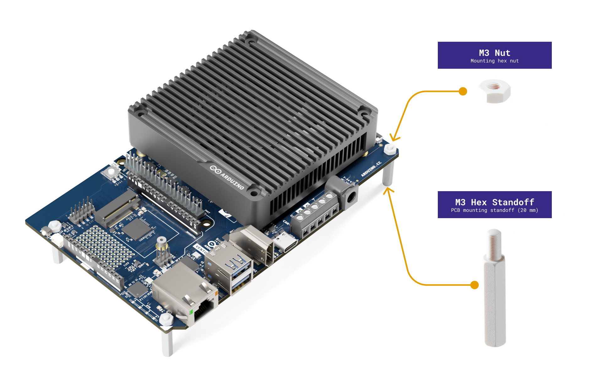

### SoM ヒートシンクおよび熱設計

Qualcomm® Dragonwing™ IQ8 (QCS8275) SoMは、フルパフォーマンスでの持続的な動作のためにアクティブ冷却を必要とする。 基板上のSoMのフットプリントは**57.5 mm × 57.5 mm**で、左端から**14.26 mm**、下端から**14.73 mm**の位置に中心があり、SoMのアクティブ領域に対して水平方向に**8.95 mm**、垂直方向に**8.55 mm**のオフセットがある。

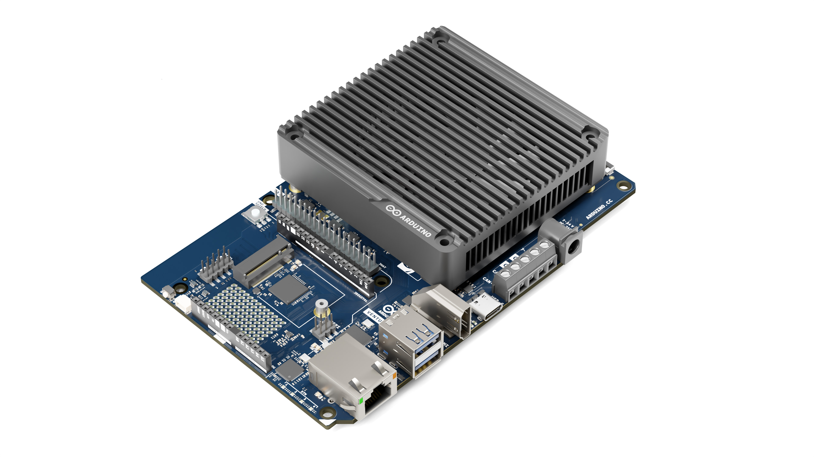

4つのM2.5スタンドオフは、同梱のヒートシンクおよびファンアセンブリの取り付けパターンを規定しており、SoMフットプリントの周囲に対称的に配置され、SoMリッド全体に均一な締め付け力を提供する。

MPU、NPU、GPUが同時にフルパフォーマンスで動作する最悪の条件下では、ボードの消費電力は約25 W以上になる。付属のアクティブ冷却ソリューションは、この熱負荷に合わせて最適化されている。持続的な高パフォーマンスのワークロード中も、ファンが正常に動作し続けることを確認すること。

>📝 **注：** 十分な冷却を行わずに、AI や演算負荷の高いワークロードでボードを動作させると、QCS8275 SoM のサーマルスロットリングが発生し、性能が低下する可能性がある。対象となるユースケースや筐体環境における熱的余裕を常に確認すること。

## 商標

「HDMI」、「HDMI High-Definition Multimedia Interface」、「HDMI トレードドレス」、および HDMI ロゴは、HDMI Licensing Administrator, Inc. の商標または登録商標である。

# Safety Information

Maintain a minimum separation distance of 20 cm between the device and the user during operation. The 5 GHz and 6GHz frequency band may be subject to operational restrictions depending on the country of use.

**Bulgarian (BG):**

Поддържайте минимално разстояние от 20 см между устройството и потребителя по време на работа. Честотните ленти 5 GHz и 6 GHz можете да подлежат на ограничения за експлоатация в зависимост от държавата, в която се използва устройството.

**Croatian (HR):**

Održavajte minimalnu udaljenost od 20 cm između uređaja i korisnika tijekom rada.
Frekvencijski pojas od 5 GHz i 6 GHz može podlijegati ograničenjima ovisno o zemlji uporabe.

**Czech (CS):**

Udržujte minimální vzdálenost 20 cm mezi zařízením a uživatelem během provozu.
Pásmo 5 GHz a 6 GHz může podléhat provozním omezením v závislosti na zemi použití.

**Danish (DA):**

Oprethold en minimumsafstand på 20 cm mellem enheden og brugeren under drift.
5 GHz og 6 GHz-båndet kan være underlagt driftsmæssige begrænsninger afhængigt af brugslandet.

**Dutch (NL):**

Houd tijdens gebruik een minimale afstand van 20 cm tussen het apparaat en de gebruiker aan.
De 5GHz en 6 GHz-band kan onderhevig zijn aan gebruiksbeperkingen afhankelijk van het land van gebruik.

**Estonian (ET):**

Hoidke seadme ja kasutaja vahel töötamise ajal vähemalt 20 cm kaugust.
5 GHz ja 6 GHz sagedusribale võivad kehtida kasutuspiirangud sõltuvalt kasutusriigist.

**Finnish (FI):**

Pidä laitteen ja käyttäjän välillä vähintään 20 cm etäisyys käytön aikana.
5 GHz:n ja 6 GHz:n taajuusalueilla voi olla käyttörajoituksia käyttömaasta riippuen.

**French (FR):**

Maintenez une distance minimale de 20 cm entre l’appareil et l’utilisateur pendant son fonctionnement.
Les bandes de fréquences 5 GHz et 6 GHz peuvent être soumises à des restrictions d'utilisation selon le pays où tu t'en sers.

**German (DE):**

Halten Sie während des Betriebs einen Mindestabstand von 20 cm zwischen dem Gerät und dem Benutzer ein.
Für die Frequenzen 5 GHz und 6 GHz können je nach Einsatzland Nutzungsbeschränkungen unterliegen.

**Greek (EL):**

Διατηρείτε ελάχιστη απόσταση 20 cm μεταξύ της συσκευής και του χρήστη κατά τη λειτουργία.
Οι ζώνες συχνοτήτων των 5 GHz και 6 GHz ενδέχεται να υπόκεινται σε περιορισμούς λειτουργίας, ανάλογα με τη χώρα χρήσης.

**Hungarian (HU):**

A működés során tartson legalább 20 cm távolságot az eszköz és a felhasználó között.
Az 5 GHz-es és 6 GHz-es frekvenciasáv használatára a országonként különböző üzemeltetési korlátozások vonatkozhatnak.

**Irish (GA):**

Coinnigh ar a laghad fad 20 cm idir an gléas agus an t‑úsáideoir le linn úsáide.
D'fhéadfadh go mbeadh srianuimh oibríochtúla i bhfeidhm ar an mbanda minicíochta 5 GHz agus 6 GHz ag brath ar an tír ina n-úsáidtear é.

**Italian (IT):**

Mantenere una distanza minima di 20 cm tra il dispositivo e l’utente durante il funzionamento.
Le bande di frequenza a 5 GHz e 6GHz possono essere soggette a restrizioni operative a seconda del paese.

**Latvian (LV):**

Uzturiet vismaz 20 cm attālumu starp ierīci un lietotāju darbības laikā.
5 GHz un 6 GHz frekvenču joslā var tikt piemēroti ekspluatācijas ierobežojumi atkarībā no izmantošanas valsts.

**Lithuanian (LT):**

Naudojimo metu laikykite bent 20 cm atstumą tarp įrenginio ir naudotojo.
5 GHz ir 6 GHz dažnių juostose gali būti taikomi naudojimo apribojimai, priklausomai nuo šalies, kurioje naudojamas įrenginys.

**Maltese (MT):**

Żomm distanza minima ta’ 20 cm bejn l-apparat u l-utent waqt l-użu.
Il-medda tal-frekwenza 5 GHz u 6 GHz tista’ tkun soġġetta għal restrizzjonijiet skont il-pajjiż.

**Polish (PL):**

Podczas pracy zachowaj minimalną odległość 20 cm między urządzeniem a użytkownikiem.
Pasma częstotliwości 5 GHz i 6 GHz mogą podlegać ograniczeniom eksploatacyjnym w zależności od kraju, w którym są używane.

**Portuguese (PT):**

Mantenha uma distância mínima de 20 cm entre o dispositivo e o utilizador durante o funcionamento.
As bandas de frequência de 5 GHz e 6 GHz podem estar sujeitas a restrições de utilização dependendo do país.

**Romanian (RO):**

Mențineți o distanță minimă de 20 cm între dispozitiv și utilizator în timpul funcționării.
Banda de frecvență de 5 GHz și 6 GHz poate face obiectul unor restricții în funcție de țara de utilizare.

**Slovak (SK):**

Počas prevádzky dodržiavajte minimálnu vzdialenosť 20 cm medzi zariadením a používateľom.
Pásmo frekvencií 5 GHz a 6 GHz môže podliehať prevádzkovým obmedzeniam v závislosti od krajiny, v ktorej sa zariadenie používa.

**Slovenian (SL):**

Med delovanjem ohranjajte najmanj 20 cm razdalje med napravo in uporabnikom.
Frekvenčni pasovi 5 GHz in 6 GHz so lahko predmet omejitev uporabe, odvisno od države uporabe.

**Spanish (ES):**

Mantenga una distancia mínima de 20 cm entre el dispositivo y el usuario durante su funcionamiento.
Las bandas de frecuencia de 5 GHz y 6 GHz pueden estar sujetas a restricciones según el país de uso.

**Swedish (SV):**

Håll ett minsta avstånd på 20 cm mellan enheten och användaren under drift.
5 GHz- och 6 GHz-frekvensbanden kan vara föremål för driftsbegränsningar beroende på användningsland.

## ESD Warning

This product is a development board that contains ESD-sensitive components. Appropriate anti-static precautions should be taken when handling the device. Avoid touching exposed connectors, pins, or circuitry. Where a heatsink is installed, handle the board by the heatsink to minimise the risk of electrostatic discharge damage. Improper handling or exposure to electrostatic discharge may result in permanent damage to the product.

## Antenna Use and Compliance

- This product is approved to operate with the built-in (internal) antenna only
- The internal antenna is part of the certified module configuration and must be used for normal operation
- RF connectors may be present for development or testing purposes only
- Use of an external antenna is not part of the approved configuration
- External antenna use requires additional regulatory assessment before use

### Warning - External Antenna Use

- Connecting an external antenna may result in non-compliance with regulatory requirements
- This includes the module approval associated with FCC ID J9C-QCNFA725
- Use of an external antenna may change RF output power
- Use of an external antenna may change frequency behavior
- Use of an external antenna may change radiation characteristics
- These changes may cause the product to exceed allowed regulatory limits
- Use of an external antenna may invalidate device approval
- Use of an external antenna may void the authorization to operate the device
- Unauthorized changes, including antenna modifications, may void regulatory approvals

### Requirements for Integrators

- End products must use the internal antenna to maintain regulatory compliance
- If an external antenna is used, the integrator must perform a full regulatory assessment
- If an external antenna is used, the integrator must obtain required certifications for the final product
- Any antenna used must meet the approved gain, radiation pattern, and performance characteristics
- Approved antenna characteristics are defined in the applicable regulatory documentation, including the Qualcomm module label guide

### Operation in the 6 GHz Band

- Operation in the 6 GHz band is only permitted with the approved internal antenna configuration
- If an external antenna is used, 6 GHz operation must be disabled
- If an external antenna is used, the product must not transmit in the 6 GHz band
- Operation outside the approved configuration may violate regional regulations

### Responsibility

- The manufacturer or integrator is responsible for ensuring the final product complies with all applicable regulatory requirements
- Changes to the antenna system or RF design may require additional testing and certification

# Certifications

## RED / UK

| CE                     | Europe - EU Declaration of Conformity                        |
| ---------------------- | ------------------------------------------------------------ |
| Česky [Czech]          | Arduino S.r.l tímto prohlašuje, že tento Radiolan je ve shodě se základními požadavky a dalšími příslušnými ustanoveními směrnice 2014/53/EU. |
| Dansk [Danish]         | Undertegnede Arduino S.r.l erklærer herved, at følgende udstyr Radiolan overholder de væsentlige krav og øvrige relevante krav i direktiv 2014/53/EU. |
| Deutsch [German]       | Hiermit erklärt Arduino S.r.l dass sich das Gerät Radiolan in Übereinstimmung mit den grundlegenden Anforderungen und den übrigen einschlägigen Bestimmungen der Richtlinie 2014/53/EU befindet. |
| Eesti [Estonian]       | Käesolevaga kinnitab Arduino S.r.l seadme Radiolan vastavust direktiivi 2014/53/EU põhinõuetele ja nimetatud direktiivist tulenevatele teistele asjakohastele sätetele. |
| English                | Hereby, Arduino S.r.l, declares that this Radiolan is in compliance with the essential requirements and other relevant provisions of Directive 2014/53/EU. |
| Español [Spanish]      | Por medio de la presente Arduino S.r.l declara que el Radiolan cumple con los requisitos esenciales y cualesquiera otras disposiciones aplicables o exigibles de la Directiva 2014/53/EU. |
| Ελληνική [Greek]       | ΜΕ ΤΗΝ ΠΑΡΟΥΣΑ Arduino S.r.l ΔΗΛΩΝΕΙ ΟΤΙ Radiolan ΣΥΜΜΟΡΦΩΝΕΤΑΙ ΠΡΟΣ ΤΙΣ ΟΥΣΙΩΔΕΙΣ ΑΠΑΙΤΗΣΕΙΣ ΚΑΙ ΤΙΣ ΛΟΙΠΕΣ ΣΧΕΤΙΚΕΣ ΔΙΑΤΑΞΕΙΣ ΤΗΣ ΟΔΗΓΙΑΣ 2014/53/EU. |
| Français [French]      | Par la présente Arduino S.r.l déclare que l'appareil Radiolan est conforme aux exigences essentielles et aux autres dispositions pertinentes de la directive 2014/53/EU. |
| Íslenska [Icelandic]   | Hér með lýsir Arduino S.r.l yfir því að Radiolan er í samræmi við grunnkröfur og aðrar kröfur, sem gerðar eru í tilskipun 2014/53/EU. |
| Italiano [Italian]     | Con la presente Arduino S.r.l dichiara che questo Radiolan è conforme ai requisiti essenziali ed alle altre disposizioni pertinenti stabilite dalla direttiva 2014/53/EU. |
| Latviski [Latvian]     | Ar šo Arduino S.r.l deklarē, ka Radiolan atbilst Direktīvas 2014/53/EU būtiskajām prasībām un citiem ar to saistītajiem noteikumiem. |
| Lietuvių [Lithuanian]  | Šiuo Arduino S.r.l deklaruoja, kad šis Radiolan atitinka esminius reikalavimus ir kitas 2014/53/EU Direktyvos nuostatas. |
| Malti [Maltese]        | Hawnhekk, Arduino S.r.l, jiddikjara li dan Radiolan jikkonforma mal-ħtiġijiet essenzjali u ma provvedimenti oħrajn relevanti li hemm fid-Dirrettiva 2014/53/EU. |
| Magyar [Hungarian]     | Alulírott, Arduino S.r.l nyilatkozom, hogy a Radiolan megfelel a vonatkozó alapvetõ követelményeknek és az 2014/53/EU irányelv egyéb elõírásainak. |
| Nederlands [Dutch]     | Hierbij verklaart Arduino S.r.l dat het toestel Radiolan in overeenstemming is met de essentiële eisen en de andere relevante bepalingen van richtlijn 2014/53/EU. |
| Norsk [Norwegian]      | Arduino S.r.l erklærer herved at utstyret Radiolan er i samsvar med de grunnleggende krav og øvrige relevante krav i direktiv 2014/53/EU. |
| Polski [Polish]        | Niniejszym Arduino S.r.l oświadcza, że Radiolan jest zgodny z zasadniczymi wymogami oraz pozostałymi stosownymi postanowieniami Dyrektywy 2014/53/EU. |
| Português [Portuguese] | Arduino S.r.l declara que este Radiolan está conforme com os requisitos essenciais e outras disposições da Directiva 2014/53/EU. |
| Slovensko [Slovenian]  | Arduino S.r.l izjavlja, da je ta Radiolan v skladu z bistvenimi zahtevami in ostalimi relevantnimi določili direktive 2014/53/EU. |
| Slovensky [Slovak]     | Arduino S.r.l týmto vyhlasuje, že Radiolan spĺňa základné požiadavky a všetky príslušné ustanovenia Smernice 2014/53/EU. |
| Suomi [Finnish]        | Arduino S.r.l vakuuttaa täten että Radiolan tyyppinen laite on direktiivin 2014/53/EU oleellisten vaatimusten ja sitä koskevien direktiivin muiden ehtojen mukainen. |
| Svenska [Swedish]      | Härmed intygar Arduino S.r.l att denna Radiolan står I överensstämmelse med de väsentliga egenskapskrav och övriga relevanta bestämmelser som framgår av direktiv 2014/53/EU. |
| **UK**                 | **United Kingdom - UKCA Declaration of Conformity**          |
| United Kingdom         | Hereby, Arduino S.r.l, declares that this Radiolan is in compliance with the essential requirements and other relevant provisions of The Radio Equipment Regulations 2017. |

Requirements in:

Belgium (BE), Bulgaria (BG), Czech Republic (CZ), Denmark (DK), Germany (DE), Iceland (IS), Estonia (EE), Ireland (IE), Greece (EL), Spain (ES), France (FR), Croatia (HR), Italy (IT), Cyprus (CY), Latvia (LV), Liechtenstein (LI), Lithuania (LT), Luxembourg (LU), Hungary (HU), Malta (MT), Netherlands (NL), Norway (NO), Austria (AT), Poland (PL), Portugal (PT), Romania (RO), Slovenia (SI), Slovakia (SK), Turkey (TR), Finland (FI), Sweden (SE), Switzerland (CH), United Kingdom (North Irland) (UK(NI)), and United Kingdom (UK).

Operations in the 5.15-5.35GHz band are restricted to indoor usage only.

For Low power indoor (LPI use): Operations in the 5955 - 6415MHz are restricted to indoor usage only.

This equipment should be installed and operated with a minimum distance of 20 cm between the radiator and your body.

### Radio Equipment Information (RED Compliance)

This radio equipment operates in the following frequency bands and with the maximum radio-frequency power indicated below:

| **Radio Technology**      | **Frequency Band** | **Maximum Transmit Power** |
| ------------------------- | ------------------ | -------------------------- |
| Bluetooth® EDR            | 2400 - 2483.5 MHz  | 18.31 dBm                  |
| Bluetooth® LE             | 2400 - 2483.5 MHz  | 9.97 dBm                   |
| Wi-Fi® 2.4 GHz            | 2400 - 2483.5 MHz  | 19.91 dBm EIRP             |
| Wi-Fi® 5 GHz              | 5150 - 5350 MHz    | 22.92 dBm EIRP             |
| Wi-Fi® 5 GHz              | 5470 - 5725 MHz    | 22.97 dBm EIRP             |
| Wi-Fi® 5 GHz              | 5725 - 5850 MHz    | 13.84 dBm EIRP             |
| Wi-Fi® 6 GHz (LPI client) | 5945 - 6425 MHz    | 22.83 dBm EIRP             |
| Wi-Fi® 6 GHz (VLP)        | 5945 - 6425 MHz    | 13.77 dBm EIRP             |

In accordance with EU regulations (RED Directive 2014/53/EU), the use of the 5 GHz band may be subject to national restrictions.

## UKCA Declaration of Conformity

Arduino S.r.l. hereby declares that this product is in compliance with the essential requirements and other relevant provisions of the applicable UK regulations. A copy of the UK Declaration of Conformity is available at: <https://docs.arduino.cc/certifications>

## FCC

Contains FCC ID: J9C-QCNFA725

**FCC Compliance Information**

This device complies with Part 15 of the FCC Rules. Operation is subject to the following two conditions: (1) this device may not cause harmful interference, and (2) this device must accept any interference received, including interference that may cause undesired operation.

This product does not contain any user serviceable components. Any unauthorized product changes or modifications will invalidate warranty and all applicable regulatory certifications and approvals, including authority to operate this device.

**FCC Part 15 Digital Emissions Compliance**

We Arduino S.r.l. - Via Andrea Appiani 25, 20900 Monza (Italy), declare under our sole responsibility that the product Arduino® VENTUNO Q complies with Part 15 of the FCC Rules. Operation is subject to the following two conditions: (1) this device may not cause harmful interference, and (2) this device must accept any interference received, including interference that may cause undesired operation.

**WARNING:** This equipment has been tested and found to comply with the limits for a Class B digital device, pursuant to Part 15 of the FCC Rules. These limits are designed to provide reasonable protection against harmful interference in a residential installation. This equipment generates and radiates radio frequency energy and, if not installed and used in accordance with the instructions, may cause harmful interference to radio communications.

However, there is no guarantee that interference will not occur in a particular installation. If this equipment does cause harmful interference to radio or television reception, which can be determined by turning the equipment off and on, the user is encouraged to try to correct the interference by one or more of the following measures:

- Reorient or relocate the receiving antenna.
- Increase the separation between the equipment and receiver.
- Connect the equipment into an outlet on a circuit different from the one the receiver is connected to.
- Consult the dealer or an experienced radio/TV technician for help.

The user may find the following booklet prepared by the Federal Communications Commission helpful:

**The Interference Handbook**

This booklet is available from the U.S. Government Printing Office, Washington, D.C. 20402. Stock No.004-000-00345-4.

**Radiation Exposure Statement**

1. This transmitter must not be co-located or operating in conjunction with any other antenna or transmitter.
2. This equipment complies with RF radiation exposure limits set forth for an uncontrolled environment. This equipment should be installed and operated, keeping the radiator at least 20cm or more away from the person's body.

**FCC 6 GHz Statement**

a. The operation of this device is prohibited on oil platforms and aircraft, except that operation of this device in 5.925-6.425 GHz is permitted in large aircraft while flying above 10,000 feet.

b. Installation on outdoor fixed infrastructure is prohibited.

c. Controlling or communications with unmanned aircraft systems, including drones, is prohibited.

## ISED

Contains IC: 2723A-QCNFA725

*English:*

This device complies with Canadian RSS-247.
This device complies with Industry Canada license-exempt RSS standard(s). Operation is subject to the following two conditions: (1) this device may not cause interference, and (2) this device must accept any interference, including interference that may cause undesired operation of the device.

*French:*

Ce dispositif est conforme à la norme CNR-247 d'Industrie Canada applicable aux appareils radio exempts de licence. Son fonctionnement est sujet aux deux conditions suivantes: (1) le dispositif ne doit pas produire de brouillage préjudiciable, et (2) ce dispositif doit accepter tout brouillage reçu, y compris un brouillage susceptible de provoquer un fonctionnement indésirable.

*English:*

Caution:

(i) the device for operation in the band 5150-5250 MHz is only for indoor use to reduce the potential for harmful interference to co-channel mobile satellite systems;

(ii) Users should also be advised that high-power radars are allocated as primary users (i.e. priority users) of the bands 5250-5350 MHz and 5650-5850 MHz and that these radars could cause interference and/or damage to LE-LAN devices.

*French:*

Avertissement :

Le guide d'utilisation des dispositifs pour réseaux locaux doit inclure des instructions précises sur les restrictions susmentionnées, notamment :

(i) les dispositifs fonctionnant dans la bande 5 150-5 250 MHz sont réservés uniquement pour une utilisation à l'intérieur afin de réduire les risques de brouillage préjudiciable aux systèmes de satellites mobiles utilisant les mêmes canaux ;

(ii) Les radars à haute puissance sont désignés comme utilisateurs principaux (c'est-à-dire utilisateurs prioritaires) des bandes de fréquences 5250-5350 MHz et 5650-5850 MHz. Ces radars peuvent causer des interférences et/ou endommager les dispositifs LE-LAN.

  <strong>Note:</strong> For 5GHz and/or when co-located with 5 GHz transmitters, the following statements should be provided in the user information.

**Radiation Exposure Statement**

1. To comply with the Canadian RF exposure compliance requirements, this device and its antenna must not be co-located or operating in conjunction with any other antenna or transmitter.
2. To comply with RSS 102 RF exposure compliance requirements, this equipment should be installed and operated, keeping the radiator at least 20cm or more away from the person's body.

**Déclaration d'exposition aux rayonnements**

1. Pour se conformer aux exigences de conformité RF canadienne l'exposition, cet appareil et son antenne ne doivent pas être co-localisés ou fonctionnant en conjonction avec une autre antenne ou transmetteur.
2. Pour se conformer aux exigences de conformité CNR 102 RF exposition, cet équipement doit être installé et utilisé en maintenant le radiateur à au moins 20cm ou plus du corps de la personne.

**6 GHz General statement**

*English:*

Devices shall not be used for control of or communications with unmanned aircraft systems. Devices shall not be used on oil platforms. Devices shall not be used on aircraft, except for the low-power indoor access points, indoor subordinate devices, low-power client devices, and very low-power devices operating in the 5925-6425 MHz band, that may be used on large aircraft as defined in the Canadian Aviation Regulations, while flying above 3,048 metres (10,000 feet).

*French :*

Les dispositifs ne doivent pas être utilisés pour commander des systèmes d'aéronef sans pilote ni pour communiquer avec de tels systèmes; Les dispositifs ne doivent pas être utilisés sur les plateformes de forage pétrolier; Les dispositifs ne doivent pas être utilisés dans les aéronefs, à l'exception des points d'accès intérieurs de faible puissance, des dispositifs subordonnés intérieurs, des dispositifs clients de faible puissance et des dispositifs de très faible puissance fonctionnant dans la bande de 5 925 à 6 425 MHz, qui peuvent être utilisés dans les gros aéronefs tel qu'il est défini dans le Règlement de l'aviation canadien, et ce, lorsqu'ils volent à une altitude supérieure à 3 048 mètres (10 000 pieds).

# 会社情報

| 会社名 | Arduino S.r.l.                             |
| ------------ | ------------------------------------------ |
| 住所      | Via Andrea Appiani 25, 20900 Monza (Italy) |

# ドキュメント参照

| 番号 | 参照先               | リンク                                                                                       |
| :-: | ----------------------- | ------------------------------------------------------------------------------------------ |
|  1  | Arduino App Lab         | [https://www.arduino.cc/en/software](https://www.arduino.cc/en/software)                   |
|  2  | VENTUNO Q ドキュメント | [https://docs.arduino.cc/hardware/ventuno-q/](https://docs.arduino.cc/hardware/ventuno-q/) |
|  3  | プロジェクトハブ             | [https://projecthub.arduino.cc/](https://projecthub.arduino.cc/)                           |
|  4  | ライブラリリファレンス       | [https://docs.arduino.cc/libraries/](https://docs.arduino.cc/libraries/)                   |
|  5  | Arduinoストア           | [https://store.arduino.cc/](https://store.arduino.cc/)                                     |

# ドキュメントの改訂履歴

| **日付**   | **改訂版** | **変更点**   |
| :--------: | :----------: | ------------- |
| 2026年8月25日 |      1       | 初版公開 |
| 2026年8月28日 |      2       | 認証情報の更新 |
| 2026年8月31日 |      3       | 安全情報に6 GHzを追加 |
| 2026年9月25日 |      4       | 入力値の更新 |