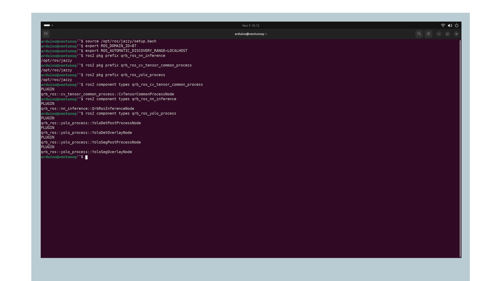
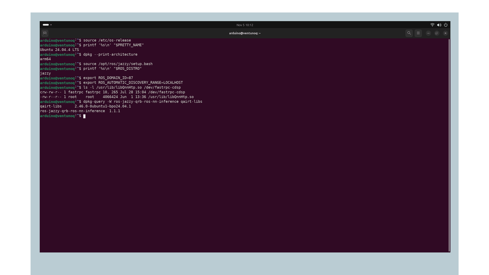

## Overview

The Robotics Software Development Kit (SDK) lets you build ROS 2 applications on the Arduino® VENTUNO™ Q from reusable components. In a vision application, these components take an image from a camera, prepare it for a neural network, run the model, and turn its output into objects or masks that your application can use.

In this tutorial, you will install the vision components and check that ROS 2 can find them. You will also prepare your computer to export models for the board. Once these steps are complete, choose Object Detection to work with boxes, Image Segmentation to work with masks, or the multi-model tutorial to connect both tasks.

The SDK runs in Ubuntu on the board's main processor. Your host computer exports and copies the models; the board receives the camera images and runs the ROS 2 nodes. Follow the existing Arduino ROS 2 tutorial for basic system preparation; this page covers the additional SDK layer and its interfaces.

## Goals

- Configure the Qualcomm® package sources and install the common SDK vision packages.
- Check the installed inference components and NPU runtime.
- Understand how images, tensors, and application results travel between nodes.
- Prepare model-export tools and a shared label file for the YOLO tutorials.
- Choose a task tutorial and verify its result independently.

## Hardware and Software Requirements

- [Arduino® VENTUNO™ Q](https://store.arduino.cc/products/ventuno-q), powered according to its [User Manual](https://docs.arduino.cc/tutorials/ventuno-q/user-manual/).
- Ubuntu 24.04, ROS 2 Jazzy, internet access, and a terminal on the board. Complete [Getting Started with ROS 2 on VENTUNO Q](https://docs.arduino.cc/tutorials/ventuno-q/getting-started-ros2/) first.
- A host computer running Ubuntu 24.04 with Python® 3.12, Bash, and internet access if you will export models. Follow [Getting Started with Qualcomm AI Hub](https://docs.arduino.cc/tutorials/ventuno-q/getting-started-qc-ai-hub/) for account access.
- The detection, segmentation and multi-model tutorials use an Orbbec Gemini 335L USB camera. Test photographs in result illustrations are separate from the camera setup.

<Alert type="info">

Use Ubuntu 24.04 and ROS 2 Jazzy on a QCS8275-based VENTUNO Q. These examples use inference package 1.1.1 and QAI Runtime 2.46.0. Check your installed versions before choosing a compiled model; newer packages may need a different model export.

</Alert>

## Instructions

### 1. Check Your Board Environment

**VENTUNO Q:** open a Bash terminal. First, check the operating system and processor architecture so you can select packages for this board:

```bash
source /etc/os-release
printf '%s\n' "$PRETTY_NAME"
dpkg --print-architecture
source /opt/ros/jazzy/setup.bash
printf '%s\n' "$ROS_DISTRO"
```

`source /etc/os-release` loads the system version information. Expect `Ubuntu 24.04` for the operating system, `arm64` for the processor architecture, and `jazzy` after ROS is loaded. If any value differs, or the ROS setup file is missing, complete the linked Arduino ROS 2 setup before installing SDK packages.

In **every board terminal** used in this series, run:

```bash
source /opt/ros/jazzy/setup.bash
export ROS_DOMAIN_ID=87
export ROS_AUTOMATIC_DISCOVERY_RANGE=LOCALHOST
```

The domain identifies the group of nodes that communicate. Use the same value in all tutorial terminals, or choose another unused value if an application already uses 87. Local-only discovery is sufficient here: all camera, inference, and visualization nodes run on the board. The host exports and copies models; it does not participate in the ROS graph. The [multi-model camera tutorial](https://docs.arduino.cc/tutorials/ventuno-q/nn-inference-person-pipeline/#1-prepare-your-board-terminals) uses its own domain and loopback UDP profile; follow its environment instructions when switching to that workflow. These commands configure only the current shell and programs started from it, so repeat them in each new board terminal.

### 2. Install the Robotics SDK

**VENTUNO Q:** add the two package sources used by this workflow:

```bash
sudo apt update
sudo apt install software-properties-common
sudo add-apt-repository ppa:ubuntu-qcom-iot/qcom-ppa
sudo add-apt-repository ppa:ubuntu-qcom-iot/qirp
sudo apt update
```

The first source provides Qualcomm platform/runtime packages. The second provides Robotics SDK packages. If these sources are already configured, check that `apt update` completes successfully rather than creating additional source-list entries by hand.

Before installing, check that your package sources offer the inference component and runtime:

```bash
apt policy ros-jazzy-qrb-ros-nn-inference qairt-libs libqnn1
```

For each package, `Installed` shows the current version and `Candidate` shows the version APT would select. If `Candidate` is `(none)`, check the two sources and the output of `apt update` before continuing. The runtime packages supply the library that inference uses to access the NPU; let APT manage these libraries together with their dependencies.

Preview the installation:

```bash
apt --simulate install \
  ros-jazzy-qrb-ros-nn-inference \
  ros-jazzy-qrb-ros-cv-tensor-common-process \
  ros-jazzy-qrb-ros-yolo-process \
  ros-jazzy-qrb-ros-vision-msgs
```

`--simulate` lists the proposed changes without installing anything. Read the list for package removals or runtime upgrades. If APT reports unmet dependencies, check the package sources and supported board image before proceeding. If it would change the runtime, plan to check your models again with that version.

Install the common vision components:

```bash
sudo apt install \
  ros-jazzy-qrb-ros-nn-inference \
  ros-jazzy-qrb-ros-cv-tensor-common-process \
  ros-jazzy-qrb-ros-yolo-process \
  ros-jazzy-qrb-ros-vision-msgs
```

APT resolves their message, transport, and runtime dependencies. This installs the subset used by the vision tutorials; task pages add camera drivers, viewers, and Python adapters as needed. It is not necessary to install every Robotics SDK sample to run one pipeline.

### 3. Verify the Installation

**VENTUNO Q:** source ROS again and confirm that the packages are discoverable:

```bash
source /opt/ros/jazzy/setup.bash
ros2 pkg prefix qrb_ros_nn_inference
ros2 pkg prefix qrb_ros_cv_tensor_common_process
ros2 pkg prefix qrb_ros_yolo_process
ros2 component types qrb_ros_cv_tensor_common_process
ros2 component types qrb_ros_nn_inference
ros2 component types qrb_ros_yolo_process
```

Each `ros2 pkg prefix` command tells you where ROS found that package. For this installation, expect `/opt/ros/jazzy`. `ros2 component types <package_name>` lists the components registered by that package; look for `QrbRosInferenceNode`, `CvTensorCommonProcessNode`, and the YOLO detection and segmentation nodes. If a package is missing, check that its installation completed. If a prefix points to a development workspace, open a fresh terminal and load only the environment from Step 1 before checking again.



*Each package resolves to /opt/ros/jazzy. The component lists include the inference, preprocessing and YOLO classes needed by the tutorials.*

Next, check that the NPU backend library and device interface are present. QNN uses the HTP backend to run a model on the Neural Processing Unit (NPU):

```bash
ls -l /usr/lib/libQnnHtp.so /dev/fastrpc-cdsp
dpkg-query -W ros-jazzy-qrb-ros-nn-inference qairt-libs
```

`ls` should list both paths without a “No such file” error. `dpkg-query` should print the installed inference and runtime package versions; compare these with the reference versions above and your model's export metadata. If the library or package is missing, revisit Step 2. If `/dev/fastrpc-cdsp` is missing, follow [Understanding and Using the NPU on VENTUNO Q](https://docs.arduino.cc/tutorials/ventuno-q/npu-guide/). These checks confirm that the required files are installed. You will check model loading and useful output in the task tutorial.



*Check that Ubuntu reports arm64, ROS reports jazzy, and the HTP library and FastRPC device are present. Keep the package versions with your model information.*

### 4. Understand the Shared Data Flow

The vision tutorials use this sequence:

```text
camera image -> preprocessing -> inference -> postprocessing -> objects or masks
```

Inference receives and publishes tensors. Postprocessing turns the model outputs into application messages.

A **tensor** is a numeric array with a defined shape and data type. The model's input contract specifies its image size, color order, layout, and value range. Its output contract determines which postprocessor can interpret it.

| SDK package | Responsibility | Interface used in this series |
|---|---|---|
| `qrb_ros_cv_tensor_common_process` | Resize and normalize images, then arrange the numeric input | `input_image` → `encoded_image`; also publishes `resized_image` |
| `qrb_ros_nn_inference` | Load and execute the model | `qrb_inference_input_tensor` → `qrb_inference_output_tensor` |
| `qrb_ros_yolo_process` | Interpret supported YOLO outputs and optionally draw results | Detection or segmentation tensor topics → result and overlay topics |
| `qrb_ros_transport_image_type` | Adapt supported images for QRB transport paths | Follow the image/encoding contracts of the connected nodes |

Inference input and output use `qrb_ros_tensor_list_msgs/msg/TensorList`. Camera and overlay images use `sensor_msgs/msg/Image`. Postprocessing converts raw tensors to application messages: `vision_msgs/msg/Detection2DArray` for detection, or `qrb_ros_vision_msgs/msg/Detection2DWithMaskArray` for instance segmentation.

A launch file connects these components with **remappings**, which change the topic names a node uses. A **namespace** adds a shared prefix so two model stages can coexist without consuming each other's tensors. Each inference component has its own `model_path`. In these tutorials, `backend_option` is `/usr/lib/libQnnHtp.so`, selecting the QNN Hexagon Tensor Processor backend for NPU execution.

The preprocessing configuration used in this series resizes directly to 640×640 and uses RGB float values from 0 to 1 in NHWC order: batch, height, width, channels. Its detection coordinates refer to that resized image. Preserve timestamps across stages and map coordinates back before cropping a differently sized camera frame. Color images use `rgb8`; segmentation masks use `mono8`.

### 5. Prepare the Host Model Tools

**Host computer:** create an isolated Python environment. These Bash commands assume Python 3.12 is already installed:

```bash
python3.12 -m venv ~/ventuno-model-tools
source ~/ventuno-model-tools/bin/activate
python -m pip install --upgrade pip
python -m pip install 'qai-hub-models==0.64.0'
```

The virtual environment keeps the model tools separate from your computer's system Python packages. Version 0.64.0 provides the command syntax used on the task pages. Wait for pip to finish without an error, then configure your AI Hub account using the [AI Hub setup instructions](https://docs.arduino.cc/tutorials/ventuno-q/getting-started-qc-ai-hub/). Keep the credentials on your computer. Activating the environment applies only to the current host terminal; run the activation command again after opening a new terminal. If `venv` is unavailable, install Ubuntu's `python3.12-venv` package and repeat this step.

These examples use the `qai-hub-models export` command from [version 0.64.0](https://github.com/qualcomm/ai-hub-models/releases/tag/v0.64.0) and select a QNN context binary for `Arduino VENTUNO Q`. A context binary contains a model compiled for the target hardware and runtime; renaming a binary for a different target does not make it compatible.

Each task page asks you to save the installed package versions after adding its model dependencies. Keep that record with the exported model so you can identify the tools used if a later export behaves differently.

### 6. Prepare the Shared Labels and Board Workspace

**Host computer:** activate the environment from Step 5 if you have opened a new terminal. Both models use the COCO object labels:

```bash
source ~/ventuno-model-tools/bin/activate
```

Download the versioned label file to your model-assets directory:

```bash
mkdir -p ~/ventuno-model-assets
curl --fail --location \
  https://raw.githubusercontent.com/ultralytics/ultralytics/v8.3.0/ultralytics/cfg/datasets/coco8.yaml \
  --output ~/ventuno-model-assets/coco.yaml
```

The upstream file is named `coco8.yaml`; this command deliberately saves it as `coco.yaml`, the filename used throughout these tutorials. It includes the full 80-class `names` mapping. The postprocessor reads those names, without downloading the dataset. Check the mapping before copying it to the board:

```bash
python - <<'PY'
from pathlib import Path
import yaml
labels = yaml.safe_load((Path.home() / 'ventuno-model-assets/coco.yaml').read_text())['names']
assert isinstance(labels, dict) and set(labels) == set(range(80))
assert labels[0] == 'person'
print('COCO labels ready: 80 classes, class 0 is person')
PY
```

Expect `COCO labels ready: 80 classes, class 0 is person`. If the assertion fails, download the file again from the versioned URL instead of editing class numbers. If Python cannot import `yaml`, activate the model-tools environment and complete its installation in Step 5.

Keep the label file's license notice and the model's license with your downloaded assets.

**VENTUNO Q:** create the shared directory used by this series:

```bash
mkdir -p ~/person-pipeline/models
```

**Host computer:** copy the labels. Replace `ventunoq.local` with your board's configured hostname:

```bash
scp ~/ventuno-model-assets/coco.yaml arduino@ventunoq.local:person-pipeline/models/coco.yaml
```

Wait for `scp` to finish without an error. If it cannot connect, check the hostname and SSH access from the User Manual; if the destination is missing, create it with the board command above. The task tutorials will put `detection.bin` and `segmentation.bin` in the same directory. Model export paths vary, so copy the binary reported by your exporter and retain its `metadata.json` alongside it with a task-specific filename.

### 7. Choose Your Next Tutorial

- [Object Detection](https://docs.arduino.cc/tutorials/ventuno-q/object-detection/): run the camera and detector, inspect boxes and confidence scores, and consume detections in your own ROS node.
- [Image Segmentation](https://docs.arduino.cc/tutorials/ventuno-q/image-segmentation/): run a model that produces an instance mask, then view it alongside the source image.
- [NN Inference Pipeline](https://docs.arduino.cc/tutorials/ventuno-q/nn-inference-person-pipeline/): connect both stages through Python adapters and learn how to add another consumer.

Start with one task. Stop its running nodes with `Ctrl+C` before starting another standalone tutorial that uses the same camera. The multi-model tutorial connects detection and segmentation to the same camera stream and shows you how to check each stage.

## Troubleshooting

| Symptom | Action |
|---|---|
| APT reports no installation candidate | Check Ubuntu 24.04/arm64, successful source configuration and `apt update`. Inspect `apt policy` before changing package versions. |
| APT reports unmet dependencies | Inspect the simulated installation and package origins. Use a consistent supported image/runtime combination; do not force-install a package while ignoring dependencies. |
| `ros2 pkg prefix` cannot find a package | Source `/opt/ros/jazzy/setup.bash` in this terminal and confirm the package installed successfully. |
| ROS resolves an unexpected workspace | Check `AMENT_PREFIX_PATH` and use a fresh shell with only the intended environment sourced. |
| The HTP library or device is missing | Check the board image, installed runtime version, and required paths using Step 3. Avoid manually replacing system libraries. |
| Nodes cannot see each other | Use identical domain and discovery settings. Local-only discovery means a viewer on another computer will not join this graph. |
| A model loads but postprocessing rejects its tensors | Compare output names, shapes and types against the task's contract. Model loading and message decoding are separate checks. |
| Export instructions report a missing module | Activate the host virtual environment and use the pinned release's CLI rather than the removed module-based exporter. |

## Conclusion

You have prepared the SDK vision components, checked how ROS 2 discovers them, and learned the interfaces that connect a camera to an inference result. The task tutorials use this common environment to turn those components into a working vision application.

## Further Reading

- [Getting Started with ROS 2 on VENTUNO Q](https://docs.arduino.cc/tutorials/ventuno-q/getting-started-ros2/)
- [ROS 2 Perception: RGB Cameras](https://docs.arduino.cc/tutorials/ventuno-q/ros2-perception-rgb-cam/)
- [QAI Hub Models v0.64.0](https://github.com/qualcomm/ai-hub-models/releases/tag/v0.64.0)
- [QRB ROS inference Jazzy source](https://github.com/qualcomm-qrb-ros/qrb_ros_nn_inference/tree/jazzy)

## Acknowledgments

ROS is a trademark of Open Source Robotics Foundation. Model and dataset assets retain their respective upstream licenses.
