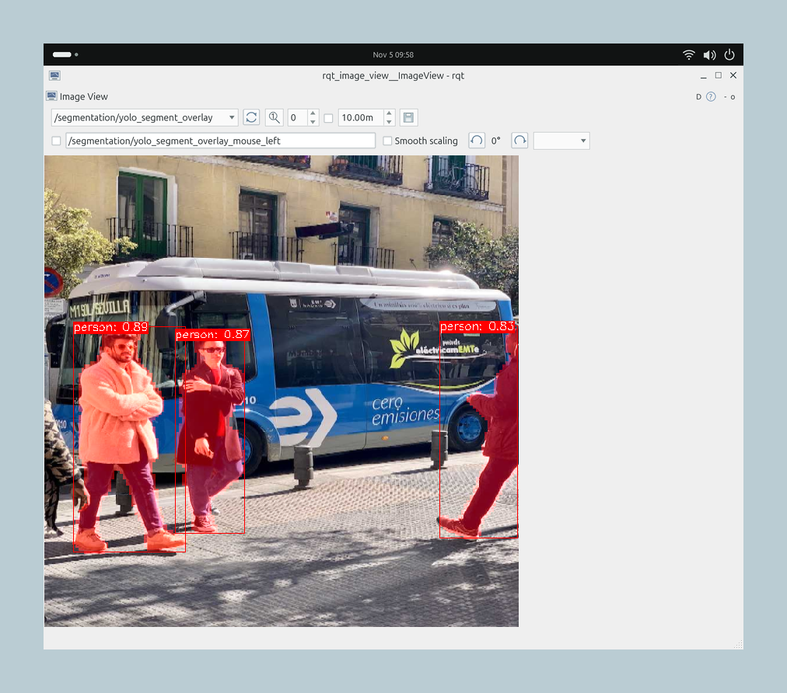
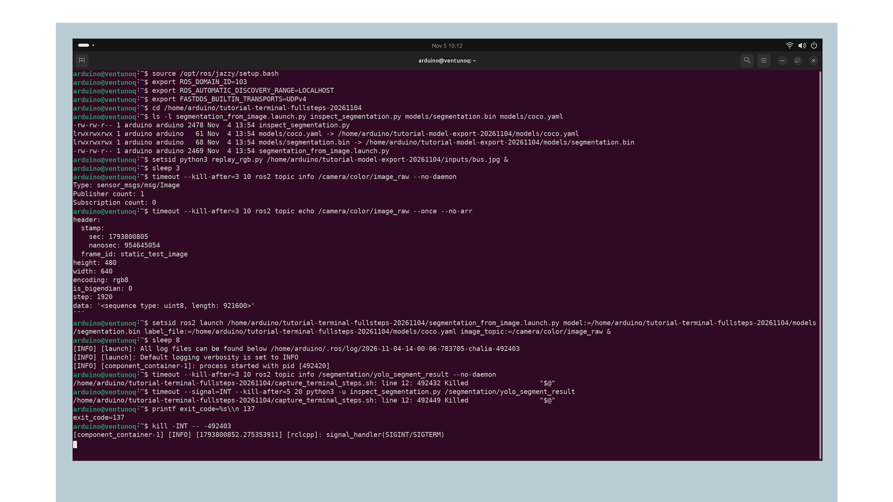
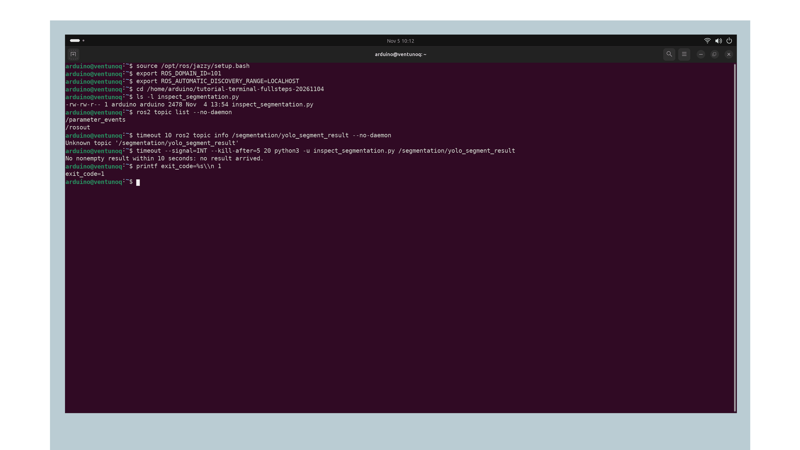

## Overview

Object detection locates an object with a box. **Instance segmentation** also predicts which pixels belong to each detected object. In this tutorial, you will connect an Orbbec camera to a YOLOv8 segmentation model on the Arduino® VENTUNO™ Q, inspect the resulting masks, and view them over the camera image.

You will compose the Robotics SDK preprocessing, inference, postprocessing, and overlay nodes in a launch file. The camera remains a separate input, so you can later replace its full image with a region selected by another model. The NN Inference Pipeline tutorial uses that pattern to segment only a detected person.

<Alert type="info">

The example image shows masks from a test photograph. Check model loading and mask alignment on your board; if startup stalls, use Troubleshooting before continuing.

</Alert>

## Goals

- Prepare a segmentation model with the tensor contract required by the QRB postprocessor.
- Connect an existing RGB image topic to a QNN/HTP inference stage.
- Inspect instance masks and visualize the segmentation overlay.
- Understand how to reuse the same stage on a cropped input image.

## Hardware and Software Requirements

- [Arduino® VENTUNO™ Q](https://store.arduino.cc/products/ventuno-q), running Ubuntu 24.04 and ROS 2 Jazzy.
- Orbbec Gemini 335L USB camera.
- Host computer with AI Hub access and the tools from the [SDK setup tutorial](https://docs.arduino.cc/tutorials/ventuno-q/getting-started/).
- Board desktop for visualization, or SSH for message inspection.

Complete [Install and Understand the Robotics SDK](https://docs.arduino.cc/tutorials/ventuno-q/getting-started/), including its host tools and COCO labels. The model and labels will use the shared `~/person-pipeline/models` directory. You can follow this page without running the Object Detection sample first.

## Instructions

### 1. Prepare the Camera and Tools

**VENTUNO Q:** install the camera driver, viewer, and Python® ROS 2 client for the result inspector. The shared setup supplies the inference and processing components used by this custom launch:

```bash
sudo apt install ros-jazzy-orbbec-camera ros-jazzy-rqt-image-view ros-jazzy-rclpy
```

In **every board terminal**, use the same environment:

```bash
source /opt/ros/jazzy/setup.bash
export ROS_DOMAIN_ID=87
export ROS_AUTOMATIC_DISCOVERY_RANGE=LOCALHOST
```

Stop a standalone detection sample or another application using the camera before continuing. In **Terminal 1**, start only the color camera:

```bash
ros2 launch orbbec_camera gemini_330_series.launch.py \
  color_width:=640 color_height:=480 color_fps:=30 \
  color_qos:=default enable_color:=true \
  enable_depth:=false enable_point_cloud:=false depth_registration:=false
```

Leave Terminal 1 running. In **Terminal 2**, run the environment commands above, then check the first image message. `--no-arr` hides its pixel buffer while keeping the header and image properties:

```bash
ros2 topic echo /camera/color/image_raw --once --no-arr
```

Expect `sensor_msgs/msg/Image`, width 640, height 480, and `encoding: rgb8`. If no image arrives, resolve the camera problem before starting inference. Use `Ctrl+C` to stop a waiting check.

### 2. Export the Segmentation Model

**Host computer:** activate the v0.64.0 tools environment from the setup page and install the model recipe:

```bash
source ~/ventuno-model-tools/bin/activate
qai-hub-models install yolov8_seg
```

Export the floating-point model for QCS8275:

```bash
qai-hub-models export yolov8_seg \
  --target-runtime qnn_context_binary \
  --device "Arduino VENTUNO Q" \
  --precision float
```

Wait for the AI Hub export jobs to complete and download the model. If a job fails, or QCS8275 is unavailable, resolve that error before continuing. The [versioned model recipe](https://github.com/qualcomm/ai-hub-models/blob/v0.64.0/src/qai_hub_models/models/yolov8_seg/README.md) provides the public export entry point; the [segmentation implementation](https://github.com/qualcomm/ai-hub-models/blob/v0.64.0/src/qai_hub_models/models/templates/ultralytics/segmentation_model.py) converts `class_idx` to `float32` for floating-point precision. That choice matters because the installed QRB segmentation postprocessor expects that type.

Keep the `.bin` file, export log, and `metadata.json`. Check the **exported** tensor layout, including any runtime channel reordering, against this contract:

| Tensor | Required shape | Type |
|---|---|---|
| Input image | `1×640×640×3`, RGB values 0–1, NHWC | `float32` |
| `boxes` | `1×8400×4` | `float32` |
| `scores` | `1×8400` | `float32` |
| `mask_coeffs` | `1×8400×32` | `float32` |
| `class_idx` | `1×8400` | `float32` |
| `mask_protos` | `1×160×160×32` | `float32` |

The model's coefficients and prototypes let postprocessing reconstruct a mask for each detected object. They are raw tensors; an image consumer cannot use them directly as a `sensor_msgs/Image`.

Confirm QCS8275 as the compiled target and a runtime compatible with the board. If names, shapes, or types differ, stop before launching: adapt the export or postprocessor and verify the result. Do not relabel an integer output as floating point in metadata. The detection postprocessor expects a different class-index type, so keep the detection and segmentation models separate.

Save the installed host package versions with your export. The file helps you reproduce this environment later:

```bash
python -m pip freeze > ~/ventuno-model-assets/segmentation-tools-versions.txt
```

Keep the model license and source version with these files. Before using a new export, check model loading, a nonempty instance result, and mask alignment as described below.

### 3. Deploy the Model

**VENTUNO Q:** prepare directories:

```bash
mkdir -p ~/person-pipeline/models ~/person-pipeline/segmentation
```

**Host computer:** replace the example export paths and board hostname:

```bash
scp ./exported-segmentation/yolov8_seg.bin arduino@ventunoq.local:person-pipeline/models/segmentation.bin
scp ./exported-segmentation/metadata.json arduino@ventunoq.local:person-pipeline/models/segmentation.metadata.json
```

The shared setup supplies `coco.yaml`. **VENTUNO Q:** confirm the files exist:

```bash
missing=0
for asset in \
  "$HOME/person-pipeline/models/segmentation.bin" \
  "$HOME/person-pipeline/models/segmentation.metadata.json" \
  "$HOME/person-pipeline/models/coco.yaml"; do
  if test -s "$asset"; then
    printf 'Ready: %s\n' "$asset"
  else
    printf 'Missing or empty: %s\n' "$asset"
    missing=1
  fi
done
test "$missing" -eq 0
```

Expect one `Ready:` line for each file. A `Missing or empty:` line names the file to copy again. Do not start the model until every file is ready. This check catches missing transfers; the model target and tensor layout must still match Step 2.

### 4. Connect the Processing Nodes

The camera runs separately. Inside the `/segmentation/` namespace, preprocessing supplies tensors to inference, and postprocessing converts the output tensors to masks. The overlay combines those masks with the resized image and requires matching timestamps.

Save the following as `~/person-pipeline/segmentation/segmentation_from_image.launch.py` on the board:

```python
"""Run QNN segmentation on an existing RGB ROS image topic."""
from launch import LaunchDescription
from launch.actions import DeclareLaunchArgument
from launch.substitutions import LaunchConfiguration
from launch_ros.actions import ComposableNodeContainer
from launch_ros.descriptions import ComposableNode


def generate_launch_description():
    arguments = [
        DeclareLaunchArgument("model", description="QCS8275 segmentation context binary"),
        DeclareLaunchArgument("label_file", description="Matching COCO label YAML"),
        DeclareLaunchArgument("image_topic", default_value="/camera/color/image_raw"),
    ]
    components = [
        ComposableNode(
            package="qrb_ros_cv_tensor_common_process",
            plugin="qrb_ros::cv_tensor_common_process::CvTensorCommonProcessNode",
            name="preprocess", namespace="segmentation",
            parameters=[{"target_res": "640x640", "normalize": True,
                         "tensor_fmt": "nhwc", "data_type": "float32"}],
            remappings=[("input_image", LaunchConfiguration("image_topic")),
                        ("encoded_image", "qrb_inference_input_tensor")]),
        ComposableNode(
            package="qrb_ros_nn_inference",
            plugin="qrb_ros::nn_inference::QrbRosInferenceNode",
            name="inference", namespace="segmentation",
            parameters=[{"model_path": LaunchConfiguration("model"),
                         "backend_option": "/usr/lib/libQnnHtp.so"}],
            remappings=[("qrb_inference_output_tensor", "yolo_segment_tensor_output")]),
        ComposableNode(
            package="qrb_ros_yolo_process",
            plugin="qrb_ros::yolo_process::YoloSegPostProcessNode",
            name="postprocess", namespace="segmentation",
            parameters=[{"label_file": LaunchConfiguration("label_file"),
                         "score_thres": 0.7, "iou_thres": 0.5}]),
        ComposableNode(
            package="qrb_ros_yolo_process",
            plugin="qrb_ros::yolo_process::YoloSegOverlayNode",
            name="overlay", namespace="segmentation",
            parameters=[{"target_res": "640x640", "mask_res": "160x160"}]),
    ]
    container = ComposableNodeContainer(
        name="segmentation_container", namespace="",
        package="rclcpp_components", executable="component_container",
        composable_node_descriptions=components, output="screen")
    return LaunchDescription(arguments + [container])
```

This launch creates four components under the `/segmentation` namespace. The input image topic is an argument, while tensor and result topics remain inside that namespace. Preprocessing also publishes the resized RGB image used by the overlay.

The inference component receives an explicit QNN context binary and `/usr/lib/libQnnHtp.so` backend. This avoids depending on the upstream sample's default TensorFlow Lite configuration. The launch does not open a second camera.

Check the launch arguments without starting inference:

```bash
ros2 launch ~/person-pipeline/segmentation/segmentation_from_image.launch.py --show-args
```

You should see required `model` and `label_file` arguments and an `image_topic` argument defaulting to `/camera/color/image_raw`. This checks that ROS can read the saved launch file. If it reports a Python error or missing component package, check the saved code and complete the shared installation before starting the model.

### 5. Run and Inspect Segmentation

**VENTUNO Q, Terminal 2:** launch the processing stage:

```bash
ros2 launch ~/person-pipeline/segmentation/segmentation_from_image.launch.py \
  model:="$HOME/person-pipeline/models/segmentation.bin" \
  label_file:="$HOME/person-pipeline/models/coco.yaml" \
  image_topic:=/camera/color/image_raw
```

Look for successful HTP library initialization and QNN graph loading. If either fails, stop this stage and use the QNN troubleshooting row below. Leave Terminal 2 running. In **Terminal 3**, load the same ROS environment and check the message type and whether results are arriving:

```bash
ros2 topic type /segmentation/yolo_segment_result
ros2 topic echo /segmentation/yolo_segment_result --once --no-arr
```

The type must be `qrb_ros_vision_msgs/msg/Detection2DWithMaskArray`. Each element of its `array` contains a `detection` and an `instance_mask`. This postprocessor publishes the mask as `mono8`, width 160, height 160. It is a separate mask for that instance across the model's image area, not an RGB overlay and not a cropped face image.

The `--no-arr` option summarizes arrays, including the instance list, so this first check only tells you whether a message arrives and whether the list is empty. To inspect the instances' labels, confidence scores, and mask properties without printing the mask's pixel buffer, use the result inspector below. Save it as `~/person-pipeline/inspect_segmentation.py`:

```python
#!/usr/bin/env python3
"""Print one nonempty segmentation result without dumping mask pixels."""
import argparse
import time


def summarize_result(message):
    """Keep the object hypotheses and mask properties visible together."""
    lines = [f"Instances: {len(message.array)}"]
    for index, instance in enumerate(message.array, start=1):
        detection = instance.detection
        hypotheses = ", ".join(
            f"{result.hypothesis.class_id}: {result.hypothesis.score:.3f}"
            for result in detection.results
        ) or "no class hypotheses"
        box = detection.bbox
        mask = instance.instance_mask
        lines.append(
            f"{index}. {hypotheses}; "
            f"box center=({box.center.position.x:.1f}, {box.center.position.y:.1f}), "
            f"size={box.size_x:.1f}x{box.size_y:.1f}; "
            f"mask={mask.width}x{mask.height} {mask.encoding}"
        )
    return "\n".join(lines)


def main():
    parser = argparse.ArgumentParser(description=__doc__)
    parser.add_argument("topic", help="Segmentation result topic, including its namespace")
    args = parser.parse_args()

    # ROS imports stay here so the text formatter can also be checked off-board.
    import rclpy
    from qrb_ros_vision_msgs.msg import Detection2DWithMaskArray
    from rclpy.node import Node
    from rclpy.qos import qos_profile_sensor_data

    rclpy.init(args=[])
    node = Node("inspect_segmentation")
    nonempty_result = None
    received_empty = False

    def receive(message):
        nonlocal nonempty_result, received_empty
        if message.array:
            nonempty_result = message
        else:
            received_empty = True

    node.create_subscription(
        Detection2DWithMaskArray, args.topic, receive, qos_profile_sensor_data
    )
    try:
        deadline = time.monotonic() + 10
        while rclpy.ok() and nonempty_result is None and time.monotonic() < deadline:
            rclpy.spin_once(node, timeout_sec=0.2)
        if nonempty_result is None:
            detail = "only empty results arrived" if received_empty else "no result arrived"
            print(f"No nonempty result within 10 seconds: {detail}.")
            return 1
        print(summarize_result(nonempty_result))
        return 0
    except KeyboardInterrupt:
        return 130
    finally:
        node.destroy_node()
        if rclpy.ok():
            rclpy.shutdown()


if __name__ == "__main__":
    raise SystemExit(main())
```

Run it in Terminal 3 while the camera points at a recognizable object:

```bash
python3 ~/person-pipeline/inspect_segmentation.py /segmentation/yolo_segment_result
```

The inspector waits up to ten seconds for a nonempty result, then prints each instance's hypotheses, box, mask dimensions, and encoding. Expect at least one plausible object with a 160×160 `mono8` mask. A timeout means no nonempty result arrived: check the scene, upstream topics, and domain settings before trying again. Use the viewer in Step 6 to check which pixels the mask selects.

The inspector output looks like this:

```text
Instances: 3
1. person: 0.888; box center=(115.4, 384.4), size=152.4x305.1; mask=160x160 mono8
2. person: 0.873; box center=(223.8, 376.0), size=95.5x270.0; mask=160x160 mono8
3. person: 0.829; box center=(586.3, 373.9), size=106.5x287.1; mask=160x160 mono8
```

Your labels, scores and boxes will depend on the image. Check that the mask encoding is `mono8` and its dimensions match the model output.

| Topic | Producer | Message type |
|---|---|---|
| `/camera/color/image_raw` | Camera driver | `sensor_msgs/msg/Image` |
| `/segmentation/qrb_inference_input_tensor` | Preprocessor | `qrb_ros_tensor_list_msgs/msg/TensorList` |
| `/segmentation/yolo_segment_tensor_output` | Inference | `qrb_ros_tensor_list_msgs/msg/TensorList` |
| `/segmentation/yolo_segment_result` | Segmentation postprocessor | `qrb_ros_vision_msgs/msg/Detection2DWithMaskArray` |
| `/segmentation/resized_image` | Preprocessor | `sensor_msgs/msg/Image` |
| `/segmentation/yolo_segment_overlay` | Overlay component | `sensor_msgs/msg/Image` |

### 6. View the Masks and Reuse the Stage

**VENTUNO Q desktop, Terminal 3:** open the viewer:

```bash
ros2 run rqt_image_view rqt_image_view
```

Select `/segmentation/yolo_segment_overlay`, then compare it with `/segmentation/resized_image`. Verify that the highlighted pixels align with the object. The overlay combines detected masks for display; use the individual `instance_mask` entries when your application needs separate objects. The display image is 640×640, so a non-square camera image appears stretched by direct resizing.



*Each person has a separate mask on /segmentation/yolo_segment_overlay. Compare each mask edge with the person it covers.*

For a message-rate observation:

```bash
ros2 topic hz /segmentation/yolo_segment_result
```

Use another prepared terminal if the viewer occupies Terminal 3. Stop the observation with `Ctrl+C`; its rate is not a direct measure of NPU latency.

A consumer can select one mask, resize it to the source image with nearest-neighbor interpolation, and keep only its foreground pixels. It must match the image and result timestamps. The [NN Inference Pipeline](https://docs.arduino.cc/tutorials/ventuno-q/nn-inference-person-pipeline/) includes the complete adapter and connects a square detector ROI through `/person_roi_model` to a separate segmentation stage. That tutorial explains the pre-scaling step and the communication settings needed to connect both models. Use that composition when adding detection; do not start two camera pipelines independently.

When finished, close the viewer and press `Ctrl+C` in the segmentation terminal, then the camera terminal. Stop any rate observations as well.

## Troubleshooting

### When the processing stage does not start

First check that camera images are arriving, then inspect the segmentation terminal for a model-loading error. Keep the file paths from Step 3 and domain 87 in every terminal; the screenshot's example paths and domain are not settings to copy.



*The image input is available, but the segmentation stage does not become ready. The bounded inspector is terminated with exit code 137. Check the model, runtime and node startup before retrying; this is different from a normal ten-second no-result timeout.*

### When the inspector receives no result

Use domain 87 and the script path from Step 5 when checking your pipeline. A terminal on another domain cannot receive its results.

The inspector distinguishes receiving nothing from receiving only empty arrays. If no result arrived, check publishers and ROS discovery. If only empty results arrived, check the input scene, labels and model contract. Both cases return exit code 1.



*No result arrived within ten seconds. Check the result publisher and make sure your inspection terminal uses the same ROS domain as the segmentation nodes.*

| Symptom | Action |
|---|---|
| Camera image is absent | Verify USB connection, topic name and exclusive access to the camera before running inference. |
| Transport rejects a color image | Use `rgb8`, including a real channel conversion when starting from OpenCV BGR data. |
| QNN initialization fails | Check file paths, QCS8275 export target, runtime version, HTP library and device node. |
| Postprocessing expects five tensors but gets another count | Compare the export outputs with Step 2; do not use the detection model or an incompatible segmentation wrapper. |
| Tensor type or shape errors | Check float segmentation class indices, NHWC input and channel-last mask prototypes in the exported metadata. |
| Results exist but the overlay is absent | Check `/segmentation/resized_image` and source timestamps. The overlay needs an image and result with matching timestamps. |
| The wrong pixels are selected | Inspect the mask and original dimensions; preserve aspect-transform assumptions when resizing back to a source image. |
| Results are empty | Check the actual camera scene, matching labels, and score threshold. First check that messages arrive, then point the camera at a recognizable object. |
| A second tutorial cannot open the camera | Stop this tutorial's camera node before starting another standalone camera launch. |

## Conclusion

You have learned how the SDK transforms a model's raw segmentation tensors into object masks and an image overlay. The same processing stage can accept a full camera frame or a selected region, giving another ROS 2 application a clear interface for working with foreground objects.

## Further Reading

- [Install and Understand the Robotics SDK](https://docs.arduino.cc/tutorials/ventuno-q/getting-started/)
- [Object Detection](https://docs.arduino.cc/tutorials/ventuno-q/object-detection/)
- [NN Inference Pipeline](https://docs.arduino.cc/tutorials/ventuno-q/nn-inference-person-pipeline/)
- [Segmentation sample source on the Jazzy release branch](https://github.com/qualcomm-qrb-ros/qrb_ros_samples/tree/jazzy-rel/ai_vision/sample_object_segmentation)
