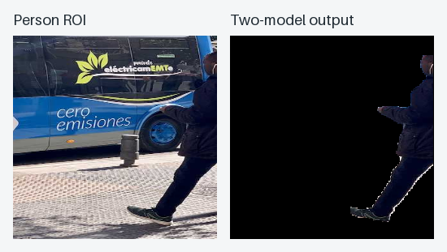
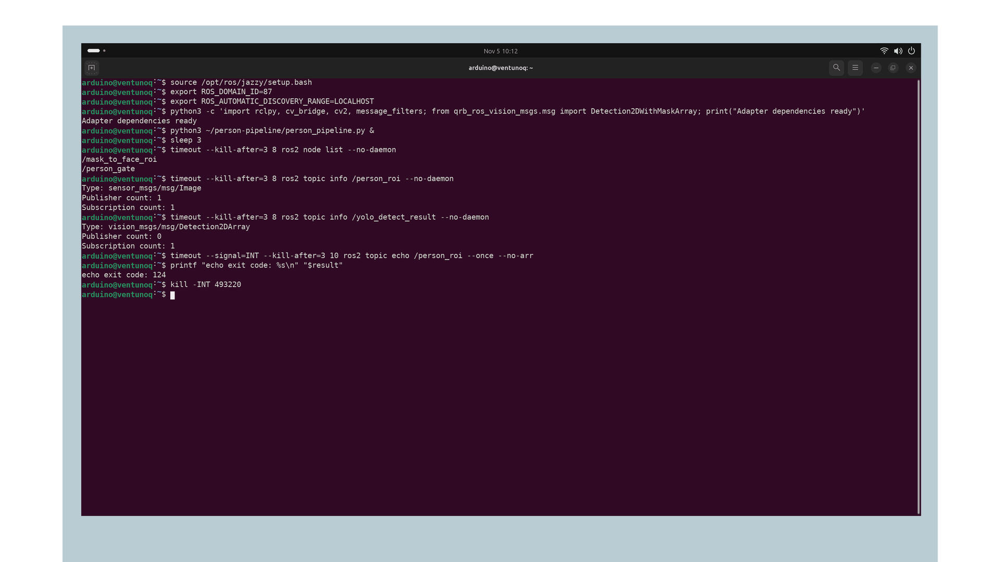

## Overview

In this tutorial, you will connect an Orbbec Gemini 335L camera to two vision models on the Arduino® VENTUNO™ Q. The first model finds a person in the camera image. A Python® adapter selects a square region around that person, and the second model predicts a mask. You will use the mask to keep the person pixels and remove the background.

The Robotics Software Development Kit (SDK) supplies reusable ROS 2 preprocessing, inference and postprocessing components. You will use `qrb_ros_nn_inference` twice, with separate models and namespaces. Both models run through the Qualcomm® Neural Network (QNN) runtime and its Hexagon Tensor Processor (HTP) backend; the adapters run on the CPU.

<Alert type="info">

This tutorial uses a live camera; the example image illustrates the result using a test photograph. Use the checks in Step 6 to inspect frame pairing and foreground alignment. Model loading and shutdown also have known issues described in Troubleshooting.

</Alert>

## Goals

- Connect detection and segmentation models through ROS 2 topics.
- Convert detector coordinates to a square person region with some surrounding context.
- Prepare that region for segmentation and apply its instance mask.
- Check timestamps, image dimensions and foreground alignment.
- Check continuous camera output, frame pairing and mask alignment during motion.

## Hardware and Software Requirements

- Arduino® VENTUNO™ Q with Ubuntu 24.04, ROS 2 Jazzy and the [shared SDK installation](https://docs.arduino.cc/tutorials/ventuno-q/getting-started/).
- Host computer for exporting and deploying models, with AI Hub access.
- An Orbbec Gemini 335L USB camera and a suitable cable. Follow the [RGB camera tutorial](https://docs.arduino.cc/tutorials/ventuno-q/ros2-perception-rgb-cam/) for connection guidance.
- Board desktop for the image viewer, or SSH for message checks. An HDMI® display is optional.
- Compatible QCS8275 detection and segmentation context binaries, metadata and COCO labels. Follow the linked model preparation steps before starting inference.

These instructions use inference 1.1.1, QAI Runtime 2.46.0 and Fast DDS 2.14.6 as reference versions. Keep your installed versions with the model metadata so you can check compatibility when updating either one.

## Instructions

### 1. Prepare Your Board Terminals

Commands run on the **VENTUNO Q**, unless marked **Host computer**. Complete the shared SDK installation first, then add the sample and Python dependencies:

```bash
sudo apt install ros-jazzy-orbbec-camera ros-jazzy-sample-object-detection ros-jazzy-rclpy ros-jazzy-cv-bridge ros-jazzy-message-filters ros-jazzy-vision-msgs ros-jazzy-rqt-image-view python3-opencv
mkdir -p ~/person-pipeline/models
```

Use the same ROS domain and communication profile in every pipeline terminal. The profile below sends messages through the board's loopback interface and allows the pipeline processes to discover each other. It also avoids the default Fast DDS shared-memory path, which can stall during node creation on this board setup. Step 6 shows you how to check output while the camera is running.

Save this as `~/person-pipeline/udp-only.xml`:

```xml
<?xml version="1.0" encoding="UTF-8" ?>
<profiles xmlns="http://www.eprosima.com/XMLSchemas/fastRTPS_Profiles">
<transport_descriptors><transport_descriptor><transport_id>tutorial_udp</transport_id><type>UDPv4</type><maxInitialPeersRange>64</maxInitialPeersRange><interfaceWhiteList><address>127.0.0.1</address></interfaceWhiteList></transport_descriptor></transport_descriptors>
<participant profile_name="tutorial_participant" is_default_profile="true"><rtps><builtin><initialPeersList><locator><udpv4><address>127.0.0.1</address></udpv4></locator></initialPeersList></builtin><userTransports><transport_id>tutorial_udp</transport_id></userTransports><useBuiltinTransports>false</useBuiltinTransports></rtps></participant>
</profiles>
```

Save the following as `~/person-pipeline/pipeline-env.sh`:

```bash
# Source this file in every board terminal for the camera pipeline.
source /opt/ros/jazzy/setup.bash
export ROS_DOMAIN_ID=94
export ROS_AUTOMATIC_DISCOVERY_RANGE=SYSTEM_DEFAULT
export FASTRTPS_DEFAULT_PROFILES_FILE="$HOME/person-pipeline/udp-only.xml"
export FASTDDS_BUILTIN_TRANSPORTS=UDPv4
```

Domain 94 must be unused by other applications. If you choose another value, change it in this file before starting any nodes. In **every board terminal** used below, run:

```bash
source ~/person-pipeline/pipeline-env.sh
```

This replaces the shared setup page's domain 87 and `LOCALHOST` discovery setting for this pipeline only. Keep the XML and environment settings identical across all participating terminals. Check discovery before starting a model:

```bash
timeout --signal=INT --kill-after=3 10 ros2 node list --no-daemon
python3 -c 'import rclpy, cv_bridge, cv2, message_filters; from qrb_ros_vision_msgs.msg import Detection2DWithMaskArray; print("Adapter dependencies ready")'
```

An unused domain should return no application nodes. Expect `Adapter dependencies ready` from the import check. If the node query times out, resolve the environment/profile problem before starting inference.

### 2. Prepare and Deploy the Models

**Host computer:** follow the [host tools and labels setup](https://docs.arduino.cc/tutorials/ventuno-q/getting-started/#5-prepare-the-host-model-tools), [detection export and deployment](https://docs.arduino.cc/tutorials/ventuno-q/object-detection/#2-export-the-detection-model), and [segmentation export and deployment](https://docs.arduino.cc/tutorials/ventuno-q/image-segmentation/#2-export-the-segmentation-model). Finish copying the models and labels before returning here. Start the camera in Step 3 so that only one pipeline opens it.

Both models take RGB float32 NHWC input, shape `1×640×640×3`, values 0–1. Detection outputs `boxes`, `scores`, and uint8 `class_idx`; segmentation additionally outputs `mask_coeffs` and `mask_protos`, with float32 class indices. Preserve the full contracts from the task pages. The two binaries cannot be interchanged.

**VENTUNO Q:** confirm that every asset is present and nonempty:

```bash
for asset in detection.bin detection.metadata.json segmentation.bin segmentation.metadata.json coco.yaml; do
  if test -s "$HOME/person-pipeline/models/$asset"; then
    printf 'Ready: %s\n' "$asset"
  else
    printf 'Missing or empty: %s\n' "$asset"
  fi
done
```

Do not continue until all five files report `Ready`. Their presence does not establish target or tensor compatibility; compare their metadata with the task pages.

### 3. Run and Inspect Object Detection

Start the camera separately so you can check its video stream before adding inference. Stop any previous image replay or other application using this camera. Only one source should publish `/camera/color/image_raw`.

**Terminal 1:** source the pipeline environment and start the Orbbec color stream:

```bash
source ~/person-pipeline/pipeline-env.sh
ros2 launch orbbec_camera gemini_330_series.launch.py \
  color_width:=640 color_height:=480 color_fps:=30 \
  color_qos:=default enable_color:=true \
  enable_depth:=false enable_point_cloud:=false depth_registration:=false
```

This requests a 640×480 color stream at 30 fps; it is not a promise that both models will process 30 frames per second. `color_qos:=default` selects the driver's default reliable profile to match the adapter. Confirm the actual publisher QoS below.

Leave Terminal 1 running. **Terminal 2:** source the same environment and inspect the camera:

```bash
source ~/person-pipeline/pipeline-env.sh
ros2 topic echo /camera/color/image_raw --once --no-arr
ros2 topic info /camera/color/image_raw --verbose --no-daemon
ros2 topic hz /camera/color/image_raw
```

Expect 640×480 `rgb8` images, a reliable publisher, advancing source timestamps and repeated messages. Stop the rate observation with `Ctrl+C`. If the stream is absent, resolve the camera connection and driver before starting a model. Confirm the view in `rqt_image_view` if needed, then close the viewer to reuse Terminal 2.

The detection wrapper below reuses the installed sample's processing nodes and removes its camera launch. Save it as `~/person-pipeline/detection_from_image.launch.py`:

```python
"""Reuse the installed detection graph on an existing RGB image topic."""
import importlib.util
from pathlib import Path
from ament_index_python.packages import get_package_share_directory
from launch import LaunchDescription
from launch.actions import IncludeLaunchDescription


def generate_launch_description():
    path = Path(get_package_share_directory("sample_object_detection")) / "launch/launch_with_orbbec_camera.py"
    spec = importlib.util.spec_from_file_location("installed_detection", path)
    module = importlib.util.module_from_spec(spec)
    spec.loader.exec_module(module)
    original = module.generate_launch_description()
    cameras = [action for action in original.entities if isinstance(action, IncludeLaunchDescription)]
    assert len(cameras) == 1, "Inspect changed packaged launch before testing"
    return LaunchDescription([action for action in original.entities if action not in cameras])
```

The wrapper checks that the installed launch has exactly one included camera launch. If that assertion fails, inspect your sample version before adapting the wrapper.

**Terminal 2:** source the pipeline environment and start detection:

```bash
ros2 launch ~/person-pipeline/detection_from_image.launch.py \
  model:="$HOME/person-pipeline/models/detection.bin" \
  label_file:="$HOME/person-pipeline/models/coco.yaml" \
  target_res:=640x640 score_thres:=0.7 iou_thres:=0.5
```

Leave Terminal 2 running. Look for HTP initialization, QNN graph loading and `Inference init successfully!`. A graph-loading error is a failed run, even if the container process starts.

**Terminal 3:** source the same environment and inspect input and detection:

```bash
ros2 topic echo /camera/color/image_raw --once --no-arr
ros2 topic echo /yolo_detect_result --once
```

Expect a 640×480 `rgb8` image and a nonempty `vision_msgs/msg/Detection2DArray`. Ask a consenting person to enter the camera view. Look for a `person` or `0` hypothesis with confidence at least 0.7 and a box that follows them as they move. An empty detection list cannot drive the next stage. Press `Ctrl+C` if an inspection waits without receiving data.

### 4. Connect Detections to a Person Crop

The detector reports boxes in its resized 640×640 coordinate space. The adapter maps them to the 640×480 source image, then selects a square region around the highest-scoring person. Its side is 1.15 times the longest box dimension, limited to the source dimensions and shifted inside the image. This retains some surrounding context and avoids stretching a narrow crop into a square. At image boundaries or for very large boxes, inspect the result for clipping.

Both selection stages require `person` or `0` with score at least 0.7. This chooses a person by confidence, not identity, completeness or position. A source image that already clips the person cannot be turned into a complete person image by this pipeline.

Save the adapter as `~/person-pipeline/person_pipeline.py`:

```python
#!/usr/bin/env python3
"""Gate YOLO detections into segmentation, then send masked person ROIs to face recognition."""

import cv2
import message_filters
import rclpy
from cv_bridge import CvBridge
from qrb_ros_vision_msgs.msg import Detection2DWithMaskArray
from rclpy.node import Node
from rclpy.qos import QoSProfile
pipeline_qos = QoSProfile(depth=10)
from sensor_msgs.msg import Image
from vision_msgs.msg import Detection2DArray


def person_result(detection, minimum_score=0.7):
    scores = []
    for result in detection.results:
        hypothesis = result.hypothesis
        if hypothesis.class_id in ("person", "0") and hypothesis.score >= minimum_score:
            scores.append(hypothesis.score)
    return max(scores) if scores else None


class PersonGate(Node):
    def __init__(self):
        super().__init__("person_gate")
        self.bridge = CvBridge()
        # Boxes use the detector's resized input, not the camera resolution.
        self.model_width = self.declare_parameter("detection_width", 640).value
        self.model_height = self.declare_parameter("detection_height", 640).value
        if self.model_width <= 0 or self.model_height <= 0:
            raise ValueError("Detection dimensions must be positive")
        self.publisher = self.create_publisher(Image, "/person_roi", 10)
        images = message_filters.Subscriber(self, Image, "/camera/color/image_raw",
                                            qos_profile=pipeline_qos)
        detections = message_filters.Subscriber(self, Detection2DArray, "/yolo_detect_result",
                                                qos_profile=pipeline_qos)
        sync = message_filters.ApproximateTimeSynchronizer([images, detections], 10, 0.25)
        sync.registerCallback(self.crop_person)
        self.sync = sync

    def crop_person(self, image, detections):
        candidates = [d for d in detections.detections if person_result(d) is not None]
        if not candidates:
            return
        person = max(candidates, key=lambda d: person_result(d))
        frame = self.bridge.imgmsg_to_cv2(image, "rgb8")
        box = person.bbox
        scale_x = frame.shape[1] / self.model_width
        scale_y = frame.shape[0] / self.model_height
        x1 = max(0, round((box.center.position.x - box.size_x / 2) * scale_x))
        y1 = max(0, round((box.center.position.y - box.size_y / 2) * scale_y))
        x2 = min(frame.shape[1], round((box.center.position.x + box.size_x / 2) * scale_x))
        y2 = min(frame.shape[0], round((box.center.position.y + box.size_y / 2) * scale_y))
        if x2 <= x1 or y2 <= y1:
            return
        # Preserve person proportions by selecting a square ROI with context.
        side = min(round(max(x2 - x1, y2 - y1) * 1.15), frame.shape[0], frame.shape[1])
        x1 = max(0, min(round((x1 + x2 - side) / 2), frame.shape[1] - side))
        y1 = max(0, min(round((y1 + y2 - side) / 2), frame.shape[0] - side))
        x2, y2 = x1 + side, y1 + side
        roi = self.bridge.cv2_to_imgmsg(frame[y1:y2, x1:x2], "rgb8")
        roi.header = image.header
        self.publisher.publish(roi)


class MaskToFaceRoi(Node):
    def __init__(self):
        super().__init__("mask_to_face_roi")
        self.bridge = CvBridge()
        self.publisher = self.create_publisher(Image, "/input_faces", 10)
        rois = message_filters.Subscriber(self, Image, "/person_roi",
                                          qos_profile=pipeline_qos)
        masks = message_filters.Subscriber(self, Detection2DWithMaskArray, "/person_seg/yolo_segment_result",
                                           qos_profile=pipeline_qos)
        sync = message_filters.ApproximateTimeSynchronizer([rois, masks], 10, 0.25)
        sync.registerCallback(self.apply_mask)
        self.sync = sync

    def apply_mask(self, roi, results):
        instances = [item for item in results.array if person_result(item.detection) is not None]
        if not instances:
            return
        image = self.bridge.imgmsg_to_cv2(roi, "rgb8")
        person = max(instances, key=lambda item: person_result(item.detection))
        mask = self.bridge.imgmsg_to_cv2(person.instance_mask, "mono8")
        # The instance mask covers the complete model input; restore ROI size.
        mask = cv2.resize(mask, (image.shape[1], image.shape[0]), interpolation=cv2.INTER_NEAREST)
        foreground = self.bridge.cv2_to_imgmsg(cv2.bitwise_and(image, image, mask=mask), "rgb8")
        foreground.header = roi.header
        self.publisher.publish(foreground)


def main():
    rclpy.init()
    executor = rclpy.executors.MultiThreadedExecutor()
    gate, masker = PersonGate(), MaskToFaceRoi()
    executor.add_node(gate)
    executor.add_node(masker)
    try:
        executor.spin()
    except KeyboardInterrupt:
        pass
    finally:
        executor.shutdown()
        gate.destroy_node()
        masker.destroy_node()
        if rclpy.ok():
            rclpy.shutdown()


if __name__ == "__main__":
    main()
```

The two synchronizers keep ten messages and pair source timestamps within 0.25 seconds. Nearby timestamps can belong to different frames. Follow the motion checks in Step 6 and adjust the queue or pairing strategy if an old result is applied to a newer image.

The adapter uses reliable subscriptions for the configured camera publisher and the SDK result publishers. A best-effort camera publisher is incompatible with a reliable subscription: check endpoint QoS before changing the input source. Reliable transport does not make this workflow a real-time system.

**Terminal 3:** start the adapter:

```bash
python3 ~/person-pipeline/person_pipeline.py
```

Leave it running. **Terminal 4:** source the environment and check its crop:

```bash
ros2 topic echo /person_roi --once --no-arr
```

Expect a square `rgb8` crop with the camera source header. Its size and position change as the selected person moves. Check that the crop follows the person and contains some surrounding context. If nothing arrives, check the detection, source timestamp and publisher QoS before starting segmentation.

### 5. Add a Second Inference Stage

Prepare the crop as a 640×640 RGB image before it enters the installed SDK preprocessor. The fixed width avoids a problem with arbitrary-width RGB crops in this SDK transport path. Keep `/person_roi` at its original size for applying the final mask.

Save this as `~/person-pipeline/prepare_roi.py`:

```python
"""Resize a square person crop before entering installed RGB DMA preprocessing.

Keep /person_roi unchanged for the mask adapter. Only the segmentation input is
resized to the model's 640x640 image area; preserve the original source header.
"""
import cv2
import rclpy
from cv_bridge import CvBridge
from rclpy.node import Node
from rclpy.qos import qos_profile_sensor_data
from sensor_msgs.msg import Image

class PrepareRoi(Node):
    def __init__(self):
        super().__init__("prepare_roi_for_inference")
        self.bridge = CvBridge()
        self.publisher = self.create_publisher(Image, "/person_roi_model", 10)
        self.create_subscription(Image, "/person_roi", self.prepare, qos_profile_sensor_data)

    def prepare(self, message):
        frame = self.bridge.imgmsg_to_cv2(message, "rgb8")
        image = self.bridge.cv2_to_imgmsg(cv2.resize(frame, (640, 640)), "rgb8")
        image.header = message.header
        self.publisher.publish(image)

def main():
    rclpy.init()
    node = PrepareRoi()
    try:
        rclpy.spin(node)
    except KeyboardInterrupt:
        pass
    finally:
        node.destroy_node()
        if rclpy.ok():
            rclpy.shutdown()

if __name__ == "__main__":
    main()
```

**Terminal 4:** start it and leave it running:

```bash
python3 ~/person-pipeline/prepare_roi.py
```

Save the second-stage launch as `~/person-pipeline/segmentation_on_roi.launch.py`:

```python
"""Run QNN segmentation on the pre-scaled RGB person ROI."""
from launch import LaunchDescription
from launch.actions import DeclareLaunchArgument
from launch.substitutions import LaunchConfiguration
from launch_ros.actions import ComposableNodeContainer
from launch_ros.descriptions import ComposableNode


def generate_launch_description():
    model = DeclareLaunchArgument("model", description="QCS8275 segmentation context binary")
    label = DeclareLaunchArgument("label_file", description="Matching COCO label YAML file")
    segmentation = [
        ComposableNode(
            package="qrb_ros_cv_tensor_common_process",
            plugin="qrb_ros::cv_tensor_common_process::CvTensorCommonProcessNode",
            name="preprocess",
            namespace="person_seg",
            parameters=[{"target_res": "640x640", "normalize": True,
                         "tensor_fmt": "nhwc", "data_type": "float32"}],
            remappings=[("input_image", "/person_roi_model"),
                        ("encoded_image", "qrb_inference_input_tensor")]),
        ComposableNode(
            package="qrb_ros_nn_inference",
            plugin="qrb_ros::nn_inference::QrbRosInferenceNode",
            name="inference",
            namespace="person_seg",
            parameters=[{"backend_option": "/usr/lib/libQnnHtp.so",
                         "model_path": LaunchConfiguration("model")}],
            remappings=[("qrb_inference_output_tensor", "yolo_segment_tensor_output")]),
        ComposableNode(
            package="qrb_ros_yolo_process",
            plugin="qrb_ros::yolo_process::YoloSegPostProcessNode",
            name="postprocess",
            namespace="person_seg",
            parameters=[{"label_file": LaunchConfiguration("label_file"),
                         "score_thres": 0.7, "iou_thres": 0.5}]),
    ]
    return LaunchDescription([model, label, ComposableNodeContainer(
        name="person_segmentation", namespace="", package="rclcpp_components",
        executable="component_container", composable_node_descriptions=segmentation,
        output="screen")])
```

The `/person_seg` namespace separates the second model's tensors from detection. Preprocessing consumes `/person_roi_model`, normalizes RGB values and supplies NHWC float tensors. Inference uses its own `model_path` and `/usr/lib/libQnnHtp.so`. Postprocessing produces `qrb_ros_vision_msgs/msg/Detection2DWithMaskArray`.

**Terminal 5:** source the environment and start segmentation:

```bash
ros2 launch ~/person-pipeline/segmentation_on_roi.launch.py \
  model:="$HOME/person-pipeline/models/segmentation.bin" \
  label_file:="$HOME/person-pipeline/models/coco.yaml"
```

Check QNN initialization and leave Terminal 5 running. **Terminal 6:** source the same environment and inspect both outputs:

```bash
ros2 topic echo /person_seg/yolo_segment_result --once --no-arr
ros2 topic echo /input_faces --once --no-arr
```

`--no-arr` hides the instance list. To see labels, scores and mask properties, save the [segmentation inspector](https://docs.arduino.cc/tutorials/ventuno-q/image-segmentation/#5-run-and-inspect-segmentation) as `~/person-pipeline/inspect_segmentation.py`, then run:

```bash
python3 ~/person-pipeline/inspect_segmentation.py /person_seg/yolo_segment_result
```

Expect a person instance at or above 0.7 and a 160×160 `mono8` mask. The confidence score depends on the camera view. The mask covers the full square model input. The adapter resizes it to the original square ROI using nearest-neighbor interpolation and preserves the foreground pixels. Expect `/input_faces` to have the same dimensions and header as its corresponding camera ROI, with `rgb8` encoding. This remains a person image, not a detected face.

### 6. View and Check the Complete Data Path

**Board desktop, Terminal 6:** open the viewer:

```bash
ros2 run rqt_image_view rqt_image_view
```

Compare `/yolo_detect_overlay`, `/person_roi`, `/person_roi_model`, and `/input_faces`. The crop should contain the selected person, the prepared input should retain its proportions, and the final image should remove the surrounding background.



*Left: the square region around the highest-scoring person. Right: the segmentation mask removes the bus and ground while retaining the visible person. Compare the foreground boundary with the person in the crop.*

```text
camera -> live RGB frames -> detection -> person result
                  |                       |
                  +------> PersonGate <---+
                               |
                          /person_roi -----------+
                               |                 |
                         PrepareRoi              |
                               |                 |
                       /person_roi_model         |
                               |                 |
                          segmentation           |
                               |                 |
                          person mask -> MaskToFaceRoi
                                              |
                                         /input_faces
```

Compare the person in the crop with the foreground image. The mask should keep the person and remove the surrounding background. Check the source timestamp, ROI dimensions and mask encoding if the edges are misplaced. Fine details such as shoes may be imperfect.

To check continuous camera operation, keep a person in view and use another prepared terminal. Observe each topic for at least 60 seconds, one at a time:

```bash
ros2 topic hz /camera/color/image_raw
ros2 topic hz /person_roi
ros2 topic hz /input_faces
```

Stop each observation with `Ctrl+C` before running the next command. Expect repeated output while a qualifying person is visible. The final rate can be lower than the camera rate; subscriber observations are not NPU benchmarks.

While watching the output, move an arm or walk slowly across the view. Check that the detection box, square ROI and foreground follow the current person without persistent lag or an old mask on a new frame. Compare source timestamps for corresponding ROI, segmentation and output messages. The adapter allows a 0.25-second approximate pairing window, so timestamps merely being nearby is not proof of a correct moving-frame match.

Leave and re-enter the scene: no qualifying person means the adapter stops publishing new crops and foregrounds. A viewer may retain its last image, so check that timestamps stop and then resume. Stop and restart the pipeline and inspect component logs. Continue only when the output follows the person consistently and the pipeline can be restarted without leaving processes behind.

### 7. Optional: Connect a Validated Face Recognition Node

Your foreground image is available on `/input_faces`. You can connect it to a face-recognition node if you already have a QCS8275 build and compatible YuNet/SFace models that work on their own. This additional node uses OpenCV face APIs and has not yet been verified on QCS8275; the two QNN models above do not provide its runtime setup.

The [Face Recognition source](https://github.com/qualcomm-qrb-ros/qrb_ros_samples/tree/ad7e91118c16137a2121bacdc46374d149659a33/ai_vision/sample_face_recognition) documents the interfaces used here. The `jazzy-rel` version used by these tutorials does not include this package. Skip this section if you do not already have a working face-recognition workspace; the steps below connect an existing installation to the image topic.

<Alert type="warning">

Register and process a person's face only with their consent. Use a local database you control, explain its purpose to the subject, and remove their data when it is no longer needed. Registration stores an image, so use a non-sensitive local subject ID.

</Alert>

Close the image viewer in Terminal 6 so its shell prompt is available. In Terminals 6 and 7, load the environment from Step 1, then use `source` to load the `install/setup.bash` file from your working face-recognition workspace. Start a dedicated component container in **Terminal 7**:

```bash
ros2 run rclcpp_components component_container --ros-args -r __node:=face_container
```

In **Terminal 6**, create a local database and load the component. Place your compatible ONNX models at the two paths shown before running the command:

```bash
mkdir -p ~/person-pipeline/face-database
ros2 component load /face_container \
  sample_face_recognition 'sample_face_recognition::RecognitionNode' \
  -p fd_model:="$HOME/person-pipeline/models/yunet.onnx" \
  -p fr_model:="$HOME/person-pipeline/models/sface.onnx" \
  -p image_data_path:="$HOME/person-pipeline/face-database" \
  -p database_path:="$HOME/person-pipeline/face-database" \
  -p overlay:=1
```

The load command should return a component ID, and the face node should report that both models loaded. If it fails, resolve the model paths, workspace, or runtime error before registering a subject. Save the following as `~/person-pipeline/register_face.py`. It converts a local image to RGB, waits for the registration subscriber, and sends one image to `/target_face`:

```python
#!/usr/bin/env python3
"""Publish a consenting subject's image to the optional face registration node."""
import argparse
import re
import time

import cv2
import rclpy
from cv_bridge import CvBridge
from rclpy.node import Node
from sensor_msgs.msg import Image


def main():
    parser = argparse.ArgumentParser()
    parser.add_argument("image")
    parser.add_argument("name", help="Local subject ID: letters, digits, underscores or hyphens")
    args = parser.parse_args()
    if not re.fullmatch(r"[A-Za-z0-9_-]+", args.name):
        parser.error("Use a simple subject ID, without path separators")
    image = cv2.imread(args.image)
    if image is None:
        parser.error("Cannot read the registration image")

    rclpy.init()
    node = Node("register_face")
    publisher = node.create_publisher(Image, "/target_face", 10)
    try:
        # Wait for a subscriber before sending this one-time registration.
        deadline = time.monotonic() + 10
        while publisher.get_subscription_count() == 0:
            if time.monotonic() >= deadline:
                raise RuntimeError("No /target_face subscriber; start Face Recognition first")
            rclpy.spin_once(node, timeout_sec=0.1)
        rgb = cv2.cvtColor(image, cv2.COLOR_BGR2RGB)
        message = CvBridge().cv2_to_imgmsg(rgb, "rgb8")
        message.header.stamp = node.get_clock().now().to_msg()
        # This sample uses frame_id as the database filename stem.
        message.header.frame_id = args.name
        publisher.publish(message)
        publisher.wait_for_all_acked(rclpy.duration.Duration(seconds=2))
        print("Image sent. Check the recognition node's registration result.")
    finally:
        node.destroy_node()
        rclpy.shutdown()


if __name__ == "__main__":
    main()
```

Choose a consenting subject's clear, front-facing photo already on the board. Replace the example path, then run:

```bash
python3 ~/person-pipeline/register_face.py ~/Pictures/consenting-subject.jpg subject_01
```

The sample uses `header.frame_id` as the registration filename stem. The script restricts it to a simple ID. `Image sent` confirms publication, not registration success: check the face node for a successful saved-image message. To test recognition, ask that consenting subject to enter the camera view and check the selected ROI. Use the consenting subject's own photo for registration.

Inspect the outputs:

```bash
ros2 topic echo /detected_faces --once
ros2 topic echo /detected_faces_overlay --once --no-arr
```

The first topic uses `sample_face_customed_msgs/msg/FaceArrayMessage`; the second uses `sensor_msgs/msg/Image`. Confirm a correct registered name and inspect the overlay. If the name is missing or incorrect, check the registration result and face image before connecting another consumer.

### 8. Adapt the Pipeline and Stop the Nodes

For another camera, adapt the driver launch, topic name, encoding and QoS while retaining the same downstream image interface. Start from the existing [RGB camera tutorial](https://docs.arduino.cc/tutorials/ventuno-q/ros2-perception-rgb-cam/). Keep only one camera publisher and one detection graph. Recheck the continuous-stream and motion checks in Step 6 after changing the camera, resolution or rate.

To replace a model, check its target/runtime, tensor names, shapes, types, normalization and postprocessor. Changing the detector resolution also requires changing `detection_width` and `detection_height`; letterboxing requires a different inverse coordinate transform.

When finished, stop any optional face container, then segmentation (Terminal 5), ROI preparation (Terminal 4), adapter (Terminal 3), detection (Terminal 2), and camera (Terminal 1), using `Ctrl+C`. Close the viewer and rate checks. Check the component logs after stopping. A component exit code of `-11` means it crashed, even if the outer launch returns 0; use the shutdown guidance below.

## Troubleshooting

### No Person Crop Arrives

In another terminal with the pipeline environment loaded, check the nodes and publishers:

```bash
ros2 node list --no-daemon
ros2 topic info /person_roi --no-daemon
ros2 topic info /yolo_detect_result --no-daemon
ros2 topic info /camera/color/image_raw --verbose --no-daemon
```

Expect `/person_gate`, `/mask_to_face_roi`, and input publishers. Reliable subscriptions require reliable publishers. If the graph is incomplete, check that every terminal uses the same domain and the provided XML profile, including its peer search range.



*The adapter is running, but the detector has no publisher. Start the detector from Step 3, then check /person_roi again.*

### Crops Arrive, But the Masked Image is Missing

Check that the square ROI includes the person and some surrounding context. A tight, narrow crop can distort the person when resized to the model input. Use the square crop and pre-scaling steps together, and inspect the prepared image before changing the score threshold.

Inspect `/person_roi_model` (640×640 `rgb8`), `/person_seg/resized_image`, and the instance hypotheses. An empty result is a valid ROS message but cannot supply a person mask.

### Startup and Shutdown Problems

| Symptom | Action |
|---|---|
| Even `ros2 node list` stalls | Source `pipeline-env.sh` in that terminal and check the XML path. Use the loopback UDP profile from Step 1 to avoid the shared-memory startup issue. |
| Some pipeline nodes are invisible | Check the common domain, loopback transport and `maxInitialPeersRange` of 64. |
| Image or crop is absent | Check publishers, reliable QoS compatibility, source timestamps and the camera stream. |
| `Failed to find graph`, possibly with a garbled name | Stop the affected launch and preserve its log, model hash and runtime version. This known loading issue can occur even with an unchanged model. Do not continue to inspect outputs until initialization succeeds, and do not edit metadata to hide the error. |
| Segmentation results are empty | Inspect the square ROI and pre-scaled input. Check that the model expects this input and that a person is visible above the confidence threshold. |
| Final mask is misaligned | Compare source timestamps and ROI dimensions. If the person is moving, check for an old mask paired with a newer crop. |
| Component exits with `-11` | This is a runtime crash, not a clean shutdown. Record it separately from successful output. Check for leftover processes before restarting. |

After stopping, inspect the known script and container names:

```bash
ps -eo pid,args | grep -E 'person_pipeline.py|prepare_roi.py|gemini_330_series.launch.py|component_container'
```

Other applications may use the same component executable. Do not kill all matching processes. If a process from this tutorial remains, confirm its PID and command from your launch log before stopping that specific process. If ordinary shutdown fails, stop the test and investigate the runtime rather than repeatedly launching more containers.

## Conclusion

You have learned how to connect detection and segmentation through ROS 2 topics, select a person region and apply an instance mask. Once the output follows the person correctly, you can use the foreground image as input to another ROS node. Repeat the camera and shutdown checks when changing a model or input source.

## Further Reading

- [Install and Understand the Robotics SDK](https://docs.arduino.cc/tutorials/ventuno-q/getting-started/)
- [Object Detection](https://docs.arduino.cc/tutorials/ventuno-q/object-detection/)
- [Image Segmentation](https://docs.arduino.cc/tutorials/ventuno-q/image-segmentation/)
- [Getting Started with ROS 2 on VENTUNO Q](https://docs.arduino.cc/tutorials/ventuno-q/getting-started-ros2/)
- [QRB ROS inference Jazzy source](https://github.com/qualcomm-qrb-ros/qrb_ros_nn_inference/tree/jazzy)

## Acknowledgments

ROS is a trademark of Open Source Robotics Foundation. Model and photograph assets retain their respective upstream terms.
