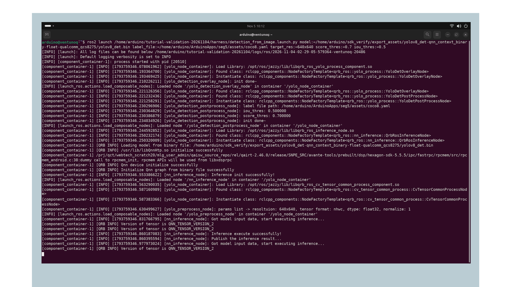
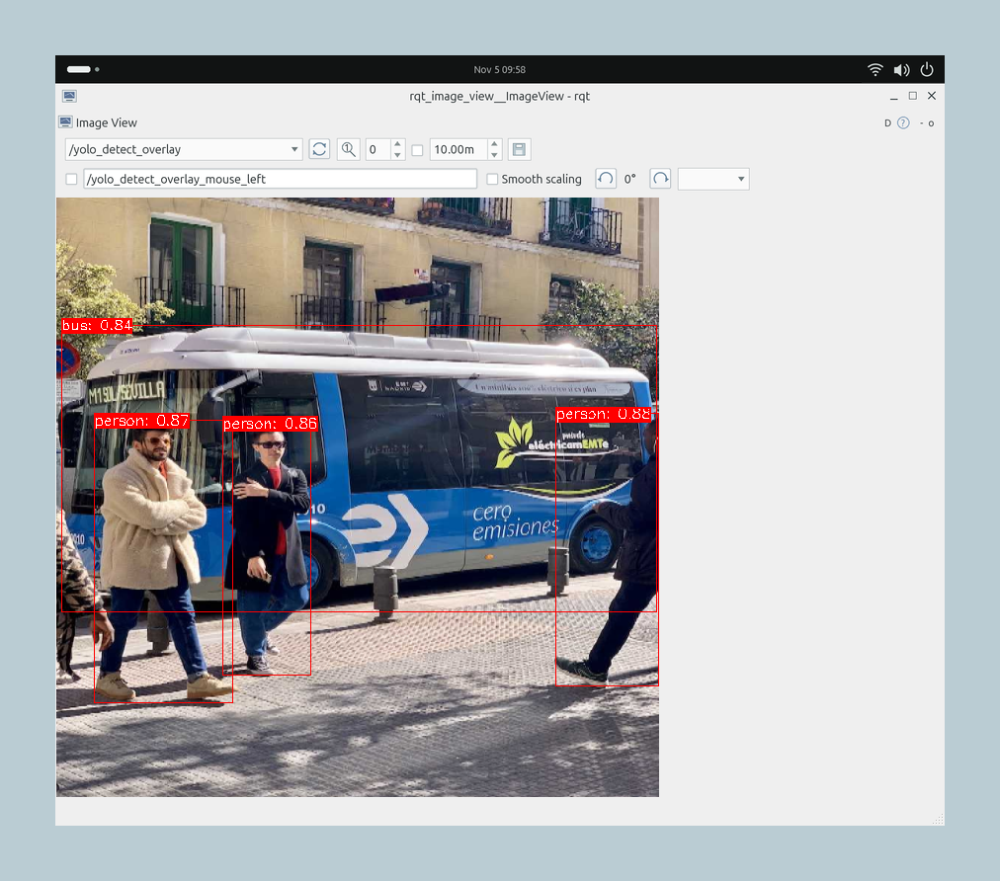

## Overview

In this tutorial, you will connect an Orbbec Gemini 335L camera to the Arduino® VENTUNO™ Q and run a YOLOv8 object detector. The detector estimates each object's class, confidence, and bounding box. You will inspect those results as ROS 2 messages and view the boxes drawn on the image.

The Robotics SDK separates image preparation, model execution, and result interpretation into reusable nodes. The detection result is a ROS 2 interface that another application can consume, for example to choose a region for a second model. You will explore that connection in the NN Inference Pipeline tutorial.

<Alert type="info">

The example images show results from a test photograph. Check model loading, object detection and box alignment on your board before using this pipeline in an application.

</Alert>

## Goals

- Prepare a QCS8275 detection model with the input and output contract expected by the SDK.
- Run the camera, preprocessing, inference, and postprocessing nodes.
- Check that the detector recognizes an object in your camera view.
- View the detection overlay and identify the interface for another ROS node.

## Hardware and Software Requirements

- [Arduino® VENTUNO™ Q](https://store.arduino.cc/products/ventuno-q), with Ubuntu 24.04 and ROS 2 Jazzy.
- Orbbec Gemini 335L USB camera and a suitable USB connection.
- Host computer with AI Hub access and the model tools prepared below.
- A graphical desktop on the board for the image viewer. Topic inspection also works over SSH.

Complete [Install and Understand the Robotics SDK](https://docs.arduino.cc/tutorials/ventuno-q/getting-started/) first, including the [host tools](https://docs.arduino.cc/tutorials/ventuno-q/getting-started/#5-prepare-the-host-model-tools) and [shared labels](https://docs.arduino.cc/tutorials/ventuno-q/getting-started/#6-prepare-the-shared-labels-and-board-workspace). This page uses the same `~/person-pipeline/models` directory as the multi-model tutorial.

## Instructions

### 1. Install the Detection Sample

**VENTUNO Q:** add the camera driver, packaged sample, and viewer:

```bash
sudo apt install ros-jazzy-sample-object-detection ros-jazzy-orbbec-camera ros-jazzy-rqt-image-view
```

Use the [shared terminal environment](https://docs.arduino.cc/tutorials/ventuno-q/getting-started/#1-check-your-board-environment) in **every board terminal**:

```bash
source /opt/ros/jazzy/setup.bash
export ROS_DOMAIN_ID=87
export ROS_AUTOMATIC_DISCOVERY_RANGE=LOCALHOST
```

Connect the camera and check that its driver and sample are discoverable:

```bash
lsusb
ros2 pkg prefix orbbec_camera
ros2 launch sample_object_detection launch_with_orbbec_camera.py --show-args
```

`lsusb` checks that Ubuntu sees the camera; look for an Orbbec device. `ros2 pkg prefix` checks that ROS can find its driver and should print `/opt/ros/jazzy`. `--show-args` lists the sample's settings without starting it; look for `model`, `label_file`, `target_res`, `score_thres`, and `iou_thres`. If the USB device is missing, check the cable and port. If the package or arguments are missing, check the installed Jazzy sample version before proceeding.

### 2. Export the Detection Model

**Host computer:** activate the model-tools environment from the setup tutorial and install the detection model's dependencies:

```bash
source ~/ventuno-model-tools/bin/activate
qai-hub-models install yolov8_det
```

Export a floating-point QNN context binary for the board:

```bash
qai-hub-models export yolov8_det \
  --target-runtime qnn_context_binary \
  --device "Arduino VENTUNO Q" \
  --precision float
```

The export command uses your AI Hub account to compile the model for the selected device and may also run profiling jobs. Wait for completion, then keep the downloaded `.bin`, `metadata.json`, and export log together. If the job fails or the target is unavailable, resolve that error in AI Hub before copying files to the board.

Read the metadata and compare it with the required interface:

| Field | Required value for this tutorial |
|---|---|
| Target | QCS8275 / Arduino VENTUNO Q |
| Runtime | QNN context binary; export runtime compatible with the board runtime |
| Image input | RGB, `float32`, shape `1×640×640×3`, values 0–1 |
| `boxes` output | `float32`, shape `1×8400×4`, corner coordinates in the resized image |
| `scores` output | `float32`, shape `1×8400` |
| `class_idx` output | `uint8`, shape `1×8400` |
| Labels | COCO ordering, with class 0 mapped to `person` |

If the exporter changes output names, types, or layout, stop and adapt the export/postprocessor before using the binary. A different class-index type cannot be fixed by editing metadata. Compare the exported tensor names, shapes, and types with this table, and confirm that the compiled model supports the QAI Runtime version installed on your board.

Save the installed package versions alongside your model assets. This creates a text record for reproducing the export; it does not test the model:

```bash
python -m pip freeze > ~/ventuno-model-assets/detection-tools-versions.txt
```

The [official versioned detection recipe](https://github.com/qualcomm/ai-hub-models/blob/v0.64.0/src/qai_hub_models/models/yolov8_det/README.md) describes export and model licensing. This tutorial does not redistribute model weights or binaries.

### 3. Deploy the Model

**VENTUNO Q:** ensure the shared directory exists:

```bash
mkdir -p ~/person-pipeline/models
```

**Host computer:** replace the example source directory with the one reported by your exporter, and replace the board hostname as needed:

```bash
scp ./exported-detection/yolov8_det.bin arduino@ventunoq.local:person-pipeline/models/detection.bin
scp ./exported-detection/metadata.json arduino@ventunoq.local:person-pipeline/models/detection.metadata.json
```

The [shared setup](https://docs.arduino.cc/tutorials/ventuno-q/getting-started/#6-prepare-the-shared-labels-and-board-workspace) supplies `coco.yaml`. **VENTUNO Q:** check all required files:

```bash
missing=0
for asset in \
  "$HOME/person-pipeline/models/detection.bin" \
  "$HOME/person-pipeline/models/detection.metadata.json" \
  "$HOME/person-pipeline/models/coco.yaml"; do
  if test -s "$asset"; then
    printf 'Ready: %s\n' "$asset"
  else
    printf 'Missing or empty: %s\n' "$asset"
    missing=1
  fi
done
test "$missing" -eq 0
```

Expect one `Ready:` line for each file. A `Missing or empty:` line names the file to copy again. Do not start the model until every file is ready. This check catches missing transfers; the model target and tensor layout must still match Step 2.

Keep models in your home directory and pass their paths to the launch file. This lets you replace a model without changing files installed by APT.

### 4. Run the Pipeline

**VENTUNO Q, Terminal 1:** start detection:

```bash
ros2 launch sample_object_detection launch_with_orbbec_camera.py \
  model:="$HOME/person-pipeline/models/detection.bin" \
  label_file:="$HOME/person-pipeline/models/coco.yaml" \
  target_res:=640x640 score_thres:=0.7 iou_thres:=0.5
```

Leave this terminal running. Look for successful HTP library initialization, QNN graph loading, and inference initialization. If initialization fails, stop with `Ctrl+C` and use the QNN troubleshooting row below before opening another pipeline. The installed launch uses `/usr/lib/libQnnHtp.so` as its backend, selecting NPU execution through QNN.



*QNN loads the graph and starts inference. Look for successful HTP initialization, graph loading and inference initialization in your terminal.*

The model path overrides the upstream sample's default for another target. `score_thres` filters low-confidence predictions; `iou_thres` controls suppression of overlapping boxes that likely describe the same object.

The camera, preprocessing, inference and postprocessing nodes publish these topics:

| Topic | Producer | Message type and meaning |
|---|---|---|
| `/camera/color/image_raw` | Orbbec camera driver | `sensor_msgs/msg/Image`; original RGB image |
| `/qrb_inference_input_tensor` | `yolo_preprocess_node` | `qrb_ros_tensor_list_msgs/msg/TensorList`; model input |
| `/yolo_detect_tensor_output` | `nn_inference_node` | `qrb_ros_tensor_list_msgs/msg/TensorList`; raw model outputs |
| `/yolo_detect_result` | `yolo_detection_postprocess_node` | `vision_msgs/msg/Detection2DArray`; boxes, classes, and confidence |
| `/resized_image` | `yolo_preprocess_node` | `sensor_msgs/msg/Image`; 640×640 image used by the model |
| `/yolo_detect_overlay` | `yolo_detection_overlay_node` | `sensor_msgs/msg/Image`; boxes drawn on the resized image |

`qrb_ros_yolo_process` supplies the postprocessing and overlay components. The inference component produces tensors; postprocessing makes them usable as detections.

### 5. Verify a Positive Detection

**VENTUNO Q, Terminal 2:** run the three environment commands from Step 1. Inspect one camera message, then one detection message. `--no-arr` hides the camera's pixel buffer so you can read its dimensions, encoding, and timestamp:

```bash
ros2 topic echo /camera/color/image_raw --once --no-arr
ros2 topic echo /yolo_detect_result --once
```

Expect `encoding: rgb8` and nonzero camera dimensions, followed by a detection message. Place a recognizable object in view, or ask a consenting person to stand in front of the camera. A positive result contains a nonempty `detections` array, a suitable `class_id`, a score at or above the configured threshold, and a plausible bounding box.

A detection message contains a class and confidence score for each object. The example below summarizes three person detections and a bus; your results will depend on the camera view.

| Hypothesis | Confidence, rounded |
|---|---|
| person | 0.884 |
| person | 0.873 |
| person | 0.855 |
| bus | 0.836 |

An empty array means a message arrived without any recognized objects. Place a familiar object in view and try again. If the command keeps waiting, press `Ctrl+C` and check the camera and inference topics.

To see how often detection messages arrive, run:

```bash
ros2 topic hz /yolo_detect_result
```

Stop it with `Ctrl+C`. This is the rate observed by that subscriber, not an NPU latency benchmark.

### 6. View and Use the Results

**VENTUNO Q desktop, Terminal 2:** open the viewer:

```bash
ros2 run rqt_image_view rqt_image_view
```

Select `/yolo_detect_overlay`. Verify that the label matches the object and that the box surrounds it. Switch to `/camera/color/image_raw` to compare the input. The overlay is 640×640 because preprocessing resizes the camera image directly; a 640×480 source will appear stretched.



*Three people and a bus are detected on /yolo_detect_overlay. Check that the labels match the objects and the boxes follow their boundaries.*

`Detection2DArray` is the interface your own application can subscribe to. Each detection contains hypotheses and a bounding box. The box uses a center position plus width and height in the resized 640×640 coordinate space. To crop the original image, scale coordinates by `original_width / 640` and `original_height / 640`, and match the source timestamps. The [NN Inference Pipeline](https://docs.arduino.cc/tutorials/ventuno-q/nn-inference-person-pipeline/#4-connect-detections-to-a-person-crop) provides a complete Python example.

For a 640×480 source image, horizontal coordinates stay the same and vertical coordinates scale by 480/640 = 0.75. This applies to direct resizing; a letterboxed input also requires removing its padding.

When finished, close the viewer and press `Ctrl+C` in Terminal 1. Stop any topic-rate checks as well. Stop this standalone camera pipeline before starting the segmentation tutorial, which opens the same camera.

## Troubleshooting

| Symptom | Action |
|---|---|
| Camera cannot start | Check USB detection and make sure another application is not holding the camera. Confirm you selected the Orbbec launch file. |
| QNN cannot load the binary | Check the explicit path, QCS8275 target metadata and runtime compatibility. Return to the shared runtime checks. |
| Postprocessing rejects tensors | Check the three output names, shapes and types in Step 2, especially `class_idx`. |
| Labels are unknown or YAML parsing fails | Use the matching COCO `names` mapping from the shared setup and pass `label_file` explicitly. |
| No detections arrive | Check the camera and tensor topics first. Verify the ROS domain and discovery settings in both terminals. |
| Detections are always empty | Inspect the actual camera view and test a well-lit object from the model's label set. Distinguish absent objects from a model/configuration problem. |
| Your own crop is misaligned | Convert from model coordinates to the original image dimensions. Do not apply this direct-resize formula to a letterboxed model. |
| The viewer does not open over SSH | Run it in the board's desktop session; use CLI checks from a headless connection. |

## Conclusion

You have learned how the SDK turns a camera image into ROS 2 detection messages and a visual overlay. Once you verify a positive detection, the same result topic can drive another model or application node without changing the inference component.

## Further Reading

- [Install and Understand the Robotics SDK](https://docs.arduino.cc/tutorials/ventuno-q/getting-started/)
- [Image Segmentation](https://docs.arduino.cc/tutorials/ventuno-q/image-segmentation/)
- [NN Inference Pipeline](https://docs.arduino.cc/tutorials/ventuno-q/nn-inference-person-pipeline/)
- [Detection sample source on the Jazzy release branch](https://github.com/qualcomm-qrb-ros/qrb_ros_samples/tree/jazzy-rel/ai_vision/sample_object_detection)
