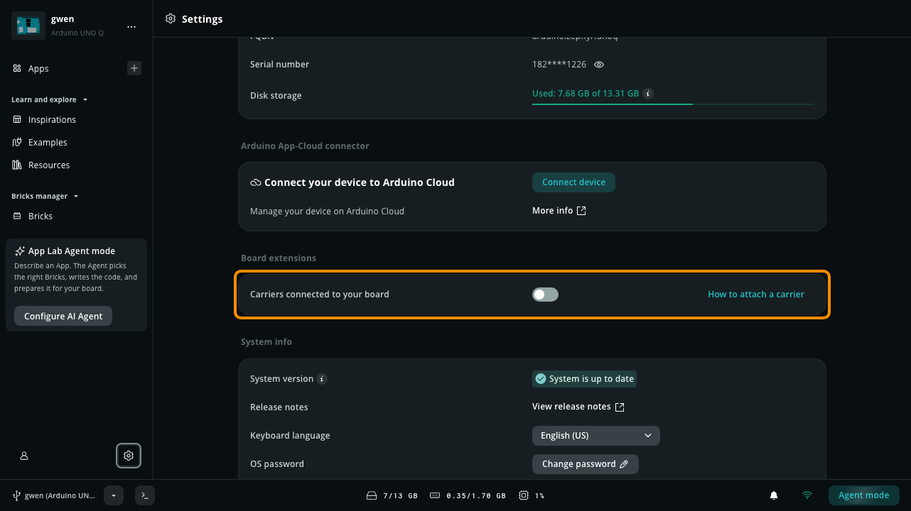
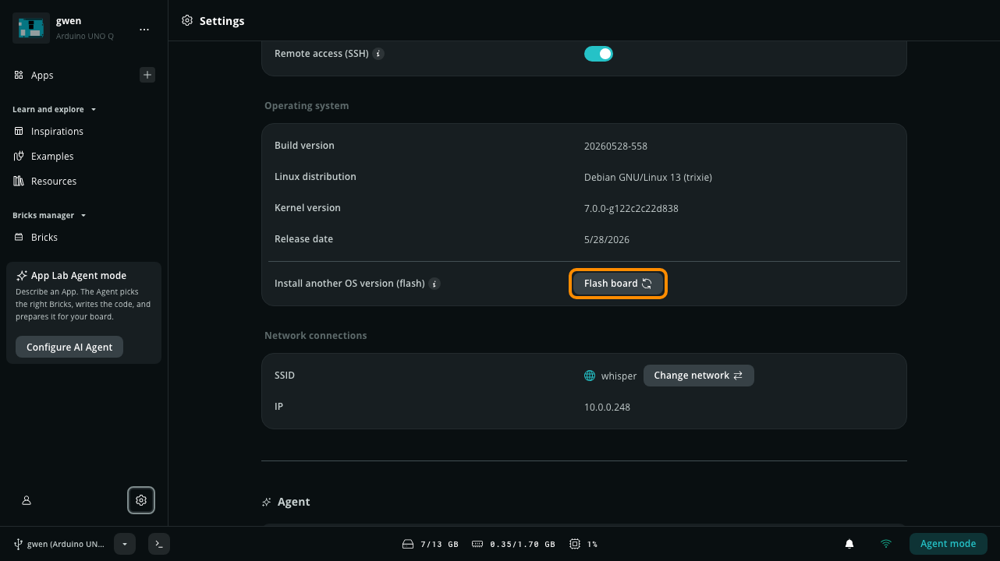

Manage your board's configuration, view system information, and access device management tools through the **Settings** page.

## Access Settings in Arduino App Lab

Follow these steps to open the Settings menu:

1. Open Arduino App Lab.
2. Connect to your board.
3. Select **Settings** (gear icon) from the left sidebar.

You can only access the Settings menu when connected to a board.

## Settings Overview

The Settings page is divided into the sections below. Some sections only appear for specific boards, system versions, or connection modes, as noted in each section.

| Section | What you can do |
| :--- | :--- |
| [Arduino App Lab](#arduino-app-lab) | Check the App Lab version and open the documentation. |
| [Device details](#device-details) | Rename the board and check its model, FQBN, serial number, and storage. |
| [Arduino App-Cloud connector](#arduino-app-cloud-connector) | Connect the board to Arduino Cloud. |
| [Board extensions](#board-extensions) | Declare carriers (such as the UNO Media Carrier) and their cameras and displays, and add-ons attached to the board. |
| [CSI Camera](#csi-camera) | Find the camera server setup guide (VENTUNO Q running Ubuntu only). |
| [System info](#system-info) | Update the system, change the keyboard layout and password, and toggle SSH. |
| [Operating system](#operating-system) | Check the Linux image and flash a different version. |
| [Network connections](#network-connections) | Check and change the Wi-Fi network. |
| [Agent](#agent) | Install and manage AI coding agents. |

### Arduino App Lab

This section provides information about the App Lab application.

- **App Lab version**: The installed version of Arduino App Lab. When a newer version is available, the version is replaced by an **Update to App Lab** button.
- **Documentation**: Select **View documentation** to open the Arduino App Lab documentation.

<Alert type="info">

**Note:** In [SBC mode](../../setup/standalone/), App Lab is updated together with the board's system, so no App Lab update button is shown. Use **System version** in [System info](#system-info) instead.

</Alert>

### Device details

This section identifies the connected board.

- **Board name**: The custom name assigned to the board (for example, `devan`). Select the **Edit** icon next to the name to change it.
- **Board model**: The connected hardware model, such as `ARDUINO UNO Q`.
- **FQBN**: The Fully Qualified Board Name used by the compilation tools, such as `arduino:zephyr:unoq`.
- **Serial number**: The unique hardware serial number of the board.
- **Disk storage**: Used storage versus the total available storage. A warning appears when storage is getting full.

<Alert type="success">

**Tip:** To free up space, delete Apps and AI models you no longer use, or run `arduino-app-cli system cleanup` on the board to remove unused container images. See [Arduino App CLI](../../cli/cli/).

</Alert>

### Arduino App-Cloud connector

This section links the board to your Arduino Cloud account. It appears when the board's system version supports the connector.

- **Connect your device to Arduino Cloud**: Select **Connect device** to register the board in Arduino Cloud. A banner shows the progress, and App Lab notifies you when the board is connected.
- **Manage your device on Arduino Cloud**: Select **More info** to learn about managing devices in Arduino Cloud.

Once the board is connected, the section shows:

- **Device Arduino Cloud status**: A **Connected** badge.
- **Manage your device on Arduino Cloud**: Select **Open Arduino Cloud** to open the board's device page in Arduino Cloud.
- **Delete device**: Select **Delete this device** to remove the board from Arduino Cloud.

### Board extensions

This section tells the board which hardware extensions are attached, so the system can enable the right peripherals. The available options depend on your board.

- **Carriers connected to your board**: Turn on the toggle when a carrier is attached, then select which peripheral you are connecting to each carrier port. Select **How to attach a carrier** for instructions.

  For example, with the **UNO Media Carrier** attached to an UNO Q, the section lists the carrier's two camera ports (camera 0 and camera 1) and its display port. For each port, select the type of camera or display you connected (such as `type1-2lanes` or `type1-4lanes` for a CSI camera), or leave it on **No camera** / **No display**. The available ports and options are reported by the board, so they depend on the carrier and the system version.

  On the **VENTUNO Q**, a DSI display disables the board's CSI 0 port, and the other two CSI ports work either on the carrier or on the board, not both.
- **Add-ons connected to JHat header**: Turn on the toggle when an add-on is attached to the JHat header, then select the **Add-on type**. Only add-ons that need to be declared are listed. Select **How to attach an Hat** for instructions.

When you change an extension, select **Reboot and apply** and enter the board password. The board restarts to apply the new configuration.

<Alert type="note">

**Important:** Attach extensions while the board is powered off. The extensions listed depend on the board's system version: on an older system, the section lists only carriers, and add-ons for the JHat header, on boards that have one, appear after you update the board from [System info](#system-info). If the board's system doesn't include the board configuration tool, the section shows **Extensions need a board update** instead, because App Lab can't tell which extensions the board supports.

</Alert>

### CSI Camera

This section only appears on the **VENTUNO Q** running Ubuntu, where the camera server (`cam-server`) is not pre-installed. It doesn't configure cameras itself: declare your cameras in [Board extensions](#board-extensions), then install the camera server manually by following the [MIPI CSI camera guide](/tutorials/ventuno-q/mipi-csi-camera/). Select **Open setup guide** to open it.

App Lab doesn't show this section on other systems, such as the Debian image of the UNO Q, because no manual installation is needed there.

### System info

This section manages the software and security configuration of the board.

- **System version**: The status of the board's system software, which includes App Lab, Arduino CLI, and other core software running on the board. When an update is available, select **Update** to download and install it. See [Manage Software Updates](../config/#manage-software-updates).
- **Release notes**: Select **View release notes** to read the Arduino App Lab [release notes](../../release-notes/).
- **Keyboard language**: The keyboard layout used by the board's Linux system.
- **OS password**: Select **Change password** to change the password of the `arduino` Linux user.
- **Remote access (SSH)**: Turn Secure Shell (SSH) access to the board on or off. SSH is required to connect App Lab to the board over the network ([Network Mode](../../getting-started/glossary/#network-mode)). The toggle is disabled while App Lab is connected over the network.

### Operating system

This section details the Linux image installed on the board.

- **Build version**: The build identifier of the installed OS image.
- **Linux distribution**: The active Linux distribution and version.
- **Kernel version**: The active Linux kernel version.
- **Release date**: The release date of the installed OS image.
- **Install another OS version (flash)**: Select **Flash board** to reinstall the current image or install another compatible operating system image. You can choose to keep your data or perform a complete wipe. See [Flash a Linux Image](../flash/).

If the installed image is too old for the current App Lab version, the section shows **Your board software is a bit behind** instead of the build version. Select **Update now** to open the flasher and install a newer image.

<Alert type="info">

**Note:** Flashing is only available when App Lab runs on a computer. In [SBC mode](../../setup/standalone/), the **Flash board** option is hidden, because the board cannot flash itself.

</Alert>

### Network connections

This section manages the board's Wi-Fi connection.

- **SSID**: The name of the Wi-Fi network the board is connected to. Select **Change network** to connect the board to a different network.
- **IP**: The local IP address currently assigned to the board.

### Agent

This section lists the AI coding agents you can use in [Agent Mode](../../integrations/agent-mode/). Select **Install** on an agent card to install it on your computer, then connect your account. After installing, you can set the default agent, manage the sign-in, and update or uninstall the agent runtime.
