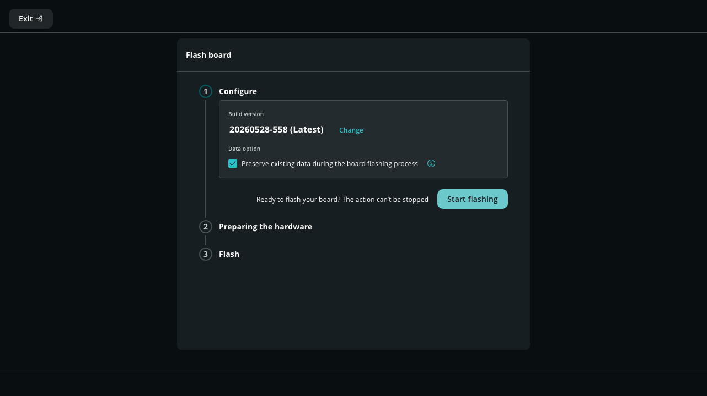
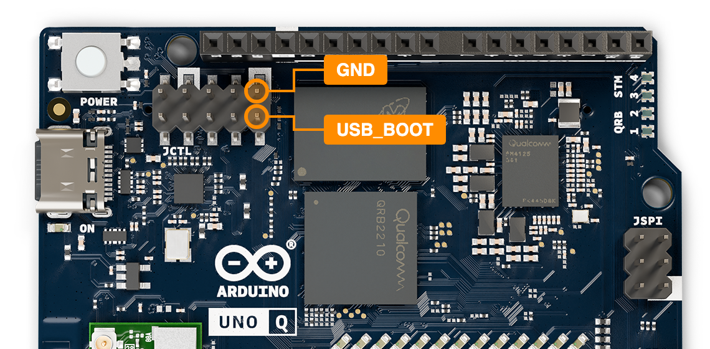
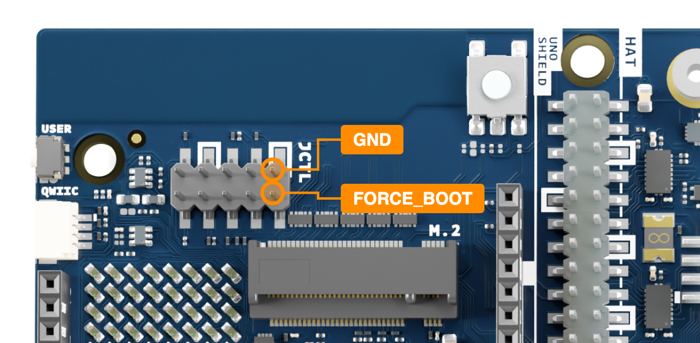

Flashing a new Linux image to your Arduino board allows you to install a fresh operating system, recover from system corruption, or switch between different supported Linux distributions. This process replaces the entire Linux OS and all stored data on the board.

There are two primary methods for flashing your board:

1. **Built-in Flasher in App Lab:** Use this method for boards already connected and recognized by App Lab.
2. **Arduino Flasher CLI:** A standalone command-line tool for recovering boards that cannot be reached via App Lab or for performing a low-level hardware reset.

## Use the Built-in Flasher in App Lab

If your board is already discovered by Arduino App Lab, you can initiate a flash directly from the interface.

Before you start, check that:

- App Lab is running on your computer. Flashing is not available in [SBC mode](../../setup/standalone/).
- Your computer has at least **10 GB** of free disk space for downloading and extracting the image.
- You have a female-to-female jumper wire (or a jumper cap) to put the board into EDL mode.

1. Open **Arduino App Lab** and connect to your board.
2. Select **Settings** (gear icon) from the left sidebar.
3. Scroll down to the **Operating system** section.
4. Select the **Flash board** button. App Lab opens the **Flash board** page.
5. In the **Configure** step, review the **Build version**. App Lab selects the latest image by default; select **Change** to install a different version.
6. Choose the data option:
   * On the **UNO Q**, **Preserve existing data during the board flashing process** is selected by default and keeps the `userdata` partition (mounted at `/home/arduino`). Clear the checkbox for a full reset. If the selected build cannot keep your data, App Lab warns you that flashing requires a complete re-initialization of the board.
   * The **VENTUNO Q** image has no separate user partition, so flashing erases all data on the board. **Back up your files or export your Apps before flashing.**
   
7. Select **Start flashing**, then follow the on-screen instructions in the **Preparing the hardware** step: disconnect the board, add the jumper between the `JCTL` boot pins shown in the image (`GND` and `USB_BOOT` on the **UNO Q**, or `GND` and `FORCE_BOOT` on the **VENTUNO Q**), and connect the board to your computer.
8. In the **Flash** step, App Lab downloads the image, extracts it, and flashes the board partitions. This can take several minutes. Flashing cannot be stopped once it starts.
9. When the flash is complete, unplug the board, remove the jumper, and plug the board in again. Select **OK, done**.

If flashing fails, select **Show logs** to see the details, then select **Retry**. The process may require a few attempts.

   <Alert type="info">

   **Note:** The interface will guide you through putting the board into **Emergency Download Mode (EDL)**. For more details on this process, see [Set your board to EDL mode](#step-1-set-your-board-to-edl-mode).

   </Alert>

## Use the Arduino Flasher CLI

If you encounter errors that prevent the board from appearing in Arduino App Lab, or prefer using a command-line tool, use the **Arduino Flasher CLI**.

<Alert type="note">

You can download the Arduino Flasher CLI here: https://www.arduino.cc/en/software/#app-lab

</Alert>

### Step 1: Set your board to EDL mode

To use the CLI tool, put the board into **Emergency Download Mode (EDL)**.

<Alert type="note">

**Important:** Short the `JCTL` boot pins **before** connecting the board to your computer. Failure to do so causes the flasher tool to hang indefinitely with a "Waiting for EDL device" message.

</Alert>

1. Disconnect the board from your computer and any external power source.
2. Locate the **JCTL** header on the board and identify the two boot pins in the rightmost column:
   * **UNO Q:** `GND` (upper row) and `USB_BOOT` (lower row)
     
   * **VENTUNO Q:** `GND` (upper row) and `FORCE_BOOT` (lower row)
     

3. Short these two pins together using a female-to-female jumper cable or a jumper cap.

   <Alert type="info">

   **Note:** If you do not have a jumper cable or cap, use a thin metal object like a wire, clip, or coin—take care not to bend the pins.

   </Alert>

4. With the jumper in place, connect the board to your computer using a USB-C cable (on the **VENTUNO Q**, connect the external power supply first).

<Alert type="success">

**Tip:** After connecting the board, you can remove the short from the pins. Your board remains in EDL mode until you restart it without the pins shorted.

</Alert>

### Step 2: Download and Prepare the Tool

1. Open the [Arduino Software](https://www.arduino.cc/en/software/#flasher-tool) page and locate the **Arduino Flasher CLI** section.
2. Download the version corresponding to your operating system.
   <Alert type="note">

   **Important:** For macOS, ensure you select the correct architecture for your Mac (**Apple Silicon** for M1/M2/M3 chips or **Intel 64-bit** for older models).

   </Alert>
3. Extract the downloaded file.
   <Alert type="success">

   **Tip (macOS):** Right-click the ZIP file and select **Open With > Archive Utility**. This ensures the tool retains the necessary execution permissions.

   </Alert>
4. Open a terminal or command prompt and navigate to the extracted directory.

### Step 3: Flash the Image

1. Execute the following command to download and flash the latest OS image:

   **macOS / Linux:**

   ```bash
   ./arduino-flasher-cli flash unoq
   # or
   ./arduino-flasher-cli flash ventunoq
   ```

   **Windows:**

   ```powershell
   arduino-flasher-cli.exe flash unoq
   # or
   arduino-flasher-cli.exe flash ventunoq
   ```

   On Windows, the tool installs the required USB drivers automatically and asks for administrator permission the first time.

   <Alert type="success">

   **Tip:** If you are flashing an **UNO Q**, you can add the `--preserve-user` flag to the command to keep your stored data and configurations (the `userdata` partition mounted at `/home/arduino`). Note that this flag is not supported for VENTUNO Q, as its image does not have a separate user partition.

   </Alert>

   <Alert type="info">

   **Note:** You can use the `--version <version>` flag to flash a specific image version instead of the latest one, and the `--serial <serial>` flag to target a specific board when multiple are connected. Run `flash` without arguments to enter interactive mode.

   </Alert>

   To see the images available for your board, run `arduino-flasher-cli list unoq` (or `ventunoq`). If more than one Linux distribution is available for a board, choose one with `--os`. The VENTUNO Q uses Ubuntu by default, and the UNO Q uses Debian.

   To flash an image you have already downloaded, pass its path after the board name, for example `arduino-flasher-cli flash unoq ./my-image.tar.zst`. You can download an image in advance with `arduino-flasher-cli download unoq`.

2. When the tool asks `Do you want to download it? (yes/no)`, type `y` and press **Enter**.
3. The tool downloads an image (approx. 1 GB), extracts it, and flashes the board. This process can take several minutes.

### Step 4: Finalize and Reboot

1. Once the tool reports a successful flash, unplug the board from your computer.
2. Remove the short from the **JCTL** pins if they are still connected.
3. Re-connect the USB-C cable to your computer to boot the new Linux OS.

## Troubleshooting

### Waiting for EDL device

If the Flasher tool hangs at a `Waiting for EDL device` message, it means the tool cannot communicate with the board. There are two primary causes for this:

- **EDL Mode Not Triggered:** The board is not correctly in EDL mode. Unplug the board, ensure the jumper cable securely shorts `GND` and `USB_BOOT` (UNO Q) or `GND` and `FORCE_BOOT` (VENTUNO Q) on the **JCTL** header, and then reconnect the USB cable.

- **Missing udev Rules (Linux):** When the board enters EDL mode, it connects using a Qualcomm USB vendor ID (`05c6`). If your Linux system lacks the necessary `udev` rules or group permissions for this ID, the flasher tool cannot communicate with the board and will hang indefinitely.

  To resolve this, follow the [Configure udev Rules](../../setup/linux/#step-2-configure-udev-rules) and [Set User Permissions](../../setup/linux/#step-3-set-user-permissions) instructions in the Linux Setup Guide.

### USB Write Failed / Communication Errors

If you encounter communication errors during flashing, try the following:

- Connect the board directly to a native USB port on your computer instead of using a USB hub or docking station.
- Use a different USB-C cable.

### "No space left on device"

Flashing requires significant temporary disk space (approx. 8 GB). If your system's default temporary partition is too small, use the `--temp-dir` flag to specify a different directory for extraction:

**macOS / Linux:**

```bash
./arduino-flasher-cli flash unoq --temp-dir /path/to/larger/disk
```

**Windows:**

```powershell
arduino-flasher-cli.exe flash unoq --temp-dir D:\path\to\larger\disk
```
