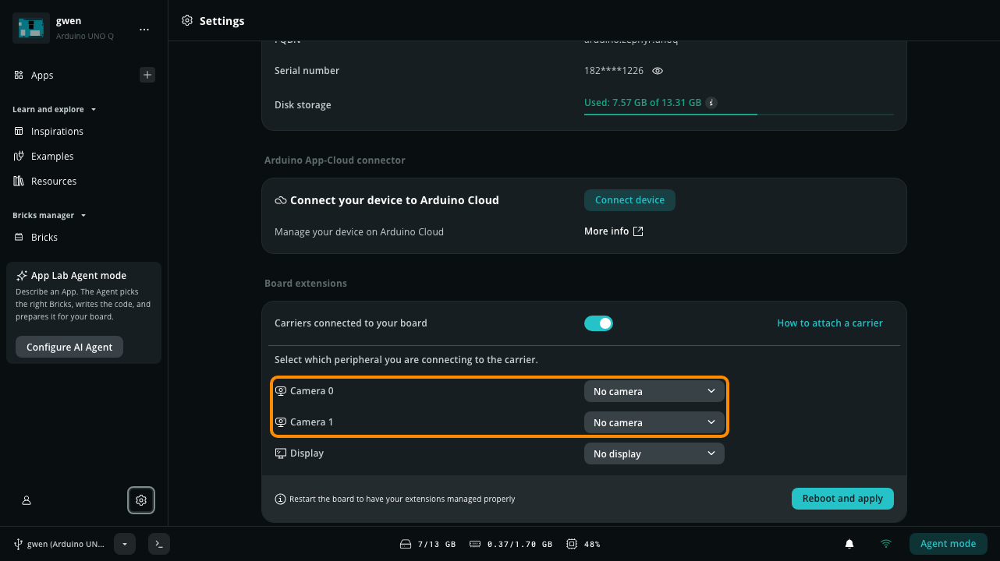

The **Arduino® UNO Media Carrier** provides two 22-pin (0.5mm pitch) MIPI-CSI connectors (CAMERA0 and CAMERA1) for attaching IMX219-based cameras, such as the Raspberry Pi Camera Module 2. Using both connectors enables dual-camera computer vision applications, such as stereo depth mapping, multi-angle capture, and object tracking.

The Raspberry Pi Camera Module 2 uses a 15-pin (1.0mm pitch) ribbon cable, so an adapter cable is required to connect it to the carrier's 22-pin connectors. Cameras must be connected to the carrier while the UNO Q is unpowered, and the ribbon cable must be inserted in the correct orientation.

<Alert type="info">

Currently, only cameras based on the Sony IMX219 (8 MP) sensor are supported, such as the Raspberry Pi Camera Module 2. Support for additional modules will be added in the future.

</Alert>

## Enable Carrier Mode

In the Arduino App Lab **Settings**, turn on **Carriers connected to your board** under the **Board extensions** section.


## Select Camera and Port

1. Select the camera port that is being used (**camera 0** and/or **camera 1**).
2. Select the type of camera: choose **`type1-2lanes`** if using a standard 15-pin Raspberry Pi Camera Module 2 with an adapter cable, or **`type1-4lanes`** if using a native 22-pin camera module.
3. Click **Reboot and apply** and enter the board password to apply the changes. This will reboot your board.



After rebooting, the camera is available to the Linux OS. Any App Lab example that uses camera input, such as the Object Detection example, will now use the camera connected via the Media Carrier's MIPI-CSI port instead.

<Alert type="info">

If you are using a single camera, connect and enable it on the **CAMERA0** connector (**camera 0**).

</Alert>

The carrier can also be configured from the UNO Q terminal instead of the App Lab UI. For example, to enable a two-lane camera on CAMERA0:

```bash
sudo arduino-linux-config hw enable media-carrier camera0=type1-2lanes
```

The board must be rebooted after any configuration change.

## How Carrier Configuration Works

MIPI-CSI cameras do not support plug-and-play detection, so the Linux kernel must be told explicitly what hardware is attached. When you select a camera and click **Reboot and apply**, App Lab stages a Device Tree Overlay (`.dtbo`) that is merged onto the board's base device tree. The Qualcomm kernel reads the device tree only once at startup to configure the camera subsystem, which is why a full reboot is required for any change to take effect.

<Alert type="info">

On the **VENTUNO Q**, the board also provides three on-board MIPI-CSI ports (`CSI 0`, `CSI 1`, and `CSI 2`), and you can attach the UNO Media Carrier in **Board extensions** as well. However, a DSI display on the carrier disables the board's `CSI 0` port, and the other two CSI ports work either on the carrier or on the board, not both. On Ubuntu, also see the **CSI Camera** section in [Settings](../settings/#csi-camera) to install the camera server (`cam-server`).

</Alert>
