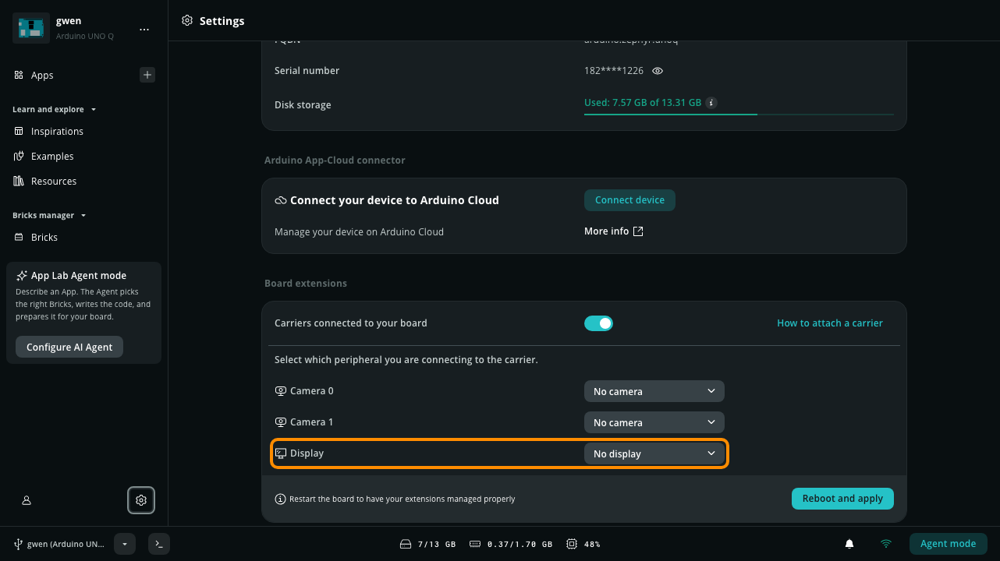

The **Arduino® UNO Media Carrier** provides a 22-pin MIPI-DSI connector (DISPLAY) for attaching touch displays. The display must be connected to the carrier while the UNO Q is unpowered.

The supported displays are the Waveshare DSI Touch "A" series:

| Preset Setting | Display Model | Specifications |
| :--- | :--- | :--- |
| `5-dsi-touch-a` | [Waveshare 5″ DSI LCD (A)](https://www.waveshare.com/5-dsi-touch-a.htm) | 720×1280 resolution, capacitive touch |
| `8-dsi-touch-a` | [Waveshare 8″ DSI LCD (A)](https://www.waveshare.com/8-dsi-touch-a.htm) | 800×1280 IPS, capacitive touch |
| `10-dsi-touch-a` | [Waveshare 10.1″ DSI LCD (A)](https://www.waveshare.com/10.1-dsi-touch-a.htm) | 800×1280 IPS, capacitive touch |

## Enable Carrier Mode

In the Arduino App Lab **Settings**, turn on **Carriers connected to your board** under the **Board extensions** section.


## Select Display

1. Next to **display**, select the preset that matches your connected display (`5-dsi-touch-a`, `8-dsi-touch-a`, or `10-dsi-touch-a`).
2. Click **Reboot and apply** and enter the board password to apply the changes. This will reboot your board.



After rebooting, the display is active and the desktop environment will render on it. Touch input is available immediately without additional configuration.

<Alert type="info">

**Note:** When a MIPI-DSI display is enabled, the board's USB-C video output is deactivated after restarting.

</Alert>

The carrier display can also be configured from the board's terminal:

```bash
sudo arduino-linux-config hw enable media-carrier display=8-dsi-touch-a
```

## How Carrier Configuration Works

MIPI-DSI displays do not support plug-and-play detection, so the Linux kernel must be told explicitly what hardware is attached. When you select a display size and click **Reboot and apply**, App Lab stages a Device Tree Overlay (`.dtbo`) that is merged onto the board's base device tree. The Qualcomm kernel reads the device tree only once at startup to configure the display drivers, which is why a full reboot is required for any change to take effect.

<Alert type="info">

On the **VENTUNO Q**, you can also configure a MIPI-DSI display on the UNO Media Carrier in **Board extensions** (enabling a DSI display disables the board's `CSI 0` camera port). For standard HDMI monitors connected to the VENTUNO Q's native HDMI port, EDID autodiscovery is handled automatically and no configuration in **Board extensions** is needed.

</Alert>

## Further Reading

- [UNO Media Carrier Hardware Page](https://docs.arduino.cc/hardware/uno-media-carrier/)
- [UNO Media Carrier User Manual](https://docs.arduino.cc/tutorials/uno-media-carrier/user-manual/)
