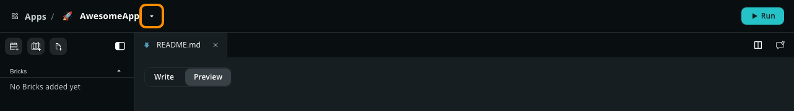
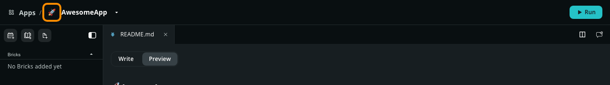
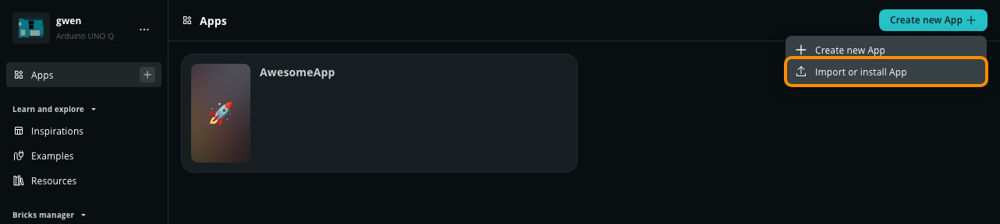
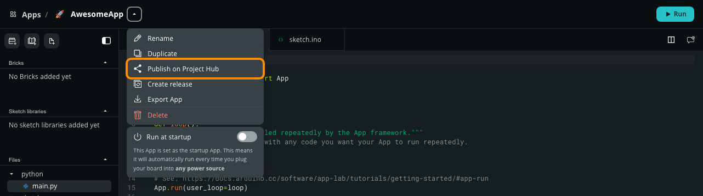
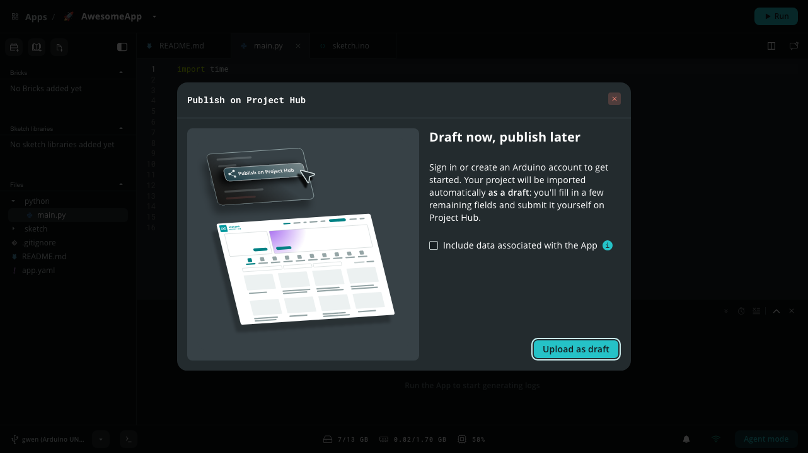
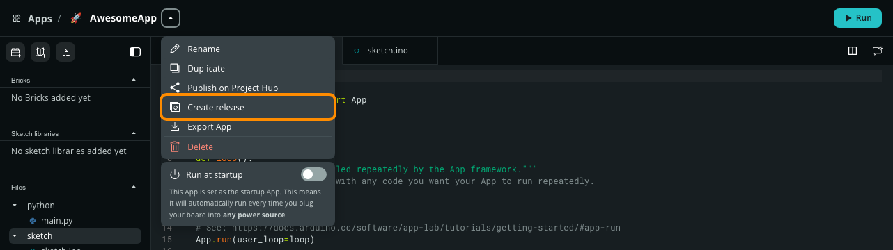
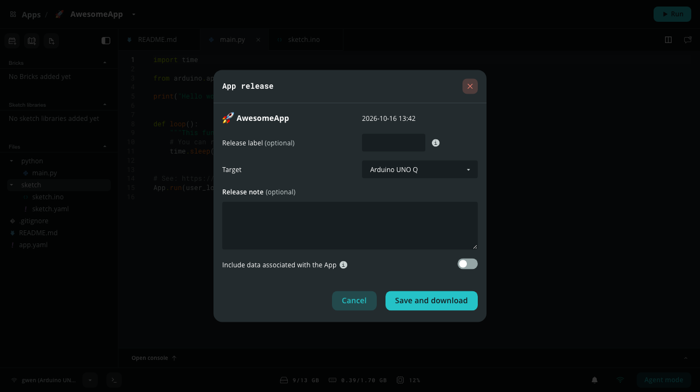

Organize and manage your projects in the **Apps** library. Use these workflows to create, duplicate, import, export, publish, and release Apps.

## Open an App

The **Apps** section contains all the projects you create, duplicate, or import, including installed App releases.

1. Open Arduino App Lab.
2. Select **Apps** in the left sidebar.
3. Select the App you want to open.

The App opens in the editor.

## Create a new App

If you want to start with a blank canvas, you can generate a new App template directly from the Arduino App Lab interface:

1. Select **Apps** in the left sidebar.
1. In the top-right corner, click the **Create new App +** button and select **Create new App**.

   You can also select the **+** button next to **Apps** in the left sidebar.
1. Change the default emoji (optional) and enter a name for your App.
1. Click **Create new**.

## Duplicate an App

1. [Open an App](#open-an-app)
1. Select the arrow (**▼**) next to the App name near the top left corner.
   
1. In the menu, select **Duplicate**.
1. Change the emoji or name for your new App (optional).
1. Click **Create new**.

## Rename an App

You can rename an App you've created directly within the editor.

1. [Open an App](#open-an-app).
1. Select the arrow (**▼**) next to the App name near the top left corner.
   
1. In the menu, select **Rename**.
1. Enter a new name for your App and press **Enter**.

Renaming an App automatically updates its metadata in the underlying `app.yaml` file.

<Alert type="success">

**Tip:** You can also edit the name by clicking on it.

</Alert>

## Change an App Icon

App Lab uses emojis as icons to help you identify your projects in the **Apps** list.

1. [Open an App](#open-an-app).
2. Select the current emoji next to your App name near the top left corner.
   
3. Use the emoji picker to select a new icon.

## Import an App

You can import an App shared with you or restored from a backup by uploading its `.zip` file. The same dialog installs [App releases](#install-an-app-release) (`.ard` files).

1. Select **Apps** in the left sidebar.
1. In the top-right corner, click the **Create new App +** button and select **Import or install App**.
   
1. In the **Import or install an App** dialog, drag and drop your `.zip` file into the import area, or select **Import from computer** to browse for the file.
1. Select **Open** to complete the import.

The imported App is added to your Apps with its files, Bricks, and sketch libraries. If the archive is not a valid App, App Lab shows **This App is invalid**.

## Export an App

Export an App to back up your code or share it with others.

1. [Open an App](#open-an-app).
1. Select the arrow (**▼**) next to the App name near the top left corner.
1. In the menu, select **Export App**.
1. Check **Include data associated with the App** if you want the package to contain data stored by your App (optional).
1. Select **Export .zip** in the dialog box.
1. Choose a location on your computer to save the file.

## Publish on Project Hub

You can share your App with the community by publishing it on [Arduino Project Hub](https://projecthub.arduino.cc/). App Lab uploads your App as a project draft, which you complete and submit on Project Hub.

1. [Open an App](#open-an-app).
1. Select the arrow (**▼**) next to the App name near the top left corner.
1. In the menu, select **Publish on Project Hub**.
   
1. Check **Include data associated with the App** if you want to upload data stored by your App (optional).
1. Select **Upload as draft**.
   
1. Sign in to your Arduino account, or create one, when prompted.
1. App Lab exports your App and uploads it to Project Hub. You can select **Abort upload** to cancel.
1. When the upload finishes, App Lab shows **Draft created** and your browser opens the draft on Project Hub. Fill in the remaining fields and submit the project. To open the draft again, select **OPEN** in the notification. If you don't submit it right away, you can find it later under **Drafts** in your Project Hub profile.

If the upload fails, select **RETRY** in the notification.

## Create an App Release

An App release is a packaged, read-only version of an App, saved as an `.ard` file. It runs exactly as it did when you created it, on any board of the same type. Use releases to deploy an App to other boards or to share a run-only copy with other App Lab users.

<Alert type="info">

**Note:** Creating and installing App releases requires Arduino App CLI 0.14 or later on the board, which comes with the board's system update. On a board with an older version, App Lab shows an error such as `404 page not found` or `HTTP 405`. [Update the board](../../configure/config/#manage-software-updates), then try again.

</Alert>

1. [Open an App](#open-an-app).
1. Select the arrow (**▼**) next to the App name near the top left corner.
1. In the menu, select **Create release**.
   
1. The first time, App Lab explains what a release is. Select **Continue**. Check **Don't show it anymore** to skip this step next time.
1. Fill in the release details:
   - **Release label** (optional): A label made of numbers or letters that identifies this release, such as `1.0`.
   - **Target**: The board the release runs on.
   - **Release note** (optional): A description of the release, shown in **Release info** when the release is installed.
   - **Include data associated with the App** (optional): Adds the App's `data/` folder to the release. This option is unavailable while the App is running.
   
1. Select **Save and download**, then choose where to save the `.ard` file on your computer.

App Lab builds the release on the board in the background and shows its progress in a card in the corner of the screen. Select **Hide in notifications** to dismiss the card while the build continues, or **Stop** to cancel the build. When the build finishes, App Lab downloads the `.ard` file to the location you chose. If the build fails, select **View log** in the notification to see the build log.

<Alert type="info">

**Note:** You can build one release of the same App at a time. **Create release** is disabled until the current build finishes.

</Alert>

### What a Release Contains

When App Lab builds a release, it freezes the App together with its dependencies for the target board: the Python environment is built, and the container configuration of each Brick is resolved. Installing the release on another board doesn't rebuild anything, so the App runs exactly as it did when you created the release.

The `.ard` file doesn't contain the container images or catalog AI models themselves, only which ones the App uses. They are downloaded when you install the release with **Install app dependencies** enabled, or the first time you run it. Custom models trained in your own Edge Impulse project are included in the `.ard` file and installed on the board with the release.

A release is installed apart from your Apps and is read-only. Only secret Brick variables, such as API keys, can be changed in an installed release.

You can also build and install releases from the board's terminal with the [`app build`](../../cli/commands/#app-build) and [`app install`](../../cli/commands/#app-install) commands.

## Install an App Release

1. Select **Apps** in the left sidebar.
1. In the top-right corner, click the **Create new App +** button and select **Import or install App**.
1. Drag and drop the `.ard` file into the import area, or select **Import from computer** to browse for the file.
1. Review the release details. Keep **Install app dependencies** enabled to download the Bricks, containers, and AI models the release needs right away. Installing dependencies requires an internet connection.
1. Select **Install**. If you install the dependencies, a card in the corner of the screen shows the download progress, and App Lab notifies you when the App is ready.

<Alert type="warning">

**Warning:** An `.ard` file can run any command on your board, with full access to the system. Only install App releases from sources you trust.

</Alert>

Installed releases appear in the **Apps** list with a **Release** badge. A release opens as read-only: you can run it, or select **Copy and edit App** to create an editable copy, leaving the release untouched. To see the release label, date, and notes, open the App menu and select **Release info**.

Turning off **Install app dependencies** only postpones the download: the release still needs its containers and models, and App Lab asks you to install them the first time you run it.

<Alert type="info">

**Note:** A release can only be installed on the type of board it was built for, as set in its **Target**. For example, a release built for the UNO Q cannot be installed on a VENTUNO Q.

</Alert>

## Delete an App

If you no longer need an App, you can permanently remove it from the board.

1. [Open an App](#open-an-app).
1. Select the arrow (**▼**) next to the App name near the top left corner.
1. In the menu, select **Delete**.
1. Select **Delete** to confirm.
