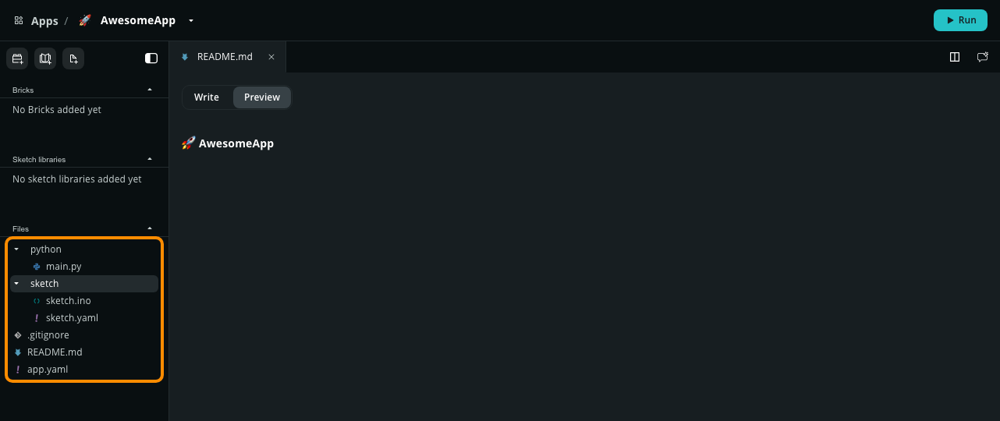
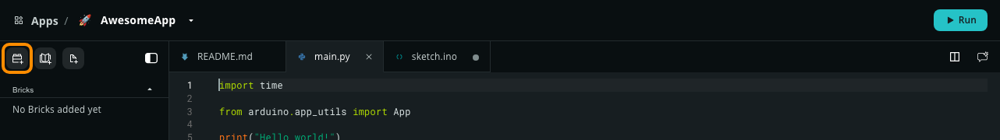
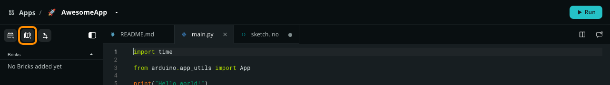
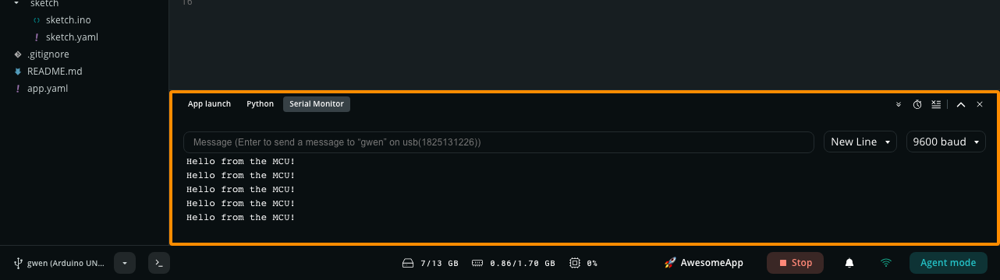

Develop Apps in Arduino App Lab by managing your project files, configuring optional Bricks, and writing your core Python logic.

## Project Files

An Arduino App is organized into a main logic layer, along with an optional real-time layer:

- **`python/main.py`**: Mandatory. The entry point for the high-level application logic running on Linux.
- **`sketch/sketch.ino`**: Optional. The C++ sketch that runs on the board's microcontroller.
- **`README.md`**: Optional. Project documentation displayed in the App Lab UI.

App Lab also manages two configuration files: `app.yaml` (mandatory manifest for App metadata and Bricks) and `sketch/sketch.yaml` (mandatory only if a sketch is present). To learn more about the directory structure, see [About Apps](../about-apps/).

You can add any other files and folders your App needs, such as web assets, images, or data files.

### Explore and Open Files

1. [Open an App](../manage-apps/#open-an-app).
1. Find the **Files** section in the Editor sidebar.
   
1. Click on a folder to expand it. Folder contents load when you expand them.
1. **Single-click** a file to open it in **Preview Mode**. The tab title will appear italicized, and opening another file will replace this tab.
1. **Double-click** a file, or modify a previewed file, to **Pin** the tab. Pinned tabs remain open until you close them.

### Add Files or Folders

1. **Right-click** an empty area in the **Files** section, or a specific folder where you want to add the new file or folder.
1. Select one of the following:
   - **Create file**
   - **Create new folder**
   - **Import file**: Upload files from your computer. Any file type is supported.
   - **Import folder**: Upload a folder from your computer.

You can also click the **Add file** button to create a new file or folder at the same level as your current selection.

If an imported file or folder has the same name as an existing one, App Lab replaces it.

### Rename or Delete Files and Folders

1. **Right-click** on the file or folder you want to rename or delete.
1. Select one of the following:
   - **Rename**
   - **Delete**

### Moving files and folders

The file tree supports **Drag and Drop** organization. Simply click and hold a file or folder, then drag it to your desired location within the project structure.

## Editor

### Split-Panel Mode

To view two files side by side, such as `main.py` next to `sketch.ino`, or a Brick's documentation next to your code, split the editor into two panels. Use one of these methods:

- **Right-click** a file tab and select **Split Right** (or **Split Left** from the right panel).
- Drag a file tab to the right edge of the editor until a highlighted drop zone appears, then release it.
- Drag a file or Brick from the Editor sidebar into the panel where you want to open it.

To move a file between panels, drag its tab from one panel to the other. App Lab remembers the open panels and tabs of each App.

### Language Server Protocol (LSP)

Arduino App Lab includes integrated Language Server Protocol (LSP) support for Python, C++, and JavaScript/TypeScript. This provides advanced coding assistance:

- **Auto-completion**: As you type, the editor suggests functions, variables, and imported modules.
- **Syntax Diagnostics**: Errors and warnings are highlighted in real-time. Hover over highlighted code to read the error message.
- **Go to Definition**: Hold `Ctrl` (or `Cmd` on Mac) and click on a function or variable to jump directly to where it is defined. You can also right-click and select **Go to Definition**, **Go to Type Definition**, or **Go to Implementation**.
- **Find All References**: Right-click a function or variable and select **Find All References** to list every place it is used. Select a result in the **References** panel to jump to it.
- **Rename** and **Format**: Right-click to rename a symbol everywhere it is used, or to format the file.

These actions are available in Python (`.py`, `.pyi`), C/C++ (`.ino`, `.c`, `.cpp`, `.h`, `.hpp`), and JavaScript/TypeScript (`.js`, `.mjs`, `.ts`) files, such as the web front end of a WebUI Brick.

The first time you open an App, App Lab shows **Installing advanced language support** while it prepares the language servers. This may take a few minutes. While the language server starts, the status bar shows **Loading language support** with the progress. If language support is unavailable, hover over the status bar indicator to see the reason.

### Keyboard Shortcuts

| Action | macOS | Windows and Linux |
| :--- | :--- | :--- |
| Find | `⌘F` | `Ctrl+F` |
| Comment / Uncomment | `⌘/` | `Ctrl+/` |
| Go to Definition | `F12` | `F12` |
| Go to Type Definition | `⌥F12` | `Alt+F12` |
| Go to Implementation | `⌘F12` | `Ctrl+F12` |
| Find All References | `⇧F12` | `Shift+F12` |
| Rename symbol | `F2` | `F2` |
| Format file | `⇧⌥F` | `Shift+Alt+F` |
| Open or close the Agent panel | `⌘L` | `Ctrl+L` |

<Alert type="info">

**Note:** On some keyboards, you need to hold the `Fn` key to use the function keys (`F2`, `F12`).

</Alert>

## Python Development

The Python script (`main.py`) handles the high-level logic and complex processing of your application. Running in its own isolated environment on the board, it provides the power needed for tasks like running AI models, hosting web servers, or performing data analysis.

### App.run()

Every Python script **must** call `App.run()` at the very bottom of the file to start the App. This call starts every Brick you have instantiated and then keeps the App running until it is stopped. Because `App.run()` blocks, any code placed after it does not run while the App is running.

The usage of `App.run()` depends on how you want to control your App's logic:

#### With user_loop function

If you need your Python script to perform repetitive tasks or maintain its own execution flow, pass a custom function to the `user_loop` parameter. This function will be called repeatedly by the App framework.

```python
from arduino.app_utils import App
import time

def loop():
    # This logic runs repeatedly on the Linux side
    print("Performing periodic task...")
    time.sleep(10)

# Start the App and run the loop
App.run(user_loop=loop)
```

#### Without user_loop function

If **Bricks** (e.g., a Web UI with its own event loop) or the **Sketch** (via Bridge calls that trigger Python functions) handle your App's logic, you can call `App.run()` without any arguments. This starts Bricks and utilities while keeping the Python environment active in the background.

```python
from arduino.app_utils import App, Bridge
import time

def my_function():
   # This logic runs when the function is called by the microcontroller
    print("Performing task...")


# Allow the microcontroller to call "my_function"
Bridge.provide("my_function", my_function)

# Start the App (no custom loop needed)
App.run()
```

Then, you can trigger this function from your Arduino sketch (`sketch.ino`) using the Bridge library:

```cpp
Bridge.call("my_function");
```

### Add Bricks

Bricks are pre-packaged code modules that run as separate processes alongside your App. Each Brick provides a specific functionality, such as a web interface or a database, that you can interact with from your Python script.

**To use a Brick:**

1. Click the **Add Brick** button at the top of the Editor sidebar to open the Bricks catalog.
   
2. Select a Brick from the list, select **Add**, and follow the prompts to configure any required settings.
3. Arduino App Lab automatically adds the Brick configuration to your `app.yaml` file. Note that you should not manually edit the `bricks` entry in this file.
4. Review the Brick's documentation. Select **Check usage examples** in the confirmation dialog, or click the Brick in the sidebar later. The **Overview** and **Usage examples** contain the specific code needed for implementation.
5. Import and initialize the Brick in your `main.py` file.

See [Use Bricks in Your App](../../bricks/use-bricks/) for details on configuring Brick variables and AI models.

<Alert type="success">

**Tip:** Click on an added Brick in the sidebar to open its documentation.

</Alert>

### Use Python Packages

You can use external Python packages (like `numpy` or `flask`) by creating a requirements file.

**To add dependencies:**

1. In the file browser, create a new file named `requirements.txt`.
2. **Important:** Place the `requirements.txt` file inside the `python/` folder, not the root of the App.
3. List your packages (one per line) in the file. For example:

   ```text
   numpy
   requests
   ```

4. When you click **Run**, the `uv` package manager automatically installs the listed packages into the App's virtual environment. Packages are only reinstalled when `requirements.txt` changes. Installing packages requires an internet connection.

<Alert type="success">

**Tip:** To install a package that isn't available online, such as your own Python library, put its wheel file (`.whl`) in a `python-libraries/` folder in the root of your App. App Lab installs it the next time the App starts.

</Alert>

If a package is installed in a broken state, run `arduino-app-cli app clean-cache <app_path>` on the board to reset the App's virtual environment.

## Sketch Development

On your board's microcontroller, you can use an Arduino sketch (`sketch.ino`) to handle real-time interaction with hardware, such as reading sensors or controlling motors.

### Add Sketch Libraries

In Arduino App Lab, you install libraries on a per-App basis to prevent version conflicts between projects.

**To add a library:**

1. Click the **Add sketch library** button (the open book icon with a **+** sign) at the top of the Editor sidebar.
   
2. Search for the library you need (e.g., `Servo` or `OneWire`).
3. Select the desired version and click **Install**.
4. Arduino App Lab updates the `sketch.yaml` file automatically and downloads the library when you launch the App.

Libraries marked as **core library** are pre-installed on your board, such as the `Arduino_RouterBridge` library used by the Bridge. You can use them without installing them, and they cannot be removed. To remove a library you installed, select **Remove** on its card.

### Serial Monitor

Standard `Serial.print()` and `Serial.println()` commands are automatically routed to the **Serial Monitor** tab in the App Lab console.

<Alert type="info">

**Note:** As of Zephyr core 0.55.0, `Serial` commands are supported. The **Arduino_RouterBridge** library is included by default, and you no longer need to manually install or include it in your sketch. For more information, see [Migrating to Zephyr core 0.55.0 on UNO Q](https://support.arduino.cc/hc/en-us/articles/27251870677916-Migrating-to-Zephyr-core-0-55-0-on-UNO-Q)

</Alert>

**To use the Serial Monitor:**

1. Open the `sketch/sketch.ino` file.
1. Call `Serial.begin()` inside your `setup()` function.
1. Use `Serial.print()` or `Serial.println()` for logging. This example sketch prints `Hello from the MCU!` once per second:
   ```cpp
   void setup() {
     Serial.begin();
   }
   
   void loop() {
     Serial.println("Hello from the MCU!");
     delay(1000);
   }
   ```
1. When your App is running, output will appear in the **Serial Monitor** tab of the console panel at the bottom of the editor. To send text to the sketch, type it in the message field at the bottom of the tab and press **Enter**.
   

<Alert type="success">

**Tip:** You may also use the `Monitor` object directly. `Monitor.begin()`, `Monitor.print()`, and `Monitor.println()` are used in many examples.

</Alert>

## Python/Sketch Communication

The `Bridge` allows your Python script and Arduino sketch to exchange data using Remote Procedure Calls (RPC).

See [Getting Started with the Bridge](../../bridge/get-started-with-bridge/) to learn more.

## Agent Mode (AI Assistant)

Arduino App Lab includes an AI coding agent that can edit your code, add Bricks, and run your App, with your approval. Open the **AI Assistant** panel next to your code with `⌘L` (macOS) or `Ctrl+L` (Windows and Linux) to ask about the open file or your selected code. Switch to the full-screen **Agent mode** from the status bar to see all your sessions.

To learn how to install, configure, and prompt the AI, see the [Agent Mode integration guide](../../integrations/agent-mode/).

## Running and Monitoring Your App

Once your code is ready, click the **Run** button in the top right corner. The environment will compile the sketch, flash it to the microcontroller, and start the Python container.

Monitor your App using the **Console** panel at the bottom of the editor by selecting the following tabs:

- **App launch**: Compilation output and deployment logs.
- **Serial Monitor**: `Monitor.print()` or `Serial.print()` output from your Arduino sketch.
- **Python**: `print()` output from your Python script. This tab is selected automatically when you run an App.
- **Brick logs**: One tab for each Brick that runs in its own container.

See [Run and Monitor Apps](../run/) to learn more.
