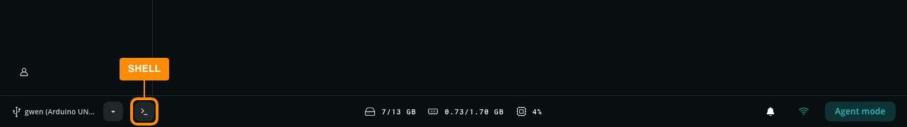
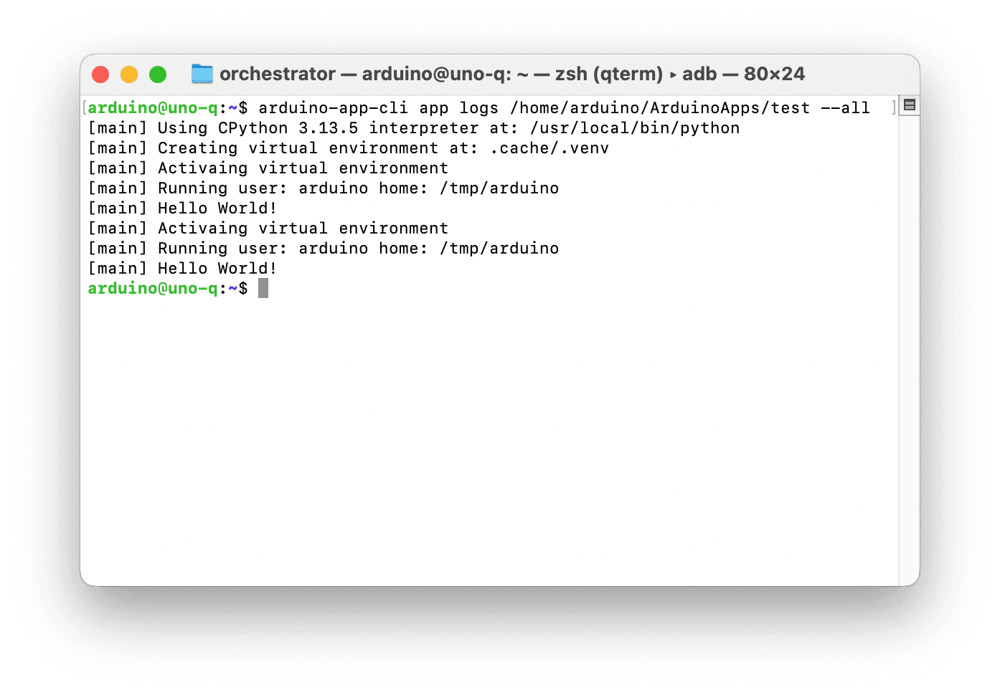
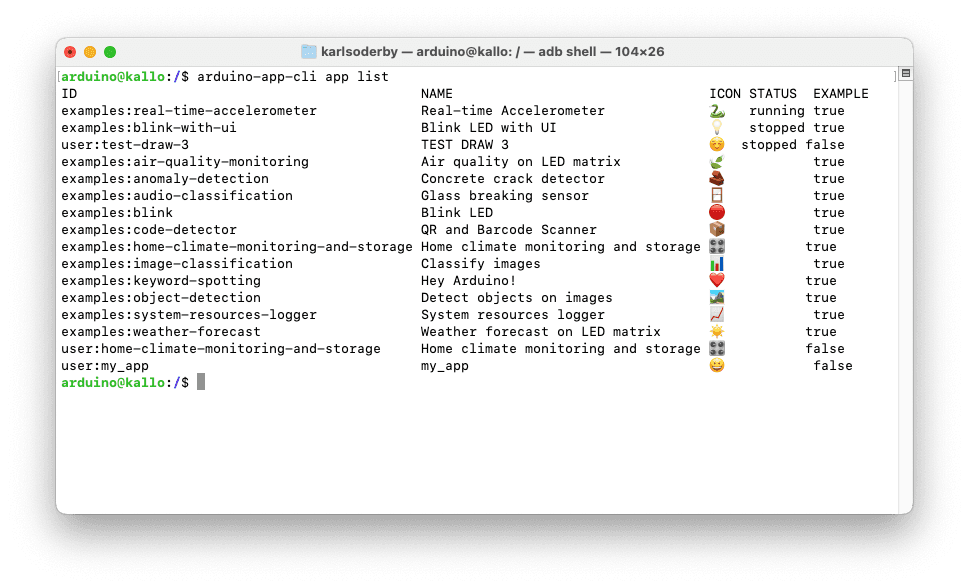
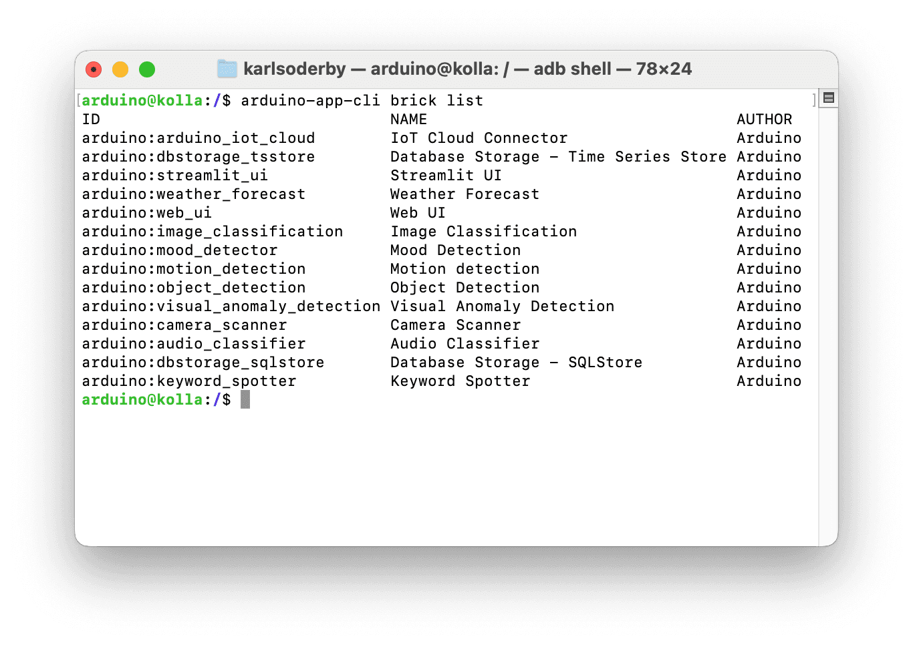

Manage your Apps through `arduino-app-cli`, the command-line engine behind Arduino App Lab. Everything App Lab does on the board, such as creating, starting, and stopping Apps, managing Bricks and AI models, and updating the system, goes through this tool. You can use it directly from the board's terminal, locally or remotely via ADB and SSH.

The `arduino-app-cli` is pre-installed on the board and updated together with the board's system. You can run it from a terminal on the board (in SBC mode) or through a shell opened from your computer (in Connected Mode, also referred to as PC-hosted mode).

## Requirements

The following hardware is required:
- [Arduino UNO Q](https://store.arduino.cc/products/uno-q) or [Arduino VENTUNO Q](https://www.arduino.cc/product-ventuno-q)
- [USB-C® type cable](https://store.arduino.cc/products/usb-cable2in1-type-c)

In Connected Mode, Arduino App Lab opens the board's shell for you, so no additional software is required. To connect manually, or to transfer files with `adb pull` and `adb push`, you also need [Android Debug Bridge](https://developer.android.com/tools/releases/platform-tools) installed. SSH is typically installed on your system by default.

## Open the Board's Shell

How you access the board's shell depends on whether you are running in Connected Mode or SBC Mode:

### Connected Mode (PC-Hosted)

When using the board in Connected Mode (PC-hosted) with Arduino App Lab running on your computer, App Lab can open a shell on the board directly from its interface without manually configuring `adb` or `ssh`:

1. Connect your board and make sure it is selected in the footer status bar.
2. Select the **Connect to the board's shell** button (terminal icon) next to the board name.

   

3. A terminal window opens on your computer, already logged in on the board as the `arduino` user.
4. Run the commands you need on the board. To close the session, type `exit`.

Arduino App Lab selects the connection method based on how the board is connected:

- **USB mode**: the shell is opened over ADB (Android Debug Bridge). No password is required.
- **Network mode**: the shell is opened over SSH. Provide the board password you set during the first setup.

<Alert type="info">

**Note:** To open the board's shell manually, or from a computer without Arduino App Lab, see the [Connect to UNO Q via ADB](/tutorials/uno-q/adb/) and [Connect to UNO Q via Secure Shell (SSH)](/tutorials/uno-q/ssh/) tutorials.

</Alert>

### SBC Mode (Standalone)

When using the board in [Single-Board Computer (SBC) mode](/tutorials/uno-q/debian-guide/#through-sbc-mode) with a monitor, keyboard, and mouse connected:

1. Open the application menu on the desktop.
2. Select **Applications > Terminal Emulator**.

A terminal window will open on the desktop where you can run `arduino-app-cli` and other Linux commands directly on the board.

## Quick Reference

| Task | Command |
| :--- | :--- |
| Create an App | `arduino-app-cli app new "my-app"` |
| List your Apps | `arduino-app-cli app list` |
| Show running Apps | `arduino-app-cli app ps` |
| Start an App | `arduino-app-cli app start user:my-app` |
| Stop an App | `arduino-app-cli app stop user:my-app` |
| Follow an App's logs | `arduino-app-cli app logs user:my-app --follow` |
| Run an App at startup | `arduino-app-cli properties set default user:my-app` |
| Build a release | `arduino-app-cli app build user:my-app` |
| Install a release | `arduino-app-cli app install my-app.ard` |
| List Bricks | `arduino-app-cli brick list` |
| List AI models | `arduino-app-cli model list` |
| Update the system | `arduino-app-cli system update` |
| Free disk space | `arduino-app-cli system cleanup` |

To see all available commands, run `arduino-app-cli --help`. Add `--help` to any command for details, for example `arduino-app-cli app start --help`. For the complete list of commands and options, see the [Commands reference](../commands/).

## Refer to Apps

Commands that act on an App accept either the path to the App folder or an App ID:

| App ID | Refers to | Location on the board |
| :--- | :--- | :--- |
| `user:<name>` | Your Apps | `/home/arduino/ArduinoApps/<name>` |
| `examples:inspirational/<name>` | Built-in Inspirations, such as `examples:inspirational/blink` | `/var/lib/arduino-app-cli/examples/inspirational/common/` or `.../platform_<board>/` |
| `examples:core-and-foundational/<category>/<name>` | Built-in foundational examples | `/var/lib/arduino-app-cli/examples/core-and-foundational/` |
| `release:<name>` | Installed App releases | `/var/lib/arduino-app-cli/releases/<name>` |

For example, these two commands start the same App:

```sh
arduino-app-cli app start user:test
arduino-app-cli app start /home/arduino/ArduinoApps/test
```

Use `arduino-app-cli app list --all` to see the ID of every App on the board.

## Create and Edit Apps

### Create an App

To create an App, use the `app new` command:

```sh
arduino-app-cli app new "test"
```

This creates an App at `/home/arduino/ArduinoApps/test`, with the `app.yaml` file and the `python` and `sketch` folders. Useful options:

- `--bricks arduino:web_ui`: Add Bricks to the new App.
- `--no-sketch`: Create a Python-only App without a sketch.
- `--from-app examples:inspirational/blink`: Start from a copy of an existing App, example, or release.

### Edit an App

If you are using the board with a monitor, keyboard & mouse, you can open the files in a code editor, such as *Vim*, *gedit* or *Sublime*.

If you are accessing the board via `adb`, you can **pull** and **push** the files/folder from your host computer.

To pull the file, use:

```sh
adb pull /home/arduino/ArduinoApps /path/to/localfolder
```

And to push it, use:

```sh
adb push /path/to/localfolder /home/arduino/ArduinoApps
```

<Alert type="info">

**Note:** You may need to give permission rights to the `ArduinoApps` folder. This can be done by running `adb shell chown -R arduino:arduino /home/arduino/ArduinoApps`.

</Alert>

## Run and Monitor Apps

### Start and Stop Apps

Once an App is created and edited, launch it with the following command:

```sh
arduino-app-cli app start user:test
```

The first start of an App can take longer, because the board downloads the containers and AI models the App needs. Add `--verbose` to see the progress.

To stop the App, use:

```sh
arduino-app-cli app stop user:test
```

To stop and start an App again in one step, use `app restart`.

### Read App Logs

To read the Python logs of an App, use the `logs` command. Add `--follow` to keep printing new logs as they arrive:

```sh
arduino-app-cli app logs user:test --follow
```

This will list the logs of the App:



To read the output of the sketch running on the microcontroller, attach to the serial monitor:

```sh
arduino-app-cli monitor
```

### List Apps and Their Status

To list the Apps on the board, use the `app list` command:

```sh
arduino-app-cli app list
```

This lists your Apps and the App releases installed on the board. Add `--examples` to list the example Apps, `--releases` to list only installed releases, or `--all` to list everything.

To see the live status of Apps on the board (starting, running, stopping, or failed), use the `app ps` command. Add `--all` to also include stopped Apps:

```sh
arduino-app-cli app ps
```

To see which network ports an App exposes, for example to open its web interface, use `app ports`:

```sh
arduino-app-cli app ports user:test
```

<Alert type="info">

**Note:** In Arduino App CLI versions earlier than 0.14, `app list` shows all Apps, including examples, together with their status:



</Alert>

### Run an App at Startup

To start an App automatically every time the board boots, set it as the default App:

```sh
arduino-app-cli properties set default user:test
```

To check the current default App, run `arduino-app-cli properties get default`. To disable it, run `arduino-app-cli properties set default none`.

## Build and Install App Releases

An App release is a packaged, read-only version of an App, saved as an `.ard` file. It runs exactly as it did when you created it, on any board of the same type. To build a release from an App, use the `app build` command:

```sh
arduino-app-cli app build user:test --release-label 1.0 -o test-1.0.ard
```

The release is built for the board running the command. Use `--target unoq` or `--target ventunoq` to build for a different board, and `--include-data` to include the App's `data` folder.

To install a release on the board, use the `app install` command. The command also downloads the containers and AI models the release needs:

```sh
arduino-app-cli app install /path/to/release.ard
```

Add `--no-prepare` to install the release without downloading its dependencies. This only postpones the download: they are downloaded the first time you start the release. `app start --no-prepare` starts an App only if its containers and models are already on the board, and fails otherwise.

See the [Commands reference](../commands/) for all options, and [Create an App Release](../../apps/manage-apps/#create-an-app-release) to create releases from App Lab.

## Bricks

To list the Bricks available on the board, or show the details of a Brick:

```sh
# List the Bricks available on the board
arduino-app-cli brick list
# Show the details of a specific Brick
arduino-app-cli brick details arduino:<brick>
```

Which will show something akin to:



To set the variables or the AI model of a Brick in an App, use `app brick config` with `name=value` pairs:

```sh
# Set a Brick variable
arduino-app-cli app brick config user:test arduino:cloud_llm API_KEY=<your-key>

# Select the AI model of a Brick
arduino-app-cli app brick config user:test arduino:llm --model <model_id>
```

An empty value (`NAME=`) clears a variable. In an installed release, only secret variables can be changed.

## AI Models

Use the `model` command to manage the AI models stored on the board:

```sh
# List the models available for this board
arduino-app-cli model list

# Install a model from the catalog
arduino-app-cli model install <model_id>

# Install a GGUF language model from Hugging Face
arduino-app-cli model install llamacpp:unsloth/Qwen3.5-0.8B-GGUF

# Delete a model
arduino-app-cli model delete <model_id>
```

For Hugging Face models, use the format `llamacpp:owner/repo`, optionally followed by `:quant` to choose a specific quantization. See [AI Models](../../integrations/models/) for more information.

## System Configuration and Updates

The `system` command allows you to manage system configurations and updates on your board.

To check for updates, run:

```sh
arduino-app-cli system update
```

This will prompt you to install any available updates. Add `--yes` to confirm automatically.

To set the board name, use:

```sh
arduino-app-cli system set-name "my-board"
```

To enable, disable, or check the network mode, use:

```sh
arduino-app-cli system network-mode enable
arduino-app-cli system network-mode disable
arduino-app-cli system network-mode status
```

Network mode enables SSH and allows App Lab and other clients to connect to the board over the local network.

To change the keyboard layout, run `arduino-app-cli system keyboard <layout>`. Run it without a layout to see the current one.

To verify that the board provides what Apps need, run:

```sh
arduino-app-cli system check
```

Finally, you can gain back some storage space by cleaning up unused containers and images by running:

```sh
arduino-app-cli system cleanup
```

## Scripting with JSON Output

Every command accepts the global `--format` option. Use `--format json` to get machine-readable output for scripts:

```sh
arduino-app-cli app ps --format json
```

To troubleshoot a command, add `--log-level debug` to print detailed logs.

## Summary

This article covers some important commands & usage of the `arduino-app-cli`, which allows you to manage Apps on your board without the graphical interface.

More documentation for the Arduino App Lab is available at:
- [Arduino App CLI Commands reference](../commands/)
- [Arduino App Lab Documentation](https://docs.arduino.cc/software/app-lab/)

You can also visit the [Arduino® UNO Q](/hardware/uno-q) hardware page for details on the board.

<!-- markdownlint-disable-file -->
