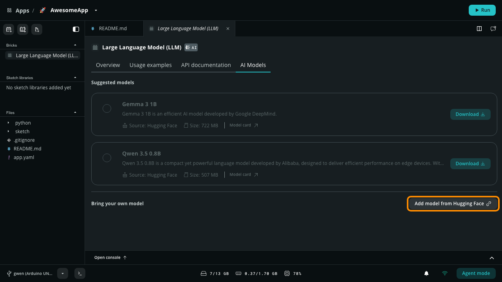
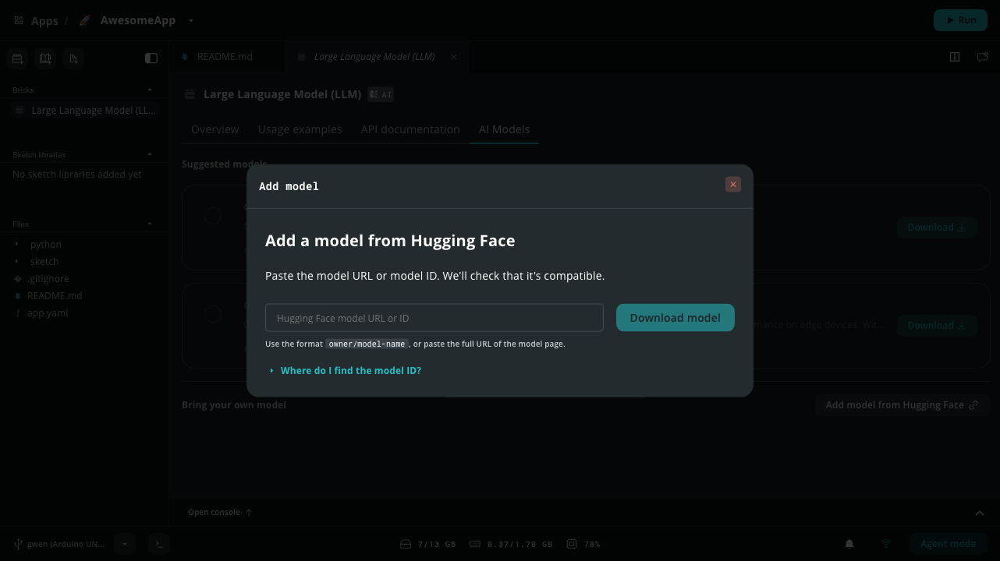

AI-powered Bricks, such as **Video Object Detection** or **Large Language Model (LLM)**, run an AI model on your board. App Lab provides a catalog of ready-to-use models for each Brick, and you can add your own models from Edge Impulse or Hugging Face.

## Use a Model with a Brick

1. [Open an App](../../apps/manage-apps/#open-an-app) that uses an AI Brick, and select the Brick in the **Bricks** section of the Editor sidebar.
2. Open the **AI Models** tab. The **Suggested models** section lists the models compatible with the Brick and your board.
3. Select **Download** on a model card to download it to your board. The card shows **Installed** when the download completes.
4. Select the model you want the Brick to use. The selected model is marked **Model in use**.

<Alert type="info">

**Note:** Models are stored on the board and shared between Apps. They can take up a lot of storage, so check **Disk storage** in [Settings](../../configure/settings/#device-details) before downloading large models. Models can't be changed in built-in examples; select **Copy and edit App** first.

</Alert>

## Add Your Own Models

Under **Bring your own model** in the **AI Models** tab, you can add models that are not in the catalog:

- **Train new AI Model on Edge Impulse**: Train a model on your own data for vision, audio, and sensor Bricks. See [Custom AI Models](../ai-models/).
- **Add model from Hugging Face**: Download a language model for the LLM Brick. See [Add Models from Hugging Face](#add-models-from-hugging-face).

The options shown depend on the Brick.

## Add Models from Hugging Face

You can download an existing language model from [Hugging Face](https://huggingface.co/models) and use it with the LLM Brick, without training one.

<Alert type="note">

**Important:** This feature is only available for the **Large Language Model (LLM)** Brick (`arduino:llm`).

</Alert>

To add a model:

1. Ensure your App includes the **Large Language Model (LLM)** Brick.
2. Select the Brick in the **Bricks** section of the editor sidebar and open the **AI Models** tab.
3. Under **Bring your own model**, click **Add model from Hugging Face**.
   
4. Enter the model ID in the format `owner/model-name` (e.g., `unsloth/Qwen3.5-0.8B-GGUF`), or paste the full URL of the model page. You can also paste the URL of a specific `.gguf` file from the **Files and versions** tab of the model repository.
   
5. Click **Download model**. App Lab checks that the model is compatible, selects a suitable quantization if the repository contains several, downloads the model to your board, and selects it for the Brick.

<Alert type="success">

**Tip:** To find a model ID, open the model on [huggingface.co/models](https://huggingface.co/models) and click the copy icon next to the model name at the top of the page.

</Alert>

Models must be in the GGUF format used by llama.cpp. Choose a model that fits your board's memory: the built-in language models for the UNO Q have about 1 billion parameters or fewer. App Lab checks that the board has enough free storage before downloading.

You can also install Hugging Face models from the board's terminal with [`arduino-app-cli model install`](../../cli/commands/#model-install), using a llama.cpp ID with a quantization, such as `llamacpp:unsloth/Qwen3.5-0.8B-GGUF:Q4_K_M`, or the repository alone, such as `unsloth/Qwen3.5-0.8B-GGUF`, to let the board choose the quantization.

## Manage Models from the Terminal

On the board, use the `model` commands of the [Arduino App CLI](../../cli/cli/):

```bash
# List the models available for your board
arduino-app-cli model list

# Install a model from the catalog, by ID
arduino-app-cli model install <model_id>

# Delete a model you no longer need
arduino-app-cli model delete <model_id>
```

## Model Catalog

The following tables list the models App Lab offers, grouped by capability. Some come pre-installed on the board; the others are downloaded when you select **Download** or run an App that uses them. The **Boards** column shows the boards each model runs on: models marked **Unrestricted** run on every supported board, and VENTUNO Q versions are optimized for its NPU.

<!-- app-lab-models table start -->
### Vision

Camera-in models: detection, classification and anomaly spotting over image or video streams.

| Model | Boards | Description | Source |
| :--- | :--- | :--- | :--- |
| Concrete crack anomaly detection | UNO Q | Anomaly detection model to identify cracks in concrete structures. | [Edge Impulse](https://studio.edgeimpulse.com/public/800941/live) |
| Concrete crack anomaly detection - High resolution | VENTUNO Q | Anomaly detection model to identify cracks in concrete structures with higher resolution input images for improved accuracy. This version of the model is optimized for NPU acceleration on supported devices, providing faster inference times while maintaining accuracy. | [Edge Impulse](https://studio.edgeimpulse.com/public/906179/live) |
| Desk Items Detector | Unrestricted | A tiny computer vision model optimized for real-time detection of common objects found in a desk or office environment. | [Edge Impulse](https://studio.edgeimpulse.com/public/995296/live) |
| General purpose image classification | Unrestricted | General purpose image classification model based on MobileNetV2. This model is trained on the ImageNet dataset and can classify images into 1000 categories. | [Edge Impulse](https://studio.edgeimpulse.com/public/708500/live) |
| General purpose object classification - EfficientNet-B4 | VENTUNO Q | EfficientNetB4 is a machine learning model that can classify images from the Imagenet dataset. It can also be used as a backbone in building more complex models for specific use cases. This version of the model is optimized for NPU acceleration on supported devices, providing faster inference times while maintaining accuracy. | [Edge Impulse](https://studio.edgeimpulse.com/public/948887/live) |
| General purpose object detection - YoloX nano | UNO Q | General purpose object detection model based on YoloX-Nano. This model is trained on the COCO dataset and can detect 80 different object classes. | [Edge Impulse](https://studio.edgeimpulse.com/public/717280/live) |
| General purpose object detection - YoloX nano | VENTUNO Q | General purpose object detection model based on YoloX-Nano. This model is trained on the COCO dataset and can detect 80 different object classes. This version of the model is optimized for NPU acceleration on supported devices, providing faster inference times while maintaining accuracy. | [Edge Impulse](https://studio.edgeimpulse.com/public/717280/live) |
| General purpose object detection - YoloX small | VENTUNO Q | General purpose object detection model based on YoloX-Small. This model is trained on the COCO dataset and can detect 80 different object classes. This version of the model is optimized for NPU acceleration on supported devices, providing faster inference times while maintaining accuracy. | [Edge Impulse](https://studio.edgeimpulse.com/public/1014102/live) |
| Hand gestures | Unrestricted | A lightweight vision model that detects four hand gestures: neutral fist, open hand (five), V-sign (peace), and thumbs-up (good). | [Edge Impulse](https://studio.edgeimpulse.com/public/842271/live) |
| Lightweight-Face-Detection | UNO Q | A small and accurate model for detecting bounding boxes for faces in images. | [Qualcomm AI Hub](https://aihub.qualcomm.com/models/face_det_lite) |
| Lightweight-Face-Detection | VENTUNO Q | A small and accurate model for detecting bounding boxes for faces in images. This version of the model is optimized for NPU acceleration on supported devices, providing faster inference times while maintaining accuracy. | [Qualcomm AI Hub](https://aihub.qualcomm.com/models/face_det_lite) |
| MediaPipe Hand-Gesture Recognition | Unrestricted | The MediaPipe Gesture Recognizer is a real-time machine learning pipeline that detects hands, predicts 21 hand landmarks, determines handedness (left/right), and classifies gestures from a predefined set. | [Qualcomm AI Hub](https://aihub.qualcomm.com/models/mediapipe_hand_gesture) |
| Person classification | Unrestricted | Person classification model based on WakeVision dataset. This model is trained to classify images into two categories: person and not-person. | [Edge Impulse](https://studio.edgeimpulse.com/public/755016/live) |
| PoseNet MobileNet Pose Estimation | Unrestricted | PoseNet performs real-time multi-person pose estimation, detecting up to 10 people per frame and locating 17 body keypoints (nose, eyes, ears, shoulders, elbows, wrists, hips, knees, ankles) for each person. | [Qualcomm AI Hub](https://aihub.qualcomm.com/models/posenet_mobilenet) |

### Audio & speech

Microphone-in models: wake words, sound classification, transcription and synthesis.

| Model | Boards | Description | Source |
| :--- | :--- | :--- | :--- |
| Glass breaking classifier | Unrestricted | A glass breaking classifier model to detect glass breaking sounds in audio recordings | [Edge Impulse](https://studio.edgeimpulse.com/public/749446/live) |
| Keyword spotting - Hey Arduino! | Unrestricted | A keyword-spotting model to detect the 'Hey Arduino!' in audio streams. | [Edge Impulse](https://studio.edgeimpulse.com/studio/757509/live) |
| Melo TTS (Chinese) | VENTUNO Q | MeloTTS is a high-quality multi-lingual text-to-speech library - Chinese version. | [Qualcomm AI Hub](https://aihub.qualcomm.com/models/melotts_zh) |
| Melo TTS (English) | VENTUNO Q | MeloTTS is a high-quality multi-lingual text-to-speech library - English version. | [Qualcomm AI Hub](https://aihub.qualcomm.com/models/melotts_en) |
| Melo TTS (Spanish) | VENTUNO Q | MeloTTS is a high-quality multi-lingual text-to-speech library - Spanish version. | [Qualcomm AI Hub](https://aihub.qualcomm.com/models/melotts_es) |
| Piper TTS (English) | VENTUNO Q | Piper is a high-quality multi-lingual text-to-speech library - English version. | [Qualcomm AI Hub](https://aihub.qualcomm.com/models/pipertts_en) |
| Piper TTS (German) | VENTUNO Q | Piper is a high-quality multi-lingual text-to-speech library - German version. | [Qualcomm AI Hub](https://aihub.qualcomm.com/models/pipertts_de) |
| Piper TTS (Italian) | VENTUNO Q | Piper is a high-quality multi-lingual text-to-speech library - Italian version. | [Qualcomm AI Hub](https://aihub.qualcomm.com/models/pipertts_it) |
| Whisper Small (quantized) | VENTUNO Q | Whisper ASR (Automatic Speech Recognition) model is a state-of-the-art system designed for transcribing spoken language into written text. This model is based on the transformer architecture and has been optimized for edge inference by replacing Multi-Head Attention (MHA) with Single-Head Attention (SHA) and linear layers with convolutional (conv) layers. It exhibits robust performance in realistic, noisy environments, making it highly reliable for real-world applications. Specifically, it excels in long-form transcription, capable of accurately transcribing audio clips up to 30 seconds long. | [Qualcomm AI Hub](https://aihub.qualcomm.com/models/whisper_small_quantized) |

### Language

Generative models running on-device through Genie or llama.cpp.

| Model | Boards | Description | Source |
| :--- | :--- | :--- | :--- |
| Gemma 3 1B | VENTUNO Q, UNO Q | Gemma 3 1B is an efficient AI model developed by Google DeepMind. | [Hugging Face](https://huggingface.co/unsloth/gemma-3-1b-it-GGUF) |
| Gemma 4 E2B | VENTUNO Q | Gemma 4 E2B is an efficient, open AI model developed by Google DeepMind. Activating an effective two billion parameters, it is engineered specifically for mobile and edge devices. It's optimized for offline agentic workflows. | [Hugging Face](https://huggingface.co/google/gemma-4-E2B-it-qat-q4_0-gguf) |
| Gemma 4 E4B | VENTUNO Q | Gemma 4 E4B is an efficient, open AI model developed by Google DeepMind. Activating an effective four billion parameters, it is engineered specifically for mobile and edge devices. It's optimized for offline agentic workflows. | [Hugging Face](https://huggingface.co/google/gemma-4-E4B-it-qat-q4_0-gguf) |
| Qwen 2.5-VL-7B VLM | VENTUNO Q | Qwen2.5-VL 7B is a multimodal vision-language model with 7 billion parameters that can process both images and text, enabling visual question answering, image description, and other vision-language tasks. | [Qualcomm AI Hub](https://aihub.qualcomm.com/models/qwen2_5_vl_7b_instruct) |
| Qwen 3-4B Instruct | VENTUNO Q | The Qwen3-4B is a state-of-the-art multilingual base language model with 4 billion parameters, excelling in language understanding, generation, coding, and mathematics. This version of the model has been tuned as instruct model, optimized for following human instructions and providing detailed responses.  It is ideal for applications such as chatbots, virtual assistants, and any use case that benefits from a more conversational and responsive AI. | [Qualcomm AI Hub](https://aihub.qualcomm.com/models/qwen3_4b_instruct_2507) |
| Qwen 3-VL-4B VLM | VENTUNO Q | Qwen3-VL 4B is a vision-language model from Alibaba Cloud capable of understanding both text and images for multimodal reasoning tasks such as visual question answering and image captioning. | [Qualcomm AI Hub](https://aihub.qualcomm.com/models/qwen3_vl_4b_instruct) |
| Qwen 3-VL-8B VLM | VENTUNO Q | Qwen3-VL 8B is a vision-language model from Alibaba Cloud capable of understanding both text and images for multimodal reasoning tasks such as visual question answering and image captioning. | [Qualcomm AI Hub](https://aihub.qualcomm.com/models/qwen3_vl_8b_instruct) |
| Qwen 3.5 0.8B | VENTUNO Q, UNO Q | Qwen 3.5 0.8B is a compact yet powerful language model developed by Alibaba, designed to deliver efficient performance on edge devices. With 0.8 billion parameters, it strikes a balance between capability and resource efficiency, making it ideal for applications that require natural language understanding and generation in constrained environments. | [Hugging Face](https://huggingface.co/unsloth/Qwen3.5-0.8B-GGUF) |

### Sensor

Models over accelerometer and vibration data, no camera or microphone required.

| Model | Boards | Description | Source |
| :--- | :--- | :--- | :--- |
| Continuous motion detection | Unrestricted | A motion detection model designed to identify up/down, wave, and snake movements evalauting accelerometer data. | [Edge Impulse](https://studio.edgeimpulse.com/public/734960/live) |
| Fan anomaly detection | Unrestricted | An anomaly detection model designed to identify anomalies in fan operation. | [Edge Impulse](https://studio.edgeimpulse.com/public/774707/live) |
<!-- app-lab-models table end -->
