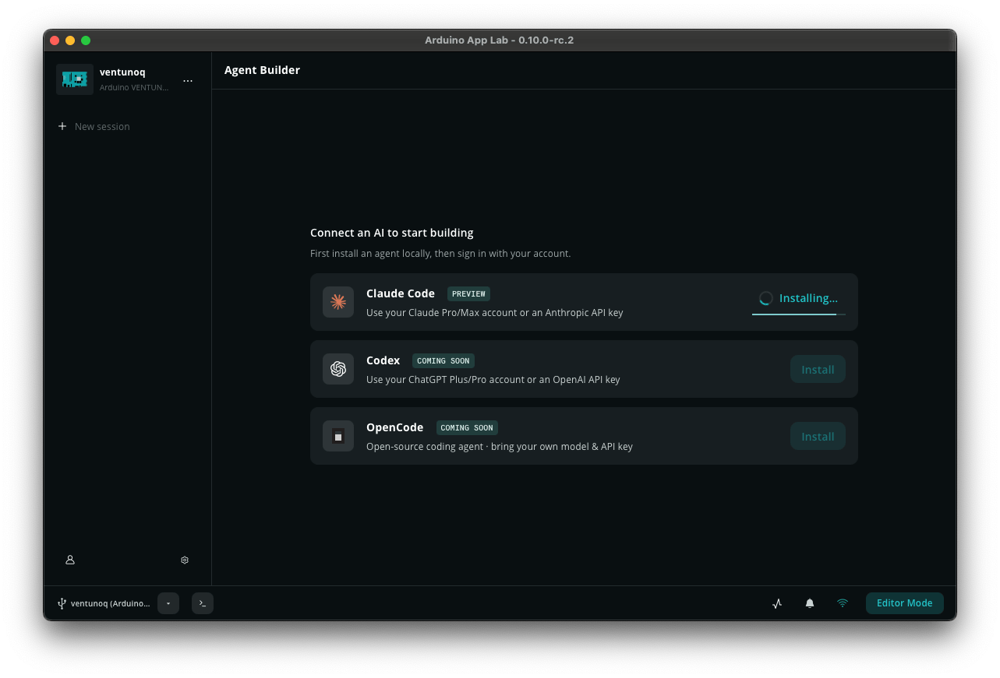
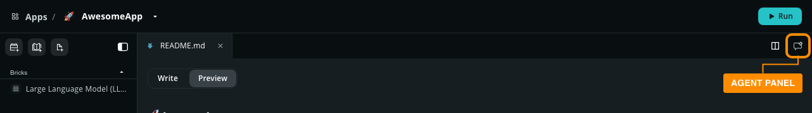
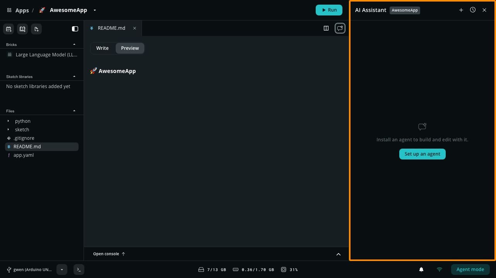
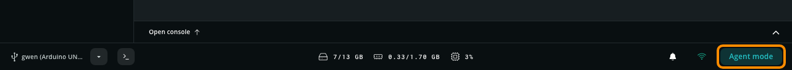

**Agent Mode** brings an AI coding agent into Arduino App Lab. Describe what you want to build, and the agent scaffolds Apps, edits Python and sketch code, adds Bricks and AI models, runs your App, and reads its logs, all without leaving App Lab. Every action that changes your board or your files waits for your approval.

Currently, **Claude Code™** (by Anthropic) is supported as a **Preview**. Codex and OpenCode are listed as **Coming soon**.

## Requirements

- A [Claude Pro or Max](https://claude.com/pricing) subscription, or an [Anthropic API key](https://platform.claude.com/settings/keys).
- An internet connection. The agent runs where App Lab runs (normally your computer) and uses your own Claude account. Arduino does not host the model, and usage counts against your Claude plan or API billing.

## Set Up the Agent

1. Select **Settings** (gear icon) in the left sidebar and scroll down to the **Agent** section.

   You can also select **Set up an agent** in the Agent panel, or select the **Agent mode** button in the status bar.
2. Select **Install** on the **Claude Code** card. App Lab downloads the agent runtime (Node.js and the Claude Code packages) to your computer. Nothing is installed on the board.
3. Select **Connect**, then sign in using one of the two tabs:
   - **Sign in**: Select **Sign in with Anthropic**. Your browser opens the Anthropic sign-in page. When the page shows a sign-in token, copy it, paste it in the **Paste token** field in App Lab, and confirm. If the browser does not open, select **Copy link** and open the link manually.
   - **API Key**: Paste your Anthropic API key and select **Verify**.
4. When the card shows **Connected**, the agent is ready.

<Alert type="info">

**Note:** Your Claude credentials are handled by the Claude Code sign-in flow and are not stored by App Lab. To sign out, select **Manage** on the agent card and then **Disconnect**.

</Alert>

## Open the Agent

You can work with the agent in two views. Both use the same sessions, so you can switch between them at any time.

### Agent Panel in the Editor

To chat with the agent while keeping your code visible, open the **AI Assistant** panel next to the editor:

- Press **⌘L** (macOS) or **Ctrl+L** (Windows and Linux). Press it again to close the panel.
- Or select the **Agent panel** button in the top-right corner of the editor tabs bar.

The panel works on the App that is open in the editor. Its header shows the App name and buttons to start a **New chat**, open the **Sessions history** for this App, and **Close** the panel.

When you send a prompt from the panel, the agent also receives the file that is open in the editor (including unsaved changes) and the lines you have selected. You can ask about "this function" or "the selected code" without pasting it.

<Alert type="info">

**Note:** The Agent panel is not available in read-only Apps, such as built-in examples and installed [App releases](../../apps/manage-apps/#install-an-app-release). Select **Copy and edit App** to create an editable copy first.

</Alert>

### Full-Screen Agent Mode

Select the **Agent mode** button in the bottom-right corner of the status bar to switch the whole window to the agent view. This view shows all your sessions, grouped by App, in a sidebar on the left.

To return to the editor, select **Editor mode** in the same place. The agent keeps working in the background while you switch views.

## What the Agent Can Do

The agent works through a set of tools that App Lab provides for your board. With these tools, the agent can:

- **Read and edit App files**: The agent edits a local copy of your App on your computer, and App Lab syncs the changes to the board at the end of each turn.
- **Manage Apps**: List, create, duplicate, rename, start, and stop Apps, and read their logs.
- **Manage Bricks, models, and libraries**: Add, configure, and remove Bricks, install AI models, and add or remove sketch libraries.
- **Check the board**: Read the board status, system resources, and Wi-Fi status. To connect to a new Wi-Fi network, the agent opens the App Lab Wi-Fi dialog, and you type the password yourself.
- **Run shell commands on the board**: As a last resort, for example to install a package. Commands run on the board, never on your computer.

The agent cannot export or import Apps, see your passwords, or read the values of secret Brick variables.

## Approve Agent Actions

Actions that only read information run without asking. Any action that changes your files, your Apps, or your board shows an **Allow the agent to do this?** card in the chat, with these options:

- **Allow once**: Run this action now.
- **Always allow**: Run this action now and allow the same action again in this App without asking.
- **Reject**: Skip this action. The agent receives your answer and can try a different approach.

The agent waits until you answer. If you stop the agent's turn, pending requests are cancelled. Shell commands always ask for approval, show the exact command and the agent's reason, and cannot be set to **Always allow**.

Actions that affect an App other than the one the session works on show an **Outside this app** badge, and previous **Always allow** answers don't apply to them.

## Choose a Mode and a Model

Use the **Mode** and **Model** pickers in the prompt area of the chat to adjust the current session:

- **Mode** controls how much the agent asks before acting:
  - **Default**: Asks for approval before changing anything.
  - **Accept Edits**: Applies file edits without asking. Other actions still ask.
  - **Plan Mode**: Explores and proposes a plan without changing anything. When the plan is ready, review it and choose whether to proceed.
  - **Don't Ask**: Never asks. Actions that you have not already allowed are rejected.
  - **Bypass Permissions**: Skips all approval checks. Use with caution.
- **Model** selects the Claude model. Larger models (Opus) are more thorough; smaller models (Sonnet, Haiku) are faster and use fewer tokens.

The modes and models offered come from Claude Code and can change when the agent runtime is updated.

## Sessions

Each conversation with the agent is a **session**. A session belongs to one App, which is shown next to the session title. Sessions that are not tied to an App are listed under **Arduino Apps**.

- **Start a session**: Select **New session** (or **New chat** in the Agent panel). In full-screen Agent Mode, select the App to work on from the **New session in** picker.
- **Reopen a session**: Select it in the session list. The full history is restored.
- **Organize sessions**: Open the session actions menu to **Rename**, **Pin Session**, or **Delete** a session.

Sessions are stored on your computer, not on the board, and are kept per board. If you rename an App, its sessions move with it. If you delete an App, its sessions are deleted too.

## Manage the Agent

In the **Agent** section of **Settings**, you can:

- **Set as default**: Choose which installed agent App Lab uses.
- **Manage** the connection: See the sign-in method and account, or **Disconnect**.
- **Runtime & Packages**: See the installed version and disk usage, **Check for updates**, or **Uninstall** the agent runtime.

## Tips for Successful Prompting

- **Start with the goal**: Describe what you want to build at a high level, such as "An App that reads the temperature from a Modulino Thermo and shows it on a web dashboard." For larger tasks, switch to **Plan Mode** first and review the plan before the agent writes code.
- **Split work into steps**: Ask the agent to work in small, testable steps. Run the App after each step and check the result.
- **Describe problems precisely**: If something doesn't work, describe what you expected and what happened, or ask the agent to read the App logs.
- **Select code for context**: In the Agent panel, select the lines you want to discuss before sending your prompt.
- **Keep one topic per session**: Start a new session for unrelated tasks, so the agent doesn't carry over context from earlier work.

<Alert type="success">

**Tip:** Prefer to run a coding agent directly on the board instead? See [Agentic AI Development on UNO Q](/tutorials/uno-q/ai-coding-agents/).

</Alert>
