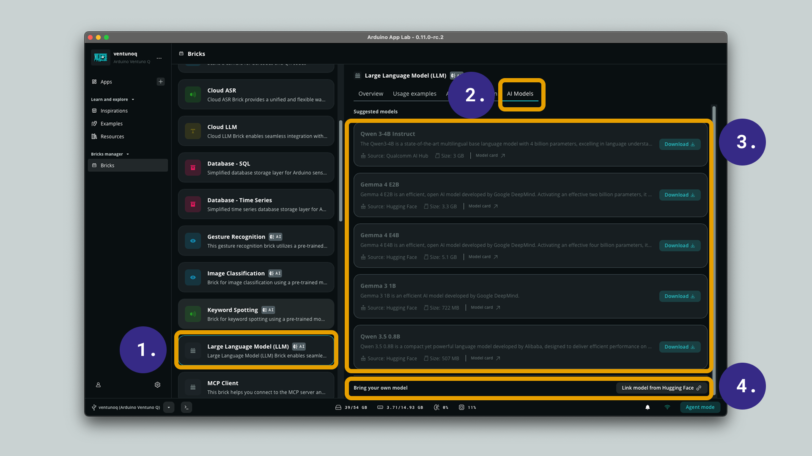
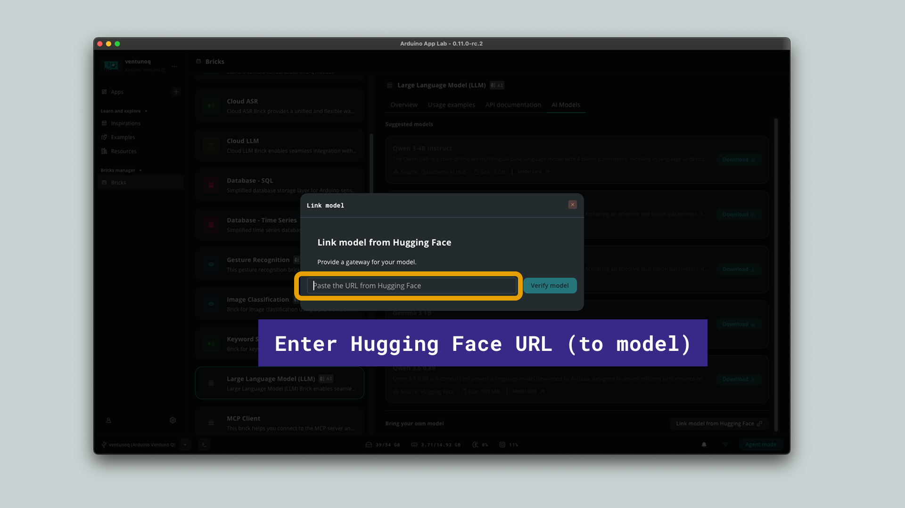

## Overview

Arduino App Lab lets you run Large Language Models (LLMs) on-device through the **Large Language Model (LLM) Brick**. In addition to the suggested models that ship with App Lab, you can bring your own model directly from [Hugging Face](https://huggingface.co/), a popular platform hosting thousands of open models.

In this tutorial, you will learn how to select a suggested model or link a custom LLM from Hugging Face to use in your own applications.

## How It Works

The **Large Language Model (LLM) Brick** runs generative models locally on your board using inference engines such as Genie or llama.cpp. From the **AI Models** tab of the Brick, you can:

- **Download a suggested model** curated by Arduino, sourced from [Hugging Face](https://huggingface.co/) or [Qualcomm AI Hub](https://aihub.qualcomm.com/).
- **Link your own model** by pasting a Hugging Face URL that points to a compatible LLM.

Suggested models are the fastest way to get started, as they are verified to run on your board. Linking your own model gives you the flexibility to experiment with the wider catalog of models available on Hugging Face.

***Only Large Language Models (LLMs) in a compatible format (such as GGUF) can be linked. Make sure the model is suitable for on-device inference before linking it.***

## Selecting a Model

To select or link a model, open the **Large Language Model (LLM) Brick** in Arduino App Lab and follow the steps below.

1. In the **Bricks** view, select the **Large Language Model (LLM)** Brick.
2. Click the **AI Models** tab.
3. Browse the **Suggested models** list and click **Download** on the model you want to use. Each entry shows its source (Hugging Face or Qualcomm AI Hub), size and a link to the model card.
4. To use a model that is not in the list, click **Link model from Hugging Face** under **Bring your own model**.

## Linking a Model from Hugging Face

When you choose to bring your own model, a **Link model** dialog appears.

1. Open [Hugging Face](https://huggingface.co/) and copy the URL of the Large Language Model (LLM) you want to use.
2. Paste the URL into the input field.
3. Click **Verify model** to validate it.

Once verified, the model becomes available in your **AI Models** list, ready to be downloaded and used in your App Lab applications just like a suggested model.

***The URL must point to a Hugging Face Large Language Model (LLM) in a compatible format. Links to other model types or incompatible formats will not be verified.***

## Conclusion

You now know how to use AI models in Arduino App Lab, both by downloading a suggested model and by linking your own Large Language Model (LLM) from [Hugging Face](https://huggingface.co/). This gives you the flexibility to explore a wide range of generative models and build AI-powered applications that run directly on your Arduino board.
